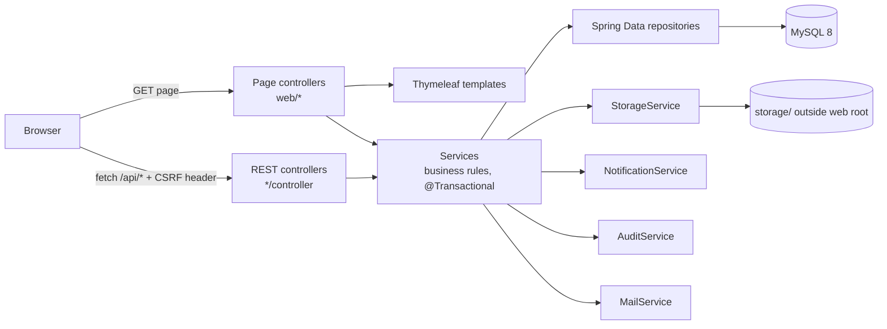
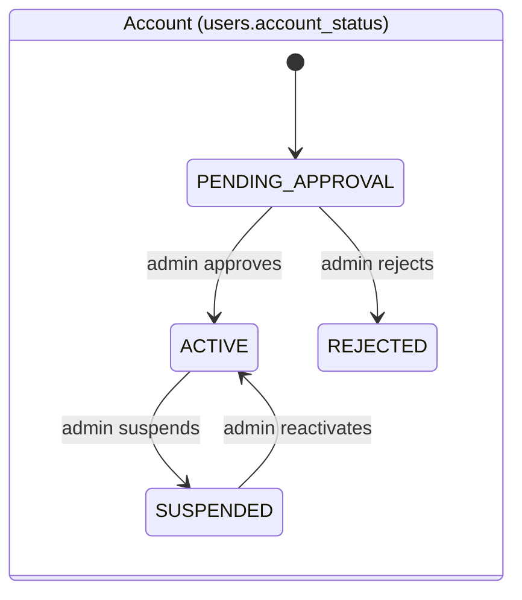
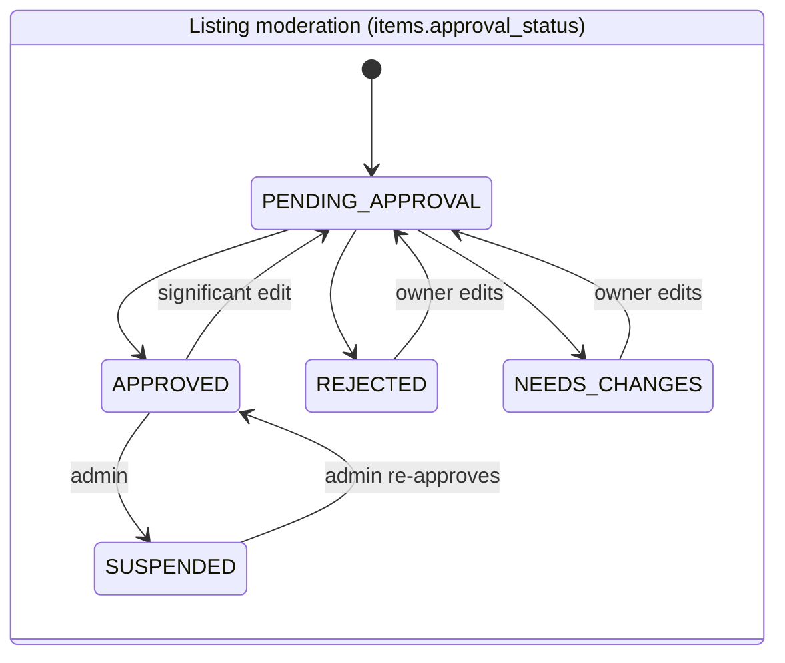
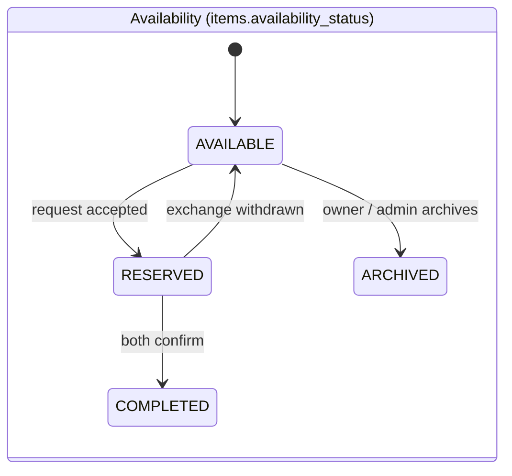
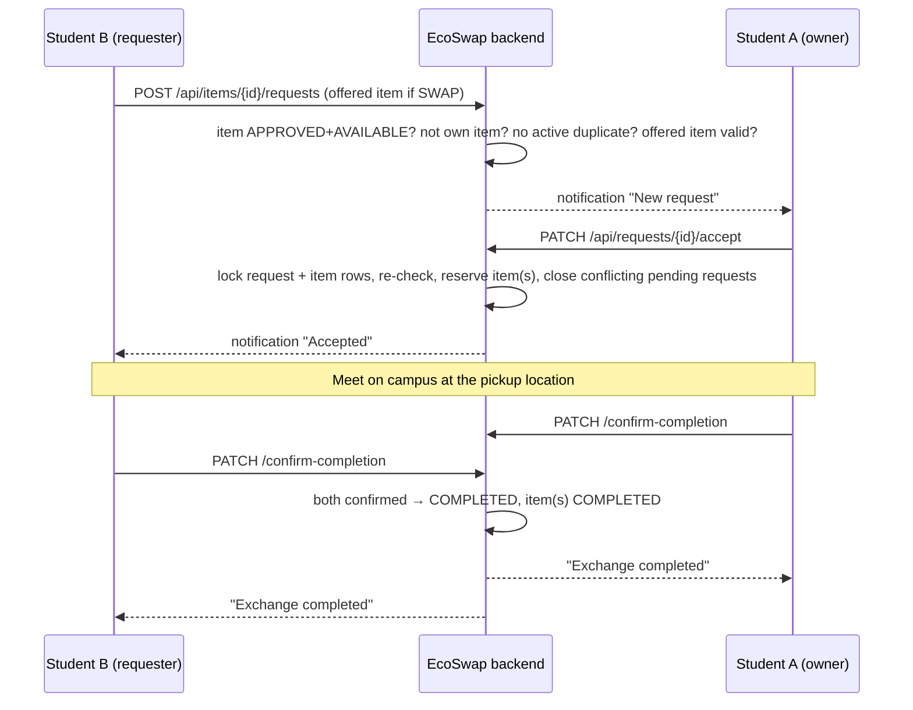

# ECOSWAP — Complete Source Code

Every text-based file of the project, complete and unabridged, grouped by area. Binary assets (images, fonts,
screenshots) are listed with their paths and descriptions and remain as individual files in the ZIP.
Text files included: 341. Generated by `scripts/build-deliverables.py`.

## Contents

- Configuration & build: 11 text files
- Database (Flyway migrations): 18 text files
- Backend (Java): 168 text files
- Frontend — Thymeleaf templates: 46 text files
- Frontend — CSS: 11 text files
- Frontend — JavaScript (ES modules): 40 text files
- Frontend — images, icons & fonts: 5 text files
- Tests: 12 text files
- Scripts: 6 text files
- Documentation: 24 text files

# Configuration & build

==================================================
FILE: .env.example
==================================================

```example
# Copy to .env and fill in real values. Never commit .env.
# --- Database (MySQL 8) ---
DB_URL=jdbc:mysql://localhost:3306/ecoswap_db?serverTimezone=UTC&characterEncoding=utf8&useSSL=false&allowPublicKeyRetrieval=true
DB_USERNAME=ecoswap
DB_PASSWORD=

# --- First administrator (created once at startup if no account with this e-mail exists) ---
ECOSWAP_ADMIN_EMAIL=
ECOSWAP_ADMIN_PASSWORD=
ECOSWAP_ADMIN_NAME=EcoSwape Administrator

# --- Application ---
SPRING_PROFILES_ACTIVE=dev
ECOSWAP_BASE_URL=http://localhost:8080
ECOSWAP_TIME_ZONE=Asia/Kuala_Lumpur
ECOSWAP_STORAGE_DIR=./storage
# Long random string; keeps "remember me" logins valid across restarts.
ECOSWAP_REMEMBER_ME_KEY=
# Comma-separated university e-mail domains allowed to register, e.g. siswa.um.edu.my,um.edu.my (empty = any)
ECOSWAP_ALLOWED_EMAIL_DOMAINS=
ECOSWAP_REQUIRE_EMAIL_VERIFICATION=false

# --- E-mail (optional). Without SPRING_MAIL_HOST, links are written to the application log instead. ---
SPRING_MAIL_HOST=
SPRING_MAIL_PORT=587
SPRING_MAIL_USERNAME=
SPRING_MAIL_PASSWORD=
SPRING_MAIL_PROPERTIES_MAIL_SMTP_AUTH=true
SPRING_MAIL_PROPERTIES_MAIL_SMTP_STARTTLS_ENABLE=true
ECOSWAP_MAIL_FROM=Eco Swape <no-reply@example.edu>

# --- Production only ---
SESSION_COOKIE_SECURE=false

# --- Tests (mvn verify) ---
TEST_DB_URL=jdbc:mysql://localhost:3306/ecoswap_test?serverTimezone=UTC&characterEncoding=utf8&useSSL=false&allowPublicKeyRetrieval=true
TEST_DB_USERNAME=ecoswap
TEST_DB_PASSWORD=
```

==================================================
FILE: .gitignore
==================================================

```text
target/
.idea/
*.iml
.vscode/
.env
storage/*
!storage/.gitkeep
*.log
```

==================================================
FILE: mvnw
==================================================

```text
#!/bin/sh
# ----------------------------------------------------------------------------
# Licensed to the Apache Software Foundation (ASF) under one
# or more contributor license agreements.  See the NOTICE file
# distributed with this work for additional information
# regarding copyright ownership.  The ASF licenses this file
# to you under the Apache License, Version 2.0 (the
# "License"); you may not use this file except in compliance
# with the License.  You may obtain a copy of the License at
#
#    http://www.apache.org/licenses/LICENSE-2.0
#
# Unless required by applicable law or agreed to in writing,
# software distributed under the License is distributed on an
# "AS IS" BASIS, WITHOUT WARRANTIES OR CONDITIONS OF ANY
# KIND, either express or implied.  See the License for the
# specific language governing permissions and limitations
# under the License.
# ----------------------------------------------------------------------------

# ----------------------------------------------------------------------------
# Apache Maven Wrapper startup batch script, version 3.3.4
#
# Optional ENV vars
# -----------------
#   JAVA_HOME - location of a JDK home dir, required when download maven via java source
#   MVNW_REPOURL - repo url base for downloading maven distribution
#   MVNW_USERNAME/MVNW_PASSWORD - user and password for downloading maven
#   MVNW_VERBOSE - true: enable verbose log; debug: trace the mvnw script; others: silence the output
# ----------------------------------------------------------------------------

set -euf
[ "${MVNW_VERBOSE-}" != debug ] || set -x

# OS specific support.
native_path() { printf %s\\n "$1"; }
case "$(uname)" in
CYGWIN* | MINGW*)
  [ -z "${JAVA_HOME-}" ] || JAVA_HOME="$(cygpath --unix "$JAVA_HOME")"
  native_path() { cygpath --path --windows "$1"; }
  ;;
esac

# set JAVACMD and JAVACCMD
set_java_home() {
  # For Cygwin and MinGW, ensure paths are in Unix format before anything is touched
  if [ -n "${JAVA_HOME-}" ]; then
    if [ -x "$JAVA_HOME/jre/sh/java" ]; then
      # IBM's JDK on AIX uses strange locations for the executables
      JAVACMD="$JAVA_HOME/jre/sh/java"
      JAVACCMD="$JAVA_HOME/jre/sh/javac"
    else
      JAVACMD="$JAVA_HOME/bin/java"
      JAVACCMD="$JAVA_HOME/bin/javac"

      if [ ! -x "$JAVACMD" ] || [ ! -x "$JAVACCMD" ]; then
        echo "The JAVA_HOME environment variable is not defined correctly, so mvnw cannot run." >&2
        echo "JAVA_HOME is set to \"$JAVA_HOME\", but \"\$JAVA_HOME/bin/java\" or \"\$JAVA_HOME/bin/javac\" does not exist." >&2
        return 1
      fi
    fi
  else
    JAVACMD="$(
      'set' +e
      'unset' -f command 2>/dev/null
      'command' -v java
    )" || :
    JAVACCMD="$(
      'set' +e
      'unset' -f command 2>/dev/null
      'command' -v javac
    )" || :

    if [ ! -x "${JAVACMD-}" ] || [ ! -x "${JAVACCMD-}" ]; then
      echo "The java/javac command does not exist in PATH nor is JAVA_HOME set, so mvnw cannot run." >&2
      return 1
    fi
  fi
}

# hash string like Java String::hashCode
hash_string() {
  str="${1:-}" h=0
  while [ -n "$str" ]; do
    char="${str%"${str#?}"}"
    h=$(((h * 31 + $(LC_CTYPE=C printf %d "'$char")) % 4294967296))
    str="${str#?}"
  done
  printf %x\\n $h
}

verbose() { :; }
[ "${MVNW_VERBOSE-}" != true ] || verbose() { printf %s\\n "${1-}"; }

die() {
  printf %s\\n "$1" >&2
  exit 1
}

trim() {
  # MWRAPPER-139:
  #   Trims trailing and leading whitespace, carriage returns, tabs, and linefeeds.
  #   Needed for removing poorly interpreted newline sequences when running in more
  #   exotic environments such as mingw bash on Windows.
  printf "%s" "${1}" | tr -d '[:space:]'
}

scriptDir="$(dirname "$0")"
scriptName="$(basename "$0")"

# parse distributionUrl and optional distributionSha256Sum, requires .mvn/wrapper/maven-wrapper.properties
while IFS="=" read -r key value; do
  case "${key-}" in
  distributionUrl) distributionUrl=$(trim "${value-}") ;;
  distributionSha256Sum) distributionSha256Sum=$(trim "${value-}") ;;
  esac
done <"$scriptDir/.mvn/wrapper/maven-wrapper.properties"
[ -n "${distributionUrl-}" ] || die "cannot read distributionUrl property in $scriptDir/.mvn/wrapper/maven-wrapper.properties"

case "${distributionUrl##*/}" in
maven-mvnd-*bin.*)
  MVN_CMD=mvnd.sh _MVNW_REPO_PATTERN=/maven/mvnd/
  case "${PROCESSOR_ARCHITECTURE-}${PROCESSOR_ARCHITEW6432-}:$(uname -a)" in
  *AMD64:CYGWIN* | *AMD64:MINGW*) distributionPlatform=windows-amd64 ;;
  :Darwin*x86_64) distributionPlatform=darwin-amd64 ;;
  :Darwin*arm64) distributionPlatform=darwin-aarch64 ;;
  :Linux*x86_64*) distributionPlatform=linux-amd64 ;;
  *)
    echo "Cannot detect native platform for mvnd on $(uname)-$(uname -m), use pure java version" >&2
    distributionPlatform=linux-amd64
    ;;
  esac
  distributionUrl="${distributionUrl%-bin.*}-$distributionPlatform.zip"
  ;;
maven-mvnd-*) MVN_CMD=mvnd.sh _MVNW_REPO_PATTERN=/maven/mvnd/ ;;
*) MVN_CMD="mvn${scriptName#mvnw}" _MVNW_REPO_PATTERN=/org/apache/maven/ ;;
esac

# apply MVNW_REPOURL and calculate MAVEN_HOME
# maven home pattern: ~/.m2/wrapper/dists/{apache-maven-<version>,maven-mvnd-<version>-<platform>}/<hash>
[ -z "${MVNW_REPOURL-}" ] || distributionUrl="$MVNW_REPOURL$_MVNW_REPO_PATTERN${distributionUrl#*"$_MVNW_REPO_PATTERN"}"
distributionUrlName="${distributionUrl##*/}"
distributionUrlNameMain="${distributionUrlName%.*}"
distributionUrlNameMain="${distributionUrlNameMain%-bin}"
MAVEN_USER_HOME="${MAVEN_USER_HOME:-${HOME}/.m2}"
MAVEN_HOME="${MAVEN_USER_HOME}/wrapper/dists/${distributionUrlNameMain-}/$(hash_string "$distributionUrl")"

exec_maven() {
  unset MVNW_VERBOSE MVNW_USERNAME MVNW_PASSWORD MVNW_REPOURL || :
  exec "$MAVEN_HOME/bin/$MVN_CMD" "$@" || die "cannot exec $MAVEN_HOME/bin/$MVN_CMD"
}

if [ -d "$MAVEN_HOME" ]; then
  verbose "found existing MAVEN_HOME at $MAVEN_HOME"
  exec_maven "$@"
fi

case "${distributionUrl-}" in
*?-bin.zip | *?maven-mvnd-?*-?*.zip) ;;
*) die "distributionUrl is not valid, must match *-bin.zip or maven-mvnd-*.zip, but found '${distributionUrl-}'" ;;
esac

# prepare tmp dir
if TMP_DOWNLOAD_DIR="$(mktemp -d)" && [ -d "$TMP_DOWNLOAD_DIR" ]; then
  clean() { rm -rf -- "$TMP_DOWNLOAD_DIR"; }
  trap clean HUP INT TERM EXIT
else
  die "cannot create temp dir"
fi

mkdir -p -- "${MAVEN_HOME%/*}"

# Download and Install Apache Maven
verbose "Couldn't find MAVEN_HOME, downloading and installing it ..."
verbose "Downloading from: $distributionUrl"
verbose "Downloading to: $TMP_DOWNLOAD_DIR/$distributionUrlName"

# select .zip or .tar.gz
if ! command -v unzip >/dev/null; then
  distributionUrl="${distributionUrl%.zip}.tar.gz"
  distributionUrlName="${distributionUrl##*/}"
fi

# verbose opt
__MVNW_QUIET_WGET=--quiet __MVNW_QUIET_CURL=--silent __MVNW_QUIET_UNZIP=-q __MVNW_QUIET_TAR=''
[ "${MVNW_VERBOSE-}" != true ] || __MVNW_QUIET_WGET='' __MVNW_QUIET_CURL='' __MVNW_QUIET_UNZIP='' __MVNW_QUIET_TAR=v

# normalize http auth
case "${MVNW_PASSWORD:+has-password}" in
'') MVNW_USERNAME='' MVNW_PASSWORD='' ;;
has-password) [ -n "${MVNW_USERNAME-}" ] || MVNW_USERNAME='' MVNW_PASSWORD='' ;;
esac

if [ -z "${MVNW_USERNAME-}" ] && command -v wget >/dev/null; then
  verbose "Found wget ... using wget"
  wget ${__MVNW_QUIET_WGET:+"$__MVNW_QUIET_WGET"} "$distributionUrl" -O "$TMP_DOWNLOAD_DIR/$distributionUrlName" || die "wget: Failed to fetch $distributionUrl"
elif [ -z "${MVNW_USERNAME-}" ] && command -v curl >/dev/null; then
  verbose "Found curl ... using curl"
  curl ${__MVNW_QUIET_CURL:+"$__MVNW_QUIET_CURL"} -f -L -o "$TMP_DOWNLOAD_DIR/$distributionUrlName" "$distributionUrl" || die "curl: Failed to fetch $distributionUrl"
elif set_java_home; then
  verbose "Falling back to use Java to download"
  javaSource="$TMP_DOWNLOAD_DIR/Downloader.java"
  targetZip="$TMP_DOWNLOAD_DIR/$distributionUrlName"
  cat >"$javaSource" <<-END
	public class Downloader extends java.net.Authenticator
	{
	  protected java.net.PasswordAuthentication getPasswordAuthentication()
	  {
	    return new java.net.PasswordAuthentication( System.getenv( "MVNW_USERNAME" ), System.getenv( "MVNW_PASSWORD" ).toCharArray() );
	  }
	  public static void main( String[] args ) throws Exception
	  {
	    setDefault( new Downloader() );
	    java.nio.file.Files.copy( java.net.URI.create( args[0] ).toURL().openStream(), java.nio.file.Paths.get( args[1] ).toAbsolutePath().normalize() );
	  }
	}
	END
  # For Cygwin/MinGW, switch paths to Windows format before running javac and java
  verbose " - Compiling Downloader.java ..."
  "$(native_path "$JAVACCMD")" "$(native_path "$javaSource")" || die "Failed to compile Downloader.java"
  verbose " - Running Downloader.java ..."
  "$(native_path "$JAVACMD")" -cp "$(native_path "$TMP_DOWNLOAD_DIR")" Downloader "$distributionUrl" "$(native_path "$targetZip")"
fi

# If specified, validate the SHA-256 sum of the Maven distribution zip file
if [ -n "${distributionSha256Sum-}" ]; then
  distributionSha256Result=false
  if [ "$MVN_CMD" = mvnd.sh ]; then
    echo "Checksum validation is not supported for maven-mvnd." >&2
    echo "Please disable validation by removing 'distributionSha256Sum' from your maven-wrapper.properties." >&2
    exit 1
  elif command -v sha256sum >/dev/null; then
    if echo "$distributionSha256Sum  $TMP_DOWNLOAD_DIR/$distributionUrlName" | sha256sum -c - >/dev/null 2>&1; then
      distributionSha256Result=true
    fi
  elif command -v shasum >/dev/null; then
    if echo "$distributionSha256Sum  $TMP_DOWNLOAD_DIR/$distributionUrlName" | shasum -a 256 -c >/dev/null 2>&1; then
      distributionSha256Result=true
    fi
  else
    echo "Checksum validation was requested but neither 'sha256sum' or 'shasum' are available." >&2
    echo "Please install either command, or disable validation by removing 'distributionSha256Sum' from your maven-wrapper.properties." >&2
    exit 1
  fi
  if [ $distributionSha256Result = false ]; then
    echo "Error: Failed to validate Maven distribution SHA-256, your Maven distribution might be compromised." >&2
    echo "If you updated your Maven version, you need to update the specified distributionSha256Sum property." >&2
    exit 1
  fi
fi

# unzip and move
if command -v unzip >/dev/null; then
  unzip ${__MVNW_QUIET_UNZIP:+"$__MVNW_QUIET_UNZIP"} "$TMP_DOWNLOAD_DIR/$distributionUrlName" -d "$TMP_DOWNLOAD_DIR" || die "failed to unzip"
else
  tar xzf${__MVNW_QUIET_TAR:+"$__MVNW_QUIET_TAR"} "$TMP_DOWNLOAD_DIR/$distributionUrlName" -C "$TMP_DOWNLOAD_DIR" || die "failed to untar"
fi

# Find the actual extracted directory name (handles snapshots where filename != directory name)
actualDistributionDir=""

# First try the expected directory name (for regular distributions)
if [ -d "$TMP_DOWNLOAD_DIR/$distributionUrlNameMain" ]; then
  if [ -f "$TMP_DOWNLOAD_DIR/$distributionUrlNameMain/bin/$MVN_CMD" ]; then
    actualDistributionDir="$distributionUrlNameMain"
  fi
fi

# If not found, search for any directory with the Maven executable (for snapshots)
if [ -z "$actualDistributionDir" ]; then
  # enable globbing to iterate over items
  set +f
  for dir in "$TMP_DOWNLOAD_DIR"/*; do
    if [ -d "$dir" ]; then
      if [ -f "$dir/bin/$MVN_CMD" ]; then
        actualDistributionDir="$(basename "$dir")"
        break
      fi
    fi
  done
  set -f
fi

if [ -z "$actualDistributionDir" ]; then
  verbose "Contents of $TMP_DOWNLOAD_DIR:"
  verbose "$(ls -la "$TMP_DOWNLOAD_DIR")"
  die "Could not find Maven distribution directory in extracted archive"
fi

verbose "Found extracted Maven distribution directory: $actualDistributionDir"
printf %s\\n "$distributionUrl" >"$TMP_DOWNLOAD_DIR/$actualDistributionDir/mvnw.url"
mv -- "$TMP_DOWNLOAD_DIR/$actualDistributionDir" "$MAVEN_HOME" || [ -d "$MAVEN_HOME" ] || die "fail to move MAVEN_HOME"

clean || :
exec_maven "$@"
```

==================================================
FILE: mvnw.cmd
==================================================

```bat
<# : batch portion
@REM ----------------------------------------------------------------------------
@REM Licensed to the Apache Software Foundation (ASF) under one
@REM or more contributor license agreements.  See the NOTICE file
@REM distributed with this work for additional information
@REM regarding copyright ownership.  The ASF licenses this file
@REM to you under the Apache License, Version 2.0 (the
@REM "License"); you may not use this file except in compliance
@REM with the License.  You may obtain a copy of the License at
@REM
@REM    http://www.apache.org/licenses/LICENSE-2.0
@REM
@REM Unless required by applicable law or agreed to in writing,
@REM software distributed under the License is distributed on an
@REM "AS IS" BASIS, WITHOUT WARRANTIES OR CONDITIONS OF ANY
@REM KIND, either express or implied.  See the License for the
@REM specific language governing permissions and limitations
@REM under the License.
@REM ----------------------------------------------------------------------------

@REM ----------------------------------------------------------------------------
@REM Apache Maven Wrapper startup batch script, version 3.3.4
@REM
@REM Optional ENV vars
@REM   MVNW_REPOURL - repo url base for downloading maven distribution
@REM   MVNW_USERNAME/MVNW_PASSWORD - user and password for downloading maven
@REM   MVNW_VERBOSE - true: enable verbose log; others: silence the output
@REM ----------------------------------------------------------------------------

@IF "%__MVNW_ARG0_NAME__%"=="" (SET __MVNW_ARG0_NAME__=%~nx0)
@SET __MVNW_CMD__=
@SET __MVNW_ERROR__=
@SET __MVNW_PSMODULEP_SAVE=%PSModulePath%
@SET PSModulePath=
@FOR /F "usebackq tokens=1* delims==" %%A IN (`powershell -noprofile "& {$scriptDir='%~dp0'; $script='%__MVNW_ARG0_NAME__%'; icm -ScriptBlock ([Scriptblock]::Create((Get-Content -Raw '%~f0'))) -NoNewScope}"`) DO @(
  IF "%%A"=="MVN_CMD" (set __MVNW_CMD__=%%B) ELSE IF "%%B"=="" (echo %%A) ELSE (echo %%A=%%B)
)
@SET PSModulePath=%__MVNW_PSMODULEP_SAVE%
@SET __MVNW_PSMODULEP_SAVE=
@SET __MVNW_ARG0_NAME__=
@SET MVNW_USERNAME=
@SET MVNW_PASSWORD=
@IF NOT "%__MVNW_CMD__%"=="" ("%__MVNW_CMD__%" %*)
@echo Cannot start maven from wrapper >&2 && exit /b 1
@GOTO :EOF
: end batch / begin powershell #>

$ErrorActionPreference = "Stop"
if ($env:MVNW_VERBOSE -eq "true") {
  $VerbosePreference = "Continue"
}

# calculate distributionUrl, requires .mvn/wrapper/maven-wrapper.properties
$distributionUrl = (Get-Content -Raw "$scriptDir/.mvn/wrapper/maven-wrapper.properties" | ConvertFrom-StringData).distributionUrl
if (!$distributionUrl) {
  Write-Error "cannot read distributionUrl property in $scriptDir/.mvn/wrapper/maven-wrapper.properties"
}

switch -wildcard -casesensitive ( $($distributionUrl -replace '^.*/','') ) {
  "maven-mvnd-*" {
    $USE_MVND = $true
    $distributionUrl = $distributionUrl -replace '-bin\.[^.]*$',"-windows-amd64.zip"
    $MVN_CMD = "mvnd.cmd"
    break
  }
  default {
    $USE_MVND = $false
    $MVN_CMD = $script -replace '^mvnw','mvn'
    break
  }
}

# apply MVNW_REPOURL and calculate MAVEN_HOME
# maven home pattern: ~/.m2/wrapper/dists/{apache-maven-<version>,maven-mvnd-<version>-<platform>}/<hash>
if ($env:MVNW_REPOURL) {
  $MVNW_REPO_PATTERN = if ($USE_MVND -eq $False) { "/org/apache/maven/" } else { "/maven/mvnd/" }
  $distributionUrl = "$env:MVNW_REPOURL$MVNW_REPO_PATTERN$($distributionUrl -replace "^.*$MVNW_REPO_PATTERN",'')"
}
$distributionUrlName = $distributionUrl -replace '^.*/',''
$distributionUrlNameMain = $distributionUrlName -replace '\.[^.]*$','' -replace '-bin$',''

$MAVEN_M2_PATH = "$HOME/.m2"
if ($env:MAVEN_USER_HOME) {
  $MAVEN_M2_PATH = "$env:MAVEN_USER_HOME"
}

if (-not (Test-Path -Path $MAVEN_M2_PATH)) {
    New-Item -Path $MAVEN_M2_PATH -ItemType Directory | Out-Null
}

$MAVEN_WRAPPER_DISTS = $null
if ((Get-Item $MAVEN_M2_PATH).Target[0] -eq $null) {
  $MAVEN_WRAPPER_DISTS = "$MAVEN_M2_PATH/wrapper/dists"
} else {
  $MAVEN_WRAPPER_DISTS = (Get-Item $MAVEN_M2_PATH).Target[0] + "/wrapper/dists"
}

$MAVEN_HOME_PARENT = "$MAVEN_WRAPPER_DISTS/$distributionUrlNameMain"
$MAVEN_HOME_NAME = ([System.Security.Cryptography.SHA256]::Create().ComputeHash([byte[]][char[]]$distributionUrl) | ForEach-Object {$_.ToString("x2")}) -join ''
$MAVEN_HOME = "$MAVEN_HOME_PARENT/$MAVEN_HOME_NAME"

if (Test-Path -Path "$MAVEN_HOME" -PathType Container) {
  Write-Verbose "found existing MAVEN_HOME at $MAVEN_HOME"
  Write-Output "MVN_CMD=$MAVEN_HOME/bin/$MVN_CMD"
  exit $?
}

if (! $distributionUrlNameMain -or ($distributionUrlName -eq $distributionUrlNameMain)) {
  Write-Error "distributionUrl is not valid, must end with *-bin.zip, but found $distributionUrl"
}

# prepare tmp dir
$TMP_DOWNLOAD_DIR_HOLDER = New-TemporaryFile
$TMP_DOWNLOAD_DIR = New-Item -Itemtype Directory -Path "$TMP_DOWNLOAD_DIR_HOLDER.dir"
$TMP_DOWNLOAD_DIR_HOLDER.Delete() | Out-Null
trap {
  if ($TMP_DOWNLOAD_DIR.Exists) {
    try { Remove-Item $TMP_DOWNLOAD_DIR -Recurse -Force | Out-Null }
    catch { Write-Warning "Cannot remove $TMP_DOWNLOAD_DIR" }
  }
}

New-Item -Itemtype Directory -Path "$MAVEN_HOME_PARENT" -Force | Out-Null

# Download and Install Apache Maven
Write-Verbose "Couldn't find MAVEN_HOME, downloading and installing it ..."
Write-Verbose "Downloading from: $distributionUrl"
Write-Verbose "Downloading to: $TMP_DOWNLOAD_DIR/$distributionUrlName"

$webclient = New-Object System.Net.WebClient
if ($env:MVNW_USERNAME -and $env:MVNW_PASSWORD) {
  $webclient.Credentials = New-Object System.Net.NetworkCredential($env:MVNW_USERNAME, $env:MVNW_PASSWORD)
}
[Net.ServicePointManager]::SecurityProtocol = [Net.SecurityProtocolType]::Tls12
$webclient.DownloadFile($distributionUrl, "$TMP_DOWNLOAD_DIR/$distributionUrlName") | Out-Null

# If specified, validate the SHA-256 sum of the Maven distribution zip file
$distributionSha256Sum = (Get-Content -Raw "$scriptDir/.mvn/wrapper/maven-wrapper.properties" | ConvertFrom-StringData).distributionSha256Sum
if ($distributionSha256Sum) {
  if ($USE_MVND) {
    Write-Error "Checksum validation is not supported for maven-mvnd. `nPlease disable validation by removing 'distributionSha256Sum' from your maven-wrapper.properties."
  }
  Import-Module $PSHOME\Modules\Microsoft.PowerShell.Utility -Function Get-FileHash
  if ((Get-FileHash "$TMP_DOWNLOAD_DIR/$distributionUrlName" -Algorithm SHA256).Hash.ToLower() -ne $distributionSha256Sum) {
    Write-Error "Error: Failed to validate Maven distribution SHA-256, your Maven distribution might be compromised. If you updated your Maven version, you need to update the specified distributionSha256Sum property."
  }
}

# unzip and move
Expand-Archive "$TMP_DOWNLOAD_DIR/$distributionUrlName" -DestinationPath "$TMP_DOWNLOAD_DIR" | Out-Null

# Find the actual extracted directory name (handles snapshots where filename != directory name)
$actualDistributionDir = ""

# First try the expected directory name (for regular distributions)
$expectedPath = Join-Path "$TMP_DOWNLOAD_DIR" "$distributionUrlNameMain"
$expectedMvnPath = Join-Path "$expectedPath" "bin/$MVN_CMD"
if ((Test-Path -Path $expectedPath -PathType Container) -and (Test-Path -Path $expectedMvnPath -PathType Leaf)) {
  $actualDistributionDir = $distributionUrlNameMain
}

# If not found, search for any directory with the Maven executable (for snapshots)
if (!$actualDistributionDir) {
  Get-ChildItem -Path "$TMP_DOWNLOAD_DIR" -Directory | ForEach-Object {
    $testPath = Join-Path $_.FullName "bin/$MVN_CMD"
    if (Test-Path -Path $testPath -PathType Leaf) {
      $actualDistributionDir = $_.Name
    }
  }
}

if (!$actualDistributionDir) {
  Write-Error "Could not find Maven distribution directory in extracted archive"
}

Write-Verbose "Found extracted Maven distribution directory: $actualDistributionDir"
Rename-Item -Path "$TMP_DOWNLOAD_DIR/$actualDistributionDir" -NewName $MAVEN_HOME_NAME | Out-Null
try {
  Move-Item -Path "$TMP_DOWNLOAD_DIR/$MAVEN_HOME_NAME" -Destination $MAVEN_HOME_PARENT | Out-Null
} catch {
  if (! (Test-Path -Path "$MAVEN_HOME" -PathType Container)) {
    Write-Error "fail to move MAVEN_HOME"
  }
} finally {
  try { Remove-Item $TMP_DOWNLOAD_DIR -Recurse -Force | Out-Null }
  catch { Write-Warning "Cannot remove $TMP_DOWNLOAD_DIR" }
}

Write-Output "MVN_CMD=$MAVEN_HOME/bin/$MVN_CMD"
```

==================================================
FILE: pom.xml
==================================================

```xml
<?xml version="1.0" encoding="UTF-8"?>
<project xmlns="http://maven.apache.org/POM/4.0.0"
         xmlns:xsi="http://www.w3.org/2001/XMLSchema-instance"
         xsi:schemaLocation="http://maven.apache.org/POM/4.0.0 https://maven.apache.org/xsd/maven-4.0.0.xsd">
    <modelVersion>4.0.0</modelVersion>

    <parent>
        <groupId>org.springframework.boot</groupId>
        <artifactId>spring-boot-starter-parent</artifactId>
        <version>3.5.6</version>
        <relativePath/>
    </parent>

    <groupId>com.ecoswap</groupId>
    <artifactId>ecoswap</artifactId>
    <version>1.0.0</version>
    <name>EcoSwap</name>
    <description>Eco Swape: free peer-to-peer campus item exchange and upcycling platform</description>

    <properties>
        <java.version>21</java.version>
    </properties>

    <dependencies>
        <dependency>
            <groupId>org.springframework.boot</groupId>
            <artifactId>spring-boot-starter-web</artifactId>
        </dependency>
        <dependency>
            <groupId>org.springframework.boot</groupId>
            <artifactId>spring-boot-starter-thymeleaf</artifactId>
        </dependency>
        <dependency>
            <groupId>org.thymeleaf.extras</groupId>
            <artifactId>thymeleaf-extras-springsecurity6</artifactId>
        </dependency>
        <dependency>
            <groupId>org.springframework.boot</groupId>
            <artifactId>spring-boot-starter-validation</artifactId>
        </dependency>
        <dependency>
            <groupId>org.springframework.boot</groupId>
            <artifactId>spring-boot-starter-security</artifactId>
        </dependency>
        <dependency>
            <groupId>org.springframework.boot</groupId>
            <artifactId>spring-boot-starter-data-jpa</artifactId>
        </dependency>
        <dependency>
            <groupId>org.springframework.boot</groupId>
            <artifactId>spring-boot-starter-mail</artifactId>
        </dependency>
        <dependency>
            <groupId>com.mysql</groupId>
            <artifactId>mysql-connector-j</artifactId>
            <scope>runtime</scope>
        </dependency>
        <dependency>
            <groupId>org.flywaydb</groupId>
            <artifactId>flyway-core</artifactId>
        </dependency>
        <dependency>
            <groupId>org.flywaydb</groupId>
            <artifactId>flyway-mysql</artifactId>
        </dependency>

        <dependency>
            <groupId>org.springframework.boot</groupId>
            <artifactId>spring-boot-starter-test</artifactId>
            <scope>test</scope>
        </dependency>
        <dependency>
            <groupId>org.springframework.security</groupId>
            <artifactId>spring-security-test</artifactId>
            <scope>test</scope>
        </dependency>
    </dependencies>

    <build>
        <plugins>
            <plugin>
                <groupId>org.springframework.boot</groupId>
                <artifactId>spring-boot-maven-plugin</artifactId>
            </plugin>
        </plugins>
    </build>
</project>
```

==================================================
FILE: render.yaml
==================================================

```yaml
# Render Blueprint: Render dashboard → New → Blueprint → pick this repository.
# Free web service (sleeps after 15 minutes without visitors). Photos are stored in MySQL
# (ECOSWAP_STORAGE_TYPE=database) because the free plan's disk is wiped on every restart.
# Values marked "sync: false" are asked for once in the dashboard; they never live in git.
services:
  - type: web
    name: ecoswap
    runtime: docker
    plan: free
    healthCheckPath: /
    envVars:
      - key: SPRING_PROFILES_ACTIVE
        value: prod
      - key: ECOSWAP_STORAGE_TYPE
        value: database
      - key: DB_URL            # jdbc:mysql://HOST:PORT/defaultdb?sslMode=REQUIRED&serverTimezone=UTC&characterEncoding=utf8
        sync: false
      - key: DB_USERNAME
        sync: false
      - key: DB_PASSWORD
        sync: false
      - key: DB_POOL_SIZE
        value: "5"
      - key: ECOSWAP_ADMIN_EMAIL
        sync: false
      - key: ECOSWAP_ADMIN_PASSWORD
        sync: false
      - key: ECOSWAP_ADMIN_NAME
        value: Eco Swape Administrator
      - key: ECOSWAP_REMEMBER_ME_KEY
        generateValue: true
      - key: ECOSWAP_TIME_ZONE
        value: Asia/Kuala_Lumpur
      - key: JAVA_OPTS
        value: "-XX:MaxRAMPercentage=60 -XX:MaxMetaspaceSize=170m -XX:+UseSerialGC -Xss512k -XX:TieredStopAtLevel=1"
```

==================================================
FILE: .mvn/wrapper/maven-wrapper.properties
==================================================

```properties
wrapperVersion=3.3.4
distributionType=only-script
distributionUrl=https://repo.maven.apache.org/maven2/org/apache/maven/apache-maven/3.9.11/apache-maven-3.9.11-bin.zip
```

==================================================
FILE: src/main/resources/application-dev.yml
==================================================

```yaml
# Local development: live template/static reloading and verbose application logs.
spring:
  thymeleaf:
    cache: false
  web:
    resources:
      cache:
        period: 0

logging:
  level:
    com.ecoswap: DEBUG
```

==================================================
FILE: src/main/resources/application-prod.yml
==================================================

```yaml
# Production: secure cookies, cached templates/static assets, proxy-aware URLs.
spring:
  thymeleaf:
    cache: true
  web:
    resources:
      cache:
        cachecontrol:
          max-age: 7d
          cache-public: true

server:
  forward-headers-strategy: framework
  servlet:
    session:
      cookie:
        secure: true

logging:
  level:
    root: INFO
    com.ecoswap: INFO
```

==================================================
FILE: src/main/resources/application.yml
==================================================

```yaml
# Shared configuration. Secrets are read from environment variables only (see .env.example).
spring:
  application:
    name: ecoswap
  profiles:
    default: dev

  datasource:
    url: ${DB_URL:jdbc:mysql://localhost:3306/ecoswap_db?serverTimezone=UTC&characterEncoding=utf8&useSSL=false&allowPublicKeyRetrieval=true}
    username: ${DB_USERNAME:ecoswap}
    password: ${DB_PASSWORD}
    hikari:
      maximum-pool-size: ${DB_POOL_SIZE:10}

  jpa:
    open-in-view: false
    hibernate:
      ddl-auto: validate          # Flyway owns the schema; Hibernate only checks it matches the entities
    properties:
      hibernate:
        jdbc.time_zone: UTC

  flyway:
    enabled: true
    locations: classpath:db/migration
    clean-disabled: true

  servlet:
    multipart:
      max-file-size: 5MB
      max-request-size: 32MB

  jackson:
    default-property-inclusion: non_null
    serialization:
      write-dates-as-timestamps: false

  thymeleaf:
    cache: true

server:
  port: ${PORT:8080}
  error:
    whitelabel:
      enabled: false
    include-stacktrace: never
    include-message: never
  servlet:
    session:
      timeout: 2h
      cookie:
        http-only: true
        same-site: lax
        secure: ${SESSION_COOKIE_SECURE:false}
        name: ECOSWAP_SESSION

ecoswap:
  base-url: ${ECOSWAP_BASE_URL:http://localhost:8080}
  display-time-zone: ${ECOSWAP_TIME_ZONE:Asia/Kuala_Lumpur}
  storage:
    type: ${ECOSWAP_STORAGE_TYPE:local}       # local | database (for hosts without a persistent disk)
    local-dir: ${ECOSWAP_STORAGE_DIR:./storage}
    max-image-bytes: 5242880          # 5 MB per photograph
    max-images-per-item: 6
    max-attachment-bytes: 5242880
  admin:
    bootstrap-email: ${ECOSWAP_ADMIN_EMAIL:}
    bootstrap-password: ${ECOSWAP_ADMIN_PASSWORD:}
    bootstrap-name: ${ECOSWAP_ADMIN_NAME:EcoSwape Administrator}
  auth:
    require-email-verification: ${ECOSWAP_REQUIRE_EMAIL_VERIFICATION:false}
    allowed-email-domains: ${ECOSWAP_ALLOWED_EMAIL_DOMAINS:}   # comma-separated, empty = any domain
    remember-me-key: ${ECOSWAP_REMEMBER_ME_KEY:}
    remember-me-days: 14
    max-login-attempts: 5
    login-lock-minutes: 15
  mail:
    from: ${ECOSWAP_MAIL_FROM:Eco Swape <no-reply@ecoswape.local>}
  map:
    # Where maps open before anyone picks a point: "latitude,longitude" (default: Universiti Malaya).
    center: ${ECOSWAP_MAP_CENTER:3.1209,101.6538}
    zoom: ${ECOSWAP_MAP_ZOOM:15}
```

==================================================
FILE: src/test/resources/application-test.yml
==================================================

```yaml
# Integration tests run against a real MySQL 8 database (default: local ecoswap_test).
spring:
  datasource:
    url: ${TEST_DB_URL:jdbc:mysql://localhost:3306/ecoswap_test?serverTimezone=UTC&characterEncoding=utf8&useSSL=false&allowPublicKeyRetrieval=true}
    username: ${TEST_DB_USERNAME:ecoswap}
    password: ${TEST_DB_PASSWORD:${DB_PASSWORD}}
  flyway:
    clean-disabled: false
  thymeleaf:
    cache: false

ecoswap:
  storage:
    local-dir: ${java.io.tmpdir}/ecoswap-test-storage
  auth:
    remember-me-key: test-only-remember-me-key
    max-login-attempts: 50

logging:
  level:
    com.ecoswap: INFO
```


# Database (Flyway migrations)

==================================================
FILE: src/main/resources/db/migration/V10__create_support_replies.sql
==================================================

```sql
CREATE TABLE support_replies (
    reply_id    BIGINT         NOT NULL AUTO_INCREMENT,
    ticket_id   BIGINT         NOT NULL,
    sender_id   BIGINT         NOT NULL,
    message     VARCHAR(4000)  NOT NULL,
    created_at  DATETIME(6)    NOT NULL DEFAULT CURRENT_TIMESTAMP(6),
    PRIMARY KEY (reply_id),
    CONSTRAINT fk_replies_ticket FOREIGN KEY (ticket_id) REFERENCES support_tickets (ticket_id) ON DELETE CASCADE,
    CONSTRAINT fk_replies_sender FOREIGN KEY (sender_id) REFERENCES users (user_id),
    INDEX idx_replies_ticket (ticket_id, created_at)
) ENGINE=InnoDB DEFAULT CHARSET=utf8mb4 COLLATE=utf8mb4_0900_ai_ci;
```

==================================================
FILE: src/main/resources/db/migration/V11__create_approval_history.sql
==================================================

```sql
-- Every moderation decision on a registration or a listing, in order.
CREATE TABLE approval_history (
    approval_id  BIGINT        NOT NULL AUTO_INCREMENT,
    entity_type  VARCHAR(20)   NOT NULL,
    entity_id    BIGINT        NOT NULL,
    admin_id     BIGINT        NOT NULL,
    decision     VARCHAR(20)   NOT NULL,
    reason       VARCHAR(500)  NULL,
    created_at   DATETIME(6)   NOT NULL DEFAULT CURRENT_TIMESTAMP(6),
    PRIMARY KEY (approval_id),
    CONSTRAINT fk_approval_admin FOREIGN KEY (admin_id) REFERENCES users (user_id),
    CONSTRAINT ck_approval_entity CHECK (entity_type IN ('USER', 'ITEM')),
    CONSTRAINT ck_approval_decision CHECK (decision IN ('APPROVED', 'REJECTED', 'NEEDS_CHANGES', 'SUSPENDED', 'REACTIVATED', 'ARCHIVED')),
    INDEX idx_approval_entity (entity_type, entity_id, created_at)
) ENGINE=InnoDB DEFAULT CHARSET=utf8mb4 COLLATE=utf8mb4_0900_ai_ci;
```

==================================================
FILE: src/main/resources/db/migration/V12__create_admin_audit_logs.sql
==================================================

```sql
-- Append-only record of administrative actions. The application never updates or deletes rows here.
CREATE TABLE admin_audit_logs (
    log_id       BIGINT        NOT NULL AUTO_INCREMENT,
    admin_id     BIGINT        NOT NULL,
    action_type  VARCHAR(40)   NOT NULL,
    target_type  VARCHAR(30)   NOT NULL,
    target_id    BIGINT        NOT NULL,
    reason       VARCHAR(1000) NULL,
    created_at   DATETIME(6)   NOT NULL DEFAULT CURRENT_TIMESTAMP(6),
    PRIMARY KEY (log_id),
    CONSTRAINT fk_audit_admin FOREIGN KEY (admin_id) REFERENCES users (user_id),
    INDEX idx_audit_created (created_at),
    INDEX idx_audit_action (action_type, created_at),
    INDEX idx_audit_target (target_type, target_id)
) ENGINE=InnoDB DEFAULT CHARSET=utf8mb4 COLLATE=utf8mb4_0900_ai_ci;
```

==================================================
FILE: src/main/resources/db/migration/V13__create_verification_tokens.sql
==================================================

```sql
-- Only a SHA-256 hash of each token is stored; the raw token exists only in the e-mailed link.
CREATE TABLE email_verification_tokens (
    token_id     BIGINT       NOT NULL AUTO_INCREMENT,
    user_id      BIGINT       NOT NULL,
    token_hash   CHAR(64)     NOT NULL,
    expiry_date  DATETIME(6)  NOT NULL,
    used         BOOLEAN      NOT NULL DEFAULT FALSE,
    created_at   DATETIME(6)  NOT NULL DEFAULT CURRENT_TIMESTAMP(6),
    PRIMARY KEY (token_id),
    CONSTRAINT uk_email_token_hash UNIQUE (token_hash),
    CONSTRAINT fk_email_token_user FOREIGN KEY (user_id) REFERENCES users (user_id) ON DELETE CASCADE,
    INDEX idx_email_token_user (user_id)
) ENGINE=InnoDB DEFAULT CHARSET=utf8mb4 COLLATE=utf8mb4_0900_ai_ci;
```

==================================================
FILE: src/main/resources/db/migration/V14__create_password_reset_tokens.sql
==================================================

```sql
CREATE TABLE password_reset_tokens (
    token_id     BIGINT       NOT NULL AUTO_INCREMENT,
    user_id      BIGINT       NOT NULL,
    token_hash   CHAR(64)     NOT NULL,
    expiry_date  DATETIME(6)  NOT NULL,
    used         BOOLEAN      NOT NULL DEFAULT FALSE,
    created_at   DATETIME(6)  NOT NULL DEFAULT CURRENT_TIMESTAMP(6),
    PRIMARY KEY (token_id),
    CONSTRAINT uk_reset_token_hash UNIQUE (token_hash),
    CONSTRAINT fk_reset_token_user FOREIGN KEY (user_id) REFERENCES users (user_id) ON DELETE CASCADE,
    INDEX idx_reset_token_user (user_id)
) ENGINE=InnoDB DEFAULT CHARSET=utf8mb4 COLLATE=utf8mb4_0900_ai_ci;
```

==================================================
FILE: src/main/resources/db/migration/V15__seed_reference_categories.sql
==================================================

```sql
-- Reference data (not sample data): the initial category list. Admins can edit,
-- deactivate or add categories afterwards from Admin > Categories.
INSERT INTO categories (category_name, slug, description, icon_key, display_order) VALUES
    ('Books',              'books',              'Textbooks, references, novels and study guides',          'books',       10),
    ('Electronics',        'electronics',        'Calculators, gadgets, chargers and small electronics',    'electronics', 20),
    ('Clothing',           'clothing',           'Clothes, shoes and wearable items',                       'clothing',    30),
    ('Accessories',        'accessories',        'Backpacks, bags and everyday accessories',                'accessories', 40),
    ('Furniture',          'furniture',          'Chairs, desks, shelves and room furniture',               'furniture',   50),
    ('Stationery',         'stationery',         'Notebooks, art supplies and study tools',                 'more',        60),
    ('Sports Equipment',   'sports-equipment',   'Rackets, balls, mats and fitness gear',                   'more',        70),
    ('Household',          'household',          'Kitchenware, lamps and things for your room',             'more',        80),
    ('Reusable Materials', 'reusable-materials', 'Cardboard, glass, fabric and packaging for upcycling',     'more',        90);
```

==================================================
FILE: src/main/resources/db/migration/V16__category_icons_and_pickup_coordinates.sql
==================================================

```sql
-- Dedicated icons for the four categories that used the generic "more" icon.
UPDATE categories SET icon_key = 'stationery' WHERE slug = 'stationery'         AND icon_key = 'more';
UPDATE categories SET icon_key = 'sports'     WHERE slug = 'sports-equipment'   AND icon_key = 'more';
UPDATE categories SET icon_key = 'household'  WHERE slug = 'household'          AND icon_key = 'more';
UPDATE categories SET icon_key = 'reusable'   WHERE slug = 'reusable-materials' AND icon_key = 'more';

-- Optional map pin for the pickup spot (WGS84). Both set or both null.
ALTER TABLE items
    ADD COLUMN pickup_latitude  DECIMAL(9,6) NULL AFTER pickup_location,
    ADD COLUMN pickup_longitude DECIMAL(9,6) NULL AFTER pickup_latitude,
    ADD CONSTRAINT ck_items_pickup_coords CHECK (
        (pickup_latitude IS NULL AND pickup_longitude IS NULL)
        OR (pickup_latitude BETWEEN -90 AND 90 AND pickup_longitude BETWEEN -180 AND 180));
```

==================================================
FILE: src/main/resources/db/migration/V17__create_chat_messages.sql
==================================================

```sql
-- Private chat between the two students of an exchange request (opens once the request is accepted).
CREATE TABLE chat_messages (
    message_id   BIGINT        NOT NULL AUTO_INCREMENT,
    request_id   BIGINT        NOT NULL,
    sender_id    BIGINT        NOT NULL,
    body         VARCHAR(2000) NOT NULL,
    created_at   DATETIME(6)   NOT NULL DEFAULT CURRENT_TIMESTAMP(6),
    read_at      DATETIME(6)   NULL,      -- when the other participant first saw it
    PRIMARY KEY (message_id),
    CONSTRAINT fk_chat_request FOREIGN KEY (request_id) REFERENCES exchange_requests (request_id) ON DELETE CASCADE,
    CONSTRAINT fk_chat_sender  FOREIGN KEY (sender_id)  REFERENCES users (user_id),
    INDEX idx_chat_thread (request_id, message_id),
    INDEX idx_chat_unread (request_id, sender_id, read_at)
) ENGINE=InnoDB DEFAULT CHARSET=utf8mb4 COLLATE=utf8mb4_0900_ai_ci;
```

==================================================
FILE: src/main/resources/db/migration/V18__create_stored_files.sql
==================================================

```sql
-- Optional database-backed file storage (ECOSWAP_STORAGE_TYPE=database), for hosts without a
-- persistent disk. Keys have the same format as the local-disk storage.
CREATE TABLE stored_files (
    storage_key  VARCHAR(200) NOT NULL,
    content      LONGBLOB     NOT NULL,
    mime_type    VARCHAR(100) NOT NULL,
    size_bytes   BIGINT       NOT NULL,
    created_at   DATETIME(6)  NOT NULL DEFAULT CURRENT_TIMESTAMP(6),
    PRIMARY KEY (storage_key)
) ENGINE=InnoDB DEFAULT CHARSET=utf8mb4 COLLATE=utf8mb4_0900_ai_ci;
```

==================================================
FILE: src/main/resources/db/migration/V1__create_users.sql
==================================================

```sql
-- Student and administrator accounts. Exactly two roles exist: USER and ADMIN.
-- Account approval (account_status) is deliberately separate from anything item-related.
CREATE TABLE users (
    user_id             BIGINT        NOT NULL AUTO_INCREMENT,
    full_name           VARCHAR(120)  NOT NULL,
    email               VARCHAR(190)  NOT NULL,
    password_hash       VARCHAR(100)  NOT NULL,
    profile_image_path  VARCHAR(255)  NULL,
    university          VARCHAR(150)  NOT NULL,
    role                VARCHAR(10)   NOT NULL DEFAULT 'USER',
    account_status      VARCHAR(20)   NOT NULL DEFAULT 'PENDING_APPROVAL',
    status_reason       VARCHAR(500)  NULL,     -- latest rejection / suspension reason shown to the student
    email_verified      BOOLEAN       NOT NULL DEFAULT FALSE,
    created_at          DATETIME(6)   NOT NULL DEFAULT CURRENT_TIMESTAMP(6),
    updated_at          DATETIME(6)   NOT NULL DEFAULT CURRENT_TIMESTAMP(6) ON UPDATE CURRENT_TIMESTAMP(6),
    PRIMARY KEY (user_id),
    CONSTRAINT uk_users_email UNIQUE (email),
    CONSTRAINT ck_users_role CHECK (role IN ('USER', 'ADMIN')),
    CONSTRAINT ck_users_status CHECK (account_status IN ('PENDING_APPROVAL', 'ACTIVE', 'REJECTED', 'SUSPENDED')),
    INDEX idx_users_status_created (account_status, created_at)
) ENGINE=InnoDB DEFAULT CHARSET=utf8mb4 COLLATE=utf8mb4_0900_ai_ci;
```

==================================================
FILE: src/main/resources/db/migration/V2__create_categories.sql
==================================================

```sql
-- Item categories, managed by administrators.
-- slug, icon_key and display_order are additions to the base design: they give
-- stable URLs (/explore?category=books) and drive the homepage category cards.
CREATE TABLE categories (
    category_id     BIGINT        NOT NULL AUTO_INCREMENT,
    category_name   VARCHAR(80)   NOT NULL,
    slug            VARCHAR(80)   NOT NULL,
    description     VARCHAR(255)  NULL,
    icon_key        VARCHAR(40)   NOT NULL DEFAULT 'more',
    display_order   INT           NOT NULL DEFAULT 100,
    active          BOOLEAN       NOT NULL DEFAULT TRUE,
    created_at      DATETIME(6)   NOT NULL DEFAULT CURRENT_TIMESTAMP(6),
    PRIMARY KEY (category_id),
    CONSTRAINT uk_categories_name UNIQUE (category_name),
    CONSTRAINT uk_categories_slug UNIQUE (slug)
) ENGINE=InnoDB DEFAULT CHARSET=utf8mb4 COLLATE=utf8mb4_0900_ai_ci;
```

==================================================
FILE: src/main/resources/db/migration/V3__create_items.sql
==================================================

```sql
-- Item listings. Moderation (approval_status) and availability (availability_status)
-- are separate fields on purpose: an APPROVED item can be AVAILABLE, RESERVED or COMPLETED.
-- "condition" is a reserved word in MySQL, so the column is named item_condition.
CREATE TABLE items (
    item_id              BIGINT        NOT NULL AUTO_INCREMENT,
    owner_id             BIGINT        NOT NULL,
    category_id          BIGINT        NOT NULL,
    item_name            VARCHAR(120)  NOT NULL,
    description          VARCHAR(2000) NOT NULL,
    item_condition       VARCHAR(20)   NOT NULL,
    listing_type         VARCHAR(20)   NOT NULL,
    pickup_location      VARCHAR(150)  NOT NULL,
    approximate_weight   DECIMAL(8,2)  NULL,      -- kilograms, optional, owner-reported
    approval_status      VARCHAR(20)   NOT NULL DEFAULT 'PENDING_APPROVAL',
    availability_status  VARCHAR(20)   NOT NULL DEFAULT 'AVAILABLE',
    reviewed_by          BIGINT        NULL,
    reviewed_at          DATETIME(6)   NULL,
    rejection_reason     VARCHAR(500)  NULL,      -- reason for REJECTED / NEEDS_CHANGES / SUSPENDED
    version              BIGINT        NOT NULL DEFAULT 0,  -- optimistic locking for concurrent edits
    created_at           DATETIME(6)   NOT NULL DEFAULT CURRENT_TIMESTAMP(6),
    updated_at           DATETIME(6)   NOT NULL DEFAULT CURRENT_TIMESTAMP(6) ON UPDATE CURRENT_TIMESTAMP(6),
    PRIMARY KEY (item_id),
    CONSTRAINT fk_items_owner    FOREIGN KEY (owner_id)    REFERENCES users (user_id),
    CONSTRAINT fk_items_category FOREIGN KEY (category_id) REFERENCES categories (category_id),
    CONSTRAINT fk_items_reviewer FOREIGN KEY (reviewed_by) REFERENCES users (user_id),
    CONSTRAINT ck_items_condition CHECK (item_condition IN ('NEW', 'LIKE_NEW', 'GOOD', 'FAIR', 'WORN')),
    CONSTRAINT ck_items_type CHECK (listing_type IN ('SWAP', 'GIVEAWAY', 'UPCYCLING')),
    CONSTRAINT ck_items_approval CHECK (approval_status IN ('PENDING_APPROVAL', 'APPROVED', 'REJECTED', 'NEEDS_CHANGES', 'SUSPENDED')),
    CONSTRAINT ck_items_availability CHECK (availability_status IN ('AVAILABLE', 'RESERVED', 'COMPLETED', 'ARCHIVED')),
    CONSTRAINT ck_items_weight CHECK (approximate_weight IS NULL OR (approximate_weight > 0 AND approximate_weight <= 500)),
    INDEX idx_items_public (approval_status, availability_status, created_at),
    INDEX idx_items_owner (owner_id, created_at),
    INDEX idx_items_category (category_id),
    INDEX idx_items_type (listing_type)
) ENGINE=InnoDB DEFAULT CHARSET=utf8mb4 COLLATE=utf8mb4_0900_ai_ci;
```

==================================================
FILE: src/main/resources/db/migration/V4__create_item_images.sql
==================================================

```sql
-- Image metadata only. The image bytes live in the file storage (local disk or object storage);
-- image_path is the storage key, never a public filesystem path.
CREATE TABLE item_images (
    image_id           BIGINT        NOT NULL AUTO_INCREMENT,
    item_id            BIGINT        NOT NULL,
    image_path         VARCHAR(255)  NOT NULL,
    original_filename  VARCHAR(255)  NULL,
    mime_type          VARCHAR(50)   NOT NULL,
    file_size          BIGINT        NOT NULL,
    display_order      INT           NOT NULL DEFAULT 0,
    created_at         DATETIME(6)   NOT NULL DEFAULT CURRENT_TIMESTAMP(6),
    PRIMARY KEY (image_id),
    CONSTRAINT fk_item_images_item FOREIGN KEY (item_id) REFERENCES items (item_id) ON DELETE CASCADE,
    CONSTRAINT uk_item_images_path UNIQUE (image_path),
    INDEX idx_item_images_item (item_id, display_order)
) ENGINE=InnoDB DEFAULT CHARSET=utf8mb4 COLLATE=utf8mb4_0900_ai_ci;
```

==================================================
FILE: src/main/resources/db/migration/V5__create_exchange_requests.sql
==================================================

```sql
-- Student-to-student exchange requests (no admin approval needed for individual requests).
CREATE TABLE exchange_requests (
    request_id                      BIGINT        NOT NULL AUTO_INCREMENT,
    item_id                         BIGINT        NOT NULL,
    requester_id                    BIGINT        NOT NULL,
    offered_item_id                 BIGINT        NULL,     -- required for SWAP, NULL for GIVEAWAY / UPCYCLING
    message                         VARCHAR(500)  NULL,
    status                          VARCHAR(20)   NOT NULL DEFAULT 'PENDING',
    status_reason                   VARCHAR(500)  NULL,     -- optional note when rejected / cancelled / closed
    owner_confirmed_completion      BOOLEAN       NOT NULL DEFAULT FALSE,
    requester_confirmed_completion  BOOLEAN       NOT NULL DEFAULT FALSE,
    completed_at                    DATETIME(6)   NULL,
    created_at                      DATETIME(6)   NOT NULL DEFAULT CURRENT_TIMESTAMP(6),
    updated_at                      DATETIME(6)   NOT NULL DEFAULT CURRENT_TIMESTAMP(6) ON UPDATE CURRENT_TIMESTAMP(6),
    -- One active (PENDING / ACCEPTED) request per requester and item. MySQL has no partial
    -- unique indexes, so a generated key that is NULL for inactive requests is used instead.
    active_request_key VARCHAR(50) GENERATED ALWAYS AS (
        CASE WHEN status IN ('PENDING', 'ACCEPTED') THEN CONCAT(item_id, ':', requester_id) END
    ) STORED,
    PRIMARY KEY (request_id),
    CONSTRAINT fk_requests_item      FOREIGN KEY (item_id)         REFERENCES items (item_id),
    CONSTRAINT fk_requests_requester FOREIGN KEY (requester_id)    REFERENCES users (user_id),
    CONSTRAINT fk_requests_offered   FOREIGN KEY (offered_item_id) REFERENCES items (item_id),
    CONSTRAINT uk_requests_active UNIQUE (active_request_key),
    CONSTRAINT ck_requests_status CHECK (status IN ('PENDING', 'ACCEPTED', 'REJECTED', 'CANCELLED', 'CLOSED', 'COMPLETED')),
    CONSTRAINT ck_requests_not_same_item CHECK (offered_item_id IS NULL OR offered_item_id <> item_id),
    INDEX idx_requests_item_status (item_id, status),
    INDEX idx_requests_requester (requester_id, status, created_at),
    INDEX idx_requests_offered (offered_item_id, status)
) ENGINE=InnoDB DEFAULT CHARSET=utf8mb4 COLLATE=utf8mb4_0900_ai_ci;
```

==================================================
FILE: src/main/resources/db/migration/V6__create_favorites.sql
==================================================

```sql
CREATE TABLE favorites (
    favorite_id  BIGINT       NOT NULL AUTO_INCREMENT,
    user_id      BIGINT       NOT NULL,
    item_id      BIGINT       NOT NULL,
    created_at   DATETIME(6)  NOT NULL DEFAULT CURRENT_TIMESTAMP(6),
    PRIMARY KEY (favorite_id),
    CONSTRAINT fk_favorites_user FOREIGN KEY (user_id) REFERENCES users (user_id) ON DELETE CASCADE,
    CONSTRAINT fk_favorites_item FOREIGN KEY (item_id) REFERENCES items (item_id) ON DELETE CASCADE,
    CONSTRAINT uk_favorites_user_item UNIQUE (user_id, item_id),
    INDEX idx_favorites_user_created (user_id, created_at)
) ENGINE=InnoDB DEFAULT CHARSET=utf8mb4 COLLATE=utf8mb4_0900_ai_ci;
```

==================================================
FILE: src/main/resources/db/migration/V7__create_notifications.sql
==================================================

```sql
CREATE TABLE notifications (
    notification_id    BIGINT        NOT NULL AUTO_INCREMENT,
    user_id            BIGINT        NOT NULL,
    title              VARCHAR(150)  NOT NULL,
    message            VARCHAR(500)  NOT NULL,
    notification_type  VARCHAR(40)   NOT NULL,
    link_url           VARCHAR(255)  NULL,      -- in-app page the notification points to
    is_read            BOOLEAN       NOT NULL DEFAULT FALSE,
    created_at         DATETIME(6)   NOT NULL DEFAULT CURRENT_TIMESTAMP(6),
    PRIMARY KEY (notification_id),
    CONSTRAINT fk_notifications_user FOREIGN KEY (user_id) REFERENCES users (user_id) ON DELETE CASCADE,
    INDEX idx_notifications_user (user_id, is_read, created_at)
) ENGINE=InnoDB DEFAULT CHARSET=utf8mb4 COLLATE=utf8mb4_0900_ai_ci;
```

==================================================
FILE: src/main/resources/db/migration/V8__create_reports.sql
==================================================

```sql
CREATE TABLE reports (
    report_id         BIGINT         NOT NULL AUTO_INCREMENT,
    reporter_id       BIGINT         NOT NULL,
    reported_user_id  BIGINT         NULL,
    item_id           BIGINT         NULL,
    reason            VARCHAR(40)    NOT NULL,
    description       VARCHAR(1000)  NULL,
    status            VARCHAR(20)    NOT NULL DEFAULT 'OPEN',
    reviewed_by       BIGINT         NULL,
    resolution_notes  VARCHAR(1000)  NULL,
    created_at        DATETIME(6)    NOT NULL DEFAULT CURRENT_TIMESTAMP(6),
    updated_at        DATETIME(6)    NOT NULL DEFAULT CURRENT_TIMESTAMP(6) ON UPDATE CURRENT_TIMESTAMP(6),
    PRIMARY KEY (report_id),
    CONSTRAINT fk_reports_reporter FOREIGN KEY (reporter_id)      REFERENCES users (user_id),
    CONSTRAINT fk_reports_user     FOREIGN KEY (reported_user_id) REFERENCES users (user_id),
    CONSTRAINT fk_reports_item     FOREIGN KEY (item_id)          REFERENCES items (item_id),
    CONSTRAINT fk_reports_reviewer FOREIGN KEY (reviewed_by)      REFERENCES users (user_id),
    CONSTRAINT ck_reports_target CHECK (reported_user_id IS NOT NULL OR item_id IS NOT NULL),
    CONSTRAINT ck_reports_reason CHECK (reason IN ('INAPPROPRIATE_LISTING', 'MISLEADING_DESCRIPTION', 'SUSPICIOUS_USER',
                                                   'PROHIBITED_CONTENT', 'INAPPROPRIATE_BEHAVIOUR', 'OTHER')),
    CONSTRAINT ck_reports_status CHECK (status IN ('OPEN', 'UNDER_REVIEW', 'RESOLVED', 'DISMISSED')),
    INDEX idx_reports_status_created (status, created_at)
) ENGINE=InnoDB DEFAULT CHARSET=utf8mb4 COLLATE=utf8mb4_0900_ai_ci;
```

==================================================
FILE: src/main/resources/db/migration/V9__create_support_tickets.sql
==================================================

```sql
CREATE TABLE support_tickets (
    ticket_id                     BIGINT         NOT NULL AUTO_INCREMENT,
    reference_code                VARCHAR(20)    NOT NULL,   -- shown to the student as the confirmation number
    user_id                       BIGINT         NOT NULL,
    subject                       VARCHAR(150)   NOT NULL,
    message                       VARCHAR(4000)  NOT NULL,
    attachment_path               VARCHAR(255)   NULL,       -- storage key, never a public path
    attachment_original_filename  VARCHAR(255)   NULL,
    attachment_mime_type          VARCHAR(50)    NULL,
    status                        VARCHAR(20)    NOT NULL DEFAULT 'OPEN',
    created_at                    DATETIME(6)    NOT NULL DEFAULT CURRENT_TIMESTAMP(6),
    updated_at                    DATETIME(6)    NOT NULL DEFAULT CURRENT_TIMESTAMP(6) ON UPDATE CURRENT_TIMESTAMP(6),
    PRIMARY KEY (ticket_id),
    CONSTRAINT uk_support_reference UNIQUE (reference_code),
    CONSTRAINT fk_support_user FOREIGN KEY (user_id) REFERENCES users (user_id),
    CONSTRAINT ck_support_status CHECK (status IN ('OPEN', 'IN_PROGRESS', 'WAITING_FOR_USER', 'RESOLVED', 'CLOSED')),
    INDEX idx_support_user (user_id, created_at),
    INDEX idx_support_status (status, updated_at)
) ENGINE=InnoDB DEFAULT CHARSET=utf8mb4 COLLATE=utf8mb4_0900_ai_ci;
```


# Backend (Java)

==================================================
FILE: src/main/java/com/ecoswap/EcoSwapApplication.java
==================================================

```java
package com.ecoswap;

import java.util.TimeZone;
import org.springframework.boot.SpringApplication;
import org.springframework.boot.autoconfigure.SpringBootApplication;
import org.springframework.boot.context.properties.ConfigurationPropertiesScan;
import org.springframework.scheduling.annotation.EnableScheduling;

@SpringBootApplication
@ConfigurationPropertiesScan
@EnableScheduling
public class EcoSwapApplication {

    public static void main(String[] args) {
        // All timestamps are stored in UTC; pages convert them to the display time zone.
        TimeZone.setDefault(TimeZone.getTimeZone("UTC"));
        SpringApplication.run(EcoSwapApplication.class, args);
    }
}
```

==================================================
FILE: src/main/java/com/ecoswap/admin/controller/AdminListingController.java
==================================================

```java
package com.ecoswap.admin.controller;

import com.ecoswap.admin.dto.AdminItemView;
import com.ecoswap.admin.dto.ReasonRequest;
import com.ecoswap.admin.service.AdminListingService;
import com.ecoswap.auth.security.AuthenticatedUser;
import com.ecoswap.common.response.PageResponse;
import com.ecoswap.item.entity.ItemAvailabilityStatus;
import com.ecoswap.item.entity.ListingApprovalStatus;
import jakarta.validation.Valid;
import org.springframework.security.access.prepost.PreAuthorize;
import org.springframework.security.core.annotation.AuthenticationPrincipal;
import org.springframework.web.bind.annotation.*;

@RestController
@RequestMapping("/api/admin/items")
@PreAuthorize("hasRole('ADMIN')")
public class AdminListingController {

    private final AdminListingService service;

    public AdminListingController(AdminListingService service) {
        this.service = service;
    }

    @GetMapping
    public PageResponse<AdminItemView> all(@RequestParam(required = false) ListingApprovalStatus approval,
                                           @RequestParam(required = false) ItemAvailabilityStatus availability,
                                           @RequestParam(required = false) String q,
                                           @RequestParam(defaultValue = "0") int page,
                                           @RequestParam(defaultValue = "20") int size) {
        return service.search(approval, availability, q, page, size);
    }

    @GetMapping("/pending")
    public PageResponse<AdminItemView> pending(@RequestParam(defaultValue = "0") int page, @RequestParam(defaultValue = "10") int size) {
        return service.search(ListingApprovalStatus.PENDING_APPROVAL, null, null, page, size);
    }

    @GetMapping("/{id}")
    public AdminItemView detail(@PathVariable Long id) {
        return service.detail(id);
    }

    @PatchMapping("/{id}/approve")
    public AdminItemView approve(@AuthenticationPrincipal AuthenticatedUser admin, @PathVariable Long id) {
        return service.approve(admin.getId(), id);
    }

    @PatchMapping("/{id}/reject")
    public AdminItemView reject(@AuthenticationPrincipal AuthenticatedUser admin, @PathVariable Long id, @Valid @RequestBody ReasonRequest body) {
        return service.reject(admin.getId(), id, body.reason());
    }

    @PatchMapping("/{id}/request-changes")
    public AdminItemView requestChanges(@AuthenticationPrincipal AuthenticatedUser admin, @PathVariable Long id, @Valid @RequestBody ReasonRequest body) {
        return service.requestChanges(admin.getId(), id, body.reason());
    }

    @PatchMapping("/{id}/suspend")
    public AdminItemView suspend(@AuthenticationPrincipal AuthenticatedUser admin, @PathVariable Long id, @Valid @RequestBody ReasonRequest body) {
        return service.suspend(admin.getId(), id, body.reason());
    }

    @PatchMapping("/{id}/archive")
    public AdminItemView archive(@AuthenticationPrincipal AuthenticatedUser admin, @PathVariable Long id, @Valid @RequestBody ReasonRequest body) {
        return service.archive(admin.getId(), id, body.reason());
    }
}
```

==================================================
FILE: src/main/java/com/ecoswap/admin/controller/AdminManagementController.java
==================================================

```java
package com.ecoswap.admin.controller;

import com.ecoswap.admin.dto.AdminCategoryView;
import com.ecoswap.admin.dto.AdminDashboardView;
import com.ecoswap.admin.dto.CategoryForm;
import com.ecoswap.admin.dto.ReasonRequest;
import com.ecoswap.admin.service.AdminCategoryService;
import com.ecoswap.admin.service.AdminDashboardService;
import com.ecoswap.admin.service.AdminReportService;
import com.ecoswap.audit.AuditAction;
import com.ecoswap.audit.AuditLogView;
import com.ecoswap.audit.AuditService;
import com.ecoswap.audit.AuditTargetType;
import com.ecoswap.auth.security.AuthenticatedUser;
import com.ecoswap.common.exception.NotFoundException;
import com.ecoswap.common.response.MessageResponse;
import com.ecoswap.common.response.PageResponse;
import com.ecoswap.common.util.Texts;
import com.ecoswap.exchange.dto.ExchangeRequestView;
import com.ecoswap.exchange.entity.ExchangeRequestStatus;
import com.ecoswap.exchange.repository.ExchangeRequestRepository;
import com.ecoswap.exchange.service.ExchangeService;
import com.ecoswap.report.ReportStatus;
import com.ecoswap.report.ReportView;
import jakarta.validation.Valid;
import jakarta.validation.constraints.Size;
import java.util.List;
import org.springframework.data.domain.PageRequest;
import org.springframework.data.domain.Sort;
import org.springframework.http.HttpStatus;
import org.springframework.security.access.prepost.PreAuthorize;
import org.springframework.security.core.annotation.AuthenticationPrincipal;
import org.springframework.transaction.annotation.Transactional;
import org.springframework.web.bind.annotation.*;

/** Admin dashboard, exchange monitoring, reports, categories and audit logs. */
@RestController
@RequestMapping("/api/admin")
@PreAuthorize("hasRole('ADMIN')")
public class AdminManagementController {

    public record ResolveBody(@Size(max = 500, message = "Use 500 characters or fewer.") String notes,
                              boolean suspendListing, boolean suspendUser) {}

    private final AdminDashboardService dashboard;
    private final AdminReportService reports;
    private final AdminCategoryService categories;
    private final AuditService audit;
    private final ExchangeService exchanges;
    private final ExchangeRequestRepository requests;

    public AdminManagementController(AdminDashboardService dashboard, AdminReportService reports, AdminCategoryService categories,
                                     AuditService audit, ExchangeService exchanges, ExchangeRequestRepository requests) {
        this.dashboard = dashboard;
        this.reports = reports;
        this.categories = categories;
        this.audit = audit;
        this.exchanges = exchanges;
        this.requests = requests;
    }

    @GetMapping("/dashboard")
    public AdminDashboardView dashboard() {
        return dashboard.dashboard();
    }

    // ---- exchange monitoring (read-only: student exchanges don't need admin approval)

    @GetMapping("/exchanges")
    @Transactional(readOnly = true)
    public PageResponse<ExchangeRequestView> exchanges(@RequestParam(required = false) ExchangeRequestStatus status,
                                                       @RequestParam(required = false) String q,
                                                       @RequestParam(defaultValue = "0") int page, @RequestParam(defaultValue = "20") int size) {
        String like = q == null || q.isBlank() ? null : Texts.likePattern(q);
        var pageable = PageRequest.of(Math.max(page, 0), Math.min(Math.max(size, 1), 50), Sort.by(Sort.Direction.DESC, "updatedAt", "id"));
        return exchanges.adminPage(requests.searchAll(status, like, pageable));
    }

    @GetMapping("/exchanges/{id}")
    @Transactional(readOnly = true)
    public ExchangeRequestView exchange(@PathVariable Long id) {
        return exchanges.adminView(requests.findDetailed(id).orElseThrow(() -> new NotFoundException("Request")));
    }

    // ---- reports

    @GetMapping("/reports")
    public PageResponse<ReportView> reports(@RequestParam(required = false) ReportStatus status,
                                            @RequestParam(defaultValue = "0") int page, @RequestParam(defaultValue = "20") int size) {
        return reports.search(status, page, size);
    }

    @PatchMapping("/reports/{id}/review")
    public ReportView review(@AuthenticationPrincipal AuthenticatedUser admin, @PathVariable Long id) {
        return reports.startReview(admin.getId(), id);
    }

    @PatchMapping("/reports/{id}/resolve")
    public ReportView resolve(@AuthenticationPrincipal AuthenticatedUser admin, @PathVariable Long id, @Valid @RequestBody ResolveBody body) {
        return reports.resolve(admin.getId(), id, body.notes(), body.suspendListing(), body.suspendUser());
    }

    @PatchMapping("/reports/{id}/dismiss")
    public ReportView dismiss(@AuthenticationPrincipal AuthenticatedUser admin, @PathVariable Long id, @Valid @RequestBody ReasonRequest body) {
        return reports.dismiss(admin.getId(), id, body.reason());
    }

    // ---- categories

    @GetMapping("/categories")
    public List<AdminCategoryView> categories() {
        return categories.all();
    }

    @PostMapping("/categories")
    @ResponseStatus(HttpStatus.CREATED)
    public AdminCategoryView createCategory(@AuthenticationPrincipal AuthenticatedUser admin, @Valid @RequestBody CategoryForm form) {
        return categories.create(admin.getId(), form);
    }

    @PutMapping("/categories/{id}")
    public AdminCategoryView updateCategory(@AuthenticationPrincipal AuthenticatedUser admin, @PathVariable Long id, @Valid @RequestBody CategoryForm form) {
        return categories.update(admin.getId(), id, form);
    }

    @PatchMapping("/categories/{id}/deactivate")
    public AdminCategoryView deactivate(@AuthenticationPrincipal AuthenticatedUser admin, @PathVariable Long id) {
        return categories.setActive(admin.getId(), id, false);
    }

    @PatchMapping("/categories/{id}/activate")
    public AdminCategoryView activate(@AuthenticationPrincipal AuthenticatedUser admin, @PathVariable Long id) {
        return categories.setActive(admin.getId(), id, true);
    }

    @DeleteMapping("/categories/{id}")
    public MessageResponse deleteCategory(@AuthenticationPrincipal AuthenticatedUser admin, @PathVariable Long id) {
        categories.delete(admin.getId(), id);
        return new MessageResponse("Category deleted.");
    }

    // ---- audit log (read-only)

    @GetMapping("/audit-logs")
    public PageResponse<AuditLogView> auditLogs(@RequestParam(required = false) AuditAction action,
                                                @RequestParam(required = false) AuditTargetType targetType,
                                                @RequestParam(defaultValue = "0") int page, @RequestParam(defaultValue = "25") int size) {
        return audit.search(action, targetType, page, size);
    }
}
```

==================================================
FILE: src/main/java/com/ecoswap/admin/controller/AdminSupportController.java
==================================================

```java
package com.ecoswap.admin.controller;

import com.ecoswap.admin.service.AdminSupportService;
import com.ecoswap.auth.security.AuthenticatedUser;
import com.ecoswap.common.response.PageResponse;
import com.ecoswap.support.ReplyBody;
import com.ecoswap.support.SupportTicketStatus;
import com.ecoswap.support.SupportTicketView;
import jakarta.validation.Valid;
import jakarta.validation.constraints.NotNull;
import org.springframework.security.access.prepost.PreAuthorize;
import org.springframework.security.core.annotation.AuthenticationPrincipal;
import org.springframework.web.bind.annotation.*;

@RestController
@RequestMapping("/api/admin/support/tickets")
@PreAuthorize("hasRole('ADMIN')")
public class AdminSupportController {

    public record StatusBody(@NotNull(message = "Choose a status.") SupportTicketStatus status) {}

    private final AdminSupportService service;

    public AdminSupportController(AdminSupportService service) {
        this.service = service;
    }

    @GetMapping
    public PageResponse<SupportTicketView> search(@RequestParam(required = false) SupportTicketStatus status,
                                                  @RequestParam(required = false) String q,
                                                  @RequestParam(defaultValue = "0") int page, @RequestParam(defaultValue = "20") int size) {
        return service.search(status, q, page, size);
    }

    @GetMapping("/{id}")
    public SupportTicketView detail(@PathVariable Long id) {
        return service.detail(id);
    }

    @PostMapping("/{id}/reply")
    public SupportTicketView reply(@AuthenticationPrincipal AuthenticatedUser admin, @PathVariable Long id, @Valid @RequestBody ReplyBody body) {
        return service.reply(admin.getId(), id, body.message());
    }

    @PatchMapping("/{id}/status")
    public SupportTicketView status(@AuthenticationPrincipal AuthenticatedUser admin, @PathVariable Long id, @Valid @RequestBody StatusBody body) {
        return service.changeStatus(admin.getId(), id, body.status());
    }
}
```

==================================================
FILE: src/main/java/com/ecoswap/admin/controller/AdminUserController.java
==================================================

```java
package com.ecoswap.admin.controller;

import com.ecoswap.admin.dto.AdminUserView;
import com.ecoswap.admin.dto.ReasonRequest;
import com.ecoswap.admin.service.AdminUserService;
import com.ecoswap.auth.security.AuthenticatedUser;
import com.ecoswap.common.response.PageResponse;
import com.ecoswap.user.entity.AccountStatus;
import jakarta.validation.Valid;
import org.springframework.security.access.prepost.PreAuthorize;
import org.springframework.security.core.annotation.AuthenticationPrincipal;
import org.springframework.web.bind.annotation.*;

@RestController
@RequestMapping("/api/admin/users")
@PreAuthorize("hasRole('ADMIN')")
public class AdminUserController {

    private final AdminUserService service;

    public AdminUserController(AdminUserService service) {
        this.service = service;
    }

    @GetMapping
    public PageResponse<AdminUserView> all(@RequestParam(required = false) AccountStatus status,
                                           @RequestParam(required = false) String q,
                                           @RequestParam(defaultValue = "0") int page,
                                           @RequestParam(defaultValue = "20") int size) {
        return service.search(status, q, page, size);
    }

    @GetMapping("/pending")
    public PageResponse<AdminUserView> pending(@RequestParam(required = false) String q,
                                               @RequestParam(defaultValue = "0") int page,
                                               @RequestParam(defaultValue = "20") int size) {
        return service.search(AccountStatus.PENDING_APPROVAL, q, page, size);
    }

    @PatchMapping("/{id}/approve")
    public AdminUserView approve(@AuthenticationPrincipal AuthenticatedUser admin, @PathVariable Long id) {
        return service.approve(admin.getId(), id);
    }

    @PatchMapping("/{id}/reject")
    public AdminUserView reject(@AuthenticationPrincipal AuthenticatedUser admin, @PathVariable Long id, @Valid @RequestBody ReasonRequest body) {
        return service.reject(admin.getId(), id, body.reason());
    }

    @PatchMapping("/{id}/suspend")
    public AdminUserView suspend(@AuthenticationPrincipal AuthenticatedUser admin, @PathVariable Long id, @Valid @RequestBody ReasonRequest body) {
        return service.suspend(admin.getId(), id, body.reason());
    }

    @PatchMapping("/{id}/activate")
    public AdminUserView activate(@AuthenticationPrincipal AuthenticatedUser admin, @PathVariable Long id) {
        return service.activate(admin.getId(), id);
    }
}
```

==================================================
FILE: src/main/java/com/ecoswap/admin/dto/AdminCategoryView.java
==================================================

```java
package com.ecoswap.admin.dto;

import com.ecoswap.category.Category;
import com.ecoswap.common.util.Times;
import java.time.Instant;

public record AdminCategoryView(Long id, String name, String slug, String description, String iconKey, int displayOrder,
                                boolean active, long itemCount, Instant createdAt) {

    public static AdminCategoryView of(Category c, long itemCount) {
        return new AdminCategoryView(c.getId(), c.getName(), c.getSlug(), c.getDescription(), c.getIconKey(), c.getDisplayOrder(),
                c.isActive(), itemCount, Times.utc(c.getCreatedAt()));
    }
}
```

==================================================
FILE: src/main/java/com/ecoswap/admin/dto/AdminDashboardView.java
==================================================

```java
package com.ecoswap.admin.dto;

import com.ecoswap.audit.AuditLogView;
import java.util.List;

/** Admin overview: every number is a database count; series are per ISO week (oldest first). */
public record AdminDashboardView(Kpis kpis, List<WeekPoint> registrations, List<WeekPoint> newListings,
                                 List<WeekPoint> completedExchanges, List<AuditLogView> recentActions) {

    public record Kpis(long totalUsers, long pendingRegistrations, long activeUsers, long suspendedUsers,
                       long totalListings, long pendingListings, long approvedListings, long rejectedListings,
                       long availableItems, long reservedItems, long completedExchanges, long openReports, long openTickets) {}

    /** weekStart is the Monday of the week (yyyy-MM-dd). */
    public record WeekPoint(String weekStart, long count) {}
}
```

==================================================
FILE: src/main/java/com/ecoswap/admin/dto/AdminItemView.java
==================================================

```java
package com.ecoswap.admin.dto;

import com.ecoswap.approval.ApprovalHistoryView;
import com.ecoswap.item.dto.ImageView;
import com.ecoswap.item.entity.ItemAvailabilityStatus;
import com.ecoswap.item.entity.ListingApprovalStatus;
import com.ecoswap.item.entity.ListingType;
import java.math.BigDecimal;
import java.time.Instant;
import java.util.List;

/** Everything an administrator needs to review a listing, including its owner and decision history. */
public record AdminItemView(
        Long id, String name, String description, String categoryName, String conditionLabel, ListingType listingType,
        String pickupLocation, BigDecimal approximateWeight, ListingApprovalStatus approvalStatus,
        ItemAvailabilityStatus availabilityStatus, String rejectionReason, Instant createdAt, Instant updatedAt,
        Long ownerId, String ownerName, String ownerEmail, String ownerUniversity,
        List<ImageView> images, List<ApprovalHistoryView> history) {}
```

==================================================
FILE: src/main/java/com/ecoswap/admin/dto/AdminSidebarCounts.java
==================================================

```java
package com.ecoswap.admin.dto;

public record AdminSidebarCounts(long pendingUsers, long pendingListings, long openReports, long openTickets) {}
```

==================================================
FILE: src/main/java/com/ecoswap/admin/dto/AdminUserView.java
==================================================

```java
package com.ecoswap.admin.dto;

import com.ecoswap.common.util.Times;
import com.ecoswap.user.entity.AccountStatus;
import com.ecoswap.user.entity.User;
import java.time.Instant;

public record AdminUserView(Long id, String fullName, String email, String university, AccountStatus accountStatus,
                            String statusReason, boolean emailVerified, Instant createdAt) {

    public static AdminUserView of(User u) {
        return new AdminUserView(u.getId(), u.getFullName(), u.getEmail(), u.getUniversity(), u.getAccountStatus(),
                u.getStatusReason(), u.isEmailVerified(), Times.utc(u.getCreatedAt()));
    }
}
```

==================================================
FILE: src/main/java/com/ecoswap/admin/dto/CategoryForm.java
==================================================

```java
package com.ecoswap.admin.dto;

import jakarta.validation.constraints.Max;
import jakarta.validation.constraints.Min;
import jakarta.validation.constraints.NotBlank;
import jakarta.validation.constraints.Pattern;
import jakarta.validation.constraints.Size;

public record CategoryForm(
        @NotBlank(message = "Enter a name.") @Size(min = 2, max = 80, message = "Use 2–80 characters.") String name,
        @Size(max = 255, message = "Use 255 characters or fewer.") String description,
        @Pattern(regexp = "books|electronics|clothing|accessories|furniture|stationery|sports|household|reusable|more", message = "Choose one of the available icons.") String iconKey,
        @Min(value = 0, message = "Use 0 or more.") @Max(value = 9999, message = "Use 9999 or less.") Integer displayOrder) {}
```

==================================================
FILE: src/main/java/com/ecoswap/admin/dto/ReasonRequest.java
==================================================

```java
package com.ecoswap.admin.dto;

import jakarta.validation.constraints.Size;

/** Optional/required free-text reason for a moderation decision (required-ness is checked per action). */
public record ReasonRequest(@Size(max = 500, message = "Use 500 characters or fewer.") String reason) {}
```

==================================================
FILE: src/main/java/com/ecoswap/admin/service/AdminCategoryService.java
==================================================

```java
package com.ecoswap.admin.service;

import com.ecoswap.admin.dto.AdminCategoryView;
import com.ecoswap.admin.dto.CategoryForm;
import com.ecoswap.audit.AuditAction;
import com.ecoswap.audit.AuditService;
import com.ecoswap.audit.AuditTargetType;
import com.ecoswap.category.Category;
import com.ecoswap.category.CategoryRepository;
import com.ecoswap.common.exception.BusinessRuleException;
import com.ecoswap.common.exception.InvalidInputException;
import com.ecoswap.common.exception.NotFoundException;
import com.ecoswap.common.util.Slugs;
import com.ecoswap.common.util.Texts;
import com.ecoswap.user.entity.User;
import com.ecoswap.user.repository.UserRepository;
import java.util.List;
import org.springframework.security.access.prepost.PreAuthorize;
import org.springframework.stereotype.Service;
import org.springframework.transaction.annotation.Transactional;

/**
 * Category management. Categories that listings use are never deleted (they are deactivated
 * instead), so existing listings keep a valid category.
 */
@Service
@PreAuthorize("hasRole('ADMIN')")
public class AdminCategoryService {

    private final CategoryRepository categories;
    private final UserRepository users;
    private final AuditService audit;

    public AdminCategoryService(CategoryRepository categories, UserRepository users, AuditService audit) {
        this.categories = categories;
        this.users = users;
        this.audit = audit;
    }

    @Transactional(readOnly = true)
    public List<AdminCategoryView> all() {
        return categories.findAllByOrderByDisplayOrderAscNameAsc().stream()
                .map(c -> AdminCategoryView.of(c, categories.countItemsUsing(c.getId()))).toList();
    }

    @Transactional
    public AdminCategoryView create(Long adminId, CategoryForm form) {
        String name = form.name().strip();
        if (categories.existsByNameIgnoreCase(name)) {
            throw new InvalidInputException("name", "A category with this name already exists.");
        }
        String slug = uniqueSlug(name, null);
        Category c = categories.save(new Category(name, slug, Texts.clean(form.description()),
                form.iconKey() == null ? "more" : form.iconKey(), form.displayOrder() == null ? 100 : form.displayOrder()));
        audit.log(admin(adminId), AuditAction.CATEGORY_CREATED, AuditTargetType.CATEGORY, c.getId(), name);
        return AdminCategoryView.of(c, 0);
    }

    @Transactional
    public AdminCategoryView update(Long adminId, Long id, CategoryForm form) {
        Category c = find(id);
        String name = form.name().strip();
        if (categories.existsByNameIgnoreCaseAndIdNot(name, id)) {
            throw new InvalidInputException("name", "A category with this name already exists.");
        }
        // The slug only changes with the name, so existing /explore?category= links keep working otherwise.
        String slug = name.equalsIgnoreCase(c.getName()) ? c.getSlug() : uniqueSlug(name, id);
        c.update(name, slug, Texts.clean(form.description()), form.iconKey() == null ? c.getIconKey() : form.iconKey(),
                form.displayOrder() == null ? c.getDisplayOrder() : form.displayOrder());
        audit.log(admin(adminId), AuditAction.CATEGORY_UPDATED, AuditTargetType.CATEGORY, c.getId(), name);
        return AdminCategoryView.of(c, categories.countItemsUsing(id));
    }

    @Transactional
    public AdminCategoryView setActive(Long adminId, Long id, boolean active) {
        Category c = find(id);
        if (!active && categories.findByActiveTrueOrderByDisplayOrderAscNameAsc().size() <= 1 && c.isActive()) {
            throw new BusinessRuleException("LAST_CATEGORY", "At least one category must stay active.");
        }
        c.setActive(active);
        audit.log(admin(adminId), active ? AuditAction.CATEGORY_ACTIVATED : AuditAction.CATEGORY_DEACTIVATED,
                AuditTargetType.CATEGORY, c.getId(), c.getName());
        return AdminCategoryView.of(c, categories.countItemsUsing(id));
    }

    /** Hard delete is only allowed for a category no listing has ever used. */
    @Transactional
    public void delete(Long adminId, Long id) {
        Category c = find(id);
        long used = categories.countItemsUsing(id);
        if (used > 0) {
            throw new BusinessRuleException("CATEGORY_IN_USE",
                    used + " listing(s) use this category, so it can't be deleted. Deactivate it instead.");
        }
        audit.log(admin(adminId), AuditAction.CATEGORY_DEACTIVATED, AuditTargetType.CATEGORY, c.getId(), "Deleted unused category " + c.getName());
        categories.delete(c);
    }

    private String uniqueSlug(String name, Long exceptId) {
        String base = Slugs.of(name);
        String slug = base;
        int n = 2;
        while (exceptId == null ? categories.existsBySlug(slug) : categories.existsBySlugAndIdNot(slug, exceptId)) {
            slug = base + "-" + n++;
        }
        return slug;
    }

    private Category find(Long id) {
        return categories.findById(id).orElseThrow(() -> new NotFoundException("Category"));
    }

    private User admin(Long id) {
        return users.findById(id).orElseThrow(() -> new NotFoundException("Administrator"));
    }
}
```

==================================================
FILE: src/main/java/com/ecoswap/admin/service/AdminCountsService.java
==================================================

```java
package com.ecoswap.admin.service;

import com.ecoswap.admin.dto.AdminSidebarCounts;
import com.ecoswap.item.entity.ListingApprovalStatus;
import com.ecoswap.item.repository.ItemRepository;
import com.ecoswap.report.ReportRepository;
import com.ecoswap.report.ReportStatus;
import com.ecoswap.support.SupportTicketRepository;
import com.ecoswap.support.SupportTicketStatus;
import com.ecoswap.user.entity.AccountStatus;
import com.ecoswap.user.entity.UserRole;
import com.ecoswap.user.repository.UserRepository;
import java.util.List;
import org.springframework.security.access.prepost.PreAuthorize;
import org.springframework.stereotype.Service;
import org.springframework.transaction.annotation.Transactional;

/** Work-queue counts shown on the admin sidebar. */
@Service
@Transactional(readOnly = true)
@PreAuthorize("hasRole('ADMIN')")
public class AdminCountsService {

    static final List<ReportStatus> OPEN_REPORTS = List.of(ReportStatus.OPEN, ReportStatus.UNDER_REVIEW);
    static final List<SupportTicketStatus> OPEN_TICKETS = List.of(SupportTicketStatus.OPEN, SupportTicketStatus.IN_PROGRESS);

    private final UserRepository users;
    private final ItemRepository items;
    private final ReportRepository reports;
    private final SupportTicketRepository tickets;

    public AdminCountsService(UserRepository users, ItemRepository items, ReportRepository reports, SupportTicketRepository tickets) {
        this.users = users;
        this.items = items;
        this.reports = reports;
        this.tickets = tickets;
    }

    public AdminSidebarCounts sidebarCounts() {
        return new AdminSidebarCounts(
                users.countByRoleAndAccountStatus(UserRole.USER, AccountStatus.PENDING_APPROVAL),
                items.countByApprovalStatus(ListingApprovalStatus.PENDING_APPROVAL),
                reports.countByStatusIn(OPEN_REPORTS),
                tickets.countByStatusIn(OPEN_TICKETS));
    }
}
```

==================================================
FILE: src/main/java/com/ecoswap/admin/service/AdminDashboardService.java
==================================================

```java
package com.ecoswap.admin.service;

import com.ecoswap.admin.dto.AdminDashboardView;
import com.ecoswap.audit.AuditService;
import com.ecoswap.exchange.entity.ExchangeRequestStatus;
import com.ecoswap.exchange.repository.ExchangeRequestRepository;
import com.ecoswap.item.entity.ItemAvailabilityStatus;
import com.ecoswap.item.entity.ListingApprovalStatus;
import com.ecoswap.item.repository.ItemRepository;
import com.ecoswap.report.ReportRepository;
import com.ecoswap.support.SupportTicketRepository;
import com.ecoswap.user.entity.AccountStatus;
import com.ecoswap.user.entity.UserRole;
import com.ecoswap.user.repository.UserRepository;
import java.time.DayOfWeek;
import java.time.LocalDate;
import java.time.LocalDateTime;
import java.time.temporal.TemporalAdjusters;
import java.util.ArrayList;
import java.util.List;
import java.util.Map;
import java.util.TreeMap;
import org.springframework.security.access.prepost.PreAuthorize;
import org.springframework.stereotype.Service;
import org.springframework.transaction.annotation.Transactional;

@Service
@PreAuthorize("hasRole('ADMIN')")
public class AdminDashboardService {

    static final int WEEKS = 8;

    private final UserRepository users;
    private final ItemRepository items;
    private final ExchangeRequestRepository requests;
    private final ReportRepository reports;
    private final SupportTicketRepository tickets;
    private final AuditService audit;

    public AdminDashboardService(UserRepository users, ItemRepository items, ExchangeRequestRepository requests,
                                 ReportRepository reports, SupportTicketRepository tickets, AuditService audit) {
        this.users = users;
        this.items = items;
        this.requests = requests;
        this.reports = reports;
        this.tickets = tickets;
        this.audit = audit;
    }

    @Transactional(readOnly = true)
    public AdminDashboardView dashboard() {
        var kpis = new AdminDashboardView.Kpis(
                users.countByRole(UserRole.USER),
                users.countByRoleAndAccountStatus(UserRole.USER, AccountStatus.PENDING_APPROVAL),
                users.countByRoleAndAccountStatus(UserRole.USER, AccountStatus.ACTIVE),
                users.countByRoleAndAccountStatus(UserRole.USER, AccountStatus.SUSPENDED),
                items.count(),
                items.countByApprovalStatus(ListingApprovalStatus.PENDING_APPROVAL),
                items.countByApprovalStatus(ListingApprovalStatus.APPROVED),
                items.countByApprovalStatus(ListingApprovalStatus.REJECTED),
                items.countByApprovalStatusAndAvailabilityStatus(ListingApprovalStatus.APPROVED, ItemAvailabilityStatus.AVAILABLE),
                items.countByAvailabilityStatus(ItemAvailabilityStatus.RESERVED),
                requests.countByStatus(ExchangeRequestStatus.COMPLETED),
                reports.countByStatusIn(AdminCountsService.OPEN_REPORTS),
                tickets.countByStatusIn(AdminCountsService.OPEN_TICKETS));

        LocalDate firstMonday = LocalDate.now().with(TemporalAdjusters.previousOrSame(DayOfWeek.MONDAY)).minusWeeks(WEEKS - 1L);
        LocalDateTime since = firstMonday.atStartOfDay();
        return new AdminDashboardView(kpis,
                weekly(users.registrationTimesSince(since), firstMonday),
                weekly(items.listingTimesSince(since), firstMonday),
                weekly(requests.completionTimesSince(since), firstMonday),
                audit.search(null, null, 0, 6).content());
    }

    /** Buckets timestamps into the last WEEKS ISO weeks, including empty weeks. */
    static List<AdminDashboardView.WeekPoint> weekly(List<LocalDateTime> times, LocalDate firstMonday) {
        Map<LocalDate, Long> buckets = new TreeMap<>();
        for (int i = 0; i < WEEKS; i++) {
            buckets.put(firstMonday.plusWeeks(i), 0L);
        }
        for (LocalDateTime t : times) {
            LocalDate monday = t.toLocalDate().with(TemporalAdjusters.previousOrSame(DayOfWeek.MONDAY));
            buckets.computeIfPresent(monday, (k, v) -> v + 1);
        }
        List<AdminDashboardView.WeekPoint> points = new ArrayList<>();
        buckets.forEach((week, count) -> points.add(new AdminDashboardView.WeekPoint(week.toString(), count)));
        return points;
    }
}
```

==================================================
FILE: src/main/java/com/ecoswap/admin/service/AdminListingService.java
==================================================

```java
package com.ecoswap.admin.service;

import com.ecoswap.admin.dto.AdminItemView;
import com.ecoswap.approval.ApprovalDecision;
import com.ecoswap.approval.ApprovalEntityType;
import com.ecoswap.approval.ApprovalService;
import com.ecoswap.audit.AuditAction;
import com.ecoswap.audit.AuditService;
import com.ecoswap.audit.AuditTargetType;
import com.ecoswap.common.exception.BusinessRuleException;
import com.ecoswap.common.exception.NotFoundException;
import com.ecoswap.common.response.PageResponse;
import com.ecoswap.common.util.Times;
import com.ecoswap.exchange.service.RequestCloser;
import com.ecoswap.item.dto.ImageView;
import com.ecoswap.item.entity.Item;
import com.ecoswap.item.entity.ItemAvailabilityStatus;
import com.ecoswap.item.entity.ListingApprovalStatus;
import com.ecoswap.item.repository.ItemRepository;
import com.ecoswap.item.repository.ItemSpecifications;
import com.ecoswap.item.service.ItemViewMapper;
import com.ecoswap.notification.NotificationService;
import com.ecoswap.notification.NotificationType;
import com.ecoswap.user.entity.User;
import com.ecoswap.user.repository.UserRepository;
import org.springframework.data.domain.PageRequest;
import org.springframework.data.domain.Sort;
import org.springframework.data.jpa.domain.Specification;
import org.springframework.security.access.prepost.PreAuthorize;
import org.springframework.stereotype.Service;
import org.springframework.transaction.annotation.Transactional;

/** Listing moderation: approve, reject, request changes, suspend and archive. */
@Service
@PreAuthorize("hasRole('ADMIN')")
public class AdminListingService {

    private final ItemRepository items;
    private final UserRepository users;
    private final ApprovalService approvals;
    private final AuditService audit;
    private final NotificationService notifications;
    private final RequestCloser requestCloser;

    public AdminListingService(ItemRepository items, UserRepository users, ApprovalService approvals, AuditService audit,
                               NotificationService notifications, RequestCloser requestCloser) {
        this.items = items;
        this.users = users;
        this.approvals = approvals;
        this.audit = audit;
        this.notifications = notifications;
        this.requestCloser = requestCloser;
    }

    @Transactional(readOnly = true)
    public PageResponse<AdminItemView> search(ListingApprovalStatus approval, ItemAvailabilityStatus availability, String q,
                                              int page, int size) {
        Specification<Item> spec = Specification.allOf(ItemSpecifications.hasApproval(approval),
                ItemSpecifications.hasAvailability(availability),
                Specification.anyOf(ItemSpecifications.textMatches(q), ItemSpecifications.ownerMatches(q)));
        // The review queue is first-come-first-served; other lists show the newest first.
        Sort sort = approval == ListingApprovalStatus.PENDING_APPROVAL ? Sort.by("updatedAt") : Sort.by(Sort.Direction.DESC, "createdAt");
        var pageable = PageRequest.of(Math.max(page, 0), Math.min(Math.max(size, 1), 50), sort.and(Sort.by("id")));
        return PageResponse.of(items.findAll(spec, pageable), i -> view(i, false));
    }

    @Transactional(readOnly = true)
    public AdminItemView detail(Long itemId) {
        return view(find(itemId), true);
    }

    @Transactional
    public AdminItemView approve(Long adminId, Long itemId) {
        User admin = admin(adminId);
        Item item = find(itemId);
        if (item.getApprovalStatus() == ListingApprovalStatus.APPROVED) {
            throw new BusinessRuleException("INVALID_STATE", "This listing is already approved.");
        }
        if (item.getAvailabilityStatus() == ItemAvailabilityStatus.ARCHIVED && item.getRejectionReason() == null) {
            throw new BusinessRuleException("INVALID_STATE", "The owner archived this listing.");
        }
        item.moderate(ListingApprovalStatus.APPROVED, admin, null);
        record(admin, item, ApprovalDecision.APPROVED, AuditAction.LISTING_APPROVED, null);
        notifications.notify(item.getOwner(), NotificationType.LISTING_APPROVED, "Listing approved",
                "\"" + item.getName() + "\" is now live in Explore.", "/items/" + item.getId());
        return view(item, true);
    }

    @Transactional
    public AdminItemView reject(Long adminId, Long itemId, String reason) {
        return decide(adminId, itemId, ListingApprovalStatus.REJECTED, ApprovalDecision.REJECTED, AuditAction.LISTING_REJECTED,
                NotificationType.LISTING_REJECTED, "Listing not approved", reason);
    }

    @Transactional
    public AdminItemView requestChanges(Long adminId, Long itemId, String reason) {
        return decide(adminId, itemId, ListingApprovalStatus.NEEDS_CHANGES, ApprovalDecision.NEEDS_CHANGES,
                AuditAction.LISTING_CHANGES_REQUESTED, NotificationType.LISTING_CHANGES_REQUESTED, "Changes requested", reason);
    }

    /** Hides an approved listing (e.g. after a report); open requests and reservations are released. */
    @Transactional
    public AdminItemView suspend(Long adminId, Long itemId, String reason) {
        Item item = find(itemId);
        if (item.getAvailabilityStatus() == ItemAvailabilityStatus.COMPLETED) {
            throw new BusinessRuleException("INVALID_STATE", "Completed exchanges can't be suspended.");
        }
        return decide(adminId, itemId, ListingApprovalStatus.SUSPENDED, ApprovalDecision.SUSPENDED, AuditAction.LISTING_SUSPENDED,
                NotificationType.LISTING_SUSPENDED, "Listing suspended", reason);
    }

    /** Removes prohibited content permanently from circulation. */
    @Transactional
    public AdminItemView archive(Long adminId, Long itemId, String reason) {
        User admin = admin(adminId);
        Item item = find(itemId);
        String why = AdminUserService.requireReason(reason);
        if (item.getAvailabilityStatus() == ItemAvailabilityStatus.COMPLETED) {
            throw new BusinessRuleException("INVALID_STATE", "Completed exchanges stay in the history.");
        }
        requestCloser.cancelAcceptedFor(item, "the listing was removed by an administrator.");
        requestCloser.closePendingFor(item, "the listing was removed by an administrator.");
        item.adminArchive(admin, why);
        record(admin, item, ApprovalDecision.ARCHIVED, AuditAction.LISTING_ARCHIVED, why);
        notifications.notify(item.getOwner(), NotificationType.LISTING_SUSPENDED, "Listing removed",
                "\"" + item.getName() + "\" was removed. Reason: " + why, "/my/listings");
        return view(item, true);
    }

    /**
     * Shared path for negative decisions. Any open requests are closed and accepted exchanges
     * cancelled, because a hidden listing must not stay reserved or requestable.
     */
    private AdminItemView decide(Long adminId, Long itemId, ListingApprovalStatus status, ApprovalDecision decision,
                                 AuditAction action, NotificationType type, String title, String reason) {
        User admin = admin(adminId);
        Item item = find(itemId);
        String why = AdminUserService.requireReason(reason);
        if (item.getApprovalStatus() == status) {
            throw new BusinessRuleException("INVALID_STATE", "The listing already has this status.");
        }
        requestCloser.cancelAcceptedFor(item, "the listing is no longer available (moderation).");
        requestCloser.closePendingFor(item, "the listing is no longer available (moderation).");
        item.moderate(status, admin, why);
        record(admin, item, decision, action, why);
        notifications.notify(item.getOwner(), type, title, "\"" + item.getName() + "\": " + why, "/my/listings");
        return view(item, true);
    }

    private void record(User admin, Item item, ApprovalDecision decision, AuditAction action, String reason) {
        approvals.record(ApprovalEntityType.ITEM, item.getId(), admin, decision, reason);
        audit.log(admin, action, AuditTargetType.ITEM, item.getId(), reason);
    }

    private AdminItemView view(Item i, boolean withHistory) {
        User owner = i.getOwner();
        return new AdminItemView(i.getId(), i.getName(), i.getDescription(), i.getCategory().getName(), i.getCondition().label(),
                i.getListingType(), i.getPickupLocation(), i.getApproximateWeight(), i.getApprovalStatus(), i.getAvailabilityStatus(),
                i.getRejectionReason(), Times.utc(i.getCreatedAt()), Times.utc(i.getUpdatedAt()),
                owner.getId(), owner.getFullName(), owner.getEmail(), owner.getUniversity(),
                i.getImages().stream().map(img -> new ImageView(img.getId(), ItemViewMapper.imageUrl(img.getId()))).toList(),
                withHistory ? approvals.historyOf(ApprovalEntityType.ITEM, i.getId()) : java.util.List.of());
    }

    private Item find(Long itemId) {
        return items.findById(itemId).orElseThrow(() -> new NotFoundException("Listing"));
    }

    private User admin(Long adminId) {
        return users.findById(adminId).orElseThrow(() -> new NotFoundException("Administrator"));
    }
}
```

==================================================
FILE: src/main/java/com/ecoswap/admin/service/AdminReportService.java
==================================================

```java
package com.ecoswap.admin.service;

import com.ecoswap.audit.AuditAction;
import com.ecoswap.audit.AuditService;
import com.ecoswap.audit.AuditTargetType;
import com.ecoswap.common.exception.BusinessRuleException;
import com.ecoswap.common.exception.NotFoundException;
import com.ecoswap.common.response.PageResponse;
import com.ecoswap.item.entity.ListingApprovalStatus;
import com.ecoswap.report.Report;
import com.ecoswap.report.ReportRepository;
import com.ecoswap.report.ReportStatus;
import com.ecoswap.report.ReportView;
import com.ecoswap.user.entity.AccountStatus;
import com.ecoswap.user.entity.User;
import com.ecoswap.user.repository.UserRepository;
import org.springframework.data.domain.PageRequest;
import org.springframework.data.domain.Sort;
import org.springframework.security.access.prepost.PreAuthorize;
import org.springframework.stereotype.Service;
import org.springframework.transaction.annotation.Transactional;

/**
 * Report handling. Resolving can optionally suspend the reported listing and/or student; those
 * actions reuse the listing and user moderation services so they get the same history, audit
 * entries and notifications as any other moderation.
 */
@Service
@PreAuthorize("hasRole('ADMIN')")
public class AdminReportService {

    private final ReportRepository reports;
    private final UserRepository users;
    private final AuditService audit;
    private final AdminListingService listings;
    private final AdminUserService userModeration;

    public AdminReportService(ReportRepository reports, UserRepository users, AuditService audit,
                              AdminListingService listings, AdminUserService userModeration) {
        this.reports = reports;
        this.users = users;
        this.audit = audit;
        this.listings = listings;
        this.userModeration = userModeration;
    }

    @Transactional(readOnly = true)
    public PageResponse<ReportView> search(ReportStatus status, int page, int size) {
        var pageable = PageRequest.of(Math.max(page, 0), Math.min(Math.max(size, 1), 50), Sort.by(Sort.Direction.DESC, "createdAt", "id"));
        return PageResponse.of(reports.search(status, pageable), ReportView::of);
    }

    @Transactional
    public ReportView startReview(Long adminId, Long reportId) {
        User admin = admin(adminId);
        Report report = open(reportId);
        report.startReview(admin);
        audit.log(admin, AuditAction.REPORT_REVIEW_STARTED, AuditTargetType.REPORT, report.getId(), null);
        return ReportView.of(report);
    }

    @Transactional
    public ReportView resolve(Long adminId, Long reportId, String notes, boolean suspendListing, boolean suspendUser) {
        User admin = admin(adminId);
        Report report = open(reportId);
        String why = AdminUserService.requireReason(notes);
        String reason = "Report #" + report.getId() + " (" + report.getReason().label() + "): " + why;
        if (suspendListing && report.getItem() != null && report.getItem().getApprovalStatus() != ListingApprovalStatus.SUSPENDED) {
            listings.suspend(adminId, report.getItem().getId(), reason);
        }
        if (suspendUser && report.getReportedUser() != null && report.getReportedUser().getAccountStatus() == AccountStatus.ACTIVE) {
            userModeration.suspend(adminId, report.getReportedUser().getId(), reason);
        }
        report.close(ReportStatus.RESOLVED, admin, why);
        audit.log(admin, AuditAction.REPORT_RESOLVED, AuditTargetType.REPORT, report.getId(), why);
        return ReportView.of(report);
    }

    @Transactional
    public ReportView dismiss(Long adminId, Long reportId, String notes) {
        User admin = admin(adminId);
        Report report = open(reportId);
        String why = AdminUserService.requireReason(notes);
        report.close(ReportStatus.DISMISSED, admin, why);
        audit.log(admin, AuditAction.REPORT_DISMISSED, AuditTargetType.REPORT, report.getId(), why);
        return ReportView.of(report);
    }

    private Report open(Long id) {
        Report report = reports.findById(id).orElseThrow(() -> new NotFoundException("Report"));
        if (report.isClosed()) {
            throw new BusinessRuleException("INVALID_STATE", "This report has already been closed.");
        }
        return report;
    }

    private User admin(Long id) {
        return users.findById(id).orElseThrow(() -> new NotFoundException("Administrator"));
    }
}
```

==================================================
FILE: src/main/java/com/ecoswap/admin/service/AdminSupportService.java
==================================================

```java
package com.ecoswap.admin.service;

import com.ecoswap.audit.AuditAction;
import com.ecoswap.audit.AuditService;
import com.ecoswap.audit.AuditTargetType;
import com.ecoswap.common.exception.BusinessRuleException;
import com.ecoswap.common.exception.NotFoundException;
import com.ecoswap.common.response.PageResponse;
import com.ecoswap.common.util.Texts;
import com.ecoswap.notification.NotificationService;
import com.ecoswap.notification.NotificationType;
import com.ecoswap.support.SupportTicket;
import com.ecoswap.support.SupportTicketRepository;
import com.ecoswap.support.SupportTicketStatus;
import com.ecoswap.support.SupportTicketView;
import com.ecoswap.user.entity.User;
import com.ecoswap.user.repository.UserRepository;
import org.springframework.data.domain.PageRequest;
import org.springframework.data.domain.Sort;
import org.springframework.security.access.prepost.PreAuthorize;
import org.springframework.stereotype.Service;
import org.springframework.transaction.annotation.Transactional;

@Service
@PreAuthorize("hasRole('ADMIN')")
public class AdminSupportService {

    private final SupportTicketRepository tickets;
    private final UserRepository users;
    private final AuditService audit;
    private final NotificationService notifications;

    public AdminSupportService(SupportTicketRepository tickets, UserRepository users, AuditService audit, NotificationService notifications) {
        this.tickets = tickets;
        this.users = users;
        this.audit = audit;
        this.notifications = notifications;
    }

    @Transactional(readOnly = true)
    public PageResponse<SupportTicketView> search(SupportTicketStatus status, String q, int page, int size) {
        String like = q == null || q.isBlank() ? null : Texts.likePattern(q);
        var pageable = PageRequest.of(Math.max(page, 0), Math.min(Math.max(size, 1), 50), Sort.by(Sort.Direction.DESC, "updatedAt", "id"));
        return PageResponse.of(tickets.search(status, like, pageable), t -> SupportTicketView.summary(t, true));
    }

    @Transactional(readOnly = true)
    public SupportTicketView detail(Long ticketId) {
        return SupportTicketView.detail(find(ticketId), true);
    }

    /** Replying moves an OPEN ticket to WAITING_FOR_USER unless the admin chooses another status. */
    @Transactional
    public SupportTicketView reply(Long adminId, Long ticketId, String message) {
        User admin = users.findById(adminId).orElseThrow(() -> new NotFoundException("Administrator"));
        SupportTicket ticket = find(ticketId);
        if (ticket.getStatus() == SupportTicketStatus.CLOSED) {
            throw new BusinessRuleException("TICKET_CLOSED", "Reopen the ticket before replying.");
        }
        ticket.addReply(admin, message.strip());
        if (ticket.getStatus() == SupportTicketStatus.OPEN || ticket.getStatus() == SupportTicketStatus.IN_PROGRESS) {
            ticket.changeStatus(SupportTicketStatus.WAITING_FOR_USER);
        }
        audit.log(admin, AuditAction.SUPPORT_REPLIED, AuditTargetType.SUPPORT_TICKET, ticket.getId(), null);
        notifications.notify(ticket.getUser(), NotificationType.SUPPORT_REPLY, "Reply on " + ticket.getReferenceCode(),
                "The Eco Swape team replied to \"" + ticket.getSubject() + "\".", "/support?ticket=" + ticket.getId());
        return SupportTicketView.detail(ticket, true);
    }

    @Transactional
    public SupportTicketView changeStatus(Long adminId, Long ticketId, SupportTicketStatus status) {
        User admin = users.findById(adminId).orElseThrow(() -> new NotFoundException("Administrator"));
        SupportTicket ticket = find(ticketId);
        if (ticket.getStatus() == status) {
            return SupportTicketView.detail(ticket, true);
        }
        ticket.changeStatus(status);
        audit.log(admin, AuditAction.SUPPORT_STATUS_CHANGED, AuditTargetType.SUPPORT_TICKET, ticket.getId(), "Status: " + status);
        notifications.notify(ticket.getUser(), NotificationType.SUPPORT_STATUS_CHANGED, "Ticket " + ticket.getReferenceCode() + " updated",
                "Status changed to " + status.name().replace('_', ' ').toLowerCase() + ".", "/support?ticket=" + ticket.getId());
        return SupportTicketView.detail(ticket, true);
    }

    private SupportTicket find(Long id) {
        return tickets.findDetailed(id).orElseThrow(() -> new NotFoundException("Ticket"));
    }
}
```

==================================================
FILE: src/main/java/com/ecoswap/admin/service/AdminUserService.java
==================================================

```java
package com.ecoswap.admin.service;

import com.ecoswap.admin.dto.AdminUserView;
import com.ecoswap.approval.ApprovalDecision;
import com.ecoswap.approval.ApprovalEntityType;
import com.ecoswap.approval.ApprovalService;
import com.ecoswap.audit.AuditAction;
import com.ecoswap.audit.AuditService;
import com.ecoswap.audit.AuditTargetType;
import com.ecoswap.auth.service.MailService;
import com.ecoswap.common.exception.BusinessRuleException;
import com.ecoswap.common.exception.InvalidInputException;
import com.ecoswap.common.exception.NotFoundException;
import com.ecoswap.common.response.PageResponse;
import com.ecoswap.common.util.Texts;
import com.ecoswap.config.AppProperties;
import com.ecoswap.notification.NotificationService;
import com.ecoswap.notification.NotificationType;
import com.ecoswap.user.entity.AccountStatus;
import com.ecoswap.user.entity.User;
import com.ecoswap.user.repository.UserRepository;
import org.springframework.data.domain.PageRequest;
import org.springframework.data.domain.Sort;
import org.springframework.security.access.prepost.PreAuthorize;
import org.springframework.stereotype.Service;
import org.springframework.transaction.annotation.Transactional;

/** Registration approval and account moderation. Administrator accounts can't be moderated here. */
@Service
@PreAuthorize("hasRole('ADMIN')")
public class AdminUserService {

    private final UserRepository users;
    private final ApprovalService approvals;
    private final AuditService audit;
    private final NotificationService notifications;
    private final MailService mail;
    private final AppProperties props;

    public AdminUserService(UserRepository users, ApprovalService approvals, AuditService audit,
                            NotificationService notifications, MailService mail, AppProperties props) {
        this.users = users;
        this.approvals = approvals;
        this.audit = audit;
        this.notifications = notifications;
        this.mail = mail;
        this.props = props;
    }

    @Transactional(readOnly = true)
    public PageResponse<AdminUserView> search(AccountStatus status, String q, int page, int size) {
        String like = q == null || q.isBlank() ? null : Texts.likePattern(q);
        Sort sort = status == AccountStatus.PENDING_APPROVAL ? Sort.by("createdAt") : Sort.by(Sort.Direction.DESC, "createdAt");
        var pageable = PageRequest.of(Math.max(page, 0), Math.min(Math.max(size, 1), 100), sort.and(Sort.by("id")));
        return PageResponse.of(users.searchStudents(status, like, pageable), AdminUserView::of);
    }

    @Transactional
    public AdminUserView approve(Long adminId, Long userId) {
        User admin = admin(adminId);
        User user = student(userId);
        requireStatus(user, AccountStatus.PENDING_APPROVAL, "Only pending registrations can be approved.");
        if (props.auth().requireEmailVerification() && !user.isEmailVerified()) {
            throw new BusinessRuleException("EMAIL_NOT_VERIFIED", "This student hasn't confirmed their e-mail address yet.");
        }
        user.changeStatus(AccountStatus.ACTIVE, null);
        record(admin, user, ApprovalDecision.APPROVED, AuditAction.REGISTRATION_APPROVED, null);
        notifications.notify(user, NotificationType.REGISTRATION_APPROVED, "Welcome to Eco Swape!",
                "Your account has been approved. You can now post items and request exchanges.", "/dashboard");
        mail.send(user.getEmail(), "Your Eco Swape account is approved",
                "Hi " + user.getFullName() + ",\n\nGood news: your Eco Swape account has been approved. Log in here:\n\n"
                        + mail.link("/login") + "\n\nHappy swapping!\nEco Swape");
        return AdminUserView.of(user);
    }

    @Transactional
    public AdminUserView reject(Long adminId, Long userId, String reason) {
        User admin = admin(adminId);
        User user = student(userId);
        requireStatus(user, AccountStatus.PENDING_APPROVAL, "Only pending registrations can be rejected.");
        String why = requireReason(reason);
        user.changeStatus(AccountStatus.REJECTED, why);
        record(admin, user, ApprovalDecision.REJECTED, AuditAction.REGISTRATION_REJECTED, why);
        notifications.notify(user, NotificationType.REGISTRATION_REJECTED, "Registration not approved", "Reason: " + why, null);
        mail.send(user.getEmail(), "About your Eco Swape registration",
                "Hi " + user.getFullName() + ",\n\nUnfortunately your Eco Swape registration was not approved.\nReason: " + why
                        + "\n\nIf you think this is a mistake, reply to this e-mail.\n\nEco Swape");
        return AdminUserView.of(user);
    }

    @Transactional
    public AdminUserView suspend(Long adminId, Long userId, String reason) {
        User admin = admin(adminId);
        User user = student(userId);
        requireStatus(user, AccountStatus.ACTIVE, "Only active accounts can be suspended.");
        String why = requireReason(reason);
        user.changeStatus(AccountStatus.SUSPENDED, why);   // AccountStatusFilter ends their sessions on the next request
        record(admin, user, ApprovalDecision.SUSPENDED, AuditAction.ACCOUNT_SUSPENDED, why);
        notifications.notify(user, NotificationType.ACCOUNT_SUSPENDED, "Account suspended", "Reason: " + why, null);
        mail.send(user.getEmail(), "Your Eco Swape account has been suspended",
                "Hi " + user.getFullName() + ",\n\nYour Eco Swape account has been suspended.\nReason: " + why + "\n\nEco Swape");
        return AdminUserView.of(user);
    }

    @Transactional
    public AdminUserView activate(Long adminId, Long userId) {
        User admin = admin(adminId);
        User user = student(userId);
        if (user.getAccountStatus() != AccountStatus.SUSPENDED && user.getAccountStatus() != AccountStatus.REJECTED) {
            throw new BusinessRuleException("INVALID_STATE", "Only suspended or rejected accounts can be reactivated.");
        }
        user.changeStatus(AccountStatus.ACTIVE, null);
        record(admin, user, ApprovalDecision.REACTIVATED, AuditAction.ACCOUNT_REACTIVATED, null);
        notifications.notify(user, NotificationType.ACCOUNT_REACTIVATED, "Account reactivated",
                "Your Eco Swape account is active again.", "/dashboard");
        mail.send(user.getEmail(), "Your Eco Swape account is active again",
                "Hi " + user.getFullName() + ",\n\nYour account has been reactivated. Log in: " + mail.link("/login") + "\n\nEco Swape");
        return AdminUserView.of(user);
    }

    private void record(User admin, User user, ApprovalDecision decision, AuditAction action, String reason) {
        approvals.record(ApprovalEntityType.USER, user.getId(), admin, decision, reason);
        audit.log(admin, action, AuditTargetType.USER, user.getId(), reason);
    }

    private User admin(Long adminId) {
        return users.findById(adminId).orElseThrow(() -> new NotFoundException("Administrator"));
    }

    private User student(Long userId) {
        return users.findById(userId).filter(u -> !u.isAdmin()).orElseThrow(() -> new NotFoundException("Student account"));
    }

    private static void requireStatus(User user, AccountStatus expected, String message) {
        if (user.getAccountStatus() != expected) {
            throw new BusinessRuleException("INVALID_STATE", message);
        }
    }

    static String requireReason(String reason) {
        String why = Texts.clean(reason);
        if (why == null || why.length() < 3) {
            throw new InvalidInputException("reason", "Please give a short reason (it is shown to the student).");
        }
        return why;
    }
}
```

==================================================
FILE: src/main/java/com/ecoswap/approval/ApprovalDecision.java
==================================================

```java
package com.ecoswap.approval;

public enum ApprovalDecision { APPROVED, REJECTED, NEEDS_CHANGES, SUSPENDED, REACTIVATED, ARCHIVED }
```

==================================================
FILE: src/main/java/com/ecoswap/approval/ApprovalEntityType.java
==================================================

```java
package com.ecoswap.approval;

public enum ApprovalEntityType { USER, ITEM }
```

==================================================
FILE: src/main/java/com/ecoswap/approval/ApprovalHistory.java
==================================================

```java
package com.ecoswap.approval;

import com.ecoswap.user.entity.User;
import jakarta.persistence.*;
import java.time.LocalDateTime;
import org.hibernate.annotations.CreationTimestamp;
import org.hibernate.annotations.Immutable;
import org.hibernate.annotations.JdbcTypeCode;
import org.hibernate.type.SqlTypes;

/** One moderation decision on a registration or listing. Rows are never modified. */
@Entity
@Immutable
@Table(name = "approval_history")
public class ApprovalHistory {

    @Id
    @GeneratedValue(strategy = GenerationType.IDENTITY)
    @Column(name = "approval_id")
    private Long id;

    @Enumerated(EnumType.STRING)
    @JdbcTypeCode(SqlTypes.VARCHAR)
    @Column(name = "entity_type", nullable = false, length = 20)
    private ApprovalEntityType entityType;

    @Column(name = "entity_id", nullable = false)
    private Long entityId;

    @ManyToOne(fetch = FetchType.LAZY, optional = false)
    @JoinColumn(name = "admin_id", nullable = false)
    private User admin;

    @Enumerated(EnumType.STRING)
    @JdbcTypeCode(SqlTypes.VARCHAR)
    @Column(nullable = false, length = 20)
    private ApprovalDecision decision;

    @Column(length = 500)
    private String reason;

    @CreationTimestamp
    @Column(name = "created_at", nullable = false, updatable = false)
    private LocalDateTime createdAt;

    protected ApprovalHistory() {}

    public ApprovalHistory(ApprovalEntityType entityType, Long entityId, User admin, ApprovalDecision decision, String reason) {
        this.entityType = entityType;
        this.entityId = entityId;
        this.admin = admin;
        this.decision = decision;
        this.reason = reason;
    }

    public Long getId() { return id; }
    public ApprovalEntityType getEntityType() { return entityType; }
    public Long getEntityId() { return entityId; }
    public User getAdmin() { return admin; }
    public ApprovalDecision getDecision() { return decision; }
    public String getReason() { return reason; }
    public LocalDateTime getCreatedAt() { return createdAt; }
}
```

==================================================
FILE: src/main/java/com/ecoswap/approval/ApprovalHistoryRepository.java
==================================================

```java
package com.ecoswap.approval;

import java.util.List;
import org.springframework.data.jpa.repository.EntityGraph;
import org.springframework.data.jpa.repository.JpaRepository;

public interface ApprovalHistoryRepository extends JpaRepository<ApprovalHistory, Long> {

    @EntityGraph(attributePaths = {"admin"})
    List<ApprovalHistory> findByEntityTypeAndEntityIdOrderByCreatedAtDesc(ApprovalEntityType type, Long entityId);
}
```

==================================================
FILE: src/main/java/com/ecoswap/approval/ApprovalHistoryView.java
==================================================

```java
package com.ecoswap.approval;

import com.ecoswap.common.util.Times;
import java.time.Instant;

public record ApprovalHistoryView(Long id, ApprovalDecision decision, String reason, String adminName, Instant createdAt) {

    public static ApprovalHistoryView of(ApprovalHistory h) {
        return new ApprovalHistoryView(h.getId(), h.getDecision(), h.getReason(), h.getAdmin().getFullName(), Times.utc(h.getCreatedAt()));
    }
}
```

==================================================
FILE: src/main/java/com/ecoswap/approval/ApprovalService.java
==================================================

```java
package com.ecoswap.approval;

import com.ecoswap.user.entity.User;
import java.util.List;
import org.springframework.stereotype.Service;
import org.springframework.transaction.annotation.Propagation;
import org.springframework.transaction.annotation.Transactional;

/** Records moderation decisions; always joins the caller's transaction. */
@Service
public class ApprovalService {

    private final ApprovalHistoryRepository history;

    public ApprovalService(ApprovalHistoryRepository history) {
        this.history = history;
    }

    @Transactional(propagation = Propagation.MANDATORY)
    public void record(ApprovalEntityType type, Long entityId, User admin, ApprovalDecision decision, String reason) {
        history.save(new ApprovalHistory(type, entityId, admin, decision, reason));
    }

    @Transactional(readOnly = true)
    public List<ApprovalHistoryView> historyOf(ApprovalEntityType type, Long entityId) {
        return history.findByEntityTypeAndEntityIdOrderByCreatedAtDesc(type, entityId).stream().map(ApprovalHistoryView::of).toList();
    }
}
```

==================================================
FILE: src/main/java/com/ecoswap/audit/AdminAuditLog.java
==================================================

```java
package com.ecoswap.audit;

import com.ecoswap.user.entity.User;
import jakarta.persistence.*;
import java.time.LocalDateTime;
import org.hibernate.annotations.CreationTimestamp;
import org.hibernate.annotations.Immutable;
import org.hibernate.annotations.JdbcTypeCode;
import org.hibernate.type.SqlTypes;

/** Append-only audit record. @Immutable makes Hibernate ignore any attempted updates. */
@Entity
@Immutable
@Table(name = "admin_audit_logs")
public class AdminAuditLog {

    @Id
    @GeneratedValue(strategy = GenerationType.IDENTITY)
    @Column(name = "log_id")
    private Long id;

    @ManyToOne(fetch = FetchType.LAZY, optional = false)
    @JoinColumn(name = "admin_id", nullable = false)
    private User admin;

    @Enumerated(EnumType.STRING)
    @JdbcTypeCode(SqlTypes.VARCHAR)
    @Column(name = "action_type", nullable = false, length = 40)
    private AuditAction action;

    @Enumerated(EnumType.STRING)
    @JdbcTypeCode(SqlTypes.VARCHAR)
    @Column(name = "target_type", nullable = false, length = 30)
    private AuditTargetType targetType;

    @Column(name = "target_id", nullable = false)
    private Long targetId;

    @Column(length = 1000)
    private String reason;

    @CreationTimestamp
    @Column(name = "created_at", nullable = false, updatable = false)
    private LocalDateTime createdAt;

    protected AdminAuditLog() {}

    public AdminAuditLog(User admin, AuditAction action, AuditTargetType targetType, Long targetId, String reason) {
        this.admin = admin;
        this.action = action;
        this.targetType = targetType;
        this.targetId = targetId;
        this.reason = reason;
    }

    public Long getId() { return id; }
    public User getAdmin() { return admin; }
    public AuditAction getAction() { return action; }
    public AuditTargetType getTargetType() { return targetType; }
    public Long getTargetId() { return targetId; }
    public String getReason() { return reason; }
    public LocalDateTime getCreatedAt() { return createdAt; }
}
```

==================================================
FILE: src/main/java/com/ecoswap/audit/AdminAuditLogRepository.java
==================================================

```java
package com.ecoswap.audit;

import org.springframework.data.domain.Page;
import org.springframework.data.domain.Pageable;
import org.springframework.data.jpa.repository.EntityGraph;
import org.springframework.data.jpa.repository.JpaRepository;
import org.springframework.data.jpa.repository.Query;
import org.springframework.data.repository.query.Param;

public interface AdminAuditLogRepository extends JpaRepository<AdminAuditLog, Long> {

    @EntityGraph(attributePaths = {"admin"})
    @Query("""
            select l from AdminAuditLog l
            where (:action is null or l.action = :action)
              and (:targetType is null or l.targetType = :targetType)
            """)
    Page<AdminAuditLog> search(@Param("action") AuditAction action, @Param("targetType") AuditTargetType targetType,
                               Pageable pageable);
}
```

==================================================
FILE: src/main/java/com/ecoswap/audit/AuditAction.java
==================================================

```java
package com.ecoswap.audit;

public enum AuditAction {
    REGISTRATION_APPROVED, REGISTRATION_REJECTED, ACCOUNT_SUSPENDED, ACCOUNT_REACTIVATED,
    LISTING_APPROVED, LISTING_REJECTED, LISTING_CHANGES_REQUESTED, LISTING_SUSPENDED, LISTING_ARCHIVED,
    REPORT_REVIEW_STARTED, REPORT_RESOLVED, REPORT_DISMISSED,
    SUPPORT_REPLIED, SUPPORT_STATUS_CHANGED,
    CATEGORY_CREATED, CATEGORY_UPDATED, CATEGORY_ACTIVATED, CATEGORY_DEACTIVATED
}
```

==================================================
FILE: src/main/java/com/ecoswap/audit/AuditLogView.java
==================================================

```java
package com.ecoswap.audit;

import com.ecoswap.common.util.Times;
import java.time.Instant;

public record AuditLogView(Long id, Long adminId, String adminName, AuditAction action, AuditTargetType targetType,
                           Long targetId, String reason, Instant createdAt) {

    public static AuditLogView of(AdminAuditLog l) {
        return new AuditLogView(l.getId(), l.getAdmin().getId(), l.getAdmin().getFullName(), l.getAction(), l.getTargetType(),
                l.getTargetId(), l.getReason(), Times.utc(l.getCreatedAt()));
    }
}
```

==================================================
FILE: src/main/java/com/ecoswap/audit/AuditService.java
==================================================

```java
package com.ecoswap.audit;

import com.ecoswap.common.response.PageResponse;
import com.ecoswap.user.entity.User;
import org.springframework.data.domain.PageRequest;
import org.springframework.data.domain.Sort;
import org.springframework.security.access.prepost.PreAuthorize;
import org.springframework.stereotype.Service;
import org.springframework.transaction.annotation.Propagation;
import org.springframework.transaction.annotation.Transactional;

/** Append-only admin audit trail. There is intentionally no update or delete operation. */
@Service
public class AuditService {

    private final AdminAuditLogRepository logs;

    public AuditService(AdminAuditLogRepository logs) {
        this.logs = logs;
    }

    /** Written in the same transaction as the action, so an action and its audit row succeed or fail together. */
    @Transactional(propagation = Propagation.MANDATORY)
    public void log(User admin, AuditAction action, AuditTargetType targetType, Long targetId, String reason) {
        logs.save(new AdminAuditLog(admin, action, targetType, targetId, reason));
    }

    @PreAuthorize("hasRole('ADMIN')")
    @Transactional(readOnly = true)
    public PageResponse<AuditLogView> search(AuditAction action, AuditTargetType targetType, int page, int size) {
        var pageable = PageRequest.of(Math.max(page, 0), Math.min(Math.max(size, 1), 100), Sort.by(Sort.Direction.DESC, "createdAt", "id"));
        return PageResponse.of(logs.search(action, targetType, pageable), AuditLogView::of);
    }
}
```

==================================================
FILE: src/main/java/com/ecoswap/audit/AuditTargetType.java
==================================================

```java
package com.ecoswap.audit;

public enum AuditTargetType { USER, ITEM, EXCHANGE_REQUEST, REPORT, SUPPORT_TICKET, CATEGORY }
```

==================================================
FILE: src/main/java/com/ecoswap/auth/controller/AuthController.java
==================================================

```java
package com.ecoswap.auth.controller;

import com.ecoswap.auth.dto.*;
import com.ecoswap.auth.security.AuthenticatedUser;
import com.ecoswap.auth.security.RequestAwareRememberMeServices;
import com.ecoswap.auth.service.AuthService;
import com.ecoswap.common.exception.NotFoundException;
import com.ecoswap.common.response.MessageResponse;
import com.ecoswap.user.entity.User;
import com.ecoswap.user.repository.UserRepository;
import jakarta.servlet.http.HttpServletRequest;
import jakarta.servlet.http.HttpServletResponse;
import jakarta.validation.Valid;
import java.util.Map;
import org.springframework.http.HttpStatus;
import org.springframework.security.authentication.UsernamePasswordAuthenticationToken;
import org.springframework.security.core.Authentication;
import org.springframework.security.core.annotation.AuthenticationPrincipal;
import org.springframework.security.core.context.SecurityContext;
import org.springframework.security.core.context.SecurityContextHolder;
import org.springframework.security.web.context.SecurityContextRepository;
import org.springframework.security.web.csrf.CsrfTokenRepository;
import org.springframework.security.web.csrf.HttpSessionCsrfTokenRepository;
import org.springframework.web.bind.annotation.*;

/** Authentication API. Logout (POST /api/auth/logout) is handled by Spring Security's logout filter. */
@RestController
@RequestMapping("/api/auth")
public class AuthController {

    private final AuthService authService;
    private final UserRepository users;
    private final SecurityContextRepository contextRepository;
    private final RequestAwareRememberMeServices rememberMe;
    private final CsrfTokenRepository csrfTokens = new HttpSessionCsrfTokenRepository();

    public AuthController(AuthService authService, UserRepository users, SecurityContextRepository contextRepository,
                          RequestAwareRememberMeServices rememberMe) {
        this.authService = authService;
        this.users = users;
        this.contextRepository = contextRepository;
        this.rememberMe = rememberMe;
    }

    @PostMapping("/register")
    @ResponseStatus(HttpStatus.CREATED)
    public RegisterResponse register(@Valid @RequestBody RegisterRequest request) {
        return authService.register(request);
    }

    @PostMapping("/login")
    public LoginResponse login(@Valid @RequestBody LoginRequest body, HttpServletRequest request, HttpServletResponse response) {
        User user = authService.authenticate(body);
        AuthenticatedUser principal = AuthenticatedUser.from(user);
        Authentication auth = UsernamePasswordAuthenticationToken.authenticated(principal, null, principal.getAuthorities());

        // New session id on login (prevents session fixation) and a fresh CSRF token.
        request.getSession(true);
        request.changeSessionId();
        csrfTokens.saveToken(null, request, response);

        SecurityContext context = SecurityContextHolder.createEmptyContext();
        context.setAuthentication(auth);
        SecurityContextHolder.setContext(context);
        contextRepository.saveContext(context, request, response);

        if (body.rememberMe()) {
            request.setAttribute(RequestAwareRememberMeServices.REMEMBER_ME_ATTRIBUTE, Boolean.TRUE);
            rememberMe.loginSuccess(request, response, auth);
        }
        return new LoginResponse(user.isAdmin() ? "/admin" : "/dashboard", MeResponse.of(user));
    }

    @GetMapping("/me")
    public MeResponse me(@AuthenticationPrincipal AuthenticatedUser me) {
        return users.findById(me.getId()).map(MeResponse::of).orElseThrow(() -> new NotFoundException("Account"));
    }

    @GetMapping("/verify-email")
    public Map<String, String> verifyEmail(@RequestParam String token) {
        AuthService.VerificationResult result = authService.verifyEmail(token);
        return Map.of("result", result.name());
    }

    @PostMapping("/resend-verification")
    public MessageResponse resendVerification(@Valid @RequestBody ForgotPasswordRequest body) {
        authService.resendVerification(body.email());
        return new MessageResponse("If that account still needs confirming, a new link is on its way.");
    }

    @PostMapping("/forgot-password")
    public MessageResponse forgotPassword(@Valid @RequestBody ForgotPasswordRequest body) {
        authService.requestPasswordReset(body);
        return new MessageResponse("If an account exists for that e-mail, a reset link is on its way. It is valid for 30 minutes.");
    }

    @PostMapping("/reset-password")
    public MessageResponse resetPassword(@Valid @RequestBody ResetPasswordRequest body) {
        authService.resetPassword(body);
        return new MessageResponse("Your password has been changed. You can now log in.");
    }
}
```

==================================================
FILE: src/main/java/com/ecoswap/auth/dto/ForgotPasswordRequest.java
==================================================

```java
package com.ecoswap.auth.dto;

import jakarta.validation.constraints.Email;
import jakarta.validation.constraints.NotBlank;
import jakarta.validation.constraints.Size;

public record ForgotPasswordRequest(
        @NotBlank(message = "Enter your e-mail.") @Email(message = "Enter a valid e-mail address.") @Size(max = 190) String email) {}
```

==================================================
FILE: src/main/java/com/ecoswap/auth/dto/LoginRequest.java
==================================================

```java
package com.ecoswap.auth.dto;

import jakarta.validation.constraints.NotBlank;
import jakarta.validation.constraints.Size;

public record LoginRequest(
        @NotBlank(message = "Enter your e-mail.") @Size(max = 190) String email,
        @NotBlank(message = "Enter your password.") @Size(max = 200) String password,
        boolean rememberMe) {}
```

==================================================
FILE: src/main/java/com/ecoswap/auth/dto/LoginResponse.java
==================================================

```java
package com.ecoswap.auth.dto;

/** Where the browser should go after a successful login, plus the signed-in user. */
public record LoginResponse(String redirectUrl, MeResponse user) {}
```

==================================================
FILE: src/main/java/com/ecoswap/auth/dto/MeResponse.java
==================================================

```java
package com.ecoswap.auth.dto;

import com.ecoswap.user.entity.AccountStatus;
import com.ecoswap.user.entity.User;
import com.ecoswap.user.entity.UserRole;

public record MeResponse(Long id, String fullName, String email, String university, UserRole role,
                         AccountStatus accountStatus, boolean emailVerified, String avatarUrl) {

    public static MeResponse of(User u) {
        String avatar = u.getProfileImagePath() == null ? null : "/media/profiles/" + u.getId();
        return new MeResponse(u.getId(), u.getFullName(), u.getEmail(), u.getUniversity(), u.getRole(),
                u.getAccountStatus(), u.isEmailVerified(), avatar);
    }
}
```

==================================================
FILE: src/main/java/com/ecoswap/auth/dto/RegisterRequest.java
==================================================

```java
package com.ecoswap.auth.dto;

import com.ecoswap.common.validation.StrongPassword;
import jakarta.validation.constraints.AssertTrue;
import jakarta.validation.constraints.Email;
import jakarta.validation.constraints.NotBlank;
import jakarta.validation.constraints.Size;

public record RegisterRequest(
        @NotBlank(message = "Enter your full name.") @Size(min = 2, max = 120, message = "Use 2–120 characters.") String fullName,
        @NotBlank(message = "Enter your university e-mail.") @Email(message = "Enter a valid e-mail address.")
        @Size(max = 190, message = "That e-mail is too long.") String email,
        @NotBlank(message = "Choose a password.") @StrongPassword String password,
        @NotBlank(message = "Confirm your password.") String confirmPassword,
        @NotBlank(message = "Enter your university.") @Size(min = 2, max = 150, message = "Use 2–150 characters.") String university,
        @AssertTrue(message = "Please accept the community guidelines to continue.") boolean acceptTerms) {}
```

==================================================
FILE: src/main/java/com/ecoswap/auth/dto/RegisterResponse.java
==================================================

```java
package com.ecoswap.auth.dto;

public record RegisterResponse(String message, String email, boolean verificationEmailSent) {}
```

==================================================
FILE: src/main/java/com/ecoswap/auth/dto/ResetPasswordRequest.java
==================================================

```java
package com.ecoswap.auth.dto;

import com.ecoswap.common.validation.StrongPassword;
import jakarta.validation.constraints.NotBlank;
import jakarta.validation.constraints.Size;

public record ResetPasswordRequest(
        @NotBlank(message = "This reset link is incomplete.") @Size(max = 100) String token,
        @NotBlank(message = "Choose a new password.") @StrongPassword String password,
        @NotBlank(message = "Confirm your new password.") String confirmPassword) {}
```

==================================================
FILE: src/main/java/com/ecoswap/auth/entity/EmailVerificationToken.java
==================================================

```java
package com.ecoswap.auth.entity;

import com.ecoswap.user.entity.User;
import jakarta.persistence.*;
import java.time.LocalDateTime;
import org.hibernate.annotations.CreationTimestamp;

/** Single-use token; only the SHA-256 hash is stored. */
@Entity
@Table(name = "email_verification_tokens")
public class EmailVerificationToken {

    @Id
    @GeneratedValue(strategy = GenerationType.IDENTITY)
    @Column(name = "token_id")
    private Long id;

    @ManyToOne(fetch = FetchType.LAZY, optional = false)
    @JoinColumn(name = "user_id", nullable = false)
    private User user;

    @Column(name = "token_hash", nullable = false, length = 64, unique = true, columnDefinition = "char(64)")
    private String tokenHash;

    @Column(name = "expiry_date", nullable = false)
    private LocalDateTime expiryDate;

    @Column(nullable = false)
    private boolean used;

    @CreationTimestamp
    @Column(name = "created_at", nullable = false, updatable = false)
    private LocalDateTime createdAt;

    protected EmailVerificationToken() {}

    public EmailVerificationToken(User user, String tokenHash, LocalDateTime expiryDate) {
        this.user = user;
        this.tokenHash = tokenHash;
        this.expiryDate = expiryDate;
    }

    public boolean isUsable() { return !used && expiryDate.isAfter(LocalDateTime.now()); }

    public void markUsed() { this.used = true; }

    public Long getId() { return id; }
    public User getUser() { return user; }
    public String getTokenHash() { return tokenHash; }
    public LocalDateTime getExpiryDate() { return expiryDate; }
    public boolean isUsed() { return used; }
}
```

==================================================
FILE: src/main/java/com/ecoswap/auth/entity/PasswordResetToken.java
==================================================

```java
package com.ecoswap.auth.entity;

import com.ecoswap.user.entity.User;
import jakarta.persistence.*;
import java.time.LocalDateTime;
import org.hibernate.annotations.CreationTimestamp;

/** Single-use token; only the SHA-256 hash is stored. */
@Entity
@Table(name = "password_reset_tokens")
public class PasswordResetToken {

    @Id
    @GeneratedValue(strategy = GenerationType.IDENTITY)
    @Column(name = "token_id")
    private Long id;

    @ManyToOne(fetch = FetchType.LAZY, optional = false)
    @JoinColumn(name = "user_id", nullable = false)
    private User user;

    @Column(name = "token_hash", nullable = false, length = 64, unique = true, columnDefinition = "char(64)")
    private String tokenHash;

    @Column(name = "expiry_date", nullable = false)
    private LocalDateTime expiryDate;

    @Column(nullable = false)
    private boolean used;

    @CreationTimestamp
    @Column(name = "created_at", nullable = false, updatable = false)
    private LocalDateTime createdAt;

    protected PasswordResetToken() {}

    public PasswordResetToken(User user, String tokenHash, LocalDateTime expiryDate) {
        this.user = user;
        this.tokenHash = tokenHash;
        this.expiryDate = expiryDate;
    }

    public boolean isUsable() { return !used && expiryDate.isAfter(LocalDateTime.now()); }

    public void markUsed() { this.used = true; }

    public Long getId() { return id; }
    public User getUser() { return user; }
    public String getTokenHash() { return tokenHash; }
    public LocalDateTime getExpiryDate() { return expiryDate; }
    public boolean isUsed() { return used; }
}
```

==================================================
FILE: src/main/java/com/ecoswap/auth/repository/EmailVerificationTokenRepository.java
==================================================

```java
package com.ecoswap.auth.repository;

import com.ecoswap.auth.entity.EmailVerificationToken;
import java.util.Optional;
import org.springframework.data.jpa.repository.EntityGraph;
import org.springframework.data.jpa.repository.JpaRepository;
import org.springframework.data.jpa.repository.Modifying;
import org.springframework.data.jpa.repository.Query;
import org.springframework.data.repository.query.Param;

public interface EmailVerificationTokenRepository extends JpaRepository<EmailVerificationToken, Long> {

    @EntityGraph(attributePaths = {"user"})
    Optional<EmailVerificationToken> findByTokenHash(String tokenHash);

    /** Issuing a new token invalidates any earlier, unused ones for the same user. */
    @Modifying
    @Query("update EmailVerificationToken t set t.used = true where t.user.id = :userId and t.used = false")
    int invalidateAllForUser(@Param("userId") Long userId);
}
```

==================================================
FILE: src/main/java/com/ecoswap/auth/repository/PasswordResetTokenRepository.java
==================================================

```java
package com.ecoswap.auth.repository;

import com.ecoswap.auth.entity.PasswordResetToken;
import java.util.Optional;
import org.springframework.data.jpa.repository.EntityGraph;
import org.springframework.data.jpa.repository.JpaRepository;
import org.springframework.data.jpa.repository.Modifying;
import org.springframework.data.jpa.repository.Query;
import org.springframework.data.repository.query.Param;

public interface PasswordResetTokenRepository extends JpaRepository<PasswordResetToken, Long> {

    @EntityGraph(attributePaths = {"user"})
    Optional<PasswordResetToken> findByTokenHash(String tokenHash);

    /** Issuing a new token invalidates any earlier, unused ones for the same user. */
    @Modifying
    @Query("update PasswordResetToken t set t.used = true where t.user.id = :userId and t.used = false")
    int invalidateAllForUser(@Param("userId") Long userId);
}
```

==================================================
FILE: src/main/java/com/ecoswap/auth/security/AccountStatusFilter.java
==================================================

```java
package com.ecoswap.auth.security;

import com.ecoswap.user.entity.AccountStatus;
import com.ecoswap.user.repository.UserRepository;
import jakarta.servlet.FilterChain;
import jakarta.servlet.ServletException;
import jakarta.servlet.http.HttpServletRequest;
import jakarta.servlet.http.HttpServletResponse;
import jakarta.servlet.http.HttpSession;
import java.io.IOException;
import org.springframework.security.core.Authentication;
import org.springframework.security.core.context.SecurityContextHolder;
import org.springframework.security.web.authentication.RememberMeServices;
import org.springframework.security.web.authentication.logout.LogoutHandler;
import org.springframework.web.filter.OncePerRequestFilter;

/**
 * Re-checks the account status of the signed-in user on every request, so a suspension
 * takes effect immediately rather than when the session happens to expire.
 */
public class AccountStatusFilter extends OncePerRequestFilter {

    private final UserRepository users;
    private final RememberMeServices rememberMeServices;

    public AccountStatusFilter(UserRepository users, RememberMeServices rememberMeServices) {
        this.users = users;
        this.rememberMeServices = rememberMeServices;
    }

    @Override
    protected boolean shouldNotFilter(HttpServletRequest request) {
        String path = request.getRequestURI();
        return path.startsWith("/css/") || path.startsWith("/js/") || path.startsWith("/img/") || path.startsWith("/fonts/");
    }

    @Override
    protected void doFilterInternal(HttpServletRequest request, HttpServletResponse response, FilterChain chain)
            throws ServletException, IOException {
        Authentication auth = SecurityContextHolder.getContext().getAuthentication();
        if (auth != null && auth.getPrincipal() instanceof AuthenticatedUser principal) {
            AccountStatus status = users.findById(principal.getId()).map(u -> u.getAccountStatus()).orElse(null);
            if (status != AccountStatus.ACTIVE) {
                signOut(request, response, auth);
                if (request.getRequestURI().startsWith("/api/")) {
                    response.setStatus(HttpServletResponse.SC_UNAUTHORIZED);
                    response.setContentType("application/json");
                    response.getWriter().write("{\"status\":401,\"code\":\"ACCOUNT_INACTIVE\",\"message\":\"Your account is no longer active.\"}");
                } else {
                    response.sendRedirect(request.getContextPath() + "/login?inactive");
                }
                return;
            }
        }
        chain.doFilter(request, response);
    }

    private void signOut(HttpServletRequest request, HttpServletResponse response, Authentication auth) {
        if (rememberMeServices instanceof LogoutHandler handler) {
            handler.logout(request, response, auth);
        }
        HttpSession session = request.getSession(false);
        if (session != null) {
            session.invalidate();
        }
        SecurityContextHolder.clearContext();
    }
}
```

==================================================
FILE: src/main/java/com/ecoswap/auth/security/AppUserDetailsService.java
==================================================

```java
package com.ecoswap.auth.security;

import com.ecoswap.common.util.Texts;
import com.ecoswap.user.repository.UserRepository;
import org.springframework.security.core.userdetails.UserDetails;
import org.springframework.security.core.userdetails.UserDetailsService;
import org.springframework.security.core.userdetails.UsernameNotFoundException;
import org.springframework.stereotype.Service;
import org.springframework.transaction.annotation.Transactional;

/** Loads principals by e-mail; used by remember-me auto-login. */
@Service
public class AppUserDetailsService implements UserDetailsService {

    private final UserRepository users;

    public AppUserDetailsService(UserRepository users) {
        this.users = users;
    }

    @Override
    @Transactional(readOnly = true)
    public UserDetails loadUserByUsername(String email) {
        return users.findByEmail(Texts.normaliseEmail(email))
                .map(AuthenticatedUser::from)
                .orElseThrow(() -> new UsernameNotFoundException("Unknown account"));
    }
}
```

==================================================
FILE: src/main/java/com/ecoswap/auth/security/AuthenticatedUser.java
==================================================

```java
package com.ecoswap.auth.security;

import com.ecoswap.user.entity.AccountStatus;
import com.ecoswap.user.entity.User;
import com.ecoswap.user.entity.UserRole;
import java.io.Serial;
import java.util.Collection;
import java.util.List;
import org.springframework.security.core.GrantedAuthority;
import org.springframework.security.core.authority.SimpleGrantedAuthority;
import org.springframework.security.core.userdetails.UserDetails;

/**
 * Security principal stored in the session. It holds only identifiers and the role;
 * the account status is re-checked on every request by {@link AccountStatusFilter}.
 */
public final class AuthenticatedUser implements UserDetails {

    @Serial
    private static final long serialVersionUID = 1L;

    private final Long id;
    private final String email;
    private final String passwordHash;
    private final UserRole role;
    private final AccountStatus status;

    private AuthenticatedUser(Long id, String email, String passwordHash, UserRole role, AccountStatus status) {
        this.id = id;
        this.email = email;
        this.passwordHash = passwordHash;
        this.role = role;
        this.status = status;
    }

    public static AuthenticatedUser from(User user) {
        return new AuthenticatedUser(user.getId(), user.getEmail(), user.getPasswordHash(), user.getRole(), user.getAccountStatus());
    }

    public Long getId() { return id; }
    public UserRole getRole() { return role; }
    public boolean isAdmin() { return role == UserRole.ADMIN; }

    @Override
    public Collection<? extends GrantedAuthority> getAuthorities() {
        return List.of(new SimpleGrantedAuthority("ROLE_" + role.name()));
    }

    @Override public String getPassword() { return passwordHash; }
    @Override public String getUsername() { return email; }

    /** Only ACTIVE accounts can be authenticated (also applies to remember-me logins). */
    @Override public boolean isEnabled() { return status == AccountStatus.ACTIVE; }
}
```

==================================================
FILE: src/main/java/com/ecoswap/auth/security/RequestAwareRememberMeServices.java
==================================================

```java
package com.ecoswap.auth.security;

import jakarta.servlet.http.HttpServletRequest;
import org.springframework.security.core.userdetails.UserDetailsService;
import org.springframework.security.web.authentication.rememberme.TokenBasedRememberMeServices;

/**
 * Login is a JSON request, so the usual "remember-me" form parameter does not exist.
 * The login service sets a request attribute instead, which this class reads.
 */
public class RequestAwareRememberMeServices extends TokenBasedRememberMeServices {

    public static final String REMEMBER_ME_ATTRIBUTE = RequestAwareRememberMeServices.class.getName() + ".REQUESTED";

    public RequestAwareRememberMeServices(String key, UserDetailsService userDetailsService) {
        super(key, userDetailsService);
    }

    @Override
    protected boolean rememberMeRequested(HttpServletRequest request, String parameter) {
        return Boolean.TRUE.equals(request.getAttribute(REMEMBER_ME_ATTRIBUTE));
    }
}
```

==================================================
FILE: src/main/java/com/ecoswap/auth/security/SecurityErrorHandlers.java
==================================================

```java
package com.ecoswap.auth.security;

import jakarta.servlet.http.HttpServletRequest;
import jakarta.servlet.http.HttpServletResponse;
import java.io.IOException;
import java.net.URLEncoder;
import java.nio.charset.StandardCharsets;
import org.springframework.security.core.Authentication;
import org.springframework.security.core.context.SecurityContextHolder;
import org.springframework.security.web.AuthenticationEntryPoint;
import org.springframework.security.web.access.AccessDeniedHandler;

/** API calls get JSON errors; page requests get a redirect (login) or the 403 page. */
public final class SecurityErrorHandlers {

    private SecurityErrorHandlers() {}

    static boolean isApi(HttpServletRequest request) {
        return request.getRequestURI().startsWith(request.getContextPath() + "/api/");
    }

    static void writeJson(HttpServletResponse response, int status, String code, String message) throws IOException {
        response.setStatus(status);
        response.setContentType("application/json");
        response.setCharacterEncoding("UTF-8");
        response.getWriter().write("{\"status\":" + status + ",\"code\":\"" + code + "\",\"message\":\"" + message + "\"}");
    }

    public static AuthenticationEntryPoint entryPoint() {
        return (request, response, ex) -> {
            if (isApi(request)) {
                writeJson(response, 401, "UNAUTHENTICATED", "Please log in to continue.");
                return;
            }
            String target = request.getRequestURI().substring(request.getContextPath().length());
            if (request.getQueryString() != null) {
                target += "?" + request.getQueryString();
            }
            response.sendRedirect(request.getContextPath() + "/login?next=" + URLEncoder.encode(target, StandardCharsets.UTF_8));
        };
    }

    public static AccessDeniedHandler accessDenied() {
        return (request, response, ex) -> {
            if (isApi(request)) {
                // A missing/expired CSRF token is the usual cause for an otherwise valid user.
                boolean csrf = ex instanceof org.springframework.security.web.csrf.CsrfException;
                writeJson(response, 403, csrf ? "CSRF_INVALID" : "FORBIDDEN",
                        csrf ? "Your session has expired. Please refresh the page and try again."
                             : "You do not have permission to do that.");
                return;
            }
            Authentication auth = SecurityContextHolder.getContext().getAuthentication();
            String path = request.getRequestURI().substring(request.getContextPath().length());
            // Admins who open a student page are sent to their own dashboard instead of an error.
            if (auth != null && auth.getPrincipal() instanceof AuthenticatedUser u && u.isAdmin() && !path.startsWith("/admin")) {
                response.sendRedirect(request.getContextPath() + "/admin");
                return;
            }
            response.sendError(HttpServletResponse.SC_FORBIDDEN);
        };
    }
}
```

==================================================
FILE: src/main/java/com/ecoswap/auth/service/AdminBootstrapRunner.java
==================================================

```java
package com.ecoswap.auth.service;

import com.ecoswap.common.util.Texts;
import com.ecoswap.common.validation.StrongPasswordValidator;
import com.ecoswap.config.AppProperties;
import com.ecoswap.user.entity.User;
import com.ecoswap.user.entity.UserRole;
import com.ecoswap.user.repository.UserRepository;
import org.slf4j.Logger;
import org.slf4j.LoggerFactory;
import org.springframework.boot.ApplicationArguments;
import org.springframework.boot.ApplicationRunner;
import org.springframework.security.crypto.password.PasswordEncoder;
import org.springframework.stereotype.Component;
import org.springframework.transaction.annotation.Transactional;

/**
 * Secure first-admin setup. There is no admin registration page: the first administrator is
 * created from ECOSWAP_ADMIN_EMAIL / ECOSWAP_ADMIN_PASSWORD, once, if that e-mail is unused.
 * Existing accounts are never modified or promoted by this runner.
 */
@Component
public class AdminBootstrapRunner implements ApplicationRunner {

    private static final Logger log = LoggerFactory.getLogger(AdminBootstrapRunner.class);

    private final UserRepository users;
    private final PasswordEncoder encoder;
    private final AppProperties props;

    public AdminBootstrapRunner(UserRepository users, PasswordEncoder encoder, AppProperties props) {
        this.users = users;
        this.encoder = encoder;
        this.props = props;
    }

    @Override
    @Transactional
    public void run(ApplicationArguments args) {
        String email = Texts.normaliseEmail(Texts.clean(props.admin().bootstrapEmail()));
        String password = props.admin().bootstrapPassword();
        if (email == null || password == null || password.isBlank()) {
            if (users.countByRole(UserRole.ADMIN) == 0) {
                log.warn("No administrator exists. Set ECOSWAP_ADMIN_EMAIL and ECOSWAP_ADMIN_PASSWORD and restart to create one.");
            }
            return;
        }
        var existing = users.findByEmail(email);
        if (existing.isPresent()) {
            if (!existing.get().isAdmin()) {
                log.warn("Admin bootstrap skipped: {} already belongs to a student account and will not be promoted.", email);
            }
            return;
        }
        if (!StrongPasswordValidator.isStrong(password)) {
            log.error("Admin bootstrap skipped: ECOSWAP_ADMIN_PASSWORD must be 8–72 characters with a letter and a number.");
            return;
        }
        String name = Texts.clean(props.admin().bootstrapName());
        users.save(User.newAdministrator(name == null ? "EcoSwape Administrator" : name, email, encoder.encode(password)));
        log.info("Created the initial administrator account {}. You can now remove ECOSWAP_ADMIN_PASSWORD from the environment.", email);
    }
}
```

==================================================
FILE: src/main/java/com/ecoswap/auth/service/AuthService.java
==================================================

```java
package com.ecoswap.auth.service;

import com.ecoswap.auth.dto.ForgotPasswordRequest;
import com.ecoswap.auth.dto.LoginRequest;
import com.ecoswap.auth.dto.RegisterRequest;
import com.ecoswap.auth.dto.RegisterResponse;
import com.ecoswap.auth.dto.ResetPasswordRequest;
import com.ecoswap.auth.entity.EmailVerificationToken;
import com.ecoswap.auth.entity.PasswordResetToken;
import com.ecoswap.auth.repository.EmailVerificationTokenRepository;
import com.ecoswap.auth.repository.PasswordResetTokenRepository;
import com.ecoswap.common.exception.ApiException;
import com.ecoswap.common.exception.InvalidInputException;
import com.ecoswap.common.util.Texts;
import com.ecoswap.common.util.TokenGenerator;
import com.ecoswap.config.AppProperties;
import com.ecoswap.notification.NotificationService;
import com.ecoswap.notification.NotificationType;
import com.ecoswap.user.entity.AccountStatus;
import com.ecoswap.user.entity.User;
import com.ecoswap.user.repository.UserRepository;
import java.time.Duration;
import java.time.LocalDateTime;
import java.util.List;
import org.springframework.http.HttpStatus;
import org.springframework.security.crypto.password.PasswordEncoder;
import org.springframework.stereotype.Service;
import org.springframework.transaction.annotation.Transactional;

/**
 * Registration, credential checks, e-mail verification and password reset.
 * HTTP/session concerns (creating the security context, remember-me) stay in AuthController.
 */
@Service
public class AuthService {

    static final Duration VERIFICATION_VALIDITY = Duration.ofHours(48);
    static final Duration RESET_VALIDITY = Duration.ofMinutes(30);

    /** Verification result shown on the /verify-email page. */
    public enum VerificationResult { VERIFIED, ALREADY_VERIFIED, EXPIRED, INVALID }

    private final UserRepository users;
    private final EmailVerificationTokenRepository verificationTokens;
    private final PasswordResetTokenRepository resetTokens;
    private final PasswordEncoder encoder;
    private final MailService mail;
    private final NotificationService notifications;
    private final LoginAttemptService attempts;
    private final AppProperties props;
    /** Compared against when the e-mail is unknown, so response time does not reveal which e-mails exist. */
    private final String dummyHash;

    public AuthService(UserRepository users, EmailVerificationTokenRepository verificationTokens,
                       PasswordResetTokenRepository resetTokens, PasswordEncoder encoder, MailService mail,
                       NotificationService notifications, LoginAttemptService attempts, AppProperties props) {
        this.users = users;
        this.verificationTokens = verificationTokens;
        this.resetTokens = resetTokens;
        this.encoder = encoder;
        this.mail = mail;
        this.notifications = notifications;
        this.attempts = attempts;
        this.props = props;
        this.dummyHash = encoder.encode(TokenGenerator.newToken());
    }

    // ---------------------------------------------------------------- registration

    @Transactional
    public RegisterResponse register(RegisterRequest req) {
        String email = Texts.normaliseEmail(req.email());
        if (!req.password().equals(req.confirmPassword())) {
            throw new InvalidInputException("confirmPassword", "Passwords do not match.");
        }
        List<String> domains = props.auth().allowedDomains();
        String domain = email.substring(email.indexOf('@') + 1);
        if (!domains.isEmpty() && domains.stream().noneMatch(d -> domain.equals(d) || domain.endsWith("." + d))) {
            throw new InvalidInputException("email", "Please use your university e-mail (" + String.join(", ", domains) + ").");
        }
        if (users.existsByEmail(email)) {
            throw new ApiException(HttpStatus.CONFLICT, "EMAIL_TAKEN", "An account with this e-mail already exists.");
        }

        // Public registration can only create USER accounts awaiting approval.
        User user = users.save(User.newStudent(req.fullName().strip(), email, encoder.encode(req.password()), req.university().strip()));
        boolean sent = sendVerificationEmail(user);

        notifications.notifyAdmins(NotificationType.REGISTRATION_SUBMITTED, "New registration to review",
                user.getFullName() + " (" + user.getUniversity() + ") has registered and is waiting for approval.",
                "/admin/pending-users");
        return new RegisterResponse("Thanks for registering! An administrator will review your account shortly.", email, sent);
    }

    private boolean sendVerificationEmail(User user) {
        verificationTokens.invalidateAllForUser(user.getId());
        String token = TokenGenerator.newToken();
        verificationTokens.save(new EmailVerificationToken(user, TokenGenerator.sha256(token),
                LocalDateTime.now().plus(VERIFICATION_VALIDITY)));
        String link = mail.link("/verify-email?token=" + token);
        return mail.send(user.getEmail(), "Confirm your Eco Swape e-mail",
                "Hi " + user.getFullName() + ",\n\nThanks for joining Eco Swape. Please confirm your e-mail address:\n\n"
                        + link + "\n\nThis link is valid for 48 hours. Your account will be reviewed by an administrator; "
                        + "we'll let you know as soon as it is approved.\n\nEco Swape");
    }

    @Transactional
    public VerificationResult verifyEmail(String rawToken) {
        if (rawToken == null || rawToken.isBlank() || rawToken.length() > 100) {
            return VerificationResult.INVALID;
        }
        return verificationTokens.findByTokenHash(TokenGenerator.sha256(rawToken)).map(t -> {
            if (t.getUser().isEmailVerified()) {
                t.markUsed();
                return VerificationResult.ALREADY_VERIFIED;
            }
            if (!t.isUsable()) {
                return t.isUsed() ? VerificationResult.INVALID : VerificationResult.EXPIRED;
            }
            t.markUsed();
            t.getUser().markEmailVerified();
            return VerificationResult.VERIFIED;
        }).orElse(VerificationResult.INVALID);
    }

    /** Re-sends the verification link; silent for unknown or already verified e-mails. */
    @Transactional
    public void resendVerification(String rawEmail) {
        String email = Texts.normaliseEmail(rawEmail);
        String key = "verify:" + email;
        if (attempts.isBlocked(key)) {
            return;
        }
        attempts.recordFailure(key);
        users.findByEmail(email).filter(u -> !u.isEmailVerified() && u.getAccountStatus() != AccountStatus.REJECTED)
                .ifPresent(this::sendVerificationEmail);
    }

    // ---------------------------------------------------------------- login

    /**
     * Verifies credentials first and only then reveals the account status, so someone guessing
     * passwords learns nothing about an account. Returns the user when they may sign in.
     */
    @Transactional(readOnly = true)
    public User authenticate(LoginRequest req) {
        String email = Texts.normaliseEmail(req.email());
        String key = "login:" + email;
        if (attempts.isBlocked(key)) {
            throw new ApiException(HttpStatus.TOO_MANY_REQUESTS, "TOO_MANY_ATTEMPTS",
                    "Too many failed attempts. Please wait " + attempts.minutesLocked() + " minutes and try again.");
        }
        User user = users.findByEmail(email).orElse(null);
        boolean matches = encoder.matches(req.password(), user != null ? user.getPasswordHash() : dummyHash);
        if (user == null || !matches) {
            attempts.recordFailure(key);
            throw new ApiException(HttpStatus.UNAUTHORIZED, "INVALID_CREDENTIALS", "The e-mail or password is incorrect.");
        }
        attempts.reset(key);

        switch (user.getAccountStatus()) {
            case PENDING_APPROVAL -> throw new ApiException(HttpStatus.FORBIDDEN, "ACCOUNT_PENDING",
                    "Your registration is still waiting for administrator approval.");
            case REJECTED -> throw new ApiException(HttpStatus.FORBIDDEN, "ACCOUNT_REJECTED",
                    "Your registration was not approved." + reasonSuffix(user));
            case SUSPENDED -> throw new ApiException(HttpStatus.FORBIDDEN, "ACCOUNT_SUSPENDED",
                    "Your account is suspended." + reasonSuffix(user) + " Contact the Eco Swape team if you think this is a mistake.");
            case ACTIVE -> { /* allowed */ }
        }
        if (props.auth().requireEmailVerification() && !user.isEmailVerified() && !user.isAdmin()) {
            throw new ApiException(HttpStatus.FORBIDDEN, "EMAIL_NOT_VERIFIED",
                    "Please confirm your e-mail address using the link we sent you.");
        }
        return user;
    }

    private static String reasonSuffix(User user) {
        return user.getStatusReason() == null ? "" : " Reason: " + user.getStatusReason();
    }

    // ---------------------------------------------------------------- password reset

    /** Always succeeds from the caller's point of view, so it cannot be used to discover accounts. */
    @Transactional
    public void requestPasswordReset(ForgotPasswordRequest req) {
        String email = Texts.normaliseEmail(req.email());
        String key = "reset:" + email;
        if (attempts.isBlocked(key)) {
            return;
        }
        attempts.recordFailure(key);   // counts requests, limiting reset e-mails per address
        users.findByEmail(email).filter(u -> u.getAccountStatus() != AccountStatus.REJECTED).ifPresent(user -> {
            resetTokens.invalidateAllForUser(user.getId());
            String token = TokenGenerator.newToken();
            resetTokens.save(new PasswordResetToken(user, TokenGenerator.sha256(token), LocalDateTime.now().plus(RESET_VALIDITY)));
            mail.send(user.getEmail(), "Reset your Eco Swape password",
                    "Hi " + user.getFullName() + ",\n\nWe received a request to reset your password. Choose a new one here:\n\n"
                            + mail.link("/reset-password?token=" + token)
                            + "\n\nThe link is valid for 30 minutes. If you didn't ask for this, you can ignore this e-mail.\n\nEco Swape");
        });
    }

    @Transactional
    public void resetPassword(ResetPasswordRequest req) {
        if (!req.password().equals(req.confirmPassword())) {
            throw new InvalidInputException("confirmPassword", "Passwords do not match.");
        }
        PasswordResetToken token = resetTokens.findByTokenHash(TokenGenerator.sha256(req.token()))
                .filter(PasswordResetToken::isUsable)
                .orElseThrow(() -> new ApiException(HttpStatus.BAD_REQUEST, "TOKEN_INVALID",
                        "This reset link is invalid or has expired. Please request a new one."));
        token.markUsed();
        User user = token.getUser();
        // Changing the hash also invalidates any remember-me cookies (they embed the hash).
        user.changePassword(encoder.encode(req.password()));
        resetTokens.invalidateAllForUser(user.getId());
        attempts.reset("login:" + user.getEmail());
    }
}
```

==================================================
FILE: src/main/java/com/ecoswap/auth/service/LoginAttemptService.java
==================================================

```java
package com.ecoswap.auth.service;

import com.ecoswap.config.AppProperties;
import java.time.Duration;
import java.time.Instant;
import java.util.Map;
import java.util.concurrent.ConcurrentHashMap;
import org.springframework.scheduling.annotation.Scheduled;
import org.springframework.stereotype.Service;

/**
 * In-memory throttling for login and password-reset requests (per e-mail key).
 * After N failures inside the window the key is locked for a few minutes.
 * For a multi-instance deployment this would move to a shared store.
 */
@Service
public class LoginAttemptService {

    private record Attempts(int failures, Instant windowStart, Instant lockedUntil) {}

    private final Map<String, Attempts> attempts = new ConcurrentHashMap<>();
    private final int maxAttempts;
    private final Duration lockDuration;

    public LoginAttemptService(AppProperties props) {
        this.maxAttempts = props.auth().maxLoginAttempts();
        this.lockDuration = Duration.ofMinutes(props.auth().loginLockMinutes());
    }

    public boolean isBlocked(String key) {
        Attempts a = attempts.get(key);
        return a != null && a.lockedUntil() != null && a.lockedUntil().isAfter(Instant.now());
    }

    public void recordFailure(String key) {
        Instant now = Instant.now();
        attempts.compute(key, (k, a) -> {
            if (a == null || a.windowStart().plus(lockDuration).isBefore(now)) {
                return new Attempts(1, now, null);
            }
            int failures = a.failures() + 1;
            return new Attempts(failures, a.windowStart(), failures >= maxAttempts ? now.plus(lockDuration) : a.lockedUntil());
        });
    }

    public void reset(String key) {
        attempts.remove(key);
    }

    public long minutesLocked() {
        return lockDuration.toMinutes();
    }

    @Scheduled(fixedDelay = 600_000)
    void purgeExpired() {
        Instant cutoff = Instant.now().minus(lockDuration.multipliedBy(2));
        attempts.entrySet().removeIf(e -> e.getValue().windowStart().isBefore(cutoff)
                && (e.getValue().lockedUntil() == null || e.getValue().lockedUntil().isBefore(Instant.now())));
    }
}
```

==================================================
FILE: src/main/java/com/ecoswap/auth/service/MailService.java
==================================================

```java
package com.ecoswap.auth.service;

import com.ecoswap.config.AppProperties;
import org.slf4j.Logger;
import org.slf4j.LoggerFactory;
import org.springframework.beans.factory.ObjectProvider;
import org.springframework.mail.SimpleMailMessage;
import org.springframework.mail.javamail.JavaMailSender;
import org.springframework.stereotype.Service;

/**
 * Sends plain-text e-mail through SMTP when SPRING_MAIL_HOST is configured. Without SMTP
 * (local development) the message, including any link, is written to the log instead.
 * Delivery problems never fail the user's request.
 */
@Service
public class MailService {

    private static final Logger log = LoggerFactory.getLogger(MailService.class);

    private final JavaMailSender sender;
    private final AppProperties props;

    public MailService(ObjectProvider<JavaMailSender> sender, AppProperties props) {
        this.sender = sender.getIfAvailable();
        this.props = props;
        if (this.sender == null) {
            log.info("SMTP is not configured (SPRING_MAIL_HOST); e-mails will be written to the log.");
        }
    }

    public boolean isSmtpConfigured() {
        return sender != null;
    }

    /** @return true if the message was handed to the mail server or logged */
    public boolean send(String to, String subject, String body) {
        if (sender == null) {
            log.info("[mail disabled] To: {} | Subject: {}\n{}", to, subject, body);
            return true;
        }
        try {
            SimpleMailMessage message = new SimpleMailMessage();
            message.setFrom(props.mail().from());
            message.setTo(to);
            message.setSubject(subject);
            message.setText(body);
            sender.send(message);
            return true;
        } catch (RuntimeException e) {
            log.warn("Could not send e-mail '{}' to {}: {}", subject, to, e.getMessage());
            return false;
        }
    }

    public String link(String pathAndQuery) {
        String base = props.baseUrl().endsWith("/") ? props.baseUrl().substring(0, props.baseUrl().length() - 1) : props.baseUrl();
        return base + pathAndQuery;
    }
}
```

==================================================
FILE: src/main/java/com/ecoswap/category/Category.java
==================================================

```java
package com.ecoswap.category;

import jakarta.persistence.*;
import java.time.LocalDateTime;
import org.hibernate.annotations.CreationTimestamp;

@Entity
@Table(name = "categories")
public class Category {

    @Id
    @GeneratedValue(strategy = GenerationType.IDENTITY)
    @Column(name = "category_id")
    private Long id;

    @Column(name = "category_name", nullable = false, length = 80, unique = true)
    private String name;

    @Column(nullable = false, length = 80, unique = true)
    private String slug;

    @Column(length = 255)
    private String description;

    @Column(name = "icon_key", nullable = false, length = 40)
    private String iconKey;

    @Column(name = "display_order", nullable = false)
    private int displayOrder;

    @Column(nullable = false)
    private boolean active = true;

    @CreationTimestamp
    @Column(name = "created_at", nullable = false, updatable = false)
    private LocalDateTime createdAt;

    protected Category() {}

    public Category(String name, String slug, String description, String iconKey, int displayOrder) {
        this.name = name;
        this.slug = slug;
        this.description = description;
        this.iconKey = iconKey;
        this.displayOrder = displayOrder;
    }

    public void update(String name, String slug, String description, String iconKey, int displayOrder) {
        this.name = name;
        this.slug = slug;
        this.description = description;
        this.iconKey = iconKey;
        this.displayOrder = displayOrder;
    }

    public void setActive(boolean active) { this.active = active; }

    public Long getId() { return id; }
    public String getName() { return name; }
    public String getSlug() { return slug; }
    public String getDescription() { return description; }
    public String getIconKey() { return iconKey; }
    public int getDisplayOrder() { return displayOrder; }
    public boolean isActive() { return active; }
    public LocalDateTime getCreatedAt() { return createdAt; }
}
```

==================================================
FILE: src/main/java/com/ecoswap/category/CategoryController.java
==================================================

```java
package com.ecoswap.category;

import java.util.List;
import org.springframework.web.bind.annotation.GetMapping;
import org.springframework.web.bind.annotation.RequestMapping;
import org.springframework.web.bind.annotation.RestController;

@RestController
@RequestMapping("/api/categories")
public class CategoryController {

    private final CategoryService categoryService;

    public CategoryController(CategoryService categoryService) {
        this.categoryService = categoryService;
    }

    @GetMapping
    public List<CategoryView> active() {
        return categoryService.activeCategories();
    }
}
```

==================================================
FILE: src/main/java/com/ecoswap/category/CategoryRepository.java
==================================================

```java
package com.ecoswap.category;

import java.util.List;
import java.util.Optional;
import org.springframework.data.jpa.repository.JpaRepository;
import org.springframework.data.jpa.repository.Query;

public interface CategoryRepository extends JpaRepository<Category, Long> {

    List<Category> findByActiveTrueOrderByDisplayOrderAscNameAsc();

    List<Category> findAllByOrderByDisplayOrderAscNameAsc();

    Optional<Category> findBySlug(String slug);

    boolean existsByNameIgnoreCase(String name);

    boolean existsByNameIgnoreCaseAndIdNot(String name, Long id);

    boolean existsBySlug(String slug);

    boolean existsBySlugAndIdNot(String slug, Long id);

    /** [categoryId, itemCount] for listings currently open in Explore. */
    @Query("""
            select i.category.id, count(i) from Item i
            where i.approvalStatus = com.ecoswap.item.entity.ListingApprovalStatus.APPROVED
              and i.availabilityStatus = com.ecoswap.item.entity.ItemAvailabilityStatus.AVAILABLE
            group by i.category.id
            """)
    List<Object[]> countAvailableItemsPerCategory();

    @Query("select count(i) from Item i where i.category.id = :categoryId")
    long countItemsUsing(Long categoryId);
}
```

==================================================
FILE: src/main/java/com/ecoswap/category/CategoryService.java
==================================================

```java
package com.ecoswap.category;

import com.ecoswap.common.exception.InvalidInputException;
import java.util.List;
import java.util.Map;
import java.util.stream.Collectors;
import org.springframework.stereotype.Service;
import org.springframework.transaction.annotation.Transactional;

/** Public category lookups. Admin create/update lives in admin.service.AdminCategoryService. */
@Service
@Transactional(readOnly = true)
public class CategoryService {

    private final CategoryRepository categories;

    public CategoryService(CategoryRepository categories) {
        this.categories = categories;
    }

    public List<CategoryView> activeCategories() {
        return categories.findByActiveTrueOrderByDisplayOrderAscNameAsc().stream().map(CategoryView::of).toList();
    }

    /** Active category by id, for posting/editing listings. */
    public Category requireActive(Long id) {
        return categories.findById(id).filter(Category::isActive)
                .orElseThrow(() -> new InvalidInputException("categoryId", "Choose a valid category."));
    }

    /** Number of open (approved + available) listings per category id. */
    public Map<Long, Long> availableCounts() {
        return categories.countAvailableItemsPerCategory().stream()
                .collect(Collectors.toMap(r -> (Long) r[0], r -> (Long) r[1]));
    }
}
```

==================================================
FILE: src/main/java/com/ecoswap/category/CategoryView.java
==================================================

```java
package com.ecoswap.category;

/** Read model for category menus, filters and the homepage. */
public record CategoryView(Long id, String name, String slug, String description, String iconKey, int displayOrder, boolean active) {

    public static CategoryView of(Category c) {
        return new CategoryView(c.getId(), c.getName(), c.getSlug(), c.getDescription(), c.getIconKey(), c.getDisplayOrder(), c.isActive());
    }
}
```

==================================================
FILE: src/main/java/com/ecoswap/chat/ChatController.java
==================================================

```java
package com.ecoswap.chat;

import com.ecoswap.auth.security.AuthenticatedUser;
import java.util.List;
import java.util.Map;
import org.springframework.http.HttpStatus;
import org.springframework.security.core.annotation.AuthenticationPrincipal;
import org.springframework.web.bind.annotation.*;

/** Student-to-student chat for accepted exchanges (role USER; see SecurityConfig). */
@RestController
@RequestMapping("/api/chats")
public class ChatController {

    private final ChatService chats;

    public ChatController(ChatService chats) {
        this.chats = chats;
    }

    @GetMapping
    public List<ChatViews.Conversation> conversations(@AuthenticationPrincipal AuthenticatedUser me) {
        return chats.conversations(me.getId());
    }

    @GetMapping("/unread-count")
    public Map<String, Long> unread(@AuthenticationPrincipal AuthenticatedUser me) {
        return Map.of("unread", chats.unreadCount(me.getId()));
    }

    @GetMapping("/{requestId:\\d+}")
    public ChatViews.Thread thread(@AuthenticationPrincipal AuthenticatedUser me, @PathVariable Long requestId,
                                   @RequestParam(required = false) Long after) {
        return chats.thread(me.getId(), requestId, after);
    }

    @GetMapping("/{requestId:\\d+}/older")
    public List<ChatViews.Message> older(@AuthenticationPrincipal AuthenticatedUser me, @PathVariable Long requestId,
                                         @RequestParam Long before) {
        return chats.older(me.getId(), requestId, before);
    }

    @PostMapping("/{requestId:\\d+}/messages")
    @ResponseStatus(HttpStatus.CREATED)
    public ChatViews.Message send(@AuthenticationPrincipal AuthenticatedUser me, @PathVariable Long requestId,
                                  @RequestBody ChatViews.SendBody body) {
        return chats.send(me.getId(), requestId, body == null ? null : body.body());
    }
}
```

==================================================
FILE: src/main/java/com/ecoswap/chat/ChatMessage.java
==================================================

```java
package com.ecoswap.chat;

import com.ecoswap.exchange.entity.ExchangeRequest;
import com.ecoswap.user.entity.User;
import jakarta.persistence.*;
import java.time.LocalDateTime;
import org.hibernate.annotations.CreationTimestamp;

/** One message in the private chat of an exchange request. */
@Entity
@Table(name = "chat_messages")
public class ChatMessage {

    @Id
    @GeneratedValue(strategy = GenerationType.IDENTITY)
    @Column(name = "message_id")
    private Long id;

    @ManyToOne(fetch = FetchType.LAZY, optional = false)
    @JoinColumn(name = "request_id", nullable = false)
    private ExchangeRequest request;

    @ManyToOne(fetch = FetchType.LAZY, optional = false)
    @JoinColumn(name = "sender_id", nullable = false)
    private User sender;

    @Column(nullable = false, length = 2000)
    private String body;

    @CreationTimestamp
    @Column(name = "created_at", nullable = false, updatable = false)
    private LocalDateTime createdAt;

    @Column(name = "read_at")
    private LocalDateTime readAt;

    protected ChatMessage() {}

    public ChatMessage(ExchangeRequest request, User sender, String body) {
        this.request = request;
        this.sender = sender;
        this.body = body;
    }

    public Long getId() { return id; }
    public ExchangeRequest getRequest() { return request; }
    public User getSender() { return sender; }
    public String getBody() { return body; }
    public LocalDateTime getCreatedAt() { return createdAt; }
    public LocalDateTime getReadAt() { return readAt; }
}
```

==================================================
FILE: src/main/java/com/ecoswap/chat/ChatMessageRepository.java
==================================================

```java
package com.ecoswap.chat;

import java.time.LocalDateTime;
import java.util.Collection;
import java.util.List;
import org.springframework.data.domain.Pageable;
import org.springframework.data.jpa.repository.EntityGraph;
import org.springframework.data.jpa.repository.JpaRepository;
import org.springframework.data.jpa.repository.Modifying;
import org.springframework.data.jpa.repository.Query;
import org.springframework.data.repository.query.Param;

public interface ChatMessageRepository extends JpaRepository<ChatMessage, Long> {

    /** Newest first; the service reverses the page for display. */
    @EntityGraph(attributePaths = "sender")
    List<ChatMessage> findByRequestIdOrderByIdDesc(Long requestId, Pageable pageable);

    @EntityGraph(attributePaths = "sender")
    List<ChatMessage> findByRequestIdAndIdLessThanOrderByIdDesc(Long requestId, Long beforeId, Pageable pageable);

    @EntityGraph(attributePaths = "sender")
    List<ChatMessage> findByRequestIdAndIdGreaterThanOrderByIdAsc(Long requestId, Long afterId, Pageable pageable);

    boolean existsByRequestIdAndIdLessThan(Long requestId, Long id);

    /** Marks everything the other participant sent as read. */
    @Modifying(flushAutomatically = true, clearAutomatically = false)
    @Query("update ChatMessage m set m.readAt = :now where m.request.id = :requestId and m.sender.id <> :readerId and m.readAt is null")
    int markRead(@Param("requestId") Long requestId, @Param("readerId") Long readerId, @Param("now") LocalDateTime now);

    @Query("""
            select count(m) from ChatMessage m
            where m.readAt is null and m.sender.id <> :userId
              and (m.request.requester.id = :userId or m.request.item.owner.id = :userId)
            """)
    long countUnreadFor(@Param("userId") Long userId);

    @Query("""
            select m.request.id, count(m) from ChatMessage m
            where m.request.id in :requestIds and m.readAt is null and m.sender.id <> :userId
            group by m.request.id
            """)
    List<Object[]> countUnreadByRequest(@Param("requestIds") Collection<Long> requestIds, @Param("userId") Long userId);

    @EntityGraph(attributePaths = "sender")
    @Query("""
            select m from ChatMessage m where m.id in (
                select max(m2.id) from ChatMessage m2 where m2.request.id in :requestIds group by m2.request.id)
            """)
    List<ChatMessage> findLatestPerRequest(@Param("requestIds") Collection<Long> requestIds);

    /** Unread messages this sender already has waiting in the thread (used to avoid notification spam). */
    long countByRequestIdAndSenderIdAndReadAtIsNull(Long requestId, Long senderId);

    long countBySenderIdAndCreatedAtAfter(Long senderId, LocalDateTime since);
}
```

==================================================
FILE: src/main/java/com/ecoswap/chat/ChatService.java
==================================================

```java
package com.ecoswap.chat;

import com.ecoswap.common.exception.BusinessRuleException;
import com.ecoswap.common.exception.InvalidInputException;
import com.ecoswap.common.exception.NotFoundException;
import com.ecoswap.common.util.Times;
import com.ecoswap.exchange.entity.ExchangeRequest;
import com.ecoswap.exchange.entity.ExchangeRequestStatus;
import com.ecoswap.exchange.repository.ExchangeRequestRepository;
import com.ecoswap.item.entity.Item;
import com.ecoswap.item.service.ItemViewMapper;
import com.ecoswap.notification.NotificationService;
import com.ecoswap.notification.NotificationType;
import com.ecoswap.user.entity.User;
import com.ecoswap.user.repository.UserRepository;
import com.ecoswap.web.CurrentUserView;
import java.time.LocalDateTime;
import java.util.ArrayList;
import java.util.Collections;
import java.util.Comparator;
import java.util.HashMap;
import java.util.List;
import java.util.Map;
import java.util.Set;
import java.util.function.Function;
import java.util.stream.Collectors;
import org.springframework.data.domain.PageRequest;
import org.springframework.stereotype.Service;
import org.springframework.transaction.annotation.Transactional;

/**
 * Private chat between the owner and the requester of an exchange. The thread opens when the
 * owner accepts the request and stays writable after completion (to sort out follow-ups).
 * Only the two participants can read it; administrators cannot.
 */
@Service
public class ChatService {

    static final int PAGE = 50;
    static final int MAX_LENGTH = 2000;
    static final int MAX_PER_MINUTE = 20;
    private static final Set<ExchangeRequestStatus> WRITABLE = Set.of(ExchangeRequestStatus.ACCEPTED, ExchangeRequestStatus.COMPLETED);

    private final ChatMessageRepository messages;
    private final ExchangeRequestRepository requests;
    private final UserRepository users;
    private final NotificationService notifications;
    private final ItemViewMapper mapper;

    public ChatService(ChatMessageRepository messages, ExchangeRequestRepository requests, UserRepository users,
                       NotificationService notifications, ItemViewMapper mapper) {
        this.messages = messages;
        this.requests = requests;
        this.users = users;
        this.notifications = notifications;
        this.mapper = mapper;
    }

    // ------------------------------------------------------------------ inbox

    @Transactional(readOnly = true)
    public List<ChatViews.Conversation> conversations(Long userId) {
        List<ExchangeRequest> list = requests.findConversations(userId, WRITABLE, PageRequest.of(0, 100));
        if (list.isEmpty()) {
            return List.of();
        }
        List<Long> ids = list.stream().map(ExchangeRequest::getId).toList();
        Map<Long, Long> unread = new HashMap<>();
        messages.countUnreadByRequest(ids, userId).forEach(r -> unread.put((Long) r[0], (Long) r[1]));
        Map<Long, ChatMessage> latest = messages.findLatestPerRequest(ids).stream()
                .collect(Collectors.toMap(m -> m.getRequest().getId(), Function.identity()));
        Map<Long, String> covers = covers(list);
        // Most recent activity first: last message time, or the request's last change when nobody has written yet.
        Map<Long, LocalDateTime> activity = new HashMap<>();
        for (ExchangeRequest r : list) {
            ChatMessage m = latest.get(r.getId());
            activity.put(r.getId(), m != null && m.getCreatedAt().isAfter(r.getUpdatedAt()) ? m.getCreatedAt() : r.getUpdatedAt());
        }
        return list.stream()
                .sorted(Comparator.comparing((ExchangeRequest r) -> activity.get(r.getId())).reversed())
                .map(r -> conversation(r, userId, latest.get(r.getId()), unread.getOrDefault(r.getId(), 0L), covers))
                .toList();
    }

    @Transactional(readOnly = true)
    public long unreadCount(Long userId) {
        return messages.countUnreadFor(userId);
    }

    // ------------------------------------------------------------------ thread

    /** Latest messages (or only those after {@code afterId}, for polling). Marks the other side's messages read. */
    @Transactional
    public ChatViews.Thread thread(Long userId, Long requestId, Long afterId) {
        ExchangeRequest request = participantRequest(userId, requestId);
        List<ChatMessage> page;
        boolean hasOlder;
        if (afterId != null) {
            page = messages.findByRequestIdAndIdGreaterThanOrderByIdAsc(requestId, afterId, PageRequest.of(0, 200));
            hasOlder = false;
        } else {
            page = new ArrayList<>(messages.findByRequestIdOrderByIdDesc(requestId, PageRequest.of(0, PAGE)));
            Collections.reverse(page);
            hasOlder = !page.isEmpty() && messages.existsByRequestIdAndIdLessThan(requestId, page.get(0).getId());
        }
        messages.markRead(requestId, userId, LocalDateTime.now());
        ChatMessage last = page.isEmpty() ? null : page.get(page.size() - 1);
        ChatViews.Conversation conv = conversation(request, userId, last, 0, covers(List.of(request)));
        return new ChatViews.Thread(conv, page.stream().map(m -> view(m, userId)).toList(), hasOlder);
    }

    @Transactional(readOnly = true)
    public List<ChatViews.Message> older(Long userId, Long requestId, Long beforeId) {
        participantRequest(userId, requestId);
        List<ChatMessage> page = new ArrayList<>(messages.findByRequestIdAndIdLessThanOrderByIdDesc(requestId, beforeId, PageRequest.of(0, PAGE)));
        Collections.reverse(page);
        return page.stream().map(m -> view(m, userId)).toList();
    }

    @Transactional
    public ChatViews.Message send(Long userId, Long requestId, String rawBody) {
        ExchangeRequest request = participantRequest(userId, requestId);
        if (!WRITABLE.contains(request.getStatus())) {
            throw new BusinessRuleException("CHAT_CLOSED", request.getStatus() == ExchangeRequestStatus.PENDING
                    ? "You can chat once the owner accepts the request."
                    : "This exchange is closed, so the chat is read-only.");
        }
        String body = rawBody == null ? "" : rawBody.strip();
        if (body.isEmpty()) {
            throw new InvalidInputException("body", "Write a message first.");
        }
        if (body.length() > MAX_LENGTH) {
            throw new InvalidInputException("body", "Messages can be up to " + MAX_LENGTH + " characters.");
        }
        if (messages.countBySenderIdAndCreatedAtAfter(userId, LocalDateTime.now().minusMinutes(1)) >= MAX_PER_MINUTE) {
            throw new BusinessRuleException("SLOW_DOWN", "You're sending messages very quickly. Please wait a moment.");
        }
        User sender = users.findById(userId).orElseThrow(() -> new NotFoundException("Account"));
        // Notify only when this starts a new unread run, so a burst of messages is one notification.
        boolean firstUnread = messages.countByRequestIdAndSenderIdAndReadAtIsNull(requestId, userId) == 0;
        ChatMessage saved = messages.save(new ChatMessage(request, sender, body));
        if (firstUnread) {
            User other = request.isOwner(userId) ? request.getRequester() : request.getItem().getOwner();
            notifications.notify(other, NotificationType.CHAT_MESSAGE, "New message from " + firstName(sender),
                    "About \"" + request.getItem().getName() + "\": " + preview(body), "/messages/" + requestId);
        }
        return view(saved, userId);
    }

    // ------------------------------------------------------------------ helpers

    private ExchangeRequest participantRequest(Long userId, Long requestId) {
        ExchangeRequest request = requests.findDetailed(requestId).orElseThrow(() -> new NotFoundException("Conversation"));
        if (!request.isParticipant(userId)) {
            throw new NotFoundException("Conversation");   // never reveal other students' chats
        }
        if (!WRITABLE.contains(request.getStatus())) {
            // Closed exchanges keep their history readable, but a chat that never started stays closed.
            if (!messages.existsByRequestIdAndIdLessThan(requestId, Long.MAX_VALUE)) {
                throw new BusinessRuleException("CHAT_NOT_OPEN", "The chat opens once the owner accepts the request.");
            }
        }
        return request;
    }

    private Map<Long, String> covers(List<ExchangeRequest> list) {
        List<Long> itemIds = new ArrayList<>();
        for (ExchangeRequest r : list) {
            itemIds.add(r.getItem().getId());
            if (r.getOfferedItem() != null) {
                itemIds.add(r.getOfferedItem().getId());
            }
        }
        return mapper.coverUrls(itemIds);
    }

    private ChatViews.Conversation conversation(ExchangeRequest r, Long userId, ChatMessage last, long unread, Map<Long, String> covers) {
        boolean iAmOwner = r.isOwner(userId);
        User other = iAmOwner ? r.getRequester() : r.getItem().getOwner();
        CurrentUserView o = CurrentUserView.of(other);
        ChatViews.LastMessage lastMessage = last == null ? null
                : new ChatViews.LastMessage(preview(last.getBody()), Times.utc(last.getCreatedAt()), last.getSender().getId().equals(userId));
        boolean confirmedByMe = iAmOwner ? r.isOwnerConfirmedCompletion() : r.isRequesterConfirmedCompletion();
        return new ChatViews.Conversation(r.getId(), r.getStatus().name(), WRITABLE.contains(r.getStatus()), iAmOwner,
                itemRef(r.getItem(), covers), r.getOfferedItem() == null ? null : itemRef(r.getOfferedItem(), covers),
                new ChatViews.Person(other.getId(), other.getFullName(), o.firstName(), o.initials(), o.avatarUrl()),
                r.isOwnerConfirmedCompletion(), r.isRequesterConfirmedCompletion(), confirmedByMe, lastMessage, unread);
    }

    private static ChatViews.ItemRef itemRef(Item item, Map<Long, String> covers) {
        return new ChatViews.ItemRef(item.getId(), item.getName(), covers.get(item.getId()), item.getListingType().name(), item.getPickupLocation());
    }

    private static ChatViews.Message view(ChatMessage m, Long userId) {
        return new ChatViews.Message(m.getId(), m.getSender().getId(), firstName(m.getSender()), m.getSender().getId().equals(userId),
                m.getBody(), Times.utc(m.getCreatedAt()), Times.utc(m.getReadAt()));
    }

    private static String firstName(User u) {
        return u.getFullName().strip().split("\\s+")[0];
    }

    private static String preview(String body) {
        String flat = body.replaceAll("\\s+", " ").strip();
        return flat.length() <= 90 ? flat : flat.substring(0, 89) + "…";
    }
}
```

==================================================
FILE: src/main/java/com/ecoswap/chat/ChatViews.java
==================================================

```java
package com.ecoswap.chat;

import java.time.Instant;
import java.util.List;

/** JSON shapes returned by the chat API. */
public final class ChatViews {

    private ChatViews() {}

    public record Message(Long id, Long senderId, String senderFirstName, boolean mine, String body,
                          Instant createdAt, Instant readAt) {}

    public record Person(Long id, String fullName, String firstName, String initials, String avatarUrl) {}

    public record ItemRef(Long id, String name, String coverUrl, String listingType, String pickupLocation) {}

    public record LastMessage(String preview, Instant createdAt, boolean mine) {}

    /**
     * One conversation (= one exchange request) as seen by the current student.
     * canSend is true while the exchange is accepted or completed.
     */
    public record Conversation(Long requestId, String status, boolean canSend, boolean iAmOwner,
                               ItemRef item, ItemRef offeredItem, Person other,
                               boolean ownerConfirmed, boolean requesterConfirmed, boolean confirmedByMe,
                               LastMessage lastMessage, long unread) {}

    public record Thread(Conversation conversation, List<Message> messages, boolean hasOlder) {}

    public record SendBody(String body) {}
}
```

==================================================
FILE: src/main/java/com/ecoswap/common/exception/ApiException.java
==================================================

```java
package com.ecoswap.common.exception;

import org.springframework.http.HttpStatus;

/**
 * Base class for expected business failures. Each carries an HTTP status and a stable,
 * machine-readable code that the frontend can react to (e.g. ACCOUNT_PENDING).
 */
public class ApiException extends RuntimeException {

    private final HttpStatus status;
    private final String code;

    public ApiException(HttpStatus status, String code, String message) {
        super(message);
        this.status = status;
        this.code = code;
    }

    public HttpStatus getStatus() { return status; }
    public String getCode() { return code; }
}
```

==================================================
FILE: src/main/java/com/ecoswap/common/exception/BusinessRuleException.java
==================================================

```java
package com.ecoswap.common.exception;

import org.springframework.http.HttpStatus;

/** A request that is well-formed but not allowed in the current state (HTTP 409). */
public class BusinessRuleException extends ApiException {
    public BusinessRuleException(String code, String message) {
        super(HttpStatus.CONFLICT, code, message);
    }
}
```

==================================================
FILE: src/main/java/com/ecoswap/common/exception/ForbiddenOperationException.java
==================================================

```java
package com.ecoswap.common.exception;

import org.springframework.http.HttpStatus;

/** The caller is authenticated but does not own / may not act on the resource (HTTP 403). */
public class ForbiddenOperationException extends ApiException {
    public ForbiddenOperationException(String message) {
        super(HttpStatus.FORBIDDEN, "FORBIDDEN", message);
    }
}
```

==================================================
FILE: src/main/java/com/ecoswap/common/exception/GlobalApiExceptionHandler.java
==================================================

```java
package com.ecoswap.common.exception;

import com.ecoswap.common.response.ApiError;
import jakarta.validation.ConstraintViolationException;
import java.util.List;
import org.slf4j.Logger;
import org.slf4j.LoggerFactory;
import org.springframework.dao.DataIntegrityViolationException;
import org.springframework.dao.OptimisticLockingFailureException;
import org.springframework.http.HttpStatus;
import org.springframework.http.ResponseEntity;
import org.springframework.http.converter.HttpMessageNotReadableException;
import org.springframework.security.access.AccessDeniedException;
import org.springframework.web.bind.MethodArgumentNotValidException;
import org.springframework.web.bind.annotation.ExceptionHandler;
import org.springframework.web.bind.annotation.RestControllerAdvice;
import org.springframework.web.method.annotation.MethodArgumentTypeMismatchException;
import org.springframework.web.multipart.MaxUploadSizeExceededException;

/** Turns exceptions from REST controllers into {@link ApiError} responses. Pages use the error templates. */
@RestControllerAdvice(annotations = org.springframework.web.bind.annotation.RestController.class)
public class GlobalApiExceptionHandler {

    private static final Logger log = LoggerFactory.getLogger(GlobalApiExceptionHandler.class);

    @ExceptionHandler(InvalidInputException.class)
    ResponseEntity<ApiError> invalidInput(InvalidInputException ex) {
        return ResponseEntity.badRequest().body(ApiError.of(400, ex.getCode(), ex.getMessage(),
                List.of(new ApiError.FieldError(ex.getField(), ex.getMessage()))));
    }

    @ExceptionHandler(ApiException.class)
    ResponseEntity<ApiError> business(ApiException ex) {
        return ResponseEntity.status(ex.getStatus())
                .body(ApiError.of(ex.getStatus().value(), ex.getCode(), ex.getMessage()));
    }

    @ExceptionHandler(MethodArgumentNotValidException.class)
    ResponseEntity<ApiError> validation(MethodArgumentNotValidException ex) {
        List<ApiError.FieldError> errors = ex.getBindingResult().getFieldErrors().stream()
                .map(e -> new ApiError.FieldError(e.getField(), e.getDefaultMessage())).toList();
        return ResponseEntity.badRequest()
                .body(ApiError.of(400, "VALIDATION_FAILED", "Please correct the highlighted fields.", errors));
    }

    @ExceptionHandler(ConstraintViolationException.class)
    ResponseEntity<ApiError> constraint(ConstraintViolationException ex) {
        List<ApiError.FieldError> errors = ex.getConstraintViolations().stream()
                .map(v -> new ApiError.FieldError(v.getPropertyPath().toString(), v.getMessage())).toList();
        return ResponseEntity.badRequest()
                .body(ApiError.of(400, "VALIDATION_FAILED", "Please correct the highlighted fields.", errors));
    }

    @ExceptionHandler({HttpMessageNotReadableException.class, MethodArgumentTypeMismatchException.class})
    ResponseEntity<ApiError> unreadable(Exception ex) {
        return ResponseEntity.badRequest().body(ApiError.of(400, "BAD_REQUEST", "The request could not be read."));
    }

    @ExceptionHandler(MaxUploadSizeExceededException.class)
    ResponseEntity<ApiError> tooLarge(MaxUploadSizeExceededException ex) {
        return ResponseEntity.status(HttpStatus.PAYLOAD_TOO_LARGE)
                .body(ApiError.of(413, "FILE_TOO_LARGE", "Each file must be 5 MB or smaller."));
    }

    @ExceptionHandler(AccessDeniedException.class)
    ResponseEntity<ApiError> denied(AccessDeniedException ex) {
        return ResponseEntity.status(HttpStatus.FORBIDDEN)
                .body(ApiError.of(403, "FORBIDDEN", "You do not have permission to do that."));
    }

    /** Database constraints are the last line of defence (e.g. a duplicate request racing the service check). */
    @ExceptionHandler(DataIntegrityViolationException.class)
    ResponseEntity<ApiError> integrity(DataIntegrityViolationException ex) {
        log.warn("Data integrity violation: {}", ex.getMostSpecificCause().getMessage());
        return ResponseEntity.status(HttpStatus.CONFLICT)
                .body(ApiError.of(409, "CONFLICT", "This action conflicts with existing data. Please refresh and try again."));
    }

    /** Lock timeouts / deadlocks (rare thanks to the fixed lock order): the caller can simply retry. */
    @ExceptionHandler({org.springframework.dao.PessimisticLockingFailureException.class, jakarta.persistence.PessimisticLockException.class,
            jakarta.persistence.OptimisticLockException.class, org.springframework.dao.CannotAcquireLockException.class})
    ResponseEntity<ApiError> lockConflict(Exception ex) {
        log.info("Concurrent update conflict: {}", ex.getMessage());
        return ResponseEntity.status(HttpStatus.CONFLICT)
                .body(ApiError.of(409, "CONCURRENT_UPDATE", "Someone else just changed this. Please refresh and try again."));
    }

    @ExceptionHandler(OptimisticLockingFailureException.class)
    ResponseEntity<ApiError> stale(OptimisticLockingFailureException ex) {
        return ResponseEntity.status(HttpStatus.CONFLICT)
                .body(ApiError.of(409, "STALE_DATA", "Someone else changed this record. Please refresh and try again."));
    }

    @ExceptionHandler(Exception.class)
    ResponseEntity<ApiError> unexpected(Exception ex) {
        log.error("Unexpected API error", ex);
        return ResponseEntity.status(HttpStatus.INTERNAL_SERVER_ERROR)
                .body(ApiError.of(500, "INTERNAL_ERROR", "Something went wrong on our side. Please try again."));
    }
}
```

==================================================
FILE: src/main/java/com/ecoswap/common/exception/InvalidInputException.java
==================================================

```java
package com.ecoswap.common.exception;

import org.springframework.http.HttpStatus;

/** Input that passes bean validation but breaks a rule checked in a service (HTTP 400). */
public class InvalidInputException extends ApiException {

    private final String field;

    public InvalidInputException(String field, String message) {
        super(HttpStatus.BAD_REQUEST, "VALIDATION_FAILED", message);
        this.field = field;
    }

    public String getField() { return field; }
}
```

==================================================
FILE: src/main/java/com/ecoswap/common/exception/NotFoundException.java
==================================================

```java
package com.ecoswap.common.exception;

import org.springframework.http.HttpStatus;

public class NotFoundException extends ApiException {
    public NotFoundException(String what) {
        super(HttpStatus.NOT_FOUND, "NOT_FOUND", what + " was not found.");
    }
}
```

==================================================
FILE: src/main/java/com/ecoswap/common/response/ApiError.java
==================================================

```java
package com.ecoswap.common.response;

import java.time.Instant;
import java.util.List;

/** Uniform error body for every /api endpoint. */
public record ApiError(int status, String code, String message, List<FieldError> fieldErrors, Instant timestamp) {

    public record FieldError(String field, String message) {}

    public static ApiError of(int status, String code, String message) {
        return new ApiError(status, code, message, List.of(), Instant.now());
    }

    public static ApiError of(int status, String code, String message, List<FieldError> fieldErrors) {
        return new ApiError(status, code, message, fieldErrors, Instant.now());
    }
}
```

==================================================
FILE: src/main/java/com/ecoswap/common/response/MessageResponse.java
==================================================

```java
package com.ecoswap.common.response;

/** Simple confirmation body for actions that do not return a resource. */
public record MessageResponse(String message) {}
```

==================================================
FILE: src/main/java/com/ecoswap/common/response/PageResponse.java
==================================================

```java
package com.ecoswap.common.response;

import java.util.List;
import java.util.function.Function;
import org.springframework.data.domain.Page;

/** Stable JSON shape for paginated results (Spring's Page is not serialised directly). */
public record PageResponse<T>(List<T> content, int page, int size, long totalElements, int totalPages) {

    public static <E, T> PageResponse<T> of(Page<E> page, Function<E, T> mapper) {
        return new PageResponse<>(page.getContent().stream().map(mapper).toList(),
                page.getNumber(), page.getSize(), page.getTotalElements(), page.getTotalPages());
    }
}
```

==================================================
FILE: src/main/java/com/ecoswap/common/util/Slugs.java
==================================================

```java
package com.ecoswap.common.util;

import java.text.Normalizer;
import java.util.Locale;

public final class Slugs {

    private Slugs() {}

    public static String of(String text) {
        String ascii = Normalizer.normalize(text, Normalizer.Form.NFD).replaceAll("\\p{M}", "");
        String slug = ascii.toLowerCase(Locale.ROOT).replaceAll("[^a-z0-9]+", "-").replaceAll("(^-|-$)", "");
        return slug.isEmpty() ? "category" : slug;
    }
}
```

==================================================
FILE: src/main/java/com/ecoswap/common/util/Texts.java
==================================================

```java
package com.ecoswap.common.util;

/** Small helpers for normalising user-entered text before it is stored. */
public final class Texts {

    private Texts() {}

    /** Trims and returns null for blank strings, so optional fields are stored as NULL. */
    public static String clean(String value) {
        if (value == null) {
            return null;
        }
        String trimmed = value.strip();
        return trimmed.isEmpty() ? null : trimmed;
    }

    public static String normaliseEmail(String email) {
        return email == null ? null : email.strip().toLowerCase(java.util.Locale.ROOT);
    }

    /** Escapes LIKE wildcards so user search text is matched literally. */
    public static String likePattern(String query) {
        String escaped = query.strip().toLowerCase(java.util.Locale.ROOT)
                .replace("\\", "\\\\").replace("%", "\\%").replace("_", "\\_");
        return "%" + escaped + "%";
    }
}
```

==================================================
FILE: src/main/java/com/ecoswap/common/util/Times.java
==================================================

```java
package com.ecoswap.common.util;

import java.time.Instant;
import java.time.LocalDateTime;
import java.time.ZoneOffset;

/** Entities store UTC LocalDateTime; DTOs expose Instant so JSON carries an explicit 'Z'. */
public final class Times {

    private Times() {}

    public static Instant utc(LocalDateTime value) {
        return value == null ? null : value.toInstant(ZoneOffset.UTC);
    }
}
```

==================================================
FILE: src/main/java/com/ecoswap/common/util/TokenGenerator.java
==================================================

```java
package com.ecoswap.common.util;

import java.nio.charset.StandardCharsets;
import java.security.MessageDigest;
import java.security.NoSuchAlgorithmException;
import java.security.SecureRandom;
import java.util.Base64;
import java.util.HexFormat;

/** Random URL-safe tokens and their SHA-256 hashes (only hashes are persisted). */
public final class TokenGenerator {

    private static final SecureRandom RANDOM = new SecureRandom();
    private static final char[] CODE_ALPHABET = "ABCDEFGHJKLMNPQRSTUVWXYZ23456789".toCharArray();

    private TokenGenerator() {}

    public static String newToken() {
        byte[] bytes = new byte[32];
        RANDOM.nextBytes(bytes);
        return Base64.getUrlEncoder().withoutPadding().encodeToString(bytes);
    }

    public static String sha256(String value) {
        try {
            byte[] digest = MessageDigest.getInstance("SHA-256").digest(value.getBytes(StandardCharsets.UTF_8));
            return HexFormat.of().formatHex(digest);
        } catch (NoSuchAlgorithmException e) {
            throw new IllegalStateException("SHA-256 is not available", e);
        }
    }

    /** Short human-friendly code without ambiguous characters (0/O, 1/I). */
    public static String shortCode(int length) {
        StringBuilder sb = new StringBuilder(length);
        for (int i = 0; i < length; i++) {
            sb.append(CODE_ALPHABET[RANDOM.nextInt(CODE_ALPHABET.length)]);
        }
        return sb.toString();
    }
}
```

==================================================
FILE: src/main/java/com/ecoswap/common/validation/StrongPassword.java
==================================================

```java
package com.ecoswap.common.validation;

import jakarta.validation.Constraint;
import jakarta.validation.Payload;
import java.lang.annotation.ElementType;
import java.lang.annotation.Retention;
import java.lang.annotation.RetentionPolicy;
import java.lang.annotation.Target;

/** 8–72 characters with at least one letter and one digit (72 = BCrypt's input limit). */
@Target({ElementType.FIELD, ElementType.PARAMETER})
@Retention(RetentionPolicy.RUNTIME)
@Constraint(validatedBy = StrongPasswordValidator.class)
public @interface StrongPassword {
    String message() default "Use 8–72 characters with at least one letter and one number.";
    Class<?>[] groups() default {};
    Class<? extends Payload>[] payload() default {};
}
```

==================================================
FILE: src/main/java/com/ecoswap/common/validation/StrongPasswordValidator.java
==================================================

```java
package com.ecoswap.common.validation;

import jakarta.validation.ConstraintValidator;
import jakarta.validation.ConstraintValidatorContext;
import java.nio.charset.StandardCharsets;

public class StrongPasswordValidator implements ConstraintValidator<StrongPassword, String> {

    @Override
    public boolean isValid(String value, ConstraintValidatorContext context) {
        return isStrong(value);
    }

    public static boolean isStrong(String value) {
        if (value == null || value.length() < 8 || value.getBytes(StandardCharsets.UTF_8).length > 72) {
            return false;
        }
        return value.chars().anyMatch(Character::isLetter) && value.chars().anyMatch(Character::isDigit);
    }
}
```

==================================================
FILE: src/main/java/com/ecoswap/config/AppProperties.java
==================================================

```java
package com.ecoswap.config;

import java.time.ZoneId;
import java.util.Arrays;
import java.util.List;
import org.springframework.boot.context.properties.ConfigurationProperties;

/** Typed view of the {@code ecoswap.*} settings in application.yml. */
@ConfigurationProperties(prefix = "ecoswap")
public record AppProperties(String baseUrl, String displayTimeZone, Storage storage, Admin admin, Auth auth, Mail mail) {

    public ZoneId zone() {
        return ZoneId.of(displayTimeZone);
    }

    public record Storage(String localDir, long maxImageBytes, int maxImagesPerItem, long maxAttachmentBytes) {}

    public record Admin(String bootstrapEmail, String bootstrapPassword, String bootstrapName) {}

    public record Auth(boolean requireEmailVerification, String allowedEmailDomains, String rememberMeKey,
                       int rememberMeDays, int maxLoginAttempts, int loginLockMinutes) {

        /** Lower-case e-mail domains students may register with; empty means any domain. */
        public List<String> allowedDomains() {
            if (allowedEmailDomains == null || allowedEmailDomains.isBlank()) {
                return List.of();
            }
            return Arrays.stream(allowedEmailDomains.split(","))
                    .map(String::trim).filter(s -> !s.isEmpty()).map(String::toLowerCase).toList();
        }
    }

    public record Mail(String from) {}
}
```

==================================================
FILE: src/main/java/com/ecoswap/config/SecurityConfig.java
==================================================

```java
package com.ecoswap.config;

import com.ecoswap.auth.security.AccountStatusFilter;
import com.ecoswap.auth.security.AppUserDetailsService;
import com.ecoswap.auth.security.RequestAwareRememberMeServices;
import com.ecoswap.auth.security.SecurityErrorHandlers;
import com.ecoswap.common.util.TokenGenerator;
import com.ecoswap.user.repository.UserRepository;
import org.slf4j.Logger;
import org.slf4j.LoggerFactory;
import org.springframework.context.annotation.Bean;
import org.springframework.context.annotation.Configuration;
import org.springframework.http.HttpMethod;
import org.springframework.http.HttpStatus;
import org.springframework.security.config.annotation.method.configuration.EnableMethodSecurity;
import org.springframework.security.config.annotation.web.builders.HttpSecurity;
import org.springframework.security.config.annotation.web.configuration.EnableWebSecurity;
import org.springframework.security.crypto.bcrypt.BCryptPasswordEncoder;
import org.springframework.security.crypto.password.PasswordEncoder;
import org.springframework.security.web.SecurityFilterChain;
import org.springframework.security.web.authentication.logout.HttpStatusReturningLogoutSuccessHandler;
import org.springframework.security.web.authentication.rememberme.RememberMeAuthenticationFilter;
import org.springframework.security.web.context.HttpSessionSecurityContextRepository;
import org.springframework.security.web.context.SecurityContextRepository;
import org.springframework.security.web.header.writers.ReferrerPolicyHeaderWriter;

/**
 * Two roles: USER (students) and ADMIN. URL rules below are the first layer; admin services
 * also carry @PreAuthorize and every service checks ownership, so the menu is never the only guard.
 */
@Configuration
@EnableWebSecurity
@EnableMethodSecurity
public class SecurityConfig {

    private static final Logger log = LoggerFactory.getLogger(SecurityConfig.class);

    static final String CSP = "default-src 'self'; script-src 'self'; style-src 'self' 'unsafe-inline'; "
            + "img-src 'self' data: blob: https://tile.openstreetmap.org; font-src 'self'; "
            + "connect-src 'self' https://nominatim.openstreetmap.org; object-src 'none'; "
            + "base-uri 'self'; form-action 'self'; frame-ancestors 'none'";

    @Bean
    PasswordEncoder passwordEncoder() {
        return new BCryptPasswordEncoder(12);
    }

    @Bean
    SecurityContextRepository securityContextRepository() {
        return new HttpSessionSecurityContextRepository();
    }

    @Bean
    RequestAwareRememberMeServices rememberMeServices(AppUserDetailsService userDetailsService, AppProperties props) {
        String key = props.auth().rememberMeKey();
        if (key == null || key.isBlank()) {
            key = TokenGenerator.newToken();
            log.warn("ECOSWAP_REMEMBER_ME_KEY is not set: using a random key, so 'remember me' logins end when the application restarts.");
        }
        RequestAwareRememberMeServices services = new RequestAwareRememberMeServices(key, userDetailsService);
        services.setCookieName("ECOSWAP_REMEMBER");
        services.setTokenValiditySeconds(props.auth().rememberMeDays() * 24 * 3600);
        return services;
    }

    @Bean
    SecurityFilterChain securityFilterChain(HttpSecurity http, UserRepository users,
                                            RequestAwareRememberMeServices rememberMeServices,
                                            SecurityContextRepository contextRepository) throws Exception {
        http
            .authorizeHttpRequests(auth -> auth
                // static assets and error pages
                .requestMatchers("/css/**", "/js/**", "/img/**", "/fonts/**", "/vendor/**", "/favicon.ico", "/error").permitAll()
                // public pages
                .requestMatchers(HttpMethod.GET, "/", "/explore", "/pickup-map", "/items/{id:\\d+}", "/how-it-works", "/community", "/impact").permitAll()
                .requestMatchers(HttpMethod.GET, "/login", "/register", "/register/pending", "/forgot-password",
                        "/reset-password", "/verify-email").permitAll()
                // public API
                .requestMatchers(HttpMethod.POST, "/api/auth/register", "/api/auth/login", "/api/auth/forgot-password",
                        "/api/auth/reset-password", "/api/auth/resend-verification").permitAll()
                .requestMatchers(HttpMethod.GET, "/api/auth/verify-email", "/api/items", "/api/items/map", "/api/items/{id:\\d+}",
                        "/api/categories", "/api/impact/summary", "/api/community/activity").permitAll()
                // item photos: the media controller decides per image whether the caller may see it
                .requestMatchers(HttpMethod.GET, "/media/items/**").permitAll()
                // administrator area
                .requestMatchers("/admin", "/admin/**", "/api/admin/**").hasRole("ADMIN")
                // shared by both roles
                .requestMatchers("/notifications", "/profile", "/api/auth/me", "/api/notifications/**",
                        "/api/profile/**", "/media/**").authenticated()
                // everything else is the student application
                .anyRequest().hasRole("USER"))
            .securityContext(ctx -> ctx.securityContextRepository(contextRepository))
            .formLogin(form -> form.disable())     // login is POST /api/auth/login (JSON)
            .httpBasic(basic -> basic.disable())
            .rememberMe(rm -> rm.rememberMeServices(rememberMeServices))
            .logout(logout -> logout
                .logoutUrl("/api/auth/logout")
                .logoutSuccessHandler(new HttpStatusReturningLogoutSuccessHandler(HttpStatus.NO_CONTENT))
                .deleteCookies("ECOSWAP_SESSION", "ECOSWAP_REMEMBER")
                .invalidateHttpSession(true))
            .sessionManagement(session -> session.sessionFixation(fix -> fix.changeSessionId()))
            .exceptionHandling(ex -> ex
                .authenticationEntryPoint(SecurityErrorHandlers.entryPoint())
                .accessDeniedHandler(SecurityErrorHandlers.accessDenied()))
            .headers(headers -> headers
                .contentSecurityPolicy(csp -> csp.policyDirectives(CSP))
                .referrerPolicy(ref -> ref.policy(ReferrerPolicyHeaderWriter.ReferrerPolicy.STRICT_ORIGIN_WHEN_CROSS_ORIGIN))
                .frameOptions(frame -> frame.deny()))
            .addFilterAfter(new AccountStatusFilter(users, rememberMeServices), RememberMeAuthenticationFilter.class);
        return http.build();
    }
}
```

==================================================
FILE: src/main/java/com/ecoswap/config/StorageConfig.java
==================================================

```java
package com.ecoswap.config;

import com.ecoswap.storage.DatabaseStorageService;
import com.ecoswap.storage.LocalStorageService;
import com.ecoswap.storage.StorageService;
import java.nio.file.Path;
import org.springframework.beans.factory.annotation.Value;
import org.springframework.context.annotation.Bean;
import org.springframework.context.annotation.Configuration;
import org.springframework.jdbc.core.JdbcTemplate;

/**
 * Selects the storage implementation with ECOSWAP_STORAGE_TYPE:
 * "local" (default, files under ECOSWAP_STORAGE_DIR) or "database" (files in MySQL, for hosts
 * without a persistent disk). An S3 / R2 implementation could be added the same way.
 */
@Configuration
public class StorageConfig {

    @Bean
    StorageService storageService(AppProperties props, JdbcTemplate jdbc,
                                  @Value("${ecoswap.storage.type:local}") String type) {
        if ("database".equalsIgnoreCase(type.strip())) {
            return new DatabaseStorageService(jdbc);
        }
        return new LocalStorageService(Path.of(props.storage().localDir()));
    }
}
```

==================================================
FILE: src/main/java/com/ecoswap/config/WebConfig.java
==================================================

```java
package com.ecoswap.config;

import org.springframework.context.annotation.Configuration;
import org.springframework.web.servlet.config.annotation.ViewControllerRegistry;
import org.springframework.web.servlet.config.annotation.WebMvcConfigurer;

@Configuration
public class WebConfig implements WebMvcConfigurer {

    /** Browsers ask for /favicon.ico regardless of the <link rel="icon">; point it at the SVG. */
    @Override
    public void addViewControllers(ViewControllerRegistry registry) {
        registry.addRedirectViewController("/favicon.ico", "/img/favicon.svg");
    }
}
```

==================================================
FILE: src/main/java/com/ecoswap/dashboard/DashboardController.java
==================================================

```java
package com.ecoswap.dashboard;

import com.ecoswap.auth.security.AuthenticatedUser;
import org.springframework.security.core.annotation.AuthenticationPrincipal;
import org.springframework.web.bind.annotation.GetMapping;
import org.springframework.web.bind.annotation.RequestMapping;
import org.springframework.web.bind.annotation.RestController;

@RestController
@RequestMapping("/api/dashboard")
public class DashboardController {

    private final DashboardService service;

    public DashboardController(DashboardService service) {
        this.service = service;
    }

    @GetMapping("/summary")
    public DashboardSummary summary(@AuthenticationPrincipal AuthenticatedUser me) {
        return service.summary(me.getId());
    }
}
```

==================================================
FILE: src/main/java/com/ecoswap/dashboard/DashboardService.java
==================================================

```java
package com.ecoswap.dashboard;

import com.ecoswap.auth.dto.MeResponse;
import com.ecoswap.common.exception.NotFoundException;
import com.ecoswap.exchange.entity.ExchangeRequestStatus;
import com.ecoswap.exchange.repository.ExchangeRequestRepository;
import com.ecoswap.exchange.service.ExchangeService;
import com.ecoswap.favorite.FavoriteRepository;
import com.ecoswap.item.entity.ItemAvailabilityStatus;
import com.ecoswap.item.entity.ListingApprovalStatus;
import com.ecoswap.item.repository.ItemRepository;
import com.ecoswap.notification.NotificationRepository;
import com.ecoswap.notification.NotificationService;
import com.ecoswap.user.repository.UserRepository;
import java.util.List;
import org.springframework.stereotype.Service;
import org.springframework.transaction.annotation.Transactional;

@Service
public class DashboardService {

    private final UserRepository users;
    private final ItemRepository items;
    private final ExchangeRequestRepository requests;
    private final FavoriteRepository favorites;
    private final NotificationRepository notificationRepository;
    private final NotificationService notifications;
    private final ExchangeService exchanges;

    public DashboardService(UserRepository users, ItemRepository items, ExchangeRequestRepository requests, FavoriteRepository favorites,
                            NotificationRepository notificationRepository, NotificationService notifications, ExchangeService exchanges) {
        this.users = users;
        this.items = items;
        this.requests = requests;
        this.favorites = favorites;
        this.notificationRepository = notificationRepository;
        this.notifications = notifications;
        this.exchanges = exchanges;
    }

    @Transactional(readOnly = true)
    public DashboardSummary summary(Long userId) {
        var user = users.findById(userId).orElseThrow(() -> new NotFoundException("Account"));
        var counts = new DashboardSummary.Counts(
                items.countByOwnerIdAndApprovalStatusAndAvailabilityStatus(userId, ListingApprovalStatus.APPROVED, ItemAvailabilityStatus.AVAILABLE),
                items.countByOwnerIdAndApprovalStatusIn(userId, List.of(ListingApprovalStatus.PENDING_APPROVAL,
                        ListingApprovalStatus.NEEDS_CHANGES, ListingApprovalStatus.REJECTED)),
                requests.countByRequesterIdAndStatus(userId, ExchangeRequestStatus.PENDING),
                requests.countByItemOwnerIdAndStatus(userId, ExchangeRequestStatus.PENDING),
                requests.countParticipating(userId, ExchangeRequestStatus.ACCEPTED),
                requests.countParticipating(userId, ExchangeRequestStatus.COMPLETED),
                favorites.countByUserId(userId),
                notificationRepository.countByUserIdAndReadFalse(userId));
        return new DashboardSummary(MeResponse.of(user), counts,
                exchanges.received(userId, ExchangeRequestStatus.PENDING, 0, 3).content(),
                notifications.list(userId, false, 0, 5).content());
    }
}
```

==================================================
FILE: src/main/java/com/ecoswap/dashboard/DashboardSummary.java
==================================================

```java
package com.ecoswap.dashboard;

import com.ecoswap.auth.dto.MeResponse;
import com.ecoswap.exchange.dto.ExchangeRequestView;
import com.ecoswap.notification.NotificationView;
import java.util.List;

/** Everything the student dashboard shows, from live database counts. */
public record DashboardSummary(MeResponse profile, Counts counts, List<ExchangeRequestView> awaitingYourAnswer,
                               List<NotificationView> recentNotifications) {

    public record Counts(long activeListings, long listingsInReview, long pendingSent, long pendingReceived,
                         long acceptedExchanges, long completedExchanges, long savedItems, long unreadNotifications) {}
}
```

==================================================
FILE: src/main/java/com/ecoswap/exchange/controller/ExchangeController.java
==================================================

```java
package com.ecoswap.exchange.controller;

import com.ecoswap.admin.dto.ReasonRequest;
import com.ecoswap.auth.security.AuthenticatedUser;
import com.ecoswap.common.response.PageResponse;
import com.ecoswap.exchange.dto.CreateRequestBody;
import com.ecoswap.exchange.dto.ExchangeRequestView;
import com.ecoswap.exchange.entity.ExchangeRequestStatus;
import com.ecoswap.exchange.service.ExchangeService;
import jakarta.validation.Valid;
import org.springframework.http.HttpStatus;
import org.springframework.security.core.annotation.AuthenticationPrincipal;
import org.springframework.web.bind.annotation.*;

@RestController
@RequestMapping("/api")
public class ExchangeController {

    private final ExchangeService service;

    public ExchangeController(ExchangeService service) {
        this.service = service;
    }

    @PostMapping("/items/{itemId}/requests")
    @ResponseStatus(HttpStatus.CREATED)
    public ExchangeRequestView create(@AuthenticationPrincipal AuthenticatedUser me, @PathVariable Long itemId,
                                      @Valid @RequestBody CreateRequestBody body) {
        return service.create(me.getId(), itemId, body.offeredItemId(), body.message());
    }

    @GetMapping("/requests/sent")
    public PageResponse<ExchangeRequestView> sent(@AuthenticationPrincipal AuthenticatedUser me,
                                                  @RequestParam(required = false) ExchangeRequestStatus status,
                                                  @RequestParam(defaultValue = "0") int page, @RequestParam(defaultValue = "10") int size) {
        return service.sent(me.getId(), status, page, size);
    }

    @GetMapping("/requests/received")
    public PageResponse<ExchangeRequestView> received(@AuthenticationPrincipal AuthenticatedUser me,
                                                      @RequestParam(required = false) ExchangeRequestStatus status,
                                                      @RequestParam(defaultValue = "0") int page, @RequestParam(defaultValue = "10") int size) {
        return service.received(me.getId(), status, page, size);
    }

    @GetMapping("/requests/history")
    public PageResponse<ExchangeRequestView> history(@AuthenticationPrincipal AuthenticatedUser me,
                                                     @RequestParam(defaultValue = "0") int page, @RequestParam(defaultValue = "10") int size) {
        return service.history(me.getId(), page, size);
    }

    @GetMapping("/requests/{id}")
    public ExchangeRequestView get(@AuthenticationPrincipal AuthenticatedUser me, @PathVariable Long id) {
        return service.get(me.getId(), id);
    }

    @PatchMapping("/requests/{id}/accept")
    public ExchangeRequestView accept(@AuthenticationPrincipal AuthenticatedUser me, @PathVariable Long id) {
        return service.accept(me.getId(), id);
    }

    @PatchMapping("/requests/{id}/reject")
    public ExchangeRequestView reject(@AuthenticationPrincipal AuthenticatedUser me, @PathVariable Long id,
                                      @Valid @RequestBody(required = false) ReasonRequest body) {
        return service.reject(me.getId(), id, body == null ? null : body.reason());
    }

    /** Cancels a pending request (requester) or withdraws from an accepted exchange (either side, reason required). */
    @PatchMapping("/requests/{id}/cancel")
    public ExchangeRequestView cancel(@AuthenticationPrincipal AuthenticatedUser me, @PathVariable Long id,
                                      @Valid @RequestBody(required = false) ReasonRequest body) {
        return service.cancel(me.getId(), id, body == null ? null : body.reason());
    }

    @PatchMapping("/requests/{id}/confirm-completion")
    public ExchangeRequestView confirm(@AuthenticationPrincipal AuthenticatedUser me, @PathVariable Long id) {
        return service.confirmCompletion(me.getId(), id);
    }
}
```

==================================================
FILE: src/main/java/com/ecoswap/exchange/dto/CreateRequestBody.java
==================================================

```java
package com.ecoswap.exchange.dto;

import jakarta.validation.constraints.Size;

/** offeredItemId is required for SWAP listings and must be null for GIVEAWAY / UPCYCLING. */
public record CreateRequestBody(Long offeredItemId, @Size(max = 500, message = "Use 500 characters or fewer.") String message) {}
```

==================================================
FILE: src/main/java/com/ecoswap/exchange/dto/ExchangeRequestView.java
==================================================

```java
package com.ecoswap.exchange.dto;

import com.ecoswap.exchange.entity.ExchangeRequestStatus;
import com.ecoswap.item.entity.ListingType;
import java.time.Instant;

/**
 * An exchange request as seen by one participant (or an admin). The allowed actions are computed
 * on the server; contact e-mails are only revealed to the two participants once accepted.
 */
public record ExchangeRequestView(
        Long id, ExchangeRequestStatus status, String statusReason, String message,
        Instant createdAt, Instant updatedAt, Instant completedAt,
        ItemSummary item, ItemSummary offeredItem, Person owner, Person requester,
        String viewerRole, boolean ownerConfirmed, boolean requesterConfirmed, Actions actions) {

    public record ItemSummary(Long id, String name, String coverUrl, ListingType listingType, String categoryName, String pickupLocation) {}

    public record Person(Long id, String name, String university, String initials, String contactEmail) {}

    public record Actions(boolean accept, boolean reject, boolean cancel, boolean withdraw, boolean confirm) {}
}
```

==================================================
FILE: src/main/java/com/ecoswap/exchange/entity/ExchangeRequest.java
==================================================

```java
package com.ecoswap.exchange.entity;

import com.ecoswap.item.entity.Item;
import com.ecoswap.user.entity.User;
import jakarta.persistence.*;
import java.time.LocalDateTime;
import org.hibernate.annotations.CreationTimestamp;
import org.hibernate.annotations.JdbcTypeCode;
import org.hibernate.annotations.UpdateTimestamp;
import org.hibernate.type.SqlTypes;

@Entity
@Table(name = "exchange_requests")
public class ExchangeRequest {

    @Id
    @GeneratedValue(strategy = GenerationType.IDENTITY)
    @Column(name = "request_id")
    private Long id;

    @ManyToOne(fetch = FetchType.LAZY, optional = false)
    @JoinColumn(name = "item_id", nullable = false)
    private Item item;

    @ManyToOne(fetch = FetchType.LAZY, optional = false)
    @JoinColumn(name = "requester_id", nullable = false)
    private User requester;

    @ManyToOne(fetch = FetchType.LAZY)
    @JoinColumn(name = "offered_item_id")
    private Item offeredItem;

    @Column(length = 500)
    private String message;

    @Enumerated(EnumType.STRING)
    @JdbcTypeCode(SqlTypes.VARCHAR)
    @Column(nullable = false, length = 20)
    private ExchangeRequestStatus status = ExchangeRequestStatus.PENDING;

    @Column(name = "status_reason", length = 500)
    private String statusReason;

    @Column(name = "owner_confirmed_completion", nullable = false)
    private boolean ownerConfirmedCompletion;

    @Column(name = "requester_confirmed_completion", nullable = false)
    private boolean requesterConfirmedCompletion;

    @Column(name = "completed_at")
    private LocalDateTime completedAt;

    @CreationTimestamp
    @Column(name = "created_at", nullable = false, updatable = false)
    private LocalDateTime createdAt;

    @UpdateTimestamp
    @Column(name = "updated_at", nullable = false)
    private LocalDateTime updatedAt;

    protected ExchangeRequest() {}

    public ExchangeRequest(Item item, User requester, Item offeredItem, String message) {
        this.item = item;
        this.requester = requester;
        this.offeredItem = offeredItem;
        this.message = message;
    }

    public boolean isOwner(Long userId) { return item.getOwner().getId().equals(userId); }
    public boolean isRequester(Long userId) { return requester.getId().equals(userId); }
    public boolean isParticipant(Long userId) { return isOwner(userId) || isRequester(userId); }

    public void accept() { this.status = ExchangeRequestStatus.ACCEPTED; }

    public void finish(ExchangeRequestStatus terminal, String reason) {
        this.status = terminal;
        this.statusReason = reason;
    }

    /** Records one participant's confirmation; returns true once both have confirmed. */
    public boolean confirmCompletionBy(Long userId) {
        if (isOwner(userId)) {
            ownerConfirmedCompletion = true;
        }
        if (isRequester(userId)) {
            requesterConfirmedCompletion = true;
        }
        if (ownerConfirmedCompletion && requesterConfirmedCompletion) {
            status = ExchangeRequestStatus.COMPLETED;
            completedAt = LocalDateTime.now();
            return true;
        }
        return false;
    }

    public Long getId() { return id; }
    public Item getItem() { return item; }
    public User getRequester() { return requester; }
    public Item getOfferedItem() { return offeredItem; }
    public String getMessage() { return message; }
    public ExchangeRequestStatus getStatus() { return status; }
    public String getStatusReason() { return statusReason; }
    public boolean isOwnerConfirmedCompletion() { return ownerConfirmedCompletion; }
    public boolean isRequesterConfirmedCompletion() { return requesterConfirmedCompletion; }
    public LocalDateTime getCompletedAt() { return completedAt; }
    public LocalDateTime getCreatedAt() { return createdAt; }
    public LocalDateTime getUpdatedAt() { return updatedAt; }
}
```

==================================================
FILE: src/main/java/com/ecoswap/exchange/entity/ExchangeRequestStatus.java
==================================================

```java
package com.ecoswap.exchange.entity;

/**
 * PENDING → ACCEPTED → COMPLETED is the happy path.
 * REJECTED (by owner), CANCELLED (by a participant) and CLOSED (automatically, because the item
 * was reserved through another request) are terminal.
 */
public enum ExchangeRequestStatus {
    PENDING, ACCEPTED, REJECTED, CANCELLED, CLOSED, COMPLETED;

    public boolean isActive() { return this == PENDING || this == ACCEPTED; }
}
```

==================================================
FILE: src/main/java/com/ecoswap/exchange/repository/ExchangeRequestRepository.java
==================================================

```java
package com.ecoswap.exchange.repository;

import com.ecoswap.exchange.entity.ExchangeRequest;
import com.ecoswap.exchange.entity.ExchangeRequestStatus;
import jakarta.persistence.LockModeType;
import java.time.LocalDateTime;
import java.util.Collection;
import java.util.List;
import java.util.Optional;
import org.springframework.data.domain.Page;
import org.springframework.data.domain.Pageable;
import org.springframework.data.jpa.repository.EntityGraph;
import org.springframework.data.jpa.repository.JpaRepository;
import org.springframework.data.jpa.repository.Lock;
import org.springframework.data.jpa.repository.Query;
import org.springframework.data.repository.query.Param;

public interface ExchangeRequestRepository extends JpaRepository<ExchangeRequest, Long> {

    String GRAPH_ITEM = "item";

    @Lock(LockModeType.PESSIMISTIC_WRITE)
    @Query("select r from ExchangeRequest r where r.id = :id")
    Optional<ExchangeRequest> findByIdForUpdate(@Param("id") Long id);

    @EntityGraph(attributePaths = {"item", "item.owner", "item.category", "requester", "offeredItem"})
    @Query("select r from ExchangeRequest r where r.id = :id")
    Optional<ExchangeRequest> findDetailed(@Param("id") Long id);

    /** Requests whose chat the user can open: accepted/completed ones, plus closed ones that already have messages. */
    @EntityGraph(attributePaths = {"item", "item.owner", "item.category", "requester", "offeredItem"})
    @Query("""
            select r from ExchangeRequest r
            where (r.requester.id = :userId or r.item.owner.id = :userId)
              and (r.status in :open or exists (select m.id from com.ecoswap.chat.ChatMessage m where m.request = r))
            order by r.updatedAt desc
            """)
    List<ExchangeRequest> findConversations(@Param("userId") Long userId, @Param("open") Collection<ExchangeRequestStatus> open,
                                            Pageable pageable);

    Optional<ExchangeRequest> findFirstByItemIdAndRequesterIdAndStatusIn(Long itemId, Long requesterId, Collection<ExchangeRequestStatus> statuses);

    boolean existsByItemIdAndRequesterIdAndStatusIn(Long itemId, Long requesterId, Collection<ExchangeRequestStatus> statuses);

    /** Pending requests that can no longer succeed once {@code itemId} is reserved (as target or as offer). */
    @Query("""
            select r from ExchangeRequest r
            where r.status = com.ecoswap.exchange.entity.ExchangeRequestStatus.PENDING
              and r.id <> :exceptId
              and (r.item.id in :itemIds or r.offeredItem.id in :itemIds)
            """)
    List<ExchangeRequest> findPendingInvolving(@Param("itemIds") Collection<Long> itemIds, @Param("exceptId") Long exceptId);

    @Query("""
            select r from ExchangeRequest r
            where r.status = com.ecoswap.exchange.entity.ExchangeRequestStatus.PENDING
              and (r.item.id = :itemId or r.offeredItem.id = :itemId)
            """)
    List<ExchangeRequest> findPendingInvolvingItem(@Param("itemId") Long itemId);

    @Query("""
            select r from ExchangeRequest r
            where r.status = com.ecoswap.exchange.entity.ExchangeRequestStatus.ACCEPTED
              and (r.item.id = :itemId or r.offeredItem.id = :itemId)
            """)
    List<ExchangeRequest> findAcceptedInvolvingItem(@Param("itemId") Long itemId);

    long countByItemIdAndStatus(Long itemId, ExchangeRequestStatus status);

    @Query("select r.item.id, count(r) from ExchangeRequest r where r.item.id in :itemIds and r.status = :status group by r.item.id")
    List<Object[]> countByItemIdsAndStatus(@Param("itemIds") Collection<Long> itemIds, @Param("status") ExchangeRequestStatus status);

    @EntityGraph(attributePaths = {"item", "item.owner", "offeredItem"})
    @Query("""
            select r from ExchangeRequest r
            where r.requester.id = :userId and (:status is null or r.status = :status)
            """)
    Page<ExchangeRequest> findSent(@Param("userId") Long userId, @Param("status") ExchangeRequestStatus status, Pageable pageable);

    @EntityGraph(attributePaths = {"item", "requester", "offeredItem"})
    @Query("""
            select r from ExchangeRequest r
            where r.item.owner.id = :userId and (:status is null or r.status = :status)
            """)
    Page<ExchangeRequest> findReceived(@Param("userId") Long userId, @Param("status") ExchangeRequestStatus status, Pageable pageable);

    /** Accepted and completed exchanges the user took part in, either side. */
    @EntityGraph(attributePaths = {"item", "item.owner", "requester", "offeredItem"})
    @Query("""
            select r from ExchangeRequest r
            where (r.requester.id = :userId or r.item.owner.id = :userId)
              and r.status in :statuses
            """)
    Page<ExchangeRequest> findHistory(@Param("userId") Long userId,
                                      @Param("statuses") Collection<ExchangeRequestStatus> statuses, Pageable pageable);

    long countByRequesterIdAndStatus(Long requesterId, ExchangeRequestStatus status);

    long countByItemOwnerIdAndStatus(Long ownerId, ExchangeRequestStatus status);

    @Query("""
            select count(r) from ExchangeRequest r
            where (r.requester.id = :userId or r.item.owner.id = :userId) and r.status = :status
            """)
    long countParticipating(@Param("userId") Long userId, @Param("status") ExchangeRequestStatus status);

    long countByStatus(ExchangeRequestStatus status);

    @EntityGraph(attributePaths = {"item", "item.owner", "requester", "offeredItem"})
    @Query("""
            select r from ExchangeRequest r
            where (:status is null or r.status = :status)
              and (:q is null or lower(r.item.name) like :q or lower(r.requester.fullName) like :q
                   or lower(r.item.owner.fullName) like :q)
            """)
    Page<ExchangeRequest> searchAll(@Param("status") ExchangeRequestStatus status, @Param("q") String likePattern, Pageable pageable);

    @EntityGraph(attributePaths = {"item", "item.category"})
    List<ExchangeRequest> findTop6ByStatusOrderByCompletedAtDesc(ExchangeRequestStatus status);

    @Query("select r.completedAt from ExchangeRequest r where r.status = com.ecoswap.exchange.entity.ExchangeRequestStatus.COMPLETED and r.completedAt >= :since")
    List<LocalDateTime> completionTimesSince(@Param("since") LocalDateTime since);
}
```

==================================================
FILE: src/main/java/com/ecoswap/exchange/service/ExchangeService.java
==================================================

```java
package com.ecoswap.exchange.service;

import com.ecoswap.common.exception.BusinessRuleException;
import com.ecoswap.common.exception.ForbiddenOperationException;
import com.ecoswap.common.exception.InvalidInputException;
import com.ecoswap.common.exception.NotFoundException;
import com.ecoswap.common.response.PageResponse;
import com.ecoswap.common.util.Texts;
import com.ecoswap.common.util.Times;
import com.ecoswap.exchange.dto.ExchangeRequestView;
import com.ecoswap.exchange.entity.ExchangeRequest;
import com.ecoswap.exchange.entity.ExchangeRequestStatus;
import com.ecoswap.exchange.repository.ExchangeRequestRepository;
import com.ecoswap.item.entity.Item;
import com.ecoswap.item.repository.ItemRepository;
import com.ecoswap.item.service.ItemViewMapper;
import com.ecoswap.notification.NotificationService;
import com.ecoswap.notification.NotificationType;
import com.ecoswap.user.entity.User;
import com.ecoswap.user.repository.UserRepository;
import com.ecoswap.web.CurrentUserView;
import jakarta.persistence.EntityManager;
import jakarta.persistence.LockModeType;
import java.util.ArrayList;
import java.util.Comparator;
import java.util.List;
import java.util.Map;
import org.springframework.data.domain.Page;
import org.springframework.data.domain.PageRequest;
import org.springframework.data.domain.Sort;
import org.springframework.stereotype.Service;
import org.springframework.transaction.annotation.Transactional;

/**
 * Student-to-student exchange requests. Every rule is enforced here (never only in the browser):
 * ownership, availability, duplicates, swap offers, transactional reservation with row locks,
 * and two-sided completion.
 */
@Service
public class ExchangeService {

    private static final List<ExchangeRequestStatus> ACTIVE = List.of(ExchangeRequestStatus.PENDING, ExchangeRequestStatus.ACCEPTED);

    private final ExchangeRequestRepository requests;
    private final ItemRepository items;
    private final UserRepository users;
    private final NotificationService notifications;
    private final ItemViewMapper mapper;
    private final EntityManager em;

    public ExchangeService(ExchangeRequestRepository requests, ItemRepository items, UserRepository users,
                           NotificationService notifications, ItemViewMapper mapper, EntityManager em) {
        this.requests = requests;
        this.items = items;
        this.users = users;
        this.notifications = notifications;
        this.mapper = mapper;
        this.em = em;
    }

    // ------------------------------------------------------------------ create

    @Transactional
    public ExchangeRequestView create(Long requesterId, Long itemId, Long offeredItemId, String rawMessage) {
        User requester = users.findById(requesterId).orElseThrow(() -> new NotFoundException("Account"));
        Item item = items.findById(itemId).orElseThrow(() -> new NotFoundException("Listing"));

        if (item.isOwnedBy(requesterId)) {
            throw new BusinessRuleException("OWN_ITEM", "You can't request your own listing.");
        }
        if (!item.isPubliclyAvailable()) {
            throw new BusinessRuleException("NOT_AVAILABLE", "This item is no longer available.");
        }
        if (requests.existsByItemIdAndRequesterIdAndStatusIn(itemId, requesterId, ACTIVE)) {
            throw new BusinessRuleException("DUPLICATE_REQUEST", "You already have an active request for this item.");
        }

        Item offered = null;
        if (item.getListingType().requiresOfferedItem()) {
            if (offeredItemId == null) {
                throw new InvalidInputException("offeredItemId", "Choose one of your items to offer for this swap.");
            }
            offered = items.findById(offeredItemId).orElseThrow(() -> new InvalidInputException("offeredItemId", "That item doesn't exist."));
            if (!offered.isOwnedBy(requesterId)) {
                throw new InvalidInputException("offeredItemId", "You can only offer your own items.");
            }
            if (!offered.isPubliclyAvailable()) {
                throw new InvalidInputException("offeredItemId", "The item you offer must be approved and available.");
            }
        } else if (offeredItemId != null) {
            throw new InvalidInputException("offeredItemId", "Giveaways and upcycling materials don't need an item in return.");
        }

        ExchangeRequest request = requests.save(new ExchangeRequest(item, requester, offered, Texts.clean(rawMessage)));
        notifications.notify(item.getOwner(), NotificationType.REQUEST_RECEIVED, "New request for \"" + item.getName() + "\"",
                requester.getFullName() + (offered != null ? " offers \"" + offered.getName() + "\" in exchange." : " would like this item."),
                "/my/received-requests");
        return view(request, requesterId, false);
    }

    // ------------------------------------------------------------------ owner decisions

    /**
     * Accepts a request. The request row and both item rows are locked (SELECT … FOR UPDATE, items
     * in id order to avoid deadlocks) and re-read, so two concurrent acceptances can never reserve
     * the same item. Conflicting pending requests are closed automatically.
     */
    @Transactional
    public ExchangeRequestView accept(Long ownerId, Long requestId) {
        LockedExchange locked = lockExchange(requestId);
        ExchangeRequest request = locked.request();
        if (!request.isOwner(ownerId)) {
            throw new ForbiddenOperationException("Only the item's owner can accept this request.");
        }
        requireStatus(request, ExchangeRequestStatus.PENDING, "This request is no longer pending.");

        List<Item> involved = locked.items();
        Item item = request.getItem();
        Item offered = request.getOfferedItem();
        if (!item.isPubliclyAvailable()) {
            throw new BusinessRuleException("NOT_AVAILABLE", "Your item is already reserved or no longer available.");
        }
        if (offered != null && (!offered.isPubliclyAvailable() || !offered.isOwnedBy(request.getRequester().getId()))) {
            throw new BusinessRuleException("OFFER_UNAVAILABLE", "The item offered in exchange is no longer available.");
        }
        if (!request.getRequester().isActive()) {
            throw new BusinessRuleException("REQUESTER_INACTIVE", "The requesting student's account is no longer active.");
        }

        request.accept();
        involved.forEach(Item::reserve);
        List<Long> ids = involved.stream().map(Item::getId).toList();
        for (ExchangeRequest other : requests.findPendingInvolving(ids, request.getId())) {
            other.finish(ExchangeRequestStatus.CLOSED, "the item was reserved through another exchange.");
            notifications.notify(other.getRequester(), NotificationType.REQUEST_CLOSED, "Request closed",
                    "\"" + other.getItem().getName() + "\" is no longer available, so your request was closed.", "/my/requests");
        }

        notifications.notify(request.getRequester(), NotificationType.REQUEST_ACCEPTED, "Request accepted!",
                item.getOwner().getFullName() + " accepted your request for \"" + item.getName()
                        + "\". Arrange the handover at " + item.getPickupLocation() + ".", "/my/requests");
        return view(request, ownerId, false);
    }

    @Transactional
    public ExchangeRequestView reject(Long ownerId, Long requestId, String reason) {
        ExchangeRequest request = lockRequest(requestId);
        if (!request.isOwner(ownerId)) {
            throw new ForbiddenOperationException("Only the item's owner can decline this request.");
        }
        requireStatus(request, ExchangeRequestStatus.PENDING, "This request is no longer pending.");
        String why = Texts.clean(reason);
        request.finish(ExchangeRequestStatus.REJECTED, why);
        notifications.notify(request.getRequester(), NotificationType.REQUEST_REJECTED, "Request declined",
                "Your request for \"" + request.getItem().getName() + "\" was declined." + (why == null ? "" : " Note: " + why), "/my/requests");
        return view(request, ownerId, false);
    }

    // ------------------------------------------------------------------ cancel / withdraw

    /**
     * PENDING: the requester cancels. ACCEPTED: either participant withdraws (reason required)
     * and both reserved items become available again.
     */
    @Transactional
    public ExchangeRequestView cancel(Long userId, Long requestId, String reason) {
        LockedExchange locked = lockExchange(requestId);
        ExchangeRequest request = locked.request();
        if (!request.isParticipant(userId)) {
            throw new NotFoundException("Request");
        }
        String why = Texts.clean(reason);
        if (request.getStatus() == ExchangeRequestStatus.PENDING) {
            if (!request.isRequester(userId)) {
                throw new ForbiddenOperationException("Owners decline pending requests instead of cancelling them.");
            }
            request.finish(ExchangeRequestStatus.CANCELLED, why);
            notifications.notify(request.getItem().getOwner(), NotificationType.REQUEST_CANCELLED, "Request cancelled",
                    request.getRequester().getFullName() + " cancelled their request for \"" + request.getItem().getName() + "\".",
                    "/my/received-requests");
        } else if (request.getStatus() == ExchangeRequestStatus.ACCEPTED) {
            if (why == null || why.length() < 3) {
                throw new InvalidInputException("reason", "Please tell the other student why you are withdrawing.");
            }
            locked.items().forEach(Item::release);
            request.finish(ExchangeRequestStatus.CANCELLED, why);
            User other = request.isOwner(userId) ? request.getRequester() : request.getItem().getOwner();
            User actor = request.isOwner(userId) ? request.getItem().getOwner() : request.getRequester();
            notifications.notify(other, NotificationType.REQUEST_CANCELLED, "Exchange withdrawn",
                    actor.getFullName() + " withdrew from the exchange for \"" + request.getItem().getName() + "\". Reason: " + why,
                    request.isOwner(userId) ? "/my/requests" : "/my/received-requests");
        } else {
            throw new BusinessRuleException("INVALID_STATE", "This request can no longer be cancelled.");
        }
        return view(request, userId, false);
    }

    // ------------------------------------------------------------------ completion

    /** Each participant confirms the handover; the exchange completes when both have. */
    @Transactional
    public ExchangeRequestView confirmCompletion(Long userId, Long requestId) {
        LockedExchange locked = lockExchange(requestId);
        ExchangeRequest request = locked.request();
        if (!request.isParticipant(userId)) {
            throw new NotFoundException("Request");
        }
        requireStatus(request, ExchangeRequestStatus.ACCEPTED, "Only accepted exchanges can be confirmed.");
        boolean alreadyConfirmed = request.isOwner(userId) ? request.isOwnerConfirmedCompletion() : request.isRequesterConfirmedCompletion();
        if (alreadyConfirmed) {
            throw new BusinessRuleException("ALREADY_CONFIRMED", "You have already confirmed this exchange.");
        }

        boolean completed = request.confirmCompletionBy(userId);
        Item item = request.getItem();
        if (completed) {
            locked.items().forEach(Item::markExchanged);
            String msg = "The exchange for \"" + item.getName() + "\" is complete. Thank you for reusing!";
            notifications.notify(request.getRequester(), NotificationType.EXCHANGE_COMPLETED, "Exchange completed", msg, "/my/history");
            notifications.notify(item.getOwner(), NotificationType.EXCHANGE_COMPLETED, "Exchange completed", msg, "/my/history");
        } else {
            User other = request.isOwner(userId) ? request.getRequester() : item.getOwner();
            User actor = request.isOwner(userId) ? item.getOwner() : request.getRequester();
            notifications.notify(other, NotificationType.EXCHANGE_CONFIRMATION, "Please confirm the handover",
                    actor.getFullName() + " confirmed the exchange for \"" + item.getName() + "\". Confirm it too once you have the item.",
                    request.isOwner(userId) ? "/my/requests" : "/my/received-requests");
        }
        return view(request, userId, false);
    }

    // ------------------------------------------------------------------ queries

    @Transactional(readOnly = true)
    public ExchangeRequestView get(Long userId, Long requestId) {
        ExchangeRequest request = requests.findDetailed(requestId).orElseThrow(() -> new NotFoundException("Request"));
        if (!request.isParticipant(userId)) {
            throw new NotFoundException("Request");   // don't reveal other students' exchanges
        }
        return view(request, userId, false);
    }

    @Transactional(readOnly = true)
    public PageResponse<ExchangeRequestView> sent(Long userId, ExchangeRequestStatus status, int page, int size) {
        return page(requests.findSent(userId, status, pageable(page, size)), userId);
    }

    @Transactional(readOnly = true)
    public PageResponse<ExchangeRequestView> received(Long userId, ExchangeRequestStatus status, int page, int size) {
        return page(requests.findReceived(userId, status, pageable(page, size)), userId);
    }

    @Transactional(readOnly = true)
    public PageResponse<ExchangeRequestView> history(Long userId, int page, int size) {
        return page(requests.findHistory(userId, List.of(ExchangeRequestStatus.ACCEPTED, ExchangeRequestStatus.COMPLETED),
                pageable(page, size)), userId);
    }

    /** Admin monitoring view (no actions, full participant details). */
    @Transactional(readOnly = true)
    public ExchangeRequestView adminView(ExchangeRequest request) {
        return view(request, null, true);
    }

    @Transactional(readOnly = true)
    public PageResponse<ExchangeRequestView> adminPage(Page<ExchangeRequest> page) {
        Map<Long, String> covers = covers(page.getContent());
        return PageResponse.of(page, r -> view(r, null, true, covers));
    }

    // ------------------------------------------------------------------ helpers

    private ExchangeRequest lockRequest(Long requestId) {
        return requests.findByIdForUpdate(requestId).orElseThrow(() -> new NotFoundException("Request"));
    }

    private record LockedExchange(ExchangeRequest request, List<Item> items) {}

    /**
     * Lock order for every state change that touches items: first the item rows (ascending id),
     * then the request row. A single global order means concurrent operations queue behind each
     * other instead of deadlocking; every check is then repeated on the freshly locked rows.
     * The ids are read without initialising the lazy item proxies, so the locking queries
     * load the items' current state.
     */
    private LockedExchange lockExchange(Long requestId) {
        ExchangeRequest request = requests.findById(requestId).orElseThrow(() -> new NotFoundException("Request"));
        List<Long> itemIds = new ArrayList<>();
        itemIds.add(request.getItem().getId());
        if (request.getOfferedItem() != null) {
            itemIds.add(request.getOfferedItem().getId());
        }
        itemIds.sort(Comparator.naturalOrder());
        List<Item> locked = itemIds.stream()
                .map(id -> items.findByIdForUpdate(id).orElseThrow(() -> new NotFoundException("Listing")))
                .toList();
        em.refresh(request, LockModeType.PESSIMISTIC_WRITE);
        return new LockedExchange(request, locked);
    }

    private static void requireStatus(ExchangeRequest request, ExchangeRequestStatus expected, String message) {
        if (request.getStatus() != expected) {
            throw new BusinessRuleException("INVALID_STATE", message);
        }
    }

    private static PageRequest pageable(int page, int size) {
        return PageRequest.of(Math.max(page, 0), Math.min(Math.max(size, 1), 50), Sort.by(Sort.Direction.DESC, "updatedAt", "id"));
    }

    private PageResponse<ExchangeRequestView> page(Page<ExchangeRequest> page, Long userId) {
        Map<Long, String> covers = covers(page.getContent());
        return PageResponse.of(page, r -> view(r, userId, false, covers));
    }

    private Map<Long, String> covers(List<ExchangeRequest> list) {
        List<Long> ids = new ArrayList<>();
        list.forEach(r -> {
            ids.add(r.getItem().getId());
            if (r.getOfferedItem() != null) ids.add(r.getOfferedItem().getId());
        });
        return mapper.coverUrls(ids);
    }

    private ExchangeRequestView view(ExchangeRequest r, Long viewerId, boolean admin) {
        return view(r, viewerId, admin, covers(List.of(r)));
    }

    private ExchangeRequestView view(ExchangeRequest r, Long viewerId, boolean admin, Map<Long, String> covers) {
        boolean isOwner = viewerId != null && r.isOwner(viewerId);
        boolean isRequester = viewerId != null && r.isRequester(viewerId);
        ExchangeRequestStatus s = r.getStatus();
        boolean contactVisible = admin || s == ExchangeRequestStatus.ACCEPTED || s == ExchangeRequestStatus.COMPLETED;
        boolean myConfirm = isOwner ? r.isOwnerConfirmedCompletion() : r.isRequesterConfirmedCompletion();
        var actions = new ExchangeRequestView.Actions(
                isOwner && s == ExchangeRequestStatus.PENDING,
                isOwner && s == ExchangeRequestStatus.PENDING,
                isRequester && s == ExchangeRequestStatus.PENDING,
                (isOwner || isRequester) && s == ExchangeRequestStatus.ACCEPTED,
                (isOwner || isRequester) && s == ExchangeRequestStatus.ACCEPTED && !myConfirm);
        return new ExchangeRequestView(r.getId(), s, r.getStatusReason(), r.getMessage(),
                Times.utc(r.getCreatedAt()), Times.utc(r.getUpdatedAt()), Times.utc(r.getCompletedAt()),
                summary(r.getItem(), covers), r.getOfferedItem() == null ? null : summary(r.getOfferedItem(), covers),
                person(r.getItem().getOwner(), contactVisible), person(r.getRequester(), contactVisible),
                admin ? "ADMIN" : isOwner ? "OWNER" : "REQUESTER",
                r.isOwnerConfirmedCompletion(), r.isRequesterConfirmedCompletion(), actions);
    }

    private static ExchangeRequestView.ItemSummary summary(Item i, Map<Long, String> covers) {
        return new ExchangeRequestView.ItemSummary(i.getId(), i.getName(), covers.get(i.getId()), i.getListingType(),
                i.getCategory().getName(), i.getPickupLocation());
    }

    private static ExchangeRequestView.Person person(User u, boolean withContact) {
        CurrentUserView v = CurrentUserView.of(u);
        return new ExchangeRequestView.Person(u.getId(), u.getFullName(), u.getUniversity(), v.initials(), withContact ? u.getEmail() : null);
    }
}
```

==================================================
FILE: src/main/java/com/ecoswap/exchange/service/RequestCloser.java
==================================================

```java
package com.ecoswap.exchange.service;

import com.ecoswap.exchange.entity.ExchangeRequest;
import com.ecoswap.exchange.entity.ExchangeRequestStatus;
import com.ecoswap.exchange.repository.ExchangeRequestRepository;
import com.ecoswap.item.entity.Item;
import com.ecoswap.notification.NotificationService;
import com.ecoswap.notification.NotificationType;
import org.springframework.stereotype.Component;
import org.springframework.transaction.annotation.Propagation;
import org.springframework.transaction.annotation.Transactional;

/**
 * Shared clean-up when an item leaves circulation (archived, suspended, edited back into review):
 * pending requests involving it are CLOSED and accepted exchanges are CANCELLED, releasing the
 * other item, with notifications to everyone affected.
 */
@Component
public class RequestCloser {

    private final ExchangeRequestRepository requests;
    private final NotificationService notifications;

    public RequestCloser(ExchangeRequestRepository requests, NotificationService notifications) {
        this.requests = requests;
        this.notifications = notifications;
    }

    @Transactional(propagation = Propagation.MANDATORY)
    public void closePendingFor(Item item, String reason) {
        for (ExchangeRequest r : requests.findPendingInvolvingItem(item.getId())) {
            r.finish(ExchangeRequestStatus.CLOSED, reason);
            notifications.notify(r.getRequester(), NotificationType.REQUEST_CLOSED, "Request closed",
                    "Your request for \"" + r.getItem().getName() + "\" was closed: " + reason, "/my/requests");
        }
    }

    @Transactional(propagation = Propagation.MANDATORY)
    public void cancelAcceptedFor(Item item, String reason) {
        for (ExchangeRequest r : requests.findAcceptedInvolvingItem(item.getId())) {
            r.finish(ExchangeRequestStatus.CANCELLED, reason);
            if (r.getItem().getAvailabilityStatus() == com.ecoswap.item.entity.ItemAvailabilityStatus.RESERVED) {
                r.getItem().release();
            }
            if (r.getOfferedItem() != null
                    && r.getOfferedItem().getAvailabilityStatus() == com.ecoswap.item.entity.ItemAvailabilityStatus.RESERVED) {
                r.getOfferedItem().release();
            }
            String message = "The exchange for \"" + r.getItem().getName() + "\" was cancelled: " + reason;
            notifications.notify(r.getRequester(), NotificationType.REQUEST_CANCELLED, "Exchange cancelled", message, "/my/requests");
            notifications.notify(r.getItem().getOwner(), NotificationType.REQUEST_CANCELLED, "Exchange cancelled", message, "/my/received-requests");
        }
    }
}
```

==================================================
FILE: src/main/java/com/ecoswap/favorite/Favorite.java
==================================================

```java
package com.ecoswap.favorite;

import com.ecoswap.item.entity.Item;
import com.ecoswap.user.entity.User;
import jakarta.persistence.*;
import java.time.LocalDateTime;
import org.hibernate.annotations.CreationTimestamp;

@Entity
@Table(name = "favorites", uniqueConstraints = @UniqueConstraint(name = "uk_favorites_user_item", columnNames = {"user_id", "item_id"}))
public class Favorite {

    @Id
    @GeneratedValue(strategy = GenerationType.IDENTITY)
    @Column(name = "favorite_id")
    private Long id;

    @ManyToOne(fetch = FetchType.LAZY, optional = false)
    @JoinColumn(name = "user_id", nullable = false)
    private User user;

    @ManyToOne(fetch = FetchType.LAZY, optional = false)
    @JoinColumn(name = "item_id", nullable = false)
    private Item item;

    @CreationTimestamp
    @Column(name = "created_at", nullable = false, updatable = false)
    private LocalDateTime createdAt;

    protected Favorite() {}

    public Favorite(User user, Item item) {
        this.user = user;
        this.item = item;
    }

    public Long getId() { return id; }
    public User getUser() { return user; }
    public Item getItem() { return item; }
    public LocalDateTime getCreatedAt() { return createdAt; }
}
```

==================================================
FILE: src/main/java/com/ecoswap/favorite/FavoriteController.java
==================================================

```java
package com.ecoswap.favorite;

import com.ecoswap.auth.security.AuthenticatedUser;
import com.ecoswap.common.response.MessageResponse;
import com.ecoswap.common.response.PageResponse;
import com.ecoswap.item.dto.ItemCardView;
import org.springframework.security.core.annotation.AuthenticationPrincipal;
import org.springframework.web.bind.annotation.*;

@RestController
@RequestMapping("/api/favorites")
public class FavoriteController {

    private final FavoriteService service;

    public FavoriteController(FavoriteService service) {
        this.service = service;
    }

    @GetMapping
    public PageResponse<ItemCardView> list(@AuthenticationPrincipal AuthenticatedUser me,
                                           @RequestParam(defaultValue = "0") int page, @RequestParam(defaultValue = "12") int size) {
        return service.list(me.getId(), page, size);
    }

    @PostMapping("/{itemId}")
    public MessageResponse save(@AuthenticationPrincipal AuthenticatedUser me, @PathVariable Long itemId) {
        service.save(me.getId(), itemId);
        return new MessageResponse("Saved.");
    }

    @DeleteMapping("/{itemId}")
    public MessageResponse remove(@AuthenticationPrincipal AuthenticatedUser me, @PathVariable Long itemId) {
        service.remove(me.getId(), itemId);
        return new MessageResponse("Removed from saved items.");
    }
}
```

==================================================
FILE: src/main/java/com/ecoswap/favorite/FavoriteRepository.java
==================================================

```java
package com.ecoswap.favorite;

import java.util.Collection;
import java.util.List;
import java.util.Optional;
import org.springframework.data.domain.Page;
import org.springframework.data.domain.Pageable;
import org.springframework.data.jpa.repository.EntityGraph;
import org.springframework.data.jpa.repository.JpaRepository;
import org.springframework.data.jpa.repository.Query;
import org.springframework.data.repository.query.Param;

public interface FavoriteRepository extends JpaRepository<Favorite, Long> {

    Optional<Favorite> findByUserIdAndItemId(Long userId, Long itemId);

    boolean existsByUserIdAndItemId(Long userId, Long itemId);

    long countByUserId(Long userId);

    @EntityGraph(attributePaths = {"item", "item.category", "item.owner"})
    Page<Favorite> findByUserId(Long userId, Pageable pageable);

    @Query("select f.item.id from Favorite f where f.user.id = :userId and f.item.id in :itemIds")
    List<Long> findSavedItemIds(@Param("userId") Long userId, @Param("itemIds") Collection<Long> itemIds);
}
```

==================================================
FILE: src/main/java/com/ecoswap/favorite/FavoriteService.java
==================================================

```java
package com.ecoswap.favorite;

import com.ecoswap.common.exception.BusinessRuleException;
import com.ecoswap.common.exception.NotFoundException;
import com.ecoswap.common.response.PageResponse;
import com.ecoswap.item.dto.ItemCardView;
import com.ecoswap.item.entity.Item;
import com.ecoswap.item.repository.ItemRepository;
import com.ecoswap.item.service.ItemViewMapper;
import com.ecoswap.user.repository.UserRepository;
import java.util.Map;
import org.springframework.data.domain.PageRequest;
import org.springframework.data.domain.Sort;
import org.springframework.stereotype.Service;
import org.springframework.transaction.annotation.Transactional;

/** Saved items. Saving is idempotent; the unique (user, item) key prevents duplicates. */
@Service
public class FavoriteService {

    private final FavoriteRepository favorites;
    private final ItemRepository items;
    private final UserRepository users;
    private final ItemViewMapper mapper;

    public FavoriteService(FavoriteRepository favorites, ItemRepository items, UserRepository users, ItemViewMapper mapper) {
        this.favorites = favorites;
        this.items = items;
        this.users = users;
        this.mapper = mapper;
    }

    @Transactional
    public void save(Long userId, Long itemId) {
        Item item = items.findById(itemId).filter(Item::isPubliclyVisible).orElseThrow(() -> new NotFoundException("Listing"));
        if (item.isOwnedBy(userId)) {
            throw new BusinessRuleException("OWN_ITEM", "You can't save your own listing.");
        }
        if (!favorites.existsByUserIdAndItemId(userId, itemId)) {
            favorites.save(new Favorite(users.getReferenceById(userId), item));
        }
    }

    @Transactional
    public void remove(Long userId, Long itemId) {
        favorites.findByUserIdAndItemId(userId, itemId).ifPresent(favorites::delete);
    }

    /** Saved items with their current availability (saved items may since have been reserved or removed). */
    @Transactional(readOnly = true)
    public PageResponse<ItemCardView> list(Long userId, int page, int size) {
        var result = favorites.findByUserId(userId, PageRequest.of(Math.max(page, 0), Math.min(Math.max(size, 1), 48),
                Sort.by(Sort.Direction.DESC, "createdAt")));
        Map<Long, String> covers = mapper.coverUrls(result.getContent().stream().map(f -> f.getItem().getId()).toList());
        return PageResponse.of(result, f -> mapper.card(f.getItem(), covers.get(f.getItem().getId())).withSaved(true));
    }
}
```

==================================================
FILE: src/main/java/com/ecoswap/impact/CommunityActivity.java
==================================================

```java
package com.ecoswap.impact;

import java.time.Instant;

/**
 * One public activity entry. Deliberately contains no names or contact details (privacy):
 * only what changed hands, its category and when.
 */
public record CommunityActivity(String kind, String itemName, String categoryName, String listingType, Instant at, Long itemId) {}
```

==================================================
FILE: src/main/java/com/ecoswap/impact/ImpactController.java
==================================================

```java
package com.ecoswap.impact;

import java.util.List;
import org.springframework.web.bind.annotation.GetMapping;
import org.springframework.web.bind.annotation.RequestMapping;
import org.springframework.web.bind.annotation.RestController;

/** Public, privacy-safe platform statistics. */
@RestController
@RequestMapping("/api")
public class ImpactController {

    private final ImpactService service;

    public ImpactController(ImpactService service) {
        this.service = service;
    }

    @GetMapping("/impact/summary")
    public ImpactSummary summary() {
        return service.summary();
    }

    @GetMapping("/community/activity")
    public List<CommunityActivity> activity() {
        return service.recentExchanges();
    }
}
```

==================================================
FILE: src/main/java/com/ecoswap/impact/ImpactService.java
==================================================

```java
package com.ecoswap.impact;

import com.ecoswap.common.util.Times;
import com.ecoswap.exchange.entity.ExchangeRequestStatus;
import com.ecoswap.exchange.repository.ExchangeRequestRepository;
import com.ecoswap.item.entity.ItemAvailabilityStatus;
import com.ecoswap.item.entity.ListingApprovalStatus;
import com.ecoswap.item.entity.ListingType;
import com.ecoswap.item.repository.ItemRepository;
import com.ecoswap.user.entity.AccountStatus;
import com.ecoswap.user.entity.UserRole;
import com.ecoswap.user.repository.UserRepository;
import java.math.BigDecimal;
import java.math.RoundingMode;
import java.util.List;
import org.springframework.stereotype.Service;
import org.springframework.transaction.annotation.Transactional;

/** Platform statistics for the homepage strip, the Impact page and the Community page. */
@Service
@Transactional(readOnly = true)
public class ImpactService {

    private final UserRepository users;
    private final ItemRepository items;
    private final ExchangeRequestRepository requests;

    public ImpactService(UserRepository users, ItemRepository items, ExchangeRequestRepository requests) {
        this.users = users;
        this.items = items;
        this.requests = requests;
    }

    public ImpactSummary summary() {
        List<ImpactSummary.Breakdown> byType = items.countReusedByListingType().stream()
                .map(r -> new ImpactSummary.Breakdown(((ListingType) r[0]).label(), (Long) r[1])).toList();
        List<ImpactSummary.Breakdown> byCategory = items.countReusedByCategory().stream()
                .map(r -> new ImpactSummary.Breakdown((String) r[0], (Long) r[1])).toList();
        return new ImpactSummary(
                users.countByRoleAndAccountStatus(UserRole.USER, AccountStatus.ACTIVE),
                requests.countByStatus(ExchangeRequestStatus.COMPLETED),
                items.countByAvailabilityStatus(ItemAvailabilityStatus.COMPLETED),
                items.sumReusedWeight().setScale(1, RoundingMode.HALF_UP),
                items.countReusedWithWeight(),
                items.countByApprovalStatusAndAvailabilityStatus(ListingApprovalStatus.APPROVED, ItemAvailabilityStatus.AVAILABLE),
                byType, byCategory);
    }

    /** Recently completed exchanges, anonymised. */
    public List<CommunityActivity> recentExchanges() {
        return requests.findTop6ByStatusOrderByCompletedAtDesc(ExchangeRequestStatus.COMPLETED).stream()
                .map(r -> new CommunityActivity("EXCHANGE_COMPLETED", r.getItem().getName(), r.getItem().getCategory().getName(),
                        r.getItem().getListingType().label(), Times.utc(r.getCompletedAt()), r.getItem().getId()))
                .toList();
    }
}
```

==================================================
FILE: src/main/java/com/ecoswap/impact/ImpactSummary.java
==================================================

```java
package com.ecoswap.impact;

import java.math.BigDecimal;
import java.util.List;

/**
 * Verified platform figures, all computed from database rows.
 * reusedWeightKg is the sum of owner-recorded weights of exchanged items; items without a recorded
 * weight are counted in itemsReused but contribute nothing to the weight (no estimation).
 */
public record ImpactSummary(
        long communityMembers,
        long completedExchanges,
        long itemsReused,
        BigDecimal reusedWeightKg,
        long itemsWithRecordedWeight,
        long availableListings,
        List<Breakdown> reusedByType,
        List<Breakdown> reusedByCategory) {

    public record Breakdown(String label, long count) {}

    /** Largest value in each breakdown, used to scale the bar charts (at least 1 to avoid dividing by zero). */
    public long maxReusedByType() {
        return reusedByType.stream().mapToLong(Breakdown::count).max().orElse(1);
    }

    public long maxReusedByCategory() {
        return reusedByCategory.stream().mapToLong(Breakdown::count).max().orElse(1);
    }
}
```

==================================================
FILE: src/main/java/com/ecoswap/item/controller/ItemController.java
==================================================

```java
package com.ecoswap.item.controller;

import com.ecoswap.auth.security.AuthenticatedUser;
import com.ecoswap.common.response.MessageResponse;
import com.ecoswap.common.response.PageResponse;
import com.ecoswap.item.dto.ItemCardView;
import com.ecoswap.item.dto.ItemDetailView;
import com.ecoswap.item.dto.ItemForm;
import com.ecoswap.item.dto.ItemSearchCriteria;
import com.ecoswap.item.dto.MyListingView;
import com.ecoswap.item.entity.ItemCondition;
import com.ecoswap.item.entity.ListingType;
import com.ecoswap.item.service.ItemQueryService;
import com.ecoswap.item.service.ItemService;
import jakarta.validation.Valid;
import java.util.List;
import java.util.Map;
import org.springframework.http.HttpStatus;
import org.springframework.http.MediaType;
import org.springframework.security.core.annotation.AuthenticationPrincipal;
import org.springframework.web.bind.annotation.*;
import org.springframework.web.multipart.MultipartFile;

@RestController
@RequestMapping("/api/items")
public class ItemController {

    private final ItemService itemService;
    private final ItemQueryService queries;

    public ItemController(ItemService itemService, ItemQueryService queries) {
        this.itemService = itemService;
        this.queries = queries;
    }

    /** Public Explore search: approved and available items only. */
    @GetMapping
    public PageResponse<ItemCardView> search(@AuthenticationPrincipal AuthenticatedUser me,
                                             @RequestParam(required = false) String q,
                                             @RequestParam(required = false) String category,
                                             @RequestParam(required = false) ItemCondition condition,
                                             @RequestParam(required = false) ListingType type,
                                             @RequestParam(required = false) String location,
                                             @RequestParam(defaultValue = "newest") String sort,
                                             @RequestParam(defaultValue = "0") int page,
                                             @RequestParam(defaultValue = "12") int size) {
        return queries.search(new ItemSearchCriteria(trim(q, 80), category, condition, type, trim(location, 80), sort, page, size),
                me == null ? null : me.getId());
    }

    @GetMapping("/map")
    public List<ItemCardView> mapPins() {
        return queries.mapPins();
    }

    @GetMapping("/{id:\\d+}")
    public ItemDetailView details(@AuthenticationPrincipal AuthenticatedUser me, @PathVariable Long id) {
        return queries.details(id, me);
    }

    @PostMapping(consumes = {MediaType.MULTIPART_FORM_DATA_VALUE, MediaType.APPLICATION_FORM_URLENCODED_VALUE})
    @ResponseStatus(HttpStatus.CREATED)
    public Map<String, Object> create(@AuthenticationPrincipal AuthenticatedUser me, @Valid @ModelAttribute ItemForm form,
                                      @RequestParam(name = "photos", required = false) List<MultipartFile> photos) {
        Long id = itemService.create(me.getId(), form, photos);
        return Map.of("id", id, "message", "Listing submitted. It will appear in Explore once an administrator approves it.");
    }

    @PutMapping(path = "/{id:\\d+}", consumes = {MediaType.MULTIPART_FORM_DATA_VALUE, MediaType.APPLICATION_FORM_URLENCODED_VALUE})
    public MessageResponse update(@AuthenticationPrincipal AuthenticatedUser me, @PathVariable Long id,
                                  @Valid @ModelAttribute ItemForm form,
                                  @RequestParam(name = "photos", required = false) List<MultipartFile> photos,
                                  @RequestParam(name = "removeImageIds", required = false) List<Long> removeImageIds) {
        itemService.update(me.getId(), id, form, photos, removeImageIds);
        return new MessageResponse("Listing updated.");
    }

    /** Archives the listing (soft delete). */
    @DeleteMapping("/{id:\\d+}")
    public MessageResponse archive(@AuthenticationPrincipal AuthenticatedUser me, @PathVariable Long id) {
        itemService.archive(me.getId(), id);
        return new MessageResponse("Listing archived.");
    }

    @GetMapping("/mine")
    public PageResponse<MyListingView> mine(@AuthenticationPrincipal AuthenticatedUser me,
                                            @RequestParam(defaultValue = "active") String tab,
                                            @RequestParam(defaultValue = "0") int page,
                                            @RequestParam(defaultValue = "10") int size) {
        return itemService.myListings(me.getId(), tab, page, size);
    }

    @GetMapping("/mine/available")
    public List<ItemCardView> mineAvailable(@AuthenticationPrincipal AuthenticatedUser me) {
        return itemService.availableForSwap(me.getId());
    }

    private static String trim(String value, int max) {
        if (value == null) return null;
        String v = value.strip();
        return v.length() > max ? v.substring(0, max) : v;
    }
}
```

==================================================
FILE: src/main/java/com/ecoswap/item/dto/ImageView.java
==================================================

```java
package com.ecoswap.item.dto;

public record ImageView(Long id, String url) {}
```

==================================================
FILE: src/main/java/com/ecoswap/item/dto/ItemCardView.java
==================================================

```java
package com.ecoswap.item.dto;

import com.ecoswap.item.entity.ItemAvailabilityStatus;
import com.ecoswap.item.entity.ListingApprovalStatus;
import com.ecoswap.item.entity.ListingType;
import java.time.Instant;

/** Compact listing used by cards and tables (Explore, homepage, saved items, dashboards). */
public record ItemCardView(
        Long id,
        String name,
        String categoryName,
        String categorySlug,
        String condition,
        String conditionLabel,
        ListingType listingType,
        String pickupLocation,
        java.math.BigDecimal pickupLatitude,
        java.math.BigDecimal pickupLongitude,
        String categoryIconKey,
        String coverUrl,
        String ownerFirstName,
        ListingApprovalStatus approvalStatus,
        ItemAvailabilityStatus availabilityStatus,
        Instant createdAt,
        boolean saved) {

    public ItemCardView withSaved(boolean value) {
        return new ItemCardView(id, name, categoryName, categorySlug, condition, conditionLabel, listingType, pickupLocation,
                pickupLatitude, pickupLongitude, categoryIconKey, coverUrl, ownerFirstName, approvalStatus, availabilityStatus, createdAt, value);
    }
}
```

==================================================
FILE: src/main/java/com/ecoswap/item/dto/ItemDetailView.java
==================================================

```java
package com.ecoswap.item.dto;

import com.ecoswap.item.entity.ItemAvailabilityStatus;
import com.ecoswap.item.entity.ListingApprovalStatus;
import com.ecoswap.item.entity.ListingType;
import java.math.BigDecimal;
import java.time.Instant;
import java.util.List;

/**
 * Full listing for the details and edit pages. Owner information is limited to what other
 * students need (first name, university, initials) — never the e-mail address.
 */
public record ItemDetailView(
        Long id, String name, String description,
        Long categoryId, String categoryName, String categorySlug, String categoryIconKey,
        String condition, String conditionLabel, ListingType listingType,
        String pickupLocation, BigDecimal pickupLatitude, BigDecimal pickupLongitude, BigDecimal approximateWeight,
        ListingApprovalStatus approvalStatus, ItemAvailabilityStatus availabilityStatus, String rejectionReason,
        Instant createdAt, Instant updatedAt,
        List<ImageView> images,
        Owner owner,
        Viewer viewer) {

    public record Owner(Long id, String firstName, String university, String initials, String avatarUrl, Instant memberSince) {}

    /**
     * What the current visitor may do. requestBlockedReason explains why the request button is
     * disabled (own item, not available, already requested, not logged in…).
     */
    public record Viewer(boolean loggedIn, boolean owner, boolean admin, boolean saved, boolean canRequest,
                         String requestBlockedReason, Long activeRequestId, String activeRequestStatus) {}
}
```

==================================================
FILE: src/main/java/com/ecoswap/item/dto/ItemForm.java
==================================================

```java
package com.ecoswap.item.dto;

import com.ecoswap.item.entity.ItemCondition;
import com.ecoswap.item.entity.ListingType;
import jakarta.validation.constraints.DecimalMax;
import jakarta.validation.constraints.DecimalMin;
import jakarta.validation.constraints.Digits;
import jakarta.validation.constraints.NotBlank;
import jakarta.validation.constraints.NotNull;
import jakarta.validation.constraints.Size;
import java.math.BigDecimal;

/** Listing fields submitted with a multipart form (photos are separate request parts). */
public record ItemForm(
        @NotBlank(message = "Give your item a name.") @Size(min = 3, max = 120, message = "Use 3–120 characters.") String name,
        @NotNull(message = "Choose a category.") Long categoryId,
        @NotBlank(message = "Describe the item.") @Size(min = 10, max = 2000, message = "Use 10–2000 characters.") String description,
        @NotNull(message = "Choose the condition.") ItemCondition condition,
        @NotNull(message = "Choose a listing type.") ListingType listingType,
        @NotBlank(message = "Where can it be picked up?") @Size(min = 2, max = 150, message = "Use 2–150 characters.") String pickupLocation,
        @DecimalMin(value = "0.01", message = "Weight must be more than 0 kg.")
        @DecimalMax(value = "500", message = "Weight must be 500 kg or less.")
        @Digits(integer = 3, fraction = 2, message = "Use up to 2 decimal places.") BigDecimal approximateWeight,
        @DecimalMin(value = "-90", message = "Choose a point on the map.") @DecimalMax(value = "90", message = "Choose a point on the map.") BigDecimal pickupLatitude,
        @DecimalMin(value = "-180", message = "Choose a point on the map.") @DecimalMax(value = "180", message = "Choose a point on the map.") BigDecimal pickupLongitude) {

    /** Both coordinates or neither. */
    public boolean hasHalfPin() {
        return (pickupLatitude == null) != (pickupLongitude == null);
    }
}
```

==================================================
FILE: src/main/java/com/ecoswap/item/dto/ItemSearchCriteria.java
==================================================

```java
package com.ecoswap.item.dto;

import com.ecoswap.item.entity.ItemCondition;
import com.ecoswap.item.entity.ListingType;

/** Explore filters. Every field is optional. sort = newest | oldest | name. */
public record ItemSearchCriteria(String q, String category, ItemCondition condition, ListingType type, String location,
                                 String sort, int page, int size) {}
```

==================================================
FILE: src/main/java/com/ecoswap/item/dto/MyListingView.java
==================================================

```java
package com.ecoswap.item.dto;

/** A listing in "My Listings": the card plus moderation feedback and request activity. */
public record MyListingView(ItemCardView item, String rejectionReason, long pendingRequests, boolean editable, boolean archivable) {}
```

==================================================
FILE: src/main/java/com/ecoswap/item/entity/Item.java
==================================================

```java
package com.ecoswap.item.entity;

import com.ecoswap.category.Category;
import com.ecoswap.user.entity.User;
import jakarta.persistence.*;
import java.math.BigDecimal;
import java.time.LocalDateTime;
import java.util.ArrayList;
import java.util.List;
import org.hibernate.annotations.CreationTimestamp;
import org.hibernate.annotations.JdbcTypeCode;
import org.hibernate.annotations.UpdateTimestamp;
import org.hibernate.type.SqlTypes;

@Entity
@Table(name = "items")
public class Item {

    @Id
    @GeneratedValue(strategy = GenerationType.IDENTITY)
    @Column(name = "item_id")
    private Long id;

    @ManyToOne(fetch = FetchType.LAZY, optional = false)
    @JoinColumn(name = "owner_id", nullable = false)
    private User owner;

    @ManyToOne(fetch = FetchType.LAZY, optional = false)
    @JoinColumn(name = "category_id", nullable = false)
    private Category category;

    @Column(name = "item_name", nullable = false, length = 120)
    private String name;

    @Column(nullable = false, length = 2000)
    private String description;

    @Enumerated(EnumType.STRING)
    @JdbcTypeCode(SqlTypes.VARCHAR)
    @Column(name = "item_condition", nullable = false, length = 20)
    private ItemCondition condition;

    @Enumerated(EnumType.STRING)
    @JdbcTypeCode(SqlTypes.VARCHAR)
    @Column(name = "listing_type", nullable = false, length = 20)
    private ListingType listingType;

    @Column(name = "pickup_location", nullable = false, length = 150)
    private String pickupLocation;

    @Column(name = "pickup_latitude", precision = 9, scale = 6)
    private BigDecimal pickupLatitude;

    @Column(name = "pickup_longitude", precision = 9, scale = 6)
    private BigDecimal pickupLongitude;

    @Column(name = "approximate_weight", precision = 8, scale = 2)
    private BigDecimal approximateWeight;

    @Enumerated(EnumType.STRING)
    @JdbcTypeCode(SqlTypes.VARCHAR)
    @Column(name = "approval_status", nullable = false, length = 20)
    private ListingApprovalStatus approvalStatus = ListingApprovalStatus.PENDING_APPROVAL;

    @Enumerated(EnumType.STRING)
    @JdbcTypeCode(SqlTypes.VARCHAR)
    @Column(name = "availability_status", nullable = false, length = 20)
    private ItemAvailabilityStatus availabilityStatus = ItemAvailabilityStatus.AVAILABLE;

    @ManyToOne(fetch = FetchType.LAZY)
    @JoinColumn(name = "reviewed_by")
    private User reviewedBy;

    @Column(name = "reviewed_at")
    private LocalDateTime reviewedAt;

    @Column(name = "rejection_reason", length = 500)
    private String rejectionReason;

    @Version
    @Column(nullable = false)
    private long version;

    @OneToMany(mappedBy = "item", cascade = CascadeType.ALL, orphanRemoval = true)
    @OrderBy("displayOrder ASC, id ASC")
    private List<ItemImage> images = new ArrayList<>();

    @CreationTimestamp
    @Column(name = "created_at", nullable = false, updatable = false)
    private LocalDateTime createdAt;

    @UpdateTimestamp
    @Column(name = "updated_at", nullable = false)
    private LocalDateTime updatedAt;

    protected Item() {}

    public Item(User owner, Category category, String name, String description, ItemCondition condition,
                ListingType listingType, String pickupLocation, BigDecimal approximateWeight) {
        this.owner = owner;
        this.category = category;
        this.name = name;
        this.description = description;
        this.condition = condition;
        this.listingType = listingType;
        this.pickupLocation = pickupLocation;
        this.approximateWeight = approximateWeight;
    }

    // ---- state checks -------------------------------------------------------------------

    public boolean isOwnedBy(Long userId) { return owner.getId().equals(userId); }

    /** Visible in Explore and requestable. */
    public boolean isPubliclyAvailable() {
        return approvalStatus == ListingApprovalStatus.APPROVED && availabilityStatus == ItemAvailabilityStatus.AVAILABLE;
    }

    /** Visible to everyone on its detail page (also once reserved or completed, for history). */
    public boolean isPubliclyVisible() {
        return approvalStatus == ListingApprovalStatus.APPROVED && availabilityStatus != ItemAvailabilityStatus.ARCHIVED;
    }

    public boolean isEditableByOwner() {
        return availabilityStatus == ItemAvailabilityStatus.AVAILABLE && approvalStatus != ListingApprovalStatus.SUSPENDED;
    }

    // ---- owner actions ------------------------------------------------------------------

    /**
     * Applies an owner's edit. Significant changes to an approved listing send it back to
     * moderation, so unreviewed content is never published.
     */
    public void applyEdit(Category category, String name, String description, ItemCondition condition,
                          ListingType listingType, String pickupLocation, BigDecimal weight, boolean imagesChanged) {
        boolean significant = imagesChanged
                || !this.category.getId().equals(category.getId())
                || !this.name.equals(name)
                || !this.description.equals(description)
                || this.condition != condition
                || this.listingType != listingType;
        this.category = category;
        this.name = name;
        this.description = description;
        this.condition = condition;
        this.listingType = listingType;
        this.pickupLocation = pickupLocation;
        this.approximateWeight = weight;
        if (approvalStatus == ListingApprovalStatus.REJECTED || approvalStatus == ListingApprovalStatus.NEEDS_CHANGES
                || (approvalStatus == ListingApprovalStatus.APPROVED && significant)) {
            resubmit();
        }
    }

    public void resubmit() {
        this.approvalStatus = ListingApprovalStatus.PENDING_APPROVAL;
        this.reviewedBy = null;
        this.reviewedAt = null;
    }

    /** Sets or clears the optional map pin (rounded to 6 decimals, about 10 cm). */
    public void setPickupPin(BigDecimal latitude, BigDecimal longitude) {
        if (latitude == null || longitude == null) {
            this.pickupLatitude = null;
            this.pickupLongitude = null;
        } else {
            this.pickupLatitude = latitude.setScale(6, java.math.RoundingMode.HALF_UP);
            this.pickupLongitude = longitude.setScale(6, java.math.RoundingMode.HALF_UP);
        }
    }

    public boolean hasPickupPin() { return pickupLatitude != null && pickupLongitude != null; }

    public void archive() { this.availabilityStatus = ItemAvailabilityStatus.ARCHIVED; }

    // ---- moderation ---------------------------------------------------------------------

    public void moderate(ListingApprovalStatus decision, User admin, String reason) {
        this.approvalStatus = decision;
        this.reviewedBy = admin;
        this.reviewedAt = LocalDateTime.now();
        this.rejectionReason = decision == ListingApprovalStatus.APPROVED ? null : reason;
        if (decision == ListingApprovalStatus.APPROVED && availabilityStatus == ItemAvailabilityStatus.ARCHIVED) {
            this.availabilityStatus = ItemAvailabilityStatus.AVAILABLE;
        }
    }

    public void adminArchive(User admin, String reason) {
        this.availabilityStatus = ItemAvailabilityStatus.ARCHIVED;
        this.reviewedBy = admin;
        this.reviewedAt = LocalDateTime.now();
        this.rejectionReason = reason;
    }

    // ---- exchange lifecycle -------------------------------------------------------------

    public void reserve() { this.availabilityStatus = ItemAvailabilityStatus.RESERVED; }
    public void release() { this.availabilityStatus = ItemAvailabilityStatus.AVAILABLE; }
    public void markExchanged() { this.availabilityStatus = ItemAvailabilityStatus.COMPLETED; }

    public void addImage(ItemImage image) {
        image.attachTo(this);
        images.add(image);
    }

    public Long getId() { return id; }
    public User getOwner() { return owner; }
    public Category getCategory() { return category; }
    public String getName() { return name; }
    public String getDescription() { return description; }
    public ItemCondition getCondition() { return condition; }
    public ListingType getListingType() { return listingType; }
    public String getPickupLocation() { return pickupLocation; }
    public BigDecimal getPickupLatitude() { return pickupLatitude; }
    public BigDecimal getPickupLongitude() { return pickupLongitude; }
    public BigDecimal getApproximateWeight() { return approximateWeight; }
    public ListingApprovalStatus getApprovalStatus() { return approvalStatus; }
    public ItemAvailabilityStatus getAvailabilityStatus() { return availabilityStatus; }
    public User getReviewedBy() { return reviewedBy; }
    public LocalDateTime getReviewedAt() { return reviewedAt; }
    public String getRejectionReason() { return rejectionReason; }
    public long getVersion() { return version; }
    public List<ItemImage> getImages() { return images; }
    public LocalDateTime getCreatedAt() { return createdAt; }
    public LocalDateTime getUpdatedAt() { return updatedAt; }
}
```

==================================================
FILE: src/main/java/com/ecoswap/item/entity/ItemAvailabilityStatus.java
==================================================

```java
package com.ecoswap.item.entity;

/** Exchange state of a listing. Only APPROVED + AVAILABLE items can be requested. */
public enum ItemAvailabilityStatus { AVAILABLE, RESERVED, COMPLETED, ARCHIVED }
```

==================================================
FILE: src/main/java/com/ecoswap/item/entity/ItemCondition.java
==================================================

```java
package com.ecoswap.item.entity;

public enum ItemCondition {
    NEW("New"), LIKE_NEW("Like new"), GOOD("Good"), FAIR("Fair"), WORN("Well used");

    private final String label;

    ItemCondition(String label) { this.label = label; }

    public String label() { return label; }
}
```

==================================================
FILE: src/main/java/com/ecoswap/item/entity/ItemImage.java
==================================================

```java
package com.ecoswap.item.entity;

import jakarta.persistence.*;
import java.time.LocalDateTime;
import org.hibernate.annotations.CreationTimestamp;

/** Metadata for one stored photograph; the bytes live in the StorageService, not MySQL. */
@Entity
@Table(name = "item_images")
public class ItemImage {

    @Id
    @GeneratedValue(strategy = GenerationType.IDENTITY)
    @Column(name = "image_id")
    private Long id;

    @ManyToOne(fetch = FetchType.LAZY, optional = false)
    @JoinColumn(name = "item_id", nullable = false)
    private Item item;

    @Column(name = "image_path", nullable = false, length = 255, unique = true)
    private String storageKey;

    @Column(name = "original_filename", length = 255)
    private String originalFilename;

    @Column(name = "mime_type", nullable = false, length = 50)
    private String mimeType;

    @Column(name = "file_size", nullable = false)
    private long fileSize;

    @Column(name = "display_order", nullable = false)
    private int displayOrder;

    @CreationTimestamp
    @Column(name = "created_at", nullable = false, updatable = false)
    private LocalDateTime createdAt;

    protected ItemImage() {}

    public ItemImage(String storageKey, String originalFilename, String mimeType, long fileSize, int displayOrder) {
        this.storageKey = storageKey;
        this.originalFilename = originalFilename;
        this.mimeType = mimeType;
        this.fileSize = fileSize;
        this.displayOrder = displayOrder;
    }

    void attachTo(Item item) { this.item = item; }

    public void moveTo(int displayOrder) { this.displayOrder = displayOrder; }

    public Long getId() { return id; }
    public Item getItem() { return item; }
    public String getStorageKey() { return storageKey; }
    public String getOriginalFilename() { return originalFilename; }
    public String getMimeType() { return mimeType; }
    public long getFileSize() { return fileSize; }
    public int getDisplayOrder() { return displayOrder; }
    public LocalDateTime getCreatedAt() { return createdAt; }
}
```

==================================================
FILE: src/main/java/com/ecoswap/item/entity/ListingApprovalStatus.java
==================================================

```java
package com.ecoswap.item.entity;

/** Moderation state of a listing. Kept separate from {@link ItemAvailabilityStatus}. */
public enum ListingApprovalStatus { PENDING_APPROVAL, APPROVED, REJECTED, NEEDS_CHANGES, SUSPENDED }
```

==================================================
FILE: src/main/java/com/ecoswap/item/entity/ListingType.java
==================================================

```java
package com.ecoswap.item.entity;

public enum ListingType {
    SWAP("Swap"), GIVEAWAY("Giveaway"), UPCYCLING("Upcycling");

    private final String label;

    ListingType(String label) { this.label = label; }

    public String label() { return label; }

    /** Only swaps require the requester to offer one of their own items. */
    public boolean requiresOfferedItem() { return this == SWAP; }
}
```

==================================================
FILE: src/main/java/com/ecoswap/item/repository/ItemImageRepository.java
==================================================

```java
package com.ecoswap.item.repository;

import com.ecoswap.item.entity.ItemImage;
import java.util.List;
import java.util.Optional;
import org.springframework.data.jpa.repository.JpaRepository;
import org.springframework.data.jpa.repository.Query;
import org.springframework.data.repository.query.Param;

public interface ItemImageRepository extends JpaRepository<ItemImage, Long> {

    @Query("select img from ItemImage img join fetch img.item i join fetch i.owner where img.id = :id")
    Optional<ItemImage> findWithItem(@Param("id") Long id);

    /** First photo of each listed item, for card thumbnails in one query. */
    @Query("""
            select img from ItemImage img
            where img.item.id in :itemIds
              and img.displayOrder = (select min(i2.displayOrder) from ItemImage i2 where i2.item.id = img.item.id)
            """)
    List<ItemImage> findCoverImages(@Param("itemIds") List<Long> itemIds);
}
```

==================================================
FILE: src/main/java/com/ecoswap/item/repository/ItemRepository.java
==================================================

```java
package com.ecoswap.item.repository;

import com.ecoswap.item.entity.Item;
import com.ecoswap.item.entity.ItemAvailabilityStatus;
import com.ecoswap.item.entity.ListingApprovalStatus;
import jakarta.persistence.LockModeType;
import java.math.BigDecimal;
import java.util.List;
import java.util.Optional;
import org.springframework.data.domain.Page;
import org.springframework.data.domain.Pageable;
import org.springframework.data.jpa.repository.EntityGraph;
import org.springframework.data.jpa.repository.JpaRepository;
import org.springframework.data.jpa.repository.JpaSpecificationExecutor;
import org.springframework.data.jpa.repository.Lock;
import org.springframework.data.jpa.repository.Query;
import org.springframework.data.repository.query.Param;

public interface ItemRepository extends JpaRepository<Item, Long>, JpaSpecificationExecutor<Item> {

    /** Row lock used when reserving items, so two acceptances can never reserve the same item. */
    @Lock(LockModeType.PESSIMISTIC_WRITE)
    @Query("select i from Item i where i.id = :id")
    Optional<Item> findByIdForUpdate(@Param("id") Long id);

    @EntityGraph(attributePaths = {"owner", "category"})
    @Query("select i from Item i where i.id = :id")
    Optional<Item> findWithOwnerAndCategory(@Param("id") Long id);

    @EntityGraph(attributePaths = {"category"})
    Page<Item> findByOwnerIdAndAvailabilityStatusNot(Long ownerId, ItemAvailabilityStatus excluded, Pageable pageable);

    @EntityGraph(attributePaths = {"category"})
    Page<Item> findByOwnerIdAndAvailabilityStatus(Long ownerId, ItemAvailabilityStatus status, Pageable pageable);

    @EntityGraph(attributePaths = {"category"})
    List<Item> findByOwnerIdAndApprovalStatusAndAvailabilityStatusOrderByCreatedAtDesc(
            Long ownerId, ListingApprovalStatus approval, ItemAvailabilityStatus availability);

    @EntityGraph(attributePaths = {"category", "owner"})
    List<Item> findTop8ByApprovalStatusAndAvailabilityStatusOrderByCreatedAtDesc(
            ListingApprovalStatus approval, ItemAvailabilityStatus availability);

    long countByApprovalStatus(ListingApprovalStatus status);

    long countByApprovalStatusAndAvailabilityStatus(ListingApprovalStatus approval, ItemAvailabilityStatus availability);

    long countByAvailabilityStatus(ItemAvailabilityStatus status);

    long countByOwnerIdAndApprovalStatusAndAvailabilityStatus(Long ownerId, ListingApprovalStatus approval,
                                                              ItemAvailabilityStatus availability);

    long countByOwnerIdAndApprovalStatusIn(Long ownerId, List<ListingApprovalStatus> statuses);

    /** Total recorded weight (kg) of items that changed hands through a completed exchange. */
    @Query("select coalesce(sum(i.approximateWeight), 0) from Item i where i.availabilityStatus = com.ecoswap.item.entity.ItemAvailabilityStatus.COMPLETED")
    BigDecimal sumReusedWeight();

    @Query("select count(i) from Item i where i.availabilityStatus = com.ecoswap.item.entity.ItemAvailabilityStatus.COMPLETED and i.approximateWeight is not null")
    long countReusedWithWeight();

    @Query("""
            select i.listingType, count(i) from Item i
            where i.availabilityStatus = com.ecoswap.item.entity.ItemAvailabilityStatus.COMPLETED
            group by i.listingType
            """)
    List<Object[]> countReusedByListingType();

    @Query("""
            select i.category.name, count(i) from Item i
            where i.availabilityStatus = com.ecoswap.item.entity.ItemAvailabilityStatus.COMPLETED
            group by i.category.name order by count(i) desc
            """)
    List<Object[]> countReusedByCategory();

    /** Approved, available listings that have a map pin (for the pickup map). */
    @Query("""
            select i from Item i join fetch i.category join fetch i.owner
            where i.approvalStatus = com.ecoswap.item.entity.ListingApprovalStatus.APPROVED
              and i.availabilityStatus = com.ecoswap.item.entity.ItemAvailabilityStatus.AVAILABLE
              and i.pickupLatitude is not null and i.pickupLongitude is not null
            order by i.createdAt desc, i.id desc
            """)
    List<Item> findMapPins(Pageable pageable);

    @Query("select i.approvalStatus, count(i) from Item i group by i.approvalStatus")
    List<Object[]> countByApprovalGrouped();

    @Query("select i.createdAt from Item i where i.createdAt >= :since")
    List<java.time.LocalDateTime> listingTimesSince(@Param("since") java.time.LocalDateTime since);
}
```

==================================================
FILE: src/main/java/com/ecoswap/item/repository/ItemSpecifications.java
==================================================

```java
package com.ecoswap.item.repository;

import com.ecoswap.common.util.Texts;
import com.ecoswap.item.entity.Item;
import com.ecoswap.item.entity.ItemAvailabilityStatus;
import com.ecoswap.item.entity.ItemCondition;
import com.ecoswap.item.entity.ListingApprovalStatus;
import com.ecoswap.item.entity.ListingType;
import org.springframework.data.jpa.domain.Specification;

/** Composable filters for Explore and the admin listing table. Null arguments mean "no filter". */
public final class ItemSpecifications {

    private ItemSpecifications() {}

    public static Specification<Item> publiclyAvailable() {
        return (root, q, cb) -> cb.and(
                cb.equal(root.get("approvalStatus"), ListingApprovalStatus.APPROVED),
                cb.equal(root.get("availabilityStatus"), ItemAvailabilityStatus.AVAILABLE));
    }

    public static Specification<Item> textMatches(String query) {
        if (query == null || query.isBlank()) {
            return null;
        }
        String pattern = Texts.likePattern(query);
        return (root, q, cb) -> cb.or(
                cb.like(cb.lower(root.get("name")), pattern, '\\'),
                cb.like(cb.lower(root.get("description")), pattern, '\\'));
    }

    public static Specification<Item> inCategory(String slug) {
        if (slug == null || slug.isBlank()) {
            return null;
        }
        return (root, q, cb) -> cb.equal(root.get("category").get("slug"), slug);
    }

    public static Specification<Item> hasCondition(ItemCondition condition) {
        return condition == null ? null : (root, q, cb) -> cb.equal(root.get("condition"), condition);
    }

    public static Specification<Item> hasType(ListingType type) {
        return type == null ? null : (root, q, cb) -> cb.equal(root.get("listingType"), type);
    }

    public static Specification<Item> pickupMatches(String location) {
        if (location == null || location.isBlank()) {
            return null;
        }
        String pattern = Texts.likePattern(location);
        return (root, q, cb) -> cb.like(cb.lower(root.get("pickupLocation")), pattern, '\\');
    }

    public static Specification<Item> hasApproval(ListingApprovalStatus status) {
        return status == null ? null : (root, q, cb) -> cb.equal(root.get("approvalStatus"), status);
    }

    public static Specification<Item> hasAvailability(ItemAvailabilityStatus status) {
        return status == null ? null : (root, q, cb) -> cb.equal(root.get("availabilityStatus"), status);
    }

    public static Specification<Item> ownerMatches(String query) {
        if (query == null || query.isBlank()) {
            return null;
        }
        String pattern = Texts.likePattern(query);
        return (root, q, cb) -> cb.or(
                cb.like(cb.lower(root.get("owner").get("fullName")), pattern, '\\'),
                cb.like(cb.lower(root.get("owner").get("email")), pattern, '\\'));
    }
}
```

==================================================
FILE: src/main/java/com/ecoswap/item/service/ItemQueryService.java
==================================================

```java
package com.ecoswap.item.service;

import com.ecoswap.auth.security.AuthenticatedUser;
import com.ecoswap.common.exception.NotFoundException;
import com.ecoswap.common.response.PageResponse;
import com.ecoswap.common.util.Times;
import com.ecoswap.exchange.entity.ExchangeRequest;
import com.ecoswap.exchange.entity.ExchangeRequestStatus;
import com.ecoswap.exchange.repository.ExchangeRequestRepository;
import com.ecoswap.favorite.FavoriteRepository;
import com.ecoswap.item.dto.ImageView;
import com.ecoswap.item.dto.ItemCardView;
import com.ecoswap.item.dto.ItemDetailView;
import com.ecoswap.item.dto.ItemSearchCriteria;
import com.ecoswap.item.entity.Item;
import com.ecoswap.item.entity.ItemAvailabilityStatus;
import com.ecoswap.item.entity.ListingApprovalStatus;
import com.ecoswap.item.repository.ItemRepository;
import com.ecoswap.item.repository.ItemSpecifications;
import com.ecoswap.web.CurrentUserView;
import java.util.HashSet;
import java.util.List;
import java.util.Set;
import org.springframework.data.domain.Page;
import org.springframework.data.domain.PageRequest;
import org.springframework.data.domain.Sort;
import org.springframework.data.jpa.domain.Specification;
import org.springframework.stereotype.Service;
import org.springframework.transaction.annotation.Transactional;

/** Read-only listing queries: Explore search, item details and the homepage. */
@Service
@Transactional(readOnly = true)
public class ItemQueryService {

    private static final List<ExchangeRequestStatus> ACTIVE = List.of(ExchangeRequestStatus.PENDING, ExchangeRequestStatus.ACCEPTED);

    private final ItemRepository items;
    private final ItemViewMapper mapper;
    private final FavoriteRepository favorites;
    private final ExchangeRequestRepository requests;

    public ItemQueryService(ItemRepository items, ItemViewMapper mapper, FavoriteRepository favorites, ExchangeRequestRepository requests) {
        this.items = items;
        this.mapper = mapper;
        this.favorites = favorites;
        this.requests = requests;
    }

    /** The newest approved, available listings (never sample data). */
    public List<ItemCardView> featured() {
        return mapper.cards(items.findTop8ByApprovalStatusAndAvailabilityStatusOrderByCreatedAtDesc(
                ListingApprovalStatus.APPROVED, ItemAvailabilityStatus.AVAILABLE));
    }

    /** Pickup map: approved, available listings with a pin (newest 300). */
    public List<ItemCardView> mapPins() {
        return mapper.cards(items.findMapPins(PageRequest.of(0, 300)));
    }

    /** Explore: only APPROVED + AVAILABLE items are ever returned. */
    public PageResponse<ItemCardView> search(ItemSearchCriteria c, Long viewerId) {
        Specification<Item> spec = Specification.allOf(
                ItemSpecifications.publiclyAvailable(),
                ItemSpecifications.textMatches(c.q()),
                ItemSpecifications.inCategory(c.category()),
                ItemSpecifications.hasCondition(c.condition()),
                ItemSpecifications.hasType(c.type()),
                ItemSpecifications.pickupMatches(c.location()));
        Sort sort = switch (c.sort() == null ? "newest" : c.sort()) {
            case "oldest" -> Sort.by(Sort.Direction.ASC, "createdAt");
            case "name" -> Sort.by(Sort.Direction.ASC, "name");
            default -> Sort.by(Sort.Direction.DESC, "createdAt");
        };
        PageRequest pageable = PageRequest.of(Math.max(c.page(), 0), Math.min(Math.max(c.size(), 1), 48), sort.and(Sort.by("id")));
        Page<Item> page = items.findAll(spec, pageable);
        List<ItemCardView> cards = mapper.cards(page.getContent());
        if (viewerId != null && !cards.isEmpty()) {
            Set<Long> saved = new HashSet<>(favorites.findSavedItemIds(viewerId, cards.stream().map(ItemCardView::id).toList()));
            cards = cards.stream().map(card -> card.withSaved(saved.contains(card.id()))).toList();
        }
        return new PageResponse<>(cards, page.getNumber(), page.getSize(), page.getTotalElements(), page.getTotalPages());
    }

    /**
     * Item details. Approved listings are public; anything else (pending, rejected, suspended,
     * archived) is visible only to its owner and to administrators.
     */
    public ItemDetailView details(Long itemId, AuthenticatedUser viewer) {
        Item item = items.findWithOwnerAndCategory(itemId).orElseThrow(() -> new NotFoundException("Listing"));
        boolean isOwner = viewer != null && item.isOwnedBy(viewer.getId());
        boolean isAdmin = viewer != null && viewer.isAdmin();
        if (!item.isPubliclyVisible() && !isOwner && !isAdmin) {
            throw new NotFoundException("Listing");
        }

        boolean saved = false;
        ExchangeRequest active = null;
        if (viewer != null && !isAdmin) {
            saved = favorites.existsByUserIdAndItemId(viewer.getId(), itemId);
            active = requests.findFirstByItemIdAndRequesterIdAndStatusIn(itemId, viewer.getId(), ACTIVE).orElse(null);
        }
        String blocked = requestBlockedReason(item, viewer, isOwner, isAdmin, active);

        var owner = item.getOwner();
        CurrentUserView ownerView = CurrentUserView.of(owner);
        List<ImageView> images = item.getImages().stream().map(img -> new ImageView(img.getId(), ItemViewMapper.imageUrl(img.getId()))).toList();
        return new ItemDetailView(item.getId(), item.getName(), item.getDescription(),
                item.getCategory().getId(), item.getCategory().getName(), item.getCategory().getSlug(), item.getCategory().getIconKey(),
                item.getCondition().name(), item.getCondition().label(), item.getListingType(),
                item.getPickupLocation(), item.getPickupLatitude(), item.getPickupLongitude(), item.getApproximateWeight(),
                item.getApprovalStatus(), item.getAvailabilityStatus(),
                (isOwner || isAdmin) ? item.getRejectionReason() : null,
                Times.utc(item.getCreatedAt()), Times.utc(item.getUpdatedAt()), images,
                new ItemDetailView.Owner(owner.getId(), ownerView.firstName(), owner.getUniversity(), ownerView.initials(),
                        ownerView.avatarUrl(), Times.utc(owner.getCreatedAt())),
                new ItemDetailView.Viewer(viewer != null, isOwner, isAdmin, saved, blocked == null, blocked,
                        active == null ? null : active.getId(), active == null ? null : active.getStatus().name()));
    }

    private static String requestBlockedReason(Item item, AuthenticatedUser viewer, boolean isOwner, boolean isAdmin, ExchangeRequest active) {
        if (viewer == null) return "LOGIN_REQUIRED";
        if (isAdmin) return "ADMIN";
        if (isOwner) return "OWN_ITEM";
        if (active != null) return "ALREADY_REQUESTED";
        if (!item.isPubliclyAvailable()) return "NOT_AVAILABLE";
        return null;
    }
}
```

==================================================
FILE: src/main/java/com/ecoswap/item/service/ItemService.java
==================================================

```java
package com.ecoswap.item.service;

import com.ecoswap.category.Category;
import com.ecoswap.category.CategoryService;
import com.ecoswap.common.exception.BusinessRuleException;
import com.ecoswap.common.exception.ForbiddenOperationException;
import com.ecoswap.common.exception.InvalidInputException;
import com.ecoswap.common.exception.NotFoundException;
import com.ecoswap.common.response.PageResponse;
import com.ecoswap.common.util.Texts;
import com.ecoswap.config.AppProperties;
import com.ecoswap.exchange.entity.ExchangeRequestStatus;
import com.ecoswap.exchange.repository.ExchangeRequestRepository;
import com.ecoswap.exchange.service.RequestCloser;
import com.ecoswap.item.dto.ItemCardView;
import com.ecoswap.item.dto.ItemForm;
import com.ecoswap.item.dto.MyListingView;
import com.ecoswap.item.entity.Item;
import com.ecoswap.item.entity.ItemAvailabilityStatus;
import com.ecoswap.item.entity.ItemImage;
import com.ecoswap.item.entity.ListingApprovalStatus;
import com.ecoswap.item.repository.ItemRepository;
import com.ecoswap.notification.NotificationService;
import com.ecoswap.notification.NotificationType;
import com.ecoswap.storage.FileCleanup;
import com.ecoswap.storage.StorageFolder;
import com.ecoswap.storage.StorageService;
import com.ecoswap.storage.StoredFile;
import com.ecoswap.storage.UploadValidator;
import com.ecoswap.user.entity.User;
import com.ecoswap.user.repository.UserRepository;
import java.util.ArrayList;
import java.util.HashSet;
import java.util.List;
import java.util.Map;
import java.util.Set;
import java.util.stream.Collectors;
import org.springframework.data.domain.Page;
import org.springframework.data.domain.PageRequest;
import org.springframework.data.domain.Sort;
import org.springframework.stereotype.Service;
import org.springframework.transaction.annotation.Transactional;
import org.springframework.web.multipart.MultipartFile;

/** Owner-side listing management: post, edit, resubmit, archive and "My Listings". */
@Service
public class ItemService {

    private final ItemRepository items;
    private final UserRepository users;
    private final CategoryService categories;
    private final UploadValidator uploads;
    private final StorageService storage;
    private final FileCleanup cleanup;
    private final NotificationService notifications;
    private final RequestCloser requestCloser;
    private final ExchangeRequestRepository requests;
    private final ItemViewMapper mapper;
    private final AppProperties props;

    public ItemService(ItemRepository items, UserRepository users, CategoryService categories, UploadValidator uploads,
                       StorageService storage, FileCleanup cleanup, NotificationService notifications,
                       RequestCloser requestCloser, ExchangeRequestRepository requests, ItemViewMapper mapper, AppProperties props) {
        this.items = items;
        this.users = users;
        this.categories = categories;
        this.uploads = uploads;
        this.storage = storage;
        this.cleanup = cleanup;
        this.notifications = notifications;
        this.requestCloser = requestCloser;
        this.requests = requests;
        this.mapper = mapper;
        this.props = props;
    }

    @Transactional
    public Long create(Long ownerId, ItemForm form, List<MultipartFile> photos) {
        User owner = users.findById(ownerId).orElseThrow(() -> new NotFoundException("Account"));
        List<MultipartFile> files = nonEmpty(photos);
        if (files.isEmpty()) {
            throw new InvalidInputException("photos", "Add at least one photo of the item.");
        }
        checkPhotoCount(files.size());
        Category category = categories.requireActive(form.categoryId());
        checkPin(form);

        Item item = new Item(owner, category, form.name().strip(), form.description().strip(), form.condition(),
                form.listingType(), form.pickupLocation().strip(), form.approximateWeight());
        item.setPickupPin(form.pickupLatitude(), form.pickupLongitude());
        storePhotos(item, files, 0);
        items.save(item);

        notifications.notifyAdmins(NotificationType.LISTING_SUBMITTED, "New listing to review",
                owner.getFullName() + " submitted \"" + item.getName() + "\".", "/admin/pending-listings");
        return item.getId();
    }

    /**
     * Applies an owner's edit. Photos can be removed (by id) and added in the same request.
     * Significant changes to an approved listing send it back to review (see Item.applyEdit).
     */
    @Transactional
    public void update(Long ownerId, Long itemId, ItemForm form, List<MultipartFile> newPhotos, List<Long> removeImageIds) {
        Item item = ownedItem(ownerId, itemId);
        if (!item.isEditableByOwner()) {
            throw new BusinessRuleException("ITEM_LOCKED", item.getApprovalStatus() == ListingApprovalStatus.SUSPENDED
                    ? "This listing was suspended by an administrator and can't be edited."
                    : "Listings that are reserved, exchanged or archived can't be edited.");
        }
        checkPin(form);
        Set<Long> remove = removeImageIds == null ? Set.of() : new HashSet<>(removeImageIds);
        List<MultipartFile> additions = nonEmpty(newPhotos);
        int remaining = (int) item.getImages().stream().filter(img -> !remove.contains(img.getId())).count();
        if (remaining + additions.size() == 0) {
            throw new InvalidInputException("photos", "Keep at least one photo of the item.");
        }
        checkPhotoCount(remaining + additions.size());

        List<String> deletedKeys = new ArrayList<>();
        item.getImages().removeIf(img -> {
            if (remove.contains(img.getId())) {
                deletedKeys.add(img.getStorageKey());
                return true;
            }
            return false;
        });
        int order = 0;
        for (ItemImage img : item.getImages()) {
            img.moveTo(order++);
        }
        storePhotos(item, additions, order);
        cleanup.deleteAfterCommit(deletedKeys);

        ListingApprovalStatus before = item.getApprovalStatus();
        item.applyEdit(categories.requireActive(form.categoryId()), form.name().strip(), form.description().strip(),
                form.condition(), form.listingType(), form.pickupLocation().strip(), form.approximateWeight(),
                !deletedKeys.isEmpty() || !additions.isEmpty());
        item.setPickupPin(form.pickupLatitude(), form.pickupLongitude());

        if (item.getApprovalStatus() == ListingApprovalStatus.PENDING_APPROVAL && before != ListingApprovalStatus.PENDING_APPROVAL) {
            // Back in review: nobody can request it until it is re-approved.
            requestCloser.closePendingFor(item, "the owner changed the listing and it is being reviewed again.");
            notifications.notifyAdmins(NotificationType.LISTING_SUBMITTED, "Listing resubmitted for review",
                    item.getOwner().getFullName() + " updated \"" + item.getName() + "\".", "/admin/pending-listings");
        }
    }

    private static void checkPin(ItemForm form) {
        if (form.hasHalfPin()) {
            throw new InvalidInputException("pickupLatitude", "Choose the pickup point on the map again.");
        }
    }

    /** Owner removes a listing (soft delete; exchange history stays intact). */
    @Transactional
    public void archive(Long ownerId, Long itemId) {
        Item item = ownedItem(ownerId, itemId);
        switch (item.getAvailabilityStatus()) {
            case RESERVED -> throw new BusinessRuleException("ITEM_RESERVED",
                    "This item is reserved for an accepted exchange. Withdraw from the exchange first.");
            case COMPLETED -> throw new BusinessRuleException("ITEM_EXCHANGED", "Exchanged items stay in your history.");
            case ARCHIVED -> { return; }
            case AVAILABLE -> { /* allowed */ }
        }
        requestCloser.closePendingFor(item, "the owner removed the listing.");
        item.archive();
    }

    @Transactional(readOnly = true)
    public PageResponse<MyListingView> myListings(Long ownerId, String tab, int page, int size) {
        PageRequest pageable = PageRequest.of(Math.max(page, 0), Math.min(Math.max(size, 1), 50), Sort.by(Sort.Direction.DESC, "createdAt"));
        Page<Item> result = "archived".equals(tab)
                ? items.findByOwnerIdAndAvailabilityStatus(ownerId, ItemAvailabilityStatus.ARCHIVED, pageable)
                : items.findByOwnerIdAndAvailabilityStatusNot(ownerId, ItemAvailabilityStatus.ARCHIVED, pageable);
        List<Long> ids = result.getContent().stream().map(Item::getId).toList();
        Map<Long, String> covers = mapper.coverUrls(ids);
        Map<Long, Long> pending = ids.isEmpty() ? Map.of() : requests.countByItemIdsAndStatus(ids, ExchangeRequestStatus.PENDING)
                .stream().collect(Collectors.toMap(r -> (Long) r[0], r -> (Long) r[1]));
        return PageResponse.of(result, i -> new MyListingView(mapper.card(i, covers.get(i.getId())),
                i.getApprovalStatus() == ListingApprovalStatus.APPROVED ? null : i.getRejectionReason(),
                pending.getOrDefault(i.getId(), 0L), i.isEditableByOwner(),
                i.getAvailabilityStatus() == ItemAvailabilityStatus.AVAILABLE));
    }

    /** The owner's approved, available items, offered when requesting a SWAP. */
    @Transactional(readOnly = true)
    public List<ItemCardView> availableForSwap(Long ownerId) {
        return mapper.cards(items.findByOwnerIdAndApprovalStatusAndAvailabilityStatusOrderByCreatedAtDesc(
                ownerId, ListingApprovalStatus.APPROVED, ItemAvailabilityStatus.AVAILABLE));
    }

    // ------------------------------------------------------------------ helpers

    private Item ownedItem(Long ownerId, Long itemId) {
        Item item = items.findById(itemId).orElseThrow(() -> new NotFoundException("Listing"));
        if (!item.isOwnedBy(ownerId)) {
            throw new ForbiddenOperationException("You can only change your own listings.");
        }
        return item;
    }

    private void storePhotos(Item item, List<MultipartFile> files, int startOrder) {
        List<String> stored = new ArrayList<>();
        cleanup.deleteOnRollback(stored);   // registered first; the list is filled below
        int order = startOrder;
        for (MultipartFile file : files) {
            UploadValidator.ValidatedUpload upload = uploads.image(file, "photos");
            StoredFile saved = storage.store(StorageFolder.ITEMS, upload.content(), upload.type(), upload.originalFilename());
            stored.add(saved.key());
            item.addImage(new ItemImage(saved.key(), Texts.clean(saved.originalFilename()), saved.mimeType(), saved.size(), order++));
        }
    }

    private void checkPhotoCount(int count) {
        int max = props.storage().maxImagesPerItem();
        if (count > max) {
            throw new InvalidInputException("photos", "You can add up to " + max + " photos.");
        }
    }

    private static List<MultipartFile> nonEmpty(List<MultipartFile> files) {
        return files == null ? List.of() : files.stream().filter(f -> f != null && !f.isEmpty()).toList();
    }
}
```

==================================================
FILE: src/main/java/com/ecoswap/item/service/ItemViewMapper.java
==================================================

```java
package com.ecoswap.item.service;

import com.ecoswap.common.util.Times;
import com.ecoswap.item.dto.ItemCardView;
import com.ecoswap.item.entity.Item;
import com.ecoswap.item.entity.ItemImage;
import com.ecoswap.item.repository.ItemImageRepository;
import java.util.Collection;
import java.util.List;
import java.util.Map;
import java.util.function.Function;
import java.util.stream.Collectors;
import org.springframework.stereotype.Component;

/** Builds card views for many items at once, fetching all cover photos in a single query. */
@Component
public class ItemViewMapper {

    private final ItemImageRepository images;

    public ItemViewMapper(ItemImageRepository images) {
        this.images = images;
    }

    public static String imageUrl(Long imageId) {
        return "/media/items/" + imageId;
    }

    public static String firstName(String fullName) {
        return fullName == null ? "" : fullName.strip().split("\\s+")[0];
    }

    public List<ItemCardView> cards(Collection<Item> items) {
        if (items.isEmpty()) {
            return List.of();
        }
        Map<Long, String> covers = coverUrls(items.stream().map(Item::getId).toList());
        return items.stream().map(i -> card(i, covers.get(i.getId()))).toList();
    }

    public Map<Long, String> coverUrls(List<Long> itemIds) {
        if (itemIds.isEmpty()) {
            return Map.of();
        }
        return images.findCoverImages(itemIds).stream()
                .collect(Collectors.toMap(img -> img.getItem().getId(), img -> imageUrl(img.getId()), (a, b) -> a));
    }

    public ItemCardView card(Item i, String coverUrl) {
        return new ItemCardView(i.getId(), i.getName(), i.getCategory().getName(), i.getCategory().getSlug(),
                i.getCondition().name(), i.getCondition().label(), i.getListingType(), i.getPickupLocation(),
                i.getPickupLatitude(), i.getPickupLongitude(), i.getCategory().getIconKey(), coverUrl,
                firstName(i.getOwner().getFullName()), i.getApprovalStatus(), i.getAvailabilityStatus(),
                Times.utc(i.getCreatedAt()), false);
    }

    public static Function<ItemImage, String> toUrl() {
        return img -> imageUrl(img.getId());
    }
}
```

==================================================
FILE: src/main/java/com/ecoswap/notification/Notification.java
==================================================

```java
package com.ecoswap.notification;

import com.ecoswap.user.entity.User;
import jakarta.persistence.*;
import java.time.LocalDateTime;
import org.hibernate.annotations.CreationTimestamp;
import org.hibernate.annotations.JdbcTypeCode;
import org.hibernate.type.SqlTypes;

@Entity
@Table(name = "notifications")
public class Notification {

    @Id
    @GeneratedValue(strategy = GenerationType.IDENTITY)
    @Column(name = "notification_id")
    private Long id;

    @ManyToOne(fetch = FetchType.LAZY, optional = false)
    @JoinColumn(name = "user_id", nullable = false)
    private User user;

    @Column(nullable = false, length = 150)
    private String title;

    @Column(nullable = false, length = 500)
    private String message;

    @Enumerated(EnumType.STRING)
    @JdbcTypeCode(SqlTypes.VARCHAR)
    @Column(name = "notification_type", nullable = false, length = 40)
    private NotificationType type;

    @Column(name = "link_url", length = 255)
    private String linkUrl;

    @Column(name = "is_read", nullable = false)
    private boolean read;

    @CreationTimestamp
    @Column(name = "created_at", nullable = false, updatable = false)
    private LocalDateTime createdAt;

    protected Notification() {}

    public Notification(User user, NotificationType type, String title, String message, String linkUrl) {
        this.user = user;
        this.type = type;
        this.title = title;
        this.message = message;
        this.linkUrl = linkUrl;
    }

    public void markRead() { this.read = true; }

    public Long getId() { return id; }
    public User getUser() { return user; }
    public String getTitle() { return title; }
    public String getMessage() { return message; }
    public NotificationType getType() { return type; }
    public String getLinkUrl() { return linkUrl; }
    public boolean isRead() { return read; }
    public LocalDateTime getCreatedAt() { return createdAt; }
}
```

==================================================
FILE: src/main/java/com/ecoswap/notification/NotificationController.java
==================================================

```java
package com.ecoswap.notification;

import com.ecoswap.auth.security.AuthenticatedUser;
import com.ecoswap.common.response.MessageResponse;
import com.ecoswap.common.response.PageResponse;
import org.springframework.security.core.annotation.AuthenticationPrincipal;
import org.springframework.web.bind.annotation.*;

@RestController
@RequestMapping("/api/notifications")
public class NotificationController {

    private final NotificationService service;

    public NotificationController(NotificationService service) {
        this.service = service;
    }

    @GetMapping
    public PageResponse<NotificationView> list(@AuthenticationPrincipal AuthenticatedUser me,
                                               @RequestParam(defaultValue = "false") boolean unreadOnly,
                                               @RequestParam(defaultValue = "0") int page,
                                               @RequestParam(defaultValue = "20") int size) {
        return service.list(me.getId(), unreadOnly, page, size);
    }

    @GetMapping("/counts")
    public NotificationCounts counts(@AuthenticationPrincipal AuthenticatedUser me) {
        return service.counts(me.getId());
    }

    @PatchMapping("/{id}/read")
    public NotificationView markRead(@AuthenticationPrincipal AuthenticatedUser me, @PathVariable Long id) {
        return service.markRead(me.getId(), id);
    }

    @PatchMapping("/read-all")
    public MessageResponse markAllRead(@AuthenticationPrincipal AuthenticatedUser me) {
        int updated = service.markAllRead(me.getId());
        return new MessageResponse(updated == 1 ? "1 notification marked as read." : updated + " notifications marked as read.");
    }
}
```

==================================================
FILE: src/main/java/com/ecoswap/notification/NotificationCounts.java
==================================================

```java
package com.ecoswap.notification;

/** Live header badge values (unread notifications, requests waiting for the owner's answer). */
public record NotificationCounts(long unread, long pendingReceivedRequests, long unreadMessages) {}
```

==================================================
FILE: src/main/java/com/ecoswap/notification/NotificationRepository.java
==================================================

```java
package com.ecoswap.notification;

import org.springframework.data.domain.Page;
import org.springframework.data.domain.Pageable;
import org.springframework.data.jpa.repository.JpaRepository;
import org.springframework.data.jpa.repository.Modifying;
import org.springframework.data.jpa.repository.Query;
import org.springframework.data.repository.query.Param;

public interface NotificationRepository extends JpaRepository<Notification, Long> {

    Page<Notification> findByUserId(Long userId, Pageable pageable);

    Page<Notification> findByUserIdAndReadFalse(Long userId, Pageable pageable);

    long countByUserIdAndReadFalse(Long userId);

    @Modifying
    @Query("update Notification n set n.read = true where n.user.id = :userId and n.read = false")
    int markAllRead(@Param("userId") Long userId);
}
```

==================================================
FILE: src/main/java/com/ecoswap/notification/NotificationService.java
==================================================

```java
package com.ecoswap.notification;

import com.ecoswap.chat.ChatMessageRepository;
import com.ecoswap.common.exception.NotFoundException;
import com.ecoswap.common.response.PageResponse;
import com.ecoswap.exchange.entity.ExchangeRequestStatus;
import com.ecoswap.exchange.repository.ExchangeRequestRepository;
import com.ecoswap.user.entity.AccountStatus;
import com.ecoswap.user.entity.User;
import com.ecoswap.user.entity.UserRole;
import com.ecoswap.user.repository.UserRepository;
import org.springframework.data.domain.PageRequest;
import org.springframework.data.domain.Sort;
import org.springframework.stereotype.Service;
import org.springframework.transaction.annotation.Transactional;

/** Creates in-app notifications (inside the caller's transaction) and serves them to their owner. */
@Service
public class NotificationService {

    private final NotificationRepository notifications;
    private final UserRepository users;
    private final ExchangeRequestRepository requests;
    private final ChatMessageRepository chatMessages;

    public NotificationService(NotificationRepository notifications, UserRepository users, ExchangeRequestRepository requests,
                               ChatMessageRepository chatMessages) {
        this.chatMessages = chatMessages;
        this.notifications = notifications;
        this.users = users;
        this.requests = requests;
    }

    @Transactional
    public void notify(User user, NotificationType type, String title, String message, String linkUrl) {
        notifications.save(new Notification(user, type, truncate(title, 150), truncate(message, 500), linkUrl));
    }

    /** Sends the same notification to every active administrator. */
    @Transactional
    public void notifyAdmins(NotificationType type, String title, String message, String linkUrl) {
        users.findByRoleAndAccountStatus(UserRole.ADMIN, AccountStatus.ACTIVE)
                .forEach(admin -> notify(admin, type, title, message, linkUrl));
    }

    @Transactional(readOnly = true)
    public PageResponse<NotificationView> list(Long userId, boolean unreadOnly, int page, int size) {
        PageRequest pageable = PageRequest.of(Math.max(page, 0), Math.min(Math.max(size, 1), 50), Sort.by(Sort.Direction.DESC, "createdAt", "id"));
        var result = unreadOnly ? notifications.findByUserIdAndReadFalse(userId, pageable) : notifications.findByUserId(userId, pageable);
        return PageResponse.of(result, NotificationView::of);
    }

    @Transactional
    public NotificationView markRead(Long userId, Long notificationId) {
        Notification n = notifications.findById(notificationId)
                .filter(x -> x.getUser().getId().equals(userId))     // users can only touch their own
                .orElseThrow(() -> new NotFoundException("Notification"));
        n.markRead();
        return NotificationView.of(n);
    }

    @Transactional
    public int markAllRead(Long userId) {
        return notifications.markAllRead(userId);
    }

    @Transactional(readOnly = true)
    public NotificationCounts counts(Long userId) {
        return new NotificationCounts(notifications.countByUserIdAndReadFalse(userId),
                requests.countByItemOwnerIdAndStatus(userId, ExchangeRequestStatus.PENDING),
                chatMessages.countUnreadFor(userId));
    }

    private static String truncate(String value, int max) {
        return value.length() <= max ? value : value.substring(0, max - 1) + "…";
    }
}
```

==================================================
FILE: src/main/java/com/ecoswap/notification/NotificationType.java
==================================================

```java
package com.ecoswap.notification;

public enum NotificationType {
    REGISTRATION_SUBMITTED, REGISTRATION_APPROVED, REGISTRATION_REJECTED, ACCOUNT_SUSPENDED, ACCOUNT_REACTIVATED,
    LISTING_SUBMITTED, LISTING_APPROVED, LISTING_REJECTED, LISTING_CHANGES_REQUESTED, LISTING_SUSPENDED,
    REQUEST_RECEIVED, REQUEST_ACCEPTED, REQUEST_REJECTED, REQUEST_CANCELLED, REQUEST_CLOSED,
    EXCHANGE_CONFIRMATION, EXCHANGE_COMPLETED, CHAT_MESSAGE,
    REPORT_SUBMITTED, SUPPORT_TICKET_CREATED, SUPPORT_REPLY, SUPPORT_STATUS_CHANGED
}
```

==================================================
FILE: src/main/java/com/ecoswap/notification/NotificationView.java
==================================================

```java
package com.ecoswap.notification;

import com.ecoswap.common.util.Times;
import java.time.Instant;

public record NotificationView(Long id, String title, String message, NotificationType type, String linkUrl, boolean read, Instant createdAt) {

    public static NotificationView of(Notification n) {
        return new NotificationView(n.getId(), n.getTitle(), n.getMessage(), n.getType(), n.getLinkUrl(), n.isRead(), Times.utc(n.getCreatedAt()));
    }
}
```

==================================================
FILE: src/main/java/com/ecoswap/report/CreateReportBody.java
==================================================

```java
package com.ecoswap.report;

import jakarta.validation.constraints.NotNull;
import jakarta.validation.constraints.Size;

/** Report a listing (itemId) or a student (reportedUserId). At least one target is required. */
public record CreateReportBody(Long itemId, Long reportedUserId,
                               @NotNull(message = "Choose a reason.") ReportReason reason,
                               @Size(max = 1000, message = "Use 1000 characters or fewer.") String description) {}
```

==================================================
FILE: src/main/java/com/ecoswap/report/Report.java
==================================================

```java
package com.ecoswap.report;

import com.ecoswap.item.entity.Item;
import com.ecoswap.user.entity.User;
import jakarta.persistence.*;
import java.time.LocalDateTime;
import org.hibernate.annotations.CreationTimestamp;
import org.hibernate.annotations.JdbcTypeCode;
import org.hibernate.annotations.UpdateTimestamp;
import org.hibernate.type.SqlTypes;

@Entity
@Table(name = "reports")
public class Report {

    @Id
    @GeneratedValue(strategy = GenerationType.IDENTITY)
    @Column(name = "report_id")
    private Long id;

    @ManyToOne(fetch = FetchType.LAZY, optional = false)
    @JoinColumn(name = "reporter_id", nullable = false)
    private User reporter;

    @ManyToOne(fetch = FetchType.LAZY)
    @JoinColumn(name = "reported_user_id")
    private User reportedUser;

    @ManyToOne(fetch = FetchType.LAZY)
    @JoinColumn(name = "item_id")
    private Item item;

    @Enumerated(EnumType.STRING)
    @JdbcTypeCode(SqlTypes.VARCHAR)
    @Column(nullable = false, length = 40)
    private ReportReason reason;

    @Column(length = 1000)
    private String description;

    @Enumerated(EnumType.STRING)
    @JdbcTypeCode(SqlTypes.VARCHAR)
    @Column(nullable = false, length = 20)
    private ReportStatus status = ReportStatus.OPEN;

    @ManyToOne(fetch = FetchType.LAZY)
    @JoinColumn(name = "reviewed_by")
    private User reviewedBy;

    @Column(name = "resolution_notes", length = 1000)
    private String resolutionNotes;

    @CreationTimestamp
    @Column(name = "created_at", nullable = false, updatable = false)
    private LocalDateTime createdAt;

    @UpdateTimestamp
    @Column(name = "updated_at", nullable = false)
    private LocalDateTime updatedAt;

    protected Report() {}

    public Report(User reporter, User reportedUser, Item item, ReportReason reason, String description) {
        this.reporter = reporter;
        this.reportedUser = reportedUser;
        this.item = item;
        this.reason = reason;
        this.description = description;
    }

    public boolean isClosed() { return status == ReportStatus.RESOLVED || status == ReportStatus.DISMISSED; }

    public void startReview(User admin) {
        this.status = ReportStatus.UNDER_REVIEW;
        this.reviewedBy = admin;
    }

    public void close(ReportStatus outcome, User admin, String notes) {
        this.status = outcome;
        this.reviewedBy = admin;
        this.resolutionNotes = notes;
    }

    public Long getId() { return id; }
    public User getReporter() { return reporter; }
    public User getReportedUser() { return reportedUser; }
    public Item getItem() { return item; }
    public ReportReason getReason() { return reason; }
    public String getDescription() { return description; }
    public ReportStatus getStatus() { return status; }
    public User getReviewedBy() { return reviewedBy; }
    public String getResolutionNotes() { return resolutionNotes; }
    public LocalDateTime getCreatedAt() { return createdAt; }
    public LocalDateTime getUpdatedAt() { return updatedAt; }
}
```

==================================================
FILE: src/main/java/com/ecoswap/report/ReportController.java
==================================================

```java
package com.ecoswap.report;

import com.ecoswap.auth.security.AuthenticatedUser;
import jakarta.validation.Valid;
import org.springframework.http.HttpStatus;
import org.springframework.security.core.annotation.AuthenticationPrincipal;
import org.springframework.web.bind.annotation.*;

@RestController
@RequestMapping("/api/reports")
public class ReportController {

    private final ReportService service;

    public ReportController(ReportService service) {
        this.service = service;
    }

    @PostMapping
    @ResponseStatus(HttpStatus.CREATED)
    public ReportView create(@AuthenticationPrincipal AuthenticatedUser me, @Valid @RequestBody CreateReportBody body) {
        return service.create(me.getId(), body);
    }
}
```

==================================================
FILE: src/main/java/com/ecoswap/report/ReportReason.java
==================================================

```java
package com.ecoswap.report;

public enum ReportReason {
    INAPPROPRIATE_LISTING("Inappropriate listing"), MISLEADING_DESCRIPTION("Misleading description"),
    SUSPICIOUS_USER("Suspicious user"), PROHIBITED_CONTENT("Prohibited content"),
    INAPPROPRIATE_BEHAVIOUR("Inappropriate behaviour"), OTHER("Other");

    private final String label;

    ReportReason(String label) { this.label = label; }

    public String label() { return label; }
}
```

==================================================
FILE: src/main/java/com/ecoswap/report/ReportRepository.java
==================================================

```java
package com.ecoswap.report;

import java.util.Collection;
import org.springframework.data.domain.Page;
import org.springframework.data.domain.Pageable;
import org.springframework.data.jpa.repository.EntityGraph;
import org.springframework.data.jpa.repository.JpaRepository;
import org.springframework.data.jpa.repository.Query;
import org.springframework.data.repository.query.Param;

public interface ReportRepository extends JpaRepository<Report, Long> {

    @EntityGraph(attributePaths = {"reporter", "reportedUser", "item", "reviewedBy"})
    @Query("select r from Report r where (:status is null or r.status = :status)")
    Page<Report> search(@Param("status") ReportStatus status, Pageable pageable);

    long countByStatusIn(Collection<ReportStatus> statuses);

    boolean existsByReporterIdAndItemIdAndStatusIn(Long reporterId, Long itemId, Collection<ReportStatus> statuses);

    boolean existsByReporterIdAndReportedUserIdAndItemIsNullAndStatusIn(Long reporterId, Long reportedUserId,
                                                                         Collection<ReportStatus> statuses);
}
```

==================================================
FILE: src/main/java/com/ecoswap/report/ReportService.java
==================================================

```java
package com.ecoswap.report;

import com.ecoswap.common.exception.BusinessRuleException;
import com.ecoswap.common.exception.InvalidInputException;
import com.ecoswap.common.exception.NotFoundException;
import com.ecoswap.common.util.Texts;
import com.ecoswap.item.entity.Item;
import com.ecoswap.item.repository.ItemRepository;
import com.ecoswap.notification.NotificationService;
import com.ecoswap.notification.NotificationType;
import com.ecoswap.user.entity.User;
import com.ecoswap.user.repository.UserRepository;
import java.util.List;
import org.springframework.stereotype.Service;
import org.springframework.transaction.annotation.Transactional;

/** Students report listings or other students; administrators handle them in AdminReportService. */
@Service
public class ReportService {

    private static final List<ReportStatus> OPEN = List.of(ReportStatus.OPEN, ReportStatus.UNDER_REVIEW);

    private final ReportRepository reports;
    private final ItemRepository items;
    private final UserRepository users;
    private final NotificationService notifications;

    public ReportService(ReportRepository reports, ItemRepository items, UserRepository users, NotificationService notifications) {
        this.reports = reports;
        this.items = items;
        this.users = users;
        this.notifications = notifications;
    }

    @Transactional
    public ReportView create(Long reporterId, CreateReportBody body) {
        User reporter = users.findById(reporterId).orElseThrow(() -> new NotFoundException("Account"));
        Item item = null;
        User reported;
        if (body.itemId() != null) {
            item = items.findById(body.itemId()).filter(Item::isPubliclyVisible).orElseThrow(() -> new NotFoundException("Listing"));
            reported = item.getOwner();
            if (reports.existsByReporterIdAndItemIdAndStatusIn(reporterId, item.getId(), OPEN)) {
                throw new BusinessRuleException("DUPLICATE_REPORT", "You've already reported this listing. The admin team is looking into it.");
            }
        } else if (body.reportedUserId() != null) {
            reported = users.findById(body.reportedUserId()).filter(u -> !u.isAdmin()).orElseThrow(() -> new NotFoundException("Student"));
            if (reports.existsByReporterIdAndReportedUserIdAndItemIsNullAndStatusIn(reporterId, reported.getId(), OPEN)) {
                throw new BusinessRuleException("DUPLICATE_REPORT", "You've already reported this student. The admin team is looking into it.");
            }
        } else {
            throw new InvalidInputException("itemId", "Choose what you are reporting.");
        }
        if (reported.getId().equals(reporterId)) {
            throw new BusinessRuleException("SELF_REPORT", "You can't report yourself or your own listing.");
        }
        Report report = reports.save(new Report(reporter, reported, item, body.reason(), Texts.clean(body.description())));
        notifications.notifyAdmins(NotificationType.REPORT_SUBMITTED, "New report: " + body.reason().label(),
                (item != null ? "Listing \"" + item.getName() + "\"" : "Student " + reported.getFullName()) + " was reported.",
                "/admin/reports");
        return ReportView.of(report);
    }
}
```

==================================================
FILE: src/main/java/com/ecoswap/report/ReportStatus.java
==================================================

```java
package com.ecoswap.report;

public enum ReportStatus { OPEN, UNDER_REVIEW, RESOLVED, DISMISSED }
```

==================================================
FILE: src/main/java/com/ecoswap/report/ReportView.java
==================================================

```java
package com.ecoswap.report;

import com.ecoswap.common.util.Times;
import java.time.Instant;

public record ReportView(Long id, ReportReason reason, String reasonLabel, String description, ReportStatus status,
                         String resolutionNotes, Instant createdAt, Instant updatedAt,
                         Long reporterId, String reporterName,
                         Long reportedUserId, String reportedUserName, String reportedUserStatus,
                         Long itemId, String itemName, String itemApprovalStatus, String reviewedBy) {

    public static ReportView of(Report r) {
        var item = r.getItem();
        var user = r.getReportedUser();
        return new ReportView(r.getId(), r.getReason(), r.getReason().label(), r.getDescription(), r.getStatus(),
                r.getResolutionNotes(), Times.utc(r.getCreatedAt()), Times.utc(r.getUpdatedAt()),
                r.getReporter().getId(), r.getReporter().getFullName(),
                user == null ? null : user.getId(), user == null ? null : user.getFullName(),
                user == null ? null : user.getAccountStatus().name(),
                item == null ? null : item.getId(), item == null ? null : item.getName(),
                item == null ? null : item.getApprovalStatus().name(),
                r.getReviewedBy() == null ? null : r.getReviewedBy().getFullName());
    }
}
```

==================================================
FILE: src/main/java/com/ecoswap/storage/DatabaseStorageService.java
==================================================

```java
package com.ecoswap.storage;

import com.ecoswap.common.exception.NotFoundException;
import java.time.YearMonth;
import java.util.List;
import java.util.UUID;
import org.slf4j.Logger;
import org.slf4j.LoggerFactory;
import org.springframework.core.io.ByteArrayResource;
import org.springframework.core.io.Resource;
import org.springframework.jdbc.core.JdbcTemplate;

/**
 * Keeps uploaded files in MySQL (table stored_files). Meant for free hosting plans whose disk is
 * wiped on every restart; the local-disk storage is still the better choice when a volume exists.
 * Runs inside the caller's transaction, so a failed listing never leaves an orphan photo behind.
 */
public class DatabaseStorageService implements StorageService {

    private static final Logger log = LoggerFactory.getLogger(DatabaseStorageService.class);

    private final JdbcTemplate jdbc;

    public DatabaseStorageService(JdbcTemplate jdbc) {
        this.jdbc = jdbc;
        log.info("File storage: database table stored_files");
    }

    @Override
    public StoredFile store(StorageFolder folder, byte[] content, DetectedFileType type, String originalFilename) {
        YearMonth month = YearMonth.now();
        String key = "%s/%d/%02d/%s.%s".formatted(folder.path(), month.getYear(), month.getMonthValue(),
                UUID.randomUUID(), type.extension());
        jdbc.update("INSERT INTO stored_files (storage_key, content, mime_type, size_bytes) VALUES (?, ?, ?, ?)",
                key, content, type.mimeType(), content.length);
        return new StoredFile(key, type.mimeType(), content.length, originalFilename);
    }

    @Override
    public Resource load(String key) {
        if (key == null || key.contains("..")) {
            throw new NotFoundException("File");
        }
        List<byte[]> rows = jdbc.query("SELECT content FROM stored_files WHERE storage_key = ?",
                (rs, i) -> rs.getBytes(1), key);
        if (rows.isEmpty()) {
            throw new NotFoundException("File");
        }
        String name = key.substring(key.lastIndexOf('/') + 1);
        return new ByteArrayResource(rows.get(0)) {
            @Override
            public String getFilename() { return name; }
        };
    }

    @Override
    public void delete(String key) {
        if (key == null) {
            return;
        }
        try {
            jdbc.update("DELETE FROM stored_files WHERE storage_key = ?", key);
        } catch (RuntimeException e) {
            log.warn("Could not delete stored file {}: {}", key, e.getMessage());
        }
    }
}
```

==================================================
FILE: src/main/java/com/ecoswap/storage/DetectedFileType.java
==================================================

```java
package com.ecoswap.storage;

import java.util.Set;

/** File types accepted by Eco Swape, identified from the file's leading bytes ("magic numbers"). */
public enum DetectedFileType {
    JPEG("image/jpeg", "jpg", Set.of("jpg", "jpeg")),
    PNG("image/png", "png", Set.of("png")),
    WEBP("image/webp", "webp", Set.of("webp")),
    PDF("application/pdf", "pdf", Set.of("pdf"));

    private final String mimeType;
    private final String extension;
    private final Set<String> acceptedExtensions;

    DetectedFileType(String mimeType, String extension, Set<String> acceptedExtensions) {
        this.mimeType = mimeType;
        this.extension = extension;
        this.acceptedExtensions = acceptedExtensions;
    }

    public String mimeType() { return mimeType; }
    public String extension() { return extension; }
    public boolean isImage() { return this != PDF; }
    public boolean acceptsExtension(String ext) { return acceptedExtensions.contains(ext); }

    public static DetectedFileType detect(byte[] b) {
        if (b.length >= 3 && (b[0] & 0xFF) == 0xFF && (b[1] & 0xFF) == 0xD8 && (b[2] & 0xFF) == 0xFF) {
            return JPEG;
        }
        if (b.length >= 8 && (b[0] & 0xFF) == 0x89 && b[1] == 'P' && b[2] == 'N' && b[3] == 'G'
                && b[4] == 0x0D && b[5] == 0x0A && b[6] == 0x1A && b[7] == 0x0A) {
            return PNG;
        }
        if (b.length >= 12 && b[0] == 'R' && b[1] == 'I' && b[2] == 'F' && b[3] == 'F'
                && b[8] == 'W' && b[9] == 'E' && b[10] == 'B' && b[11] == 'P') {
            return WEBP;
        }
        if (b.length >= 5 && b[0] == '%' && b[1] == 'P' && b[2] == 'D' && b[3] == 'F' && b[4] == '-') {
            return PDF;
        }
        return null;
    }
}
```

==================================================
FILE: src/main/java/com/ecoswap/storage/FileCleanup.java
==================================================

```java
package com.ecoswap.storage;

import java.util.ArrayList;
import java.util.List;
import org.springframework.stereotype.Component;
import org.springframework.transaction.support.TransactionSynchronization;
import org.springframework.transaction.support.TransactionSynchronizationManager;

/**
 * Keeps disk and database consistent: files written during a transaction are removed if it
 * rolls back, and files scheduled for deletion are only removed once it commits.
 */
@Component
public class FileCleanup {

    private final StorageService storage;

    public FileCleanup(StorageService storage) {
        this.storage = storage;
    }

    /** The list is read when the transaction ends, so callers may keep adding keys after registering it. */
    public void deleteOnRollback(List<String> keys) {
        TransactionSynchronizationManager.registerSynchronization(new TransactionSynchronization() {
            @Override
            public void afterCompletion(int status) {
                if (status != STATUS_COMMITTED) {
                    keys.forEach(storage::delete);
                }
            }
        });
    }

    public void deleteAfterCommit(List<String> keys) {
        List<String> copy = new ArrayList<>(keys);
        TransactionSynchronizationManager.registerSynchronization(new TransactionSynchronization() {
            @Override
            public void afterCommit() {
                copy.forEach(storage::delete);
            }
        });
    }
}
```

==================================================
FILE: src/main/java/com/ecoswap/storage/LocalStorageService.java
==================================================

```java
package com.ecoswap.storage;

import com.ecoswap.common.exception.NotFoundException;
import java.io.IOException;
import java.io.UncheckedIOException;
import java.nio.file.Files;
import java.nio.file.Path;
import java.nio.file.StandardOpenOption;
import java.time.YearMonth;
import java.util.UUID;
import org.slf4j.Logger;
import org.slf4j.LoggerFactory;
import org.springframework.core.io.FileSystemResource;
import org.springframework.core.io.Resource;

/** Stores files under ECOSWAP_STORAGE_DIR with random names, e.g. items/2026/11/3f2a….webp. */
public class LocalStorageService implements StorageService {

    private static final Logger log = LoggerFactory.getLogger(LocalStorageService.class);

    private final Path root;

    public LocalStorageService(Path root) {
        this.root = root.toAbsolutePath().normalize();
        try {
            for (StorageFolder folder : StorageFolder.values()) {
                Files.createDirectories(this.root.resolve(folder.path()));
            }
        } catch (IOException e) {
            throw new UncheckedIOException("Cannot create storage folders under " + this.root, e);
        }
        log.info("File storage root: {}", this.root);
    }

    @Override
    public StoredFile store(StorageFolder folder, byte[] content, DetectedFileType type, String originalFilename) {
        YearMonth month = YearMonth.now();
        String key = "%s/%d/%02d/%s.%s".formatted(folder.path(), month.getYear(), month.getMonthValue(),
                UUID.randomUUID(), type.extension());
        Path target = resolve(key);
        try {
            Files.createDirectories(target.getParent());
            Files.write(target, content, StandardOpenOption.CREATE_NEW, StandardOpenOption.WRITE);
        } catch (IOException e) {
            throw new UncheckedIOException("Could not store file", e);
        }
        return new StoredFile(key, type.mimeType(), content.length, originalFilename);
    }

    @Override
    public Resource load(String key) {
        Path path = resolve(key);
        if (!Files.isRegularFile(path)) {
            throw new NotFoundException("File");
        }
        return new FileSystemResource(path);
    }

    @Override
    public void delete(String key) {
        if (key == null) {
            return;
        }
        try {
            Files.deleteIfExists(resolve(key));
        } catch (IOException e) {
            log.warn("Could not delete stored file {}: {}", key, e.getMessage());
        }
    }

    /** Resolves a key and refuses anything that would escape the storage root (path traversal). */
    private Path resolve(String key) {
        Path path = root.resolve(key).normalize();
        if (!path.startsWith(root) || key.contains("..")) {
            throw new NotFoundException("File");
        }
        return path;
    }
}
```

==================================================
FILE: src/main/java/com/ecoswap/storage/MediaController.java
==================================================

```java
package com.ecoswap.storage;

import com.ecoswap.auth.security.AuthenticatedUser;
import com.ecoswap.common.exception.NotFoundException;
import com.ecoswap.item.entity.Item;
import com.ecoswap.item.entity.ItemImage;
import com.ecoswap.item.repository.ItemImageRepository;
import com.ecoswap.support.SupportTicket;
import com.ecoswap.support.SupportTicketRepository;
import com.ecoswap.user.entity.User;
import com.ecoswap.user.repository.UserRepository;
import java.time.Duration;
import org.springframework.core.io.Resource;
import org.springframework.http.CacheControl;
import org.springframework.http.ContentDisposition;
import org.springframework.http.HttpHeaders;
import org.springframework.http.MediaType;
import org.springframework.http.ResponseEntity;
import org.springframework.security.core.annotation.AuthenticationPrincipal;
import org.springframework.transaction.annotation.Transactional;
import org.springframework.web.bind.annotation.GetMapping;
import org.springframework.web.bind.annotation.PathVariable;
import org.springframework.web.bind.annotation.RequestMapping;
import org.springframework.web.bind.annotation.RestController;

/**
 * The only way stored files reach a browser. Each endpoint checks who may see the file;
 * storage paths are never exposed. Unauthorised requests get 404 so file existence isn't leaked.
 */
@RestController
@RequestMapping("/media")
public class MediaController {

    private final ItemImageRepository images;
    private final UserRepository users;
    private final SupportTicketRepository tickets;
    private final StorageService storage;

    public MediaController(ItemImageRepository images, UserRepository users, SupportTicketRepository tickets, StorageService storage) {
        this.images = images;
        this.users = users;
        this.tickets = tickets;
        this.storage = storage;
    }

    @GetMapping("/items/{imageId:\\d+}")
    @Transactional(readOnly = true)
    public ResponseEntity<Resource> itemImage(@PathVariable Long imageId, @AuthenticationPrincipal AuthenticatedUser me) {
        ItemImage image = images.findWithItem(imageId).orElseThrow(() -> new NotFoundException("Image"));
        Item item = image.getItem();
        boolean isPublic = item.isPubliclyVisible();
        boolean allowed = isPublic || (me != null && (me.isAdmin() || item.isOwnedBy(me.getId())));
        if (!allowed) {
            throw new NotFoundException("Image");
        }
        CacheControl cache = isPublic ? CacheControl.maxAge(Duration.ofDays(1)).cachePublic() : CacheControl.noStore();
        return file(image.getStorageKey(), image.getMimeType(), cache, null);
    }

    /** Profile photos are only shown to signed-in members. */
    @GetMapping("/profiles/{userId:\\d+}")
    @Transactional(readOnly = true)
    public ResponseEntity<Resource> profileImage(@PathVariable Long userId) {
        User user = users.findById(userId).filter(u -> u.getProfileImagePath() != null)
                .orElseThrow(() -> new NotFoundException("Image"));
        String mime = user.getProfileImagePath().endsWith(".png") ? "image/png"
                : user.getProfileImagePath().endsWith(".webp") ? "image/webp" : "image/jpeg";
        return file(user.getProfileImagePath(), mime, CacheControl.maxAge(Duration.ofHours(1)).cachePrivate(), null);
    }

    /** Support attachments: the ticket owner and administrators only. */
    @GetMapping("/support/{ticketId:\\d+}")
    @Transactional(readOnly = true)
    public ResponseEntity<Resource> supportAttachment(@PathVariable Long ticketId, @AuthenticationPrincipal AuthenticatedUser me) {
        SupportTicket ticket = tickets.findById(ticketId)
                .filter(t -> t.getAttachmentPath() != null)
                .filter(t -> me.isAdmin() || t.getUser().getId().equals(me.getId()))
                .orElseThrow(() -> new NotFoundException("Attachment"));
        return file(ticket.getAttachmentPath(), ticket.getAttachmentMimeType(), CacheControl.noStore(),
                ticket.getAttachmentOriginalFilename());
    }

    private ResponseEntity<Resource> file(String key, String mime, CacheControl cache, String downloadName) {
        Resource resource = storage.load(key);
        boolean pdf = "application/pdf".equals(mime);
        ContentDisposition disposition = (pdf ? ContentDisposition.attachment() : ContentDisposition.inline())
                .filename(downloadName != null ? downloadName : key.substring(key.lastIndexOf('/') + 1)).build();
        return ResponseEntity.ok()
                .contentType(MediaType.parseMediaType(mime))
                .cacheControl(cache)
                .header(HttpHeaders.CONTENT_DISPOSITION, disposition.toString())
                .header("X-Content-Type-Options", "nosniff")
                .body(resource);
    }
}
```

==================================================
FILE: src/main/java/com/ecoswap/storage/StorageFolder.java
==================================================

```java
package com.ecoswap.storage;

/** Top-level storage areas (Part 5). */
public enum StorageFolder {
    ITEMS("items"), PROFILES("profiles"), SUPPORT("support"), TEMPORARY("temporary");

    private final String path;

    StorageFolder(String path) { this.path = path; }

    public String path() { return path; }
}
```

==================================================
FILE: src/main/java/com/ecoswap/storage/StorageService.java
==================================================

```java
package com.ecoswap.storage;

import org.springframework.core.io.Resource;

/**
 * File storage abstraction. The local implementation writes to disk outside the web root;
 * an S3 / Cloudflare R2 implementation can be added behind the same interface without
 * touching any service that stores files.
 */
public interface StorageService {

    /** Stores validated bytes under a random name and returns its key. */
    StoredFile store(StorageFolder folder, byte[] content, DetectedFileType type, String originalFilename);

    /** Loads a file by key; throws NotFoundException if it does not exist. */
    Resource load(String key);

    /** Deletes a file if it exists. Never throws for a missing file. */
    void delete(String key);
}
```

==================================================
FILE: src/main/java/com/ecoswap/storage/StoredFile.java
==================================================

```java
package com.ecoswap.storage;

/** Result of storing a file: the storage key (what MySQL keeps) plus metadata. */
public record StoredFile(String key, String mimeType, long size, String originalFilename) {}
```

==================================================
FILE: src/main/java/com/ecoswap/storage/UploadValidator.java
==================================================

```java
package com.ecoswap.storage;

import com.ecoswap.common.exception.InvalidInputException;
import com.ecoswap.config.AppProperties;
import java.io.IOException;
import java.io.UncheckedIOException;
import java.util.Locale;
import java.util.Set;
import org.springframework.stereotype.Component;
import org.springframework.web.multipart.MultipartFile;

/**
 * Validates uploads before anything is written: extension allow-list, real type from the
 * file's bytes (the browser-supplied Content-Type and file name are not trusted), and size.
 */
@Component
public class UploadValidator {

    public record ValidatedUpload(byte[] content, DetectedFileType type, String originalFilename) {}

    private static final Set<DetectedFileType> IMAGES = Set.of(DetectedFileType.JPEG, DetectedFileType.PNG, DetectedFileType.WEBP);
    private static final Set<DetectedFileType> IMAGES_AND_PDF = Set.of(DetectedFileType.JPEG, DetectedFileType.PNG,
            DetectedFileType.WEBP, DetectedFileType.PDF);

    private final AppProperties props;

    public UploadValidator(AppProperties props) {
        this.props = props;
    }

    public ValidatedUpload image(MultipartFile file, String field) {
        return validate(file, field, IMAGES, props.storage().maxImageBytes(), "Photos must be JPG, PNG or WebP images");
    }

    public ValidatedUpload attachment(MultipartFile file, String field) {
        return validate(file, field, IMAGES_AND_PDF, props.storage().maxAttachmentBytes(), "Attachments must be a JPG, PNG, WebP image or a PDF");
    }

    private ValidatedUpload validate(MultipartFile file, String field, Set<DetectedFileType> allowed, long maxBytes, String typeMessage) {
        if (file == null || file.isEmpty()) {
            throw new InvalidInputException(field, "The file is empty.");
        }
        if (file.getSize() > maxBytes) {
            throw new InvalidInputException(field, "Each file must be " + (maxBytes / 1024 / 1024) + " MB or smaller.");
        }
        String original = sanitiseName(file.getOriginalFilename());
        String ext = original.contains(".") ? original.substring(original.lastIndexOf('.') + 1).toLowerCase(Locale.ROOT) : "";
        byte[] content;
        try {
            content = file.getBytes();
        } catch (IOException e) {
            throw new UncheckedIOException("Could not read upload", e);
        }
        DetectedFileType type = DetectedFileType.detect(content);
        if (type == null || !allowed.contains(type) || !type.acceptsExtension(ext)) {
            throw new InvalidInputException(field, typeMessage + " (\"" + original + "\" is not).");
        }
        return new ValidatedUpload(content, type, original);
    }

    /** Keeps only a display-safe base name; it is stored as metadata, never used as a path. */
    static String sanitiseName(String name) {
        if (name == null || name.isBlank()) {
            return "upload";
        }
        String base = name.replace('\\', '/');
        base = base.substring(base.lastIndexOf('/') + 1).replaceAll("[^\\p{L}\\p{N}._ -]", "_").strip();
        return base.length() > 200 ? base.substring(base.length() - 200) : (base.isEmpty() ? "upload" : base);
    }
}
```

==================================================
FILE: src/main/java/com/ecoswap/support/CreateTicketForm.java
==================================================

```java
package com.ecoswap.support;

import jakarta.validation.constraints.NotBlank;
import jakarta.validation.constraints.Size;

public record CreateTicketForm(
        @NotBlank(message = "Add a short subject.") @Size(min = 4, max = 150, message = "Use 4–150 characters.") String subject,
        @NotBlank(message = "Describe the issue.") @Size(min = 10, max = 4000, message = "Use 10–4000 characters.") String message) {}
```

==================================================
FILE: src/main/java/com/ecoswap/support/ReplyBody.java
==================================================

```java
package com.ecoswap.support;

import jakarta.validation.constraints.NotBlank;
import jakarta.validation.constraints.Size;

public record ReplyBody(@NotBlank(message = "Write a message.") @Size(max = 4000, message = "Use 4000 characters or fewer.") String message) {}
```

==================================================
FILE: src/main/java/com/ecoswap/support/SupportController.java
==================================================

```java
package com.ecoswap.support;

import com.ecoswap.auth.security.AuthenticatedUser;
import com.ecoswap.common.response.PageResponse;
import jakarta.validation.Valid;
import org.springframework.http.HttpStatus;
import org.springframework.security.core.annotation.AuthenticationPrincipal;
import org.springframework.web.bind.annotation.*;
import org.springframework.web.multipart.MultipartFile;

@RestController
@RequestMapping("/api/support/tickets")
public class SupportController {

    private final SupportService service;

    public SupportController(SupportService service) {
        this.service = service;
    }

    @PostMapping
    @ResponseStatus(HttpStatus.CREATED)
    public SupportTicketView create(@AuthenticationPrincipal AuthenticatedUser me, @Valid @ModelAttribute CreateTicketForm form,
                                    @RequestParam(name = "attachment", required = false) MultipartFile attachment) {
        return service.create(me.getId(), form, attachment);
    }

    @GetMapping("/mine")
    public PageResponse<SupportTicketView> mine(@AuthenticationPrincipal AuthenticatedUser me,
                                                @RequestParam(defaultValue = "0") int page, @RequestParam(defaultValue = "10") int size) {
        return service.mine(me.getId(), page, size);
    }

    @GetMapping("/{id}")
    public SupportTicketView detail(@AuthenticationPrincipal AuthenticatedUser me, @PathVariable Long id) {
        return service.detail(me.getId(), id);
    }

    @PostMapping("/{id}/reply")
    public SupportTicketView reply(@AuthenticationPrincipal AuthenticatedUser me, @PathVariable Long id, @Valid @RequestBody ReplyBody body) {
        return service.reply(me.getId(), id, body.message());
    }
}
```

==================================================
FILE: src/main/java/com/ecoswap/support/SupportReply.java
==================================================

```java
package com.ecoswap.support;

import com.ecoswap.user.entity.User;
import jakarta.persistence.*;
import java.time.LocalDateTime;
import org.hibernate.annotations.CreationTimestamp;

@Entity
@Table(name = "support_replies")
public class SupportReply {

    @Id
    @GeneratedValue(strategy = GenerationType.IDENTITY)
    @Column(name = "reply_id")
    private Long id;

    @ManyToOne(fetch = FetchType.LAZY, optional = false)
    @JoinColumn(name = "ticket_id", nullable = false)
    private SupportTicket ticket;

    @ManyToOne(fetch = FetchType.LAZY, optional = false)
    @JoinColumn(name = "sender_id", nullable = false)
    private User sender;

    @Column(nullable = false, length = 4000)
    private String message;

    @CreationTimestamp
    @Column(name = "created_at", nullable = false, updatable = false)
    private LocalDateTime createdAt;

    protected SupportReply() {}

    SupportReply(SupportTicket ticket, User sender, String message) {
        this.ticket = ticket;
        this.sender = sender;
        this.message = message;
    }

    public Long getId() { return id; }
    public SupportTicket getTicket() { return ticket; }
    public User getSender() { return sender; }
    public String getMessage() { return message; }
    public LocalDateTime getCreatedAt() { return createdAt; }
}
```

==================================================
FILE: src/main/java/com/ecoswap/support/SupportService.java
==================================================

```java
package com.ecoswap.support;

import com.ecoswap.common.exception.BusinessRuleException;
import com.ecoswap.common.exception.NotFoundException;
import com.ecoswap.common.response.PageResponse;
import com.ecoswap.common.util.TokenGenerator;
import com.ecoswap.notification.NotificationService;
import com.ecoswap.notification.NotificationType;
import com.ecoswap.storage.FileCleanup;
import com.ecoswap.storage.StorageFolder;
import com.ecoswap.storage.StorageService;
import com.ecoswap.storage.UploadValidator;
import com.ecoswap.user.entity.User;
import com.ecoswap.user.repository.UserRepository;
import java.util.ArrayList;
import java.util.List;
import org.springframework.data.domain.PageRequest;
import org.springframework.data.domain.Sort;
import org.springframework.stereotype.Service;
import org.springframework.transaction.annotation.Transactional;
import org.springframework.web.multipart.MultipartFile;

/** Student side of Help & Support. */
@Service
public class SupportService {

    private final SupportTicketRepository tickets;
    private final UserRepository users;
    private final UploadValidator uploads;
    private final StorageService storage;
    private final FileCleanup cleanup;
    private final NotificationService notifications;

    public SupportService(SupportTicketRepository tickets, UserRepository users, UploadValidator uploads, StorageService storage,
                          FileCleanup cleanup, NotificationService notifications) {
        this.tickets = tickets;
        this.users = users;
        this.uploads = uploads;
        this.storage = storage;
        this.cleanup = cleanup;
        this.notifications = notifications;
    }

    @Transactional
    public SupportTicketView create(Long userId, CreateTicketForm form, MultipartFile attachment) {
        User user = users.findById(userId).orElseThrow(() -> new NotFoundException("Account"));
        SupportTicket ticket = new SupportTicket(newReference(), user, form.subject().strip(), form.message().strip());
        if (attachment != null && !attachment.isEmpty()) {
            var upload = uploads.attachment(attachment, "attachment");
            var stored = storage.store(StorageFolder.SUPPORT, upload.content(), upload.type(), upload.originalFilename());
            cleanup.deleteOnRollback(new ArrayList<>(List.of(stored.key())));
            ticket.attach(stored.key(), stored.originalFilename(), stored.mimeType());
        }
        tickets.save(ticket);
        notifications.notifyAdmins(NotificationType.SUPPORT_TICKET_CREATED, "New support ticket " + ticket.getReferenceCode(),
                user.getFullName() + ": " + ticket.getSubject(), "/admin/support");
        return SupportTicketView.detail(ticket, false);
    }

    @Transactional(readOnly = true)
    public PageResponse<SupportTicketView> mine(Long userId, int page, int size) {
        var pageable = PageRequest.of(Math.max(page, 0), Math.min(Math.max(size, 1), 50), Sort.by(Sort.Direction.DESC, "updatedAt"));
        return PageResponse.of(tickets.findByUserId(userId, pageable), t -> SupportTicketView.summary(t, false));
    }

    @Transactional(readOnly = true)
    public SupportTicketView detail(Long userId, Long ticketId) {
        return SupportTicketView.detail(owned(userId, ticketId), false);
    }

    @Transactional
    public SupportTicketView reply(Long userId, Long ticketId, String message) {
        SupportTicket ticket = owned(userId, ticketId);
        if (ticket.getStatus() == SupportTicketStatus.CLOSED) {
            throw new BusinessRuleException("TICKET_CLOSED", "This ticket is closed. Please open a new one.");
        }
        ticket.addReply(ticket.getUser(), message.strip());
        ticket.changeStatus(SupportTicketStatus.OPEN);   // a student reply puts it back in the team's queue
        notifications.notifyAdmins(NotificationType.SUPPORT_REPLY, "Student replied on " + ticket.getReferenceCode(),
                ticket.getUser().getFullName() + ": " + ticket.getSubject(), "/admin/support");
        return SupportTicketView.detail(ticket, false);
    }

    private SupportTicket owned(Long userId, Long ticketId) {
        return tickets.findDetailed(ticketId).filter(t -> t.getUser().getId().equals(userId))
                .orElseThrow(() -> new NotFoundException("Ticket"));
    }

    private String newReference() {
        String code;
        do {
            code = "ES-" + TokenGenerator.shortCode(6);
        } while (tickets.existsByReferenceCode(code));
        return code;
    }
}
```

==================================================
FILE: src/main/java/com/ecoswap/support/SupportTicket.java
==================================================

```java
package com.ecoswap.support;

import com.ecoswap.user.entity.User;
import jakarta.persistence.*;
import java.time.LocalDateTime;
import java.util.ArrayList;
import java.util.List;
import org.hibernate.annotations.CreationTimestamp;
import org.hibernate.annotations.JdbcTypeCode;
import org.hibernate.annotations.UpdateTimestamp;
import org.hibernate.type.SqlTypes;

@Entity
@Table(name = "support_tickets")
public class SupportTicket {

    @Id
    @GeneratedValue(strategy = GenerationType.IDENTITY)
    @Column(name = "ticket_id")
    private Long id;

    @Column(name = "reference_code", nullable = false, length = 20, unique = true)
    private String referenceCode;

    @ManyToOne(fetch = FetchType.LAZY, optional = false)
    @JoinColumn(name = "user_id", nullable = false)
    private User user;

    @Column(nullable = false, length = 150)
    private String subject;

    @Column(nullable = false, length = 4000)
    private String message;

    @Column(name = "attachment_path", length = 255)
    private String attachmentPath;

    @Column(name = "attachment_original_filename", length = 255)
    private String attachmentOriginalFilename;

    @Column(name = "attachment_mime_type", length = 50)
    private String attachmentMimeType;

    @Enumerated(EnumType.STRING)
    @JdbcTypeCode(SqlTypes.VARCHAR)
    @Column(nullable = false, length = 20)
    private SupportTicketStatus status = SupportTicketStatus.OPEN;

    @OneToMany(mappedBy = "ticket", cascade = CascadeType.ALL, orphanRemoval = true)
    @OrderBy("createdAt ASC")
    private List<SupportReply> replies = new ArrayList<>();

    @CreationTimestamp
    @Column(name = "created_at", nullable = false, updatable = false)
    private LocalDateTime createdAt;

    @UpdateTimestamp
    @Column(name = "updated_at", nullable = false)
    private LocalDateTime updatedAt;

    protected SupportTicket() {}

    public SupportTicket(String referenceCode, User user, String subject, String message) {
        this.referenceCode = referenceCode;
        this.user = user;
        this.subject = subject;
        this.message = message;
    }

    public void attach(String path, String originalFilename, String mimeType) {
        this.attachmentPath = path;
        this.attachmentOriginalFilename = originalFilename;
        this.attachmentMimeType = mimeType;
    }

    public SupportReply addReply(User sender, String message) {
        SupportReply reply = new SupportReply(this, sender, message);
        replies.add(reply);
        return reply;
    }

    public void changeStatus(SupportTicketStatus status) { this.status = status; }

    public Long getId() { return id; }
    public String getReferenceCode() { return referenceCode; }
    public User getUser() { return user; }
    public String getSubject() { return subject; }
    public String getMessage() { return message; }
    public String getAttachmentPath() { return attachmentPath; }
    public String getAttachmentOriginalFilename() { return attachmentOriginalFilename; }
    public String getAttachmentMimeType() { return attachmentMimeType; }
    public SupportTicketStatus getStatus() { return status; }
    public List<SupportReply> getReplies() { return replies; }
    public LocalDateTime getCreatedAt() { return createdAt; }
    public LocalDateTime getUpdatedAt() { return updatedAt; }
}
```

==================================================
FILE: src/main/java/com/ecoswap/support/SupportTicketRepository.java
==================================================

```java
package com.ecoswap.support;

import java.util.Collection;
import java.util.Optional;
import org.springframework.data.domain.Page;
import org.springframework.data.domain.Pageable;
import org.springframework.data.jpa.repository.EntityGraph;
import org.springframework.data.jpa.repository.JpaRepository;
import org.springframework.data.jpa.repository.Query;
import org.springframework.data.repository.query.Param;

public interface SupportTicketRepository extends JpaRepository<SupportTicket, Long> {

    Page<SupportTicket> findByUserId(Long userId, Pageable pageable);

    boolean existsByReferenceCode(String referenceCode);

    @EntityGraph(attributePaths = {"user", "replies", "replies.sender"})
    @Query("select t from SupportTicket t where t.id = :id")
    Optional<SupportTicket> findDetailed(@Param("id") Long id);

    @EntityGraph(attributePaths = {"user"})
    @Query("""
            select t from SupportTicket t
            where (:status is null or t.status = :status)
              and (:q is null or lower(t.subject) like :q or lower(t.referenceCode) like :q
                   or lower(t.user.fullName) like :q or lower(t.user.email) like :q)
            """)
    Page<SupportTicket> search(@Param("status") SupportTicketStatus status, @Param("q") String likePattern, Pageable pageable);

    long countByStatusIn(Collection<SupportTicketStatus> statuses);
}
```

==================================================
FILE: src/main/java/com/ecoswap/support/SupportTicketStatus.java
==================================================

```java
package com.ecoswap.support;

public enum SupportTicketStatus { OPEN, IN_PROGRESS, WAITING_FOR_USER, RESOLVED, CLOSED }
```

==================================================
FILE: src/main/java/com/ecoswap/support/SupportTicketView.java
==================================================

```java
package com.ecoswap.support;

import com.ecoswap.common.util.Times;
import java.time.Instant;
import java.util.List;

/** Ticket with its conversation. studentEmail is only filled for administrators. */
public record SupportTicketView(Long id, String referenceCode, String subject, String message, SupportTicketStatus status,
                                Instant createdAt, Instant updatedAt, String studentName, String studentEmail,
                                String attachmentUrl, String attachmentName, int replyCount, List<Reply> replies) {

    public record Reply(Long id, String senderName, boolean staff, String message, Instant createdAt) {}

    public static SupportTicketView summary(SupportTicket t, boolean forAdmin) {
        return of(t, forAdmin, false);
    }

    public static SupportTicketView detail(SupportTicket t, boolean forAdmin) {
        return of(t, forAdmin, true);
    }

    private static SupportTicketView of(SupportTicket t, boolean forAdmin, boolean withReplies) {
        List<Reply> replies = withReplies ? t.getReplies().stream()
                .map(r -> new Reply(r.getId(), r.getSender().isAdmin() ? "Eco Swape team" : r.getSender().getFullName(),
                        r.getSender().isAdmin(), r.getMessage(), Times.utc(r.getCreatedAt())))
                .toList() : List.of();
        return new SupportTicketView(t.getId(), t.getReferenceCode(), t.getSubject(), withReplies ? t.getMessage() : null, t.getStatus(),
                Times.utc(t.getCreatedAt()), Times.utc(t.getUpdatedAt()), t.getUser().getFullName(),
                forAdmin ? t.getUser().getEmail() : null,
                t.getAttachmentPath() == null ? null : "/media/support/" + t.getId(), t.getAttachmentOriginalFilename(),
                withReplies ? replies.size() : 0, replies);
    }
}
```

==================================================
FILE: src/main/java/com/ecoswap/user/controller/ProfileController.java
==================================================

```java
package com.ecoswap.user.controller;

import com.ecoswap.auth.dto.MeResponse;
import com.ecoswap.auth.security.AuthenticatedUser;
import com.ecoswap.common.response.MessageResponse;
import com.ecoswap.user.dto.PasswordChangeRequest;
import com.ecoswap.user.dto.ProfileUpdateRequest;
import com.ecoswap.user.service.ProfileService;
import jakarta.validation.Valid;
import org.springframework.security.core.annotation.AuthenticationPrincipal;
import org.springframework.web.bind.annotation.*;
import org.springframework.web.multipart.MultipartFile;

@RestController
@RequestMapping("/api/profile")
public class ProfileController {

    private final ProfileService service;

    public ProfileController(ProfileService service) {
        this.service = service;
    }

    @GetMapping
    public MeResponse get(@AuthenticationPrincipal AuthenticatedUser me) {
        return service.get(me.getId());
    }

    @PutMapping
    public MeResponse update(@AuthenticationPrincipal AuthenticatedUser me, @Valid @RequestBody ProfileUpdateRequest body) {
        return service.update(me.getId(), body);
    }

    @PostMapping("/photo")
    public MeResponse photo(@AuthenticationPrincipal AuthenticatedUser me, @RequestParam("photo") MultipartFile photo) {
        return service.changePhoto(me.getId(), photo);
    }

    @DeleteMapping("/photo")
    public MeResponse removePhoto(@AuthenticationPrincipal AuthenticatedUser me) {
        return service.removePhoto(me.getId());
    }

    @PatchMapping("/password")
    public MessageResponse password(@AuthenticationPrincipal AuthenticatedUser me, @Valid @RequestBody PasswordChangeRequest body) {
        service.changePassword(me.getId(), body);
        return new MessageResponse("Password changed.");
    }
}
```

==================================================
FILE: src/main/java/com/ecoswap/user/dto/PasswordChangeRequest.java
==================================================

```java
package com.ecoswap.user.dto;

import com.ecoswap.common.validation.StrongPassword;
import jakarta.validation.constraints.NotBlank;
import jakarta.validation.constraints.Size;

public record PasswordChangeRequest(
        @NotBlank(message = "Enter your current password.") @Size(max = 200) String currentPassword,
        @NotBlank(message = "Choose a new password.") @StrongPassword String newPassword,
        @NotBlank(message = "Confirm your new password.") String confirmPassword) {}
```

==================================================
FILE: src/main/java/com/ecoswap/user/dto/ProfileUpdateRequest.java
==================================================

```java
package com.ecoswap.user.dto;

import jakarta.validation.constraints.NotBlank;
import jakarta.validation.constraints.Size;

public record ProfileUpdateRequest(
        @NotBlank(message = "Enter your full name.") @Size(min = 2, max = 120, message = "Use 2–120 characters.") String fullName,
        @NotBlank(message = "Enter your university.") @Size(min = 2, max = 150, message = "Use 2–150 characters.") String university) {}
```

==================================================
FILE: src/main/java/com/ecoswap/user/entity/AccountStatus.java
==================================================

```java
package com.ecoswap.user.entity;

/** Registration / account state, independent of any listing or exchange state. */
public enum AccountStatus { PENDING_APPROVAL, ACTIVE, REJECTED, SUSPENDED }
```

==================================================
FILE: src/main/java/com/ecoswap/user/entity/User.java
==================================================

```java
package com.ecoswap.user.entity;

import jakarta.persistence.*;
import java.time.LocalDateTime;
import org.hibernate.annotations.CreationTimestamp;
import org.hibernate.annotations.JdbcTypeCode;
import org.hibernate.annotations.UpdateTimestamp;
import org.hibernate.type.SqlTypes;

@Entity
@Table(name = "users")
public class User {

    @Id
    @GeneratedValue(strategy = GenerationType.IDENTITY)
    @Column(name = "user_id")
    private Long id;

    @Column(name = "full_name", nullable = false, length = 120)
    private String fullName;

    @Column(nullable = false, length = 190, unique = true)
    private String email;

    @Column(name = "password_hash", nullable = false, length = 100)
    private String passwordHash;

    @Column(name = "profile_image_path", length = 255)
    private String profileImagePath;

    @Column(nullable = false, length = 150)
    private String university;

    @Enumerated(EnumType.STRING)
    @JdbcTypeCode(SqlTypes.VARCHAR)
    @Column(nullable = false, length = 10)
    private UserRole role = UserRole.USER;

    @Enumerated(EnumType.STRING)
    @JdbcTypeCode(SqlTypes.VARCHAR)
    @Column(name = "account_status", nullable = false, length = 20)
    private AccountStatus accountStatus = AccountStatus.PENDING_APPROVAL;

    @Column(name = "status_reason", length = 500)
    private String statusReason;

    @Column(name = "email_verified", nullable = false)
    private boolean emailVerified;

    @CreationTimestamp
    @Column(name = "created_at", nullable = false, updatable = false)
    private LocalDateTime createdAt;

    @UpdateTimestamp
    @Column(name = "updated_at", nullable = false)
    private LocalDateTime updatedAt;

    protected User() {}

    /** Public registration can only ever create USER accounts in PENDING_APPROVAL. */
    public static User newStudent(String fullName, String email, String passwordHash, String university) {
        User u = new User();
        u.fullName = fullName;
        u.email = email;
        u.passwordHash = passwordHash;
        u.university = university;
        u.role = UserRole.USER;
        u.accountStatus = AccountStatus.PENDING_APPROVAL;
        return u;
    }

    /** Used only by the admin bootstrap process. */
    public static User newAdministrator(String fullName, String email, String passwordHash) {
        User u = new User();
        u.fullName = fullName;
        u.email = email;
        u.passwordHash = passwordHash;
        u.university = "EcoSwape Administration";
        u.role = UserRole.ADMIN;
        u.accountStatus = AccountStatus.ACTIVE;
        u.emailVerified = true;
        return u;
    }

    public boolean isAdmin() { return role == UserRole.ADMIN; }
    public boolean isActive() { return accountStatus == AccountStatus.ACTIVE; }

    public void changeStatus(AccountStatus status, String reason) {
        this.accountStatus = status;
        this.statusReason = reason;
    }

    public void markEmailVerified() { this.emailVerified = true; }
    public void changePassword(String newHash) { this.passwordHash = newHash; }
    public void rename(String fullName) { this.fullName = fullName; }
    public void changeUniversity(String university) { this.university = university; }
    public void changeProfileImage(String path) { this.profileImagePath = path; }

    public Long getId() { return id; }
    public String getFullName() { return fullName; }
    public String getEmail() { return email; }
    public String getPasswordHash() { return passwordHash; }
    public String getProfileImagePath() { return profileImagePath; }
    public String getUniversity() { return university; }
    public UserRole getRole() { return role; }
    public AccountStatus getAccountStatus() { return accountStatus; }
    public String getStatusReason() { return statusReason; }
    public boolean isEmailVerified() { return emailVerified; }
    public LocalDateTime getCreatedAt() { return createdAt; }
    public LocalDateTime getUpdatedAt() { return updatedAt; }
}
```

==================================================
FILE: src/main/java/com/ecoswap/user/entity/UserRole.java
==================================================

```java
package com.ecoswap.user.entity;

public enum UserRole { USER, ADMIN }
```

==================================================
FILE: src/main/java/com/ecoswap/user/repository/UserRepository.java
==================================================

```java
package com.ecoswap.user.repository;

import com.ecoswap.user.entity.AccountStatus;
import com.ecoswap.user.entity.User;
import com.ecoswap.user.entity.UserRole;
import java.util.List;
import java.util.Optional;
import org.springframework.data.domain.Page;
import org.springframework.data.domain.Pageable;
import org.springframework.data.jpa.repository.JpaRepository;
import org.springframework.data.jpa.repository.Query;
import org.springframework.data.repository.query.Param;

public interface UserRepository extends JpaRepository<User, Long> {

    Optional<User> findByEmail(String email);

    boolean existsByEmail(String email);

    long countByRole(UserRole role);

    long countByRoleAndAccountStatus(UserRole role, AccountStatus status);

    List<User> findByRoleAndAccountStatus(UserRole role, AccountStatus status);

    /** Student accounts for the admin tables, with optional status and name/e-mail/university search. */
    @Query("""
            select u from User u
            where u.role = com.ecoswap.user.entity.UserRole.USER
              and (:status is null or u.accountStatus = :status)
              and (:q is null or lower(u.fullName) like :q or lower(u.email) like :q or lower(u.university) like :q)
            """)
    Page<User> searchStudents(@Param("status") AccountStatus status, @Param("q") String likePattern, Pageable pageable);

    @Query("select count(u) from User u where u.role = com.ecoswap.user.entity.UserRole.USER and u.createdAt >= :since")
    long countStudentsRegisteredSince(@Param("since") java.time.LocalDateTime since);

    @Query("select u.createdAt from User u where u.role = com.ecoswap.user.entity.UserRole.USER and u.createdAt >= :since")
    List<java.time.LocalDateTime> registrationTimesSince(@Param("since") java.time.LocalDateTime since);
}
```

==================================================
FILE: src/main/java/com/ecoswap/user/service/ProfileService.java
==================================================

```java
package com.ecoswap.user.service;

import com.ecoswap.auth.dto.MeResponse;
import com.ecoswap.common.exception.InvalidInputException;
import com.ecoswap.common.exception.NotFoundException;
import com.ecoswap.storage.FileCleanup;
import com.ecoswap.storage.StorageFolder;
import com.ecoswap.storage.StorageService;
import com.ecoswap.storage.UploadValidator;
import com.ecoswap.user.dto.PasswordChangeRequest;
import com.ecoswap.user.dto.ProfileUpdateRequest;
import com.ecoswap.user.entity.User;
import com.ecoswap.user.repository.UserRepository;
import java.util.ArrayList;
import java.util.List;
import org.springframework.security.crypto.password.PasswordEncoder;
import org.springframework.stereotype.Service;
import org.springframework.transaction.annotation.Transactional;
import org.springframework.web.multipart.MultipartFile;

/** The signed-in user's own profile: name, university, photo and password. E-mail and role are not editable. */
@Service
public class ProfileService {

    private final UserRepository users;
    private final PasswordEncoder encoder;
    private final UploadValidator uploads;
    private final StorageService storage;
    private final FileCleanup cleanup;

    public ProfileService(UserRepository users, PasswordEncoder encoder, UploadValidator uploads, StorageService storage, FileCleanup cleanup) {
        this.users = users;
        this.encoder = encoder;
        this.uploads = uploads;
        this.storage = storage;
        this.cleanup = cleanup;
    }

    @Transactional(readOnly = true)
    public MeResponse get(Long userId) {
        return MeResponse.of(user(userId));
    }

    @Transactional
    public MeResponse update(Long userId, ProfileUpdateRequest req) {
        User user = user(userId);
        user.rename(req.fullName().strip());
        if (!user.isAdmin()) {
            user.changeUniversity(req.university().strip());
        }
        return MeResponse.of(user);
    }

    @Transactional
    public MeResponse changePhoto(Long userId, MultipartFile file) {
        User user = user(userId);
        var upload = uploads.image(file, "photo");
        var stored = storage.store(StorageFolder.PROFILES, upload.content(), upload.type(), upload.originalFilename());
        List<String> newKey = new ArrayList<>(List.of(stored.key()));
        cleanup.deleteOnRollback(newKey);
        if (user.getProfileImagePath() != null) {
            cleanup.deleteAfterCommit(List.of(user.getProfileImagePath()));
        }
        user.changeProfileImage(stored.key());
        return MeResponse.of(user);
    }

    @Transactional
    public MeResponse removePhoto(Long userId) {
        User user = user(userId);
        if (user.getProfileImagePath() != null) {
            cleanup.deleteAfterCommit(List.of(user.getProfileImagePath()));
            user.changeProfileImage(null);
        }
        return MeResponse.of(user);
    }

    @Transactional
    public void changePassword(Long userId, PasswordChangeRequest req) {
        User user = user(userId);
        if (!encoder.matches(req.currentPassword(), user.getPasswordHash())) {
            throw new InvalidInputException("currentPassword", "Your current password is incorrect.");
        }
        if (!req.newPassword().equals(req.confirmPassword())) {
            throw new InvalidInputException("confirmPassword", "Passwords do not match.");
        }
        if (encoder.matches(req.newPassword(), user.getPasswordHash())) {
            throw new InvalidInputException("newPassword", "Choose a password you haven't used here before.");
        }
        user.changePassword(encoder.encode(req.newPassword()));   // also invalidates remember-me cookies
    }

    private User user(Long userId) {
        return users.findById(userId).orElseThrow(() -> new NotFoundException("Account"));
    }
}
```

==================================================
FILE: src/main/java/com/ecoswap/web/AdminPageController.java
==================================================

```java
package com.ecoswap.web;

import org.springframework.security.access.prepost.PreAuthorize;
import org.springframework.stereotype.Controller;
import org.springframework.ui.Model;
import org.springframework.web.bind.annotation.GetMapping;
import org.springframework.web.bind.annotation.RequestMapping;

/** Administrator pages. Data comes from /api/admin/** (also ADMIN-only). */
@Controller
@RequestMapping("/admin")
@PreAuthorize("hasRole('ADMIN')")
public class AdminPageController {

    @GetMapping
    public String dashboard(Model model) { return page(model, "overview", "dashboard"); }

    @GetMapping("/pending-users")
    public String pendingUsers(Model model) { return page(model, "pending-users", "pending-users"); }

    @GetMapping("/users")
    public String users(Model model) { return page(model, "users", "all-users"); }

    @GetMapping("/pending-listings")
    public String pendingListings(Model model) { return page(model, "pending-listings", "pending-listings"); }

    @GetMapping("/listings")
    public String listings(Model model) { return page(model, "listings", "all-listings"); }

    @GetMapping("/exchanges")
    public String exchanges(Model model) { return page(model, "exchanges", "exchanges"); }

    @GetMapping("/reports")
    public String reports(Model model) { return page(model, "reports", "reports"); }

    @GetMapping("/support")
    public String support(Model model) { return page(model, "support", "support"); }

    @GetMapping("/categories")
    public String categories(Model model) { return page(model, "categories", "categories"); }

    @GetMapping("/audit-logs")
    public String auditLogs(Model model) { return page(model, "audit", "audit-logs"); }

    private static String page(Model model, String section, String view) {
        model.addAttribute("activeSection", section);
        return "pages/admin/" + view;
    }
}
```

==================================================
FILE: src/main/java/com/ecoswap/web/AuthPageController.java
==================================================

```java
package com.ecoswap.web;

import com.ecoswap.auth.security.AuthenticatedUser;
import com.ecoswap.auth.service.AuthService;
import org.springframework.security.core.annotation.AuthenticationPrincipal;
import org.springframework.stereotype.Controller;
import org.springframework.ui.Model;
import org.springframework.web.bind.annotation.GetMapping;
import org.springframework.web.bind.annotation.RequestParam;

/** Login, registration and account-status pages. Signed-in users are sent to their dashboard. */
@Controller
public class AuthPageController {

    private final AuthService authService;

    public AuthPageController(AuthService authService) {
        this.authService = authService;
    }

    @GetMapping("/login")
    public String login(@AuthenticationPrincipal AuthenticatedUser me) {
        return me != null ? redirectHome(me) : "pages/auth/login";
    }

    @GetMapping("/register")
    public String register(@AuthenticationPrincipal AuthenticatedUser me) {
        return me != null ? redirectHome(me) : "pages/auth/register";
    }

    /** state = registered (just signed up) | pending (tried to log in before approval). */
    @GetMapping("/register/pending")
    public String pending(@RequestParam(defaultValue = "registered") String state, Model model) {
        model.addAttribute("state", state.equals("pending") ? "pending" : "registered");
        return "pages/auth/pending-approval";
    }

    @GetMapping("/verify-email")
    public String verifyEmail(@RequestParam(required = false) String token, Model model) {
        AuthService.VerificationResult result = authService.verifyEmail(token);
        model.addAttribute("state", "verify-" + result.name().toLowerCase());
        return "pages/auth/pending-approval";
    }

    @GetMapping("/forgot-password")
    public String forgotPassword() {
        return "pages/auth/forgot-password";
    }

    @GetMapping("/reset-password")
    public String resetPassword(@RequestParam(required = false) String token, Model model) {
        model.addAttribute("token", token);
        return "pages/auth/reset-password";
    }

    private static String redirectHome(AuthenticatedUser me) {
        return me.isAdmin() ? "redirect:/admin" : "redirect:/dashboard";
    }
}
```

==================================================
FILE: src/main/java/com/ecoswap/web/CurrentUserView.java
==================================================

```java
package com.ecoswap.web;

import com.ecoswap.user.entity.User;
import java.util.Arrays;
import java.util.stream.Collectors;

/** What templates need to know about the signed-in user (never the entity itself). */
public record CurrentUserView(Long id, String fullName, String email, String university, boolean admin, String avatarUrl) {

    public static CurrentUserView of(User user) {
        String avatar = user.getProfileImagePath() == null ? null
                : "/media/profiles/" + user.getId() + "?v=" + user.getUpdatedAt().hashCode();
        return new CurrentUserView(user.getId(), user.getFullName(), user.getEmail(), user.getUniversity(), user.isAdmin(), avatar);
    }

    public String firstName() {
        return fullName.strip().split("\\s+")[0];
    }

    public String initials() {
        return Arrays.stream(fullName.strip().split("\\s+")).limit(2)
                .map(p -> p.substring(0, 1).toUpperCase()).collect(Collectors.joining());
    }
}
```

==================================================
FILE: src/main/java/com/ecoswap/web/ErrorPageConfig.java
==================================================

```java
package com.ecoswap.web;

import java.util.Map;
import org.springframework.boot.autoconfigure.web.servlet.error.ErrorViewResolver;
import org.springframework.context.annotation.Bean;
import org.springframework.context.annotation.Configuration;
import org.springframework.http.HttpStatus;
import org.springframework.web.servlet.ModelAndView;

/** Maps HTTP errors on page requests to the themed templates in templates/pages/error. */
@Configuration
public class ErrorPageConfig {

    @Bean
    ErrorViewResolver themedErrorViews() {
        return (request, status, model) -> {
            String view = switch (status) {
                case FORBIDDEN -> "pages/error/403";
                case NOT_FOUND, METHOD_NOT_ALLOWED -> "pages/error/404";
                default -> status.is4xxClientError() ? "pages/error/404" : "pages/error/500";
            };
            return new ModelAndView(view, Map.of("status", status.value()), status == HttpStatus.METHOD_NOT_ALLOWED ? HttpStatus.NOT_FOUND : status);
        };
    }
}
```

==================================================
FILE: src/main/java/com/ecoswap/web/GlobalModelAdvice.java
==================================================

```java
package com.ecoswap.web;

import com.ecoswap.admin.service.AdminCountsService;
import com.ecoswap.auth.security.AuthenticatedUser;
import com.ecoswap.category.CategoryService;
import com.ecoswap.chat.ChatMessageRepository;
import com.ecoswap.category.CategoryView;
import com.ecoswap.exchange.repository.ExchangeRequestRepository;
import com.ecoswap.exchange.entity.ExchangeRequestStatus;
import com.ecoswap.notification.NotificationRepository;
import com.ecoswap.user.repository.UserRepository;
import jakarta.servlet.http.HttpServletRequest;
import java.time.Year;
import java.util.List;
import org.slf4j.Logger;
import org.slf4j.LoggerFactory;
import org.springframework.security.core.annotation.AuthenticationPrincipal;
import org.springframework.ui.Model;
import org.springframework.web.bind.annotation.ControllerAdvice;
import org.springframework.web.bind.annotation.ModelAttribute;

/**
 * Model attributes every page layout needs: the signed-in user, category menu, live badge
 * counts and the active navigation item. Applies to page controllers and the error pages only
 * (REST controllers are excluded so API calls stay cheap).
 */
@ControllerAdvice(basePackages = {"com.ecoswap.web", "org.springframework.boot.autoconfigure.web.servlet.error"})
public class GlobalModelAdvice {

    private static final Logger log = LoggerFactory.getLogger(GlobalModelAdvice.class);

    private final UserRepository users;
    private final CategoryService categories;
    private final NotificationRepository notifications;
    private final ExchangeRequestRepository requests;
    private final AdminCountsService adminCounts;
    private final ChatMessageRepository chatMessages;

    @org.springframework.beans.factory.annotation.Value("${ecoswap.map.center:3.1209,101.6538}")
    private String mapCenter;

    @org.springframework.beans.factory.annotation.Value("${ecoswap.map.zoom:15}")
    private int mapZoom;

    public GlobalModelAdvice(UserRepository users, CategoryService categories, NotificationRepository notifications,
                             ExchangeRequestRepository requests, AdminCountsService adminCounts,
                             ChatMessageRepository chatMessages) {
        this.chatMessages = chatMessages;
        this.users = users;
        this.categories = categories;
        this.notifications = notifications;
        this.requests = requests;
        this.adminCounts = adminCounts;
    }

    @ModelAttribute
    void layoutAttributes(@AuthenticationPrincipal AuthenticatedUser principal, HttpServletRequest request, Model model) {
        String path = request.getRequestURI();
        model.addAttribute("currentPath", path);
        model.addAttribute("activeNav", activeNav(path));
        model.addAttribute("currentYear", Year.now().getValue());
        model.addAttribute("navCategories", safeCategories());
        model.addAttribute("mapCenter", mapCenter);
        model.addAttribute("mapZoom", mapZoom);

        CurrentUserView current = null;
        long unread = 0;
        long pendingReceived = 0;
        long unreadMessages = 0;
        if (principal != null) {
            try {
                current = users.findById(principal.getId()).map(CurrentUserView::of).orElse(null);
                unread = notifications.countByUserIdAndReadFalse(principal.getId());
                if (!principal.isAdmin()) {
                    pendingReceived = requests.countByItemOwnerIdAndStatus(principal.getId(), ExchangeRequestStatus.PENDING);
                    unreadMessages = chatMessages.countUnreadFor(principal.getId());
                } else {
                    // Admins see their sidebar (with queue counts) on every app page, incl. /notifications and /profile.
                    model.addAttribute("adminCounts", adminCounts.sidebarCounts());
                }
            } catch (RuntimeException e) {
                // The layout must still render (e.g. on an error page while the database is down).
                log.debug("Could not load layout data for user {}", principal.getId(), e);
            }
        }
        model.addAttribute("currentUser", current);
        model.addAttribute("unreadCount", unread);
        model.addAttribute("pendingRequestCount", pendingReceived);
        model.addAttribute("unreadMessageCount", unreadMessages);
    }

    private List<CategoryView> safeCategories() {
        try {
            return categories.activeCategories();
        } catch (RuntimeException e) {
            log.debug("Could not load categories for the navigation", e);
            return List.of();
        }
    }

    private static String activeNav(String path) {
        if (path.equals("/")) return "home";
        if (path.startsWith("/explore") || path.startsWith("/pickup-map") || path.matches("/items/\\d+")) return "explore";
        if (path.startsWith("/how-it-works")) return "how";
        if (path.startsWith("/community")) return "community";
        if (path.startsWith("/impact")) return "impact";
        return "";
    }
}
```

==================================================
FILE: src/main/java/com/ecoswap/web/HomeController.java
==================================================

```java
package com.ecoswap.web;

import com.ecoswap.category.CategoryService;
import com.ecoswap.impact.ImpactService;
import com.ecoswap.item.service.ItemQueryService;
import org.springframework.stereotype.Controller;
import org.springframework.ui.Model;
import org.springframework.web.bind.annotation.GetMapping;

@Controller
public class HomeController {

    private final ImpactService impactService;
    private final ItemQueryService itemQueries;
    private final CategoryService categoryService;

    public HomeController(ImpactService impactService, ItemQueryService itemQueries, CategoryService categoryService) {
        this.impactService = impactService;
        this.itemQueries = itemQueries;
        this.categoryService = categoryService;
    }

    @GetMapping("/")
    public String home(Model model) {
        model.addAttribute("impact", impactService.summary());
        model.addAttribute("featuredItems", itemQueries.featured());
        model.addAttribute("categoryCounts", categoryService.availableCounts());
        model.addAttribute("recentExchanges", impactService.recentExchanges());
        return "pages/home";
    }
}
```

==================================================
FILE: src/main/java/com/ecoswap/web/PublicPageController.java
==================================================

```java
package com.ecoswap.web;

import com.ecoswap.auth.security.AuthenticatedUser;
import com.ecoswap.impact.ImpactService;
import com.ecoswap.item.entity.ItemCondition;
import com.ecoswap.item.entity.ListingType;
import com.ecoswap.item.service.ItemQueryService;
import org.springframework.security.core.annotation.AuthenticationPrincipal;
import org.springframework.stereotype.Controller;
import org.springframework.ui.Model;
import org.springframework.web.bind.annotation.GetMapping;
import org.springframework.web.bind.annotation.PathVariable;

/** Public pages. Explore results are loaded by explore.js from /api/items. */
@Controller
public class PublicPageController {

    private final ItemQueryService itemQueries;
    private final ImpactService impact;

    public PublicPageController(ItemQueryService itemQueries, ImpactService impact) {
        this.itemQueries = itemQueries;
        this.impact = impact;
    }

    @GetMapping("/explore")
    public String explore(Model model) {
        model.addAttribute("conditions", ItemCondition.values());
        model.addAttribute("listingTypes", ListingType.values());
        return "pages/explore";
    }

    /** Rendered server-side for a fast first paint and shareable links; actions go through the API. */
    @GetMapping("/items/{id:\\d+}")
    public String itemDetails(@PathVariable Long id, @AuthenticationPrincipal AuthenticatedUser me, Model model) {
        model.addAttribute("item", itemQueries.details(id, me));
        return "pages/item-details";
    }

    /** Map of pickup points for approved, available listings (data from /api/items/map). */
    @GetMapping("/pickup-map")
    public String pickupMap(Model model) {
        return "pages/pickup-map";
    }

    @GetMapping("/how-it-works")
    public String howItWorks() {
        return "pages/how-it-works";
    }

    @GetMapping("/community")
    public String community(Model model) {
        model.addAttribute("impact", impact.summary());
        model.addAttribute("recentExchanges", impact.recentExchanges());
        model.addAttribute("newListings", itemQueries.featured());
        return "pages/community";
    }

    @GetMapping("/impact")
    public String impact(Model model) {
        model.addAttribute("impact", impact.summary());
        return "pages/impact";
    }
}
```

==================================================
FILE: src/main/java/com/ecoswap/web/UserPageController.java
==================================================

```java
package com.ecoswap.web;

import com.ecoswap.auth.security.AuthenticatedUser;
import com.ecoswap.category.CategoryService;
import com.ecoswap.common.exception.NotFoundException;
import com.ecoswap.item.dto.ItemDetailView;
import com.ecoswap.item.entity.ItemCondition;
import com.ecoswap.item.entity.ListingType;
import com.ecoswap.item.service.ItemQueryService;
import org.springframework.security.core.annotation.AuthenticationPrincipal;
import org.springframework.stereotype.Controller;
import org.springframework.ui.Model;
import org.springframework.web.bind.annotation.GetMapping;
import org.springframework.web.bind.annotation.PathVariable;

/** Student application pages (role USER, enforced by SecurityConfig). Data is loaded through /api. */
@Controller
public class UserPageController {

    private final CategoryService categories;
    private final ItemQueryService itemQueries;

    public UserPageController(CategoryService categories, ItemQueryService itemQueries) {
        this.categories = categories;
        this.itemQueries = itemQueries;
    }

    @GetMapping("/dashboard")
    public String dashboard(Model model) {
        return page(model, "dashboard", "pages/user/dashboard");
    }

    @GetMapping("/items/new")
    public String postItem(Model model) {
        formOptions(model);
        model.addAttribute("item", null);
        return page(model, "post", "pages/user/post-item");
    }

    @GetMapping("/items/{id:\\d+}/edit")
    public String editItem(@PathVariable Long id, @AuthenticationPrincipal AuthenticatedUser me, Model model) {
        ItemDetailView item = itemQueries.details(id, me);
        if (!item.viewer().owner()) {
            throw new NotFoundException("Listing");   // never reveal other students' listings for editing
        }
        formOptions(model);
        model.addAttribute("item", item);
        return page(model, "listings", "pages/user/post-item");
    }

    @GetMapping("/my/listings")
    public String myListings(Model model) {
        return page(model, "listings", "pages/user/my-listings");
    }

    @GetMapping("/my/requests")
    public String myRequests(Model model) {
        return page(model, "requests", "pages/user/my-requests");
    }

    @GetMapping("/my/received-requests")
    public String receivedRequests(Model model) {
        return page(model, "received", "pages/user/received-requests");
    }

    @GetMapping("/my/saved")
    public String savedItems(Model model) {
        return page(model, "saved", "pages/user/saved-items");
    }

    @GetMapping("/my/history")
    public String history(Model model) {
        return page(model, "history", "pages/user/exchange-history");
    }

    @GetMapping("/notifications")
    public String notifications(@AuthenticationPrincipal AuthenticatedUser me, Model model) {
        model.addAttribute("shell", me.isAdmin() ? "admin" : "user");
        return page(model, "notifications", "pages/user/notifications");
    }

    @GetMapping("/profile")
    public String profile(@AuthenticationPrincipal AuthenticatedUser me, Model model) {
        model.addAttribute("shell", me.isAdmin() ? "admin" : "user");
        return page(model, "profile", "pages/user/profile");
    }

    /** Chats with the other student of each accepted exchange. */
    @GetMapping({"/messages", "/messages/{requestId:\\d+}"})
    public String messages(@PathVariable(required = false) Long requestId, Model model) {
        model.addAttribute("openRequestId", requestId);
        return page(model, "messages", "pages/user/messages");
    }

    @GetMapping("/support")
    public String support(Model model) {
        return page(model, "support", "pages/user/support");
    }

    private void formOptions(Model model) {
        model.addAttribute("categories", categories.activeCategories());
        model.addAttribute("conditions", ItemCondition.values());
        model.addAttribute("listingTypes", ListingType.values());
    }

    private static String page(Model model, String section, String view) {
        model.addAttribute("activeSection", section);
        return view;
    }
}
```


# Frontend — Thymeleaf templates

==================================================
FILE: src/main/resources/templates/fragments/admin-sidebar.html
==================================================

```html
<!DOCTYPE html>
<html xmlns:th="http://www.thymeleaf.org">
<body>
<!--/* Administrator navigation. Counts come from GlobalModelAdvice (adminCounts). */-->
<aside th:fragment="sidebar" class="sidebar sidebar--admin" aria-label="Admin navigation">
    <div class="sidebar__profile">
        <span th:replace="~{fragments/ui :: avatar(${currentUser}, '')}"></span>
        <div><strong th:text="${currentUser.fullName}">Administrator</strong><span>Administrator</span></div>
    </div>
    <nav>
        <div class="sidebar__group">
        <a class="sidebar__link" th:classappend="${activeSection == 'overview'} ? 'is-active'" th:href="@{/admin}" th:attr="aria-current=${activeSection == 'overview'} ? 'page' : null"><svg th:replace="~{fragments/ui :: icon('chart-column', '')}"></svg>Overview</a>
        </div><div class="sidebar__group"><p class="sidebar__label">Approvals</p>
        <a class="sidebar__link" th:classappend="${activeSection == 'pending-users'} ? 'is-active'" th:href="@{/admin/pending-users}" th:attr="aria-current=${activeSection == 'pending-users'} ? 'page' : null"><svg th:replace="~{fragments/ui :: icon('user-plus', '')}"></svg>Pending registrations<span class="sidebar__count" th:if="${adminCounts.pendingUsers > 0}" th:text="${adminCounts.pendingUsers}">0</span></a>
        <a class="sidebar__link" th:classappend="${activeSection == 'pending-listings'} ? 'is-active'" th:href="@{/admin/pending-listings}" th:attr="aria-current=${activeSection == 'pending-listings'} ? 'page' : null"><svg th:replace="~{fragments/ui :: icon('package-plus', '')}"></svg>Pending listings<span class="sidebar__count" th:if="${adminCounts.pendingListings > 0}" th:text="${adminCounts.pendingListings}">0</span></a>
        </div><div class="sidebar__group"><p class="sidebar__label">Manage</p>
        <a class="sidebar__link" th:classappend="${activeSection == 'users'} ? 'is-active'" th:href="@{/admin/users}" th:attr="aria-current=${activeSection == 'users'} ? 'page' : null"><svg th:replace="~{fragments/ui :: icon('users', '')}"></svg>All users</a>
        <a class="sidebar__link" th:classappend="${activeSection == 'listings'} ? 'is-active'" th:href="@{/admin/listings}" th:attr="aria-current=${activeSection == 'listings'} ? 'page' : null"><svg th:replace="~{fragments/ui :: icon('package', '')}"></svg>All listings</a>
        <a class="sidebar__link" th:classappend="${activeSection == 'exchanges'} ? 'is-active'" th:href="@{/admin/exchanges}" th:attr="aria-current=${activeSection == 'exchanges'} ? 'page' : null"><svg th:replace="~{fragments/ui :: icon('arrow-left-right', '')}"></svg>Exchanges</a>
        <a class="sidebar__link" th:classappend="${activeSection == 'reports'} ? 'is-active'" th:href="@{/admin/reports}" th:attr="aria-current=${activeSection == 'reports'} ? 'page' : null"><svg th:replace="~{fragments/ui :: icon('flag', '')}"></svg>Reports<span class="sidebar__count" th:if="${adminCounts.openReports > 0}" th:text="${adminCounts.openReports}">0</span></a>
        <a class="sidebar__link" th:classappend="${activeSection == 'support'} ? 'is-active'" th:href="@{/admin/support}" th:attr="aria-current=${activeSection == 'support'} ? 'page' : null"><svg th:replace="~{fragments/ui :: icon('life-buoy', '')}"></svg>Support tickets<span class="sidebar__count" th:if="${adminCounts.openTickets > 0}" th:text="${adminCounts.openTickets}">0</span></a>
        <a class="sidebar__link" th:classappend="${activeSection == 'categories'} ? 'is-active'" th:href="@{/admin/categories}" th:attr="aria-current=${activeSection == 'categories'} ? 'page' : null"><svg th:replace="~{fragments/ui :: icon('folder-tree', '')}"></svg>Categories</a>
        <a class="sidebar__link" th:classappend="${activeSection == 'audit'} ? 'is-active'" th:href="@{/admin/audit-logs}" th:attr="aria-current=${activeSection == 'audit'} ? 'page' : null"><svg th:replace="~{fragments/ui :: icon('scroll-text', '')}"></svg>Audit logs</a>
        </div><div class="sidebar__group">
        <a class="sidebar__link" th:classappend="${activeSection == 'site'} ? 'is-active'" th:href="@{/}" th:attr="aria-current=${activeSection == 'site'} ? 'page' : null"><svg th:replace="~{fragments/ui :: icon('house', '')}"></svg>View public site</a>
        </div>
    </nav>
</aside>
</body>
</html>
```

==================================================
FILE: src/main/resources/templates/fragments/bottom-navigation.html
==================================================

```html
<!DOCTYPE html>
<html xmlns:th="http://www.thymeleaf.org">
<body>
<!--/* Student navigation for tablet and mobile (shown below 1060px). */-->
<nav th:fragment="bottomNav" class="bottom-nav" aria-label="Student quick navigation">
    <ul>
        <li><a th:href="@{/dashboard}" th:classappend="${activeSection == 'dashboard'} ? 'is-active'"><svg th:replace="~{fragments/ui :: icon('layout-dashboard', '')}"></svg>Home</a></li>
        <li><a th:href="@{/explore}" th:classappend="${activeSection == 'explore'} ? 'is-active'"><svg th:replace="~{fragments/ui :: icon('search', '')}"></svg>Explore</a></li>
        <li><a class="bottom-nav__post" th:href="@{/items/new}" aria-label="Post an item"><svg th:replace="~{fragments/ui :: icon('plus', '')}"></svg></a></li>
        <li><a th:href="@{/my/received-requests}" th:classappend="${activeSection == 'received' or activeSection == 'requests'} ? 'is-active'"><svg th:replace="~{fragments/ui :: icon('arrow-left-right', '')}"></svg>Requests<span class="badge-count" data-requests-dot th:if="${pendingRequestCount > 0}" th:text="${pendingRequestCount}">0</span></a></li>
        <li><a th:href="@{/messages}" th:classappend="${activeSection == 'messages'} ? 'is-active'"><svg th:replace="~{fragments/ui :: icon('message-circle', '')}"></svg>Chats<span class="badge-count" data-messages-badge th:hidden="${unreadMessageCount == 0}" th:text="${unreadMessageCount}">0</span></a></li>
    </ul>
</nav>
</body>
</html>
```

==================================================
FILE: src/main/resources/templates/fragments/footer.html
==================================================

```html
<!DOCTYPE html>
<html xmlns:th="http://www.thymeleaf.org">
<body>
<footer th:fragment="footer" class="site-footer">
    <div class="container">
        <div class="site-footer__grid">
            <div>
                <a th:replace="~{fragments/ui :: brand}"></a>
                <p class="site-footer__about">A free campus community exchange. Swap, give away and upcycle pre-loved items, reduce waste and build a more sustainable campus together. No buying, no selling.</p>
            </div>
            <div>
                <h2>Explore</h2>
                <ul>
                    <li><a th:href="@{/explore}">All items</a></li>
                    <li><a th:href="@{/explore(type='SWAP')}">Swaps</a></li>
                    <li><a th:href="@{/explore(type='GIVEAWAY')}">Giveaways</a></li>
                    <li><a th:href="@{/explore(type='UPCYCLING')}">Upcycling materials</a></li>
                </ul>
            </div>
            <div>
                <h2>Platform</h2>
                <ul>
                    <li><a th:href="@{/how-it-works}">How it works</a></li>
                    <li><a th:href="@{/community}">Community</a></li>
                    <li><a th:href="@{/impact}">Impact</a></li>
                    <li><a th:href="@{/how-it-works} + '#guidelines'">Community guidelines</a></li>
                </ul>
            </div>
            <div>
                <h2>Account</h2>
                <ul th:if="${currentUser == null}">
                    <li><a th:href="@{/register}">Join Eco Swape</a></li>
                    <li><a th:href="@{/login}">Log in</a></li>
                    <li><a th:href="@{/forgot-password}">Forgot password</a></li>
                </ul>
                <ul th:if="${currentUser != null}">
                    <li th:unless="${currentUser.admin}"><a th:href="@{/dashboard}">Dashboard</a></li>
                    <li th:if="${currentUser.admin}"><a th:href="@{/admin}">Admin dashboard</a></li>
                    <li><a th:href="@{/profile}">My profile</a></li>
                    <li th:unless="${currentUser.admin}"><a th:href="@{/support}">Help &amp; support</a></li>
                </ul>
            </div>
        </div>
        <div class="site-footer__bottom">
            <span>&copy; <span th:text="${currentYear}">2026</span> Eco Swape. Free for every student, always.</span>
            <span class="site-footer__script">Reuse Today for a Greener Tomorrow</span>
        </div>
    </div>
</footer>
</body>
</html>
```

==================================================
FILE: src/main/resources/templates/fragments/head.html
==================================================

```html
<!DOCTYPE html>
<html xmlns:th="http://www.thymeleaf.org">
<head th:fragment="head(title)">
    <meta charset="UTF-8">
    <meta name="viewport" content="width=device-width, initial-scale=1">
    <meta name="theme-color" content="#153E35">
    <meta name="description" content="Eco Swape: swap, give away and upcycle pre-loved items with your campus community. Always free.">
    <meta name="_csrf" th:if="${_csrf != null}" th:content="${_csrf.token}">
    <meta name="_csrf_header" th:if="${_csrf != null}" th:content="${_csrf.headerName}">
    <title th:replace="${title}">Eco Swape</title>
    <link rel="icon" type="image/svg+xml" th:href="@{/img/favicon.svg}">
    <link rel="preload" th:href="@{/fonts/manrope-variable.woff2}" as="font" type="font/woff2" crossorigin>
    <link rel="preload" th:href="@{/fonts/inter-variable.woff2}" as="font" type="font/woff2" crossorigin>
    <link rel="stylesheet" th:href="@{/css/app.css}">
</head>
</html>
```

==================================================
FILE: src/main/resources/templates/fragments/header.html
==================================================

```html
<!DOCTYPE html>
<html xmlns:th="http://www.thymeleaf.org">
<body>
<!--/* Floating navigation. Content depends on authentication state:
       anonymous → Log in / Join · USER → saved, notifications, exchange requests, profile · ADMIN → admin dashboard. */-->
<header th:fragment="header" class="site-header" data-header>
    <div class="container">
        <div class="site-header__bar">
            <a th:replace="~{fragments/ui :: brand}"></a>
            <span class="site-header__divider" aria-hidden="true"></span>

            <nav class="nav" id="primary-nav" aria-label="Primary">
                <a class="nav__link" th:classappend="${activeNav == 'home'} ? 'is-active'" th:href="@{/}"
                   th:attr="aria-current=${activeNav == 'home'} ? 'page' : null">Home</a>
                <div class="dropdown dropdown--hover" data-dropdown>
                    <a class="nav__link" th:classappend="${activeNav == 'explore'} ? 'is-active'" th:href="@{/explore}"
                       aria-haspopup="true" aria-expanded="false" data-dropdown-trigger>
                        Explore Items <svg th:replace="~{fragments/ui :: icon('chevron-down', '')}"></svg>
                    </a>
                    <div class="dropdown__menu" role="menu">
                        <a class="dropdown__item" role="menuitem" th:each="c : ${navCategories}"
                           th:href="@{/explore(category=${c.slug})}">
                            
                            <span th:text="${c.name}">Books</span>
                        </a>
                        <div class="dropdown__sep"></div>
                        <a class="dropdown__item" role="menuitem" th:href="@{/explore}">
                            <span>All items</span>
                        </a>
                        <a class="dropdown__item" role="menuitem" th:href="@{/pickup-map}">
                            <span class="dropdown__icon"><svg th:replace="~{fragments/ui :: icon('map', '')}"></svg></span><span>Pickup map</span>
                        </a>
                    </div>
                </div>
                <a class="nav__link" th:classappend="${activeNav == 'how'} ? 'is-active'" th:href="@{/how-it-works}">How It Works</a>
                <a class="nav__link" th:classappend="${activeNav == 'community'} ? 'is-active'" th:href="@{/community}">Community</a>
                <a class="nav__link" th:classappend="${activeNav == 'impact'} ? 'is-active'" th:href="@{/impact}">Impact</a>
            </nav>

            <div class="header-actions">
                <button class="icon-btn hide-sm" type="button" aria-label="Search items" aria-expanded="false"
                        aria-controls="header-search" data-search-toggle>
                    <svg th:replace="~{fragments/ui :: icon('search', '')}"></svg>
                </button>

                <!--/* Anonymous visitor */-->
                <th:block th:if="${currentUser == null}">
                    <a class="btn btn--secondary btn--sm" th:href="@{/login}">Log in</a>
                    <a class="btn btn--primary btn--sm" th:href="@{/register}">Join</a>
                </th:block>

                <!--/* Student */-->
                <th:block th:if="${currentUser != null and !currentUser.admin}">
                    <a class="icon-btn hide-sm" th:href="@{/my/saved}" aria-label="Saved items">
                        <svg th:replace="~{fragments/ui :: icon('heart', '')}"></svg>
                    </a>
                    <a class="icon-btn hide-sm" th:href="@{/messages}" aria-label="Messages">
                        <svg th:replace="~{fragments/ui :: icon('message-circle', '')}"></svg>
                        <span class="badge-count" data-messages-badge th:hidden="${unreadMessageCount == 0}" th:text="${unreadMessageCount > 99} ? '99+' : ${unreadMessageCount}">0</span>
                    </a>
                    <a class="icon-btn" th:href="@{/notifications}" aria-label="Notifications">
                        <svg th:replace="~{fragments/ui :: icon('bell', '')}"></svg>
                        <span class="badge-count" data-unread-badge th:hidden="${unreadCount == 0}" th:text="${unreadCount > 99} ? '99+' : ${unreadCount}">0</span>
                    </a>
                    <a class="requests-pill" th:href="@{/my/received-requests}"
                       th:attr="aria-label='Exchange requests waiting for you: ' + ${pendingRequestCount}">
                        <svg th:replace="~{fragments/ui :: icon('arrow-left-right', '')}"></svg>
                        <span data-requests-badge th:text="${pendingRequestCount}">0</span>
                    </a>
                </th:block>

                <!--/* Administrator */-->
                <th:block th:if="${currentUser != null and currentUser.admin}">
                    <a class="icon-btn" th:href="@{/notifications}" aria-label="Notifications">
                        <svg th:replace="~{fragments/ui :: icon('bell', '')}"></svg>
                        <span class="badge-count" data-unread-badge th:hidden="${unreadCount == 0}" th:text="${unreadCount > 99} ? '99+' : ${unreadCount}">0</span>
                    </a>
                    <a class="requests-pill" th:href="@{/admin}">
                        <svg th:replace="~{fragments/ui :: icon('shield-check', '')}"></svg>
                        <span class="requests-pill__label">Admin</span>
                    </a>
                </th:block>

                <div class="dropdown" th:if="${currentUser != null}" data-dropdown>
                    <button class="avatar-btn" type="button" aria-haspopup="true" aria-expanded="false"
                            data-dropdown-trigger th:attr="aria-label='Account menu for ' + ${currentUser.fullName}">
                        
                        <th:block th:unless="${currentUser.avatarUrl != null}"><svg th:replace="~{fragments/ui :: icon('circle-user-round', '')}"></svg></th:block>
                    </button>
                    <div class="dropdown__menu dropdown__menu--right" role="menu">
                        <div class="dropdown__header">
                            <strong th:text="${currentUser.fullName}">Student</strong>
                            <span th:text="${currentUser.email}">student@university.edu</span>
                        </div>
                        <th:block th:unless="${currentUser.admin}">
                            <a class="dropdown__item" role="menuitem" th:href="@{/dashboard}"><svg th:replace="~{fragments/ui :: icon('layout-dashboard', '')}"></svg>Dashboard</a>
                            <a class="dropdown__item" role="menuitem" th:href="@{/items/new}"><svg th:replace="~{fragments/ui :: icon('package-plus', '')}"></svg>Post an item</a>
                            <a class="dropdown__item" role="menuitem" th:href="@{/my/listings}"><svg th:replace="~{fragments/ui :: icon('package', '')}"></svg>My listings</a>
                            <a class="dropdown__item" role="menuitem" th:href="@{/support}"><svg th:replace="~{fragments/ui :: icon('life-buoy', '')}"></svg>Help &amp; support</a>
                        </th:block>
                        <a th:if="${currentUser.admin}" class="dropdown__item" role="menuitem" th:href="@{/admin}"><svg th:replace="~{fragments/ui :: icon('shield-check', '')}"></svg>Admin dashboard</a>
                        <a class="dropdown__item" role="menuitem" th:href="@{/profile}"><svg th:replace="~{fragments/ui :: icon('user', '')}"></svg>My profile</a>
                        <div class="dropdown__sep"></div>
                        <button class="dropdown__item dropdown__item--danger" role="menuitem" type="button" data-logout>
                            <svg th:replace="~{fragments/ui :: icon('log-out', '')}"></svg>Log out
                        </button>
                    </div>
                </div>

                <button class="icon-btn menu-toggle" type="button" aria-label="Open menu"
                        aria-controls="primary-nav" aria-expanded="false" data-menu-toggle>
                    <svg th:replace="~{fragments/ui :: icon('menu', '')}"></svg>
                </button>
            </div>
        </div>

        <div class="search-panel" id="header-search" hidden data-search-panel>
            <form th:action="@{/explore}" method="get" role="search">
                <label class="sr-only" for="header-search-input">Search items</label>
                <div class="input-wrap" style="flex:1">
                    <svg th:replace="~{fragments/ui :: icon('search', '')}"></svg>
                    <input class="input" id="header-search-input" type="search" name="q" maxlength="80"
                           placeholder="Search books, calculators, chairs…" autocomplete="off">
                </div>
                <button class="btn btn--primary" type="submit">Search</button>
            </form>
        </div>
    </div>
</header>
</body>
</html>
```

==================================================
FILE: src/main/resources/templates/fragments/modal-container.html
==================================================

```html
<!DOCTYPE html>
<html xmlns:th="http://www.thymeleaf.org">
<body>
<!--/* Mount point for dialogs built by js/core/ui.js (confirmations, reason prompts, forms). */-->
<div th:fragment="modals" id="modal-root"></div>
</body>
</html>
```

==================================================
FILE: src/main/resources/templates/fragments/toast-container.html
==================================================

```html
<!DOCTYPE html>
<html xmlns:th="http://www.thymeleaf.org">
<body>
<!--/* Live region for success / error toasts created by js/core/ui.js. Flash messages from redirects are read from data-flash. */-->
<div th:fragment="toasts" class="toast-region" id="toast-region" role="status" aria-live="polite"
     th:attr="data-flash=${flash}"></div>
</body>
</html>
```

==================================================
FILE: src/main/resources/templates/fragments/ui.html
==================================================

```html
<!DOCTYPE html>
<html xmlns:th="http://www.thymeleaf.org">
<body>

<!--/* Sprite icon:  <svg th:replace="~{fragments/ui :: icon('leaf', '')}"></svg> */-->
<svg th:fragment="icon(name, cls)" class="icon" th:classappend="${cls}" aria-hidden="true" focusable="false"><use th:attr="href=@{/img/icons.svg} + '#i-' + ${name}"></use></svg>

<!--/* Brand mark: two chasing arrows around a leaf, the "swap" loop */-->
<svg th:fragment="logoMark" class="brand__mark" viewBox="0 0 48 48" aria-hidden="true">
    <path d="M39.5 18.5A16.5 16.5 0 0 0 10.6 13.4" fill="none" stroke="#438B25" stroke-width="5.2" stroke-linecap="round"/>
    <path d="M8.5 29.5a16.5 16.5 0 0 0 28.9 5.1" fill="none" stroke="#438B25" stroke-width="5.2" stroke-linecap="round"/>
    <path d="M5.2 7.6l2.4 10.9 10.6-3.6z" fill="#438B25"/>
    <path d="M42.8 40.4l-2.4-10.9-10.6 3.6z" fill="#438B25"/>
    <path d="M24 31c-4.5-1.2-6.4-4.6-5.6-9.8 4.9-.9 8.6.9 9.6 5.3" fill="#B9D96B"/>
</svg>

<a th:fragment="brand" class="brand" th:href="@{/}" aria-label="Eco Swape home">
    <svg th:replace="~{fragments/ui :: logoMark}"></svg>
    <span class="brand__name"><span class="brand__eco">Eco</span> <span class="brand__swape">Swape</span></span>
</a>

<!--/* Avatar: photo when the user has one, otherwise initials */-->
<span th:fragment="avatar(person, cls)" class="avatar" th:classappend="${cls}" aria-hidden="true">
    
    <th:block th:unless="${person.avatarUrl != null}" th:text="${person.initials}">ES</th:block>
</span>

<!--/* Empty / informational state */-->
<div th:fragment="state(iconName, heading, text)" class="state">
    <span class="state__icon"><svg th:replace="~{fragments/ui :: icon(${iconName}, '')}"></svg></span>
    <h3 th:text="${heading}">Nothing here yet</h3>
    <p th:text="${text}">…</p>
</div>

</body>
</html>
```

==================================================
FILE: src/main/resources/templates/fragments/user-sidebar.html
==================================================

```html
<!DOCTYPE html>
<html xmlns:th="http://www.thymeleaf.org">
<body>
<!--/* Student navigation (desktop). On tablet/mobile the bottom navigation replaces it. */-->
<aside th:fragment="sidebar" class="sidebar" aria-label="Student navigation">
    <div class="sidebar__profile">
        <span th:replace="~{fragments/ui :: avatar(${currentUser}, '')}"></span>
        <div><strong th:text="${currentUser.fullName}">Student</strong><span th:text="${currentUser.university}">University</span></div>
    </div>
    <nav>
        <div class="sidebar__group">
        <a class="sidebar__link" th:classappend="${activeSection == 'dashboard'} ? 'is-active'" th:href="@{/dashboard}" th:attr="aria-current=${activeSection == 'dashboard'} ? 'page' : null"><svg th:replace="~{fragments/ui :: icon('layout-dashboard', '')}"></svg>Dashboard</a>
        <a class="sidebar__link" th:classappend="${activeSection == 'explore'} ? 'is-active'" th:href="@{/explore}" th:attr="aria-current=${activeSection == 'explore'} ? 'page' : null"><svg th:replace="~{fragments/ui :: icon('search', '')}"></svg>Explore Items</a>
        <a class="sidebar__link" th:href="@{/pickup-map}"><svg th:replace="~{fragments/ui :: icon('map', '')}"></svg>Pickup Map</a>
        <a class="sidebar__link" th:classappend="${activeSection == 'post'} ? 'is-active'" th:href="@{/items/new}" th:attr="aria-current=${activeSection == 'post'} ? 'page' : null"><svg th:replace="~{fragments/ui :: icon('package-plus', '')}"></svg>Post an Item</a>
        </div><div class="sidebar__group"><p class="sidebar__label">My exchange</p>
        <a class="sidebar__link" th:classappend="${activeSection == 'listings'} ? 'is-active'" th:href="@{/my/listings}" th:attr="aria-current=${activeSection == 'listings'} ? 'page' : null"><svg th:replace="~{fragments/ui :: icon('package', '')}"></svg>My Listings</a>
        <a class="sidebar__link" th:classappend="${activeSection == 'requests'} ? 'is-active'" th:href="@{/my/requests}" th:attr="aria-current=${activeSection == 'requests'} ? 'page' : null"><svg th:replace="~{fragments/ui :: icon('send', '')}"></svg>My Requests</a>
        <a class="sidebar__link" th:classappend="${activeSection == 'received'} ? 'is-active'" th:href="@{/my/received-requests}" th:attr="aria-current=${activeSection == 'received'} ? 'page' : null"><svg th:replace="~{fragments/ui :: icon('inbox', '')}"></svg>Received Requests<span class="sidebar__count" th:if="${pendingRequestCount > 0}" th:text="${pendingRequestCount}">0</span></a>
        <a class="sidebar__link" th:classappend="${activeSection == 'messages'} ? 'is-active'" th:href="@{/messages}" th:attr="aria-current=${activeSection == 'messages'} ? 'page' : null"><svg th:replace="~{fragments/ui :: icon('message-circle', '')}"></svg>Messages<span class="sidebar__count" data-messages-count th:hidden="${unreadMessageCount == 0}" th:text="${unreadMessageCount}">0</span></a>
        <a class="sidebar__link" th:classappend="${activeSection == 'saved'} ? 'is-active'" th:href="@{/my/saved}" th:attr="aria-current=${activeSection == 'saved'} ? 'page' : null"><svg th:replace="~{fragments/ui :: icon('heart', '')}"></svg>Saved Items</a>
        <a class="sidebar__link" th:classappend="${activeSection == 'history'} ? 'is-active'" th:href="@{/my/history}" th:attr="aria-current=${activeSection == 'history'} ? 'page' : null"><svg th:replace="~{fragments/ui :: icon('history', '')}"></svg>Exchange History</a>
        <a class="sidebar__link" th:classappend="${activeSection == 'notifications'} ? 'is-active'" th:href="@{/notifications}" th:attr="aria-current=${activeSection == 'notifications'} ? 'page' : null"><svg th:replace="~{fragments/ui :: icon('bell', '')}"></svg>Notifications<span class="sidebar__count" th:if="${unreadCount > 0}" th:text="${unreadCount}">0</span></a>
        </div><div class="sidebar__group"><p class="sidebar__label">Community</p>
        <a class="sidebar__link" th:classappend="${activeSection == 'upcycling'} ? 'is-active'" th:href="@{/explore(type='UPCYCLING')}" th:attr="aria-current=${activeSection == 'upcycling'} ? 'page' : null"><svg th:replace="~{fragments/ui :: icon('recycle', '')}"></svg>Upcycling</a>
        <a class="sidebar__link" th:classappend="${activeSection == 'community'} ? 'is-active'" th:href="@{/community}" th:attr="aria-current=${activeSection == 'community'} ? 'page' : null"><svg th:replace="~{fragments/ui :: icon('users-round', '')}"></svg>Community</a>
        <a class="sidebar__link" th:classappend="${activeSection == 'profile'} ? 'is-active'" th:href="@{/profile}" th:attr="aria-current=${activeSection == 'profile'} ? 'page' : null"><svg th:replace="~{fragments/ui :: icon('user', '')}"></svg>My Profile</a>
        <a class="sidebar__link" th:classappend="${activeSection == 'support'} ? 'is-active'" th:href="@{/support}" th:attr="aria-current=${activeSection == 'support'} ? 'page' : null"><svg th:replace="~{fragments/ui :: icon('life-buoy', '')}"></svg>Help &amp; Support</a>
        </div>
    </nav>
</aside>
</body>
</html>
```

==================================================
FILE: src/main/resources/templates/layout/base.html
==================================================

```html
<!DOCTYPE html>
<!--/* Note: th:replace runs before th:if on the same tag, so conditional fragments are wrapped in th:block.
     Master layout. Every page calls:
       layout(~{::title}, shell, pageKey, ~{::main})
       shell   = 'public' | 'user' | 'admin'  (user/admin pages get a sidebar)
       pageKey = name of the ES module in /js that drives the page ('' for none) */-->
<html lang="en" xmlns:th="http://www.thymeleaf.org" th:fragment="layout(title, shell, pageKey, content)">
<head th:replace="~{fragments/head :: head(${title})}"></head>
<body th:attr="data-page=${pageKey},data-map-center=${mapCenter},data-map-zoom=${mapZoom}" th:classappend="${shell == 'user'} ? 'has-bottom-nav'">
    <a class="skip-link" href="#main">Skip to content</a>
    <header th:replace="~{fragments/header :: header}"></header>

    <th:block th:if="${shell == 'public'}">
        <main th:replace="${content}"></main>
    </th:block>

    <div th:if="${shell == 'user' or shell == 'admin'}" class="container app-shell">
        <th:block th:if="${shell == 'user'}"><aside th:replace="~{fragments/user-sidebar :: sidebar}"></aside></th:block>
        <th:block th:if="${shell == 'admin'}"><aside th:replace="~{fragments/admin-sidebar :: sidebar}"></aside></th:block>
        <main th:replace="${content}"></main>
    </div>

    <footer th:replace="~{fragments/footer :: footer}"></footer>
    <th:block th:if="${shell == 'user'}"><nav th:replace="~{fragments/bottom-navigation :: bottomNav}"></nav></th:block>
    <div th:replace="~{fragments/toast-container :: toasts}"></div>
    <div th:replace="~{fragments/modal-container :: modals}"></div>
    <script type="module" th:src="@{/js/app.js}"></script>
</body>
</html>
```

==================================================
FILE: src/main/resources/templates/pages/community.html
==================================================

```html
<!DOCTYPE html>
<html xmlns:th="http://www.thymeleaf.org"
      th:replace="~{layout/base :: layout(~{::title}, 'public', '', ~{::main})}">
<head><title>Community · Eco Swape</title></head>
<body>
<main id="main" class="page">
    <div class="container">
        <header class="page-hero">
            <span class="eyebrow">Community</span>
            <h1>What's happening on campus</h1>
            <p>Live activity from the exchange. To protect privacy we never show who swapped with whom: only what found a new home.</p>
        </header>
        <div class="metric-hero">
            <div class="metric"><strong th:text="${#numbers.formatInteger(impact.communityMembers, 1, 'COMMA')}">0</strong><span>approved students</span></div>
            <div class="metric"><strong th:text="${#numbers.formatInteger(impact.availableListings, 1, 'COMMA')}">0</strong><span>items available now</span></div>
            <div class="metric"><strong th:text="${#numbers.formatInteger(impact.completedExchanges, 1, 'COMMA')}">0</strong><span>completed exchanges</span></div>
            <div class="metric"><strong th:text="${#numbers.formatInteger(impact.itemsReused, 1, 'COMMA')}">0</strong><span>items reused</span></div>
        </div>
        <div class="split" style="margin-top:32px">
            <section class="card card--pad" aria-labelledby="recent-ex">
                <h2 id="recent-ex" style="font-size:var(--text-xl);margin-bottom:14px">Recent exchanges</h2>
                <ul class="list" th:unless="${#lists.isEmpty(recentExchanges)}">
                    <li class="list__item" th:each="a : ${recentExchanges}">
                        <span class="stat-card__icon"><svg th:replace="~{fragments/ui :: icon('handshake', '')}"></svg></span>
                        <div class="list__main"><span class="list__title" th:text="${a.itemName}">Item</span>
                            <span class="list__sub" th:text="${a.listingType} + ' · ' + ${a.categoryName}">Swap · Books</span></div>
                        <time class="list__sub nowrap" th:attr="data-relative=${a.at}"></time>
                    </li>
                </ul>
                <th:block th:if="${#lists.isEmpty(recentExchanges)}"><div th:replace="~{fragments/ui :: state('handshake', 'No completed exchanges yet', 'The first completed swaps and giveaways will appear here.')}"></div></th:block>
            </section>
            <section class="card card--pad" aria-labelledby="new-items">
                <h2 id="new-items" style="font-size:var(--text-xl);margin-bottom:14px">Newly shared items</h2>
                <ul class="list" th:unless="${#lists.isEmpty(newListings)}">
                    <li class="list__item" th:each="i : ${newListings}">
                        <span class="avatar" style="border-radius:12px"></span>
                        <div class="list__main"><a class="list__title" th:href="@{/items/{id}(id=${i.id})}" th:text="${i.name}">Item</a>
                            <span class="list__sub" th:text="${i.listingType.label()} + ' · ' + ${i.categoryName}">Swap · Books</span></div>
                        <time class="list__sub nowrap" th:attr="data-relative=${i.createdAt}"></time>
                    </li>
                </ul>
                <th:block th:if="${#lists.isEmpty(newListings)}"><div th:replace="~{fragments/ui :: state('sprout', 'No listings yet', 'Approved listings will appear here as students share them.')}"></div></th:block>
            </section>
        </div>
    </div>
</main>
</body>
</html>
```

==================================================
FILE: src/main/resources/templates/pages/explore.html
==================================================

```html
<!DOCTYPE html>
<html xmlns:th="http://www.thymeleaf.org"
      th:replace="~{layout/base :: layout(~{::title}, 'public', 'explore', ~{::main})}">
<head><title>Explore items · Eco Swape</title></head>
<body>
<main id="main" class="container page">
    <header class="page-hero" style="padding-top:12px">
        <span class="eyebrow">Explore items</span>
        <h1>Pre-loved finds from your campus</h1>
        <p>Every listing here has been approved and is free to request: swap one of your items, or ask for a giveaway or upcycling material.</p>
        <a class="btn btn--secondary" th:href="@{/pickup-map}" style="margin-top:14px"><svg th:replace="~{fragments/ui :: icon('map', '')}"></svg>Find pickup points on the map</a>
    </header>

    <div class="explore">
        <form class="card filters" id="filters" aria-label="Filters">
            <div class="spread"><h2>Filters</h2>
                <button class="btn btn--ghost btn--sm filter-toggle" type="button" data-close-filters aria-label="Close filters"><svg th:replace="~{fragments/ui :: icon('x', '')}"></svg></button></div>
            <div class="field">
                <label for="f-category">Category</label>
                <select class="select" id="f-category" name="category">
                    <option value="">All categories</option>
                    <option th:each="c : ${navCategories}" th:value="${c.slug}" th:text="${c.name}">Books</option>
                </select>
            </div>
            <fieldset class="field" style="border:0;padding:0;margin:0">
                <legend class="field__label" style="margin-bottom:8px">Listing type</legend>
                <div class="cluster">
                    <button class="chip" type="button" data-type="" aria-pressed="true">All</button>
                    <button class="chip" type="button" th:each="t : ${listingTypes}" th:attr="data-type=${t.name()}" aria-pressed="false" th:text="${t.label()}">Swap</button>
                </div>
            </fieldset>
            <div class="field">
                <label for="f-condition">Condition</label>
                <select class="select" id="f-condition" name="condition">
                    <option value="">Any condition</option>
                    <option th:each="c : ${conditions}" th:value="${c.name()}" th:text="${c.label()}">Good</option>
                </select>
            </div>
            <div class="field">
                <label for="f-location">Pickup location</label>
                <div class="input-wrap">
                    <svg th:replace="~{fragments/ui :: icon('map-pin', '')}"></svg>
                    <input class="input" id="f-location" name="location" maxlength="80" placeholder="e.g. Library, KK8">
                </div>
            </div>
            <div class="filters__actions">
                <button class="btn btn--primary btn--sm" type="submit" style="flex:1">Apply</button>
                <button class="btn btn--secondary btn--sm" type="button" data-reset>Reset</button>
            </div>
        </form>

        <section aria-labelledby="results-title">
            <h2 id="results-title" class="sr-only">Results</h2>
            <div class="explore__bar">
                <div class="input-wrap">
                    <svg th:replace="~{fragments/ui :: icon('search', '')}"></svg>
                    <label class="sr-only" for="q">Search items</label>
                    <input class="input" id="q" type="search" maxlength="80" placeholder="Search books, calculators, chairs…" autocomplete="off">
                </div>
                <label class="sr-only" for="sort">Sort</label>
                <select class="select" id="sort" style="width:auto">
                    <option value="newest">Newest first</option>
                    <option value="oldest">Oldest first</option>
                    <option value="name">Name A–Z</option>
                </select>
                <button class="btn btn--secondary filter-toggle" type="button" data-open-filters><svg th:replace="~{fragments/ui :: icon('sliders-horizontal', '')}"></svg>Filters</button>
            </div>
            <p class="explore__count" id="result-count" aria-live="polite"></p>
            <div class="item-grid" id="results"></div>
            <div id="pager"></div>
        </section>
    </div>
</main>
</body>
</html>
```

==================================================
FILE: src/main/resources/templates/pages/home.html
==================================================

```html
<!DOCTYPE html>
<html xmlns:th="http://www.thymeleaf.org"
      th:replace="~{layout/base :: layout(~{::title}, 'public', 'home', ~{::main})}">
<head><title>Eco Swape · Swap, Reuse and Reimagine on Campus</title></head>
<body>
<main id="main" class="home">

    
    
    

    <!-- ===================== HERO ===================== -->
    <section class="hero container" aria-labelledby="hero-title">
        <div class="hero__copy">
            <span class="pill reveal"><svg th:replace="~{fragments/ui :: icon('users-round', '')}"></svg>Campus Community Exchange</span>
            <h1 id="hero-title" class="hero__title reveal">
                <svg class="hero__spark" viewBox="0 0 60 50" aria-hidden="true">
                    <path d="M8 22 4 6" stroke="#438B25" stroke-width="4.5" stroke-linecap="round"/>
                    <path d="M22 18 40 2" stroke="#438B25" stroke-width="4.5" stroke-linecap="round"/>
                    <path d="M26 34 52 26" stroke="#D77D61" stroke-width="4.5" stroke-linecap="round"/>
                </svg>
                Swap, Reuse<br>
                and <span class="hero__accent">Reimagine<svg class="hero__swash" viewBox="0 0 300 24" preserveAspectRatio="none" aria-hidden="true"><path d="M4 18C70 6 170 2 296 10" fill="none" stroke="#438B25" stroke-width="5" stroke-linecap="round"/></svg></span>
            </h1>
            <p class="hero__lead reveal">Give pre-loved items a new life, reduce waste, and build a more sustainable campus together.</p>
            <div class="hero__actions reveal">
                <a class="btn btn--primary btn--lg" th:href="@{/explore}">Start Swapping<svg th:replace="~{fragments/ui :: icon('arrow-right', '')}"></svg></a>
                <a class="btn btn--secondary btn--lg" href="#how-it-works"><svg th:replace="~{fragments/ui :: icon('circle-play', 'icon--play')}"></svg>How It Works</a>
            </div>
        </div>

        <div class="hero__art">
            
            <!--/* Main five categories. "More" rotates them around the circle to reveal the remaining categories (home.js);
                 without JavaScript it simply opens Explore. */-->
            <th:block th:each="c, s : ${navCategories}"
                      th:if="${ {'books','clothing','electronics','furniture','accessories'}.contains(c.iconKey) }">
                <a class="cat-chip cat-chip--main" th:classappend="'cat-chip--' + ${c.iconKey}" th:href="@{/explore(category=${c.slug})}"
                   th:style="'--d:' + ${s.index * 90} + 'ms'">
                    <span th:text="${c.name}">Books</span>
                </a>
            </th:block>
            <th:block th:with="extra=${navCategories.?[!{'books','clothing','electronics','furniture','accessories'}.contains(iconKey)]}">
                <a class="cat-chip cat-chip--alt" th:each="c, s : ${extra}" th:if="${s.index < 5}"
                   th:classappend="'cat-chip--slot' + ${s.count}" th:href="@{/explore(category=${c.slug})}"
                   th:style="'--i:' + ${s.index}" tabindex="-1" aria-hidden="true" data-chip-alt>
                    <span th:text="${c.name}">Stationery</span>
                </a>
            </th:block>
            <a class="cat-chip cat-chip--more" th:href="@{/explore}" style="--d:450ms" data-chip-more
               aria-label="Show more categories" aria-expanded="false">
                <span class="cat-chip__face cat-chip__face--more"><span>More</span></span>
                <span class="cat-chip__face cat-chip__face--back"><span>Back</span></span>
            </a>
        </div>
    </section>

    <!-- ===================== LIVE STATISTICS ===================== -->
    <section class="stats container" aria-label="Community impact, live from the Eco Swape database">
        <ul class="stats__bar">
            <li class="stat">
                <svg th:replace="~{fragments/ui :: icon('users-round', 'stat__icon')}"></svg>
                <div><strong class="stat__value" th:text="${#numbers.formatInteger(impact.communityMembers, 1, 'COMMA')}">0</strong><span class="stat__label">Community Members</span></div>
            </li>
            <li class="stat">
                <svg th:replace="~{fragments/ui :: icon('arrow-left-right', 'stat__icon')}"></svg>
                <div><strong class="stat__value" th:text="${#numbers.formatInteger(impact.completedExchanges, 1, 'COMMA')}">0</strong><span class="stat__label">Completed Exchanges</span></div>
            </li>
            <li class="stat">
                <svg th:replace="~{fragments/ui :: icon('recycle', 'stat__icon')}"></svg>
                <div><strong class="stat__value" th:text="${#numbers.formatInteger(impact.itemsReused, 1, 'COMMA')}">0</strong><span class="stat__label">Items Reused</span></div>
            </li>
            <li class="stat">
                <svg th:replace="~{fragments/ui :: icon('leaf', 'stat__icon')}"></svg>
                <div><strong class="stat__value" th:text="${#numbers.formatDecimal(impact.reusedWeightKg, 1, 'COMMA', 1, 'POINT')} + ' kg'">0.0 kg</strong><span class="stat__label">Recorded Weight Reused</span></div>
            </li>
        </ul>
        <p class="stats__note">Live figures from completed exchanges. <a class="link" th:href="@{/impact}">How we count</a></p>
    </section>

    <!-- ===================== CAMPUS LANDSCAPE ===================== -->
    <section class="landscape" aria-label="Reuse Today for a Greener Tomorrow">
        <p class="landscape__script">Reuse Today<br>for a Greener Tomorrow
            <svg viewBox="0 0 160 14" preserveAspectRatio="none" aria-hidden="true"><path d="M2 11C50 4 110 2 158 3" fill="none" stroke="currentColor" stroke-width="3" stroke-linecap="round"/></svg>
        </p>
        
    </section>

    <!-- ===================== FEATURED ITEMS ===================== -->
    <section class="home-section home-section--tint" aria-labelledby="featured-title">
        <div class="container">
            <div class="section-head">
                <div>
                    <span class="eyebrow">Featured items</span>
                    <h2 id="featured-title" class="section-title">Fresh on the exchange</h2>
                    <p class="section-lead">The newest approved listings from students on campus.</p>
                </div>
                <a class="btn btn--secondary" th:href="@{/explore}">Explore all items<svg th:replace="~{fragments/ui :: icon('arrow-right', '')}"></svg></a>
            </div>

            <div class="item-grid" th:unless="${#lists.isEmpty(featuredItems)}">
                <article class="item-card" th:each="item : ${featuredItems}">
                    <div class="item-card__media">
                        
                        <div th:unless="${item.coverUrl != null}" class="photo-placeholder" role="img" aria-label="No photo"><svg th:replace="~{fragments/ui :: icon('image-plus', '')}"></svg></div>
                        <span class="item-card__type badge badge--plain" th:classappend="'badge--' + ${#strings.toLowerCase(item.listingType)}" th:text="${item.listingType.label()}">Swap</span>
                    </div>
                    <div class="item-card__body">
                        <h3 class="item-card__title"><a th:href="@{/items/{id}(id=${item.id})}" th:text="${item.name}">Item</a></h3>
                        <p class="item-card__meta"><svg th:replace="~{fragments/ui :: icon('tag', '')}"></svg><span th:text="${item.categoryName} + ' · ' + ${item.conditionLabel}">Books · Good</span></p>
                        <p class="item-card__meta"><svg th:replace="~{fragments/ui :: icon('map-pin', '')}"></svg><span th:text="${item.pickupLocation}">Library</span></p>
                    </div>
                </article>
            </div>

            <div class="card" th:if="${#lists.isEmpty(featuredItems)}">
                <div class="state">
                    <span class="state__icon"><svg th:replace="~{fragments/ui :: icon('sprout', '')}"></svg></span>
                    <h3>The exchange is just getting started</h3>
                    <p>No listings have been approved yet. Be one of the first to give something a second life.</p>
                    <a class="btn btn--primary" th:href="${currentUser == null} ? @{/register} : @{/items/new}"
                       th:text="${currentUser == null} ? 'Join Eco Swape' : 'Post your first item'">Join Eco Swape</a>
                </div>
            </div>
        </div>
    </section>

    <!-- ===================== POPULAR CATEGORIES ===================== -->
    <section class="home-section" aria-labelledby="categories-title">
        <div class="container">
            <div class="section-head">
                <div>
                    <span class="eyebrow">Popular categories</span>
                    <h2 id="categories-title" class="section-title">Find what your semester needs</h2>
                </div>
            </div>
            <div class="category-grid">
                <a class="category-tile" th:each="c : ${navCategories}" th:href="@{/explore(category=${c.slug})}">
                    
                    <div>
                        <strong th:text="${c.name}">Books</strong>
                        <span th:with="n=${categoryCounts.get(c.id) ?: 0}"
                              th:text="${n == 1} ? '1 item available' : ${n} + ' items available'">0 items available</span>
                    </div>
                </a>
            </div>
        </div>
    </section>

    <!-- ===================== HOW IT WORKS ===================== -->
    <section id="how-it-works" class="home-section home-section--tint" aria-labelledby="how-title">
        <div class="container">
            <div class="section-head">
                <div>
                    <span class="eyebrow">How Eco Swape works</span>
                    <h2 id="how-title" class="section-title">From your shelf to someone's next favourite thing</h2>
                    <p class="section-lead">Every account and every listing is checked by our campus team, so the exchange stays safe and trustworthy. It's always free.</p>
                </div>
                <a class="btn btn--secondary" th:href="@{/how-it-works}">Read the full guide</a>
            </div>
            <ol class="steps">
                <li class="step"><span class="step__num">01</span><span class="step__icon"><svg th:replace="~{fragments/ui :: icon('user-plus', '')}"></svg></span>
                    <h3>Join with your university e-mail</h3><p>Register in a minute. An admin approves new accounts to keep the community campus-only.</p></li>
                <li class="step"><span class="step__num">02</span><span class="step__icon"><svg th:replace="~{fragments/ui :: icon('package-plus', '')}"></svg></span>
                    <h3>List what you no longer need</h3><p>Add photos, condition and a pickup spot. Listings go live once they're approved.</p></li>
                <li class="step"><span class="step__num">03</span><span class="step__icon"><svg th:replace="~{fragments/ui :: icon('arrow-left-right', '')}"></svg></span>
                    <h3>Request and agree</h3><p>Ask for an item, offering one of yours for a swap. The owner accepts or declines.</p></li>
                <li class="step"><span class="step__num">04</span><span class="step__icon"><svg th:replace="~{fragments/ui :: icon('handshake', '')}"></svg></span>
                    <h3>Meet on campus</h3><p>Hand over at the pickup spot, then both confirm. The swap counts towards campus impact.</p></li>
            </ol>
            <div class="listing-types">
                <div class="listing-type"><svg th:replace="~{fragments/ui :: icon('repeat', '')}"></svg><div><strong>Swap</strong><p>Trade an item for one of yours.</p></div></div>
                <div class="listing-type"><svg th:replace="~{fragments/ui :: icon('gift', '')}"></svg><div><strong>Giveaway</strong><p>Pass something on for free, nothing expected back.</p></div></div>
                <div class="listing-type"><svg th:replace="~{fragments/ui :: icon('recycle', '')}"></svg><div><strong>Upcycling</strong><p>Share cardboard, glass, fabric and more for creative projects.</p></div></div>
            </div>
        </div>
    </section>

    <!-- ===================== COMMUNITY ACTIVITY ===================== -->
    <section class="home-section home-section--deep" aria-labelledby="community-title">
        <div class="container community-grid">
            <div>
                <span class="eyebrow">Community activity</span>
                <h2 id="community-title" class="section-title">Things are changing hands across campus</h2>
                <p class="section-lead">Recent completed exchanges. We never show who swapped with whom, only what found a new home.</p>
                <a class="btn btn--lime" th:href="@{/community}" style="margin-top:24px">Visit the community</a>
            </div>
            <div>
                <ul class="activity-list" th:unless="${#lists.isEmpty(recentExchanges)}">
                    <li class="activity" th:each="a : ${recentExchanges}">
                        <span class="activity__icon"><svg th:replace="~{fragments/ui :: icon('handshake', '')}"></svg></span>
                        <div>
                            <strong th:text="${a.itemName}">Item</strong>
                            <span><th:block th:text="${a.listingType} + ' · ' + ${a.categoryName} + ' · '"></th:block><time th:attr="data-relative=${a.at}" th:datetime="${a.at}"></time></span>
                        </div>
                    </li>
                </ul>
                <div class="state" th:if="${#lists.isEmpty(recentExchanges)}">
                    <span class="state__icon"><svg th:replace="~{fragments/ui :: icon('handshake', '')}"></svg></span>
                    <h3>No completed exchanges yet</h3>
                    <p>When students complete their first swaps and giveaways, they'll appear here.</p>
                </div>
            </div>
        </div>
    </section>

    <!-- ===================== SUSTAINABILITY IMPACT ===================== -->
    <section class="home-section" aria-labelledby="impact-title">
        <div class="container">
            <div class="impact-band">
                <div>
                    <span class="eyebrow">Sustainability impact</span>
                    <h2 id="impact-title" class="section-title">Every exchange keeps something out of the bin</h2>
                    <p class="section-lead">We only report what we can verify: completed exchanges and the weights students recorded for their items. No guesswork.</p>
                    <a class="btn btn--dark" th:href="@{/impact}" style="margin-top:22px">See our impact methodology</a>
                </div>
                <div class="impact-figures">
                    <div class="impact-figure"><strong th:text="${#numbers.formatInteger(impact.availableListings, 1, 'COMMA')}">0</strong><span>items available now</span></div>
                    <div class="impact-figure"><strong th:text="${#numbers.formatInteger(impact.itemsReused, 1, 'COMMA')}">0</strong><span>items given a second life</span></div>
                    <div class="impact-figure"><strong th:text="${#numbers.formatDecimal(impact.reusedWeightKg, 1, 'COMMA', 1, 'POINT')} + ' kg'">0 kg</strong><span>recorded weight reused</span></div>
                    <div class="impact-figure"><strong th:text="${#numbers.formatInteger(impact.communityMembers, 1, 'COMMA')}">0</strong><span>approved students</span></div>
                </div>
            </div>
        </div>
    </section>

    <!-- ===================== FINAL CALL TO ACTION ===================== -->
    <section class="home-section" style="padding-top:0" aria-labelledby="cta-title">
        <div class="container">
            <div class="cta">
                <div>
                    <h2 id="cta-title">Your old things could be someone's new favourites.</h2>
                    <p>Join the free campus exchange. No buying, no selling, just students helping students reuse more.</p>
                </div>
                <div class="cta__actions">
                    <a th:if="${currentUser == null}" class="btn btn--lime btn--lg" th:href="@{/register}">Join Eco Swape</a>
                    <a th:if="${currentUser != null and !currentUser.admin}" class="btn btn--lime btn--lg" th:href="@{/items/new}">Post an item</a>
                    <a class="btn btn--secondary btn--lg" th:href="@{/explore}">Explore items</a>
                </div>
            </div>
        </div>
    </section>
</main>
</body>
</html>
```

==================================================
FILE: src/main/resources/templates/pages/how-it-works.html
==================================================

```html
<!DOCTYPE html>
<html xmlns:th="http://www.thymeleaf.org"
      th:replace="~{layout/base :: layout(~{::title}, 'public', '', ~{::main})}">
<head><title>How it works · Eco Swape</title></head>
<body>
<main id="main" class="page">
    <div class="container">
        <header class="page-hero">
            <span class="eyebrow">How it works</span>
            <h1>Free, simple and safe exchanges between students</h1>
            <p>Eco Swape connects students on the same campus so useful things are reused instead of thrown away. Nothing is ever bought or sold.</p>
        </header>
        <ol class="steps">
            <li class="step"><span class="step__num">01</span><span class="step__icon"><svg th:replace="~{fragments/ui :: icon('user-plus', '')}"></svg></span>
                <h3>Join and get approved</h3><p>Register with your university e-mail and confirm it. An administrator approves new accounts so the community stays campus-only.</p></li>
            <li class="step"><span class="step__num">02</span><span class="step__icon"><svg th:replace="~{fragments/ui :: icon('package-plus', '')}"></svg></span>
                <h3>Post with photos</h3><p>Choose Swap, Giveaway or Upcycling, add 1–6 photos, the condition and a pickup spot. An admin reviews it before it appears in Explore.</p></li>
            <li class="step"><span class="step__num">03</span><span class="step__icon"><svg th:replace="~{fragments/ui :: icon('send', '')}"></svg></span>
                <h3>Request and accept</h3><p>For swaps you offer one of your approved items. When the owner accepts, both items are reserved and you can see each other's e-mail.</p></li>
            <li class="step"><span class="step__num">04</span><span class="step__icon"><svg th:replace="~{fragments/ui :: icon('handshake', '')}"></svg></span>
                <h3>Hand over and confirm</h3><p>Meet at the pickup location. Both of you confirm the handover, and the exchange counts towards campus impact.</p></li>
        </ol>
        <div class="listing-types">
            <div class="listing-type"><svg th:replace="~{fragments/ui :: icon('repeat', '')}"></svg><div><strong>Swap</strong><p>One item for another. The requester must offer an approved, available item of their own.</p></div></div>
            <div class="listing-type"><svg th:replace="~{fragments/ui :: icon('gift', '')}"></svg><div><strong>Giveaway</strong><p>Free to a good home. Just send a request with a short message.</p></div></div>
            <div class="listing-type"><svg th:replace="~{fragments/ui :: icon('recycle', '')}"></svg><div><strong>Upcycling</strong><p>Cardboard, glass jars, fabric and other materials for creative projects.</p></div></div>
        </div>

        <section class="prose" id="guidelines" style="margin-top:48px">
            <h2>Community guidelines</h2>
            <p>By joining Eco Swape you agree to keep the exchange free, honest and safe:</p>
            <ul>
                <li><strong>Always free.</strong> No prices, payments, deposits or "tips". Listings that ask for money are removed.</li>
                <li><strong>Honest listings.</strong> Use your own photos and describe the condition and any flaws accurately.</li>
                <li><strong>Allowed items only.</strong> No weapons, drugs, alcohol, medicines, counterfeit or stolen goods, or anything unsafe.</li>
                <li><strong>Be reliable.</strong> Turn up when you agree to meet. If plans change, withdraw from the exchange with a reason.</li>
                <li><strong>Meet safely.</strong> Hand over items in public places on campus during the day.</li>
                <li><strong>Respect privacy.</strong> Only use contact details to arrange the exchange.</li>
                <li><strong>Report problems.</strong> Use "Report" on a listing or request. Our administrators review every report.</li>
            </ul>
            <h2>Why accounts and listings are reviewed</h2>
            <p>Administrators approve every new account and every new or significantly changed listing. Exchanges themselves go directly between students. Admins only step in when something is reported.</p>
        </section>
        <div class="cluster" style="margin-top:32px">
            <a class="btn btn--primary btn--lg" th:href="${currentUser == null} ? @{/register} : @{/explore}" th:text="${currentUser == null} ? 'Join Eco Swape' : 'Explore items'">Join</a>
            <a class="btn btn--secondary btn--lg" th:href="@{/explore}">Browse items</a>
        </div>
    </div>
</main>
</body>
</html>
```

==================================================
FILE: src/main/resources/templates/pages/impact.html
==================================================

```html
<!DOCTYPE html>
<html xmlns:th="http://www.thymeleaf.org"
      th:replace="~{layout/base :: layout(~{::title}, 'public', '', ~{::main})}">
<head><title>Impact · Eco Swape</title></head>
<body>
<main id="main" class="page">
    <div class="container">
        <header class="page-hero">
            <span class="eyebrow">Sustainability impact</span>
            <h1>Verified impact, counted from real exchanges</h1>
            <p>Every number on this page comes straight from the Eco Swape database. Nothing is estimated or rounded up.</p>
        </header>
        <div class="metric-hero">
            <div class="metric"><strong th:text="${#numbers.formatInteger(impact.completedExchanges, 1, 'COMMA')}">0</strong><span>completed exchanges</span></div>
            <div class="metric"><strong th:text="${#numbers.formatInteger(impact.itemsReused, 1, 'COMMA')}">0</strong><span>items reused</span></div>
            <div class="metric"><strong th:text="${#numbers.formatDecimal(impact.reusedWeightKg, 1, 'COMMA', 1, 'POINT')} + ' kg'">0 kg</strong><span>recorded weight reused</span></div>
            <div class="metric"><strong th:text="${#numbers.formatInteger(impact.communityMembers, 1, 'COMMA')}">0</strong><span>approved students</span></div>
        </div>

        <div class="split" style="margin-top:28px">
            <section class="card card--pad" aria-labelledby="by-type">
                <h2 id="by-type" style="font-size:var(--text-xl);margin-bottom:14px">Items reused by listing type</h2>
                <ul class="bar-list" th:unless="${#lists.isEmpty(impact.reusedByType)}"
                    th:with="max=${impact.maxReusedByType()}">
                    <li th:each="b : ${impact.reusedByType}"><span class="spread"><span th:text="${b.label}">Swap</span><strong th:text="${b.count}">0</strong></span>
                        <span class="bar-list__track"><span class="bar-list__fill" th:style="'width:' + ${b.count * 100 / max} + '%'"></span></span></li>
                </ul>
                <p th:if="${#lists.isEmpty(impact.reusedByType)}" class="text-secondary">No completed exchanges yet.</p>
            </section>
            <section class="card card--pad" aria-labelledby="by-cat">
                <h2 id="by-cat" style="font-size:var(--text-xl);margin-bottom:14px">Items reused by category</h2>
                <ul class="bar-list" th:unless="${#lists.isEmpty(impact.reusedByCategory)}"
                    th:with="max=${impact.maxReusedByCategory()}">
                    <li th:each="b : ${impact.reusedByCategory}"><span class="spread"><span th:text="${b.label}">Books</span><strong th:text="${b.count}">0</strong></span>
                        <span class="bar-list__track"><span class="bar-list__fill" th:style="'width:' + ${b.count * 100 / max} + '%'"></span></span></li>
                </ul>
                <p th:if="${#lists.isEmpty(impact.reusedByCategory)}" class="text-secondary">No completed exchanges yet.</p>
            </section>
        </div>

        <section class="prose" style="margin-top:44px" aria-labelledby="method">
            <h2 id="method">How we count</h2>
            <ul>
                <li><strong>Completed exchanges</strong> are requests where <em>both</em> students confirmed the handover.</li>
                <li><strong>Items reused</strong> counts every item that changed hands in a completed exchange. A swap moves two items, so it counts as two.</li>
                <li><strong>Recorded weight reused</strong> is the sum of the approximate weights owners entered when listing those items
                    (<span th:text="${impact.itemsWithRecordedWeight}">0</span> of <span th:text="${impact.itemsReused}">0</span> reused items have a recorded weight).
                    Items without a recorded weight add nothing. We don't guess.</li>
                <li><strong>Approved students</strong> are accounts with an active, administrator-approved status.</li>
            </ul>
            <h2>Why there's no CO₂ figure</h2>
            <p>Carbon savings depend on what each item would otherwise have been replaced with, and how. We don't have reliable, item-specific emission factors for the things students exchange, so instead of publishing an estimate that looks precise but isn't, we report the verified counts and recorded weight above. If the university adopts an approved conversion methodology, it can be added here and clearly labelled as an estimate.</p>
        </section>
    </div>
</main>
</body>
</html>
```

==================================================
FILE: src/main/resources/templates/pages/item-details.html
==================================================

```html
<!DOCTYPE html>
<html xmlns:th="http://www.thymeleaf.org"
      th:replace="~{layout/base :: layout(~{::title}, 'public', 'item-details', ~{::main})}">
<head><title th:text="${item.name} + ' · Eco Swape'">Item · Eco Swape</title></head>
<body>
<main id="main" class="container page" th:attr="data-item-id=${item.id},data-listing-type=${item.listingType}">
    <nav aria-label="Breadcrumb" class="text-sm text-secondary" style="margin-bottom:18px">
        <a class="link" th:href="@{/explore}">Explore</a> ·
        <a class="link" th:href="@{/explore(category=${item.categorySlug})}" th:text="${item.categoryName}">Books</a>
    </nav>

    <!-- Owner / admin see moderation state for listings that aren't public -->
    <div class="alert" style="margin-bottom:20px"
         th:if="${(item.viewer.owner or item.viewer.admin) and !(item.approvalStatus.name() == 'APPROVED' and item.availabilityStatus.name() == 'AVAILABLE')}"
         th:classappend="${item.approvalStatus.name() == 'REJECTED' or item.approvalStatus.name() == 'SUSPENDED'} ? 'alert--danger' : 'alert--warning'">
        <svg th:replace="~{fragments/ui :: icon('info', '')}"></svg>
        <div>
            <strong th:switch="${item.approvalStatus.name()}">
                <th:block th:case="'PENDING_APPROVAL'">Waiting for administrator approval</th:block>
                <th:block th:case="'REJECTED'">This listing was not approved</th:block>
                <th:block th:case="'NEEDS_CHANGES'">Changes requested by an administrator</th:block>
                <th:block th:case="'SUSPENDED'">This listing is suspended</th:block>
                <th:block th:case="*" th:text="'This item is ' + ${#strings.toLowerCase(item.availabilityStatus.name())}">Status</th:block>
            </strong>
            <span th:if="${item.rejectionReason != null}" th:text="'Note: ' + ${item.rejectionReason}">Reason</span>
            <span th:if="${item.viewer.owner and item.rejectionReason == null}">Only you can see this page until the listing is approved and available.</span>
        </div>
    </div>

    <div class="item-detail">
        <section class="gallery" aria-label="Photos">
            <div class="gallery__main">
                
                <div th:if="${#lists.isEmpty(item.images)}" class="photo-placeholder"><svg th:replace="~{fragments/ui :: icon('image-plus', '')}"></svg></div>
            </div>
            <div class="gallery__thumbs" th:if="${#lists.size(item.images) > 1}">
                <button type="button" th:each="img, s : ${item.images}" th:attr="data-src=${img.url},aria-current=${s.first} ? 'true' : 'false',aria-label='Photo ' + ${s.count}">
                    
                </button>
            </div>
        </section>

        <section class="item-info" aria-labelledby="item-title">
            <div class="cluster">
                <span class="badge badge--plain" th:classappend="'badge--' + ${#strings.toLowerCase(item.listingType)}" th:text="${item.listingType.label()}">Swap</span>
                <span class="badge badge--success" th:if="${item.availabilityStatus.name() == 'AVAILABLE' and item.approvalStatus.name() == 'APPROVED'}">Available</span>
                <span class="badge badge--info" th:if="${item.availabilityStatus.name() == 'RESERVED'}">Reserved</span>
                <span class="badge badge--neutral" th:if="${item.availabilityStatus.name() == 'COMPLETED'}">Exchanged</span>
            </div>
            <h1 id="item-title" th:text="${item.name}">Item name</h1>
            <p class="item-info__desc" th:text="${item.description}">Description</p>

            <div class="item-facts">
                <div class="fact"><span>Category</span><strong th:text="${item.categoryName}">Books</strong></div>
                <div class="fact"><span>Condition</span><strong th:text="${item.conditionLabel}">Good</strong></div>
                <div class="fact"><span>Pickup location</span><strong th:text="${item.pickupLocation}">Library</strong></div>
                <div class="fact"><span>Posted</span><strong th:attr="data-date=${item.createdAt}">—</strong></div>
                <div class="fact" th:if="${item.approximateWeight != null}"><span>Approx. weight</span><strong th:text="${item.approximateWeight} + ' kg'">1 kg</strong></div>
                <div class="fact"><span>Listing type</span><strong th:text="${item.listingType.name() == 'SWAP'} ? 'Swap for one of your items' : (${item.listingType.name() == 'GIVEAWAY'} ? 'Free giveaway' : 'Upcycling material')">Swap</strong></div>
            </div>

            <div class="card owner-card">
                <span class="avatar">
                    
                    <th:block th:unless="${item.owner.avatarUrl != null and currentUser != null}" th:text="${item.owner.initials}">AK</th:block>
                </span>
                <div>
                    <strong th:text="${item.viewer.owner} ? 'You' : ${item.owner.firstName}">Aisha</strong>
                    <span th:text="${item.owner.university}">Universiti Malaya</span>
                </div>
            </div>

            <div class="item-actions" id="item-actions">
                <th:block th:switch="${item.viewer.requestBlockedReason}">
                    <button th:case="null" class="btn btn--primary btn--lg btn--block" type="button" data-request>
                        <svg th:replace="~{fragments/ui :: icon('send', '')}"></svg>
                        <span th:text="${item.listingType.name() == 'SWAP'} ? 'Request a swap' : 'Request this item'">Request</span>
                    </button>
                    <a th:case="'LOGIN_REQUIRED'" class="btn btn--primary btn--lg btn--block" th:href="@{/login(next='/items/' + ${item.id})}">Log in to request this item</a>
                    <th:block th:case="'OWN_ITEM'">
                        <a th:if="${item.availabilityStatus.name() == 'AVAILABLE' and item.approvalStatus.name() != 'SUSPENDED'}"
                           class="btn btn--secondary btn--lg btn--block" th:href="@{/items/{id}/edit(id=${item.id})}">
                            <svg th:replace="~{fragments/ui :: icon('pencil', '')}"></svg>Edit your listing</a>
                        <a th:unless="${item.availabilityStatus.name() == 'AVAILABLE' and item.approvalStatus.name() != 'SUSPENDED'}"
                           class="btn btn--secondary btn--lg btn--block" th:href="@{/my/listings}">View in My Listings</a>
                    </th:block>
                    <th:block th:case="'ALREADY_REQUESTED'">
                        <a th:if="${item.viewer.activeRequestStatus == 'ACCEPTED'}" class="btn btn--primary btn--lg btn--block"
                           th:href="@{/messages/{id}(id=${item.viewer.activeRequestId})}">
                            <svg th:replace="~{fragments/ui :: icon('message-circle', '')}"></svg>Chat with the owner</a>
                        <a class="btn btn--secondary btn--lg btn--block" th:href="@{/my/requests}">
                            <svg th:replace="~{fragments/ui :: icon('check', '')}"></svg>
                            <span th:text="${item.viewer.activeRequestStatus == 'ACCEPTED'} ? 'Request accepted. View it' : 'Requested. Waiting for the owner'">Requested</span></a>
                    </th:block>
                    <a th:case="'ADMIN'" class="btn btn--dark btn--lg btn--block" th:href="@{/admin/listings(q=${item.name})}">
                        <svg th:replace="~{fragments/ui :: icon('shield-check', '')}"></svg>Moderate in admin</a>
                    <p th:case="*" class="alert alert--info"><svg th:replace="~{fragments/ui :: icon('info', '')}"></svg>
                        <span th:text="${item.availabilityStatus.name() == 'COMPLETED'} ? 'This item has already found a new home.' : (${item.availabilityStatus.name() == 'RESERVED'} ? 'This item is reserved for an accepted exchange.' : 'This item is not available to request right now.')">Not available</span></p>
                </th:block>
                <div class="item-actions__row" th:if="${item.viewer.loggedIn and !item.viewer.owner and !item.viewer.admin}">
                    <button class="btn btn--secondary" type="button" th:attr="data-save=${item.id},aria-pressed=${item.viewer.saved}"
                            th:aria-label="${item.viewer.saved} ? 'Remove from saved' : 'Save item'">
                        <svg th:replace="~{fragments/ui :: icon('heart', '')}"></svg><span data-save-label th:text="${item.viewer.saved} ? 'Saved' : 'Save'">Save</span></button>
                    <button class="btn btn--danger" type="button" data-report><svg th:replace="~{fragments/ui :: icon('flag', '')}"></svg>Report</button>
                </div>
            </div>
            <p class="text-xs text-secondary">Eco Swape is free: nothing here is ever bought or sold. Meet in a public place on campus.</p>
        </section>
    </div>

    <!-- Pickup point: map + distance from the visitor (item-details.js) -->
    <section class="pickup-card" aria-labelledby="pickup-title"
             th:attr="data-lat=${item.pickupLatitude},data-lng=${item.pickupLongitude},data-icon=${item.categoryIconKey},data-place=${item.pickupLocation}">
        <div class="pickup-card__info">
            <span class="pill pill--soft"><svg th:replace="~{fragments/ui :: icon('map-pin', '')}"></svg>Pickup point</span>
            <h2 id="pickup-title" th:text="${item.pickupLocation}">Main library entrance</h2>
            <th:block th:if="${item.pickupLatitude != null}">
                <div class="pickup-stats">
                    <div class="pickup-stat"><svg th:replace="~{fragments/ui :: icon('route', '')}"></svg>
                        <div><strong data-distance>—</strong><span>Distance from you</span></div></div>
                    <div class="pickup-stat"><svg th:replace="~{fragments/ui :: icon('footprints', '')}"></svg>
                        <div><strong data-walk>—</strong><span>Approximate walk</span></div></div>
                </div>
                <p class="text-xs text-secondary" data-distance-note>Share your location to see how far the pickup point is. It stays in your browser and is never saved.</p>
                <div class="cluster">
                    <button class="btn btn--primary" type="button" data-locate><svg th:replace="~{fragments/ui :: icon('locate-fixed', '')}"></svg>Show distance from me</button>
                    <a class="btn btn--secondary" target="_blank" rel="noopener" data-directions
                       th:href="'https://www.google.com/maps/dir/?api=1&destination=' + ${item.pickupLatitude} + ',' + ${item.pickupLongitude} + '&travelmode=walking'">
                        <svg th:replace="~{fragments/ui :: icon('navigation', '')}"></svg>Walking directions</a>
                </div>
            </th:block>
            <p th:if="${item.pickupLatitude == null}" class="text-secondary">The owner described the pickup spot in words but didn't pin it on the map.
                After your request is accepted you can agree on the exact place in the chat.</p>
        </div>
        <div class="map-frame map-frame--detail" id="item-map" th:if="${item.pickupLatitude != null}" aria-label="Map of the pickup point"></div>
    </section>
</main>
</body>
</html>
```

==================================================
FILE: src/main/resources/templates/pages/pickup-map.html
==================================================

```html
<!DOCTYPE html>
<html xmlns:th="http://www.thymeleaf.org"
      th:replace="~{layout/base :: layout(~{::title}, 'public', 'pickup-map', ~{::main})}">
<head><title>Find pickup points · Eco Swape</title></head>
<body>
<main id="main" class="container page pickup-page">
    <section class="pickup-page__grid">
        <div class="pickup-page__side">
            <span class="pill"><svg th:replace="~{fragments/ui :: icon('map-pin', '')}"></svg>Pickup Near You</span>
            <h1 class="pickup-page__title">Find Pickup <span class="text-swoosh">Points</span></h1>
            <p class="pickup-page__lead">Pick up your swapped items at convenient, community pickup locations around you.</p>

            <div class="pickup-search">
                <div class="input-wrap"><svg th:replace="~{fragments/ui :: icon('search', '')}"></svg>
                    <input class="input" id="pm-search" type="search" placeholder="Search a location, area, or item" autocomplete="off" aria-label="Search pickup points"></div>
                <button class="icon-btn pickup-search__filter" type="button" aria-label="Filter by category" aria-expanded="false" aria-controls="pm-filters" data-filter-toggle>
                    <svg th:replace="~{fragments/ui :: icon('sliders-horizontal', '')}"></svg></button>
            </div>
            <div class="pickup-filters" id="pm-filters" hidden>
                <button class="chip is-active" type="button" data-category="">All</button>
                <button class="chip" type="button" th:each="c : ${navCategories}" th:attr="data-category=${c.slug}" th:text="${c.name}">Books</button>
            </div>

            <ul class="pickup-list" id="pm-list" aria-live="polite">
                <li class="pickup-row pickup-row--skeleton" aria-hidden="true"></li>
                <li class="pickup-row pickup-row--skeleton" aria-hidden="true"></li>
                <li class="pickup-row pickup-row--skeleton" aria-hidden="true"></li>
            </ul>

            <p class="pickup-page__script" aria-hidden="true">Swap Closer,<br>Live Greener</p>
        </div>

        <div class="pickup-page__map">
            <div class="map-frame map-frame--page" id="pm-map" aria-label="Map of pickup points"></div>
            <button class="map-locate-btn" type="button" data-locate aria-label="Show my location">
                <svg th:replace="~{fragments/ui :: icon('navigation', '')}"></svg></button>
            <div class="pickup-summary">
                <div class="pickup-summary__item"><svg th:replace="~{fragments/ui :: icon('footprints', '')}"></svg>
                    <div><strong data-sum-count>—</strong><span data-sum-count-label>Pickup points on the map</span></div></div>
                <div class="pickup-summary__item"><svg th:replace="~{fragments/ui :: icon('route', '')}"></svg>
                    <div><strong data-sum-closest>Share location</strong><span>Closest pickup</span></div></div>
                <div class="pickup-summary__item"><svg th:replace="~{fragments/ui :: icon('leaf', '')}"></svg>
                    <div><strong>Walk &amp; Reuse</strong><span>A greener choice</span></div></div>
            </div>
        </div>
    </section>
    
</main>
</body>
</html>
```

==================================================
FILE: src/main/resources/templates/pages/admin/all-listings.html
==================================================

```html
<!DOCTYPE html>
<html xmlns:th="http://www.thymeleaf.org"
      th:replace="~{layout/base :: layout(~{::title}, 'admin', 'admin/all-listings', ~{::main})}">
<head><title>All listings · Eco Swape Admin</title></head>
<body>
<main id="main" class="app-main">
    <div class="page-head"><div><h1>All listings</h1><p>Every listing on the platform, including hidden ones. Suspend or archive anything inappropriate.</p></div></div>
    <div class="toolbar">
        <div class="input-wrap"><svg th:replace="~{fragments/ui :: icon('search', '')}"></svg><label class="sr-only" for="q">Search</label><input class="input" id="q" type="search" maxlength="80" placeholder="Search item name or owner"></div>
        <label class="sr-only" for="approval">Approval</label>
        <select class="select" id="approval"><option value="">Any approval status</option><option value="PENDING_APPROVAL">Pending</option><option value="APPROVED">Approved</option><option value="REJECTED">Rejected</option><option value="NEEDS_CHANGES">Needs changes</option><option value="SUSPENDED">Suspended</option></select>
        <label class="sr-only" for="availability">Availability</label>
        <select class="select" id="availability"><option value="">Any availability</option><option value="AVAILABLE">Available</option><option value="RESERVED">Reserved</option><option value="COMPLETED">Completed</option><option value="ARCHIVED">Archived</option></select>
    </div>
    <div class="card"><div class="table-wrap" id="rows" aria-live="polite"></div></div>
    <div id="pager"></div>
</main>
</body>
</html>
```

==================================================
FILE: src/main/resources/templates/pages/admin/all-users.html
==================================================

```html
<!DOCTYPE html>
<html xmlns:th="http://www.thymeleaf.org"
      th:replace="~{layout/base :: layout(~{::title}, 'admin', 'admin/all-users', ~{::main})}">
<head><title>All users · Eco Swape Admin</title></head>
<body>
<main id="main" class="app-main">
    <div class="page-head"><div><h1>All users</h1><p>Every student account. Suspend accounts that break the guidelines, or reactivate them.</p></div></div>
    <div class="toolbar">
        <div class="input-wrap"><svg th:replace="~{fragments/ui :: icon('search', '')}"></svg><label class="sr-only" for="q">Search</label><input class="input" id="q" type="search" maxlength="80" placeholder="Search name, e-mail or university"></div>
        <label class="sr-only" for="status">Status</label>
        <select class="select" id="status"><option value="">All statuses</option><option value="ACTIVE">Active</option><option value="PENDING_APPROVAL">Pending approval</option><option value="SUSPENDED">Suspended</option><option value="REJECTED">Rejected</option></select>
    </div>
    <div class="card"><div class="table-wrap" id="rows" aria-live="polite"></div></div>
    <div id="pager"></div>
</main>
</body>
</html>
```

==================================================
FILE: src/main/resources/templates/pages/admin/audit-logs.html
==================================================

```html
<!DOCTYPE html>
<html xmlns:th="http://www.thymeleaf.org"
      th:replace="~{layout/base :: layout(~{::title}, 'admin', 'admin/audit-logs', ~{::main})}">
<head><title>Audit logs · Eco Swape Admin</title></head>
<body>
<main id="main" class="app-main">
    <div class="page-head"><div><h1>Audit logs</h1><p>A permanent, read-only record of every administrative action.</p></div></div>
    <div class="toolbar">
        <label class="sr-only" for="action">Action</label>
        <select class="select" id="action"><option value="">All actions</option></select>
        <label class="sr-only" for="target">Target</label>
        <select class="select" id="target"><option value="">All targets</option><option value="USER">Users</option><option value="ITEM">Listings</option><option value="REPORT">Reports</option><option value="SUPPORT_TICKET">Support tickets</option><option value="CATEGORY">Categories</option></select>
    </div>
    <div class="card"><div class="table-wrap" id="rows" aria-live="polite"></div></div><div id="pager"></div>
</main>
</body>
</html>
```

==================================================
FILE: src/main/resources/templates/pages/admin/categories.html
==================================================

```html
<!DOCTYPE html>
<html xmlns:th="http://www.thymeleaf.org"
      th:replace="~{layout/base :: layout(~{::title}, 'admin', 'admin/categories', ~{::main})}">
<head><title>Categories · Eco Swape Admin</title></head>
<body>
<main id="main" class="app-main">
    <div class="page-head"><div><h1>Categories</h1><p>Add, edit or deactivate categories. Categories that listings use can't be deleted.</p></div><div class="page-head__actions"><button class="btn btn--primary" type="button" data-new><svg th:replace="~{fragments/ui :: icon('plus', '')}"></svg>New category</button></div></div>
    <div class="card"><div class="table-wrap" id="rows" aria-live="polite"></div></div>
</main>
</body>
</html>
```

==================================================
FILE: src/main/resources/templates/pages/admin/dashboard.html
==================================================

```html
<!DOCTYPE html>
<html xmlns:th="http://www.thymeleaf.org"
      th:replace="~{layout/base :: layout(~{::title}, 'admin', 'admin/dashboard', ~{::main})}">
<head><title>Admin overview · Eco Swape Admin</title></head>
<body>
<main id="main" class="app-main">
    <div class="page-head"><div><h1>Admin overview</h1><p>Live platform figures, straight from the database.</p></div><div class="page-head__actions"><a class="btn btn--primary" th:href="@{/admin/pending-users}">Review registrations</a><a class="btn btn--secondary" th:href="@{/admin/pending-listings}">Review listings</a></div></div>
    <div id="kpis" aria-live="polite" aria-busy="true"></div>
    <div class="chart-grid" id="charts"></div>
    <section class="card" style="margin-top:22px" aria-labelledby="recent-actions">
        <div class="card__head"><h2 id="recent-actions">Recent admin actions</h2><a class="link text-sm" th:href="@{/admin/audit-logs}">Full audit log</a></div>
        <div class="card__body" id="recent"></div>
    </section>
</main>
</body>
</html>
```

==================================================
FILE: src/main/resources/templates/pages/admin/exchanges.html
==================================================

```html
<!DOCTYPE html>
<html xmlns:th="http://www.thymeleaf.org"
      th:replace="~{layout/base :: layout(~{::title}, 'admin', 'admin/exchanges', ~{::main})}">
<head><title>Exchanges · Eco Swape Admin</title></head>
<body>
<main id="main" class="app-main">
    <div class="page-head"><div><h1>Exchanges</h1><p>Monitor student-to-student exchanges. Individual requests don't need approval; step in through reports.</p></div></div>
    <div class="toolbar">
        <div class="input-wrap"><svg th:replace="~{fragments/ui :: icon('search', '')}"></svg><label class="sr-only" for="q">Search</label><input class="input" id="q" type="search" maxlength="80" placeholder="Search item or student"></div>
        <label class="sr-only" for="status">Status</label>
        <select class="select" id="status"><option value="">All statuses</option><option value="PENDING">Pending</option><option value="ACCEPTED">Accepted</option><option value="COMPLETED">Completed</option><option value="REJECTED">Declined</option><option value="CANCELLED">Cancelled</option><option value="CLOSED">Closed</option></select>
    </div>
    <div class="card"><div class="table-wrap" id="rows" aria-live="polite"></div></div><div id="pager"></div>
</main>
</body>
</html>
```

==================================================
FILE: src/main/resources/templates/pages/admin/pending-listings.html
==================================================

```html
<!DOCTYPE html>
<html xmlns:th="http://www.thymeleaf.org"
      th:replace="~{layout/base :: layout(~{::title}, 'admin', 'admin/pending-listings', ~{::main})}">
<head><title>Pending listings · Eco Swape Admin</title></head>
<body>
<main id="main" class="app-main">
    <div class="page-head"><div><h1>Pending listings</h1><p>Check photos and details, then approve, reject or ask the owner for changes. Oldest first.</p></div></div>
    <div id="rows" aria-live="polite"></div>
    <div id="pager"></div>
</main>
</body>
</html>
```

==================================================
FILE: src/main/resources/templates/pages/admin/pending-users.html
==================================================

```html
<!DOCTYPE html>
<html xmlns:th="http://www.thymeleaf.org"
      th:replace="~{layout/base :: layout(~{::title}, 'admin', 'admin/pending-users', ~{::main})}">
<head><title>Pending registrations · Eco Swape Admin</title></head>
<body>
<main id="main" class="app-main">
    <div class="page-head"><div><h1>Pending registrations</h1><p>Review new students before they can use Eco Swape. Oldest registrations first.</p></div></div>
    <div class="toolbar">
        <div class="input-wrap"><svg th:replace="~{fragments/ui :: icon('search', '')}"></svg><label class="sr-only" for="q">Search</label><input class="input" id="q" type="search" maxlength="80" placeholder="Search name, e-mail or university"></div>
    </div>
    <div class="card"><div class="table-wrap" id="rows" aria-live="polite"></div></div>
    <div id="pager"></div>
</main>
</body>
</html>
```

==================================================
FILE: src/main/resources/templates/pages/admin/reports.html
==================================================

```html
<!DOCTYPE html>
<html xmlns:th="http://www.thymeleaf.org"
      th:replace="~{layout/base :: layout(~{::title}, 'admin', 'admin/reports', ~{::main})}">
<head><title>Reports · Eco Swape Admin</title></head>
<body>
<main id="main" class="app-main">
    <div class="page-head"><div><h1>Reports</h1><p>Investigate reported listings and students. Resolve (optionally suspending) or dismiss with notes.</p></div></div>
    <div class="tabs" role="tablist" style="margin-bottom:18px">
        <button class="tab" role="tab" type="button" data-status="OPEN" aria-selected="true">Open</button>
        <button class="tab" role="tab" type="button" data-status="UNDER_REVIEW" aria-selected="false">Under review</button>
        <button class="tab" role="tab" type="button" data-status="RESOLVED" aria-selected="false">Resolved</button>
        <button class="tab" role="tab" type="button" data-status="DISMISSED" aria-selected="false">Dismissed</button>
        <button class="tab" role="tab" type="button" data-status="" aria-selected="false">All</button>
    </div>
    <div class="card"><div class="table-wrap" id="rows" aria-live="polite"></div></div><div id="pager"></div>
</main>
</body>
</html>
```

==================================================
FILE: src/main/resources/templates/pages/admin/support.html
==================================================

```html
<!DOCTYPE html>
<html xmlns:th="http://www.thymeleaf.org"
      th:replace="~{layout/base :: layout(~{::title}, 'admin', 'admin/support', ~{::main})}">
<head><title>Support tickets · Eco Swape Admin</title></head>
<body>
<main id="main" class="app-main">
    <div class="page-head"><div><h1>Support tickets</h1><p>Read student messages, reply and keep ticket statuses up to date.</p></div></div>
    <div class="toolbar">
        <div class="input-wrap"><svg th:replace="~{fragments/ui :: icon('search', '')}"></svg><label class="sr-only" for="q">Search</label><input class="input" id="q" type="search" maxlength="80" placeholder="Search subject, reference or student"></div>
        <label class="sr-only" for="status">Status</label>
        <select class="select" id="status"><option value="">All statuses</option><option value="OPEN">Open</option><option value="IN_PROGRESS">In progress</option><option value="WAITING_FOR_USER">Waiting for student</option><option value="RESOLVED">Resolved</option><option value="CLOSED">Closed</option></select>
    </div>
    <div class="card"><div class="table-wrap" id="rows" aria-live="polite"></div></div><div id="pager"></div>
</main>
</body>
</html>
```

==================================================
FILE: src/main/resources/templates/pages/auth/forgot-password.html
==================================================

```html
<!DOCTYPE html>
<html xmlns:th="http://www.thymeleaf.org"
      th:replace="~{layout/base :: layout(~{::title}, 'public', 'forgot-password', ~{::main})}">
<head><title>Forgot password · Eco Swape</title></head>
<body>
<main id="main" class="container auth">
    <section class="card auth__card" aria-labelledby="forgot-title">
        <h1 id="forgot-title">Forgot your password?</h1>
        <p>Enter your university e-mail and we'll send you a link to choose a new one.</p>
        <div class="alert alert--success" data-success hidden role="status" style="margin-top:20px"></div>
        <form class="form" id="forgot-form" novalidate>
            <div class="alert alert--danger" data-form-error hidden role="alert"></div>
            <div class="field">
                <label for="email">University e-mail</label>
                <input class="input" id="email" name="email" type="email" autocomplete="email" maxlength="190" required autofocus>
            </div>
            <button class="btn btn--primary btn--block" type="submit">Send reset link</button>
        </form>
        <p class="auth__switch"><a class="link" th:href="@{/login}">Back to log in</a></p>
    </section>
        <div class="auth__art" aria-hidden="true">
            
            <p class="auth__quote">Reuse today,<br>for a greener tomorrow</p>
        </div>
</main>
</body>
</html>
```

==================================================
FILE: src/main/resources/templates/pages/auth/login.html
==================================================

```html
<!DOCTYPE html>
<html xmlns:th="http://www.thymeleaf.org"
      th:replace="~{layout/base :: layout(~{::title}, 'public', 'login', ~{::main})}">
<head><title>Log in · Eco Swape</title></head>
<body>
<main id="main" class="container auth">
    <section class="card auth__card" aria-labelledby="login-title">
        <h1 id="login-title">Welcome back</h1>
        <p>Log in to swap, give away and upcycle with your campus.</p>
        <div class="alert alert--warning" th:if="${param.inactive != null}" style="margin-top:18px">
            <svg th:replace="~{fragments/ui :: icon('shield-alert', '')}"></svg>
            <div><strong>You've been signed out</strong>Your account is no longer active. Log in again to see why.</div>
        </div>
        <form class="form" id="login-form" novalidate>
            <div class="alert alert--danger" data-form-error hidden role="alert"></div>
            <div class="field">
                <label for="email">University e-mail</label>
                <div class="input-wrap">
                    <svg th:replace="~{fragments/ui :: icon('mail', '')}"></svg>
                    <input class="input" id="email" name="email" type="email" autocomplete="email" maxlength="190" required autofocus>
                </div>
            </div>
            <div class="field">
                <div class="spread"><label for="password">Password</label><a class="link text-sm" th:href="@{/forgot-password}">Forgot password?</a></div>
                <div class="input-wrap">
                    <svg th:replace="~{fragments/ui :: icon('lock', '')}"></svg>
                    <input class="input" id="password" name="password" type="password" autocomplete="current-password" maxlength="200" required>
                    <button class="input-wrap__toggle" type="button" aria-label="Show password" data-toggle-password="password"><svg th:replace="~{fragments/ui :: icon('eye', '')}"></svg></button>
                </div>
            </div>
            <label class="check"><input type="checkbox" name="rememberMe"> Keep me logged in on this device</label>
            <button class="btn btn--primary btn--block" type="submit">Log in <svg th:replace="~{fragments/ui :: icon('arrow-right', '')}"></svg></button>
        </form>
        <p class="auth__switch">New to Eco Swape? <a class="link" th:href="@{/register}">Create a free account</a></p>
    </section>
        <div class="auth__art" aria-hidden="true">
            
            <p class="auth__quote">Reuse today,<br>for a greener tomorrow</p>
        </div>
</main>
</body>
</html>
```

==================================================
FILE: src/main/resources/templates/pages/auth/pending-approval.html
==================================================

```html
<!DOCTYPE html>
<html xmlns:th="http://www.thymeleaf.org"
      th:replace="~{layout/base :: layout(~{::title}, 'public', 'account-status', ~{::main})}">
<head><title>Account status · Eco Swape</title></head>
<body>
<main id="main" class="container">
    <section class="card status-panel" th:switch="${state}">

        <th:block th:case="'registered'">
            <span class="state__icon"><svg th:replace="~{fragments/ui :: icon('mail-check', '')}"></svg></span>
            <h1>Registration received</h1>
            <p>Thanks for joining Eco Swape! Please confirm your e-mail using the link we've sent. An administrator will then review your account. You'll be able to log in once it's approved.</p>
            <ol class="timeline">
                <li><svg th:replace="~{fragments/ui :: icon('circle-check', '')}"></svg><span><strong>Account created</strong>, waiting for review</span></li>
                <li class="is-pending"><svg th:replace="~{fragments/ui :: icon('mail', '')}"></svg><span>Confirm your e-mail address</span></li>
                <li class="is-pending"><svg th:replace="~{fragments/ui :: icon('hourglass', '')}"></svg><span>Administrator approval (we'll notify you by e-mail)</span></li>
            </ol>
        </th:block>

        <th:block th:case="'pending'">
            <span class="state__icon"><svg th:replace="~{fragments/ui :: icon('hourglass', '')}"></svg></span>
            <h1>Your account is awaiting approval</h1>
            <p>An administrator still needs to review your registration. This usually happens within one working day, and you'll get an e-mail as soon as it's done.</p>
        </th:block>

        <th:block th:case="'verify-verified'">
            <span class="state__icon"><svg th:replace="~{fragments/ui :: icon('mail-check', '')}"></svg></span>
            <h1>E-mail confirmed</h1>
            <p>Thank you! Your e-mail address is confirmed. If your account has already been approved you can log in now; otherwise we'll e-mail you when it is.</p>
        </th:block>

        <th:block th:case="'verify-already_verified'">
            <span class="state__icon"><svg th:replace="~{fragments/ui :: icon('circle-check', '')}"></svg></span>
            <h1>Already confirmed</h1>
            <p>This e-mail address was confirmed earlier, so there's nothing more to do.</p>
        </th:block>

        <th:block th:case="*">
            <span class="state__icon" style="background:var(--color-danger-bg);color:var(--color-danger)"><svg th:replace="~{fragments/ui :: icon('circle-x', '')}"></svg></span>
            <h1 th:text="${state == 'verify-expired'} ? 'This link has expired' : 'This link is not valid'">This link is not valid</h1>
            <p>Confirmation links work once and expire after 48 hours. Enter your e-mail and we'll send a new one.</p>
            <form class="form" id="resend-form" style="max-width:420px;margin:22px auto 0;text-align:left" novalidate>
                <div class="field"><label for="resend-email">University e-mail</label>
                    <input class="input" id="resend-email" name="email" type="email" required maxlength="190" autocomplete="email"></div>
                <button class="btn btn--primary btn--block" type="submit">Send a new link</button>
            </form>
        </th:block>

        <div class="cluster">
            <a class="btn btn--primary" th:href="@{/login}">Go to log in</a>
            <a class="btn btn--secondary" th:href="@{/explore}">Browse items meanwhile</a>
        </div>
    </section>
</main>
</body>
</html>
```

==================================================
FILE: src/main/resources/templates/pages/auth/register.html
==================================================

```html
<!DOCTYPE html>
<html xmlns:th="http://www.thymeleaf.org"
      th:replace="~{layout/base :: layout(~{::title}, 'public', 'register', ~{::main})}">
<head><title>Join · Eco Swape</title></head>
<body>
<main id="main" class="container auth">
    <section class="card auth__card" aria-labelledby="register-title">
        <h1 id="register-title">Join the campus exchange</h1>
        <p>Free for every student. An administrator approves new accounts to keep Eco Swape campus-only.</p>
        <form class="form" id="register-form" novalidate>
            <div class="alert alert--danger" data-form-error hidden role="alert"></div>
            <div class="field">
                <label for="fullName">Full name</label>
                <input class="input" id="fullName" name="fullName" autocomplete="name" maxlength="120" required>
            </div>
            <div class="field">
                <label for="email">University e-mail</label>
                <input class="input" id="email" name="email" type="email" autocomplete="email" maxlength="190" required placeholder="you@university.edu">
                <p class="field__help">We'll send a confirmation link to this address.</p>
            </div>
            <div class="field">
                <label for="university">University</label>
                <input class="input" id="university" name="university" maxlength="150" required list="university-list" autocomplete="organization">
                <datalist id="university-list">
                    <option value="Universiti Malaya"></option>
                    <option value="Universiti Kebangsaan Malaysia"></option>
                    <option value="Universiti Putra Malaysia"></option>
                    <option value="Universiti Sains Malaysia"></option>
                    <option value="Universiti Teknologi Malaysia"></option>
                </datalist>
            </div>
            <div class="form-row">
                <div class="field">
                    <label for="password">Password</label>
                    <div class="input-wrap">
                        <svg th:replace="~{fragments/ui :: icon('lock', '')}"></svg>
                        <input class="input" id="password" name="password" type="password" autocomplete="new-password" maxlength="72" required aria-describedby="password-help">
                        <button class="input-wrap__toggle" type="button" aria-label="Show password" data-toggle-password="password"><svg th:replace="~{fragments/ui :: icon('eye', '')}"></svg></button>
                    </div>
                    <p class="field__help" id="password-help">8+ characters, with a letter and a number.</p>
                </div>
                <div class="field">
                    <label for="confirmPassword">Confirm password</label>
                    <input class="input" id="confirmPassword" name="confirmPassword" type="password" autocomplete="new-password" maxlength="72" required>
                </div>
            </div>
            <div class="field">
                <label class="check"><input type="checkbox" name="acceptTerms" required>
                    <span>I agree to the <a class="link" th:href="@{/how-it-works} + '#guidelines'" target="_blank" rel="noopener">community guidelines</a>: items are free to swap or give, never sold.</span></label>
            </div>
            <button class="btn btn--primary btn--block" type="submit">Create my account</button>
        </form>
        <p class="auth__switch">Already a member? <a class="link" th:href="@{/login}">Log in</a></p>
    </section>
        <div class="auth__art" aria-hidden="true">
            
            <p class="auth__quote">Reuse today,<br>for a greener tomorrow</p>
        </div>
</main>
</body>
</html>
```

==================================================
FILE: src/main/resources/templates/pages/auth/reset-password.html
==================================================

```html
<!DOCTYPE html>
<html xmlns:th="http://www.thymeleaf.org"
      th:replace="~{layout/base :: layout(~{::title}, 'public', 'reset-password', ~{::main})}">
<head><title>Choose a new password · Eco Swape</title></head>
<body>
<main id="main" class="container auth">
    <section class="card auth__card" aria-labelledby="reset-title">
        <h1 id="reset-title">Choose a new password</h1>
        <p>Use at least 8 characters with a letter and a number.</p>
        <div class="alert alert--danger" th:if="${token == null or token.isBlank()}" style="margin-top:18px">
            <svg th:replace="~{fragments/ui :: icon('circle-alert', '')}"></svg>
            <div><strong>Reset link missing</strong>Open the link from your e-mail again, or <a class="link" th:href="@{/forgot-password}">request a new one</a>.</div>
        </div>
        <form class="form" id="reset-form" novalidate th:unless="${token == null or token.isBlank()}">
            <div class="alert alert--danger" data-form-error hidden role="alert"></div>
            <input type="hidden" name="token" th:value="${token}">
            <div class="field">
                <label for="password">New password</label>
                <div class="input-wrap">
                    <svg th:replace="~{fragments/ui :: icon('lock', '')}"></svg>
                    <input class="input" id="password" name="password" type="password" autocomplete="new-password" maxlength="72" required autofocus>
                    <button class="input-wrap__toggle" type="button" aria-label="Show password" data-toggle-password="password"><svg th:replace="~{fragments/ui :: icon('eye', '')}"></svg></button>
                </div>
            </div>
            <div class="field">
                <label for="confirmPassword">Confirm new password</label>
                <input class="input" id="confirmPassword" name="confirmPassword" type="password" autocomplete="new-password" maxlength="72" required>
            </div>
            <button class="btn btn--primary btn--block" type="submit">Save new password</button>
        </form>
    </section>
        <div class="auth__art" aria-hidden="true">
            
            <p class="auth__quote">Reuse today,<br>for a greener tomorrow</p>
        </div>
</main>
</body>
</html>
```

==================================================
FILE: src/main/resources/templates/pages/error/403.html
==================================================

```html
<!DOCTYPE html>
<html xmlns:th="http://www.thymeleaf.org"
      th:replace="~{layout/base :: layout(~{::title}, 'public', '', ~{::main})}">
<head><title>Eco Swape · 403</title></head>
<body>
<main id="main" class="container error-page">
    <span class="error-page__code" aria-hidden="true">403</span>
    <h1>You don't have access to this page</h1>
    <p>This area is reserved for a different kind of account. If you think this is a mistake, contact support.</p>
    <div class="cluster">
        <a class="btn btn--primary" th:href="@{/}"><svg th:replace="~{fragments/ui :: icon('house', '')}"></svg>Back to home</a>
        <a class="btn btn--secondary" th:href="@{/explore}">Explore items</a>
    </div>
</main>
</body>
</html>
```

==================================================
FILE: src/main/resources/templates/pages/error/404.html
==================================================

```html
<!DOCTYPE html>
<html xmlns:th="http://www.thymeleaf.org"
      th:replace="~{layout/base :: layout(~{::title}, 'public', '', ~{::main})}">
<head><title>Eco Swape · 404</title></head>
<body>
<main id="main" class="container error-page">
    <span class="error-page__code" aria-hidden="true">404</span>
    <h1>We couldn't find that page</h1>
    <p>The page may have moved, or the listing is no longer available. Let's get you back to the exchange.</p>
    <div class="cluster">
        <a class="btn btn--primary" th:href="@{/}"><svg th:replace="~{fragments/ui :: icon('house', '')}"></svg>Back to home</a>
        <a class="btn btn--secondary" th:href="@{/explore}">Explore items</a>
    </div>
</main>
</body>
</html>
```

==================================================
FILE: src/main/resources/templates/pages/error/500.html
==================================================

```html
<!DOCTYPE html>
<html xmlns:th="http://www.thymeleaf.org"
      th:replace="~{layout/base :: layout(~{::title}, 'public', '', ~{::main})}">
<head><title>Eco Swape · 500</title></head>
<body>
<main id="main" class="container error-page">
    <span class="error-page__code" aria-hidden="true">500</span>
    <h1>Something went wrong on our side</h1>
    <p>We've logged the problem. Please try again in a moment.</p>
    <div class="cluster">
        <a class="btn btn--primary" th:href="@{/}"><svg th:replace="~{fragments/ui :: icon('house', '')}"></svg>Back to home</a>
        <a class="btn btn--secondary" th:href="@{/explore}">Explore items</a>
    </div>
</main>
</body>
</html>
```

==================================================
FILE: src/main/resources/templates/pages/user/dashboard.html
==================================================

```html
<!DOCTYPE html>
<html xmlns:th="http://www.thymeleaf.org"
      th:replace="~{layout/base :: layout(~{::title}, 'user', 'dashboard', ~{::main})}">
<head><title>Dashboard · Eco Swape</title></head>
<body>
<main id="main" class="app-main">
    <section class="welcome" aria-labelledby="welcome-title">
        <div>
            <h1 id="welcome-title" th:text="'Welcome back, ' + ${currentUser.firstName()}">Welcome back</h1>
            <p th:text="${currentUser.university} + ' · here is what is happening with your exchanges.'">University</p>
        </div>
        <div class="welcome__actions">
            <a class="btn btn--lime" th:href="@{/items/new}"><svg th:replace="~{fragments/ui :: icon('plus', '')}"></svg>Post an item</a>
            <a class="btn btn--secondary" th:href="@{/explore}"><svg th:replace="~{fragments/ui :: icon('search', '')}"></svg>Explore items</a>
        </div>
    </section>

    <div class="stat-grid" id="stats" style="margin-top:22px" aria-live="polite" aria-busy="true"></div>

    <div class="dash-grid">
        <section class="card" aria-labelledby="awaiting-title">
            <div class="card__head"><h2 id="awaiting-title">Requests waiting for your answer</h2>
                <a class="link text-sm" th:href="@{/my/received-requests}">View all</a></div>
            <div class="card__body"><div class="request-list" id="awaiting"></div></div>
        </section>
        <section class="card" aria-labelledby="recent-title">
            <div class="card__head"><h2 id="recent-title">Recent notifications</h2>
                <a class="link text-sm" th:href="@{/notifications}">View all</a></div>
            <div id="recent"></div>
        </section>
    </div>
</main>
</body>
</html>
```

==================================================
FILE: src/main/resources/templates/pages/user/exchange-history.html
==================================================

```html
<!DOCTYPE html>
<html xmlns:th="http://www.thymeleaf.org"
      th:replace="~{layout/base :: layout(~{::title}, 'user', 'exchange-history', ~{::main})}">
<head><title>Exchange history · Eco Swape</title></head>
<body>
<main id="main" class="app-main">
    <div class="page-head"><div><h1>Exchange history</h1><p>Accepted and completed exchanges, as owner or requester.</p></div></div>
    <div class="request-list" id="rows" aria-live="polite"></div><div id="pager"></div>
</main>
</body>
</html>
```

==================================================
FILE: src/main/resources/templates/pages/user/messages.html
==================================================

```html
<!DOCTYPE html>
<html xmlns:th="http://www.thymeleaf.org"
      th:replace="~{layout/base :: layout(~{::title}, 'user', 'messages', ~{::main})}">
<head><title>Messages · Eco Swape</title></head>
<body>
<main id="main" class="app-main" th:attr="data-open-request=${openRequestId}">
    <div class="page-head"><div><h1>Messages</h1>
        <p>Chat with the other student once a request is accepted: agree on a time and place, then both confirm the handover.</p></div></div>
    <div class="chat" data-chat>
        <aside class="chat__inbox" aria-label="Conversations">
            <div class="chat__inbox-head"><h2>Conversations</h2></div>
            <ul class="chat__list" id="chat-list" aria-live="polite"><li class="chat__placeholder">Loading…</li></ul>
        </aside>
        <section class="chat__thread" id="chat-thread" aria-live="polite">
            <div class="chat__placeholder">
                <svg th:replace="~{fragments/ui :: icon('message-circle', '')}"></svg>
                <strong>Select a conversation</strong>
                <span>Your chats about accepted exchanges appear here.</span>
            </div>
        </section>
    </div>
</main>
</body>
</html>
```

==================================================
FILE: src/main/resources/templates/pages/user/my-listings.html
==================================================

```html
<!DOCTYPE html>
<html xmlns:th="http://www.thymeleaf.org"
      th:replace="~{layout/base :: layout(~{::title}, 'user', 'my-listings', ~{::main})}">
<head><title>My listings · Eco Swape</title></head>
<body>
<main id="main" class="app-main">
    <div class="page-head">
        <div><h1>My listings</h1><p>Track approval, update details and see who wants your items.</p></div>
        <div class="page-head__actions"><a class="btn btn--primary" th:href="@{/items/new}"><svg th:replace="~{fragments/ui :: icon('plus', '')}"></svg>Post an item</a></div>
    </div>
    <div class="tabs" role="tablist" aria-label="Listing filter" style="margin-bottom:18px">
        <button class="tab" role="tab" type="button" data-tab="active" aria-selected="true">Current</button>
        <button class="tab" role="tab" type="button" data-tab="archived" aria-selected="false">Archived</button>
    </div>
    <div class="request-list" id="listings" aria-live="polite"></div>
    <div id="pager"></div>
</main>
</body>
</html>
```

==================================================
FILE: src/main/resources/templates/pages/user/my-requests.html
==================================================

```html
<!DOCTYPE html>
<html xmlns:th="http://www.thymeleaf.org"
      th:replace="~{layout/base :: layout(~{::title}, 'user', 'my-requests', ~{::main})}">
<head><title>My requests · Eco Swape</title></head>
<body>
<main id="main" class="app-main">
    <div class="page-head"><div><h1>My requests</h1><p>Items you have asked for. Cancel pending requests or confirm the handover once you have the item.</p></div></div>
    <div class="tabs" role="tablist" style="margin-bottom:18px"><button class="tab" role="tab" type="button" data-status="" aria-selected="true">All</button><button class="tab" role="tab" type="button" data-status="PENDING" aria-selected="false">Pending</button><button class="tab" role="tab" type="button" data-status="ACCEPTED" aria-selected="false">Accepted</button><button class="tab" role="tab" type="button" data-status="COMPLETED" aria-selected="false">Completed</button><button class="tab" role="tab" type="button" data-status="REJECTED" aria-selected="false">Declined</button></div>
    <div class="request-list" id="rows" aria-live="polite"></div><div id="pager"></div>
</main>
</body>
</html>
```

==================================================
FILE: src/main/resources/templates/pages/user/notifications.html
==================================================

```html
<!DOCTYPE html>
<html xmlns:th="http://www.thymeleaf.org"
      th:replace="~{layout/base :: layout(~{::title}, ${shell}, 'notifications', ~{::main})}">
<head><title>Notifications · Eco Swape</title></head>
<body>
<main id="main" class="app-main">
    <div class="page-head"><div><h1>Notifications</h1><p>Updates about your account, listings and exchanges.</p></div><div class="page-head__actions"><button class="btn btn--secondary" type="button" data-read-all><svg th:replace="~{fragments/ui :: icon('check-check', '')}"></svg>Mark all as read</button></div></div>
    <div class="tabs" role="tablist" style="margin-bottom:18px"><button class="tab" role="tab" type="button" data-status="all" aria-selected="true">All</button><button class="tab" role="tab" type="button" data-status="unread" aria-selected="false">Unread</button></div>
    <div class="card" id="rows" aria-live="polite"></div><div id="pager"></div>
</main>
</body>
</html>
```

==================================================
FILE: src/main/resources/templates/pages/user/post-item.html
==================================================

```html
<!DOCTYPE html>
<html xmlns:th="http://www.thymeleaf.org"
      th:replace="~{layout/base :: layout(~{::title}, 'user', 'post-item', ~{::main})}">
<head><title th:text="${item == null} ? 'Post an item · Eco Swape' : 'Edit listing · Eco Swape'">Post an item · Eco Swape</title></head>
<body>
<main id="main" class="app-main" th:attr="data-item-id=${item?.id}">
    <div class="page-head">
        <div>
            <h1 th:text="${item == null} ? 'Post an item' : 'Edit your listing'">Post an item</h1>
            <p th:if="${item == null}">Listings are reviewed by an administrator before they appear in Explore, usually within a day.</p>
            <p th:if="${item != null}">Changing the name, description, category, condition, type or photos of an approved listing sends it back for a quick review.</p>
        </div>
    </div>

    <div class="alert alert--warning" th:if="${item != null and item.rejectionReason != null}" style="margin-bottom:18px">
        <svg th:replace="~{fragments/ui :: icon('triangle-alert', '')}"></svg>
        <div><strong th:text="${item.approvalStatus.name() == 'NEEDS_CHANGES'} ? 'The administrator asked for changes' : 'Why this listing was not approved'">Feedback</strong>
            <span th:text="${item.rejectionReason}">Reason</span> Saving your changes resubmits the listing.</div>
    </div>

    <form class="card card--pad form" id="item-form" novalidate>
        <div class="alert alert--danger" data-form-error hidden role="alert"></div>
        <div class="field">
            <label for="name">Item name</label>
            <input class="input" id="name" name="name" maxlength="120" required th:value="${item?.name}" placeholder="e.g. Engineering Mathematics, 10th edition">
        </div>
        <div class="form-row">
            <div class="field">
                <label for="categoryId">Category</label>
                <select class="select" id="categoryId" name="categoryId" required>
                    <option value="">Choose a category</option>
                    <option th:each="c : ${categories}" th:value="${c.id}" th:attr="data-icon=${c.iconKey}" th:text="${c.name}" th:selected="${item != null and item.categoryId == c.id}">Books</option>
                </select>
            </div>
            <div class="field">
                <label for="condition">Condition</label>
                <select class="select" id="condition" name="condition" required>
                    <option value="">Choose the condition</option>
                    <option th:each="c : ${conditions}" th:value="${c.name()}" th:text="${c.label()}" th:selected="${item != null and item.condition == c.name()}">Good</option>
                </select>
            </div>
        </div>
        <div class="field">
            <label for="description">Description</label>
            <textarea class="textarea" id="description" name="description" maxlength="2000" required
                      placeholder="What is it, what's included, any flaws? Honest details help it find the right home." th:text="${item?.description}"></textarea>
            <p class="field__help"><span data-count="description">0</span>/2000 characters</p>
        </div>
        <fieldset class="field" style="border:0;padding:0;margin:0">
            <legend class="field__label" style="margin-bottom:8px">Listing type</legend>
            <div class="choice-grid">
                <label class="choice"><input type="radio" name="listingType" value="SWAP" required th:checked="${item == null or item.listingType.name() == 'SWAP'}">
                    <span class="choice__box"><strong><svg th:replace="~{fragments/ui :: icon('repeat', '')}"></svg>Swap</strong><span>Exchange it for another student's item.</span></span></label>
                <label class="choice"><input type="radio" name="listingType" value="GIVEAWAY" th:checked="${item != null and item.listingType.name() == 'GIVEAWAY'}">
                    <span class="choice__box"><strong><svg th:replace="~{fragments/ui :: icon('gift', '')}"></svg>Giveaway</strong><span>Give it away for free, nothing expected back.</span></span></label>
                <label class="choice"><input type="radio" name="listingType" value="UPCYCLING" th:checked="${item != null and item.listingType.name() == 'UPCYCLING'}">
                    <span class="choice__box"><strong><svg th:replace="~{fragments/ui :: icon('recycle', '')}"></svg>Upcycling</strong><span>Reusable materials for creative projects.</span></span></label>
            </div>
        </fieldset>
        <div class="form-row">
            <div class="field">
                <label for="pickupLocation">Pickup location</label>
                <div class="input-wrap"><svg th:replace="~{fragments/ui :: icon('map-pin', '')}"></svg>
                    <input class="input" id="pickupLocation" name="pickupLocation" maxlength="150" required th:value="${item?.pickupLocation}" placeholder="e.g. Main library entrance"></div>
            </div>
            <div class="field">
                <label for="approximateWeight">Approximate weight (kg) <span class="optional">(optional)</span></label>
                <input class="input" id="approximateWeight" name="approximateWeight" type="number" min="0.01" max="500" step="0.01"
                       th:value="${item?.approximateWeight}" placeholder="e.g. 1.2">
                <p class="field__help">Helps us report the verified weight of reused items.</p>
            </div>
        </div>
        <div class="field pickup-picker" data-pickup-picker>
            <label for="map-search">Pin the pickup point on the map <span class="optional">(recommended)</span></label>
            <p class="field__help">Search a place, tap the map or use your current location. Students will see how far it is and get walking directions.
                Please choose a public meeting spot (library, faculty lobby, café) rather than your home address.</p>
            <div class="map-tools">
                <div class="map-search">
                    <div class="input-wrap"><svg th:replace="~{fragments/ui :: icon('search', '')}"></svg>
                        <input class="input" id="map-search" type="search" placeholder="Search a place, e.g. Main Library" autocomplete="off"
                               role="combobox" aria-expanded="false" aria-controls="map-search-results" aria-autocomplete="list"></div>
                    <ul class="map-search__results" id="map-search-results" role="listbox" hidden></ul>
                </div>
                <button class="btn btn--secondary" type="button" data-locate>
                    <svg th:replace="~{fragments/ui :: icon('locate-fixed', '')}"></svg>Use my location</button>
            </div>
            <div class="map-frame map-frame--picker" id="pickup-map" aria-label="Map. Tap to place the pickup pin."></div>
            <div class="map-picker__status" data-pin-status aria-live="polite">
                <span data-pin-text>No pin yet. Tap the map to place one.</span>
                <button class="link" type="button" data-clear-pin hidden>Remove pin</button>
            </div>
            <input type="hidden" name="pickupLatitude" id="pickupLatitude" th:value="${item?.pickupLatitude}">
            <input type="hidden" name="pickupLongitude" id="pickupLongitude" th:value="${item?.pickupLongitude}">
        </div>
        <div class="field">
            <span class="field__label">Photos <span class="optional">(1–6 · JPG, PNG or WebP · up to 5 MB each)</span></span>
            <div class="uploader">
                <label class="uploader__drop" for="photos" data-drop>
                    <svg th:replace="~{fragments/ui :: icon('image-plus', '')}"></svg>
                    <strong>Add photos</strong><span>Drag them here or click to choose. The first photo is the cover.</span>
                </label>
                <input class="sr-only" id="photos" name="photos" type="file" accept="image/jpeg,image/png,image/webp" multiple>
                <div class="uploader__grid" id="photo-grid">
                    <div class="thumb" th:each="img, s : ${item?.images}" th:attr="data-existing=${img.id}">
                        
                        <span class="thumb__cover" th:if="${s.first}">Cover</span>
                        <button class="thumb__remove" type="button" aria-label="Remove photo"><svg th:replace="~{fragments/ui :: icon('x', '')}"></svg></button>
                    </div>
                </div>
            </div>
        </div>
        <div class="spread" style="margin-top:6px">
            <a class="btn btn--ghost" th:href="${item == null} ? @{/dashboard} : @{/my/listings}">Cancel</a>
            <button class="btn btn--primary btn--lg" type="submit" th:text="${item == null} ? 'Submit for approval' : 'Save changes'">Submit for approval</button>
        </div>
    </form>
</main>
</body>
</html>
```

==================================================
FILE: src/main/resources/templates/pages/user/profile.html
==================================================

```html
<!DOCTYPE html>
<html xmlns:th="http://www.thymeleaf.org"
      th:replace="~{layout/base :: layout(~{::title}, ${shell}, 'profile', ~{::main})}">
<head><title>My profile · Eco Swape</title></head>
<body>
<main id="main" class="app-main">
    <div class="page-head"><div><h1>My profile</h1><p>Your name and photo are shown to students you exchange with. Your e-mail is only shared after a request is accepted.</p></div></div>

    <section class="card card--pad profile-head" aria-label="Profile photo">
        <span class="avatar avatar--lg" id="avatar">
            
            <th:block th:unless="${currentUser.avatarUrl != null}" th:text="${currentUser.initials()}">ES</th:block>
        </span>
        <div style="flex:1;min-width:200px">
            <h2 style="font-size:var(--text-xl)" th:text="${currentUser.fullName}">Name</h2>
            <p class="text-secondary" th:text="${currentUser.email}">e-mail</p>
        </div>
        <div class="cluster">
            <label class="btn btn--secondary" for="photo-input"><svg th:replace="~{fragments/ui :: icon('camera', '')}"></svg>Change photo</label>
            <input class="sr-only" id="photo-input" type="file" accept="image/jpeg,image/png,image/webp">
            <button class="btn btn--ghost" type="button" data-remove-photo th:if="${currentUser.avatarUrl != null}">Remove</button>
        </div>
    </section>

    <div class="profile-grid" style="margin-top:22px">
        <form class="card card--pad form" id="profile-form" novalidate>
            <h2 style="font-size:var(--text-lg)">Account details</h2>
            <div class="alert alert--danger" data-form-error hidden role="alert"></div>
            <div class="field"><label for="fullName">Full name</label>
                <input class="input" id="fullName" name="fullName" maxlength="120" required th:value="${currentUser.fullName}"></div>
            <div class="field"><label for="university">University</label>
                <input class="input" id="university" name="university" maxlength="150" required th:value="${currentUser.university}" th:readonly="${currentUser.admin}"></div>
            <div class="field"><label for="email">University e-mail</label>
                <input class="input" id="email" th:value="${currentUser.email}" readonly aria-describedby="email-help">
                <p class="field__help" id="email-help">Contact support to change the e-mail linked to your account.</p></div>
            <button class="btn btn--primary" type="submit">Save details</button>
        </form>

        <form class="card card--pad form" id="password-form" novalidate>
            <h2 style="font-size:var(--text-lg)">Change password</h2>
            <div class="alert alert--danger" data-form-error hidden role="alert"></div>
            <div class="field"><label for="currentPassword">Current password</label>
                <input class="input" id="currentPassword" name="currentPassword" type="password" autocomplete="current-password" required></div>
            <div class="field"><label for="newPassword">New password</label>
                <input class="input" id="newPassword" name="newPassword" type="password" autocomplete="new-password" maxlength="72" required>
                <p class="field__help">8+ characters, with a letter and a number. Other devices that use "keep me logged in" will need to log in again.</p></div>
            <div class="field"><label for="confirmPassword">Confirm new password</label>
                <input class="input" id="confirmPassword" name="confirmPassword" type="password" autocomplete="new-password" maxlength="72" required></div>
            <button class="btn btn--primary" type="submit">Update password</button>
        </form>
    </div>

    <section class="card card--pad spread" style="margin-top:22px" aria-label="Session">
        <div><h2 style="font-size:var(--text-lg)">Log out</h2><p class="text-secondary text-sm">End your session on this device.</p></div>
        <button class="btn btn--danger" type="button" data-logout><svg th:replace="~{fragments/ui :: icon('log-out', '')}"></svg>Log out</button>
    </section>
</main>
</body>
</html>
```

==================================================
FILE: src/main/resources/templates/pages/user/received-requests.html
==================================================

```html
<!DOCTYPE html>
<html xmlns:th="http://www.thymeleaf.org"
      th:replace="~{layout/base :: layout(~{::title}, 'user', 'received-requests', ~{::main})}">
<head><title>Received requests · Eco Swape</title></head>
<body>
<main id="main" class="app-main">
    <div class="page-head"><div><h1>Received requests</h1><p>Students who want your items. Accepting reserves the item; you then arrange the handover.</p></div></div>
    <div class="tabs" role="tablist" style="margin-bottom:18px"><button class="tab" role="tab" type="button" data-status="PENDING" aria-selected="true">Waiting for you</button><button class="tab" role="tab" type="button" data-status="ACCEPTED" aria-selected="false">Accepted</button><button class="tab" role="tab" type="button" data-status="" aria-selected="false">All</button></div>
    <div class="request-list" id="rows" aria-live="polite"></div><div id="pager"></div>
</main>
</body>
</html>
```

==================================================
FILE: src/main/resources/templates/pages/user/saved-items.html
==================================================

```html
<!DOCTYPE html>
<html xmlns:th="http://www.thymeleaf.org"
      th:replace="~{layout/base :: layout(~{::title}, 'user', 'saved-items', ~{::main})}">
<head><title>Saved items · Eco Swape</title></head>
<body>
<main id="main" class="app-main">
    <div class="page-head"><div><h1>Saved items</h1><p>Listings you saved for later. Availability updates automatically.</p></div></div>
    <div class="item-grid" id="rows" aria-live="polite"></div><div id="pager"></div>
</main>
</body>
</html>
```

==================================================
FILE: src/main/resources/templates/pages/user/support.html
==================================================

```html
<!DOCTYPE html>
<html xmlns:th="http://www.thymeleaf.org"
      th:replace="~{layout/base :: layout(~{::title}, 'user', 'support', ~{::main})}">
<head><title>Help &amp; support · Eco Swape</title></head>
<body>
<main id="main" class="app-main">
    <div class="page-head"><div><h1>Help &amp; support</h1><p>Find quick answers, or send the Eco Swape team a message. We reply on working days.</p></div></div>

    <section aria-labelledby="faq-title" style="margin-bottom:26px">
        <h2 id="faq-title" style="font-size:var(--text-xl);margin-bottom:12px">Frequently asked questions</h2>
        <div class="accordion">
            <details><summary>Why isn't my listing visible in Explore yet?<svg th:replace="~{fragments/ui :: icon('chevron-down', '')}"></svg></summary>
                <div>Every new listing is checked by an administrator first, usually within one working day. You can see its status under My Listings. If changes are requested, edit the listing and it is automatically resubmitted.</div></details>
            <details><summary>Can I sell items on Eco Swape?<svg th:replace="~{fragments/ui :: icon('chevron-down', '')}"></svg></summary>
                <div>No. Eco Swape is completely free: items are swapped, given away or shared for upcycling. Listings that ask for money are removed.</div></details>
            <details><summary>How does a swap work?<svg th:replace="~{fragments/ui :: icon('chevron-down', '')}"></svg></summary>
                <div>Request the item and choose one of your own approved items to offer. If the owner accepts, both items are reserved, you can see each other's e-mail, and you meet at the pickup location. Both of you then confirm the handover to complete the exchange.</div></details>
            <details><summary>What if the other student doesn't show up?<svg th:replace="~{fragments/ui :: icon('chevron-down', '')}"></svg></summary>
                <div>Use "Withdraw" on the accepted exchange and give a short reason. The items become available again. If something felt wrong, report the student and our team will look into it.</div></details>
            <details><summary>Who can see my e-mail address?<svg th:replace="~{fragments/ui :: icon('chevron-down', '')}"></svg></summary>
                <div>Only the other student in an accepted exchange, so you can arrange the handover, and the administrators.</div></details>
        </div>
        <p class="text-sm text-secondary" style="margin-top:12px">Contact: write to us below. Urgent safety issue on campus? Contact campus security first.</p>
    </section>

    <div class="support-layout">
        <form class="card card--pad form" id="ticket-form" novalidate>
            <h2 style="font-size:var(--text-lg)">Submit a support ticket</h2>
            <div class="alert alert--danger" data-form-error hidden role="alert"></div>
            <div class="field"><label for="subject">Subject</label>
                <input class="input" id="subject" name="subject" maxlength="150" required placeholder="e.g. I can't upload photos"></div>
            <div class="field"><label for="message">Describe the issue</label>
                <textarea class="textarea" id="message" name="message" maxlength="4000" required></textarea></div>
            <div class="field"><label for="attachment">Attachment <span class="optional">(optional · image or PDF up to 5 MB)</span></label>
                <input class="input" id="attachment" name="attachment" type="file" accept="image/jpeg,image/png,image/webp,application/pdf"></div>
            <button class="btn btn--primary" type="submit"><svg th:replace="~{fragments/ui :: icon('send', '')}"></svg>Send to support</button>
        </form>
        <section class="card card--pad" aria-labelledby="tickets-title">
            <h2 id="tickets-title" style="font-size:var(--text-lg);margin-bottom:12px">Your tickets</h2>
            <div class="ticket-list" id="tickets" aria-live="polite"></div>
            <div id="pager"></div>
        </section>
    </div>
</main>
</body>
</html>
```


# Frontend — CSS

==================================================
FILE: src/main/resources/static/css/admin.css
==================================================

```css
/* ==========================================================================
   Admin dashboard: denser information, same theme.
   ========================================================================== */

.admin-kpis { display: grid; grid-template-columns: repeat(auto-fill, minmax(180px, 1fr)); gap: 14px; }
.admin-kpis .stat-card { padding: 16px; }
.admin-kpis .stat-card__value { font-size: 1.45rem; }
.kpi-group + .kpi-group { margin-top: 22px; }
.kpi-group__title { margin-bottom: 10px; font-size: var(--text-sm); font-weight: 700; letter-spacing: .08em; text-transform: uppercase; color: var(--color-text-secondary); }

.chart-grid { display: grid; grid-template-columns: repeat(3, minmax(0, 1fr)); gap: 18px; margin-top: 22px; }
.chart-card { padding: 20px; }
.chart-card h3 { font-size: var(--text-md); }
.chart-card p { font-size: var(--text-xs); color: var(--color-text-secondary); margin-top: 2px; }
.chart { margin-top: 14px; width: 100%; height: auto; overflow: visible; }
.chart text { font-family: var(--font-body); font-size: 11px; fill: var(--color-text-secondary); }
.chart .chart__grid { stroke: var(--color-border); stroke-width: 1; }
.chart .chart__bar { fill: var(--color-action); }
.chart .chart__bar:hover { fill: var(--color-forest); }
.chart .chart__value { font-weight: 700; fill: var(--color-forest); }

.review-card { display: grid; grid-template-columns: 220px minmax(0, 1fr) auto; gap: 20px; padding: 18px; align-items: start; }
.review-card + .review-card { margin-top: 14px; }
.review-card__photos { display: grid; grid-template-columns: repeat(3, 1fr); gap: 6px; }
.review-card__photos img, .review-card__photos .media-cell__ph { width: 100%; aspect-ratio: 1; object-fit: cover; border-radius: 10px; cursor: zoom-in; }
.review-card__photos img:first-child { grid-column: 1 / -1; aspect-ratio: 4 / 3; }
.review-card h3 { font-size: var(--text-lg); }
.review-card__desc { margin-top: 8px; font-size: var(--text-sm); color: var(--color-text-secondary); white-space: pre-wrap; max-height: 7.5em; overflow: hidden; }
.review-card__actions { display: flex; flex-direction: column; gap: 8px; min-width: 170px; }
.history-list { list-style: none; display: grid; gap: 10px; font-size: var(--text-sm); }
.history-list li { padding: 10px 12px; border-radius: 12px; background: var(--color-white); border: 1px solid var(--color-border); }
.lightbox img { width: 100%; border-radius: var(--radius-md); }
```

==================================================
FILE: src/main/resources/static/css/app.css
==================================================

```css
/* Central stylesheet entry point. Order matters: tokens → base → layout → components → pages → responsive. */
@import url("theme.css");
@import url("base.css");
@import url("layout.css");
@import url("components.css");
@import url("pages.css");
@import url("home.css");
@import url("dashboard.css");
@import url("admin.css");
@import url("features.css");
@import url("responsive.css");
```

==================================================
FILE: src/main/resources/static/css/base.css
==================================================

```css
/* Global element styles and typography. */
*, *::before, *::after { box-sizing: border-box; }
html { -webkit-text-size-adjust: 100%; scroll-behavior: smooth; }
body {
    margin: 0;
    font-family: var(--font-body);
    font-size: var(--text-base);
    line-height: 1.6;
    color: var(--color-text);
    background: var(--color-ivory);
    -webkit-font-smoothing: antialiased;
    text-rendering: optimizeLegibility;
    overflow-x: hidden;
}
img, svg, video { display: block; max-width: 100%; }
a { color: inherit; text-decoration: none; }
p a, .link { color: var(--color-action-strong); font-weight: 600; text-decoration: underline; text-underline-offset: 3px; text-decoration-thickness: 1px; }
p a:hover, .link:hover { color: var(--color-forest); }
button, input, select, textarea { font: inherit; color: inherit; }
button { background: none; border: 0; cursor: pointer; padding: 0; }
h1, h2, h3, h4, h5 { margin: 0; font-family: var(--font-heading); color: var(--color-forest); line-height: 1.15; letter-spacing: -0.02em; font-weight: 800; }
h3, h4, h5 { font-weight: 700; letter-spacing: -0.01em; }
p { margin: 0; }
ul, ol { margin: 0; padding: 0; }
hr { border: 0; border-top: 1px solid var(--color-border); margin: var(--space-6) 0; }
table { border-collapse: collapse; width: 100%; }
::selection { background: var(--color-lime); color: var(--color-forest); }
:focus-visible { outline: 3px solid var(--color-action); outline-offset: 3px; border-radius: 6px; }

.sr-only { position: absolute !important; width: 1px; height: 1px; overflow: hidden; clip: rect(0 0 0 0); white-space: nowrap; }
.skip-link { position: absolute; left: 16px; top: -60px; z-index: 200; padding: 10px 16px; border-radius: var(--radius-sm); background: var(--color-forest); color: var(--color-white); font-weight: 700; }
.skip-link:focus { top: 16px; }

.container { width: 100%; max-width: calc(var(--container) + var(--gutter) * 2); margin-inline: auto; padding-inline: var(--gutter); }
.icon { width: 20px; height: 20px; flex: none; }
.icon--xs { width: 14px; height: 14px; }
.icon--sm { width: 16px; height: 16px; }
.icon--lg { width: 28px; height: 28px; }
.icon--xl { width: 44px; height: 44px; }

.text-secondary { color: var(--color-text-secondary); }
.text-muted { color: var(--color-muted); }
.text-sm { font-size: var(--text-sm); }
.text-xs { font-size: var(--text-xs); }
.nowrap { white-space: nowrap; }
.stack > * + * { margin-top: var(--space-4); }
.cluster { display: flex; flex-wrap: wrap; align-items: center; gap: var(--space-3); }
.spread { display: flex; align-items: center; justify-content: space-between; gap: var(--space-4); flex-wrap: wrap; }
[hidden] { display: none !important; }

@media (prefers-reduced-motion: reduce) {
    *, *::before, *::after { animation-duration: .001ms !important; animation-iteration-count: 1 !important; transition-duration: .001ms !important; scroll-behavior: auto !important; }
}
```

==================================================
FILE: src/main/resources/static/css/components.css
==================================================

```css
/* ==========================================================================
   Reusable components: buttons, badges, cards, forms, alerts, states,
   tables, pagination, tabs, modal, toast, avatar, item card, stat card.
   ========================================================================== */

/* ---------- Buttons ---------- */
.btn {
    display: inline-flex; align-items: center; justify-content: center; gap: 10px;
    min-height: 46px; padding: 0 22px;
    border-radius: var(--radius-pill); border: 1.5px solid transparent;
    font-family: var(--font-body); font-weight: 700; font-size: var(--text-base); line-height: 1.1;
    white-space: nowrap; cursor: pointer; text-decoration: none;
    transition: background var(--dur) var(--ease), border-color var(--dur) var(--ease), box-shadow var(--dur) var(--ease), transform var(--dur) var(--ease), color var(--dur) var(--ease);
}
.btn:hover { transform: translateY(-1px); }
.btn:active { transform: none; }
.btn[disabled], .btn.is-loading { opacity: .6; pointer-events: none; }
.btn .icon { width: 19px; height: 19px; }
.btn--primary { background: var(--color-action); color: var(--color-white); box-shadow: var(--shadow-action); }
.btn--primary:hover { background: var(--color-action-hover); }
.btn--secondary { background: var(--color-cream); color: var(--color-forest); border-color: var(--color-border); box-shadow: var(--shadow-xs); }
.btn--secondary:hover { border-color: var(--color-border-strong); box-shadow: var(--shadow-sm); }
.btn--dark { background: var(--color-forest); color: var(--color-white); }
.btn--dark:hover { background: var(--color-leaf); }
.btn--lime { background: var(--color-lime); color: var(--color-forest); }
.btn--lime:hover { background: #ADD05A; }
.btn--danger { background: var(--color-cream); color: var(--color-danger); border-color: #EBC7BA; }
.btn--danger:hover { background: var(--color-danger-bg); }
.btn--danger-solid { background: var(--color-danger); color: var(--color-white); }
.btn--danger-solid:hover { background: #923821; }
.btn--ghost { background: transparent; color: var(--color-forest); }
.btn--ghost:hover { background: var(--color-lime-faint); }
.btn--sm { min-height: 36px; padding: 0 14px; font-size: var(--text-sm); gap: 7px; }
.btn--sm .icon { width: 16px; height: 16px; }
.btn--lg { min-height: 62px; padding: 0 34px; font-size: 1.15rem; }
.btn--block { width: 100%; }
.btn--icon { width: 40px; min-height: 40px; padding: 0; }
.btn.is-loading::after {
    content: ""; width: 16px; height: 16px; border-radius: 50%;
    border: 2px solid currentColor; border-right-color: transparent; animation: spin .7s linear infinite;
}
@keyframes spin { to { transform: rotate(360deg); } }

/* ---------- Pills, chips & status badges ---------- */
.pill {
    display: inline-flex; align-items: center; gap: 10px;
    padding: 9px 20px; border: 1.5px solid var(--color-lime); border-radius: var(--radius-pill);
    background: rgba(255, 255, 255, .45); color: var(--color-forest); font-weight: 600; font-size: var(--text-sm);
}
.pill .icon { color: var(--color-action); }
.chip {
    display: inline-flex; align-items: center; gap: 6px;
    padding: 7px 14px; border-radius: var(--radius-pill);
    border: 1.5px solid var(--color-border); background: var(--color-cream);
    font-size: var(--text-sm); font-weight: 600; color: var(--color-text); cursor: pointer;
    transition: all var(--dur-fast) var(--ease);
}
.chip:hover { border-color: var(--color-border-strong); }
.chip.is-active, .chip[aria-pressed="true"] { background: var(--color-forest); border-color: var(--color-forest); color: var(--color-white); }

.badge {
    display: inline-flex; align-items: center; gap: 5px;
    padding: 3px 10px; border-radius: var(--radius-pill);
    font-size: var(--text-xs); font-weight: 700; letter-spacing: .02em; white-space: nowrap;
    background: var(--color-forest-soft); color: var(--color-forest);
}
.badge::before { content: ""; width: 6px; height: 6px; border-radius: 50%; background: currentColor; opacity: .8; }
.badge--plain::before { display: none; }
.badge--success { background: var(--color-success-bg); color: var(--color-success); }
.badge--warning { background: var(--color-warning-bg); color: var(--color-warning); }
.badge--danger  { background: var(--color-danger-bg);  color: var(--color-danger); }
.badge--info    { background: var(--color-info-bg);    color: var(--color-info); }
.badge--neutral { background: #EEEFE8; color: var(--color-text-secondary); }
.badge--swap      { background: var(--color-lime-soft); color: var(--color-forest); }
.badge--giveaway  { background: var(--color-terracotta-soft); color: #8E4A33; }
.badge--upcycling { background: #E2EEF0; color: #1F5560; }

/* ---------- Cards ---------- */
.card {
    background: var(--color-cream);
    border: 1px solid var(--color-border);
    border-radius: var(--radius-lg);
    box-shadow: var(--shadow-sm);
}
.card--pad { padding: 24px; }
.card--flat { box-shadow: none; }
.card__head { display: flex; align-items: center; justify-content: space-between; gap: 12px; padding: 20px 24px 0; }
.card__head h2, .card__head h3 { font-size: var(--text-lg); }
.card__body { padding: 20px 24px 24px; }

/* ---------- Forms ---------- */
.form { display: grid; gap: 18px; }
.form-row { display: grid; grid-template-columns: repeat(2, minmax(0, 1fr)); gap: 18px; }
.field { display: grid; gap: 7px; align-content: start; }
.field > label, .field__label, .field .spread > label { font-weight: 600; font-size: var(--text-sm); color: var(--color-forest); }
.field__label .optional { font-weight: 500; color: var(--color-text-secondary); }
.input, .select, .textarea {
    width: 100%; min-height: 48px; padding: 11px 15px;
    background: var(--color-white); border: 1.5px solid var(--color-border-strong); border-radius: var(--radius-sm);
    font-size: var(--text-base); color: var(--color-text);
    transition: border-color var(--dur-fast) var(--ease), box-shadow var(--dur-fast) var(--ease);
}
.input::placeholder, .textarea::placeholder { color: var(--color-muted); }
.input:hover, .select:hover, .textarea:hover { border-color: #B9C0AC; }
.input:focus, .select:focus, .textarea:focus { outline: none; border-color: var(--color-action); box-shadow: 0 0 0 4px rgba(185, 217, 107, .45); }
.textarea { min-height: 120px; resize: vertical; line-height: 1.5; }
.select { appearance: none; padding-right: 40px; background-image: url("data:image/svg+xml,%3Csvg xmlns='http://www.w3.org/2000/svg' width='16' height='16' viewBox='0 0 24 24' fill='none' stroke='%23202C26' stroke-width='2' stroke-linecap='round'%3E%3Cpath d='m6 9 6 6 6-6'/%3E%3C/svg%3E"); background-repeat: no-repeat; background-position: right 14px center; }
.input-wrap { position: relative; }
.input-wrap .input { padding-left: 44px; }
.input-wrap > .icon { position: absolute; left: 14px; top: 50%; transform: translateY(-50%); color: var(--color-muted); pointer-events: none; }
.input-wrap__toggle { position: absolute; right: 8px; top: 50%; transform: translateY(-50%); width: 36px; height: 36px; display: grid; place-items: center; border-radius: 50%; color: var(--color-text-secondary); }
.input-wrap__toggle:hover { background: var(--color-lime-faint); }
.field__help { font-size: var(--text-xs); color: var(--color-text-secondary); }
.field__error { font-size: var(--text-xs); font-weight: 600; color: var(--color-danger); }
.field.has-error .input, .field.has-error .select, .field.has-error .textarea { border-color: var(--color-danger); }
.check { display: flex; align-items: flex-start; gap: 10px; font-size: var(--text-sm); cursor: pointer; }
.check input { width: 18px; height: 18px; margin-top: 2px; accent-color: var(--color-action); flex: none; }

/* Segmented radio cards (listing type) */
.choice-grid { display: grid; grid-template-columns: repeat(3, 1fr); gap: 12px; }
.choice { position: relative; }
.choice input { position: absolute; opacity: 0; inset: 0; }
.choice__box {
    display: grid; gap: 6px; height: 100%; padding: 16px;
    border: 1.5px solid var(--color-border-strong); border-radius: var(--radius-md);
    background: var(--color-white); cursor: pointer; transition: all var(--dur-fast) var(--ease);
}
.choice__box strong { font-family: var(--font-heading); color: var(--color-forest); display: flex; align-items: center; gap: 8px; }
.choice__box span { font-size: var(--text-xs); color: var(--color-text-secondary); }
.choice input:checked + .choice__box { border-color: var(--color-action); background: var(--color-lime-faint); box-shadow: 0 0 0 3px rgba(185, 217, 107, .5); }
.choice input:focus-visible + .choice__box { outline: 3px solid var(--color-action); outline-offset: 2px; }

/* Photo uploader */
.uploader { display: grid; gap: 12px; }
.uploader__drop {
    display: grid; place-items: center; gap: 8px; padding: 28px; text-align: center;
    border: 2px dashed var(--color-border-strong); border-radius: var(--radius-md);
    background: var(--color-white); color: var(--color-text-secondary); cursor: pointer;
    transition: border-color var(--dur-fast), background var(--dur-fast);
}
.uploader__drop:hover, .uploader__drop.is-dragover { border-color: var(--color-action); background: var(--color-lime-faint); }
.uploader__drop .icon { width: 34px; height: 34px; color: var(--color-action); }
.uploader__drop strong { color: var(--color-forest); }
.uploader__grid { display: grid; grid-template-columns: repeat(auto-fill, minmax(110px, 1fr)); gap: 10px; }
.thumb { position: relative; aspect-ratio: 1; border-radius: var(--radius-sm); overflow: hidden; background: var(--color-forest-soft); border: 1px solid var(--color-border); }
.thumb img { width: 100%; height: 100%; object-fit: cover; }
.thumb__remove { position: absolute; top: 6px; right: 6px; width: 28px; height: 28px; border-radius: 50%; display: grid; place-items: center; background: rgba(32, 44, 38, .75); color: var(--color-white); }
.thumb__remove .icon { width: 15px; height: 15px; }
.thumb__cover { position: absolute; left: 6px; bottom: 6px; padding: 2px 8px; border-radius: 10px; background: var(--color-forest); color: var(--color-white); font-size: 10px; font-weight: 700; }

/* ---------- Alerts ---------- */
.alert { display: flex; gap: 12px; align-items: flex-start; padding: 14px 16px; border-radius: var(--radius-md); font-size: var(--text-sm); border: 1px solid transparent; }
.alert .icon { margin-top: 1px; }
.alert strong { display: block; font-family: var(--font-heading); }
.alert--info    { background: var(--color-info-bg); color: var(--color-info); }
.alert--success { background: var(--color-success-bg); color: var(--color-success); }
.alert--warning { background: var(--color-warning-bg); color: var(--color-warning); }
.alert--danger  { background: var(--color-danger-bg); color: var(--color-danger); }

/* ---------- Empty / error / loading states ---------- */
.state { display: grid; justify-items: center; gap: 10px; padding: 48px 20px; text-align: center; }
.state__icon { width: 64px; height: 64px; display: grid; place-items: center; border-radius: 22px; background: var(--color-lime-soft); color: var(--color-action-strong); }
.state__icon .icon { width: 28px; height: 28px; }
.state--error .state__icon { background: var(--color-danger-bg); color: var(--color-danger); }
.state h3 { font-size: var(--text-lg); }
.state p { color: var(--color-text-secondary); max-width: 44ch; }
.state .btn { margin-top: 6px; }

.skeleton { position: relative; overflow: hidden; background: #ECEEE4; border-radius: var(--radius-sm); }
.skeleton::after { content: ""; position: absolute; inset: 0; transform: translateX(-100%); background: linear-gradient(90deg, transparent, rgba(255,255,255,.6), transparent); animation: shimmer 1.3s infinite; }
@keyframes shimmer { to { transform: translateX(100%); } }
.skeleton--text { height: 12px; margin-block: 8px; }
.skeleton--title { height: 18px; width: 60%; }
.skeleton-card { padding: 12px; }
.skeleton-card .skeleton--media { aspect-ratio: 4 / 3; border-radius: var(--radius-md); }
.skeleton-row { height: 56px; margin-bottom: 8px; }

/* ---------- Tables (become cards on small screens, see responsive.css) ---------- */
.table-wrap { overflow-x: auto; border-radius: var(--radius-lg); }
.table { font-size: var(--text-sm); }
.table th { padding: 13px 16px; text-align: left; font-weight: 700; font-size: var(--text-xs); letter-spacing: .06em; text-transform: uppercase; color: var(--color-text-secondary); background: #F3F2E8; border-bottom: 1px solid var(--color-border); white-space: nowrap; }
.table td { padding: 14px 16px; border-bottom: 1px solid var(--color-border); vertical-align: middle; }
.table tbody tr:last-child td { border-bottom: 0; }
.table tbody tr:hover { background: rgba(232, 242, 201, .35); }
.table__primary { font-weight: 600; color: var(--color-forest); }
.table__sub { display: block; font-size: var(--text-xs); color: var(--color-text-secondary); }
.table__actions { display: flex; gap: 6px; justify-content: flex-end; flex-wrap: wrap; }
.media-cell { display: flex; align-items: center; gap: 12px; min-width: 200px; }
.media-cell img, .media-cell__ph { width: 48px; height: 48px; border-radius: 12px; object-fit: cover; flex: none; background: var(--color-forest-soft); }

/* ---------- Toolbar, tabs, pagination ---------- */
.toolbar { display: flex; flex-wrap: wrap; gap: 10px; align-items: center; margin-bottom: 18px; }
.toolbar .input-wrap { flex: 1 1 260px; }
.toolbar .select { width: auto; min-width: 170px; }
.tabs { display: flex; gap: 6px; flex-wrap: wrap; padding: 5px; background: #EFEEE3; border-radius: var(--radius-pill); width: fit-content; max-width: 100%; overflow-x: auto; }
.tab { padding: 8px 16px; border-radius: var(--radius-pill); font-weight: 600; font-size: var(--text-sm); color: var(--color-text-secondary); white-space: nowrap; }
.tab:hover { color: var(--color-forest); }
.tab.is-active, .tab[aria-selected="true"] { background: var(--color-cream); color: var(--color-forest); box-shadow: var(--shadow-xs); }
.pagination { display: flex; align-items: center; justify-content: center; gap: 6px; margin-top: 24px; flex-wrap: wrap; }
.pagination button { min-width: 40px; height: 40px; padding: 0 12px; border-radius: 12px; font-weight: 600; font-size: var(--text-sm); color: var(--color-text); border: 1px solid var(--color-border); background: var(--color-cream); }
.pagination button:hover:not([disabled]) { border-color: var(--color-border-strong); }
.pagination button[aria-current="page"] { background: var(--color-forest); border-color: var(--color-forest); color: var(--color-white); }
.pagination button[disabled] { opacity: .45; cursor: default; }
.pagination__info { font-size: var(--text-sm); color: var(--color-text-secondary); margin-inline: 8px; }

/* ---------- Modal ---------- */
.modal { position: fixed; inset: 0; z-index: 100; display: grid; place-items: center; padding: 20px; }
.modal__backdrop { position: absolute; inset: 0; background: rgba(21, 62, 53, .45); backdrop-filter: blur(3px); animation: fade .2s var(--ease); }
.modal__dialog {
    position: relative; width: min(520px, 100%); max-height: calc(100vh - 40px); overflow-y: auto;
    padding: 28px; background: var(--color-cream); border-radius: var(--radius-lg); box-shadow: var(--shadow-lg);
    animation: pop .25s var(--ease);
}
.modal__dialog--wide { width: min(860px, 100%); }
.modal__close { position: absolute; top: 14px; right: 14px; }
.modal__title { font-size: var(--text-xl); padding-right: 40px; }
.modal__text { margin-top: 10px; color: var(--color-text-secondary); }
.modal__body { margin-top: 18px; }
.modal__actions { display: flex; justify-content: flex-end; gap: 10px; margin-top: 24px; flex-wrap: wrap; }
@keyframes fade { from { opacity: 0; } }
@keyframes pop { from { opacity: 0; transform: translateY(10px) scale(.98); } }
body.has-modal { overflow: hidden; }

/* ---------- Toasts ---------- */
.toast-region { position: fixed; right: 20px; bottom: 20px; z-index: 120; display: grid; gap: 10px; width: min(380px, calc(100vw - 40px)); }
.toast {
    display: flex; align-items: flex-start; gap: 12px; padding: 14px 16px;
    background: var(--color-forest); color: var(--color-white);
    border-radius: var(--radius-md); box-shadow: var(--shadow-lg);
    font-size: var(--text-sm); animation: pop .25s var(--ease);
}
.toast .icon { color: var(--color-lime); margin-top: 1px; }
.toast--error { background: #6E2C1C; }
.toast--error .icon { color: #F4B8A4; }
.toast__close { margin-left: auto; color: rgba(255,255,255,.7); }
.toast.is-leaving { opacity: 0; transform: translateY(8px); transition: all .2s var(--ease); }

/* ---------- Avatar ---------- */
.avatar { display: grid; place-items: center; width: 44px; height: 44px; border-radius: 50%; flex: none; overflow: hidden; background: var(--color-lime-soft); color: var(--color-forest); font-family: var(--font-heading); font-weight: 800; font-size: var(--text-sm); }
.avatar img { width: 100%; height: 100%; object-fit: cover; }
.avatar--lg { width: 88px; height: 88px; font-size: 1.6rem; }
.avatar--sm { width: 32px; height: 32px; font-size: 12px; }

/* ---------- Item card ---------- */
.item-grid { display: grid; grid-template-columns: repeat(auto-fill, minmax(240px, 1fr)); gap: 22px; }
.item-card {
    position: relative; display: flex; flex-direction: column;
    background: var(--color-cream); border: 1px solid var(--color-border); border-radius: var(--radius-lg);
    overflow: hidden; box-shadow: var(--shadow-xs);
    transition: transform var(--dur) var(--ease), box-shadow var(--dur) var(--ease);
}
.item-card:hover { transform: translateY(-4px); box-shadow: var(--shadow-md); }
.item-card__media { position: relative; aspect-ratio: 4 / 3; background: var(--color-forest-soft); overflow: hidden; }
.item-card__media img { width: 100%; height: 100%; object-fit: cover; transition: transform .5s var(--ease); }
.item-card:hover .item-card__media img { transform: scale(1.04); }
.item-card__type { position: absolute; left: 12px; top: 12px; }
.item-card__save { position: absolute; right: 10px; top: 10px; z-index: 2; width: 38px; height: 38px; border-radius: 50%; display: grid; place-items: center; background: rgba(255, 253, 245, .92); color: var(--color-forest); box-shadow: var(--shadow-sm); }
.item-card__save .icon { width: 18px; height: 18px; }
.item-card__save[aria-pressed="true"] { color: var(--color-terracotta); }
.item-card__save[aria-pressed="true"] .icon { fill: currentColor; }
.item-card__body { display: grid; gap: 6px; padding: 14px 16px 16px; }
.item-card__title { font-family: var(--font-heading); font-weight: 700; font-size: var(--text-md); color: var(--color-forest); line-height: 1.3; }
.item-card__title a::after { content: ""; position: absolute; inset: 0; }
.item-card__meta { display: flex; align-items: center; gap: 6px; font-size: var(--text-xs); color: var(--color-text-secondary); }
.item-card__meta .icon { width: 14px; height: 14px; }
.item-card__foot { display: flex; align-items: center; justify-content: space-between; gap: 8px; margin-top: 4px; }
.photo-placeholder { width: 100%; height: 100%; display: grid; place-items: center; color: var(--color-muted); background: linear-gradient(135deg, var(--color-forest-soft), var(--color-lime-faint)); }
.photo-placeholder .icon { width: 36px; height: 36px; }

/* ---------- Stat cards ---------- */
.stat-grid { display: grid; grid-template-columns: repeat(auto-fit, minmax(190px, 1fr)); gap: 16px; }
.stat-card { display: flex; gap: 14px; align-items: center; padding: 18px; background: var(--color-cream); border: 1px solid var(--color-border); border-radius: var(--radius-md); box-shadow: var(--shadow-xs); }
.stat-card__icon { width: 46px; height: 46px; border-radius: 14px; display: grid; place-items: center; background: var(--color-lime-soft); color: var(--color-action-strong); flex: none; }
.stat-card__icon--terracotta { background: var(--color-terracotta-soft); color: #9B4E36; }
.stat-card__icon--forest { background: var(--color-forest-soft); color: var(--color-forest); }
.stat-card__icon--warning { background: var(--color-warning-bg); color: var(--color-warning); }
.stat-card__value { font-family: var(--font-heading); font-size: 1.6rem; font-weight: 800; color: var(--color-forest); line-height: 1.1; }
.stat-card__label { font-size: var(--text-sm); color: var(--color-text-secondary); }
a.stat-card:hover { border-color: var(--color-border-strong); box-shadow: var(--shadow-sm); }

/* ---------- Definition list ---------- */
.dl { display: grid; grid-template-columns: max-content 1fr; gap: 10px 20px; font-size: var(--text-sm); }
.dl dt { color: var(--color-text-secondary); }
.dl dd { margin: 0; font-weight: 600; color: var(--color-text); }

/* ---------- Conversation (support) ---------- */
.thread { display: grid; gap: 14px; }
.bubble { max-width: 85%; padding: 14px 16px; border-radius: 18px; background: var(--color-white); border: 1px solid var(--color-border); }
.bubble--staff { justify-self: end; background: var(--color-lime-faint); border-color: var(--color-lime-soft); }
.bubble__meta { display: block; margin-bottom: 4px; font-size: var(--text-xs); font-weight: 600; color: var(--color-text-secondary); }
.bubble p { white-space: pre-wrap; }

/* ---------- Accordion (FAQ) ---------- */
.accordion { display: grid; gap: 10px; }
.accordion details { background: var(--color-cream); border: 1px solid var(--color-border); border-radius: var(--radius-md); }
.accordion summary { display: flex; justify-content: space-between; align-items: center; gap: 12px; padding: 16px 18px; cursor: pointer; font-weight: 600; color: var(--color-forest); list-style: none; }
.accordion summary::-webkit-details-marker { display: none; }
.accordion summary .icon { transition: transform var(--dur) var(--ease); }
.accordion details[open] summary .icon { transform: rotate(180deg); }
.accordion details > div { padding: 0 18px 18px; color: var(--color-text-secondary); }
```

==================================================
FILE: src/main/resources/static/css/dashboard.css
==================================================

```css
/* ==========================================================================
   Student dashboard and "My …" pages.
   ========================================================================== */

.welcome {
    position: relative; overflow: hidden;
    display: flex; align-items: center; justify-content: space-between; gap: 20px; flex-wrap: wrap;
    padding: clamp(22px, 3vw, 34px); border-radius: var(--radius-xl);
    background: linear-gradient(120deg, var(--color-forest), var(--color-leaf)); color: #DCE7DF;
}
.welcome h1 { color: var(--color-white); font-size: var(--text-2xl); }
.welcome p { margin-top: 6px; color: #B7C9BD; }
.welcome__actions { display: flex; gap: 10px; flex-wrap: wrap; position: relative; z-index: 1; }
.welcome::after { content: ""; position: absolute; right: -60px; bottom: -90px; width: 260px; height: 260px; border-radius: 50%; background: radial-gradient(circle, rgba(185, 217, 107, .35), transparent 70%); }

.dash-grid { display: grid; grid-template-columns: minmax(0, 1.5fr) minmax(0, 1fr); gap: 22px; margin-top: 22px; align-items: start; }
.dash-section + .dash-section { margin-top: 22px; }

.list { list-style: none; }
.list__item { display: flex; align-items: center; gap: 14px; padding: 14px 0; border-bottom: 1px solid var(--color-border); }
.list__item:last-child { border-bottom: 0; }
.list__main { flex: 1; min-width: 0; }
.list__title { font-weight: 600; color: var(--color-forest); display: block; overflow: hidden; text-overflow: ellipsis; white-space: nowrap; }
.list__sub { font-size: var(--text-xs); color: var(--color-text-secondary); }

/* Notification rows */
.notification { display: flex; gap: 14px; padding: 16px 18px; border-bottom: 1px solid var(--color-border); }
.notification:last-child { border-bottom: 0; }
.notification.is-unread { background: rgba(232, 242, 201, .35); }
.notification__icon { width: 40px; height: 40px; border-radius: 14px; display: grid; place-items: center; flex: none; background: var(--color-forest-soft); color: var(--color-forest); }
.notification.is-unread .notification__icon { background: var(--color-lime-soft); color: var(--color-action-strong); }
.notification__body { flex: 1; min-width: 0; }
.notification__title { font-weight: 700; color: var(--color-forest); }
.notification__text { font-size: var(--text-sm); color: var(--color-text-secondary); }
.notification__time { font-size: var(--text-xs); color: var(--color-muted); margin-top: 4px; }
.dot-unread { width: 9px; height: 9px; border-radius: 50%; background: var(--color-terracotta); flex: none; margin-top: 8px; }

/* Request cards (my requests / received requests / history) */
.request-list { display: grid; gap: 14px; }
.request { display: grid; grid-template-columns: auto minmax(0, 1fr) auto; gap: 16px; align-items: center; padding: 16px; }
.request__media { width: 84px; height: 84px; border-radius: 16px; overflow: hidden; background: var(--color-forest-soft); }
.request__media img { width: 100%; height: 100%; object-fit: cover; }
.request__title { font-family: var(--font-heading); font-weight: 700; color: var(--color-forest); }
.request__meta { display: flex; flex-wrap: wrap; gap: 6px 14px; margin-top: 6px; font-size: var(--text-xs); color: var(--color-text-secondary); }
.request__meta span { display: inline-flex; align-items: center; gap: 5px; }
.request__meta .icon { width: 14px; height: 14px; }
.request__message { margin-top: 8px; padding: 10px 12px; border-radius: 12px; background: var(--color-white); border: 1px solid var(--color-border); font-size: var(--text-sm); color: var(--color-text-secondary); }
.request__offer { display: inline-flex; align-items: center; gap: 8px; margin-top: 8px; padding: 6px 10px 6px 6px; border-radius: 12px; background: var(--color-lime-faint); font-size: var(--text-sm); font-weight: 600; color: var(--color-forest); }
.request__offer img { width: 32px; height: 32px; border-radius: 8px; object-fit: cover; }
.request__actions { display: flex; flex-direction: column; gap: 8px; align-items: flex-end; }
.request__progress { font-size: var(--text-xs); color: var(--color-text-secondary); text-align: right; }

/* Listing management */
.listing-row { display: grid; grid-template-columns: auto minmax(0, 1fr) auto; gap: 16px; align-items: center; padding: 16px; }
.listing-row__reason { margin-top: 8px; }
```

==================================================
FILE: src/main/resources/static/css/features.css
==================================================

```css
/* Features added in v1.1: photo category icons, hero chip flip, pickup maps and student chat. */

/* ---------- Illustrated category icons (transparent artwork) ---------- */
img[src$="/categories/stationery.webp"], img[src$="/categories/sports.webp"],
img[src$="/categories/household.webp"], img[src$="/categories/reusable.webp"] { object-fit: contain; aspect-ratio: 1; }
.category-tile img[src$="/categories/stationery.webp"], .category-tile img[src$="/categories/sports.webp"],
.category-tile img[src$="/categories/household.webp"], .category-tile img[src$="/categories/reusable.webp"] { width: 54px; height: 54px; }
.dropdown__icon { display: grid; place-items: center; width: 28px; height: 28px; border-radius: 8px; background: var(--color-lime-soft); color: var(--color-action-strong); }
.dropdown__icon .icon { width: 16px; height: 16px; color: inherit; }

/* ---------- Hero: "More" rotates the category chips around the circle (home.js) ---------- */
.cat-chip--alt { justify-content: center; gap: 2%; padding-top: 0; }
.cat-chip--alt img { height: 7.4cqw; width: 7.4cqw; max-width: none; flex: none; filter: drop-shadow(0 .3cqw .5cqw rgba(21, 62, 53, .12)); }
.cat-chip--alt span { text-align: center; line-height: 1.08; font-size: clamp(9.5px, 1.42cqw, 14px); padding: 0 5%; letter-spacing: -.01em; }
.cat-chip--slot1 { left: 16.2%; top: 2.9%; }
.cat-chip--slot2 { left: 69.6%; top: 2.9%; }
.cat-chip--slot3 { left: 4.6%;  top: 25.3%; }
.cat-chip--slot4 { left: 82.6%; top: 25.3%; }
.cat-chip--slot5 { left: 1.5%;  top: 51%; }
.cat-chip--main, .cat-chip--alt { z-index: 2; }
.cat-chip--more { z-index: 3; }

.cat-chip--alt { opacity: 0; visibility: hidden; pointer-events: none; animation: none; }
.hero__art.chips-ready .cat-chip { animation: none; }
.hero__art.is-more .cat-chip--main { opacity: 0; visibility: hidden; pointer-events: none; }
.hero__art.is-more .cat-chip--alt { opacity: 1; visibility: visible; pointer-events: auto; }
/* While rotating, JavaScript drives position, scale and opacity frame by frame. */
.hero__art.is-orbiting .cat-chip--main,
.hero__art.is-orbiting .cat-chip--alt { visibility: visible; pointer-events: none; transition: none !important; will-change: left, top, transform, opacity; }

/* More / Back toggle: two faces that cross-fade with a quarter turn */
.cat-chip--more { overflow: hidden; }
.cat-chip__face { display: flex; flex-direction: column; align-items: center; justify-content: center; gap: 4%; width: 100%; height: 100%;
    transition: transform .6s var(--ease), opacity .4s ease; }
.cat-chip__face img { height: 7.2cqw; width: auto; max-width: 78%; object-fit: contain; }
.cat-chip__face--back { position: absolute; inset: 0; padding-top: 2%; opacity: 0; transform: rotate(-120deg) scale(.6); color: var(--color-forest); }
.cat-chip__face--back .cat-chip__arrow { height: 7.4cqw; width: 7.4cqw; transform: scaleX(-1); filter: drop-shadow(0 .4cqw .8cqw rgba(67, 139, 37, .25)); }
.hero__art.is-more .cat-chip__face--more { opacity: 0; transform: rotate(120deg) scale(.6); }
.hero__art.is-more .cat-chip__face--back { opacity: 1; transform: none; }
.cat-chip--more:hover .cat-chip__arrow { animation: nudge-back .9s var(--ease) infinite; }
@keyframes nudge-back { 50% { transform: scaleX(-1) translateX(.5cqw); } }
@media (prefers-reduced-motion: reduce) {
    .cat-chip__face { transition-duration: .01s !important; }
    .cat-chip--more:hover .cat-chip__arrow { animation: none; }
}

/* ---------- Maps (Leaflet + OpenStreetMap, themed to the Eco Swape palette) ---------- */
.map-frame { position: relative; z-index: 0; overflow: hidden; border-radius: var(--radius-lg); background: #e9f1d8; border: 1px solid var(--color-border); }
.map-frame .leaflet-container, .map-frame.leaflet-container { font-family: var(--font-body); background: #e9f1d8; }
.eco-tiles { filter: sepia(.22) hue-rotate(42deg) saturate(1.35) brightness(1.05) contrast(.9); }
.map-frame--picker { height: 340px; margin-top: 12px; }
.map-frame--detail { min-height: 320px; height: 100%; }
.map-frame--page { height: 100%; min-height: 560px; border-radius: 34px; box-shadow: var(--shadow-lg); border: 6px solid var(--color-cream); }
.map-fallback { display: grid; place-items: center; height: 100%; min-height: 160px; padding: 20px; text-align: center; color: var(--color-text-secondary); font-size: var(--text-sm); }
.leaflet-control-zoom { border: 0 !important; box-shadow: var(--shadow-md) !important; border-radius: 16px !important; overflow: hidden; margin: 14px 14px 0 0 !important; }
.leaflet-control-zoom a { width: 40px !important; height: 40px !important; line-height: 40px !important; color: var(--color-forest) !important; background: var(--color-cream) !important; font-size: 20px !important; }
.leaflet-control-attribution { font-size: 10px; background: rgba(255, 253, 245, .8) !important; border-radius: 8px 0 0 0; }
.leaflet-popup-content-wrapper { border-radius: 16px; box-shadow: var(--shadow-md); }
.leaflet-popup-content { margin: 12px 14px; }
.map-popup { display: grid; gap: 6px; min-width: 170px; font-family: var(--font-body); }
.map-popup strong { font-family: var(--font-heading); color: var(--color-forest); font-size: .95rem; }
.map-popup span { color: var(--color-text-secondary); font-size: var(--text-xs); }
.map-popup .btn { justify-self: start; color: var(--color-white); }

.map-pin-wrap { background: none; border: 0; }
.map-pin { position: absolute; left: 0; top: 0; width: 46px; height: 56px; display: block; filter: drop-shadow(0 6px 8px rgba(21, 62, 53, .28)); transition: transform .2s var(--ease); }
.map-pin::before { content: ""; position: absolute; left: 3px; top: 0; width: 40px; height: 40px; border-radius: 50% 50% 50% 0; transform: rotate(-45deg); transform-origin: center;
    background: var(--color-action); top: 4px; }
.map-pin__head { position: absolute; left: 7px; top: 8px; width: 32px; height: 32px; border-radius: 50%; background: var(--color-cream); display: grid; place-items: center; overflow: hidden; }
.map-pin__head img { width: 26px; height: 26px; object-fit: contain; border-radius: 50%; }
.map-pin__dot { width: 12px; height: 12px; border-radius: 50%; background: var(--color-action); }
.map-pin.is-active::before { background: var(--color-forest); }
.map-pin.is-active { transform: scale(1.14); }
.map-pin-wrap:hover .map-pin { transform: scale(1.1) translateY(-2px); }
.map-pin__label { position: absolute; left: 44px; top: 4px; white-space: nowrap; max-width: 180px; overflow: hidden; text-overflow: ellipsis;
    padding: 6px 12px; border-radius: 12px; background: rgba(255, 253, 245, .96); box-shadow: var(--shadow-sm);
    font: 700 12.5px/1.2 var(--font-heading); color: var(--color-forest); pointer-events: none; }

.map-you-wrap { background: none; border: 0; }
.map-you { position: relative; display: block; width: 24px; height: 24px; }
.map-you__dot { position: absolute; inset: 3px; border-radius: 50%; background: var(--color-action); border: 4px solid var(--color-white); box-shadow: 0 2px 8px rgba(21, 62, 53, .35); }
.map-you__pulse { position: absolute; inset: -22px; border-radius: 50%; background: radial-gradient(circle, rgba(67, 139, 37, .28), rgba(67, 139, 37, 0) 70%); animation: you-pulse 2.4s ease-out infinite; }
.map-you__label { position: absolute; top: 28px; left: 50%; transform: translateX(-50%); padding: 3px 12px; border-radius: 999px; background: var(--color-forest); color: var(--color-white); font: 700 12px/1.4 var(--font-heading); white-space: nowrap; }
@keyframes you-pulse { 0% { transform: scale(.5); opacity: 1; } 100% { transform: scale(1.3); opacity: 0; } }
.map-route { stroke: var(--color-action); }
.map-route.is-active { stroke: var(--color-forest); }

/* item form picker */
.pickup-picker { margin-top: 4px; }
.map-tools { display: flex; gap: 10px; flex-wrap: wrap; margin-top: 10px; }
.map-search { position: relative; flex: 1 1 260px; }
.map-search__results { position: absolute; z-index: 30; left: 0; right: 0; top: calc(100% + 6px); list-style: none; margin: 0; padding: 6px; max-height: 280px; overflow: auto;
    background: var(--color-cream); border: 1px solid var(--color-border); border-radius: var(--radius-md); box-shadow: var(--shadow-lg); }
.map-search__results li[role="option"] { display: grid; gap: 2px; padding: 10px 12px; border-radius: 10px; cursor: pointer; }
.map-search__results li[role="option"]:hover, .map-search__results li[role="option"]:focus { background: var(--color-lime-faint); outline: none; }
.map-search__results strong { font-size: var(--text-sm); color: var(--color-forest); }
.map-search__results span { font-size: var(--text-xs); color: var(--color-text-secondary); }
.map-search__note { padding: 10px 12px; font-size: var(--text-sm); color: var(--color-text-secondary); }
.map-picker__status { display: flex; align-items: center; justify-content: space-between; gap: 12px; margin-top: 8px; font-size: var(--text-sm); color: var(--color-text-secondary); }
.pickup-picker.has-pin .map-picker__status { color: var(--color-action-strong); font-weight: 600; }

/* item details pickup card */
.pickup-card { display: grid; grid-template-columns: minmax(0, .9fr) minmax(0, 1.3fr); gap: 0; margin-top: 34px; overflow: hidden;
    background: var(--color-cream); border: 1px solid var(--color-border); border-radius: var(--radius-xl); box-shadow: var(--shadow-sm); }
.pickup-card__info { display: grid; align-content: start; gap: 16px; padding: clamp(22px, 3vw, 36px); }
.pickup-card__info h2 { font-size: var(--text-xl); color: var(--color-forest); }
.pickup-card .map-frame { border-radius: 0; border: 0; border-left: 1px solid var(--color-border); }
.pickup-card:not(:has(.map-frame)) { grid-template-columns: 1fr; }
.pill--soft { background: var(--color-lime-soft); }
.pickup-stats { display: grid; grid-template-columns: 1fr 1fr; gap: 12px; }
.pickup-stat { display: flex; gap: 12px; align-items: center; padding: 14px; border-radius: var(--radius-md); background: var(--color-lime-faint); }
.pickup-stat > .icon { width: 26px; height: 26px; color: var(--color-action); flex: none; }
.pickup-stat strong { display: block; font: 800 1.15rem/1.2 var(--font-heading); color: var(--color-forest); }
.pickup-stat span { font-size: var(--text-xs); color: var(--color-text-secondary); }

/* ---------- Pickup map page ---------- */
.pickup-page { position: relative; padding-bottom: 0; }
.pickup-page__grid { position: relative; z-index: 1; display: grid; grid-template-columns: minmax(300px, .62fr) minmax(0, 1fr); gap: clamp(20px, 3vw, 40px); align-items: stretch; }
.pickup-page__side { display: flex; flex-direction: column; gap: 18px; min-width: 0; }
.pickup-page__side > .pill { align-self: flex-start; }
.pickup-page__title { font-size: var(--text-3xl); font-weight: 800; line-height: 1.08; letter-spacing: -.03em; color: var(--color-forest); }
.text-swoosh { position: relative; color: var(--color-action); white-space: nowrap; }
.text-swoosh::after { content: ""; position: absolute; left: -4%; right: -2%; bottom: -.16em; height: .26em;
    background: no-repeat center / 100% 100% url("data:image/svg+xml,%3Csvg xmlns='http://www.w3.org/2000/svg' viewBox='0 0 200 20' preserveAspectRatio='none'%3E%3Cpath d='M3 15 C 60 4, 140 2, 197 9' fill='none' stroke='%23438B25' stroke-width='5' stroke-linecap='round'/%3E%3C/svg%3E"); }
.pickup-page__lead { color: var(--color-text-secondary); font-size: var(--text-md); max-width: 46ch; }
.pickup-search { display: flex; gap: 10px; }
.pickup-search .input-wrap { flex: 1; }
.pickup-search .input { border-radius: 999px; height: 52px; background: var(--color-cream); box-shadow: var(--shadow-sm); }
.pickup-search__filter { width: 52px; height: 52px; border-radius: 18px; background: var(--color-lime-soft); color: var(--color-action-strong); flex: none; }
.pickup-search__filter.is-active { background: var(--color-forest); color: var(--color-white); }
.pickup-filters { display: flex; flex-wrap: wrap; gap: 8px; }
.pickup-list { list-style: none; margin: 0; padding: 4px 4px 4px 0; display: grid; gap: 12px; max-height: 520px; overflow: auto; }
.pickup-row { display: flex; align-items: center; gap: 8px; padding: 10px 12px 10px 10px; border-radius: 22px; background: var(--color-cream);
    border: 1.5px solid transparent; box-shadow: var(--shadow-sm); transition: border-color var(--dur), background var(--dur), transform var(--dur) var(--ease); }
.pickup-row:hover { transform: translateY(-2px); }
.pickup-row.is-active { border-color: var(--color-action); background: var(--color-lime-faint); }
.pickup-row__main { display: flex; align-items: center; gap: 16px; flex: 1; min-width: 0; padding: 0; border: 0; background: none; text-align: left; cursor: pointer; color: inherit; font: inherit; }
.pickup-row__art { flex: none; width: 76px; height: 76px; border-radius: 18px; overflow: hidden; background: var(--color-lime-faint); display: grid; place-items: center; box-shadow: var(--shadow-xs); }
.pickup-row__art img { width: 100%; height: 100%; object-fit: cover; }
.pickup-row__body { display: grid; gap: 4px; min-width: 0; }
.pickup-row__body strong { font: 800 1.08rem/1.25 var(--font-heading); color: var(--color-forest); overflow: hidden; text-overflow: ellipsis; white-space: nowrap; }
.pickup-row__meta { display: flex; align-items: center; gap: 6px; font-size: var(--text-sm); color: var(--color-text); overflow: hidden; white-space: nowrap; text-overflow: ellipsis; }
.pickup-row__meta .icon { color: var(--color-action); flex: none; }
.pickup-row__go { flex: none; display: grid; place-items: center; width: 40px; height: 40px; border-radius: 50%; border: 1.5px solid var(--color-border-strong); color: var(--color-forest); }
.pickup-row.is-active .pickup-row__go { background: var(--color-action); border-color: var(--color-action); color: var(--color-white); }
.pickup-row--skeleton { height: 96px; background: linear-gradient(90deg, var(--color-cream), var(--color-lime-faint), var(--color-cream)); background-size: 200% 100%; animation: pm-shimmer 1.4s linear infinite; }
@keyframes pm-shimmer { from { background-position: 200% 0; } to { background-position: -200% 0; } }
.pickup-empty { display: grid; justify-items: start; gap: 8px; padding: 22px; border-radius: 22px; background: var(--color-cream); color: var(--color-text-secondary); font-size: var(--text-sm); }
.pickup-empty strong { color: var(--color-forest); font-size: var(--text-md); }
.pickup-empty > .icon { width: 28px; height: 28px; color: var(--color-action); }
.pickup-page__script { margin-top: auto; padding-top: 10px; font: 600 2rem/1.05 var(--font-script); color: var(--color-forest); transform: rotate(-6deg); transform-origin: left; }
.pickup-page__map { position: relative; min-height: 560px; }
.map-locate-btn { position: absolute; z-index: 500; top: 120px; right: 20px; width: 40px; height: 40px; display: grid; place-items: center; border-radius: 50%;
    border: 0; background: var(--color-cream); color: var(--color-forest); box-shadow: var(--shadow-md); cursor: pointer; }
.map-locate-btn:hover { color: var(--color-action); }
.pickup-summary { position: absolute; z-index: 500; left: 18px; right: 18px; bottom: 18px; display: grid; grid-template-columns: repeat(3, 1fr);
    padding: 16px 10px; border-radius: 26px; background: rgba(255, 253, 245, .97); box-shadow: var(--shadow-md); }
.pickup-summary__item { display: flex; align-items: center; gap: 12px; padding: 4px 16px; min-width: 0; }
.pickup-summary__item + .pickup-summary__item { border-left: 1px solid var(--color-border-strong); }
.pickup-summary__item > .icon { width: 32px; height: 32px; color: var(--color-action); flex: none; }
.pickup-summary__item strong { display: block; font: 800 1.08rem/1.2 var(--font-heading); color: var(--color-forest); white-space: nowrap; }
.pickup-summary__item span { font-size: var(--text-sm); color: var(--color-text-secondary); }
.pickup-page__landscape { display: block; width: 100%; height: auto; margin-top: -40px; opacity: .9; pointer-events: none; }
.request__progress--todo { color: var(--color-warning); font-weight: 600; }

/* ---------- Messages (student chat) ---------- */
.chat { display: grid; grid-template-columns: 330px minmax(0, 1fr); height: calc(100vh - var(--header-h) - 150px); min-height: 520px;
    background: var(--color-cream); border: 1px solid var(--color-border); border-radius: var(--radius-xl); overflow: hidden; box-shadow: var(--shadow-sm); }
.chat__inbox { display: flex; flex-direction: column; min-height: 0; border-right: 1px solid var(--color-border); background: #fbfaf2; }
.chat__inbox-head { padding: 18px 18px 12px; }
.chat__inbox-head h2 { font-size: var(--text-lg); }
.chat__list { list-style: none; margin: 0; padding: 0 10px 12px; overflow: auto; flex: 1; display: grid; align-content: start; gap: 4px; }
.convo { display: flex; gap: 12px; align-items: center; width: 100%; padding: 12px; border: 0; border-radius: 16px; background: none; text-align: left; cursor: pointer; color: inherit; font: inherit; text-decoration: none; }
.convo:hover { background: var(--color-lime-faint); }
.convo.is-active { background: var(--color-lime-soft); }
.convo__media { position: relative; flex: none; width: 48px; height: 48px; }
.convo__media img, .convo__media .photo-placeholder { width: 48px; height: 48px; border-radius: 14px; object-fit: cover; }
.convo__avatar { position: absolute; right: -6px; bottom: -6px; width: 24px; height: 24px; border-radius: 50%; display: grid; place-items: center;
    background: var(--color-forest); color: var(--color-white); font: 700 10px/1 var(--font-heading); border: 2px solid var(--color-cream); overflow: hidden; }
.convo__avatar img { width: 100%; height: 100%; object-fit: cover; }
.convo__body { min-width: 0; flex: 1; display: grid; gap: 2px; }
.convo__top { display: flex; justify-content: space-between; gap: 8px; align-items: baseline; }
.convo__top strong { font-family: var(--font-heading); color: var(--color-forest); overflow: hidden; text-overflow: ellipsis; white-space: nowrap; }
.convo__top time { flex: none; font-size: 11px; color: var(--color-muted); }
.convo__item { font-size: var(--text-xs); color: var(--color-action-strong); font-weight: 600; overflow: hidden; text-overflow: ellipsis; white-space: nowrap; }
.convo__last { font-size: var(--text-sm); color: var(--color-text-secondary); overflow: hidden; text-overflow: ellipsis; white-space: nowrap; }
.convo.has-unread .convo__last { color: var(--color-text); font-weight: 600; }
.convo__badge { flex: none; min-width: 22px; height: 22px; padding: 0 6px; border-radius: 999px; background: var(--color-action); color: var(--color-white); font: 700 11px/22px var(--font-heading); text-align: center; }

.chat__thread { display: flex; flex-direction: column; min-height: 0; min-width: 0; }
.chat__placeholder { display: grid; place-items: center; align-content: center; gap: 10px; height: 100%; padding: 30px; text-align: center; color: var(--color-text-secondary); }
.chat__placeholder .icon { width: 44px; height: 44px; color: var(--color-lime); }
.thread__head { display: flex; align-items: center; gap: 12px; padding: 14px 18px; border-bottom: 1px solid var(--color-border); background: var(--color-cream); }
.thread__back { display: none; }
.thread__who { min-width: 0; flex: 1; display: grid; gap: 2px; }
.thread__who strong { font: 800 1.05rem/1.2 var(--font-heading); color: var(--color-forest); }
.thread__who a { font-size: var(--text-sm); color: var(--color-action-strong); font-weight: 600; overflow: hidden; text-overflow: ellipsis; white-space: nowrap; }
.thread__handover { display: flex; align-items: center; justify-content: space-between; gap: 12px; flex-wrap: wrap; padding: 10px 18px;
    background: var(--color-lime-faint); border-bottom: 1px solid var(--color-border); font-size: var(--text-sm); }
.thread__handover.is-todo { background: var(--color-warning-bg); }
.thread__handover.is-done { background: var(--color-lime-soft); color: var(--color-action-strong); font-weight: 600; }
.thread__messages { flex: 1; overflow: auto; padding: 18px; display: flex; flex-direction: column; gap: 6px;
    background: radial-gradient(circle at 20% 10%, rgba(185, 217, 107, .12), transparent 40%), var(--color-ivory); }
.thread__older { align-self: center; margin-bottom: 8px; }
.thread__day { align-self: center; margin: 10px 0 4px; padding: 3px 12px; border-radius: 999px; background: rgba(255, 253, 245, .9); font-size: 11px; font-weight: 600; color: var(--color-text-secondary); }
.bubble { max-width: min(78%, 560px); padding: 9px 14px 6px; border-radius: 18px 18px 18px 6px; background: var(--color-cream); box-shadow: var(--shadow-xs);
    align-self: flex-start; white-space: pre-wrap; overflow-wrap: anywhere; font-size: .95rem; line-height: 1.45; }
.bubble--mine { align-self: flex-end; border-radius: 18px 18px 6px 18px; background: var(--color-action); color: var(--color-white); }
.bubble__meta { display: block; margin-top: 2px; text-align: right; font-size: 10.5px; opacity: .72; }
.bubble--pending { opacity: .6; }
.thread__empty { margin: auto; text-align: center; color: var(--color-text-secondary); font-size: var(--text-sm); max-width: 36ch; }
.composer { display: flex; align-items: flex-end; gap: 10px; padding: 12px 14px; border-top: 1px solid var(--color-border); background: var(--color-cream); }
.composer textarea { flex: 1; resize: none; min-height: 46px; max-height: 160px; padding: 12px 16px; border-radius: 22px; border: 1px solid var(--color-border-strong);
    background: var(--color-white); font: inherit; line-height: 1.4; }
.composer textarea:focus { outline: 2px solid var(--color-lime); border-color: var(--color-action); }
.composer .btn { border-radius: 50%; width: 46px; height: 46px; padding: 0; flex: none; }
.composer__closed { padding: 14px 18px; border-top: 1px solid var(--color-border); font-size: var(--text-sm); color: var(--color-text-secondary); background: var(--color-cream); }
.thread__handover > span { display: flex; align-items: center; gap: 8px; }
.thread__handover .icon { flex: none; }
.bubble--mine .bubble__meta { color: rgba(255, 255, 255, .88); opacity: 1; }
.composer textarea:focus { outline: 0; box-shadow: 0 0 0 3px rgba(185, 217, 107, .55); }
.pickup-card__info > .pill { justify-self: start; }
.leaflet-control-attribution { margin: 0 12px 6px 0 !important; border-radius: 8px !important; }
.map-frame--page .leaflet-bottom.leaflet-right { bottom: 112px; }

/* ---------- Responsive: tablets ---------- */
@media (max-width: 1060px) {
    .pickup-page__grid { grid-template-columns: 1fr; }
    .pickup-page__map { min-height: 0; }
    .map-frame--page { min-height: 0; height: 58vh; border-radius: 26px; }
    .pickup-list { max-height: none; overflow: visible; }
    .pickup-page__script { display: none; }
    .chat { grid-template-columns: 280px minmax(0, 1fr); height: calc(100vh - var(--header-h) - 200px); }
}
/* ---------- Responsive: phones ---------- */
@media (max-width: 760px) {
    .pickup-card { grid-template-columns: 1fr; }
    .pickup-card .map-frame { border-left: 0; border-top: 1px solid var(--color-border); min-height: 280px; order: -1; }
    .map-frame--picker { height: 280px; }
    .map-frame--page { height: 52vh; }
    .pickup-summary { position: static; margin-top: 12px; grid-template-columns: 1fr; gap: 6px; padding: 12px; border-radius: 22px; }
    .pickup-summary__item + .pickup-summary__item { border-left: 0; border-top: 1px solid var(--color-border); padding-top: 8px; }
    .map-frame--page .leaflet-bottom.leaflet-right { bottom: 0; }
    .map-locate-btn { top: 110px; right: 14px; }
    .pickup-row__art { width: 60px; height: 60px; border-radius: 14px; }
    .pickup-row__body strong { font-size: 1rem; }
    .pickup-page__title { font-size: clamp(2rem, 9vw, 2.6rem); }
    .pickup-page__landscape { margin-top: 10px; }

    .chat { display: block; height: calc(100dvh - var(--header-h) - 160px); min-height: 460px; border-radius: var(--radius-lg); }
    .chat__inbox { height: 100%; border-right: 0; }
    .chat__thread { display: none; height: 100%; }
    .chat.has-thread .chat__inbox { display: none; }
    .chat.has-thread .chat__thread { display: flex; }
    .thread__back { display: grid; }
    .thread__head { padding: 10px 12px; gap: 8px; }
    .thread__head .badge { display: none; }
    .thread__messages { padding: 12px; }
    .bubble { max-width: 86%; }
    .thread__handover { padding: 10px 12px; }
    .thread__handover .btn { width: 100%; }
}
.list__item > * { min-width: 0; }
.card { min-width: 0; }

/* Small phones: keep the floating header inside the screen */
@media (max-width: 420px) {
    .site-header__divider { display: none; }
    .brand__name { font-size: 1.15rem; }
    .header-actions { gap: 0; }
    .icon-btn, .avatar-btn { width: 36px; height: 36px; }
    .requests-pill { padding: 0 10px; gap: 4px; }
    .site-header__bar { padding: 0 6px 0 10px; }
}

/* Phones: the floating category chips become a tidy row under the hero picture */
@media (max-width: 640px) {
    .hero__art { aspect-ratio: auto; container-type: normal; display: grid; grid-template-columns: repeat(3, minmax(0, 1fr)); gap: 10px; perspective: none; }
    .hero__scene { grid-column: 1 / -1; width: 100%; height: auto; }
    .hero__art .cat-chip { position: static; width: auto; aspect-ratio: auto; min-height: 92px; padding: 10px 6px; gap: 6px; border-radius: 18px; font-size: 12.5px; }
    .hero__art .cat-chip img, .hero__art .cat-chip__face img { height: 40px; width: auto; max-width: 70%; }
    .hero__art .cat-chip--alt img { width: 44px; height: 44px; }
    .hero__art .cat-chip--alt span { font-size: 12px; }
    .hero__art .cat-chip__face--back .cat-chip__arrow { width: 42px; height: 42px; }
    .hero__art .cat-chip--alt { display: none; }
    .hero__art.is-more .cat-chip--main { display: none; }
    .hero__art.is-more .cat-chip--alt { display: flex; animation: chip-in .45s var(--ease) both; animation-delay: calc(var(--i, 0) * 60ms); }
    .hero__art .cat-chip--more { order: 10; }
}
```

==================================================
FILE: src/main/resources/static/css/home.css
==================================================

```css
/* ==========================================================================
   Homepage — composition follows the approved reference screenshot.
   ========================================================================== */

.home { position: relative; isolation: isolate; }
body[data-page="home"] { background: radial-gradient(1200px 700px at 72% 18%, #FAF6E6 0%, var(--color-ivory) 60%) var(--color-ivory); }

/* ---------- Decorative foliage ---------- */
.leaf { position: absolute; z-index: -1; pointer-events: none; user-select: none; }
.leaf--tl { top: -118px; left: 0; width: clamp(110px, 15vw, 215px); }
.leaf--r  { top: 560px; right: 0; width: clamp(70px, 9.5vw, 137px); }
.leaf--bl { top: 610px; left: 0; width: clamp(60px, 8.3vw, 120px); }

/* ---------- Hero ---------- */
.hero { display: grid; grid-template-columns: minmax(0, .58fr) minmax(0, 1fr); align-items: center; padding-top: 2px; }
.hero__copy { position: relative; z-index: 2; }
.hero .pill { font-size: 1.05rem; padding: 10px 22px; }
.hero__title { position: relative; margin-top: clamp(24px, 3.4vw, 46px); font-size: var(--text-display); font-weight: 800; line-height: 1.08; letter-spacing: -0.035em; }
.hero__spark { position: absolute; width: .82em; top: -.62em; left: 5.95em; }
.hero__accent { position: relative; color: var(--color-action); white-space: nowrap; }
.hero__swash { position: absolute; left: .2em; bottom: -.2em; width: calc(100% - .1em); height: .28em; }
.hero__lead { margin-top: clamp(26px, 3vw, 38px); max-width: 410px; font-size: clamp(1.05rem, 1.45vw, 1.3rem); line-height: 1.55; }
.hero__actions { display: flex; flex-wrap: nowrap; gap: 18px; margin-top: clamp(28px, 3.2vw, 40px); }
.hero__actions .btn--secondary { padding-inline: 26px 30px; }
.hero__actions .icon--play { width: 30px; height: 30px; stroke-width: 1.6; color: var(--color-forest); }

.hero__art { position: relative; container-type: inline-size; aspect-ratio: 860 / 625; margin-right: calc(var(--gutter) * -.3); }
.hero__scene { width: 100%; height: 100%; object-fit: contain; }
.cat-chip {
    position: absolute; width: 12.4%; aspect-ratio: 1;
    display: flex; flex-direction: column; align-items: center; justify-content: center; gap: 4%;
    padding-top: 2%; background: rgba(255, 253, 245, .97); border-radius: 2.6cqw;
    box-shadow: 0 1.2cqw 3cqw rgba(21, 62, 53, .10), 0 .2cqw .6cqw rgba(21, 62, 53, .06);
    font-size: clamp(11px, 1.86cqw, 17px); font-weight: 600; color: var(--color-text);
    transition: transform var(--dur) var(--ease), box-shadow var(--dur) var(--ease);
    animation: chip-in .6s var(--ease) both; animation-delay: var(--d, 0ms);
}
.cat-chip img { height: 7.2cqw; width: auto; max-width: 78%; object-fit: contain; }
.cat-chip:hover { transform: translateY(-6px); box-shadow: 0 2cqw 4cqw rgba(21, 62, 53, .16); }
/* Positions measured from the reference composition */
.cat-chip--books       { left: 16.2%; top: 2.9%; }
.cat-chip--clothing    { left: 69.6%; top: 2.9%; }
.cat-chip--electronics { left: 4.6%;  top: 25.3%; }
.cat-chip--furniture   { left: 82.6%; top: 25.3%; }
.cat-chip--accessories { left: 1.5%;  top: 51%; }
.cat-chip--more        { left: 85.6%; top: 51%; }
@keyframes chip-in { from { opacity: 0; transform: translateY(12px) scale(.94); } }

.reveal { animation: rise .7s var(--ease) both; }
.hero__copy .reveal:nth-child(2) { animation-delay: .08s; }
.hero__copy .reveal:nth-child(3) { animation-delay: .16s; }
.hero__copy .reveal:nth-child(4) { animation-delay: .24s; }
@keyframes rise { from { opacity: 0; transform: translateY(16px); } }

/* ---------- Statistics strip ---------- */
.stats { position: relative; z-index: 3; }
.stats__bar { list-style: none; display: grid; grid-template-columns: repeat(4, 1fr); padding: 26px 20px; border-radius: 44px; background: rgba(255, 253, 245, .96); box-shadow: 0 18px 48px rgba(21, 62, 53, .10); }
.stat { display: flex; align-items: center; justify-content: center; gap: 18px; padding: 6px 12px; }
.stat + .stat { border-left: 1.5px solid var(--color-border); }
.stat__icon { color: var(--color-action); stroke-width: 1.7; width: clamp(36px, 3.6vw, 50px); height: clamp(36px, 3.6vw, 50px); }
.stat__value { display: block; font-family: var(--font-heading); font-size: clamp(1.35rem, 2.1vw, 1.95rem); font-weight: 800; color: var(--color-forest); letter-spacing: -0.02em; line-height: 1.15; }
.stat__label { display: block; color: var(--color-text-secondary); font-size: clamp(.9rem, 1.2vw, 1.05rem); font-weight: 500; }
.stats__note { margin-top: 10px; text-align: center; font-size: var(--text-xs); color: var(--color-text-secondary); }

/* ---------- Campus landscape ---------- */
.landscape { position: relative; margin-top: 6px; }
.landscape img { width: 100%; height: clamp(140px, 15vw, 230px); object-fit: cover; object-position: center bottom; }
.landscape__script {
    position: absolute; z-index: 1; left: clamp(24px, 7vw, 104px); top: clamp(8px, 2.6vw, 44px);
    font-family: var(--font-script); font-weight: 600; font-size: clamp(1.25rem, 2.3vw, 2.15rem); line-height: 1.12;
    color: var(--color-forest); transform: rotate(-6deg); transform-origin: left center;
}
.landscape__script svg { width: 62%; height: 12px; margin: 6px 0 0 38%; }

/* ---------- Sections below the fold ---------- */
.home-section { padding-block: clamp(60px, 7vw, 100px); }
.home-section--tint { background: var(--color-lime-faint); }
.home-section--deep { background: var(--color-forest); color: #DCE7DF; }
.section-head { display: flex; align-items: flex-end; justify-content: space-between; gap: 20px; flex-wrap: wrap; margin-bottom: 36px; }
.eyebrow { display: inline-block; color: var(--color-action-strong); font-weight: 700; font-size: var(--text-sm); letter-spacing: .1em; text-transform: uppercase; }
.section-title { font-size: var(--text-3xl); margin-top: 8px; max-width: 22ch; }
.section-lead { color: var(--color-text-secondary); font-size: var(--text-md); margin-top: 12px; max-width: 54ch; }
.home-section--deep .eyebrow { color: var(--color-lime); }
.home-section--deep .section-title { color: var(--color-white); }
.home-section--deep .section-lead { color: #B7C9BD; }

/* Popular categories */
.category-grid { display: grid; grid-template-columns: repeat(auto-fill, minmax(190px, 1fr)); gap: 16px; }
.category-tile {
    display: flex; align-items: center; gap: 14px; padding: 16px 18px;
    background: var(--color-cream); border: 1px solid var(--color-border); border-radius: var(--radius-md);
    transition: transform var(--dur) var(--ease), box-shadow var(--dur) var(--ease), border-color var(--dur);
}
.category-tile:hover { transform: translateY(-3px); box-shadow: var(--shadow-md); border-color: var(--color-lime); }
.category-tile img { width: 44px; height: 44px; object-fit: contain; }
.category-tile strong { display: block; font-family: var(--font-heading); color: var(--color-forest); }
.category-tile span { font-size: var(--text-xs); color: var(--color-text-secondary); }

/* How it works */
.steps { list-style: none; display: grid; grid-template-columns: repeat(4, 1fr); gap: 22px; counter-reset: step; }
.step { position: relative; padding: 30px 26px 28px; background: var(--color-cream); border: 1px solid var(--color-border); border-radius: var(--radius-lg); transition: transform var(--dur) var(--ease), box-shadow var(--dur) var(--ease); }
.step:hover { transform: translateY(-4px); box-shadow: var(--shadow-md); }
.step__num { position: absolute; top: 22px; right: 24px; font-family: var(--font-heading); font-weight: 800; font-size: 1.1rem; color: var(--color-lime); }
.step__icon { display: grid; place-items: center; width: 56px; height: 56px; border-radius: 18px; background: var(--color-lime-soft); color: var(--color-action-strong); }
.step__icon .icon { width: 26px; height: 26px; }
.step h3 { margin-top: 22px; font-size: var(--text-lg); }
.step p { margin-top: 10px; color: var(--color-text-secondary); font-size: var(--text-sm); }
.listing-types { display: grid; grid-template-columns: repeat(3, 1fr); gap: 18px; margin-top: 28px; }
.listing-type { display: flex; gap: 14px; padding: 20px; border-radius: var(--radius-md); background: rgba(255,255,255,.6); border: 1px dashed var(--color-border-strong); }
.listing-type .icon { color: var(--color-action-strong); width: 26px; height: 26px; flex: none; }
.listing-type strong { font-family: var(--font-heading); color: var(--color-forest); }
.listing-type p { font-size: var(--text-sm); color: var(--color-text-secondary); margin-top: 2px; }

/* Community activity */
.activity-list { list-style: none; display: grid; gap: 12px; }
.activity { display: flex; align-items: center; gap: 14px; padding: 14px 16px; background: rgba(255, 255, 255, .06); border: 1px solid rgba(255, 255, 255, .1); border-radius: var(--radius-md); }
.activity__icon { width: 42px; height: 42px; border-radius: 14px; display: grid; place-items: center; background: rgba(185, 217, 107, .18); color: var(--color-lime); flex: none; }
.activity strong { color: var(--color-white); }
.activity span { display: block; font-size: var(--text-xs); color: #A9BDB0; }
.community-grid { display: grid; grid-template-columns: 1fr 1fr; gap: 40px; align-items: start; }
.home-section--deep .state h3 { color: var(--color-white); }
.home-section--deep .state p { color: #B7C9BD; }

/* Impact band */
.impact-band { display: grid; grid-template-columns: 1.1fr 1fr; gap: 40px; align-items: center; padding: clamp(28px, 4vw, 52px); border-radius: var(--radius-xl); background: linear-gradient(135deg, var(--color-lime-soft), #F4F8E6); border: 1px solid var(--color-lime); }
.impact-figures { display: grid; grid-template-columns: 1fr 1fr; gap: 14px; }
.impact-figure { padding: 18px; border-radius: var(--radius-md); background: var(--color-cream); box-shadow: var(--shadow-xs); }
.impact-figure strong { display: block; font-family: var(--font-heading); font-size: 1.8rem; font-weight: 800; color: var(--color-forest); line-height: 1.1; }
.impact-figure span { font-size: var(--text-sm); color: var(--color-text-secondary); }

/* Final call to action */
.cta { position: relative; overflow: hidden; display: grid; grid-template-columns: 1.4fr 1fr; gap: 24px; align-items: center; padding: clamp(32px, 5vw, 64px); border-radius: var(--radius-xl); background: var(--color-forest); color: #DCE7DF; }
.cta h2 { color: var(--color-white); font-size: var(--text-3xl); }
.cta p { margin-top: 12px; color: #B7C9BD; max-width: 48ch; }
.cta__actions { display: flex; gap: 14px; flex-wrap: wrap; justify-content: flex-end; }
.cta::after { content: ""; position: absolute; right: -80px; top: -80px; width: 280px; height: 280px; border-radius: 50%; background: radial-gradient(circle, rgba(185, 217, 107, .35), transparent 70%); }
```

==================================================
FILE: src/main/resources/static/css/layout.css
==================================================

```css
/* ==========================================================================
   Shared page chrome: floating header, menus, search, footer, app shell
   (sidebars) and mobile bottom navigation.
   ========================================================================== */

/* ---------- Floating header ---------- */
.site-header { position: sticky; top: 0; z-index: 60; padding-top: 20px; pointer-events: none; }
.site-header > .container { pointer-events: auto; position: relative; }
.site-header__bar {
    display: flex; align-items: center; gap: var(--space-4);
    height: var(--header-h);
    padding: 0 16px 0 24px;
    background: rgba(255, 253, 245, .92);
    backdrop-filter: blur(14px); -webkit-backdrop-filter: blur(14px);
    border: 1px solid rgba(230, 232, 223, .8);
    border-radius: 30px;
    box-shadow: var(--shadow-md);
}

.brand { display: inline-flex; align-items: center; gap: 10px; flex: none; }
.brand__mark { width: 40px; height: 40px; }
.brand__name { font-family: var(--font-heading); font-size: 1.7rem; font-weight: 800; letter-spacing: -0.035em; line-height: 1; white-space: nowrap; }
.brand__eco { color: var(--color-forest); }
.brand__swape { color: var(--color-action); }
.site-header__divider { width: 1px; height: 40px; background: var(--color-border); margin-inline: 10px 2px; flex: none; }

.nav { display: flex; align-items: center; gap: 2px; }
.nav__link {
    display: inline-flex; align-items: center; gap: 6px;
    padding: 10px 18px; border-radius: var(--radius-pill);
    font-weight: 500; font-size: 1rem; color: var(--color-text); white-space: nowrap;
    transition: background var(--dur) var(--ease), color var(--dur) var(--ease);
}
.nav__link:hover { background: var(--color-lime-faint); }
.nav__link.is-active { background: var(--color-lime-soft); color: var(--color-forest); font-weight: 600; }
.nav__link .icon { width: 16px; height: 16px; transition: transform var(--dur) var(--ease); }

/* Dropdowns (Explore menu, profile menu) */
.dropdown { position: relative; }
.dropdown__menu {
    position: absolute; top: calc(100% + 12px); left: 0; z-index: 70;
    min-width: 240px; padding: 8px;
    background: var(--color-cream); border: 1px solid var(--color-border);
    border-radius: var(--radius-md); box-shadow: var(--shadow-lg);
    opacity: 0; visibility: hidden; transform: translateY(-6px);
    transition: opacity var(--dur-fast) var(--ease), transform var(--dur-fast) var(--ease), visibility var(--dur-fast);
}
.dropdown__menu--right { left: auto; right: 0; }
.dropdown.is-open > .dropdown__menu,
.dropdown--hover:hover > .dropdown__menu,
.dropdown--hover:focus-within > .dropdown__menu { opacity: 1; visibility: visible; transform: none; }
.dropdown.is-open > .nav__link .icon, .dropdown--hover:hover > .nav__link .icon { transform: rotate(180deg); }
.dropdown__item {
    display: flex; align-items: center; gap: 12px; width: 100%;
    padding: 9px 12px; border-radius: var(--radius-xs);
    font-weight: 500; font-size: var(--text-sm); color: var(--color-text); text-align: left;
}
.dropdown__item:hover, .dropdown__item:focus-visible { background: var(--color-lime-faint); }
.dropdown__item img { width: 28px; height: 28px; object-fit: contain; }
.dropdown__item .icon { color: var(--color-text-secondary); }
.dropdown__item--danger, .dropdown__item--danger .icon { color: var(--color-danger); }
.dropdown__header { padding: 10px 12px 12px; border-bottom: 1px solid var(--color-border); margin-bottom: 6px; }
.dropdown__header strong { display: block; font-family: var(--font-heading); color: var(--color-forest); }
.dropdown__header span { font-size: var(--text-xs); color: var(--color-text-secondary); }
.dropdown__sep { border-top: 1px solid var(--color-border); margin: 6px 4px; }

/* Header actions */
.header-actions { display: flex; align-items: center; gap: 4px; margin-left: auto; }
.icon-btn {
    position: relative; display: grid; place-items: center;
    width: 44px; height: 44px; border-radius: 50%; color: var(--color-text);
    transition: background var(--dur) var(--ease);
}
.icon-btn:hover { background: var(--color-lime-faint); }
.icon-btn .icon { width: 23px; height: 23px; }
.badge-count {
    position: absolute; top: 4px; right: 3px;
    min-width: 18px; height: 18px; padding: 0 5px; border-radius: 9px;
    background: var(--color-terracotta); color: var(--color-white);
    font-size: 11px; font-weight: 700; line-height: 18px; text-align: center;
    border: 2px solid var(--color-cream);
}
.requests-pill {
    display: inline-flex; align-items: center; gap: 9px;
    height: 46px; padding: 0 20px; margin-inline: 8px 6px;
    border-radius: var(--radius-pill);
    background: var(--color-action); color: var(--color-white);
    font-weight: 700; font-size: 1.05rem;
    transition: background var(--dur) var(--ease), transform var(--dur) var(--ease);
}
.requests-pill:hover { background: var(--color-action-hover); transform: translateY(-1px); }
.avatar-btn { display: grid; place-items: center; width: 50px; height: 50px; border-radius: 50%; border: 2px solid var(--color-text); overflow: hidden; color: var(--color-text); }
.avatar-btn:hover { background: var(--color-lime-faint); }
.avatar-btn img { width: 100%; height: 100%; object-fit: cover; }
.avatar-btn .icon { width: 27px; height: 27px; }
.menu-toggle { display: none; }

/* Search overlay */
.search-panel {
    position: absolute; left: var(--gutter); right: var(--gutter); top: calc(100% + 10px);
    padding: 14px; background: var(--color-cream); border: 1px solid var(--color-border);
    border-radius: var(--radius-lg); box-shadow: var(--shadow-lg);
}
.search-panel form { display: flex; gap: 10px; }
.search-panel input { flex: 1; }

/* ---------- Footer ---------- */
.site-footer { background: var(--color-forest); color: #D2E0D6; padding-block: 64px 28px; }
.site-footer__grid { display: grid; grid-template-columns: 1.5fr repeat(3, 1fr); gap: 40px; }
.site-footer .brand__eco { color: var(--color-white); }
.site-footer .brand__swape { color: var(--color-lime); }
.site-footer .brand__mark path[stroke] { stroke: var(--color-lime); }
.site-footer__about { margin-top: 16px; max-width: 36ch; color: #B7C9BD; }
.site-footer h2 { color: var(--color-white); font-size: var(--text-base); margin-bottom: 14px; letter-spacing: 0; }
.site-footer ul { list-style: none; display: grid; gap: 10px; }
.site-footer a:hover { color: var(--color-white); text-decoration: underline; text-underline-offset: 3px; }
.site-footer__bottom {
    margin-top: 48px; padding-top: 22px; border-top: 1px solid rgba(255, 255, 255, .12);
    display: flex; justify-content: space-between; gap: 16px; flex-wrap: wrap;
    font-size: var(--text-sm); color: #A9BDB0;
}
.site-footer__script { font-family: var(--font-script); font-size: 1.5rem; color: var(--color-lime); line-height: 1; }

/* ---------- App shell (student + admin) ---------- */
.app-shell {
    display: grid; grid-template-columns: var(--sidebar-w) minmax(0, 1fr);
    gap: 28px; align-items: start;
    padding-top: 28px; padding-bottom: 72px;
}
.sidebar {
    position: sticky; top: calc(var(--header-h) + 36px);
    padding: 16px; background: var(--color-cream);
    border: 1px solid var(--color-border); border-radius: var(--radius-lg); box-shadow: var(--shadow-sm);
    max-height: calc(100vh - var(--header-h) - 56px); overflow-y: auto;
}
.sidebar__profile { display: flex; align-items: center; gap: 12px; padding: 6px 8px 16px; border-bottom: 1px solid var(--color-border); margin-bottom: 10px; }
.sidebar__profile strong { display: block; font-family: var(--font-heading); color: var(--color-forest); line-height: 1.2; }
.sidebar__profile span { font-size: var(--text-xs); color: var(--color-text-secondary); }
.sidebar__group { margin-top: 10px; }
.sidebar__label { padding: 8px 12px 4px; font-size: var(--text-xs); font-weight: 700; letter-spacing: .08em; text-transform: uppercase; color: var(--color-muted); }
.sidebar__link {
    display: flex; align-items: center; gap: 12px;
    padding: 10px 12px; border-radius: var(--radius-sm);
    font-weight: 500; font-size: var(--text-sm); color: var(--color-text);
    transition: background var(--dur-fast) var(--ease);
}
.sidebar__link .icon { color: var(--color-text-secondary); width: 19px; height: 19px; }
.sidebar__link:hover { background: var(--color-lime-faint); }
.sidebar__link.is-active { background: var(--color-lime-soft); color: var(--color-forest); font-weight: 700; }
.sidebar__link.is-active .icon { color: var(--color-action-strong); }
.sidebar__count { margin-left: auto; min-width: 22px; padding: 0 7px; border-radius: 11px; background: var(--color-terracotta); color: var(--color-white); font-size: 11px; font-weight: 700; line-height: 20px; text-align: center; }
.sidebar--admin { background: var(--color-forest); border-color: var(--color-forest); }
.sidebar--admin .sidebar__profile { border-color: rgba(255,255,255,.12); }
.sidebar--admin .sidebar__profile strong { color: var(--color-white); }
.sidebar--admin .sidebar__profile span, .sidebar--admin .sidebar__label { color: #A9BDB0; }
.sidebar--admin .sidebar__link { color: #DCE7DF; }
.sidebar--admin .sidebar__link .icon { color: #A9BDB0; }
.sidebar--admin .sidebar__link:hover { background: rgba(255,255,255,.07); }
.sidebar--admin .sidebar__link.is-active { background: var(--color-lime); color: var(--color-forest); }
.sidebar--admin .sidebar__link.is-active .icon { color: var(--color-forest); }

.app-main { min-width: 0; }
.page-head { display: flex; align-items: flex-end; justify-content: space-between; gap: 16px; flex-wrap: wrap; margin-bottom: 24px; }
.page-head h1 { font-size: var(--text-2xl); }
.page-head p { color: var(--color-text-secondary); margin-top: 6px; }
.page-head__actions { display: flex; gap: 10px; flex-wrap: wrap; }

/* ---------- Mobile bottom navigation ---------- */
.bottom-nav {
    display: none;
    position: fixed; left: 10px; right: 10px; bottom: 10px; z-index: 55;
    padding: 6px; background: rgba(255, 253, 245, .96);
    backdrop-filter: blur(12px); -webkit-backdrop-filter: blur(12px);
    border: 1px solid var(--color-border); border-radius: 22px; box-shadow: var(--shadow-lg);
}
.bottom-nav ul { list-style: none; display: grid; grid-template-columns: repeat(5, 1fr); }
.bottom-nav a {
    position: relative; display: flex; flex-direction: column; align-items: center; gap: 2px;
    min-height: 52px; padding: 6px 2px; border-radius: 16px;
    font-size: 11px; font-weight: 600; color: var(--color-text-secondary);
}
.bottom-nav a .icon { width: 22px; height: 22px; }
.bottom-nav a.is-active { color: var(--color-forest); background: var(--color-lime-soft); }
.bottom-nav a.bottom-nav__post .icon { width: 40px; height: 40px; padding: 9px; margin-top: -2px; border-radius: 50%; background: var(--color-action); color: var(--color-white); box-shadow: var(--shadow-action); }
.bottom-nav .badge-count { top: 2px; right: calc(50% - 22px); }
```

==================================================
FILE: src/main/resources/static/css/pages.css
==================================================

```css
/* ==========================================================================
   Shared page styles: auth screens, explore, item details, static content
   pages (how it works, community, impact), support, profile, errors.
   ========================================================================== */

.page { padding-block: 36px 80px; }
.page-hero { padding-block: 40px 28px; }
.page-hero h1 { font-size: var(--text-3xl); max-width: 20ch; }
.page-hero p { margin-top: 12px; color: var(--color-text-secondary); font-size: var(--text-md); max-width: 60ch; }

/* ---------- Auth ---------- */
.auth { display: grid; grid-template-columns: 1fr 1fr; min-height: calc(100vh - var(--header-h) - 20px); align-items: center; gap: clamp(24px, 4vw, 64px); padding-block: 32px 64px; }
.auth__card { width: 100%; max-width: 500px; justify-self: center; padding: clamp(24px, 3.5vw, 40px); }
.auth__card h1 { font-size: var(--text-2xl); }
.auth__card > p { margin-top: 8px; color: var(--color-text-secondary); }
.auth__card .form { margin-top: 26px; }
.auth__switch { margin-top: 22px; text-align: center; font-size: var(--text-sm); color: var(--color-text-secondary); }
.auth__art { position: relative; border-radius: var(--radius-xl); overflow: hidden; background: radial-gradient(circle at 50% 45%, var(--color-lime-soft), var(--color-ivory) 70%); aspect-ratio: 860 / 625; }
.auth__art img { width: 100%; height: 100%; object-fit: contain;
    /* the scene is shared with the homepage, where category cards sit on its edges: fade the edges out here */
    -webkit-mask-image: radial-gradient(ellipse 58% 62% at 52% 60%, #000 72%, transparent 100%);
            mask-image: radial-gradient(ellipse 58% 62% at 52% 60%, #000 72%, transparent 100%); }
.auth__quote { position: absolute; left: 28px; top: 22px; font-family: var(--font-script); font-size: 1.9rem; line-height: 1.1; color: var(--color-forest); transform: rotate(-4deg); }
.status-panel { max-width: 620px; margin: 40px auto 80px; padding: clamp(28px, 4vw, 48px); text-align: center; }
.status-panel .state__icon { margin: 0 auto 18px; width: 76px; height: 76px; border-radius: 26px; }
.status-panel h1 { font-size: var(--text-2xl); }
.status-panel p { margin-top: 12px; color: var(--color-text-secondary); }
.status-panel .cluster { justify-content: center; margin-top: 24px; }
.timeline { list-style: none; display: grid; gap: 12px; margin: 26px auto 0; max-width: 420px; text-align: left; }
.timeline li { display: flex; gap: 12px; align-items: flex-start; font-size: var(--text-sm); }
.timeline li .icon { color: var(--color-action); margin-top: 2px; }
.timeline li.is-pending .icon { color: var(--color-muted); }

/* ---------- Explore ---------- */
.explore { display: grid; grid-template-columns: 280px minmax(0, 1fr); gap: 28px; align-items: start; }
.filters { position: sticky; top: calc(var(--header-h) + 36px); padding: 22px; display: grid; gap: 18px; }
.filters h2 { font-size: var(--text-lg); }
.filters__actions { display: flex; gap: 8px; }
.explore__bar { display: flex; gap: 12px; align-items: center; flex-wrap: wrap; margin-bottom: 20px; }
.explore__bar .input-wrap { flex: 1 1 280px; }
.explore__count { font-size: var(--text-sm); color: var(--color-text-secondary); margin-bottom: 14px; }
.filter-toggle { display: none; }

/* ---------- Item details ---------- */
.item-detail { display: grid; grid-template-columns: minmax(0, 1.15fr) minmax(0, 1fr); gap: clamp(24px, 4vw, 48px); align-items: start; }
.gallery { display: grid; gap: 12px; }
.gallery__main { aspect-ratio: 4 / 3; border-radius: var(--radius-lg); overflow: hidden; background: var(--color-forest-soft); border: 1px solid var(--color-border); }
.gallery__main img { width: 100%; height: 100%; object-fit: cover; }
.gallery__thumbs { display: flex; gap: 10px; overflow-x: auto; padding-bottom: 4px; }
.gallery__thumbs button { width: 82px; height: 82px; flex: none; border-radius: var(--radius-sm); overflow: hidden; border: 2px solid transparent; opacity: .75; }
.gallery__thumbs button[aria-current="true"] { border-color: var(--color-action); opacity: 1; }
.gallery__thumbs img { width: 100%; height: 100%; object-fit: cover; }
.item-info { display: grid; gap: 18px; }
.item-info h1 { font-size: var(--text-2xl); }
.item-info__desc { white-space: pre-wrap; color: var(--color-text); }
.item-facts { display: grid; grid-template-columns: 1fr 1fr; gap: 12px; }
.fact { padding: 14px; border-radius: var(--radius-md); background: var(--color-cream); border: 1px solid var(--color-border); }
.fact span { display: block; font-size: var(--text-xs); color: var(--color-text-secondary); }
.fact strong { font-family: var(--font-heading); color: var(--color-forest); }
.owner-card { display: flex; align-items: center; gap: 14px; padding: 16px; }
.owner-card strong { font-family: var(--font-heading); color: var(--color-forest); display: block; }
.owner-card span { font-size: var(--text-sm); color: var(--color-text-secondary); }
.item-actions { display: grid; gap: 10px; }
.item-actions__row { display: flex; gap: 10px; }
.item-actions__row .btn { flex: 1; }
.offer-list { display: grid; gap: 10px; max-height: 320px; overflow-y: auto; }
.offer-option { display: flex; align-items: center; gap: 12px; padding: 10px; border: 1.5px solid var(--color-border-strong); border-radius: var(--radius-md); cursor: pointer; background: var(--color-white); }
.offer-option:has(input:checked) { border-color: var(--color-action); background: var(--color-lime-faint); }
.offer-option input { accent-color: var(--color-action); }
.offer-option img, .offer-option .media-cell__ph { width: 52px; height: 52px; border-radius: 12px; object-fit: cover; }

/* ---------- Content pages ---------- */
.prose { max-width: 72ch; }
.prose h2 { font-size: var(--text-xl); margin: 32px 0 10px; }
.prose p, .prose li { color: var(--color-text-secondary); }
.prose p + p { margin-top: 12px; }
.prose ul { padding-left: 20px; display: grid; gap: 6px; margin-top: 10px; }
.metric-hero { display: grid; grid-template-columns: repeat(4, 1fr); gap: 16px; }
.metric { padding: 22px; border-radius: var(--radius-lg); background: var(--color-cream); border: 1px solid var(--color-border); }
.metric strong { display: block; font-family: var(--font-heading); font-size: 2rem; font-weight: 800; color: var(--color-forest); }
.metric span { font-size: var(--text-sm); color: var(--color-text-secondary); }
.split { display: grid; grid-template-columns: 1fr 1fr; gap: 24px; }
.bar-list { list-style: none; display: grid; gap: 12px; }
.bar-list li { display: grid; gap: 6px; font-size: var(--text-sm); }
.bar-list__track { height: 10px; border-radius: 5px; background: #ECEEE4; overflow: hidden; }
.bar-list__fill { height: 100%; border-radius: 5px; background: var(--color-action); }

/* ---------- Support ---------- */
.support-layout { display: grid; grid-template-columns: 1fr 1fr; gap: 24px; align-items: start; }
.ticket-list { display: grid; gap: 10px; }
.ticket { display: flex; align-items: center; justify-content: space-between; gap: 12px; padding: 14px 16px; border: 1px solid var(--color-border); border-radius: var(--radius-md); background: var(--color-white); width: 100%; text-align: left; }
.ticket:hover { border-color: var(--color-border-strong); }
.ticket strong { display: block; color: var(--color-forest); }
.ticket span { font-size: var(--text-xs); color: var(--color-text-secondary); }

/* ---------- Profile ---------- */
.profile-head { display: flex; align-items: center; gap: 20px; flex-wrap: wrap; }
.profile-grid { display: grid; grid-template-columns: 1fr 1fr; gap: 24px; align-items: start; }

/* ---------- Errors ---------- */
.error-page { min-height: 62vh; display: grid; place-content: center; justify-items: center; gap: 14px; text-align: center; padding-block: 80px; }
.error-page__code { font-family: var(--font-heading); font-size: clamp(4rem, 12vw, 7rem); font-weight: 800; line-height: 1; color: var(--color-lime); }
.error-page h1 { font-size: var(--text-2xl); max-width: 24ch; }
.error-page p { color: var(--color-text-secondary); max-width: 46ch; }
```

==================================================
FILE: src/main/resources/static/css/responsive.css
==================================================

```css
/* ==========================================================================
   Breakpoints. Desktop ≥1321 · laptop ≤1320 · tablet ≤1060 · mobile ≤640.
   ========================================================================== */

@media (max-width: 1320px) {
    .nav__link { padding: 10px 13px; font-size: .97rem; }
    .site-header__divider { display: none; }
    .requests-pill { padding: 0 16px; margin-inline: 4px; }
    .requests-pill__label { display: none; }
    .chart-grid { grid-template-columns: 1fr 1fr; }
}

@media (max-width: 1160px) {
    .explore { grid-template-columns: 1fr; }
    .filters { position: fixed; inset: auto 0 0 0; z-index: 90; max-height: 82vh; overflow-y: auto; border-radius: 26px 26px 0 0; transform: translateY(105%); transition: transform var(--dur) var(--ease); box-shadow: var(--shadow-lg); }
    .filters.is-open { transform: none; }
    .filter-toggle { display: inline-flex; }
    .review-card { grid-template-columns: 160px minmax(0, 1fr); }
    .review-card__actions { grid-column: 1 / -1; flex-direction: row; flex-wrap: wrap; }
}

@media (max-width: 1060px) {
    /* Header collapses into a menu */
    .menu-toggle { display: grid; }
    .nav {
        position: absolute; left: var(--gutter); right: var(--gutter); top: calc(100% + 10px);
        flex-direction: column; align-items: stretch; gap: 2px; padding: 12px;
        background: var(--color-cream); border: 1px solid var(--color-border); border-radius: var(--radius-lg); box-shadow: var(--shadow-lg);
        opacity: 0; visibility: hidden; transform: translateY(-8px);
        transition: opacity var(--dur) var(--ease), transform var(--dur) var(--ease), visibility var(--dur);
    }
    .site-header.nav-open .nav { opacity: 1; visibility: visible; transform: none; }
    .nav__link { justify-content: space-between; padding: 14px 16px; }
    .nav .dropdown__menu { position: static; box-shadow: none; border: 0; padding: 0 0 0 8px; display: none; opacity: 1; visibility: visible; transform: none; }
    .nav .dropdown.is-open > .dropdown__menu { display: block; }
    .nav .dropdown--hover:hover > .dropdown__menu { display: none; }
    .nav .dropdown--hover.is-open:hover > .dropdown__menu { display: block; }

    /* Homepage keeps the side-by-side hero here; it stacks only below 820px. */
    .hero { grid-template-columns: minmax(0, .66fr) minmax(0, 1fr); column-gap: 8px; }
    .hero__title { font-size: clamp(2.3rem, 5.4vw, 3.4rem); }
    .hero__lead { font-size: 1.02rem; max-width: 340px; }
    .hero .pill { font-size: .92rem; padding: 8px 16px; white-space: nowrap; }
    .hero__actions { flex-wrap: nowrap; gap: 10px; }
    .hero__actions .btn { padding-inline: 16px; font-size: .95rem; min-height: 50px; }
    .hero__actions .icon--play { width: 24px; height: 24px; }
    .hero__spark { display: none; }
    .stat { gap: 10px; padding: 6px 8px; }
    .steps { grid-template-columns: repeat(2, 1fr); }
    .listing-types, .community-grid, .impact-band, .cta { grid-template-columns: minmax(0, 1fr); }
    .cta__actions { justify-content: flex-start; }
    .leaf--r, .leaf--bl { display: none; }

    /* App shell: sidebar hidden, bottom navigation shown */
    .app-shell { grid-template-columns: 1fr; padding-bottom: 110px; }
    .sidebar:not(.sidebar--admin) { display: none; }
    .bottom-nav { display: block; }
    /* Admin navigation becomes a horizontal, scrollable strip */
    .sidebar--admin { position: static; max-height: none; padding: 8px; border-radius: var(--radius-md); overflow-x: auto; }
    .sidebar--admin .sidebar__profile, .sidebar--admin .sidebar__label { display: none; }
    .sidebar--admin nav { display: flex; gap: 4px; }
    .sidebar--admin .sidebar__group { display: flex; gap: 4px; margin: 0; }
    .sidebar--admin .sidebar__link { white-space: nowrap; }
    .site-footer { padding-bottom: 110px; }
    body:not(.has-bottom-nav) .site-footer { padding-bottom: 28px; }

    .auth { grid-template-columns: 1fr; }
    .auth__art { display: none; }
    .item-detail, .dash-grid, .support-layout, .profile-grid, .split { grid-template-columns: minmax(0, 1fr); }
    .metric-hero { grid-template-columns: 1fr 1fr; }
    .site-footer__grid { grid-template-columns: 1fr 1fr; }
    .chart-grid { grid-template-columns: 1fr; }
}

/* Small tablets and below: the hero stacks, picture under the text. */
@media (max-width: 820px) {
    .hero { grid-template-columns: 1fr; text-align: center; }
    .hero__title { font-size: var(--text-display); }
    .hero__copy { display: flex; flex-direction: column; align-items: center; }
    .hero__lead { margin-inline: auto; max-width: 410px; }
    .hero__actions { justify-content: center; }
    .hero__art { max-width: 760px; width: 100%; margin: 8px auto 0; }
    .stats { margin-top: 12px; }
    .stats__bar { grid-template-columns: repeat(2, 1fr); row-gap: 22px; border-radius: 32px; }
    .stat:nth-child(3) { border-left: 0; }
}

@media (max-width: 760px) {
    /* Tables become stacked cards */
    .table--stack thead { display: none; }
    .table--stack tr { display: grid; gap: 6px; padding: 14px 16px; border-bottom: 1px solid var(--color-border); }
    .table--stack td { display: flex; justify-content: space-between; gap: 12px; padding: 4px 0; border: 0; text-align: right; }
    .table--stack td::before { content: attr(data-label); font-size: var(--text-xs); font-weight: 700; text-transform: uppercase; letter-spacing: .05em; color: var(--color-text-secondary); text-align: left; }
    .table--stack td.media-cell-td { display: block; text-align: left; }
    .table--stack td.media-cell-td::before { display: none; }
    .table--stack .table__actions { justify-content: flex-start; }
    .request, .listing-row { grid-template-columns: auto minmax(0, 1fr); }
    .request__actions { grid-column: 1 / -1; flex-direction: row; flex-wrap: wrap; align-items: center; }
    .request__progress { text-align: left; }
    .review-card { grid-template-columns: 1fr; }
}

@media (max-width: 640px) {
    :root { --header-h: 66px; }
    .site-header { padding-top: 10px; }
    .site-header__bar { padding: 0 8px 0 14px; border-radius: 22px; gap: 2px; }
    .brand__mark { width: 30px; height: 30px; }
    .brand__name { font-size: 1.3rem; }
    .header-actions .hide-sm { display: none; }
    .icon-btn { width: 40px; height: 40px; }
    .requests-pill { height: 40px; padding: 0 13px; }
    .avatar-btn { width: 40px; height: 40px; }
    .avatar-btn .icon { width: 22px; height: 22px; }
    .header-actions .btn { min-height: 38px; padding: 0 14px; font-size: var(--text-sm); }

    .hero__title { font-size: clamp(2.3rem, 10.5vw, 3rem); }
    .hero__actions { flex-direction: column; width: 100%; }
    .hero__actions .btn { width: 100%; min-height: 58px; }
    .stats__bar { padding: 20px 8px; }
    .stat { flex-direction: column; text-align: center; gap: 8px; }
    .steps { grid-template-columns: 1fr; }
    .landscape__script { top: 4px; }
    .impact-figures { grid-template-columns: 1fr 1fr; }

    .form-row, .choice-grid, .item-facts { grid-template-columns: 1fr; }
    .metric-hero { grid-template-columns: 1fr; }
    .stat-grid { grid-template-columns: repeat(2, minmax(0, 1fr)); gap: 10px; }
    .stat-card { flex-direction: column; align-items: flex-start; gap: 10px; padding: 14px; }
    .site-footer__grid { grid-template-columns: 1fr; }
    .modal__dialog { padding: 22px; }
    .modal__actions .btn { flex: 1; }
    .toolbar .select { flex: 1 1 140px; min-width: 0; }
    .item-grid { grid-template-columns: repeat(auto-fill, minmax(160px, 1fr)); gap: 14px; }
    .item-card__body { padding: 12px; }
    .toast-region { right: 12px; left: 12px; bottom: 90px; width: auto; }
}
```

==================================================
FILE: src/main/resources/static/css/theme.css
==================================================

```css
/* ==========================================================================
   EcoSwape design tokens — the ONLY place colours, type, radii, shadows and
   spacing are defined. Every page (public, student, admin) uses these.
   Palette: official EcoSwape theme (Part 2.2).
   ========================================================================== */

@font-face { font-family: "Manrope"; src: url("/fonts/manrope-variable.woff2") format("woff2"); font-weight: 200 800; font-display: swap; }
@font-face { font-family: "Inter";   src: url("/fonts/inter-variable.woff2")   format("woff2"); font-weight: 100 900; font-display: swap; }
@font-face { font-family: "Caveat";  src: url("/fonts/caveat-600.woff2")       format("woff2"); font-weight: 600; font-display: swap; }

:root {
    /* --- Official palette --- */
    --color-forest:      #153E35;   /* primary forest green: headings, dark surfaces */
    --color-leaf:        #194C36;   /* secondary dark leafy green */
    --color-action:      #438B25;   /* primary action */
    --color-lime:        #B9D96B;   /* accent */
    --color-ivory:       #F7F5ED;   /* main background */
    --color-cream:       #FFFDF5;   /* card background */
    --color-terracotta:  #D77D61;   /* supporting accent */
    --color-text:        #202C26;   /* primary text */
    --color-muted:       #78827A;   /* secondary text (large text, icons, placeholders) */
    --color-border:      #E6E8DF;   /* borders */

    /* --- Derived shades (same hues, for states and accessibility) --- */
    --color-action-hover:  #39771F;
    --color-action-strong: #2F6A18;   /* green text on light backgrounds (≥ 4.5:1) */
    --color-lime-soft:     #E8F2C9;
    --color-lime-faint:    #F2F7E3;
    --color-forest-soft:   #E3ECE8;
    --color-terracotta-soft: #F7E3DB;
    --color-text-secondary: #5A645C;  /* body-size secondary text (≥ 4.5:1 on ivory) */
    --color-border-strong: #D3D8C6;
    --color-white:         #FFFFFF;

    /* --- Semantic --- */
    --color-success:     var(--color-action-strong);
    --color-success-bg:  var(--color-lime-soft);
    --color-warning:     #8A5A0B;
    --color-warning-bg:  #FBEFD2;
    --color-danger:      #A8432A;
    --color-danger-bg:   var(--color-terracotta-soft);
    --color-info:        var(--color-forest);
    --color-info-bg:     var(--color-forest-soft);

    /* --- Typography --- */
    --font-heading: "Manrope", system-ui, -apple-system, "Segoe UI", sans-serif;
    --font-body:    "Inter", system-ui, -apple-system, "Segoe UI", Roboto, sans-serif;
    --font-script:  "Caveat", "Segoe Script", cursive;

    --text-xs:   0.75rem;
    --text-sm:   0.875rem;
    --text-base: 1rem;
    --text-md:   1.0625rem;
    --text-lg:   1.25rem;
    --text-xl:   1.5rem;
    --text-2xl:  clamp(1.65rem, 2.6vw, 2.2rem);
    --text-3xl:  clamp(2rem, 3.4vw, 2.9rem);
    --text-display: clamp(2.5rem, 4.6vw, 4.35rem);

    /* --- Spacing scale --- */
    --space-1: 4px;  --space-2: 8px;  --space-3: 12px; --space-4: 16px;
    --space-5: 20px; --space-6: 24px; --space-8: 32px; --space-10: 40px;
    --space-12: 48px; --space-16: 64px; --space-20: 80px;

    /* --- Shape & depth --- */
    --radius-xs:   8px;
    --radius-sm:   12px;
    --radius-md:   16px;
    --radius-lg:   24px;
    --radius-xl:   32px;
    --radius-pill: 999px;
    --shadow-xs:   0 1px 2px rgba(21, 62, 53, 0.06);
    --shadow-sm:   0 4px 12px rgba(21, 62, 53, 0.06);
    --shadow-md:   0 12px 32px rgba(21, 62, 53, 0.08);
    --shadow-lg:   0 22px 56px rgba(21, 62, 53, 0.12);
    --shadow-action: 0 10px 22px rgba(67, 139, 37, 0.28);

    /* --- Layout --- */
    --container:   1340px;
    --gutter:      clamp(16px, 3.2vw, 48px);
    --header-h:    80px;
    --sidebar-w:   264px;

    /* --- Motion --- */
    --ease:        cubic-bezier(.2, .7, .2, 1);
    --dur-fast:    .15s;
    --dur:         .25s;
}
```


# Frontend — JavaScript (ES modules)

==================================================
FILE: src/main/resources/static/js/app.js
==================================================

```javascript
// Application entry point (loaded on every page as an ES module).
// 1. wires the shared header (menus, search, logout, live badges)
// 2. shows any flash message
// 3. loads the module for the current page, named by <body data-page="…">.
import { api } from './core/api.js';
import { logout } from './core/auth.js';
import { formatDate, formatDateTime, timeAgo, toast } from './core/ui.js';

const PAGE_MODULES = {
    'home': () => import('./pages/home.js'),
    'explore': () => import('./pages/explore.js'),
    'pickup-map': () => import('./pages/pickup-map.js'),
    'messages': () => import('./pages/messages.js'),
    'item-details': () => import('./pages/item-details.js'),
    'post-item': () => import('./pages/post-item.js'),
    'dashboard': () => import('./pages/dashboard.js'),
    'my-listings': () => import('./pages/my-listings.js'),
    'my-requests': () => import('./pages/my-requests.js'),
    'received-requests': () => import('./pages/received-requests.js'),
    'saved-items': () => import('./pages/saved-items.js'),
    'exchange-history': () => import('./pages/exchange-history.js'),
    'notifications': () => import('./pages/notifications.js'),
    'profile': () => import('./pages/profile.js'),
    'support': () => import('./pages/support.js'),
    'login': () => import('./pages/login.js'),
    'register': () => import('./pages/register.js'),
    'forgot-password': () => import('./pages/forgot-password.js'),
    'account-status': () => import('./pages/account-status.js'),
    'reset-password': () => import('./pages/reset-password.js'),
    'admin/dashboard': () => import('./admin/dashboard.js'),
    'admin/pending-users': () => import('./admin/pending-users.js'),
    'admin/all-users': () => import('./admin/all-users.js'),
    'admin/pending-listings': () => import('./admin/pending-listings.js'),
    'admin/all-listings': () => import('./admin/all-listings.js'),
    'admin/exchanges': () => import('./admin/exchanges.js'),
    'admin/reports': () => import('./admin/reports.js'),
    'admin/support': () => import('./admin/support.js'),
    'admin/categories': () => import('./admin/categories.js'),
    'admin/audit-logs': () => import('./admin/audit-logs.js'),
};

function initHeader() {
    const header = document.querySelector('[data-header]');
    if (!header) return;
    const toggle = header.querySelector('[data-menu-toggle]');
    const searchToggle = header.querySelector('[data-search-toggle]');
    const searchPanel = header.querySelector('[data-search-panel]');

    const closeAll = (except) => {
        header.querySelectorAll('[data-dropdown].is-open').forEach((dd) => {
            if (dd === except) return;
            dd.classList.remove('is-open');
            dd.querySelector('[data-dropdown-trigger]')?.setAttribute('aria-expanded', 'false');
        });
    };

    toggle?.addEventListener('click', () => {
        const open = header.classList.toggle('nav-open');
        toggle.setAttribute('aria-expanded', String(open));
    });

    header.querySelectorAll('[data-dropdown]').forEach((dd) => {
        const trigger = dd.querySelector('[data-dropdown-trigger]');
        trigger.addEventListener('click', (e) => {
            const isLink = trigger.tagName === 'A';
            const touchLike = window.matchMedia('(hover: none), (max-width: 1060px)').matches;
            // Links (Explore) navigate on desktop; on touch the first tap opens the menu.
            if (isLink && !touchLike) return;
            if (isLink && dd.classList.contains('is-open')) return;
            e.preventDefault();
            const open = !dd.classList.contains('is-open');
            closeAll(dd);
            dd.classList.toggle('is-open', open);
            trigger.setAttribute('aria-expanded', String(open));
        });
    });

    searchToggle?.addEventListener('click', () => {
        const open = searchPanel.hidden;
        searchPanel.hidden = !open;
        searchToggle.setAttribute('aria-expanded', String(open));
        if (open) searchPanel.querySelector('input')?.focus();
    });

    document.addEventListener('click', (e) => {
        if (!header.contains(e.target)) {
            closeAll();
            header.classList.remove('nav-open');
            toggle?.setAttribute('aria-expanded', 'false');
            if (searchPanel && !searchPanel.hidden) { searchPanel.hidden = true; searchToggle?.setAttribute('aria-expanded', 'false'); }
        }
    });
    document.addEventListener('keydown', (e) => {
        if (e.key !== 'Escape') return;
        closeAll();
        header.classList.remove('nav-open');
        if (searchPanel) searchPanel.hidden = true;
    });

    document.querySelectorAll('[data-logout]').forEach((b) => b.addEventListener('click', logout));
}

/**
 * Keeps the notification and exchange-request badges current without a page reload.
 * Polls every 60 s while the tab is visible (lightweight COUNT queries).
 */
function initLiveBadges() {
    const unread = document.querySelectorAll('[data-unread-badge]');
    const requests = document.querySelectorAll('[data-requests-badge]');
    const messages = document.querySelectorAll('[data-messages-badge], [data-messages-count]');
    if (!unread.length) return;
    const refresh = async () => {
        if (document.hidden) return;
        try {
            const counts = await api.get('/api/notifications/counts');
            unread.forEach((b) => { b.textContent = counts.unread > 99 ? '99+' : counts.unread; b.hidden = counts.unread === 0; });
            requests.forEach((b) => { b.textContent = counts.pendingReceivedRequests; });
            messages.forEach((b) => { b.textContent = counts.unreadMessages > 99 ? '99+' : counts.unreadMessages; b.hidden = counts.unreadMessages === 0; });
            document.dispatchEvent(new CustomEvent('ecoswap:counts', { detail: counts }));
        } catch { /* badges are best-effort */ }
    };
    setInterval(refresh, 30000);
    document.addEventListener('ecoswap:refresh-counts', refresh);
    document.addEventListener('visibilitychange', () => { if (!document.hidden) refresh(); });
}

/** Server-rendered timestamps carry ISO values; render them in the visitor's own time zone. */
function formatTimes(root = document) {
    root.querySelectorAll('[data-relative]').forEach((el) => { el.textContent = timeAgo(el.dataset.relative); el.title = formatDateTime(el.dataset.relative); });
    root.querySelectorAll('[data-date]').forEach((el) => { el.textContent = formatDate(el.dataset.date); });
    root.querySelectorAll('[data-datetime]').forEach((el) => { el.textContent = formatDateTime(el.dataset.datetime); });
}

/** Show / hide toggles for password fields: <button data-toggle-password="inputId">. */
function initPasswordToggles() {
    document.querySelectorAll('[data-toggle-password]').forEach((btn) => {
        const input = document.getElementById(btn.dataset.togglePassword);
        btn.addEventListener('click', () => {
            const show = input.type === 'password';
            input.type = show ? 'text' : 'password';
            btn.setAttribute('aria-label', show ? 'Hide password' : 'Show password');
            btn.querySelector('use')?.setAttribute('href', `/img/icons.svg#i-${show ? 'eye-off' : 'eye'}`);
        });
    });
}

function showFlash() {
    const region = document.getElementById('toast-region');
    const params = new URLSearchParams(window.location.search);
    if (region?.dataset.flash) toast(region.dataset.flash);
    if (params.has('loggedOut')) toast('You have been logged out. See you soon!');
    if (params.has('reset')) toast('Your password has been changed. You can now log in.');
}

async function initPage() {
    const key = document.body.dataset.page;
    const loader = PAGE_MODULES[key];
    if (!loader) return;
    const module = await loader();
    await module.init?.();
}

initHeader();
formatTimes();
initPasswordToggles();
initLiveBadges();
showFlash();
initPage().catch((err) => console.error('Page script failed', err));
```

==================================================
FILE: src/main/resources/static/js/admin/all-listings.js
==================================================

```javascript
// All listings: every listing with approval / availability filters and moderation actions.
import { api } from '../core/api.js';
import { $, createListController, debounce, emptyState, formatDate, html, icon, photo, raw, statusBadge, typeBadge } from '../core/ui.js';
import { actionButtons, openListingDetail, runListingAction } from './moderation.js';

export function init() {
    const q = $('#q');
    const approval = $('#approval');
    const availability = $('#availability');
    const rows = $('#rows');
    q.value = new URLSearchParams(window.location.search).get('q') ?? '';
    const list = createListController({
        container: rows, pager: $('#pager'),
        empty: emptyState('package', 'No listings found', 'Try a different search or filter.'),
        load: (page) => api.get('/api/admin/items', { q: q.value.trim(), approval: approval.value, availability: availability.value, page, size: 20 }),
        render: (data) => html`<table class="table table--stack"><thead><tr><th>Listing</th><th>Owner</th><th>Status</th><th>Created</th><th><span class="sr-only">Actions</span></th></tr></thead><tbody>
            ${data.content.map((i) => raw(html`<tr>
                <td class="media-cell-td"><div class="media-cell">${photo(i.images[0]?.url, '')}<div><button class="table__primary link" type="button" data-detail="${i.id}" style="text-decoration:none">${i.name}</button>
                    <span class="table__sub">${i.categoryName} · ${typeBadge(i.listingType)}</span></div></div></td>
                <td data-label="Owner">${i.ownerName}<span class="table__sub">${i.ownerEmail}</span></td>
                <td data-label="Status"><div class="cluster" style="gap:4px">${statusBadge(i.approvalStatus)}${statusBadge(i.availabilityStatus)}</div></td>
                <td data-label="Created">${formatDate(i.createdAt)}</td>
                <td><div class="table__actions">${raw(actionButtons(i))}<button class="btn btn--ghost btn--sm" type="button" data-detail="${i.id}" aria-label="Details">${icon('eye')}</button></div></td></tr>`))}
            </tbody></table>`,
    });
    q.addEventListener('input', debounce(() => list.reset(), 350));
    approval.addEventListener('change', () => list.reset());
    availability.addEventListener('change', () => list.reset());
    rows.addEventListener('click', async (e) => {
        const action = e.target.closest('[data-action]');
        const detail = e.target.closest('[data-detail]');
        if (action) {
            if (await runListingAction(action.dataset.action, action.dataset.id)) list.reload();
        } else if (detail) {
            openListingDetail(detail.dataset.detail);
        }
    });
    list.reload();
}
```

==================================================
FILE: src/main/resources/static/js/admin/all-users.js
==================================================

```javascript
// All users: search, filter by status, suspend or reactivate accounts.
import { api } from '../core/api.js';
import { $, createListController, debounce, emptyState, formatDate, html, icon, raw, statusBadge } from '../core/ui.js';
import { moderate } from './moderation.js';

function actions(u) {
    const name = u.fullName;
    if (u.accountStatus === 'ACTIVE') return html`<button class="btn btn--danger btn--sm" type="button" data-suspend="${u.id}" data-name="${name}">${icon('ban')}Suspend</button>`;
    if (u.accountStatus === 'SUSPENDED' || u.accountStatus === 'REJECTED') return html`<button class="btn btn--secondary btn--sm" type="button" data-activate="${u.id}" data-name="${name}">${icon('rotate-ccw')}Reactivate</button>`;
    return html`<a class="btn btn--secondary btn--sm" href="/admin/pending-users">Review</a>`;
}

export function init() {
    const q = $('#q');
    const status = $('#status');
    const rows = $('#rows');
    status.value = new URLSearchParams(window.location.search).get('status') ?? '';
    const list = createListController({
        container: rows, pager: $('#pager'),
        empty: emptyState('users', 'No students found', 'Try a different search or status filter.'),
        load: (page) => api.get('/api/admin/users', { q: q.value.trim(), status: status.value, page, size: 20 }),
        render: (data) => html`<table class="table table--stack"><thead><tr><th>Student</th><th>University</th><th>Status</th><th>Joined</th><th><span class="sr-only">Actions</span></th></tr></thead><tbody>
            ${data.content.map((u) => raw(html`<tr>
                <td data-label="Student"><span class="table__primary">${u.fullName}</span><span class="table__sub">${u.email}</span></td>
                <td data-label="University">${u.university}</td>
                <td data-label="Status">${statusBadge(u.accountStatus)}${u.statusReason ? raw(html`<span class="table__sub">${u.statusReason}</span>`) : ''}</td>
                <td data-label="Joined">${formatDate(u.createdAt)}</td>
                <td><div class="table__actions">${raw(actions(u))}</div></td></tr>`))}
            </tbody></table>`,
    });
    q.addEventListener('input', debounce(() => list.reset(), 350));
    status.addEventListener('change', () => list.reset());
    rows.addEventListener('click', async (e) => {
        const suspend = e.target.closest('[data-suspend]');
        const activate = e.target.closest('[data-activate]');
        let done = null;
        if (suspend) {
            done = await moderate(`/api/admin/users/${suspend.dataset.suspend}/suspend`, {
                title: `Suspend ${suspend.dataset.name}?`, text: 'They are signed out immediately and cannot log in until reactivated.',
                confirmLabel: 'Suspend account', tone: 'danger', reason: {}, success: 'Account suspended.' });
        } else if (activate) {
            done = await moderate(`/api/admin/users/${activate.dataset.activate}/activate`, {
                title: `Reactivate ${activate.dataset.name}?`, text: 'They will be able to log in and use Eco Swape again.',
                confirmLabel: 'Reactivate', success: 'Account reactivated.' });
        }
        if (done) list.reload();
    });
    list.reload();
}
```

==================================================
FILE: src/main/resources/static/js/admin/audit-logs.js
==================================================

```javascript
// Audit logs: read-only, filterable record of every admin action.
import { api } from '../core/api.js';
import { $, createListController, emptyState, formatDateTime, html, humanize, raw } from '../core/ui.js';

const ACTIONS = ['REGISTRATION_APPROVED', 'REGISTRATION_REJECTED', 'ACCOUNT_SUSPENDED', 'ACCOUNT_REACTIVATED', 'LISTING_APPROVED', 'LISTING_REJECTED',
    'LISTING_CHANGES_REQUESTED', 'LISTING_SUSPENDED', 'LISTING_ARCHIVED', 'REPORT_REVIEW_STARTED', 'REPORT_RESOLVED', 'REPORT_DISMISSED',
    'SUPPORT_REPLIED', 'SUPPORT_STATUS_CHANGED', 'CATEGORY_CREATED', 'CATEGORY_UPDATED', 'CATEGORY_ACTIVATED', 'CATEGORY_DEACTIVATED'];

export function init() {
    const action = $('#action');
    const target = $('#target');
    action.insertAdjacentHTML('beforeend', ACTIONS.map((a) => `<option value="${a}">${humanize(a)}</option>`).join(''));
    const list = createListController({
        container: $('#rows'), pager: $('#pager'),
        empty: emptyState('scroll-text', 'No matching entries', 'Admin actions are recorded here automatically.'),
        load: (page) => api.get('/api/admin/audit-logs', { action: action.value, targetType: target.value, page, size: 25 }),
        render: (data) => html`<table class="table table--stack"><thead><tr><th>When</th><th>Admin</th><th>Action</th><th>Target</th><th>Reason</th></tr></thead><tbody>
            ${data.content.map((l) => raw(html`<tr><td data-label="When" class="nowrap">${formatDateTime(l.createdAt)}</td><td data-label="Admin">${l.adminName}<span class="table__sub">ID ${l.adminId}</span></td>
                <td data-label="Action"><span class="table__primary">${humanize(l.action)}</span></td><td data-label="Target">${humanize(l.targetType)} #${l.targetId}</td>
                <td data-label="Reason">${l.reason || '—'}</td></tr>`))}</tbody></table>`,
    });
    action.addEventListener('change', () => list.reset());
    target.addEventListener('change', () => list.reset());
    list.reload();
}
```

==================================================
FILE: src/main/resources/static/js/admin/categories.js
==================================================

```javascript
// Category management: create, edit, activate / deactivate, delete unused categories.
import { api } from '../core/api.js';
import { $, confirmDialog, createListController, emptyState, html, icon, openDialog, raw, statusBadge, toast, toastError } from '../core/ui.js';

const ICONS = ['books', 'electronics', 'clothing', 'accessories', 'furniture', 'stationery', 'sports', 'household', 'reusable', 'more'];

function form(c = {}) {
    return html`<div class="form">
        <div class="field"><label for="c-name">Name</label><input class="input" id="c-name" name="name" required minlength="2" maxlength="80" value="${c.name ?? ''}"></div>
        <div class="field"><label for="c-desc">Description <span class="optional">(optional)</span></label><input class="input" id="c-desc" name="description" maxlength="255" value="${c.description ?? ''}"></div>
        <div class="form-row">
            <div class="field"><label for="c-icon">Icon</label><select class="select" id="c-icon" name="iconKey">
                ${ICONS.map((i) => raw(html`<option value="${i}" ${(c.iconKey ?? 'more') === i ? raw('selected') : ''}>${i}</option>`))}</select></div>
            <div class="field"><label for="c-order">Display order</label><input class="input" id="c-order" name="displayOrder" type="number" min="0" max="9999" value="${c.displayOrder ?? 100}"></div>
        </div></div>`;
}

const payload = (data) => ({ name: data.get('name'), description: data.get('description') || null, iconKey: data.get('iconKey'), displayOrder: Number(data.get('displayOrder')) });

export function init() {
    const rows = $('#rows');
    let current = [];
    const list = createListController({
        container: rows,
        empty: emptyState('folder-tree', 'No categories', 'Create the first category.'),
        load: async () => {
            current = await api.get('/api/admin/categories');
            return { content: current, page: 0, size: current.length, totalElements: current.length, totalPages: 1 };
        },
        render: () => html`<table class="table table--stack"><thead><tr><th>Category</th><th>Slug</th><th>Listings</th><th>Order</th><th>Status</th><th></th></tr></thead><tbody>
            ${current.map((c) => raw(html`<tr>
                <td class="media-cell-td"><div class="media-cell">
                    <div><span class="table__primary">${c.name}</span><span class="table__sub">${c.description || ''}</span></div></div></td>
                <td data-label="Slug">${c.slug}</td><td data-label="Listings">${c.itemCount}</td><td data-label="Order">${c.displayOrder}</td>
                <td data-label="Status">${statusBadge(c.active ? 'ACTIVE' : 'ARCHIVED', c.active ? 'Active' : 'Inactive')}</td>
                <td><div class="table__actions">
                    <button class="btn btn--secondary btn--sm" type="button" data-edit="${c.id}">${icon('pencil')}Edit</button>
                    <button class="btn btn--ghost btn--sm" type="button" data-toggle="${c.id}" data-active="${c.active}">${c.active ? 'Deactivate' : 'Activate'}</button>
                    ${c.itemCount === 0 ? raw(html`<button class="btn btn--danger btn--sm" type="button" data-delete="${c.id}" aria-label="Delete ${c.name}">${icon('trash-2')}</button>`) : ''}
                </div></td></tr>`))}
            </tbody></table>`,
    });

    $('[data-new]').addEventListener('click', async () => {
        const r = await openDialog({ title: 'New category', body: form(), confirmLabel: 'Create', onSubmit: (d) => api.post('/api/admin/categories', payload(d)) });
        if (r) { toast('Category created.'); list.reload(); }
    });
    rows.addEventListener('click', async (e) => {
        const edit = e.target.closest('[data-edit]');
        const toggle = e.target.closest('[data-toggle]');
        const del = e.target.closest('[data-delete]');
        try {
            if (edit) {
                const c = current.find((x) => String(x.id) === edit.dataset.edit);
                const r = await openDialog({ title: `Edit ${c.name}`, body: form(c), confirmLabel: 'Save', onSubmit: (d) => api.put(`/api/admin/categories/${c.id}`, payload(d)) });
                if (r) { toast('Category saved.'); list.reload(); }
            } else if (toggle) {
                const active = toggle.dataset.active === 'true';
                await api.patch(`/api/admin/categories/${toggle.dataset.toggle}/${active ? 'deactivate' : 'activate'}`);
                toast(active ? 'Category deactivated: it is hidden from new listings and filters.' : 'Category activated.');
                list.reload();
            } else if (del) {
                if (!(await confirmDialog({ title: 'Delete this category?', text: 'It has never been used by a listing, so it can be deleted permanently.', confirmLabel: 'Delete', tone: 'danger' }))) return;
                await api.delete(`/api/admin/categories/${del.dataset.delete}`);
                toast('Category deleted.');
                list.reload();
            }
        } catch (err) { toastError(err); }
    });
    list.reload();
}
```

==================================================
FILE: src/main/resources/static/js/admin/dashboard.js
==================================================

```javascript
// Admin overview: KPI groups, three weekly bar charts (single series each, hover tooltips,
// table view for screen readers / exact values) and the latest audit entries.
import { api } from '../core/api.js';
import { $, errorState, formatDate, formatDateTime, formatNumber, html, humanize, icon, raw } from '../core/ui.js';

const GROUPS = [
    ['People', [['totalUsers', 'Total users', 'users', '/admin/users', 'forest'], ['pendingRegistrations', 'Pending registrations', 'hourglass', '/admin/pending-users', 'warning'],
        ['activeUsers', 'Active users', 'circle-check', '/admin/users?status=ACTIVE', ''], ['suspendedUsers', 'Suspended users', 'ban', '/admin/users?status=SUSPENDED', 'terracotta']]],
    ['Listings', [['totalListings', 'Total listings', 'package', '/admin/listings', 'forest'], ['pendingListings', 'Pending listings', 'hourglass', '/admin/pending-listings', 'warning'],
        ['approvedListings', 'Approved listings', 'circle-check', '/admin/listings', ''], ['rejectedListings', 'Rejected listings', 'circle-x', '/admin/listings', 'terracotta'],
        ['availableItems', 'Available items', 'sprout', '/admin/listings', ''], ['reservedItems', 'Reserved items', 'lock', '/admin/listings', 'forest']]],
    ['Activity', [['completedExchanges', 'Completed exchanges', 'handshake', '/admin/exchanges', ''], ['openReports', 'Open reports', 'flag', '/admin/reports', 'terracotta'],
        ['openTickets', 'Open support tickets', 'life-buoy', '/admin/support', 'warning']]],
];

/** Single-series weekly bar chart as inline SVG. */
function barChart(points, label) {
    const W = 320, H = 170, padL = 26, padB = 26, padT = 18, gap = 6;
    const max = Math.max(1, ...points.map((p) => p.count));
    const ticks = max <= 4 ? Array.from({ length: max + 1 }, (_, i) => i) : [0, Math.round(max / 2), max];
    const bw = (W - padL) / points.length - gap;
    const y = (v) => H - padB - (v / max) * (H - padB - padT);
    const grid = ticks.map((t) => `<line class="chart__grid" x1="${padL}" x2="${W}" y1="${y(t)}" y2="${y(t)}"/><text x="${padL - 6}" y="${y(t) + 4}" text-anchor="end">${t}</text>`).join('');
    const peak = points.reduce((a, p, i) => (p.count > points[a].count ? i : a), 0);
    const bars = points.map((p, i) => {
        const x = padL + gap / 2 + i * (bw + gap);
        const h = Math.max(0, H - padB - y(p.count));
        const r = Math.min(4, h / 2);
        const top = y(p.count);
        // rounded top corners only, anchored to the baseline
        const d = h <= 0 ? '' : `M${x},${H - padB} V${top + r} Q${x},${top} ${x + r},${top} H${x + bw - r} Q${x + bw},${top} ${x + bw},${top + r} V${H - padB} Z`;
        const tip = `Week of ${formatDate(p.weekStart)}: ${p.count} ${label}`;
        return `<g><rect x="${x - gap / 2}" y="${padT}" width="${bw + gap}" height="${H - padB - padT}" fill="transparent" data-tip="${tip}"/>`
            + (d ? `<path class="chart__bar" d="${d}" data-tip="${tip}"/>` : '')
            + (i === peak && p.count > 0 ? `<text class="chart__value" x="${x + bw / 2}" y="${top - 5}" text-anchor="middle">${p.count}</text>` : '')
            + (i % 2 === points.length % 2 ? '' : `<text x="${x + bw / 2}" y="${H - 8}" text-anchor="middle">${new Date(p.weekStart).toLocaleDateString(undefined, { day: 'numeric', month: 'short' })}</text>`)
            + '</g>';
    }).join('');
    return `<svg class="chart" viewBox="0 0 ${W} ${H}" role="img" aria-label="${label} per week, last ${points.length} weeks">${grid}${bars}</svg>`;
}

function chartCard(title, sub, points, label) {
    const total = points.reduce((s, p) => s + p.count, 0);
    return html`<section class="card chart-card" aria-label="${title}">
        <div class="spread"><div><h3>${title}</h3><p>${sub}</p></div><strong class="stat-card__value" style="font-size:1.3rem">${formatNumber(total)}</strong></div>
        <div class="chart-wrap" style="position:relative">${raw(barChart(points, label))}<div class="chart-tip" hidden></div></div>
        <details style="margin-top:8px"><summary class="text-xs text-secondary" style="cursor:pointer">View as table</summary>
            <table class="table" style="margin-top:6px"><thead><tr><th>Week starting</th><th>${label}</th></tr></thead>
            <tbody>${points.map((p) => raw(html`<tr><td>${formatDate(p.weekStart)}</td><td>${p.count}</td></tr>`))}</tbody></table></details>
    </section>`;
}

/** Hover / focus tooltip for any [data-tip] mark inside the charts. */
function bindTooltips(root) {
    root.addEventListener('pointermove', (e) => {
        const mark = e.target.closest('[data-tip]');
        const wrap = e.target.closest('.chart-wrap');
        root.querySelectorAll('.chart-tip').forEach((t) => { if (!wrap || !wrap.contains(t)) t.hidden = true; });
        if (!mark || !wrap) return;
        const tip = wrap.querySelector('.chart-tip');
        const box = wrap.getBoundingClientRect();
        tip.textContent = mark.dataset.tip;
        tip.hidden = false;
        tip.style.cssText = `position:absolute;left:${Math.min(e.clientX - box.left + 12, box.width - 170)}px;top:${e.clientY - box.top - 34}px;`
            + 'background:var(--color-forest);color:#fff;font-size:12px;padding:6px 10px;border-radius:8px;pointer-events:none;white-space:nowrap;box-shadow:var(--shadow-md)';
    });
    root.addEventListener('pointerleave', () => root.querySelectorAll('.chart-tip').forEach((t) => { t.hidden = true; }));
}

export async function init() {
    const kpis = $('#kpis');
    const charts = $('#charts');
    const recent = $('#recent');
    kpis.innerHTML = '<div class="admin-kpis">' + Array.from({ length: 8 }, () => '<div class="skeleton" style="height:78px;border-radius:16px"></div>').join('') + '</div>';
    try {
        const d = await api.get('/api/admin/dashboard');
        kpis.innerHTML = GROUPS.map(([title, items]) => html`<div class="kpi-group"><p class="kpi-group__title">${title}</p><div class="admin-kpis">
            ${items.map(([key, label, ic, href, tone]) => raw(html`<a class="stat-card" href="${href}"><span class="stat-card__icon ${tone ? `stat-card__icon--${tone}` : ''}">${icon(ic)}</span>
            <div><div class="stat-card__value">${formatNumber(d.kpis[key])}</div><div class="stat-card__label">${label}</div></div></a>`))}
        </div></div>`).join('');
        kpis.removeAttribute('aria-busy');
        charts.innerHTML = [
            chartCard('New registrations', 'Students who signed up, per week', d.registrations, 'registrations'),
            chartCard('New listings', 'Listings submitted, per week', d.newListings, 'listings'),
            chartCard('Completed exchanges', 'Both sides confirmed, per week', d.completedExchanges, 'exchanges'),
        ].join('');
        bindTooltips(charts);
        recent.innerHTML = d.recentActions.length
            ? html`<ul class="list">${d.recentActions.map((a) => raw(html`<li class="list__item"><div class="list__main">
                <span class="list__title">${humanize(a.action)} · ${humanize(a.targetType)} #${a.targetId}</span>
                <span class="list__sub">${a.adminName}${a.reason ? ` · ${a.reason}` : ''}</span></div>
                <span class="list__sub nowrap">${formatDateTime(a.createdAt)}</span></li>`))}</ul>`
            : '<p class="text-secondary text-sm">No admin actions yet.</p>';
    } catch (err) {
        kpis.innerHTML = errorState(err.message);
        kpis.querySelector('[data-retry]')?.addEventListener('click', init);
    }
}
```

==================================================
FILE: src/main/resources/static/js/admin/exchanges.js
==================================================

```javascript
// Exchange monitoring: read-only list of all requests with status / search filters and details.
import { api } from '../core/api.js';
import { $, createListController, debounce, emptyState, formatDate, formatDateTime, html, icon, openDialog, raw, statusBadge, toastError, typeBadge } from '../core/ui.js';

export function init() {
    const q = $('#q');
    const status = $('#status');
    const rows = $('#rows');
    const list = createListController({
        container: rows, pager: $('#pager'),
        empty: emptyState('arrow-left-right', 'No exchanges found', 'Requests between students will appear here.'),
        load: (page) => api.get('/api/admin/exchanges', { q: q.value.trim(), status: status.value, page, size: 20 }),
        render: (data) => html`<table class="table table--stack"><thead><tr><th>ID</th><th>Item</th><th>Owner</th><th>Requester</th><th>Offered item</th><th>Status</th><th>Requested</th><th>Completed</th><th></th></tr></thead><tbody>
            ${data.content.map((r) => raw(html`<tr>
                <td data-label="ID">#${r.id}</td>
                <td data-label="Item"><span class="table__primary">${r.item.name}</span><span class="table__sub">${typeBadge(r.item.listingType)}</span></td>
                <td data-label="Owner">${r.owner.name}</td><td data-label="Requester">${r.requester.name}</td>
                <td data-label="Offered item">${r.offeredItem ? r.offeredItem.name : '—'}</td>
                <td data-label="Status">${statusBadge(r.status)}</td>
                <td data-label="Requested">${formatDate(r.createdAt)}</td><td data-label="Completed">${r.completedAt ? formatDate(r.completedAt) : '—'}</td>
                <td><button class="btn btn--ghost btn--sm" type="button" data-detail="${r.id}">${icon('eye')}Details</button></td></tr>`))}
            </tbody></table>`,
    });
    q.addEventListener('input', debounce(() => list.reset(), 350));
    status.addEventListener('change', () => list.reset());
    rows.addEventListener('click', async (e) => {
        const btn = e.target.closest('[data-detail]');
        if (!btn) return;
        try {
            const r = await api.get(`/api/admin/exchanges/${btn.dataset.detail}`);
            await openDialog({
                title: `Exchange #${r.id}`, confirmLabel: '', cancelLabel: 'Close', wide: true,
                body: html`<div class="cluster" style="margin-bottom:14px">${statusBadge(r.status)}${typeBadge(r.item.listingType)}</div>
                <dl class="dl">
                    <dt>Item</dt><dd><a class="link" href="/items/${r.item.id}">${r.item.name}</a> (${r.item.categoryName})</dd>
                    <dt>Owner</dt><dd>${r.owner.name} · ${r.owner.contactEmail} · ${r.owner.university}</dd>
                    <dt>Requester</dt><dd>${r.requester.name} · ${r.requester.contactEmail} · ${r.requester.university}</dd>
                    <dt>Offered item</dt><dd>${r.offeredItem ? raw(html`<a class="link" href="/items/${r.offeredItem.id}">${r.offeredItem.name}</a>`) : '—'}</dd>
                    <dt>Message</dt><dd>${r.message || '—'}</dd><dt>Note</dt><dd>${r.statusReason || '—'}</dd>
                    <dt>Confirmations</dt><dd>Owner ${r.ownerConfirmed ? '✓' : '—'} · Requester ${r.requesterConfirmed ? '✓' : '—'}</dd>
                    <dt>Requested</dt><dd>${formatDateTime(r.createdAt)}</dd><dt>Last update</dt><dd>${formatDateTime(r.updatedAt)}</dd>
                    <dt>Completed</dt><dd>${r.completedAt ? formatDateTime(r.completedAt) : '—'}</dd>
                </dl>
                <p class="text-xs text-secondary" style="margin-top:14px">To intervene, suspend the listing in All listings or the student in All users (or resolve a report).</p>`,
            });
        } catch (err) { toastError(err); }
    });
    list.reload();
}
```

==================================================
FILE: src/main/resources/static/js/admin/moderation.js
==================================================

```javascript
// Shared moderation helpers for the admin pages: confirm/reason dialogs wired to PATCH endpoints,
// and listing review rendering (used by pending-listings and all-listings).
import { api } from '../core/api.js';
import { confirmDialog, formatDate, formatDateTime, html, humanize, icon, openDialog, raw, reasonDialog, statusBadge, toast, toastError, typeBadge } from '../core/ui.js';

/**
 * Runs a moderation action. With `reason` set, a reason dialog is shown first (required unless
 * reason.optional). Returns the API response, or null when the admin cancelled.
 */
export async function moderate(url, { title, text, confirmLabel, tone = 'primary', reason = null, success }) {
    let body;
    if (reason) {
        const value = await reasonDialog({ title, text, label: reason.label || 'Reason (shown to the student)',
            confirmLabel, tone, optional: reason.optional, placeholder: reason.placeholder || '' });
        if (value === null) return null;
        body = { reason: value };
    } else {
        const ok = await confirmDialog({ title, text, confirmLabel, tone });
        if (!ok) return null;
    }
    try {
        const result = await api.patch(url, body);
        toast(success);
        return result;
    } catch (err) {
        toastError(err);
        return null;
    }
}

const LISTING_ACTIONS = {
    approve: { label: 'Approve', tone: 'primary', icon: 'check', success: 'Listing approved and now live in Explore.',
        title: 'Approve this listing?', text: 'It will appear in Explore and the owner will be notified.' },
    'request-changes': { label: 'Request changes', tone: 'primary', icon: 'pencil', success: 'Change request sent to the owner.',
        title: 'Ask the owner for changes', text: 'The listing stays hidden until the owner edits and resubmits it.',
        reason: { label: 'What should the owner change?', placeholder: 'e.g. Please add a clearer photo of the cover.' } },
    reject: { label: 'Reject', tone: 'danger', icon: 'circle-x', success: 'Listing rejected.',
        title: 'Reject this listing?', text: 'The listing stays hidden. The owner sees your reason and can edit and resubmit.', reason: {} },
    suspend: { label: 'Suspend', tone: 'danger', icon: 'ban', success: 'Listing suspended.',
        title: 'Suspend this listing?', text: 'It disappears from Explore; pending requests are closed and any reservation is released.', reason: {} },
    archive: { label: 'Archive (prohibited)', tone: 'danger', icon: 'archive', success: 'Listing archived.',
        title: 'Archive as prohibited content?', text: 'Removes the listing from circulation permanently.', reason: {} },
};

/** Which actions make sense for a listing in its current state. */
export function listingActions(item) {
    if (item.availabilityStatus === 'COMPLETED') return [];
    const s = item.approvalStatus;
    if (s === 'PENDING_APPROVAL') return ['approve', 'request-changes', 'reject'];
    if (s === 'APPROVED') return item.availabilityStatus === 'ARCHIVED' ? [] : ['suspend', 'archive'];
    if (s === 'SUSPENDED') return ['approve', 'archive'];
    return ['approve', 'archive'];   // REJECTED / NEEDS_CHANGES: admin may still approve
}

export function actionButtons(item, size = 'btn--sm') {
    return listingActions(item).map((a) => {
        const def = LISTING_ACTIONS[a];
        const cls = def.tone === 'danger' ? 'btn--danger' : a === 'approve' ? 'btn--primary' : 'btn--secondary';
        return html`<button class="btn ${cls} ${size}" type="button" data-action="${a}" data-id="${item.id}">${icon(def.icon)}${def.label}</button>`;
    }).join('');
}

export async function runListingAction(action, id) {
    const def = LISTING_ACTIONS[action];
    return moderate(`/api/admin/items/${id}/${action}`, { ...def, confirmLabel: def.label });
}

/** Full listing review dialog: photos, details, owner and decision history. */
export async function openListingDetail(id) {
    let item;
    try { item = await api.get(`/api/admin/items/${id}`); } catch (err) { toastError(err); return; }
    const history = item.history.length
        ? raw(html`<ul class="history-list">${item.history.map((h) => raw(html`<li><strong>${humanize(h.decision)}</strong> by ${h.adminName}
            · ${formatDateTime(h.createdAt)}${h.reason ? raw(html`<br><span class="text-secondary">${h.reason}</span>`) : ''}</li>`))}</ul>`)
        : raw('<p class="text-sm text-secondary">No decisions yet.</p>');
    await openDialog({
        title: item.name, wide: true, confirmLabel: '', cancelLabel: 'Close',
        body: html`<div class="split">
            <div class="review-card__photos">${item.images.map((img) => raw(html`<a href="${img.url}" target="_blank" rel="noopener"></a>`))}</div>
            <div class="stack">
                <div class="cluster">${typeBadge(item.listingType)}${statusBadge(item.approvalStatus)}${statusBadge(item.availabilityStatus)}</div>
                <p style="white-space:pre-wrap">${item.description}</p>
                <dl class="dl">
                    <dt>Category</dt><dd>${item.categoryName}</dd><dt>Condition</dt><dd>${item.conditionLabel}</dd>
                    <dt>Pickup</dt><dd>${item.pickupLocation}</dd><dt>Weight</dt><dd>${item.approximateWeight ? `${item.approximateWeight} kg` : '—'}</dd>
                    <dt>Owner</dt><dd>${item.ownerName}<br><span class="text-xs text-secondary">${item.ownerEmail} · ${item.ownerUniversity}</span></dd>
                    <dt>Submitted</dt><dd>${formatDate(item.createdAt)}</dd>
                </dl>
                ${item.rejectionReason ? raw(html`<div class="alert alert--warning">${icon('info')}<div><strong>Current note</strong>${item.rejectionReason}</div></div>`) : ''}
                <h3 style="font-size:1rem">Approval history</h3>${history}
            </div></div>`,
    });
}
```

==================================================
FILE: src/main/resources/static/js/admin/pending-listings.js
==================================================

```javascript
// Pending listings: review cards with photos and the full description, plus decision buttons.
import { api } from '../core/api.js';
import { $, createListController, emptyState, formatDate, html, icon, raw, typeBadge } from '../core/ui.js';
import { actionButtons, openListingDetail, runListingAction } from './moderation.js';

function card(item) {
    const photos = item.images.length
        ? item.images.slice(0, 4).map((img) => raw(html``))
        : raw('<span class="media-cell__ph"></span>');
    return html`<article class="card review-card">
        <div class="review-card__photos">${photos}</div>
        <div>
            <div class="cluster">${typeBadge(item.listingType)}<span class="badge badge--neutral badge--plain">${item.categoryName}</span><span class="badge badge--neutral badge--plain">${item.conditionLabel}</span></div>
            <h3 style="margin-top:8px">${item.name}</h3>
            <p class="review-card__desc">${item.description}</p>
            <div class="request__meta" style="margin-top:10px">
                <span>${icon('user')}${item.ownerName} · ${item.ownerEmail}</span><span>${icon('map-pin')}${item.pickupLocation}</span>
                <span>${icon('clock')}Submitted ${formatDate(item.updatedAt)}</span>
            </div>
        </div>
        <div class="review-card__actions">${raw(actionButtons(item, ''))}
            <button class="btn btn--ghost" type="button" data-detail="${item.id}">${icon('eye')}Full details</button></div>
    </article>`;
}

export function init() {
    const rows = $('#rows');
    const list = createListController({
        container: rows, pager: $('#pager'),
        empty: emptyState('circle-check', 'Queue is clear', 'New and resubmitted listings will appear here for review.'),
        load: (page) => api.get('/api/admin/items/pending', { page, size: 10 }),
        render: (data) => data.content.map(card).join(''),
    });
    rows.addEventListener('click', async (e) => {
        const action = e.target.closest('[data-action]');
        const detail = e.target.closest('[data-detail]');
        if (action) {
            if (await runListingAction(action.dataset.action, action.dataset.id)) list.reload();
        } else if (detail) {
            openListingDetail(detail.dataset.detail);
        }
    });
    list.reload();
}
```

==================================================
FILE: src/main/resources/static/js/admin/pending-users.js
==================================================

```javascript
// Pending registrations queue: approve or reject (with a reason) each new student.
import { api } from '../core/api.js';
import { $, createListController, debounce, emptyState, formatDate, html, icon, raw } from '../core/ui.js';
import { moderate } from './moderation.js';

function table(data) {
    return html`<table class="table table--stack"><thead><tr><th>Student</th><th>University</th><th>Registered</th><th>E-mail verified</th><th><span class="sr-only">Actions</span></th></tr></thead><tbody>
    ${data.content.map((u) => raw(html`<tr>
        <td data-label="Student"><span class="table__primary">${u.fullName}</span><span class="table__sub">${u.email}</span></td>
        <td data-label="University">${u.university}</td>
        <td data-label="Registered">${formatDate(u.createdAt)}</td>
        <td data-label="E-mail verified">${u.emailVerified ? raw('<span class="badge badge--success">Verified</span>') : raw('<span class="badge badge--neutral">Not yet</span>')}</td>
        <td><div class="table__actions">
            <button class="btn btn--primary btn--sm" type="button" data-approve="${u.id}" data-name="${u.fullName}">${icon('check')}Approve</button>
            <button class="btn btn--danger btn--sm" type="button" data-reject="${u.id}" data-name="${u.fullName}">${icon('circle-x')}Reject</button>
        </div></td></tr>`))}
    </tbody></table>`;
}

export function init() {
    const q = $('#q');
    const rows = $('#rows');
    const list = createListController({
        container: rows, pager: $('#pager'),
        empty: emptyState('circle-check', 'No registrations waiting', 'New sign-ups will appear here for review.'),
        load: (page) => api.get('/api/admin/users/pending', { q: q.value.trim(), page, size: 20 }),
        render: table,
    });
    q.addEventListener('input', debounce(() => list.reset(), 350));
    rows.addEventListener('click', async (e) => {
        const approve = e.target.closest('[data-approve]');
        const reject = e.target.closest('[data-reject]');
        let done = null;
        if (approve) {
            done = await moderate(`/api/admin/users/${approve.dataset.approve}/approve`, {
                title: `Approve ${approve.dataset.name}?`, text: 'They will be notified and can start using Eco Swape straight away.',
                confirmLabel: 'Approve', success: 'Registration approved.' });
        } else if (reject) {
            done = await moderate(`/api/admin/users/${reject.dataset.reject}/reject`, {
                title: `Reject ${reject.dataset.name}?`, text: 'The student will see your reason and won\'t be able to log in.',
                confirmLabel: 'Reject registration', tone: 'danger', reason: {}, success: 'Registration rejected.' });
        }
        if (done) list.reload();
    });
    list.reload();
}
```

==================================================
FILE: src/main/resources/static/js/admin/reports.js
==================================================

```javascript
// Reports: start review, resolve (optionally suspending listing / student) or dismiss, with notes.
import { api } from '../core/api.js';
import { $, $$, createListController, emptyState, formatDate, html, icon, openDialog, raw, reasonDialog, statusBadge, toast, toastError } from '../core/ui.js';

export function init() {
    let status = 'OPEN';
    const rows = $('#rows');
    const list = createListController({
        container: rows, pager: $('#pager'),
        empty: emptyState('flag', 'No reports here', 'Reports from students will appear in this queue.'),
        load: (page) => api.get('/api/admin/reports', { status, page, size: 20 }),
        render: (data) => html`<table class="table table--stack"><thead><tr><th>Report</th><th>Target</th><th>Reported by</th><th>Status</th><th>Date</th><th></th></tr></thead><tbody>
            ${data.content.map((r) => raw(html`<tr>
                <td data-label="Report"><span class="table__primary">${r.reasonLabel}</span><span class="table__sub">${r.description || 'No details given'}</span>
                    ${r.resolutionNotes ? raw(html`<span class="table__sub">${icon('check', 'icon--xs')} ${r.resolutionNotes}${r.reviewedBy ? ` (${r.reviewedBy})` : ''}</span>`) : ''}</td>
                <td data-label="Target">${r.itemId ? raw(html`<a class="link" href="/items/${r.itemId}">${r.itemName}</a><span class="table__sub">Listing · ${r.itemApprovalStatus}</span>`) : ''}
                    ${r.reportedUserName ? raw(html`<span class="table__sub">Student: ${r.reportedUserName} (${r.reportedUserStatus})</span>`) : ''}</td>
                <td data-label="Reported by">${r.reporterName}</td>
                <td data-label="Status">${statusBadge(r.status)}</td><td data-label="Date">${formatDate(r.createdAt)}</td>
                <td><div class="table__actions">${['OPEN', 'UNDER_REVIEW'].includes(r.status) ? raw(html`
                    ${r.status === 'OPEN' ? raw(html`<button class="btn btn--secondary btn--sm" type="button" data-review="${r.id}">Start review</button>`) : ''}
                    <button class="btn btn--primary btn--sm" type="button" data-resolve="${r.id}" data-item="${r.itemId ?? ''}" data-user="${r.reportedUserId ?? ''}">Resolve</button>
                    <button class="btn btn--ghost btn--sm" type="button" data-dismiss="${r.id}">Dismiss</button>`) : ''}</div></td></tr>`))}
            </tbody></table>`,
    });
    $$('[data-status]').forEach((t) => t.addEventListener('click', () => {
        status = t.dataset.status;
        $$('[data-status]').forEach((x) => x.setAttribute('aria-selected', String(x === t)));
        list.reset();
    }));
    rows.addEventListener('click', async (e) => {
        const review = e.target.closest('[data-review]');
        const resolve = e.target.closest('[data-resolve]');
        const dismiss = e.target.closest('[data-dismiss]');
        try {
            if (review) {
                await api.patch(`/api/admin/reports/${review.dataset.review}/review`);
                toast('Report marked as under review.');
                list.reload();
            } else if (resolve) {
                const result = await openDialog({
                    title: 'Resolve report', confirmLabel: 'Resolve report',
                    body: html`<div class="field"><label for="notes">Resolution notes</label><textarea class="textarea" id="notes" name="notes" required minlength="3" maxlength="500"></textarea></div>
                        ${resolve.dataset.item ? raw('<label class="check" style="margin-top:12px"><input type="checkbox" name="suspendListing"> Suspend the reported listing</label>') : ''}
                        ${resolve.dataset.user ? raw('<label class="check" style="margin-top:8px"><input type="checkbox" name="suspendUser"> Suspend the student\'s account</label>') : ''}`,
                    onSubmit: (data) => api.patch(`/api/admin/reports/${resolve.dataset.resolve}/resolve`, {
                        notes: data.get('notes'), suspendListing: data.has('suspendListing'), suspendUser: data.has('suspendUser') }),
                });
                if (result) { toast('Report resolved.'); list.reload(); }
            } else if (dismiss) {
                const notes = await reasonDialog({ title: 'Dismiss report', text: 'Explain why no action is needed.', label: 'Notes', confirmLabel: 'Dismiss', tone: 'primary' });
                if (notes === null) return;
                await api.patch(`/api/admin/reports/${dismiss.dataset.dismiss}/dismiss`, { reason: notes });
                toast('Report dismissed.');
                list.reload();
            }
        } catch (err) { toastError(err); }
    });
    list.reload();
}
```

==================================================
FILE: src/main/resources/static/js/admin/support.js
==================================================

```javascript
// Admin support: search / filter tickets, read the conversation, reply and change status.
import { api } from '../core/api.js';
import { $, createListController, debounce, emptyState, formatDate, formatDateTime, html, icon, openDialog, raw, statusBadge, toast, toastError } from '../core/ui.js';

const STATUSES = [['OPEN', 'Open'], ['IN_PROGRESS', 'In progress'], ['WAITING_FOR_USER', 'Waiting for student'], ['RESOLVED', 'Resolved'], ['CLOSED', 'Closed']];

export function init() {
    const q = $('#q');
    const status = $('#status');
    const rows = $('#rows');
    const list = createListController({
        container: rows, pager: $('#pager'),
        empty: emptyState('life-buoy', 'No tickets found', 'Student support tickets will appear here.'),
        load: (page) => api.get('/api/admin/support/tickets', { q: q.value.trim(), status: status.value, page, size: 20 }),
        render: (data) => html`<table class="table table--stack"><thead><tr><th>Ticket</th><th>Student</th><th>Status</th><th>Updated</th><th></th></tr></thead><tbody>
            ${data.content.map((t) => raw(html`<tr>
                <td data-label="Ticket"><span class="table__primary">${t.subject}</span><span class="table__sub">${t.referenceCode}</span></td>
                <td data-label="Student">${t.studentName}<span class="table__sub">${t.studentEmail}</span></td>
                <td data-label="Status">${statusBadge(t.status, t.status === 'WAITING_FOR_USER' ? 'Waiting for student' : null)}</td>
                <td data-label="Updated">${formatDate(t.updatedAt)}</td>
                <td><button class="btn btn--secondary btn--sm" type="button" data-open="${t.id}">${icon('message-square')}Open</button></td></tr>`))}
            </tbody></table>`,
    });
    q.addEventListener('input', debounce(() => list.reset(), 350));
    status.addEventListener('change', () => list.reset());
    rows.addEventListener('click', (e) => {
        const btn = e.target.closest('[data-open]');
        if (btn) openTicket(btn.dataset.open, list);
    });
    list.reload();
}

async function openTicket(id, list) {
    let t;
    try { t = await api.get(`/api/admin/support/tickets/${id}`); } catch (err) { toastError(err); return; }
    const thread = [{ senderName: t.studentName, staff: false, message: t.message, createdAt: t.createdAt }, ...t.replies];
    const result = await openDialog({
        title: t.subject, wide: true, confirmLabel: 'Save', cancelLabel: 'Close',
        body: html`<p class="text-sm text-secondary" style="margin-bottom:12px"><strong>${t.referenceCode}</strong> · ${t.studentName} (${t.studentEmail})</p>
            ${t.attachmentUrl ? raw(html`<p style="margin-bottom:12px"><a class="link" href="${t.attachmentUrl}" target="_blank" rel="noopener">${icon('paperclip', 'icon--sm')} ${t.attachmentName}</a></p>`) : ''}
            <div class="thread">${thread.map((m) => raw(html`<div class="bubble${m.staff ? ' bubble--staff' : ''}"><span class="bubble__meta">${m.staff ? m.senderName : m.senderName} · ${formatDateTime(m.createdAt)}</span><p>${m.message}</p></div>`))}</div>
            <div class="form-row" style="margin-top:16px">
                <div class="field"><label for="t-status">Status</label><select class="select" id="t-status" name="status">
                    ${STATUSES.map(([v, l]) => raw(html`<option value="${v}" ${v === t.status ? raw('selected') : ''}>${l}</option>`))}</select></div>
            </div>
            <div class="field" style="margin-top:12px"><label for="t-reply">Reply to the student <span class="optional">(optional)</span></label>
                <textarea class="textarea" id="t-reply" name="message" maxlength="4000"></textarea></div>`,
        onSubmit: async (data) => {
            const message = (data.get('message') || '').trim();
            if (message) await api.post(`/api/admin/support/tickets/${id}/reply`, { message });
            if (data.get('status') !== t.status || !message) await api.patch(`/api/admin/support/tickets/${id}/status`, { status: data.get('status') });
            return true;
        },
    });
    if (result) { toast('Ticket updated.'); list.reload(); }
}
```

==================================================
FILE: src/main/resources/static/js/core/api.js
==================================================

```javascript
// Shared Fetch client. Every page module talks to the backend through these helpers so that
// CSRF headers, JSON parsing, error shapes and authentication failures are handled in one place.

const csrfToken = document.querySelector('meta[name="_csrf"]')?.content;
const csrfHeader = document.querySelector('meta[name="_csrf_header"]')?.content ?? 'X-CSRF-TOKEN';

/** Error carrying the backend's ApiError body ({status, code, message, fieldErrors}). */
export class ApiError extends Error {
    constructor(status, body) {
        super(body?.message || 'Something went wrong. Please try again.');
        this.status = status;
        this.code = body?.code || 'UNKNOWN';
        this.fieldErrors = body?.fieldErrors || [];
    }
}

async function request(method, url, { body, query, signal } = {}) {
    const target = new URL(url, window.location.origin);
    if (query) {
        Object.entries(query).forEach(([k, v]) => {
            if (v !== undefined && v !== null && v !== '') target.searchParams.set(k, v);
        });
    }
    const headers = { Accept: 'application/json' };
    const options = { method, headers, credentials: 'same-origin', signal };
    if (method !== 'GET' && csrfToken) headers[csrfHeader] = csrfToken;
    if (body instanceof FormData) {
        options.body = body;                       // browser sets the multipart boundary
    } else if (body !== undefined) {
        headers['Content-Type'] = 'application/json';
        options.body = JSON.stringify(body);
    }

    let response;
    try {
        response = await fetch(target, options);
    } catch (e) {
        if (e.name === 'AbortError') throw e;
        throw new ApiError(0, { code: 'NETWORK', message: 'You appear to be offline. Check your connection and try again.' });
    }

    const isJson = response.headers.get('content-type')?.includes('application/json');
    const data = isJson ? await response.json().catch(() => null) : null;

    if (!response.ok) {
        // Session expired or never logged in: send the user to login and come back afterwards.
        if (response.status === 401 && !url.startsWith('/api/auth/')) {
            const next = encodeURIComponent(window.location.pathname + window.location.search);
            window.location.assign(`/login?next=${next}`);
        }
        throw new ApiError(response.status, data);
    }
    return data;
}

export const api = {
    get: (url, query, signal) => request('GET', url, { query, signal }),
    post: (url, body) => request('POST', url, { body }),
    put: (url, body) => request('PUT', url, { body }),
    patch: (url, body) => request('PATCH', url, { body }),
    delete: (url) => request('DELETE', url),
};
```

==================================================
FILE: src/main/resources/static/js/core/auth.js
==================================================

```javascript
// Authentication helpers used by the header and the auth pages.
import { api } from './api.js';
import { toastError } from './ui.js';

export async function logout() {
    try {
        await api.post('/api/auth/logout');
    } catch (err) {
        if (err.status !== 401) { toastError(err); return; }
    }
    window.location.assign('/?loggedOut');
}

/** Only allows same-site relative redirects after login (prevents open redirects). */
export function safeNext(defaultPath) {
    const next = new URLSearchParams(window.location.search).get('next');
    return next && next.startsWith('/') && !next.startsWith('//') ? next : defaultPath;
}
```

==================================================
FILE: src/main/resources/static/js/core/items.js
==================================================

```javascript
// Shared item-card rendering and save/unsave behaviour (Explore, saved items, dashboard).
import { api } from './api.js';
import { html, icon, photo, raw, toast, toastError, typeBadge } from './ui.js';

/** Renders one listing card. `opts.showSave` adds the heart button (students only). */
export function itemCard(item, { showSave = false, extra = '' } = {}) {
    return html`<article class="item-card">
        <div class="item-card__media">
            ${photo(item.coverUrl, item.name)}
            <span class="item-card__type">${typeBadge(item.listingType)}</span>
            ${showSave ? raw(html`<button class="item-card__save" type="button" data-save="${item.id}" aria-pressed="${item.saved ? 'true' : 'false'}"
                aria-label="${item.saved ? 'Remove from saved' : 'Save item'}">${icon('heart')}</button>`) : ''}
        </div>
        <div class="item-card__body">
            <h3 class="item-card__title"><a href="/items/${item.id}">${item.name}</a></h3>
            <p class="item-card__meta">${icon('tag')}<span>${item.categoryName} · ${item.conditionLabel}</span></p>
            <p class="item-card__meta">${icon('map-pin')}<span>${item.pickupLocation}</span></p>
            ${raw(extra)}
        </div>
    </article>`;
}

/** Toggles a favourite through the API and updates the button state. */
export async function toggleSave(button) {
    const id = button.dataset.save;
    const saved = button.getAttribute('aria-pressed') === 'true';
    button.disabled = true;
    try {
        if (saved) await api.delete(`/api/favorites/${id}`);
        else await api.post(`/api/favorites/${id}`);
        button.setAttribute('aria-pressed', String(!saved));
        button.setAttribute('aria-label', saved ? 'Save item' : 'Remove from saved');
        toast(saved ? 'Removed from saved items.' : 'Saved. Find it later under Saved Items.');
        return !saved;
    } catch (err) {
        if (err.status !== 401) toastError(err);
        return saved;
    } finally {
        button.disabled = false;
    }
}

/** Delegated click handler for every [data-save] button inside a container. */
export function bindSaveButtons(container, onChange) {
    container.addEventListener('click', async (e) => {
        const button = e.target.closest('[data-save]');
        if (!button) return;
        e.preventDefault();
        const nowSaved = await toggleSave(button);
        onChange?.(button.dataset.save, nowSaved);
    });
}
```

==================================================
FILE: src/main/resources/static/js/core/map.js
==================================================

```javascript
// Map helpers shared by the item form, item details and the pickup map.
// Leaflet (vendored under /vendor/leaflet) is loaded only on pages that show a map.
// Tiles and place search come from OpenStreetMap; distances are straight-line ("as the crow flies").

let leafletPromise = null;

/** Loads Leaflet once and resolves with the global L. */
export function loadLeaflet() {
    if (window.L) return Promise.resolve(window.L);
    leafletPromise ??= new Promise((resolve, reject) => {
        const css = document.createElement('link');
        css.rel = 'stylesheet';
        css.href = '/vendor/leaflet/leaflet.css';
        document.head.append(css);
        const script = document.createElement('script');
        script.src = '/vendor/leaflet/leaflet.js';
        script.onload = () => resolve(window.L);
        script.onerror = () => { leafletPromise = null; reject(new Error('The map could not be loaded.')); };
        document.head.append(script);
    });
    return leafletPromise;
}

/** Default view from application.yml (ecoswap.map.center / zoom), e.g. the university campus. */
export function defaultView() {
    const [lat, lng] = (document.body.dataset.mapCenter || '3.1209,101.6538').split(',').map(Number);
    return { center: [lat, lng], zoom: Number(document.body.dataset.mapZoom) || 15 };
}

/** Creates a themed map in `el`. Scroll-wheel zoom is off until the map is clicked (no scroll traps). */
export async function createMap(el, { center, zoom, interactive = true } = {}) {
    const L = await loadLeaflet();
    const view = defaultView();
    const map = L.map(el, {
        center: center ?? view.center, zoom: zoom ?? view.zoom,
        zoomControl: false, scrollWheelZoom: false, attributionControl: true,
        dragging: interactive, touchZoom: interactive, doubleClickZoom: interactive, keyboard: interactive, tap: interactive,
    });
    L.tileLayer('https://tile.openstreetmap.org/{z}/{x}/{y}.png', {
        maxZoom: 19, className: 'eco-tiles',
        attribution: '&copy; <a href="https://www.openstreetmap.org/copyright" target="_blank" rel="noopener">OpenStreetMap</a>',
    }).addTo(map);
    map.attributionControl.setPrefix(false);
    if (interactive) {
        L.control.zoom({ position: 'topright' }).addTo(map);
        map.on('click focus', () => map.scrollWheelZoom.enable());
        map.on('mouseout', () => map.scrollWheelZoom.disable());
    }
    // Maps inside layouts that resize (sidebars, tabs, dialogs) need a nudge.
    new ResizeObserver(() => map.invalidateSize()).observe(el);
    return { L, map };
}

const esc = (s) => String(s ?? '').replace(/[&<>"']/g, (c) => ({ '&': '&amp;', '<': '&lt;', '>': '&gt;', '"': '&quot;', "'": '&#39;' }[c]));

/** Green teardrop pin with the category artwork (or a plain leaf) and an optional label bubble. */
export function pinIcon(L, { iconKey, label, active = false } = {}) {
    const art = iconKey ? `` : '<span class="map-pin__dot"></span>';
    const bubble = label ? `<span class="map-pin__label">${esc(label)}</span>` : '';
    return L.divIcon({
        className: 'map-pin-wrap',
        html: `<span class="map-pin${active ? ' is-active' : ''}"><span class="map-pin__head">${art}</span></span>${bubble}`,
        iconSize: [46, 58], iconAnchor: [23, 56], popupAnchor: [0, -52],
    });
}

/** Pulsing "You" marker. */
export function youIcon(L) {
    return L.divIcon({
        className: 'map-you-wrap',
        html: '<span class="map-you"><span class="map-you__pulse"></span><span class="map-you__dot"></span><span class="map-you__label">You</span></span>',
        iconSize: [24, 24], iconAnchor: [12, 12],
    });
}

/** Gently curved dashed line between two points (looks like a walking route without pretending to be one). */
export function routeLine(L, from, to, { active = false } = {}) {
    const [la1, ln1] = from;
    const [la2, ln2] = to;
    const mid = [(la1 + la2) / 2, (ln1 + ln2) / 2];
    const bend = 0.18;
    const ctrl = [mid[0] - (ln2 - ln1) * bend, mid[1] + (la2 - la1) * bend];
    const pts = [];
    for (let t = 0; t <= 1.0001; t += 0.05) {
        const a = (1 - t) * (1 - t);
        const b = 2 * (1 - t) * t;
        const c = t * t;
        pts.push([a * la1 + b * ctrl[0] + c * la2, a * ln1 + b * ctrl[1] + c * ln2]);
    }
    return L.polyline(pts, { className: `map-route${active ? ' is-active' : ''}`, weight: active ? 4 : 3, dashArray: '2 9', lineCap: 'round', interactive: false });
}

/** Great-circle distance in kilometres. */
export function distanceKm([lat1, lng1], [lat2, lng2]) {
    const R = 6371;
    const rad = (d) => (d * Math.PI) / 180;
    const dLat = rad(lat2 - lat1);
    const dLng = rad(lng2 - lng1);
    const h = Math.sin(dLat / 2) ** 2 + Math.cos(rad(lat1)) * Math.cos(rad(lat2)) * Math.sin(dLng / 2) ** 2;
    return 2 * R * Math.asin(Math.sqrt(h));
}

export const formatDistance = (km) => (km < 1 ? `${Math.max(10, Math.round((km * 1000) / 10) * 10)} m` : `${km < 10 ? km.toFixed(1) : Math.round(km)} km`);

/** Rough walking time: straight line × 1.3 for real paths, at 4.8 km/h. */
export function walkMinutes(km) {
    return Math.max(1, Math.round(((km * 1.3) / 4.8) * 60));
}

export const formatWalk = (km) => {
    const min = walkMinutes(km);
    return min < 90 ? `≈ ${min} min walk` : `≈ ${Math.round(min / 60)} h walk`;
};

const LOC_KEY = 'ecoswap:my-location';

/** Last known position from this browser session, if any (never sent to the server). */
export function cachedLocation() {
    try {
        const saved = JSON.parse(sessionStorage.getItem(LOC_KEY) || 'null');
        if (saved && Date.now() - saved.at < 15 * 60 * 1000) return saved.pos;
    } catch { /* storage unavailable */ }
    return null;
}

/** Asks the browser for the visitor's position. Rejects with a friendly message. */
export function locateMe() {
    return new Promise((resolve, reject) => {
        if (!navigator.geolocation) { reject(new Error('Your browser cannot share its location.')); return; }
        navigator.geolocation.getCurrentPosition(
            (p) => {
                const pos = [p.coords.latitude, p.coords.longitude];
                try { sessionStorage.setItem(LOC_KEY, JSON.stringify({ pos, at: Date.now() })); } catch { /* ignore */ }
                resolve(pos);
            },
            (err) => reject(new Error(err.code === 1
                ? 'Location permission was blocked. Allow it in your browser’s site settings to see distances.'
                : 'Your location could not be found right now. Please try again.')),
            { enableHighAccuracy: true, timeout: 12000, maximumAge: 60000 },
        );
    });
}

/** Place search with OpenStreetMap Nominatim (biased towards the default map area). */
export async function searchPlaces(query) {
    const { center } = defaultView();
    const params = new URLSearchParams({
        format: 'jsonv2', q: query, limit: '6', addressdetails: '0',
        viewbox: `${center[1] - 0.6},${center[0] + 0.6},${center[1] + 0.6},${center[0] - 0.6}`, bounded: '0',
    });
    const res = await fetch(`https://nominatim.openstreetmap.org/search?${params}`, { headers: { Accept: 'application/json' } });
    if (!res.ok) throw new Error('Place search is unavailable right now.');
    const rows = await res.json();
    return rows.map((r) => ({ name: r.name || r.display_name.split(',')[0], label: r.display_name, pos: [Number(r.lat), Number(r.lon)] }));
}

/** Short place name for a point ("Faculty of Engineering, Jalan Universiti"), or null. */
export async function placeName([lat, lng]) {
    try {
        const params = new URLSearchParams({ format: 'jsonv2', lat: String(lat), lon: String(lng), zoom: '18' });
        const res = await fetch(`https://nominatim.openstreetmap.org/reverse?${params}`, { headers: { Accept: 'application/json' } });
        if (!res.ok) return null;
        const r = await res.json();
        const a = r.address || {};
        const parts = [r.name, a.road, a.suburb || a.neighbourhood || a.city_district].filter(Boolean);
        const unique = [...new Set(parts)];
        return unique.slice(0, 2).join(', ') || (r.display_name ? r.display_name.split(',').slice(0, 2).join(',') : null);
    } catch {
        return null;
    }
}

/** Link that opens walking directions in the visitor's map app. */
export function directionsUrl([lat, lng]) {
    return `https://www.google.com/maps/dir/?api=1&destination=${lat},${lng}&travelmode=walking`;
}
```

==================================================
FILE: src/main/resources/static/js/core/pickup-picker.js
==================================================

```javascript
// Map picker on the Post / Edit item form: search a place, tap the map or use the device
// location to drop a draggable pin. Writes the pin into the hidden pickupLatitude/Longitude fields.
import { createMap, locateMe, pinIcon, placeName, searchPlaces } from './map.js';
import { html, toastError } from './ui.js';

export async function initPickupPicker(form) {
    const root = form.querySelector('[data-pickup-picker]');
    if (!root) return;
    const latInput = form.elements.namedItem('pickupLatitude');
    const lngInput = form.elements.namedItem('pickupLongitude');
    const textInput = form.elements.namedItem('pickupLocation');
    const status = root.querySelector('[data-pin-text]');
    const clearBtn = root.querySelector('[data-clear-pin]');
    const search = root.querySelector('#map-search');
    const results = root.querySelector('#map-search-results');
    const locateBtn = root.querySelector('[data-locate]');
    const categorySelect = form.elements.namedItem('categoryId');

    const start = latInput.value && lngInput.value ? [Number(latInput.value), Number(lngInput.value)] : null;
    let L;
    let map;
    try {
        ({ L, map } = await createMap(root.querySelector('#pickup-map'), start ? { center: start, zoom: 17 } : {}));
    } catch (err) {
        root.querySelector('#pickup-map').innerHTML = html`<p class="map-fallback">${err.message} You can still post the item with the written pickup location.</p>`;
        return;
    }

    const iconKey = () => categorySelect?.selectedOptions[0]?.dataset.icon || null;
    let marker = null;

    const describe = (pos) => `Pin placed at ${pos[0].toFixed(5)}, ${pos[1].toFixed(5)}. Drag it to adjust.`;
    const setPin = async (pos, { fly = true, fillText = true } = {}) => {
        latInput.value = pos[0].toFixed(6);
        lngInput.value = pos[1].toFixed(6);
        if (!marker) {
            marker = L.marker(pos, { draggable: true, icon: pinIcon(L, { iconKey: iconKey(), active: true }), keyboard: true, title: 'Pickup point' }).addTo(map);
            marker.on('dragend', () => setPin([marker.getLatLng().lat, marker.getLatLng().lng], { fly: false }));
        } else {
            marker.setLatLng(pos);
        }
        if (fly) map.flyTo(pos, Math.max(map.getZoom(), 17), { duration: 0.6 });
        status.textContent = describe(pos);
        clearBtn.hidden = false;
        root.classList.add('has-pin');
        // Suggest a written location from the map if the student hasn't typed one yet.
        if (fillText && textInput && !textInput.value.trim()) {
            const name = await placeName(pos);
            if (name && !textInput.value.trim()) textInput.value = name.slice(0, 150);
        }
    };
    const clearPin = () => {
        latInput.value = '';
        lngInput.value = '';
        marker?.remove();
        marker = null;
        status.textContent = 'No pin yet. Tap the map to place one.';
        clearBtn.hidden = true;
        root.classList.remove('has-pin');
    };

    if (start) await setPin(start, { fly: false, fillText: false });
    map.on('click', (e) => setPin([e.latlng.lat, e.latlng.lng], { fly: false }));
    clearBtn.addEventListener('click', clearPin);
    categorySelect?.addEventListener('change', () => marker?.setIcon(pinIcon(L, { iconKey: iconKey(), active: true })));

    locateBtn.addEventListener('click', async () => {
        locateBtn.disabled = true;
        try {
            await setPin(await locateMe());
        } catch (err) {
            toastError(err);
        } finally {
            locateBtn.disabled = false;
        }
    });

    // ---- place search (on Enter or after a short pause; Nominatim allows ~1 request per second)
    let timer;
    let lastQuery = '';
    const closeResults = () => { results.hidden = true; search.setAttribute('aria-expanded', 'false'); };
    const runSearch = async () => {
        const q = search.value.trim();
        if (q.length < 3 || q === lastQuery) return;
        lastQuery = q;
        results.innerHTML = '<li class="map-search__note">Searching…</li>';
        results.hidden = false;
        try {
            const places = await searchPlaces(q);
            results.innerHTML = places.length
                ? places.map((p, i) => html`<li role="option" tabindex="-1" data-i="${i}"><strong>${p.name}</strong><span>${p.label}</span></li>`).join('')
                : '<li class="map-search__note">No places found. Try another name, or tap the map.</li>';
            results._places = places;
            search.setAttribute('aria-expanded', 'true');
        } catch (err) {
            results.innerHTML = html`<li class="map-search__note">${err.message}</li>`;
        }
    };
    search.addEventListener('input', () => { clearTimeout(timer); timer = setTimeout(runSearch, 900); });
    search.addEventListener('keydown', (e) => {
        if (e.key === 'Enter') { e.preventDefault(); clearTimeout(timer); lastQuery = ''; runSearch(); }
        if (e.key === 'Escape') closeResults();
        if (e.key === 'ArrowDown') results.querySelector('[role="option"]')?.focus();
    });
    const choose = (li) => {
        const place = results._places?.[Number(li.dataset.i)];
        if (!place) return;
        closeResults();
        search.value = place.name;
        if (textInput && !textInput.value.trim()) textInput.value = place.name.slice(0, 150);
        setPin(place.pos, { fillText: false });
    };
    results.addEventListener('click', (e) => { const li = e.target.closest('[role="option"]'); if (li) choose(li); });
    results.addEventListener('keydown', (e) => {
        const li = e.target.closest('[role="option"]');
        if (!li) return;
        if (e.key === 'Enter') { e.preventDefault(); choose(li); }
        if (e.key === 'ArrowDown') li.nextElementSibling?.focus();
        if (e.key === 'ArrowUp') (li.previousElementSibling || search).focus();
        if (e.key === 'Escape') { closeResults(); search.focus(); }
    });
    document.addEventListener('click', (e) => { if (!root.querySelector('.map-search').contains(e.target)) closeResults(); });
}
```

==================================================
FILE: src/main/resources/static/js/core/requests.js
==================================================

```javascript
// Exchange request cards and actions, shared by My Requests, Received Requests, History and
// the dashboard. Which buttons appear comes from the server's `actions` flags.
import { api } from './api.js';
import { confirmDialog, formatDate, html, icon, photo, raw, reasonDialog, statusBadge, toast, toastError, typeBadge } from './ui.js';

export function requestCard(r) {
    const mine = r.viewerRole === 'OWNER';
    const other = mine ? r.requester : r.owner;
    const a = r.actions;
    const meConfirmed = mine ? r.ownerConfirmed : r.requesterConfirmed;
    const otherConfirmed = mine ? r.requesterConfirmed : r.ownerConfirmed;
    const otherFirst = String(other.name || 'the other student').split(' ')[0];
    const progressText = meConfirmed && !otherConfirmed ? `You confirmed. Waiting for ${otherFirst} to confirm`
        : !meConfirmed && otherConfirmed ? `${otherFirst} confirmed. Please confirm once you have handed over / received the item`
            : 'Both of you confirm the handover to complete the exchange';
    const confirmations = r.status === 'ACCEPTED'
        ? raw(html`<p class="request__progress${!meConfirmed && otherConfirmed ? ' request__progress--todo' : ''}">${icon('check-check', 'icon--xs')} ${Number(r.ownerConfirmed) + Number(r.requesterConfirmed)}/2 · ${progressText}</p>`) : '';
    const chat = r.status === 'ACCEPTED' || r.status === 'COMPLETED'
        ? raw(html`<a class="btn btn--secondary btn--sm" href="/messages/${r.id}">${icon('message-circle')}Chat with ${otherFirst}</a>`) : '';
    const contact = other.contactEmail && r.status === 'ACCEPTED'
        ? raw(html`<span>${icon('mail')}<a class="link" href="mailto:${other.contactEmail}">${other.contactEmail}</a></span>`) : '';
    return html`<article class="card request" data-request-id="${r.id}">
        <a class="request__media" href="/items/${r.item.id}">${photo(r.item.coverUrl, r.item.name)}</a>
        <div>
            <div class="cluster">${statusBadge(r.status)}${typeBadge(r.item.listingType)}</div>
            <h3 class="request__title" style="margin-top:6px"><a href="/items/${r.item.id}">${r.item.name}</a></h3>
            <div class="request__meta">
                <span>${icon('user')}${mine ? 'From' : 'Owner:'} ${other.name}</span>
                <span>${icon('calendar')}${formatDate(r.createdAt)}</span>
                <span>${icon('map-pin')}${r.item.pickupLocation}</span>${contact}
                ${r.completedAt ? raw(html`<span>${icon('circle-check')}Completed ${formatDate(r.completedAt)}</span>`) : ''}
            </div>
            ${r.offeredItem ? raw(html`<a class="request__offer" href="/items/${r.offeredItem.id}">${r.offeredItem.coverUrl ? raw(html``) : ''}
                ${mine ? 'Offers' : 'You offer'}: ${r.offeredItem.name}</a>`) : ''}
            ${r.message ? raw(html`<p class="request__message">“${r.message}”</p>`) : ''}
            ${r.statusReason ? raw(html`<p class="request__message">${icon('info', 'icon--xs')} ${r.statusReason}</p>`) : ''}
        </div>
        <div class="request__actions">
            ${a.accept ? raw(html`<button class="btn btn--primary btn--sm" type="button" data-req-action="accept">${icon('check')}Accept</button>`) : ''}
            ${a.reject ? raw(html`<button class="btn btn--danger btn--sm" type="button" data-req-action="reject">${icon('x')}Decline</button>`) : ''}
            ${a.confirm ? raw(html`<button class="btn btn--primary btn--sm" type="button" data-req-action="confirm">${icon('handshake')}Confirm handover</button>`) : ''}
            ${chat}
            ${a.cancel ? raw(html`<button class="btn btn--secondary btn--sm" type="button" data-req-action="cancel">Cancel request</button>`) : ''}
            ${a.withdraw ? raw(html`<button class="btn btn--ghost btn--sm" type="button" data-req-action="withdraw">Withdraw</button>`) : ''}
            ${confirmations}
        </div>
    </article>`;
}

const ACTIONS = {
    accept: { title: 'Accept this request?', text: 'Your item (and the offered item, for swaps) will be reserved and other pending requests for it will be closed. You can then arrange the handover.', confirmLabel: 'Accept request', url: 'accept', done: 'Request accepted. Arrange the handover with the other student.' },
    reject: { title: 'Decline this request?', text: 'The student will be notified. You can add a short note.', confirmLabel: 'Decline', tone: 'danger', reason: { optional: true, label: 'Note to the student' }, url: 'reject', done: 'Request declined.' },
    cancel: { title: 'Cancel your request?', text: 'The owner will be notified.', confirmLabel: 'Cancel request', tone: 'danger', url: 'cancel', done: 'Request cancelled.' },
    withdraw: { title: 'Withdraw from this exchange?', text: 'The reserved items become available again. Please tell the other student why.', confirmLabel: 'Withdraw', tone: 'danger', reason: { label: 'Reason' }, url: 'cancel', done: 'You withdrew from the exchange.' },
    confirm: { title: 'Confirm the handover?', text: 'Only confirm once the item has changed hands. The exchange completes when both of you confirm.', confirmLabel: 'Yes, confirm', url: 'confirm-completion', done: 'Thanks! Your confirmation was recorded.' },
};

/** Delegated handler for [data-req-action] buttons; calls onDone() after a successful change. */
export function bindRequestActions(container, onDone) {
    container.addEventListener('click', async (e) => {
        const button = e.target.closest('[data-req-action]');
        if (!button) return;
        const id = button.closest('[data-request-id]').dataset.requestId;
        const def = ACTIONS[button.dataset.reqAction];
        let body;
        if (def.reason) {
            const reason = await reasonDialog({ title: def.title, text: def.text, label: def.reason.label, confirmLabel: def.confirmLabel, tone: def.tone || 'primary', optional: def.reason.optional });
            if (reason === null) return;
            body = { reason };
        } else if (!(await confirmDialog({ title: def.title, text: def.text, confirmLabel: def.confirmLabel, tone: def.tone || 'primary' }))) {
            return;
        }
        try {
            const result = await api.patch(`/api/requests/${id}/${def.url}`, body);
            if (def.url === 'confirm-completion') {
                toast(result?.status === 'COMPLETED'
                    ? 'Exchange completed! It now counts towards the community impact.'
                    : 'Your confirmation was recorded. The exchange completes when the other student confirms too.');
            } else {
                toast(def.done);
            }
            document.dispatchEvent(new CustomEvent('ecoswap:refresh-counts'));
            onDone?.();
        } catch (err) {
            toastError(err);
            onDone?.();
        }
    });
}
```

==================================================
FILE: src/main/resources/static/js/core/ui.js
==================================================

```javascript
// UI primitives shared by all pages: safe HTML templating, toasts, dialogs, states, pagination,
// formatting and status badges. No page builds these by hand.

const ICONS = '/img/icons.svg';

/** Escapes a value for safe insertion into HTML. */
export function esc(value) {
    return String(value ?? '').replace(/[&<>"']/g, (c) => ({ '&': '&amp;', '<': '&lt;', '>': '&gt;', '"': '&quot;', "'": '&#39;' }[c]));
}

/**
 * Markup that is already safe. Rendering it (innerHTML, join, template literals) uses toString(),
 * and nesting one html`` result inside another does not escape it a second time.
 */
class SafeHtml {
    constructor(value) { this.value = value; this.__raw = true; }
    toString() { return String(this.value); }
}

/** Tagged template: interpolated values are escaped unless they are SafeHtml (html`` / raw()). */
export function html(strings, ...values) {
    const out = strings.reduce((acc, s, i) => {
        if (i >= values.length) return acc + s;
        const v = values[i];
        const text = Array.isArray(v) ? v.map((x) => (x?.__raw ? x.value : esc(x))).join('') : v?.__raw ? v.value : esc(v);
        return acc + s + text;
    }, '');
    return new SafeHtml(out);
}
export const raw = (value) => new SafeHtml(value ?? '');

export function icon(name, cls = '') {
    return raw(`<svg class="icon ${cls}" aria-hidden="true" focusable="false"><use href="${ICONS}#i-${name}"></use></svg>`);
}

export const $ = (sel, root = document) => root.querySelector(sel);
export const $$ = (sel, root = document) => [...root.querySelectorAll(sel)];

// ---------- Toasts ----------
export function toast(message, type = 'success') {
    const region = document.getElementById('toast-region');
    if (!region) return;
    const el = document.createElement('div');
    el.className = `toast${type === 'error' ? ' toast--error' : ''}`;
    el.innerHTML = html`${icon(type === 'error' ? 'circle-alert' : 'circle-check')}<span>${message}</span>
        <button class="toast__close" type="button" aria-label="Dismiss">${icon('x', 'icon--sm')}</button>`;
    const remove = () => { el.classList.add('is-leaving'); setTimeout(() => el.remove(), 200); };
    el.querySelector('.toast__close').addEventListener('click', remove);
    region.append(el);
    setTimeout(remove, type === 'error' ? 7000 : 4500);
}
export const toastError = (err) => toast(err?.message || 'Something went wrong. Please try again.', 'error');

// ---------- Dialogs ----------
let lastFocus = null;

/**
 * Opens a dialog. `body` is trusted HTML (build it with html``). Resolves with the submitted
 * FormData (or true for plain confirmations), or null when dismissed.
 */
export function openDialog({ title, text = '', body = '', confirmLabel = 'Confirm', cancelLabel = 'Cancel', tone = 'primary', wide = false, onSubmit }) {
    return new Promise((resolve) => {
        const root = document.getElementById('modal-root');
        lastFocus = document.activeElement;
        const wrapper = document.createElement('div');
        wrapper.className = 'modal';
        const btnClass = tone === 'danger' ? 'btn--danger-solid' : 'btn--primary';
        wrapper.innerHTML = html`
            <div class="modal__backdrop" data-close></div>
            <form class="modal__dialog${wide ? ' modal__dialog--wide' : ''}" role="dialog" aria-modal="true" aria-labelledby="modal-title" novalidate>
                <button class="icon-btn modal__close" type="button" aria-label="Close" data-close>${icon('x')}</button>
                <h2 class="modal__title" id="modal-title">${title}</h2>
                ${text ? raw(html`<p class="modal__text">${text}</p>`) : ''}
                ${body ? raw(`<div class="modal__body">${body}</div>`) : ''}
                <div class="modal__error alert alert--danger" hidden></div>
                <div class="modal__actions">
                    ${cancelLabel ? raw(html`<button class="btn btn--secondary" type="button" data-close>${cancelLabel}</button>`) : ''}
                    ${confirmLabel ? raw(html`<button class="btn ${btnClass}" type="submit">${confirmLabel}</button>`) : ''}
                </div>
            </form>`;
        root.append(wrapper);
        document.body.classList.add('has-modal');
        const form = wrapper.querySelector('form');
        const close = (result) => {
            wrapper.remove();
            document.body.classList.remove('has-modal');
            document.removeEventListener('keydown', onKey);
            lastFocus?.focus?.();
            resolve(result);
        };
        const onKey = (e) => {
            if (e.key === 'Escape') close(null);
            if (e.key === 'Tab') trapFocus(e, form);
        };
        document.addEventListener('keydown', onKey);
        wrapper.querySelectorAll('[data-close]').forEach((b) => b.addEventListener('click', () => close(null)));
        form.addEventListener('submit', async (e) => {
            e.preventDefault();
            if (!form.reportValidity()) return;
            const data = new FormData(form);
            if (!onSubmit) return close(data.entries().next().done ? true : data);
            const submit = form.querySelector('[type="submit"]');
            setBusy(submit, true);
            try {
                const result = await onSubmit(data, form);
                close(result ?? true);
            } catch (err) {
                const box = form.querySelector('.modal__error');
                box.textContent = err.message;
                box.hidden = false;
                setBusy(submit, false);
            }
        });
        (form.querySelector('textarea, input, select') || form.querySelector('[type="submit"]'))?.focus();
    });
}

function trapFocus(e, container) {
    const focusable = $$('button, [href], input, select, textarea, [tabindex]:not([tabindex="-1"])', container).filter((el) => !el.disabled);
    if (!focusable.length) return;
    const first = focusable[0], last = focusable[focusable.length - 1];
    if (e.shiftKey && document.activeElement === first) { e.preventDefault(); last.focus(); }
    else if (!e.shiftKey && document.activeElement === last) { e.preventDefault(); first.focus(); }
}

export const confirmDialog = (opts) => openDialog({ ...opts });

/** Dialog that asks for a reason (required unless optional=true). Resolves with the text or null. */
export async function reasonDialog({ title, text, label = 'Reason', confirmLabel = 'Confirm', tone = 'danger', optional = false, placeholder = '' }) {
    const result = await openDialog({
        title, text, confirmLabel, tone,
        body: html`<div class="field">
            <label for="dlg-reason">${label}${optional ? raw(' <span class="optional">(optional)</span>') : ''}</label>
            <textarea class="textarea" id="dlg-reason" name="reason" maxlength="500" ${optional ? '' : raw('required minlength="3"')} placeholder="${placeholder}"></textarea>
        </div>`,
    });
    if (result === null) return null;
    return (result.get?.('reason') ?? '').trim();
}

// ---------- Busy state ----------
export function setBusy(button, busy) {
    if (!button) return;
    button.classList.toggle('is-loading', busy);
    button.disabled = busy;
    button.setAttribute('aria-busy', String(busy));
}

/** Runs an async action with the button in a busy state; shows errors as toasts. */
export async function withBusy(button, action) {
    setBusy(button, true);
    try {
        return await action();
    } catch (err) {
        toastError(err);
        return undefined;
    } finally {
        setBusy(button, false);
    }
}

// ---------- States ----------
export function emptyState(iconName, title, text, action = '') {
    return html`<div class="state">
        <span class="state__icon">${icon(iconName)}</span>
        <h3>${title}</h3><p>${text}</p>${raw(action)}
    </div>`;
}

export function errorState(message, retryLabel = 'Try again') {
    return html`<div class="state state--error">
        <span class="state__icon">${icon('triangle-alert')}</span>
        <h3>We couldn't load this</h3><p>${message}</p>
        <button class="btn btn--secondary" type="button" data-retry>${icon('refresh-cw')}${retryLabel}</button>
    </div>`;
}

export function cardSkeletons(count = 6) {
    return Array.from({ length: count }, () => `<div class="card skeleton-card" aria-hidden="true">
        <div class="skeleton skeleton--media"></div><div class="skeleton skeleton--title" style="margin-top:14px"></div>
        <div class="skeleton skeleton--text"></div><div class="skeleton skeleton--text" style="width:45%"></div></div>`).join('');
}

export function rowSkeletons(count = 5) {
    return `<div aria-hidden="true">${Array.from({ length: count }, () => '<div class="skeleton skeleton-row"></div>').join('')}</div>`;
}

/**
 * Generic list loader: shows skeletons, fetches, renders, handles empty/error with retry.
 * `load(page)` must return a PageResponse; `render(pageResponse)` returns HTML for the items.
 */
export function createListController({ container, pager, load, render, empty, skeleton = rowSkeletons() }) {
    let page = 0;
    const run = async () => {
        container.setAttribute('aria-busy', 'true');
        container.innerHTML = skeleton;
        if (pager) pager.innerHTML = '';
        try {
            const data = await load(page);
            if (!data.content.length) {
                container.innerHTML = empty;
            } else {
                container.innerHTML = render(data);
                if (pager) renderPagination(pager, data, (p) => { page = p; run(); container.scrollIntoView({ behavior: 'smooth', block: 'start' }); });
            }
            return data;
        } catch (err) {
            container.innerHTML = errorState(err.message);
            container.querySelector('[data-retry]')?.addEventListener('click', run);
            return null;
        } finally {
            container.removeAttribute('aria-busy');
        }
    };
    return {
        reload: run,
        reset() { page = 0; return run(); },
    };
}

export function renderPagination(target, data, onPage) {
    if (data.totalPages <= 1) { target.innerHTML = ''; return; }
    const current = data.page;
    const pages = new Set([0, data.totalPages - 1, current - 1, current, current + 1].filter((p) => p >= 0 && p < data.totalPages));
    const sorted = [...pages].sort((a, b) => a - b);
    let buttons = '';
    sorted.forEach((p, i) => {
        if (i > 0 && p - sorted[i - 1] > 1) buttons += '<span class="pagination__info">…</span>';
        buttons += `<button type="button" data-page="${p}" ${p === current ? 'aria-current="page"' : ''}>${p + 1}</button>`;
    });
    target.innerHTML = html`<nav class="pagination" aria-label="Pagination">
        <button type="button" data-page="${current - 1}" ${current === 0 ? raw('disabled') : ''} aria-label="Previous page">${icon('chevron-left', 'icon--sm')}</button>
        ${raw(buttons)}
        <button type="button" data-page="${current + 1}" ${current >= data.totalPages - 1 ? raw('disabled') : ''} aria-label="Next page">${icon('chevron-right', 'icon--sm')}</button>
    </nav>`;
    target.querySelectorAll('[data-page]').forEach((b) => b.addEventListener('click', () => onPage(Number(b.dataset.page))));
}

// ---------- Formatting ----------
const dateFmt = new Intl.DateTimeFormat(undefined, { day: 'numeric', month: 'short', year: 'numeric' });
const dateTimeFmt = new Intl.DateTimeFormat(undefined, { day: 'numeric', month: 'short', year: 'numeric', hour: 'numeric', minute: '2-digit' });
const rel = new Intl.RelativeTimeFormat(undefined, { numeric: 'auto' });

export const formatDate = (iso) => (iso ? dateFmt.format(new Date(iso)) : '—');
export const formatDateTime = (iso) => (iso ? dateTimeFmt.format(new Date(iso)) : '—');
export function timeAgo(iso) {
    if (!iso) return '';
    const seconds = Math.round((new Date(iso) - Date.now()) / 1000);
    const units = [['year', 31536000], ['month', 2592000], ['week', 604800], ['day', 86400], ['hour', 3600], ['minute', 60]];
    for (const [unit, s] of units) if (Math.abs(seconds) >= s) return rel.format(Math.round(seconds / s), unit);
    return 'just now';
}
export const formatNumber = (n) => new Intl.NumberFormat().format(n ?? 0);
export const humanize = (value) => String(value ?? '').toLowerCase().replace(/_/g, ' ').replace(/^\w/, (c) => c.toUpperCase());

// ---------- Status badges ----------
const TONES = {
    PENDING_APPROVAL: 'warning', ACTIVE: 'success', REJECTED: 'danger', SUSPENDED: 'danger',
    APPROVED: 'success', NEEDS_CHANGES: 'warning',
    AVAILABLE: 'success', RESERVED: 'info', COMPLETED: 'neutral', ARCHIVED: 'neutral',
    PENDING: 'warning', ACCEPTED: 'info', CANCELLED: 'neutral', CLOSED: 'neutral',
    OPEN: 'warning', UNDER_REVIEW: 'info', RESOLVED: 'success', DISMISSED: 'neutral',
    IN_PROGRESS: 'info', WAITING_FOR_USER: 'warning',
};
const LABELS = { PENDING_APPROVAL: 'Pending approval', NEEDS_CHANGES: 'Changes requested', WAITING_FOR_USER: 'Waiting for you', UNDER_REVIEW: 'Under review', IN_PROGRESS: 'In progress' };

export function statusBadge(status, labelOverride) {
    return html`<span class="badge badge--${TONES[status] || 'neutral'}">${labelOverride || LABELS[status] || humanize(status)}</span>`;
}

export function typeBadge(type) {
    const labels = { SWAP: 'Swap', GIVEAWAY: 'Giveaway', UPCYCLING: 'Upcycling' };
    return html`<span class="badge badge--plain badge--${String(type).toLowerCase()}">${labels[type] || type}</span>`;
}

export function photo(url, alt = '') {
    return url
        ? html``
        : html`<div class="photo-placeholder" role="img" aria-label="No photo">${icon('image-plus')}</div>`;
}

export function debounce(fn, wait = 300) {
    let t;
    return (...args) => { clearTimeout(t); t = setTimeout(() => fn(...args), wait); };
}
```

==================================================
FILE: src/main/resources/static/js/core/validation.js
==================================================

```javascript
// Client-side validation mirrors the backend rules for fast feedback. The backend re-validates
// everything; these helpers also display the field errors the API returns.

export const rules = {
    required: (v) => (String(v ?? '').trim() ? '' : 'This field is required.'),
    email: (v) => (/^[^\s@]+@[^\s@]+\.[^\s@]+$/.test(String(v).trim()) ? '' : 'Enter a valid e-mail address.'),
    password: (v) => {
        const s = String(v ?? '');
        if (s.length < 8) return 'Use at least 8 characters.';
        if (new TextEncoder().encode(s).length > 72) return 'Use 72 characters or fewer.';
        if (!/[A-Za-z]/.test(s) || !/\d/.test(s)) return 'Include at least one letter and one number.';
        return '';
    },
    maxLength: (n) => (v) => (String(v ?? '').length <= n ? '' : `Use ${n} characters or fewer.`),
    minLength: (n) => (v) => (String(v ?? '').trim().length >= n ? '' : `Use at least ${n} characters.`),
};

function fieldFor(form, name) {
    const input = form.elements.namedItem(name);
    const el = input instanceof RadioNodeList ? input[0] : input;
    return el?.closest('.field') ?? null;
}

export function setFieldError(form, name, message) {
    const field = fieldFor(form, name);
    if (!field) return false;
    field.classList.toggle('has-error', Boolean(message));
    let error = field.querySelector('.field__error');
    if (!error) {
        error = document.createElement('p');
        error.className = 'field__error';
        error.id = `${name}-error`;
        field.append(error);
    }
    error.textContent = message || '';
    error.hidden = !message;
    const input = field.querySelector('input, select, textarea');
    if (input) {
        input.setAttribute('aria-invalid', message ? 'true' : 'false');
        if (message) input.setAttribute('aria-describedby', error.id);
    }
    return true;
}

export function clearErrors(form) {
    form.querySelectorAll('.field.has-error').forEach((f) => f.classList.remove('has-error'));
    form.querySelectorAll('.field__error').forEach((e) => { e.textContent = ''; e.hidden = true; });
    form.querySelectorAll('[aria-invalid="true"]').forEach((i) => i.setAttribute('aria-invalid', 'false'));
    const banner = form.querySelector('[data-form-error]');
    if (banner) banner.hidden = true;
}

/** Validates `{ fieldName: [rule, …] }`; shows messages and focuses the first invalid field. */
export function validate(form, schema) {
    clearErrors(form);
    let firstInvalid = null;
    Object.entries(schema).forEach(([name, checks]) => {
        const input = form.elements.namedItem(name);
        const value = input?.type === 'checkbox' ? (input.checked ? 'yes' : '') : input?.value;
        const message = checks.map((check) => check(value, form)).find(Boolean);
        if (message) {
            setFieldError(form, name, message);
            firstInvalid ??= input instanceof RadioNodeList ? input[0] : input;
        }
    });
    firstInvalid?.focus();
    return !firstInvalid;
}

/** Shows an ApiError on the form: field errors next to fields, the rest in the form banner. */
export function showApiError(form, error) {
    let placed = false;
    (error.fieldErrors || []).forEach((fe) => { placed = setFieldError(form, fe.field, fe.message) || placed; });
    const banner = form.querySelector('[data-form-error]');
    if (banner && (!placed || !error.fieldErrors?.length)) {
        banner.textContent = error.message;
        banner.hidden = false;
        banner.scrollIntoView({ behavior: 'smooth', block: 'center' });
    }
    return placed || Boolean(banner);
}
```

==================================================
FILE: src/main/resources/static/js/pages/account-status.js
==================================================

```javascript
// Account status page: lets students request a new e-mail confirmation link.
import { api } from '../core/api.js';
import { toast, withBusy } from '../core/ui.js';
import { rules, validate } from '../core/validation.js';

export function init() {
    const form = document.getElementById('resend-form');
    if (!form) return;
    form.addEventListener('submit', (e) => {
        e.preventDefault();
        if (!validate(form, { email: [rules.required, rules.email] })) return;
        withBusy(form.querySelector('[type="submit"]'), async () => {
            const result = await api.post('/api/auth/resend-verification', { email: form.email.value.trim() });
            toast(result.message);
            form.reset();
        });
    });
}
```

==================================================
FILE: src/main/resources/static/js/pages/dashboard.js
==================================================

```javascript
// Student dashboard: live counters, requests waiting for an answer, recent notifications.
import { api } from '../core/api.js';
import { bindRequestActions, requestCard } from '../core/requests.js';
import { $, emptyState, errorState, formatNumber, html, icon, raw, rowSkeletons, timeAgo } from '../core/ui.js';

const STATS = [
    ['activeListings', 'Active listings', 'package', '/my/listings', ''],
    ['listingsInReview', 'Listings in review', 'hourglass', '/my/listings', 'stat-card__icon--warning'],
    ['pendingSent', 'Requests sent', 'send', '/my/requests', 'stat-card__icon--forest'],
    ['pendingReceived', 'Requests received', 'inbox', '/my/received-requests', 'stat-card__icon--terracotta'],
    ['acceptedExchanges', 'Accepted exchanges', 'handshake', '/my/history', ''],
    ['completedExchanges', 'Completed exchanges', 'circle-check', '/my/history', 'stat-card__icon--forest'],
    ['savedItems', 'Saved items', 'heart', '/my/saved', 'stat-card__icon--terracotta'],
    ['unreadNotifications', 'Unread notifications', 'bell', '/notifications', 'stat-card__icon--warning'],
];

export async function init() {
    const stats = $('#stats');
    const awaiting = $('#awaiting');
    const recent = $('#recent');
    stats.innerHTML = STATS.map(() => '<div class="skeleton" style="height:84px;border-radius:16px"></div>').join('');
    awaiting.innerHTML = rowSkeletons(2);
    recent.innerHTML = rowSkeletons(3);

    const load = async () => {
        try {
            const s = await api.get('/api/dashboard/summary');
            stats.innerHTML = STATS.map(([key, label, ic, href, tone]) => html`<a class="stat-card" href="${href}">
                <span class="stat-card__icon ${tone}">${icon(ic)}</span>
                <div><div class="stat-card__value">${formatNumber(s.counts[key])}</div><div class="stat-card__label">${label}</div></div></a>`).join('');
            stats.removeAttribute('aria-busy');
            awaiting.innerHTML = s.awaitingYourAnswer.length
                ? s.awaitingYourAnswer.map(requestCard).join('')
                : emptyState('inbox', 'Nothing waiting', 'Requests for your items will appear here.');
            recent.innerHTML = s.recentNotifications.length
                ? html`<ul class="list" style="padding:4px 24px 12px">${s.recentNotifications.map((n) => raw(html`<li class="list__item">
                    ${n.read ? '' : raw('<span class="dot-unread" aria-label="Unread"></span>')}
                    <div class="list__main"><a class="list__title" href="${n.linkUrl || '/notifications'}">${n.title}</a>
                    <span class="list__sub">${n.message}</span></div><span class="list__sub nowrap">${timeAgo(n.createdAt)}</span></li>`))}</ul>`
                : emptyState('bell', 'No notifications yet', 'Updates about your listings and exchanges appear here.');
        } catch (err) {
            stats.innerHTML = '';
            awaiting.innerHTML = errorState(err.message);
            awaiting.querySelector('[data-retry]')?.addEventListener('click', load);
        }
    };
    bindRequestActions(awaiting, load);
    await load();
}
```

==================================================
FILE: src/main/resources/static/js/pages/exchange-history.js
==================================================

```javascript
// Exchange History: accepted and completed exchanges on either side.
import { api } from '../core/api.js';
import { bindRequestActions, requestCard } from '../core/requests.js';
import { $, createListController, emptyState } from '../core/ui.js';

export function init() {
    const rows = $('#rows');
    const list = createListController({
        container: rows, pager: $('#pager'),
        empty: emptyState('history', 'No exchanges yet', 'Accepted and completed swaps and giveaways will be listed here.'),
        load: (page) => api.get('/api/requests/history', { page, size: 10 }),
        render: (data) => data.content.map(requestCard).join(''),
    });
    bindRequestActions(rows, () => list.reload());
    list.reload();
}
```

==================================================
FILE: src/main/resources/static/js/pages/explore.js
==================================================

```javascript
// Explore Items: filters, search, sort and pagination, all reflected in the URL so results
// are shareable and the back button works.
import { api } from '../core/api.js';
import { bindSaveButtons, itemCard } from '../core/items.js';
import { $, $$, cardSkeletons, createListController, debounce, emptyState, formatNumber } from '../core/ui.js';

export function init() {
    const form = $('#filters');
    const q = $('#q');
    const sort = $('#sort');
    const results = $('#results');
    const count = $('#result-count');
    const loggedInStudent = Boolean(document.querySelector('[data-requests-badge]'));
    let type = '';

    // Initial state from the URL (?q=&category=&type=&condition=&location=&sort=)
    const params = new URLSearchParams(window.location.search);
    q.value = params.get('q') ?? '';
    form.category.value = params.get('category') ?? '';
    form.condition.value = params.get('condition') ?? '';
    form.location.value = params.get('location') ?? '';
    sort.value = params.get('sort') ?? 'newest';
    type = params.get('type') ?? '';
    const setType = (value) => {
        type = value;
        $$('[data-type]', form).forEach((chip) => chip.setAttribute('aria-pressed', String(chip.dataset.type === value)));
    };
    setType(type);

    const query = () => ({
        q: q.value.trim(), category: form.category.value, condition: form.condition.value,
        type, location: form.location.value.trim(), sort: sort.value,
    });

    const list = createListController({
        container: results,
        pager: $('#pager'),
        skeleton: cardSkeletons(6),
        empty: emptyState('search', 'No items match your search',
            'Try a different keyword or fewer filters. New items are approved every day.',
            '<button class="btn btn--secondary" type="button" data-clear>Clear all filters</button>'),
        load: async (page) => {
            const data = await api.get('/api/items', { ...query(), page, size: 12 });
            count.textContent = data.totalElements === 1 ? '1 item available' : `${formatNumber(data.totalElements)} items available`;
            return data;
        },
        render: (data) => data.content.map((item) => itemCard(item, { showSave: loggedInStudent })).join(''),
    });

    const apply = () => {
        const state = Object.fromEntries(Object.entries(query()).filter(([k, v]) => v && !(k === 'sort' && v === 'newest')));
        history.replaceState(null, '', `/explore${Object.keys(state).length ? `?${new URLSearchParams(state)}` : ''}`);
        form.classList.remove('is-open');
        list.reset();
    };
    const reset = () => {
        form.reset();
        q.value = '';
        sort.value = 'newest';
        setType('');
        apply();
    };

    form.addEventListener('submit', (e) => { e.preventDefault(); apply(); });
    form.category.addEventListener('change', apply);
    form.condition.addEventListener('change', apply);
    $$('[data-type]', form).forEach((chip) => chip.addEventListener('click', () => { setType(chip.dataset.type); apply(); }));
    $('[data-reset]', form).addEventListener('click', reset);
    q.addEventListener('input', debounce(apply, 350));
    sort.addEventListener('change', apply);
    results.addEventListener('click', (e) => { if (e.target.closest('[data-clear]')) reset(); });
    $('[data-open-filters]').addEventListener('click', () => form.classList.add('is-open'));
    $('[data-close-filters]').addEventListener('click', () => form.classList.remove('is-open'));
    bindSaveButtons(results);

    list.reload();
}
```

==================================================
FILE: src/main/resources/static/js/pages/forgot-password.js
==================================================

```javascript
// Forgot password: always shows the same confirmation, whether or not the account exists.
import { api } from '../core/api.js';
import { setBusy } from '../core/ui.js';
import { rules, showApiError, validate } from '../core/validation.js';

export function init() {
    const form = document.getElementById('forgot-form');
    const success = document.querySelector('[data-success]');
    form.addEventListener('submit', async (e) => {
        e.preventDefault();
        if (!validate(form, { email: [rules.required, rules.email] })) return;
        const button = form.querySelector('[type="submit"]');
        setBusy(button, true);
        try {
            const result = await api.post('/api/auth/forgot-password', { email: form.email.value.trim() });
            success.textContent = result.message;
            success.hidden = false;
            form.hidden = true;
        } catch (err) {
            showApiError(form, err);
        } finally {
            setBusy(button, false);
        }
    });
}
```

==================================================
FILE: src/main/resources/static/js/pages/home.js
==================================================

```javascript
// Homepage: "More" rotates the category chips around the green circle, counter-clockwise like a
// carousel: the main categories travel up and over the top and leave at the bottom left, while the
// other categories come in from behind the More chip. "Back" turns the circle the other way.
// Without JavaScript the More chip is a plain link to Explore.

const DURATION = 1500;                     // ms for one full turn
const BELT = ['furniture', 'clothing', 'books', 'electronics', 'accessories'];   // slots S1..S5 along the circle
const ALT_SLOT = { 1: 'books', 2: 'clothing', 3: 'electronics', 4: 'furniture', 5: 'accessories' }; // .cat-chip--slotN → slot
const SHIFT = BELT.length;                 // how many slots the circle turns

const easeInOut = (t) => (t < 0.5 ? 4 * t * t * t : 1 - (-2 * t + 2) ** 3 / 2);
const clamp01 = (v) => Math.min(1, Math.max(0, v));

export function init() {
    const art = document.querySelector('.hero__art');
    const toggle = art?.querySelector('[data-chip-more]');
    const alt = art ? [...art.querySelectorAll('[data-chip-alt]')] : [];
    if (!toggle || alt.length === 0) return;
    const main = [...art.querySelectorAll('.cat-chip--main')];
    const phone = window.matchMedia('(max-width: 640px)');
    const reduced = window.matchMedia('(prefers-reduced-motion: reduce)');
    let busy = false;

    const setState = (open) => {
        art.classList.toggle('is-more', open);
        toggle.setAttribute('aria-expanded', String(open));
        toggle.setAttribute('aria-label', open ? 'Back to the main categories' : 'Show more categories');
        alt.forEach((a) => { a.tabIndex = open ? 0 : -1; a.setAttribute('aria-hidden', String(!open)); });
        main.forEach((a) => { a.tabIndex = open ? -1 : 0; a.setAttribute('aria-hidden', String(open)); });
    };

    toggle.addEventListener('click', (e) => {
        e.preventDefault();
        if (busy) return;
        const open = !art.classList.contains('is-more');
        art.classList.add('chips-ready');   // switch off the entrance animation for good
        if (phone.matches || reduced.matches) { setState(open); return; }
        busy = true;
        orbit(open).finally(() => { busy = false; });
    });

    /** Turns the circle: open = counter-clockwise (main out, extra in), otherwise clockwise. */
    function orbit(open) {
        const box = art.getBoundingClientRect();
        const W = box.width;
        const H = box.height;
        const center = (el) => {
            const r = el.getBoundingClientRect();
            return { x: r.left - box.left + r.width / 2, y: r.top - box.top + r.height / 2, w: r.width, h: r.height };
        };
        // Slot centres, measured from the real layout (main chips sit on their slots, extra chips are laid out but hidden).
        const slot = {};
        main.forEach((c) => { const key = BELT.find((k) => c.classList.contains(`cat-chip--${k}`)); if (key) slot[key] = center(c); });
        alt.forEach((c) => {
            const n = Number([...c.classList].find((k) => k.startsWith('cat-chip--slot'))?.slice(14));
            if (ALT_SLOT[n] && !slot[ALT_SLOT[n]]) slot[ALT_SLOT[n]] = center(c);
        });
        const start = center(toggle);

        // The circle the chips travel on (fitted to the arch in the hero picture).
        const cx = 0.5 * W;
        const cy = 0.62 * H;
        const rx = 0.44 * W;
        const ry = 0.58 * H;
        const angleOf = (p) => Math.atan2((p.y - cy) / ry, (p.x - cx) / rx);
        const onCircle = (a) => ({ x: cx + rx * Math.cos(a), y: cy + ry * Math.sin(a) });

        // Anchors along the path: 0 = entry (behind More), 1..5 = slots, 6 = exit (bottom left).
        const anchors = [];
        const slotAngles = BELT.map((k) => angleOf(slot[k]));
        // New chips come out from behind the More/Back chip; old ones leave past the bottom-left slot.
        const entry = angleOf(start);
        const exit = slotAngles[4] + 0.8 * (slotAngles[4] - slotAngles[3]);
        const entryOn = onCircle(entry);
        anchors.push({ a: entry, dx: start.x - entryOn.x, dy: start.y - entryOn.y });
        BELT.forEach((k, i) => { const p = onCircle(slotAngles[i]); anchors.push({ a: slotAngles[i], dx: slot[k].x - p.x, dy: slot[k].y - p.y }); });
        anchors.push({ a: exit, dx: 0, dy: 0 });
        const last = anchors.length - 1;

        // Position on the path for a continuous index u (extrapolates beyond both ends).
        const at = (u) => {
            let a; let dx = 0; let dy = 0;
            if (u <= 0) {
                a = anchors[0].a + u * (anchors[1].a - anchors[0].a);
            } else if (u >= last) {
                a = anchors[last].a + (u - last) * (anchors[last].a - anchors[last - 1].a);
            } else {
                const i = Math.floor(u);
                const t = u - i;
                const p = anchors[i];
                const q = anchors[i + 1];
                a = p.a + (q.a - p.a) * t;
                dx = p.dx + (q.dx - p.dx) * t;
                dy = p.dy + (q.dy - p.dy) * t;
            }
            const c = onCircle(a);
            return { x: c.x + dx, y: c.y + dy };
        };
        const visibility = (u) => clamp01((u + 0.1) / 0.75) * clamp01((last + 0.3 - u) / 0.8);

        // Each chip's start and end index on the path.
        const movers = [];
        main.forEach((c) => {
            const i = BELT.findIndex((k) => c.classList.contains(`cat-chip--${k}`)) + 1;
            if (i > 0) movers.push({ el: c, from: open ? i : i + SHIFT, to: open ? i + SHIFT : i });
        });
        alt.forEach((c) => {
            const n = Number([...c.classList].find((k) => k.startsWith('cat-chip--slot'))?.slice(14));
            const i = BELT.indexOf(ALT_SLOT[n]) + 1;
            if (i > 0) movers.push({ el: c, from: open ? i - SHIFT : i, to: open ? i : i - SHIFT });
        });
        const size = { w: start.w, h: start.h };

        art.classList.add('is-orbiting');
        // The More/Back faces swap while the circle turns.
        setState(open);

        return new Promise((resolve) => {
            const t0 = performance.now();
            const frame = (now) => {
                const t = clamp01((now - t0) / DURATION);
                const k = easeInOut(t);
                movers.forEach((m) => {
                    const u = m.from + (m.to - m.from) * k;
                    const p = at(u);
                    const v = visibility(u);
                    m.el.style.left = `${((p.x - size.w / 2) / W) * 100}%`;
                    m.el.style.top = `${((p.y - size.h / 2) / H) * 100}%`;
                    m.el.style.opacity = String(v);
                    m.el.style.transform = `scale(${0.78 + 0.22 * v})`;
                });
                if (t < 1) {
                    requestAnimationFrame(frame);
                } else {
                    movers.forEach((m) => { m.el.style.left = ''; m.el.style.top = ''; m.el.style.opacity = ''; m.el.style.transform = ''; });
                    art.classList.remove('is-orbiting');
                    resolve();
                }
            };
            requestAnimationFrame(frame);
        });
    }
}
```

==================================================
FILE: src/main/resources/static/js/pages/item-details.js
==================================================

```javascript
// Item details: photo gallery, request dialog (with offered item for swaps), save and report.
import { api } from '../core/api.js';
import { toggleSave } from '../core/items.js';
import { cachedLocation, createMap, distanceKm, formatDistance, formatWalk, locateMe, pinIcon, routeLine, youIcon } from '../core/map.js';
import { $, $$, html, icon, openDialog, raw, toast, toastError } from '../core/ui.js';

export function init() {
    const main = $('#main');
    const itemId = main.dataset.itemId;
    const isSwap = main.dataset.listingType === 'SWAP';

    // Gallery thumbnails
    $$('.gallery__thumbs button').forEach((thumb) => thumb.addEventListener('click', () => {
        $('#gallery-main').src = thumb.dataset.src;
        $$('.gallery__thumbs button').forEach((b) => b.setAttribute('aria-current', String(b === thumb)));
    }));

    $('[data-request]')?.addEventListener('click', () => openRequestDialog(itemId, isSwap));

    const save = $('[data-save]');
    save?.addEventListener('click', async () => {
        const saved = await toggleSave(save);
        save.querySelector('[data-save-label]').textContent = saved ? 'Saved' : 'Save';
    });

    $('[data-report]')?.addEventListener('click', () => openReportDialog(itemId));
    initPickupMap();
}

/** Pickup point map with the distance from the visitor (location stays in the browser). */
async function initPickupMap() {
    const card = $('.pickup-card');
    const el = $('#item-map');
    if (!card || !el) return;
    const pickup = [Number(card.dataset.lat), Number(card.dataset.lng)];
    let L;
    let map;
    try {
        ({ L, map } = await createMap(el, { center: pickup, zoom: 16 }));
    } catch (err) {
        el.innerHTML = html`<p class="map-fallback">${err.message}</p>`;
        return;
    }
    L.marker(pickup, { icon: pinIcon(L, { iconKey: card.dataset.icon, label: card.dataset.place, active: true }), title: card.dataset.place }).addTo(map);

    let you = null;
    let line = null;
    const show = (pos) => {
        const km = distanceKm(pos, pickup);
        card.querySelector('[data-distance]').textContent = formatDistance(km);
        card.querySelector('[data-walk]').textContent = formatWalk(km).replace('≈ ', '');
        card.querySelector('[data-distance-note]').textContent = 'Straight-line distance; the walking time is an estimate.';
        you?.remove();
        line?.remove();
        you = L.marker(pos, { icon: youIcon(L), interactive: false, keyboard: false }).addTo(map);
        line = routeLine(L, pos, pickup, { active: true }).addTo(map);
        map.fitBounds(L.latLngBounds([pos, pickup]), { padding: [60, 60], maxZoom: 17 });
    };
    const saved = cachedLocation();
    if (saved) show(saved);
    const btn = card.querySelector('[data-locate]');
    btn?.addEventListener('click', async () => {
        btn.disabled = true;
        try { show(await locateMe()); } catch (err) { toastError(err); } finally { btn.disabled = false; }
    });
}

async function openRequestDialog(itemId, isSwap) {
    let offerHtml = '';
    if (isSwap) {
        const mine = await api.get('/api/items/mine/available');
        if (!mine.length) {
            await openDialog({
                title: 'You need an item to offer',
                text: 'Swaps are one-for-one. Post an item and wait for it to be approved, then you can offer it here. Giveaways and upcycling materials can be requested without offering anything.',
                confirmLabel: '', cancelLabel: 'Close',
                body: html`<a class="btn btn--primary btn--block" href="/items/new">${icon('package-plus')}Post an item</a>`,
            });
            return;
        }
        offerHtml = html`<fieldset class="field" style="border:0;padding:0;margin:0 0 16px">
            <legend class="field__label" style="margin-bottom:8px">Which of your items do you offer?</legend>
            <div class="offer-list">${mine.map((m, i) => raw(html`<label class="offer-option">
                <input type="radio" name="offeredItemId" value="${m.id}" ${i === 0 ? raw('checked') : ''} required>
                ${m.coverUrl ? raw(html``) : raw('<span class="media-cell__ph"></span>')}
                <span><strong>${m.name}</strong><br><span class="text-xs text-secondary">${m.categoryName} · ${m.conditionLabel}</span></span>
            </label>`))}</div></fieldset>`;
    }
    const result = await openDialog({
        title: isSwap ? 'Request a swap' : 'Request this item',
        text: 'The owner will be notified and can accept or decline. You can cancel while it is pending.',
        confirmLabel: 'Send request',
        body: offerHtml + html`<div class="field"><label for="req-message">Message to the owner <span class="optional">(optional)</span></label>
            <textarea class="textarea" id="req-message" name="message" maxlength="500" placeholder="Hi! I'd love this for my course. I can meet at the library any weekday afternoon."></textarea></div>`,
        onSubmit: (data) => api.post(`/api/items/${itemId}/requests`, {
            offeredItemId: data.get('offeredItemId') ? Number(data.get('offeredItemId')) : null,
            message: (data.get('message') || '').trim() || null,
        }),
    });
    if (result) {
        toast('Request sent! We will notify you when the owner replies.');
        setTimeout(() => window.location.reload(), 900);
    }
}

async function openReportDialog(itemId) {
    const reasons = [
        ['INAPPROPRIATE_LISTING', 'Inappropriate listing'], ['MISLEADING_DESCRIPTION', 'Misleading description'],
        ['PROHIBITED_CONTENT', 'Prohibited item (e.g. for sale, unsafe)'], ['SUSPICIOUS_USER', 'Suspicious owner'], ['OTHER', 'Something else'],
    ];
    const result = await openDialog({
        title: 'Report this listing',
        text: 'Reports go to the Eco Swape admin team. The owner is not told who reported them.',
        confirmLabel: 'Send report', tone: 'danger',
        body: html`<div class="field"><label for="rep-reason">Reason</label>
            <select class="select" id="rep-reason" name="reason" required>${reasons.map(([v, l]) => raw(html`<option value="${v}">${l}</option>`))}</select></div>
            <div class="field" style="margin-top:14px"><label for="rep-desc">What's wrong? <span class="optional">(optional)</span></label>
            <textarea class="textarea" id="rep-desc" name="description" maxlength="1000"></textarea></div>`,
        onSubmit: (data) => api.post('/api/reports', { itemId: Number(itemId), reason: data.get('reason'), description: data.get('description') || null }),
    });
    if (result) toast('Thanks, your report was sent to the admin team.');
}
```

==================================================
FILE: src/main/resources/static/js/pages/login.js
==================================================

```javascript
// Login page: posts credentials as JSON and reacts to the account-status error codes.
import { api } from '../core/api.js';
import { safeNext } from '../core/auth.js';
import { setBusy } from '../core/ui.js';
import { clearErrors, rules, showApiError, validate } from '../core/validation.js';

export function init() {
    const form = document.getElementById('login-form');
    form.addEventListener('submit', async (e) => {
        e.preventDefault();
        if (!validate(form, { email: [rules.required, rules.email], password: [rules.required] })) return;
        const button = form.querySelector('[type="submit"]');
        setBusy(button, true);
        try {
            const result = await api.post('/api/auth/login', {
                email: form.email.value.trim(),
                password: form.password.value,
                rememberMe: form.rememberMe.checked,
            });
            // Students go back to where they were heading; admins always land on their dashboard.
            window.location.assign(result.user.role === 'ADMIN' ? result.redirectUrl : safeNext(result.redirectUrl));
        } catch (err) {
            setBusy(button, false);
            if (err.code === 'ACCOUNT_PENDING') {
                window.location.assign('/register/pending?state=pending');
                return;
            }
            clearErrors(form);
            showApiError(form, err);
            if (err.code === 'INVALID_CREDENTIALS') form.password.select();
        }
    });
}
```

==================================================
FILE: src/main/resources/static/js/pages/messages.js
==================================================

```javascript
// Messages: inbox of exchange chats + the open thread. New messages arrive by polling every
// 3 seconds while the tab is visible; the inbox refreshes every 15 seconds.
import { api } from '../core/api.js';
import { $, confirmDialog, html, icon, photo, raw, statusBadge, timeAgo, toast, toastError } from '../core/ui.js';

const THREAD_POLL_MS = 3000;
const INBOX_POLL_MS = 15000;

const timeFmt = new Intl.DateTimeFormat(undefined, { hour: 'numeric', minute: '2-digit' });
const dayFmt = new Intl.DateTimeFormat(undefined, { weekday: 'long', day: 'numeric', month: 'short', year: 'numeric' });

export function init() {
    const chat = $('[data-chat]');
    const list = $('#chat-list');
    const pane = $('#chat-thread');
    const state = { conversations: [], openId: Number($('#main').dataset.openRequest) || null, lastId: 0, firstId: null, thread: null, sending: false };
    let threadTimer = null;

    // ------------------------------------------------------------------ inbox
    const renderInbox = () => {
        if (!state.conversations.length) {
            list.innerHTML = html`<li class="chat__placeholder">${icon('message-circle')}<strong>No chats yet</strong>
                <span>A chat opens when an owner accepts a request: yours, or one you accepted.</span>
                <a class="btn btn--primary btn--sm" href="/explore">Explore items</a></li>`;
            return;
        }
        list.innerHTML = state.conversations.map((c) => html`<li>
            <a class="convo${c.requestId === state.openId ? ' is-active' : ''}${c.unread ? ' has-unread' : ''}" href="/messages/${c.requestId}" data-open="${c.requestId}">
                <span class="convo__media">${photo(c.item.coverUrl, '')}<span class="convo__avatar">${c.other.avatarUrl ? raw(html``) : c.other.initials}</span></span>
                <span class="convo__body">
                    <span class="convo__top"><strong>${c.other.fullName}</strong>${c.lastMessage ? raw(html`<time>${timeAgo(c.lastMessage.createdAt)}</time>`) : ''}</span>
                    <span class="convo__item">${c.item.name}</span>
                    <span class="convo__last">${c.lastMessage ? `${c.lastMessage.mine ? 'You: ' : ''}${c.lastMessage.preview}` : 'Say hello and agree on a pickup time'}</span>
                </span>
                ${c.unread ? raw(html`<span class="convo__badge" aria-label="${`${c.unread} unread`}">${c.unread > 99 ? '99+' : c.unread}</span>`) : ''}
            </a></li>`).join('');
    };

    const loadInbox = async () => {
        try {
            state.conversations = await api.get('/api/chats');
            renderInbox();
        } catch (err) {
            list.innerHTML = html`<li class="chat__placeholder">${err.message}</li>`;
        }
    };

    list.addEventListener('click', (e) => {
        const a = e.target.closest('[data-open]');
        if (!a || e.ctrlKey || e.metaKey) return;
        e.preventDefault();
        open(Number(a.dataset.open), true);
    });

    // ------------------------------------------------------------------ thread
    const bubble = (m) => html`<div class="bubble${m.mine ? ' bubble--mine' : ''}" data-id="${m.id}">${m.body}<span class="bubble__meta">${timeFmt.format(new Date(m.createdAt))}${m.mine && m.readAt ? ' · Seen' : ''}</span></div>`;
    const dayKey = (iso) => new Date(iso).toDateString();
    const withDays = (messages, prevIso) => {
        let prev = prevIso ? dayKey(prevIso) : null;
        return messages.map((m) => {
            const d = dayKey(m.createdAt);
            const sep = d !== prev ? html`<div class="thread__day">${dayFmt.format(new Date(m.createdAt))}</div>` : '';
            prev = d;
            return `${sep}${bubble(m)}`;
        }).join('');
    };

    const handoverBar = (c) => {
        if (c.status === 'COMPLETED') return html`<div class="thread__handover is-done"><span>${icon('circle-check')} Exchange completed. Thank you for reusing!</span></div>`;
        if (c.status !== 'ACCEPTED') return html`<div class="thread__handover"><span>${icon('info')} This exchange is ${c.status.toLowerCase()}. The chat is read-only.</span></div>`;
        const otherConfirmed = c.iAmOwner ? c.requesterConfirmed : c.ownerConfirmed;
        const text = c.confirmedByMe
            ? `You confirmed the handover. Waiting for ${c.other.firstName} to confirm.`
            : otherConfirmed ? `${c.other.firstName} confirmed the handover. Confirm too once the item has changed hands.`
                : 'After you meet, both of you confirm the handover to complete the exchange.';
        return html`<div class="thread__handover${!c.confirmedByMe && otherConfirmed ? ' is-todo' : ''}"><span>${icon('handshake')} ${text}</span>
            ${c.confirmedByMe ? '' : raw(html`<button class="btn btn--primary btn--sm" type="button" data-confirm-handover>${icon('check')}Confirm handover</button>`)}</div>`;
    };

    const renderThread = (t) => {
        const c = t.conversation;
        state.thread = c;
        pane.innerHTML = html`
            <header class="thread__head">
                <button class="icon-btn thread__back" type="button" aria-label="Back to conversations" data-back>${icon('arrow-left')}</button>
                <span class="convo__media">${photo(c.item.coverUrl, '')}</span>
                <div class="thread__who"><strong>${c.other.fullName}</strong>
                    <a href="/items/${c.item.id}">${c.item.name}${c.offeredItem ? ` ⇄ ${c.offeredItem.name}` : ''}</a></div>
                ${statusBadge(c.status)}
            </header>
            ${handoverBar(c)}
            <div class="thread__messages" id="thread-messages">
                ${t.hasOlder ? raw(html`<button class="btn btn--ghost btn--sm thread__older" type="button" data-older>Load earlier messages</button>`) : ''}
                ${t.messages.length ? raw(withDays(t.messages)) : raw(html`<p class="thread__empty" data-empty>${icon('map-pin', 'icon--xs')} Pickup point: ${c.item.pickupLocation}.<br>Say hello to ${c.other.firstName} and agree on a time.</p>`)}
            </div>
            ${c.canSend ? raw(html`<form class="composer" id="composer" autocomplete="off">
                <label class="sr-only" for="composer-text">Message to ${c.other.firstName}</label>
                <textarea id="composer-text" rows="1" maxlength="2000" placeholder="Write a message…" required></textarea>
                <button class="btn btn--primary" type="submit" aria-label="Send message">${icon('send')}</button>
            </form>`) : raw(html`<p class="composer__closed">${icon('lock', 'icon--xs')} This chat is read-only because the exchange is ${c.status.toLowerCase()}.</p>`)}`;
        state.firstId = t.messages[0]?.id ?? null;
        state.lastId = t.messages.at(-1)?.id ?? 0;
        state.lastIso = t.messages.at(-1)?.createdAt ?? null;
        scrollDown(true);
        bindComposer();
    };

    const box = () => $('#thread-messages');
    const scrollDown = (force = false) => {
        const el = box();
        if (!el) return;
        const nearBottom = el.scrollHeight - el.scrollTop - el.clientHeight < 140;
        if (force || nearBottom) el.scrollTop = el.scrollHeight;
    };

    const appendMessages = (messages) => {
        const fresh = messages.filter((m) => m.id > state.lastId && !box()?.querySelector(`[data-id="${m.id}"]`));
        if (!fresh.length) return;
        box().querySelector('[data-empty]')?.remove();
        box().insertAdjacentHTML('beforeend', withDays(fresh, state.lastIso));
        state.lastId = fresh.at(-1).id;
        state.lastIso = fresh.at(-1).createdAt;
        scrollDown(fresh.some((m) => m.mine));
    };

    const poll = async () => {
        if (!state.openId || document.hidden) return;
        try {
            const t = await api.get(`/api/chats/${state.openId}`, { after: state.lastId });
            appendMessages(t.messages);
            const c = t.conversation;
            const prev = state.thread;
            // Refresh the header bar when the handover state changed (e.g. the other student confirmed).
            if (prev && (prev.status !== c.status || prev.ownerConfirmed !== c.ownerConfirmed || prev.requesterConfirmed !== c.requesterConfirmed)) {
                const t2 = await api.get(`/api/chats/${state.openId}`);
                renderThread(t2);
            }
            // "Seen" receipts on my messages.
            if (t.messages.length === 0 && state.thread) markSeen();
        } catch { /* transient; try again on the next tick */ }
    };
    const markSeen = async () => {
        // Cheap way to refresh read receipts: re-read the last page every ~15 s.
        const now = Date.now();
        if (state.seenAt && now - state.seenAt < 15000) return;
        state.seenAt = now;
        try {
            const t = await api.get(`/api/chats/${state.openId}`);
            const byId = new Map(t.messages.map((m) => [m.id, m]));
            box()?.querySelectorAll('.bubble--mine').forEach((b) => {
                const m = byId.get(Number(b.dataset.id));
                if (m?.readAt && !b.querySelector('.bubble__meta').textContent.includes('Seen')) b.querySelector('.bubble__meta').textContent += ' · Seen';
            });
        } catch { /* ignore */ }
    };

    const open = async (requestId, push) => {
        state.openId = requestId;
        state.seenAt = 0;
        chat.classList.add('has-thread');
        if (push) history.pushState({ requestId }, '', `/messages/${requestId}`);
        pane.innerHTML = '<div class="chat__placeholder">Loading…</div>';
        try {
            renderThread(await api.get(`/api/chats/${requestId}`));
            // Opening the thread marked it read: update the inbox badge and the header counters.
            const c = state.conversations.find((x) => x.requestId === requestId);
            if (c) c.unread = 0;
            renderInbox();
            document.dispatchEvent(new CustomEvent('ecoswap:refresh-counts'));
        } catch (err) {
            pane.innerHTML = html`<div class="chat__placeholder">${icon('circle-alert')}<strong>${err.message}</strong></div>`;
        }
        clearInterval(threadTimer);
        threadTimer = setInterval(poll, THREAD_POLL_MS);
    };

    const bindComposer = () => {
        const form = $('#composer');
        if (!form) return;
        const text = $('#composer-text');
        const grow = () => { text.style.height = 'auto'; text.style.height = `${Math.min(text.scrollHeight, 160)}px`; };
        text.addEventListener('input', grow);
        text.addEventListener('keydown', (e) => {
            if (e.key === 'Enter' && !e.shiftKey && !e.isComposing) { e.preventDefault(); form.requestSubmit(); }
        });
        form.addEventListener('submit', async (e) => {
            e.preventDefault();
            const body = text.value.trim();
            if (!body || state.sending) return;
            state.sending = true;
            const button = form.querySelector('button');
            button.disabled = true;
            try {
                const m = await api.post(`/api/chats/${state.openId}/messages`, { body });
                text.value = '';
                grow();
                appendMessages([m]);
                const c = state.conversations.find((x) => x.requestId === state.openId);
                if (c) { c.lastMessage = { preview: body.slice(0, 90), createdAt: m.createdAt, mine: true }; renderInbox(); }
            } catch (err) {
                toastError(err);
            } finally {
                state.sending = false;
                button.disabled = false;
                text.focus();
            }
        });
        text.focus({ preventScroll: true });
    };

    pane.addEventListener('click', async (e) => {
        if (e.target.closest('[data-back]')) {
            chat.classList.remove('has-thread');
            state.openId = null;
            clearInterval(threadTimer);
            history.pushState({}, '', '/messages');
            renderInbox();
            return;
        }
        if (e.target.closest('[data-older]')) {
            const btn = e.target.closest('[data-older]');
            btn.disabled = true;
            try {
                const older = await api.get(`/api/chats/${state.openId}/older`, { before: state.firstId });
                const el = box();
                const prevHeight = el.scrollHeight;
                btn.remove();
                el.insertAdjacentHTML('afterbegin', (older.length === 50 ? html`<button class="btn btn--ghost btn--sm thread__older" type="button" data-older>Load earlier messages</button>` : '') + withDays(older));
                el.scrollTop = el.scrollHeight - prevHeight;
                if (older.length) state.firstId = older[0].id;
            } catch (err) { toastError(err); btn.disabled = false; }
            return;
        }
        if (e.target.closest('[data-confirm-handover]')) {
            const ok = await confirmDialog({ title: 'Confirm the handover?', text: 'Only confirm once the item has changed hands. The exchange completes when both of you confirm.', confirmLabel: 'Yes, confirm' });
            if (!ok) return;
            try {
                const r = await api.patch(`/api/requests/${state.openId}/confirm-completion`);
                toast(r?.status === 'COMPLETED' ? 'Exchange completed! It now counts towards the community impact.'
                    : 'Your confirmation was recorded. The exchange completes when the other student confirms too.');
                renderThread(await api.get(`/api/chats/${state.openId}`));
                loadInbox();
            } catch (err) { toastError(err); }
        }
    });

    window.addEventListener('popstate', () => {
        const m = location.pathname.match(/^\/messages\/(\d+)$/);
        if (m) open(Number(m[1]), false);
        else { chat.classList.remove('has-thread'); state.openId = null; clearInterval(threadTimer); renderInbox(); }
    });
    document.addEventListener('visibilitychange', () => { if (!document.hidden) { poll(); loadInbox(); } });
    setInterval(() => { if (!document.hidden) loadInbox(); }, INBOX_POLL_MS);

    loadInbox().then(() => { if (state.openId) open(state.openId, false); });
}
```

==================================================
FILE: src/main/resources/static/js/pages/my-listings.js
==================================================

```javascript
// My Listings: moderation status, rejection reasons, incoming requests, edit and archive.
import { api } from '../core/api.js';
import { $, $$, confirmDialog, createListController, emptyState, html, icon, photo, raw, statusBadge, toast, toastError, typeBadge } from '../core/ui.js';

function row(l) {
    const i = l.item;
    const moderation = i.approvalStatus === 'APPROVED' ? '' : raw(statusBadge(i.approvalStatus));
    const availability = i.approvalStatus === 'APPROVED' || i.availabilityStatus === 'ARCHIVED' ? raw(statusBadge(i.availabilityStatus)) : '';
    return html`<article class="card listing-row">
        <a class="request__media" href="/items/${i.id}">${photo(i.coverUrl, i.name)}</a>
        <div>
            <div class="cluster">${typeBadge(i.listingType)}${moderation}${availability}</div>
            <h2 class="request__title" style="margin-top:6px"><a href="/items/${i.id}">${i.name}</a></h2>
            <div class="request__meta"><span>${icon('tag')}${i.categoryName}</span><span>${icon('map-pin')}${i.pickupLocation}</span>
                ${l.pendingRequests ? raw(html`<span><a class="link" href="/my/received-requests">${icon('inbox')}${l.pendingRequests} pending request${l.pendingRequests > 1 ? 's' : ''}</a></span>`) : ''}</div>
            ${l.rejectionReason ? raw(html`<div class="alert alert--warning listing-row__reason">${icon('info')}<div><strong>Admin feedback</strong>${l.rejectionReason}</div></div>`) : ''}
        </div>
        <div class="request__actions">
            ${l.editable ? raw(html`<a class="btn btn--secondary btn--sm" href="/items/${i.id}/edit">${icon('pencil')}${['REJECTED', 'NEEDS_CHANGES'].includes(i.approvalStatus) ? 'Edit & resubmit' : 'Edit'}</a>`) : ''}
            ${l.archivable ? raw(html`<button class="btn btn--danger btn--sm" type="button" data-archive="${i.id}" data-name="${i.name}">${icon('archive')}Archive</button>`) : ''}
        </div>
    </article>`;
}

export function init() {
    const container = $('#listings');
    let tab = 'active';
    const params = new URLSearchParams(window.location.search);
    if (params.has('submitted')) toast('Listing submitted! It will appear in Explore once an administrator approves it.');
    if (params.has('updated')) toast('Listing updated.');
    if (params.has('submitted') || params.has('updated')) history.replaceState(null, '', '/my/listings');

    const list = createListController({
        container, pager: $('#pager'),
        empty: emptyState('package', 'Nothing here yet', 'Post something you no longer need. Someone on campus probably needs it.',
            '<a class="btn btn--primary" href="/items/new">Post an item</a>'),
        load: (page) => api.get('/api/items/mine', { tab, page, size: 10 }),
        render: (data) => data.content.map(row).join(''),
    });

    $$('[data-tab]').forEach((t) => t.addEventListener('click', () => {
        tab = t.dataset.tab;
        $$('[data-tab]').forEach((x) => x.setAttribute('aria-selected', String(x === t)));
        list.reset();
    }));

    container.addEventListener('click', async (e) => {
        const btn = e.target.closest('[data-archive]');
        if (!btn) return;
        const ok = await confirmDialog({
            title: 'Archive this listing?',
            text: `"${btn.dataset.name}" will be removed from Explore and any pending requests will be closed. Your exchange history is kept.`,
            confirmLabel: 'Archive listing', tone: 'danger',
        });
        if (!ok) return;
        try {
            await api.delete(`/api/items/${btn.dataset.archive}`);
            toast('Listing archived.');
            list.reload();
        } catch (err) { toastError(err); }
    });

    list.reload();
}
```

==================================================
FILE: src/main/resources/static/js/pages/my-requests.js
==================================================

```javascript
// My Requests: requests I sent, filterable by status, with cancel / withdraw / confirm actions.
import { api } from '../core/api.js';
import { bindRequestActions, requestCard } from '../core/requests.js';
import { $, $$, createListController, emptyState } from '../core/ui.js';

export function init() {
    let status = '';
    const rows = $('#rows');
    const list = createListController({
        container: rows, pager: $('#pager'),
        empty: emptyState('send', 'No requests here', 'Find something you need in Explore and send a request.', '<a class="btn btn--primary" href="/explore">Explore items</a>'),
        load: (page) => api.get('/api/requests/sent', { status, page, size: 10 }),
        render: (data) => data.content.map(requestCard).join(''),
    });
    $$('[data-status]').forEach((t) => t.addEventListener('click', () => {
        status = t.dataset.status;
        $$('[data-status]').forEach((x) => x.setAttribute('aria-selected', String(x === t)));
        list.reset();
    }));
    bindRequestActions(rows, () => list.reload());
    list.reload();
}
```

==================================================
FILE: src/main/resources/static/js/pages/notifications.js
==================================================

```javascript
// Notifications: all / unread, mark one or all as read, open the related page.
import { api } from '../core/api.js';
import { $, $$, createListController, emptyState, html, icon, raw, timeAgo, formatDateTime, toast, toastError } from '../core/ui.js';

const ICONS = {
    REQUEST_RECEIVED: 'inbox', REQUEST_ACCEPTED: 'circle-check', REQUEST_REJECTED: 'circle-x', REQUEST_CANCELLED: 'rotate-ccw',
    REQUEST_CLOSED: 'ban', EXCHANGE_CONFIRMATION: 'handshake', EXCHANGE_COMPLETED: 'sparkles', LISTING_APPROVED: 'circle-check',
    LISTING_REJECTED: 'circle-x', LISTING_CHANGES_REQUESTED: 'pencil', LISTING_SUSPENDED: 'ban', LISTING_SUBMITTED: 'package-plus',
    REGISTRATION_SUBMITTED: 'user-plus', REGISTRATION_APPROVED: 'sparkles', SUPPORT_REPLY: 'message-square',
    SUPPORT_STATUS_CHANGED: 'life-buoy', SUPPORT_TICKET_CREATED: 'life-buoy', REPORT_SUBMITTED: 'flag',
};

export function init() {
    let unreadOnly = false;
    const rows = $('#rows');
    const list = createListController({
        container: rows, pager: $('#pager'),
        empty: emptyState('bell', "You're all caught up", 'New updates about your listings and exchanges appear here.'),
        load: (page) => api.get('/api/notifications', { unreadOnly, page, size: 15 }),
        render: (data) => data.content.map((n) => html`<div class="notification${n.read ? '' : ' is-unread'}" data-id="${n.id}">
            <span class="notification__icon">${icon(ICONS[n.type] || 'bell')}</span>
            <div class="notification__body">
                <p class="notification__title">${n.linkUrl ? raw(html`<a href="${n.linkUrl}" data-open>${n.title}</a>`) : n.title}</p>
                <p class="notification__text">${n.message}</p>
                <p class="notification__time" title="${formatDateTime(n.createdAt)}">${timeAgo(n.createdAt)}</p>
            </div>
            ${n.read ? '' : raw(html`<button class="btn btn--ghost btn--sm" type="button" data-read aria-label="Mark as read">${icon('check')}</button>`)}
        </div>`).join(''),
    });

    $$('[data-status]').forEach((t) => t.addEventListener('click', () => {
        unreadOnly = t.dataset.status === 'unread';
        $$('[data-status]').forEach((x) => x.setAttribute('aria-selected', String(x === t)));
        list.reset();
    }));
    rows.addEventListener('click', async (e) => {
        const row = e.target.closest('[data-id]');
        if (!row) return;
        if (e.target.closest('[data-read]')) {
            try { await api.patch(`/api/notifications/${row.dataset.id}/read`); list.reload(); } catch (err) { toastError(err); }
        } else if (e.target.closest('[data-open]') && row.classList.contains('is-unread')) {
            api.patch(`/api/notifications/${row.dataset.id}/read`).catch(() => {});   // navigation continues
        }
    });
    $('[data-read-all]').addEventListener('click', async () => {
        try {
            const r = await api.patch('/api/notifications/read-all');
            toast(r.message);
            $$('[data-unread-badge]').forEach((b) => { b.hidden = true; });
            list.reload();
        } catch (err) { toastError(err); }
    });
    list.reload();
}
```

==================================================
FILE: src/main/resources/static/js/pages/pickup-map.js
==================================================

```javascript
// Pickup map: every approved, available listing that has a map pin, with distance and an
// approximate walking time from the visitor once they share their location.
import { api } from '../core/api.js';
import { cachedLocation, createMap, distanceKm, formatDistance, formatWalk, locateMe, pinIcon, routeLine, youIcon } from '../core/map.js';
import { $, $$, debounce, html, icon, toastError } from '../core/ui.js';

const NEAR_KM = 5;

export async function init() {
    const list = $('#pm-list');
    const search = $('#pm-search');
    const filterToggle = $('[data-filter-toggle]');
    const filters = $('#pm-filters');
    const locateBtn = $('[data-locate]');

    let L;
    let map;
    try {
        ({ L, map } = await createMap($('#pm-map')));
    } catch (err) {
        $('#pm-map').innerHTML = html`<p class="map-fallback">${err.message}</p>`;
    }

    let items = [];
    try {
        items = await api.get('/api/items/map');
    } catch (err) {
        list.innerHTML = html`<li class="pickup-empty">${err.message}</li>`;
        return;
    }

    const state = { q: '', category: '', me: cachedLocation(), activeId: null };
    const markers = new Map();
    let youMarker = null;
    let routes = [];

    const pos = (it) => [Number(it.pickupLatitude), Number(it.pickupLongitude)];
    const visible = () => {
        const q = state.q.toLowerCase();
        return items
            .filter((it) => !state.category || it.categorySlug === state.category)
            .filter((it) => !q || [it.name, it.pickupLocation, it.categoryName].some((v) => v?.toLowerCase().includes(q)))
            .map((it) => ({ ...it, km: state.me ? distanceKm(state.me, pos(it)) : null }))
            .sort((a, b) => (a.km ?? 0) - (b.km ?? 0));
    };

    const renderList = (rows) => {
        if (!items.length) {
            list.innerHTML = html`<li class="pickup-empty">${icon('map-pin')}<strong>No pinned pickup points yet</strong>
                <span>When students pin their pickup spot on the map, their listings appear here.</span>
                <a class="btn btn--primary btn--sm" href="/explore">Explore all items</a></li>`;
            return;
        }
        if (!rows.length) {
            list.innerHTML = html`<li class="pickup-empty">${icon('search')}<strong>No pickup points match</strong><span>Try another place, item or category.</span></li>`;
            return;
        }
        list.innerHTML = rows.slice(0, 60).map((it) => html`
            <li class="pickup-row${it.id === state.activeId ? ' is-active' : ''}" data-id="${it.id}">
                <button class="pickup-row__main" type="button" aria-label="${`Show ${it.name} on the map`}">
                    <span class="pickup-row__art"></span>
                    <span class="pickup-row__body">
                        <strong>${it.name}</strong>
                        <span class="pickup-row__meta">${icon('map-pin', 'icon--xs')}${it.pickupLocation}</span>
                        <span class="pickup-row__meta">${icon('footprints', 'icon--xs')}${it.km == null ? it.categoryName : `${formatWalk(it.km)} · ${formatDistance(it.km)}`}</span>
                    </span>
                </button>
                <a class="pickup-row__go" href="/items/${it.id}" aria-label="${`Open ${it.name}`}">${icon('chevron-right')}</a>
            </li>`).join('');
    };

    const renderSummary = (rows) => {
        const near = state.me ? rows.filter((r) => r.km <= NEAR_KM) : rows;
        $('[data-sum-count]').textContent = `${near.length} Pickup Point${near.length === 1 ? '' : 's'}`;
        $('[data-sum-count-label]').textContent = state.me ? `Within ${NEAR_KM} km of you` : 'On the map';
        $('[data-sum-closest]').textContent = state.me && rows.length ? `From ${formatDistance(rows[0].km)}` : 'Share location';
    };

    const renderMap = (rows) => {
        if (!map) return;
        const ids = new Set(rows.map((r) => r.id));
        markers.forEach((m, id) => { if (!ids.has(id)) { m.remove(); markers.delete(id); } });
        rows.forEach((it) => {
            const label = it.km == null ? it.pickupLocation : formatDistance(it.km);
            const icn = pinIcon(L, { iconKey: it.categoryIconKey, label, active: it.id === state.activeId });
            if (markers.has(it.id)) {
                markers.get(it.id).setIcon(icn);
            } else {
                const m = L.marker(pos(it), { icon: icn, title: it.name, riseOnHover: true })
                    .addTo(map)
                    .bindPopup(html`<div class="map-popup"><strong>${it.name}</strong><span>${it.categoryName} · ${it.pickupLocation}</span>
                        <a class="btn btn--primary btn--sm" href="/items/${it.id}">View item</a></div>`.toString())
                    .on('click', () => select(it.id, false));
                markers.set(it.id, m);
            }
        });
        routes.forEach((r) => r.remove());
        routes = [];
        if (state.me) {
            if (!youMarker) youMarker = L.marker(state.me, { icon: youIcon(L), interactive: false, keyboard: false, zIndexOffset: 1000 }).addTo(map);
            youMarker.setLatLng(state.me);
            // Routes to the three closest points (or the selected one), like the design.
            const targets = state.activeId ? rows.filter((r) => r.id === state.activeId) : rows.slice(0, 3);
            targets.forEach((t) => routes.push(routeLine(L, state.me, pos(t), { active: t.id === state.activeId }).addTo(map)));
        }
    };

    const fit = (rows) => {
        if (!map) return;
        const pts = rows.map(pos);
        if (state.me) pts.push(state.me);
        if (pts.length === 1) map.setView(pts[0], 16);
        else if (pts.length > 1) map.fitBounds(L.latLngBounds(state.me ? [state.me, ...rows.slice(0, 3).map(pos)] : pts), { padding: [70, 70], maxZoom: 16 });
    };

    const render = ({ refit = false } = {}) => {
        const rows = visible();
        renderList(rows);
        renderSummary(rows);
        renderMap(rows);
        if (refit) fit(rows);
    };

    const select = (id, pan = true) => {
        state.activeId = state.activeId === id && pan ? null : id;
        render();
        const it = items.find((i) => i.id === id);
        if (map && it && state.activeId) {
            if (pan) map.flyTo(pos(it), Math.max(map.getZoom(), 16), { duration: 0.6 });
            markers.get(id)?.openPopup();
        }
        list.querySelector('.pickup-row.is-active')?.scrollIntoView({ block: 'nearest', behavior: 'smooth' });
    };

    list.addEventListener('click', (e) => {
        const btn = e.target.closest('.pickup-row__main');
        if (btn) select(Number(btn.closest('.pickup-row').dataset.id));
    });
    search.addEventListener('input', debounce(() => { state.q = search.value.trim(); render({ refit: true }); }, 250));
    filterToggle.addEventListener('click', () => {
        filters.hidden = !filters.hidden;
        filterToggle.setAttribute('aria-expanded', String(!filters.hidden));
        filterToggle.classList.toggle('is-active', !filters.hidden);
    });
    filters.addEventListener('click', (e) => {
        const chip = e.target.closest('[data-category]');
        if (!chip) return;
        $$('[data-category]', filters).forEach((c) => c.classList.toggle('is-active', c === chip));
        state.category = chip.dataset.category;
        state.activeId = null;
        render({ refit: true });
    });
    locateBtn.addEventListener('click', async () => {
        locateBtn.disabled = true;
        try {
            state.me = await locateMe();
            render({ refit: true });
        } catch (err) {
            toastError(err);
        } finally {
            locateBtn.disabled = false;
        }
    });

    render({ refit: true });
}
```

==================================================
FILE: src/main/resources/static/js/pages/post-item.js
==================================================

```javascript
// Post / edit a listing: validation, photo previews (drag & drop), multipart submission.
import { api } from '../core/api.js';
import { initPickupPicker } from '../core/pickup-picker.js';
import { $, html, icon, setBusy } from '../core/ui.js';
import { rules, setFieldError, showApiError, validate } from '../core/validation.js';

const MAX_PHOTOS = 6;
const MAX_BYTES = 5 * 1024 * 1024;
const TYPES = ['image/jpeg', 'image/png', 'image/webp'];

export function init() {
    const form = $('#item-form');
    const itemId = $('#main').dataset.itemId;
    const grid = $('#photo-grid');
    const input = $('#photos');
    const drop = $('[data-drop]');
    const newFiles = [];            // File objects added in this session
    const removed = new Set();      // ids of existing images to delete

    initPickupPicker(form);

    const counter = $('[data-count="description"]');
    const updateCount = () => { counter.textContent = form.description.value.length; };
    form.description.addEventListener('input', updateCount);
    updateCount();

    const photoCount = () => grid.querySelectorAll('.thumb').length;
    const refreshCover = () => grid.querySelectorAll('.thumb').forEach((t, i) => {
        t.querySelector('.thumb__cover')?.remove();
        if (i === 0) t.insertAdjacentHTML('beforeend', '<span class="thumb__cover">Cover</span>');
    });

    const addFiles = (files) => {
        setFieldError(form, 'photos', '');
        for (const file of files) {
            if (!TYPES.includes(file.type)) { setFieldError(form, 'photos', `"${file.name}" is not a JPG, PNG or WebP image.`); continue; }
            if (file.size > MAX_BYTES) { setFieldError(form, 'photos', `"${file.name}" is larger than 5 MB.`); continue; }
            if (photoCount() >= MAX_PHOTOS) { setFieldError(form, 'photos', `You can add up to ${MAX_PHOTOS} photos.`); break; }
            newFiles.push(file);
            const url = URL.createObjectURL(file);
            const thumb = document.createElement('div');
            thumb.className = 'thumb';
            thumb.dataset.newIndex = String(newFiles.length - 1);
            thumb.innerHTML = html`<button class="thumb__remove" type="button" aria-label="Remove photo">${icon('x')}</button>`;
            grid.append(thumb);
        }
        refreshCover();
        input.value = '';
    };

    input.addEventListener('change', () => addFiles([...input.files]));
    ['dragenter', 'dragover'].forEach((ev) => drop.addEventListener(ev, (e) => { e.preventDefault(); drop.classList.add('is-dragover'); }));
    ['dragleave', 'drop'].forEach((ev) => drop.addEventListener(ev, (e) => { e.preventDefault(); drop.classList.remove('is-dragover'); }));
    drop.addEventListener('drop', (e) => addFiles([...e.dataTransfer.files]));

    grid.addEventListener('click', (e) => {
        const btn = e.target.closest('.thumb__remove');
        if (!btn) return;
        const thumb = btn.closest('.thumb');
        if (thumb.dataset.existing) removed.add(thumb.dataset.existing);
        if (thumb.dataset.newIndex) newFiles[Number(thumb.dataset.newIndex)] = null;
        thumb.remove();
        refreshCover();
    });

    const hasPhoto = () => (photoCount() > 0 ? '' : 'Add at least one photo of the item.');
    const weight = (v) => (!v || (Number(v) > 0 && Number(v) <= 500) ? '' : 'Enter a weight between 0.01 and 500 kg.');

    form.addEventListener('submit', async (e) => {
        e.preventDefault();
        const ok = validate(form, {
            name: [rules.required, rules.minLength(3), rules.maxLength(120)],
            categoryId: [rules.required],
            condition: [rules.required],
            description: [rules.required, rules.minLength(10), rules.maxLength(2000)],
            pickupLocation: [rules.required, rules.minLength(2), rules.maxLength(150)],
            approximateWeight: [weight],
        });
        const photosError = hasPhoto();
        if (photosError) setFieldError(form, 'photos', photosError);
        if (!ok || photosError) return;

        const body = new FormData();
        ['name', 'categoryId', 'description', 'condition', 'pickupLocation', 'approximateWeight', 'pickupLatitude', 'pickupLongitude'].forEach((f) => {
            const value = form.elements.namedItem(f).value.trim();
            if (value) body.append(f, value);
        });
        body.append('listingType', form.listingType.value);
        newFiles.filter(Boolean).forEach((file) => body.append('photos', file));
        removed.forEach((id) => body.append('removeImageIds', id));

        const button = form.querySelector('[type="submit"]');
        setBusy(button, true);
        try {
            if (itemId) {
                await api.put(`/api/items/${itemId}`, body);
                window.location.assign('/my/listings?updated');
            } else {
                await api.post('/api/items', body);
                window.location.assign('/my/listings?submitted');
            }
        } catch (err) {
            setBusy(button, false);
            showApiError(form, err);
        }
    });
}
```

==================================================
FILE: src/main/resources/static/js/pages/profile.js
==================================================

```javascript
// Profile: update name / university, profile photo and password.
import { api } from '../core/api.js';
import { $, html, setBusy, toast, toastError, withBusy } from '../core/ui.js';
import { clearErrors, rules, showApiError, validate } from '../core/validation.js';

export function init() {
    const profileForm = $('#profile-form');
    profileForm.addEventListener('submit', async (e) => {
        e.preventDefault();
        if (!validate(profileForm, { fullName: [rules.required, rules.minLength(2)], university: [rules.required, rules.minLength(2)] })) return;
        const button = profileForm.querySelector('[type="submit"]');
        setBusy(button, true);
        try {
            await api.put('/api/profile', { fullName: profileForm.fullName.value.trim(), university: profileForm.university.value.trim() });
            toast('Profile updated.');
        } catch (err) { showApiError(profileForm, err); } finally { setBusy(button, false); }
    });

    const passwordForm = $('#password-form');
    passwordForm.addEventListener('submit', async (e) => {
        e.preventDefault();
        const matches = (v) => (v === passwordForm.newPassword.value ? '' : 'Passwords do not match.');
        if (!validate(passwordForm, { currentPassword: [rules.required], newPassword: [rules.required, rules.password], confirmPassword: [rules.required, matches] })) return;
        const button = passwordForm.querySelector('[type="submit"]');
        setBusy(button, true);
        try {
            await api.patch('/api/profile/password', {
                currentPassword: passwordForm.currentPassword.value, newPassword: passwordForm.newPassword.value,
                confirmPassword: passwordForm.confirmPassword.value,
            });
            passwordForm.reset();
            clearErrors(passwordForm);
            toast('Password changed.');
        } catch (err) { showApiError(passwordForm, err); } finally { setBusy(button, false); }
    });

    const input = $('#photo-input');
    const avatar = $('#avatar');
    input.addEventListener('change', async () => {
        const file = input.files[0];
        if (!file) return;
        if (file.size > 5 * 1024 * 1024) { toastError({ message: 'Choose an image of 5 MB or less.' }); return; }
        const body = new FormData();
        body.append('photo', file);
        try {
            const me = await api.post('/api/profile/photo', body);
            avatar.innerHTML = html``;
            toast('Profile photo updated.');
            setTimeout(() => window.location.reload(), 700);
        } catch (err) { toastError(err); } finally { input.value = ''; }
    });

    const remove = $('[data-remove-photo]');
    remove?.addEventListener('click', () => withBusy(remove, async () => {
        await api.delete('/api/profile/photo');
        toast('Profile photo removed.');
        setTimeout(() => window.location.reload(), 700);
    }));
}
```

==================================================
FILE: src/main/resources/static/js/pages/received-requests.js
==================================================

```javascript
// Received Requests: requests for my items. Accept / decline pending ones, confirm or withdraw accepted ones.
import { api } from '../core/api.js';
import { bindRequestActions, requestCard } from '../core/requests.js';
import { $, $$, createListController, emptyState } from '../core/ui.js';

export function init() {
    let status = 'PENDING';
    const rows = $('#rows');
    const list = createListController({
        container: rows, pager: $('#pager'),
        empty: emptyState('inbox', 'No requests here', 'When students request your items, they show up here.', '<a class="btn btn--primary" href="/items/new">Post an item</a>'),
        load: (page) => api.get('/api/requests/received', { status, page, size: 10 }),
        render: (data) => data.content.map(requestCard).join(''),
    });
    $$('[data-status]').forEach((t) => t.addEventListener('click', () => {
        status = t.dataset.status;
        $$('[data-status]').forEach((x) => x.setAttribute('aria-selected', String(x === t)));
        list.reset();
    }));
    bindRequestActions(rows, () => list.reload());
    list.reload();
}
```

==================================================
FILE: src/main/resources/static/js/pages/register.js
==================================================

```javascript
// Registration page: client checks for quick feedback; the server re-validates everything.
import { api } from '../core/api.js';
import { setBusy } from '../core/ui.js';
import { rules, showApiError, validate } from '../core/validation.js';

export function init() {
    const form = document.getElementById('register-form');
    const matches = (value) => (value === form.password.value ? '' : 'Passwords do not match.');
    const accepted = (value) => (value ? '' : 'Please accept the community guidelines to continue.');

    form.addEventListener('submit', async (e) => {
        e.preventDefault();
        const ok = validate(form, {
            fullName: [rules.required, rules.minLength(2), rules.maxLength(120)],
            email: [rules.required, rules.email],
            university: [rules.required, rules.minLength(2), rules.maxLength(150)],
            password: [rules.required, rules.password],
            confirmPassword: [rules.required, matches],
            acceptTerms: [accepted],
        });
        if (!ok) return;
        const button = form.querySelector('[type="submit"]');
        setBusy(button, true);
        try {
            await api.post('/api/auth/register', {
                fullName: form.fullName.value.trim(),
                email: form.email.value.trim(),
                university: form.university.value.trim(),
                password: form.password.value,
                confirmPassword: form.confirmPassword.value,
                acceptTerms: form.acceptTerms.checked,
            });
            window.location.assign('/register/pending?state=registered');
        } catch (err) {
            setBusy(button, false);
            if (err.code === 'EMAIL_TAKEN') err.fieldErrors = [{ field: 'email', message: err.message }];
            showApiError(form, err);
        }
    });
}
```

==================================================
FILE: src/main/resources/static/js/pages/reset-password.js
==================================================

```javascript
// Reset password with the single-use token from the e-mailed link.
import { api } from '../core/api.js';
import { setBusy } from '../core/ui.js';
import { rules, showApiError, validate } from '../core/validation.js';

export function init() {
    const form = document.getElementById('reset-form');
    if (!form) return;
    const matches = (value) => (value === form.password.value ? '' : 'Passwords do not match.');
    form.addEventListener('submit', async (e) => {
        e.preventDefault();
        if (!validate(form, { password: [rules.required, rules.password], confirmPassword: [rules.required, matches] })) return;
        const button = form.querySelector('[type="submit"]');
        setBusy(button, true);
        try {
            await api.post('/api/auth/reset-password', {
                token: form.token.value, password: form.password.value, confirmPassword: form.confirmPassword.value,
            });
            window.location.assign('/login?reset');
        } catch (err) {
            setBusy(button, false);
            showApiError(form, err);
        }
    });
}
```

==================================================
FILE: src/main/resources/static/js/pages/saved-items.js
==================================================

```javascript
// Saved Items: favourites with live availability; un-saving removes the card.
import { api } from '../core/api.js';
import { bindSaveButtons, itemCard } from '../core/items.js';
import { $, cardSkeletons, createListController, emptyState, statusBadge } from '../core/ui.js';

export function init() {
    const rows = $('#rows');
    const list = createListController({
        container: rows, pager: $('#pager'), skeleton: cardSkeletons(4),
        empty: emptyState('heart', 'Nothing saved yet', 'Tap the heart on any listing to keep it here for later.', '<a class="btn btn--primary" href="/explore">Explore items</a>'),
        load: (page) => api.get('/api/favorites', { page, size: 12 }),
        render: (data) => data.content.map((item) => {
            const available = item.approvalStatus === 'APPROVED' && item.availabilityStatus === 'AVAILABLE';
            return itemCard(item, { showSave: true, extra: `<div class="item-card__foot">${available ? statusBadge('AVAILABLE') : statusBadge(item.availabilityStatus === 'AVAILABLE' ? 'ARCHIVED' : item.availabilityStatus, 'No longer available')}</div>` });
        }).join(''),
    });
    bindSaveButtons(rows, (_, saved) => { if (!saved) list.reload(); });
    list.reload();
}
```

==================================================
FILE: src/main/resources/static/js/pages/support.js
==================================================

```javascript
// Help & Support: submit tickets (optional attachment), list them, read and reply to the conversation.
import { api } from '../core/api.js';
import { $, createListController, emptyState, formatDate, formatDateTime, html, icon, openDialog, raw, setBusy, statusBadge, toast } from '../core/ui.js';
import { rules, showApiError, validate } from '../core/validation.js';

export function init() {
    const form = $('#ticket-form');
    const tickets = $('#tickets');
    const list = createListController({
        container: tickets, pager: $('#pager'),
        empty: emptyState('life-buoy', 'No tickets yet', 'Questions or problems? Send us a message and we will help.'),
        load: (page) => api.get('/api/support/tickets/mine', { page, size: 8 }),
        render: (data) => data.content.map((t) => html`<button class="ticket" type="button" data-ticket="${t.id}">
            <div><strong>${t.subject}</strong><span>${t.referenceCode} · updated ${formatDate(t.updatedAt)}</span></div>${statusBadge(t.status)}</button>`).join(''),
    });

    form.addEventListener('submit', async (e) => {
        e.preventDefault();
        if (!validate(form, { subject: [rules.required, rules.minLength(4), rules.maxLength(150)], message: [rules.required, rules.minLength(10), rules.maxLength(4000)] })) return;
        const button = form.querySelector('[type="submit"]');
        setBusy(button, true);
        try {
            const ticket = await api.post('/api/support/tickets', new FormData(form));
            form.reset();
            toast(`Ticket sent. Your reference number is ${ticket.referenceCode}.`);
            list.reset();
        } catch (err) { showApiError(form, err); } finally { setBusy(button, false); }
    });

    tickets.addEventListener('click', (e) => {
        const btn = e.target.closest('[data-ticket]');
        if (btn) openTicket(btn.dataset.ticket, list);
    });
    list.reload();
    const deepLink = new URLSearchParams(window.location.search).get('ticket');
    if (deepLink) openTicket(deepLink, list);
}

async function openTicket(id, list) {
    const t = await api.get(`/api/support/tickets/${id}`);
    const thread = [{ senderName: 'You', staff: false, message: t.message, createdAt: t.createdAt }, ...t.replies];
    const result = await openDialog({
        title: `${t.subject}`, wide: true,
        confirmLabel: t.status === 'CLOSED' ? '' : 'Send reply', cancelLabel: 'Close',
        body: html`<p class="text-sm text-secondary" style="margin-bottom:14px">Reference <strong>${t.referenceCode}</strong> · ${raw(statusBadge(t.status))}</p>
            ${t.attachmentUrl ? raw(html`<p style="margin-bottom:14px"><a class="link" href="${t.attachmentUrl}" target="_blank" rel="noopener">${icon('paperclip', 'icon--sm')} ${t.attachmentName}</a></p>`) : ''}
            <div class="thread">${thread.map((m) => raw(html`<div class="bubble${m.staff ? ' bubble--staff' : ''}"><span class="bubble__meta">${m.staff ? 'Eco Swape team' : m.senderName === 'You' ? 'You' : m.senderName} · ${formatDateTime(m.createdAt)}</span><p>${m.message}</p></div>`))}</div>
            ${t.status === 'CLOSED' ? raw('<p class="alert alert--info" style="margin-top:14px">This ticket is closed. Open a new one if you need more help.</p>')
                : raw(html`<div class="field" style="margin-top:16px"><label for="reply">Your reply</label><textarea class="textarea" id="reply" name="message" maxlength="4000" required minlength="2"></textarea></div>`)}`,
        onSubmit: (data) => api.post(`/api/support/tickets/${id}/reply`, { message: data.get('message') }),
    });
    if (result) { toast('Reply sent.'); list.reload(); }
}
```


# Frontend — images, icons & fonts

==================================================
FILE: src/main/resources/static/img/favicon.svg
==================================================

```xml
<svg xmlns="http://www.w3.org/2000/svg" viewBox="0 0 48 48"><rect width="48" height="48" rx="12" fill="#FFFDF5"/><path d="M39.5 18.5A16.5 16.5 0 0 0 10.6 13.4" fill="none" stroke="#438B25" stroke-width="5.2" stroke-linecap="round"/><path d="M8.5 29.5a16.5 16.5 0 0 0 28.9 5.1" fill="none" stroke="#438B25" stroke-width="5.2" stroke-linecap="round"/><path d="M5.2 7.6l2.4 10.9 10.6-3.6z" fill="#438B25"/><path d="M42.8 40.4l-2.4-10.9-10.6 3.6z" fill="#438B25"/><path d="M24 31c-4.5-1.2-6.4-4.6-5.6-9.8 4.9-.9 8.6.9 9.6 5.3" fill="#B9D96B"/></svg>
```

==================================================
FILE: src/main/resources/static/img/icons.svg
==================================================

```xml
<svg xmlns="http://www.w3.org/2000/svg" style="display:none">
<symbol id="i-search" viewBox="0 0 24 24" fill="none" stroke="currentColor" stroke-width="2" stroke-linecap="round" stroke-linejoin="round"><path d="m21 21-4.34-4.34" />
  <circle cx="11" cy="11" r="8" /></symbol>
<symbol id="i-heart" viewBox="0 0 24 24" fill="none" stroke="currentColor" stroke-width="2" stroke-linecap="round" stroke-linejoin="round"><path d="M2 9.5a5.5 5.5 0 0 1 9.591-3.676.56.56 0 0 0 .818 0A5.49 5.49 0 0 1 22 9.5c0 2.29-1.5 4-3 5.5l-5.492 5.313a2 2 0 0 1-3 .019L5 15c-1.5-1.5-3-3.2-3-5.5" /></symbol>
<symbol id="i-bell" viewBox="0 0 24 24" fill="none" stroke="currentColor" stroke-width="2" stroke-linecap="round" stroke-linejoin="round"><path d="M10.268 21a2 2 0 0 0 3.464 0" />
  <path d="M3.262 15.326A1 1 0 0 0 4 17h16a1 1 0 0 0 .74-1.673C19.41 13.956 18 12.499 18 8A6 6 0 0 0 6 8c0 4.499-1.411 5.956-2.738 7.326" /></symbol>
<symbol id="i-circle-user-round" viewBox="0 0 24 24" fill="none" stroke="currentColor" stroke-width="2" stroke-linecap="round" stroke-linejoin="round"><path d="M17.925 20.056a6 6 0 0 0-11.851.001" />
  <circle cx="12" cy="11" r="4" />
  <circle cx="12" cy="12" r="10" /></symbol>
<symbol id="i-users-round" viewBox="0 0 24 24" fill="none" stroke="currentColor" stroke-width="2" stroke-linecap="round" stroke-linejoin="round"><path d="M18 21a8 8 0 0 0-16 0" />
  <circle cx="10" cy="8" r="5" />
  <path d="M22 20c0-3.37-2-6.5-4-8a5 5 0 0 0-.45-8.3" /></symbol>
<symbol id="i-recycle" viewBox="0 0 24 24" fill="none" stroke="currentColor" stroke-width="2" stroke-linecap="round" stroke-linejoin="round"><path d="M7 19H4.815a1.83 1.83 0 0 1-1.57-.881 1.785 1.785 0 0 1-.004-1.784L7.196 9.5" />
  <path d="M11 19h8.203a1.83 1.83 0 0 0 1.556-.89 1.784 1.784 0 0 0 0-1.775l-1.226-2.12" />
  <path d="m14 16-3 3 3 3" />
  <path d="M8.293 13.596 7.196 9.5 3.1 10.598" />
  <path d="m9.344 5.811 1.093-1.892A1.83 1.83 0 0 1 11.985 3a1.784 1.784 0 0 1 1.546.888l3.943 6.843" />
  <path d="m13.378 9.633 4.096 1.098 1.097-4.096" /></symbol>
<symbol id="i-leaf" viewBox="0 0 24 24" fill="none" stroke="currentColor" stroke-width="2" stroke-linecap="round" stroke-linejoin="round"><path d="M11 20a10 10 0 0010-10 25.9 25.9 0 00-1.04-7.281 1 1 0 00-1.755-.325C15.833 5.5 13 5.5 9.8 6.1A7 7 0 0011 20" />
  <path d="M2 21a5 5 0 012.911-4.544C7.613 15.212 8.351 15.24 11 13" /></symbol>
<symbol id="i-sprout" viewBox="0 0 24 24" fill="none" stroke="currentColor" stroke-width="2" stroke-linecap="round" stroke-linejoin="round"><path d="M14 9.536V7a4 4 0 0 1 4-4h1.5a.5.5 0 0 1 .5.5V5a4 4 0 0 1-4 4 4 4 0 0 0-4 4c0 2 1 3 1 5a5 5 0 0 1-1 3" />
  <path d="M4 9a5 5 0 0 1 8 4 5 5 0 0 1-8-4" />
  <path d="M5 21h14" /></symbol>
<symbol id="i-circle-play" viewBox="0 0 24 24" fill="none" stroke="currentColor" stroke-width="2" stroke-linecap="round" stroke-linejoin="round"><path d="M9 9.003a1 1 0 0 1 1.517-.859l4.997 2.997a1 1 0 0 1 0 1.718l-4.997 2.997A1 1 0 0 1 9 14.996z" />
  <circle cx="12" cy="12" r="10" /></symbol>
<symbol id="i-arrow-right" viewBox="0 0 24 24" fill="none" stroke="currentColor" stroke-width="2" stroke-linecap="round" stroke-linejoin="round"><path d="M5 12h14" />
  <path d="m12 5 7 7-7 7" /></symbol>
<symbol id="i-arrow-left" viewBox="0 0 24 24" fill="none" stroke="currentColor" stroke-width="2" stroke-linecap="round" stroke-linejoin="round"><path d="m12 19-7-7 7-7" />
  <path d="M19 12H5" /></symbol>
<symbol id="i-chevron-down" viewBox="0 0 24 24" fill="none" stroke="currentColor" stroke-width="2" stroke-linecap="round" stroke-linejoin="round"><path d="m6 9 6 6 6-6" /></symbol>
<symbol id="i-chevron-right" viewBox="0 0 24 24" fill="none" stroke="currentColor" stroke-width="2" stroke-linecap="round" stroke-linejoin="round"><path d="m9 18 6-6-6-6" /></symbol>
<symbol id="i-chevron-left" viewBox="0 0 24 24" fill="none" stroke="currentColor" stroke-width="2" stroke-linecap="round" stroke-linejoin="round"><path d="m15 18-6-6 6-6" /></symbol>
<symbol id="i-menu" viewBox="0 0 24 24" fill="none" stroke="currentColor" stroke-width="2" stroke-linecap="round" stroke-linejoin="round"><path d="M4 5h16" />
  <path d="M4 12h16" />
  <path d="M4 19h16" /></symbol>
<symbol id="i-x" viewBox="0 0 24 24" fill="none" stroke="currentColor" stroke-width="2" stroke-linecap="round" stroke-linejoin="round"><path d="M18 6 6 18" />
  <path d="m6 6 12 12" /></symbol>
<symbol id="i-package-plus" viewBox="0 0 24 24" fill="none" stroke="currentColor" stroke-width="2" stroke-linecap="round" stroke-linejoin="round"><path d="M12 22V12" />
  <path d="M16 17h6" />
  <path d="M19 14v6" />
  <path d="M21 10.535V8a2 2 0 0 0-1-1.73l-7-4a2 2 0 0 0-2 0l-7 4A2 2 0 0 0 3 8v8a2 2 0 0 0 1 1.729l7 4a2 2 0 0 0 2 .001l1.675-.955" />
  <path d="M3.29 7 12 12l8.71-5" />
  <path d="m7.5 4.27 8.997 5.148" /></symbol>
<symbol id="i-shield-check" viewBox="0 0 24 24" fill="none" stroke="currentColor" stroke-width="2" stroke-linecap="round" stroke-linejoin="round"><path d="M20 13c0 5-3.5 7.5-7.66 8.95a1 1 0 0 1-.67-.01C7.5 20.5 4 18 4 13V6a1 1 0 0 1 1-1c2 0 4.5-1.2 6.24-2.72a1.17 1.17 0 0 1 1.52 0C14.51 3.81 17 5 19 5a1 1 0 0 1 1 1z" />
  <path d="m9 12 2 2 4-4" /></symbol>
<symbol id="i-arrow-left-right" viewBox="0 0 24 24" fill="none" stroke="currentColor" stroke-width="2" stroke-linecap="round" stroke-linejoin="round"><path d="M8 3 4 7l4 4" />
  <path d="M4 7h16" />
  <path d="m16 21 4-4-4-4" />
  <path d="M20 17H4" /></symbol>
<symbol id="i-handshake" viewBox="0 0 24 24" fill="none" stroke="currentColor" stroke-width="2" stroke-linecap="round" stroke-linejoin="round"><path d="m11 17 2 2a1 1 0 1 0 3-3" />
  <path d="m14 14 2.5 2.5a1 1 0 1 0 3-3l-3.88-3.88a3 3 0 0 0-4.24 0l-.88.88a1 1 0 1 1-3-3l2.81-2.81a5.79 5.79 0 0 1 7.06-.87l.47.28a2 2 0 0 0 1.42.25L21 4" />
  <path d="m21 3 1 11h-2" />
  <path d="M3 3 2 14l6.5 6.5a1 1 0 1 0 3-3" />
  <path d="M3 4h8" /></symbol>
<symbol id="i-map-pin" viewBox="0 0 24 24" fill="none" stroke="currentColor" stroke-width="2" stroke-linecap="round" stroke-linejoin="round"><path d="M20 10c0 4.993-5.539 10.193-7.399 11.799a1 1 0 0 1-1.202 0C9.539 20.193 4 14.993 4 10a8 8 0 0 1 16 0" />
  <circle cx="12" cy="10" r="3" /></symbol>
<symbol id="i-mail" viewBox="0 0 24 24" fill="none" stroke="currentColor" stroke-width="2" stroke-linecap="round" stroke-linejoin="round"><path d="m22 7-8.991 5.727a2 2 0 0 1-2.009 0L2 7" />
  <rect x="2" y="4" width="20" height="16" rx="2" /></symbol>
<symbol id="i-lock" viewBox="0 0 24 24" fill="none" stroke="currentColor" stroke-width="2" stroke-linecap="round" stroke-linejoin="round"><rect width="18" height="11" x="3" y="11" rx="2" ry="2" />
  <path d="M7 11V7a5 5 0 0 1 10 0v4" /></symbol>
<symbol id="i-eye" viewBox="0 0 24 24" fill="none" stroke="currentColor" stroke-width="2" stroke-linecap="round" stroke-linejoin="round"><path d="M2.062 12.348a1 1 0 0 1 0-.696 10.75 10.75 0 0 1 19.876 0 1 1 0 0 1 0 .696 10.75 10.75 0 0 1-19.876 0" />
  <circle cx="12" cy="12" r="3" /></symbol>
<symbol id="i-eye-off" viewBox="0 0 24 24" fill="none" stroke="currentColor" stroke-width="2" stroke-linecap="round" stroke-linejoin="round"><path d="M10.733 5.076a10.744 10.744 0 0 1 11.205 6.575 1 1 0 0 1 0 .696 10.747 10.747 0 0 1-1.444 2.49" />
  <path d="M14.084 14.158a3 3 0 0 1-4.242-4.242" />
  <path d="M17.479 17.499a10.75 10.75 0 0 1-15.417-5.151 1 1 0 0 1 0-.696 10.75 10.75 0 0 1 4.446-5.143" />
  <path d="m2 2 20 20" /></symbol>
<symbol id="i-log-out" viewBox="0 0 24 24" fill="none" stroke="currentColor" stroke-width="2" stroke-linecap="round" stroke-linejoin="round"><path d="m16 17 5-5-5-5" />
  <path d="M21 12H9" />
  <path d="M9 21H5a2 2 0 0 1-2-2V5a2 2 0 0 1 2-2h4" /></symbol>
<symbol id="i-log-in" viewBox="0 0 24 24" fill="none" stroke="currentColor" stroke-width="2" stroke-linecap="round" stroke-linejoin="round"><path d="m10 17 5-5-5-5" />
  <path d="M15 12H3" />
  <path d="M15 3h4a2 2 0 0 1 2 2v14a2 2 0 0 1-2 2h-4" /></symbol>
<symbol id="i-user-plus" viewBox="0 0 24 24" fill="none" stroke="currentColor" stroke-width="2" stroke-linecap="round" stroke-linejoin="round"><path d="M16 21v-2a4 4 0 0 0-4-4H6a4 4 0 0 0-4 4v2" />
  <circle cx="9" cy="7" r="4" />
  <line x1="19" x2="19" y1="8" y2="14" />
  <line x1="22" x2="16" y1="11" y2="11" /></symbol>
<symbol id="i-layout-dashboard" viewBox="0 0 24 24" fill="none" stroke="currentColor" stroke-width="2" stroke-linecap="round" stroke-linejoin="round"><rect width="7" height="9" x="3" y="3" rx="1" />
  <rect width="7" height="5" x="14" y="3" rx="1" />
  <rect width="7" height="9" x="14" y="12" rx="1" />
  <rect width="7" height="5" x="3" y="16" rx="1" /></symbol>
<symbol id="i-package" viewBox="0 0 24 24" fill="none" stroke="currentColor" stroke-width="2" stroke-linecap="round" stroke-linejoin="round"><path d="M11 21.73a2 2 0 0 0 2 0l7-4A2 2 0 0 0 21 16V8a2 2 0 0 0-1-1.73l-7-4a2 2 0 0 0-2 0l-7 4A2 2 0 0 0 3 8v8a2 2 0 0 0 1 1.73z" />
  <path d="M12 22V12" />
  <polyline points="3.29 7 12 12 20.71 7" />
  <path d="m7.5 4.27 9 5.15" /></symbol>
<symbol id="i-inbox" viewBox="0 0 24 24" fill="none" stroke="currentColor" stroke-width="2" stroke-linecap="round" stroke-linejoin="round"><polyline points="22 12 16 12 14 15 10 15 8 12 2 12" />
  <path d="M5.45 5.11 2 12v6a2 2 0 0 0 2 2h16a2 2 0 0 0 2-2v-6l-3.45-6.89A2 2 0 0 0 16.76 4H7.24a2 2 0 0 0-1.79 1.11z" /></symbol>
<symbol id="i-send" viewBox="0 0 24 24" fill="none" stroke="currentColor" stroke-width="2" stroke-linecap="round" stroke-linejoin="round"><path d="M14.536 21.686a.5.5 0 0 0 .937-.024l6.5-19a.496.496 0 0 0-.635-.635l-19 6.5a.5.5 0 0 0-.024.937l7.93 3.18a2 2 0 0 1 1.112 1.11z" />
  <path d="m21.854 2.147-10.94 10.939" /></symbol>
<symbol id="i-bookmark" viewBox="0 0 24 24" fill="none" stroke="currentColor" stroke-width="2" stroke-linecap="round" stroke-linejoin="round"><path d="M17 3a2 2 0 0 1 2 2v15a1 1 0 0 1-1.496.868l-4.512-2.578a2 2 0 0 0-1.984 0l-4.512 2.578A1 1 0 0 1 5 20V5a2 2 0 0 1 2-2z" /></symbol>
<symbol id="i-history" viewBox="0 0 24 24" fill="none" stroke="currentColor" stroke-width="2" stroke-linecap="round" stroke-linejoin="round"><path d="M3 12a9 9 0 1 0 9-9 9.75 9.75 0 0 0-6.74 2.74L3 8" />
  <path d="M3 3v5h5" />
  <path d="M12 7v5l4 2" /></symbol>
<symbol id="i-settings" viewBox="0 0 24 24" fill="none" stroke="currentColor" stroke-width="2" stroke-linecap="round" stroke-linejoin="round"><path d="M9.671 4.136a2.34 2.34 0 0 1 4.659 0 2.34 2.34 0 0 0 3.319 1.915 2.34 2.34 0 0 1 2.33 4.033 2.34 2.34 0 0 0 0 3.831 2.34 2.34 0 0 1-2.33 4.033 2.34 2.34 0 0 0-3.319 1.915 2.34 2.34 0 0 1-4.659 0 2.34 2.34 0 0 0-3.32-1.915 2.34 2.34 0 0 1-2.33-4.033 2.34 2.34 0 0 0 0-3.831A2.34 2.34 0 0 1 6.35 6.051a2.34 2.34 0 0 0 3.319-1.915" />
  <circle cx="12" cy="12" r="3" /></symbol>
<symbol id="i-life-buoy" viewBox="0 0 24 24" fill="none" stroke="currentColor" stroke-width="2" stroke-linecap="round" stroke-linejoin="round"><circle cx="12" cy="12" r="10" />
  <path d="m4.93 4.93 4.24 4.24" />
  <path d="m14.83 9.17 4.24-4.24" />
  <path d="m14.83 14.83 4.24 4.24" />
  <path d="m9.17 14.83-4.24 4.24" />
  <circle cx="12" cy="12" r="4" /></symbol>
<symbol id="i-plus" viewBox="0 0 24 24" fill="none" stroke="currentColor" stroke-width="2" stroke-linecap="round" stroke-linejoin="round"><path d="M5 12h14" />
  <path d="M12 5v14" /></symbol>
<symbol id="i-pencil" viewBox="0 0 24 24" fill="none" stroke="currentColor" stroke-width="2" stroke-linecap="round" stroke-linejoin="round"><path d="M21.174 6.812a1 1 0 0 0-3.986-3.987L3.842 16.174a2 2 0 0 0-.5.83l-1.321 4.352a.5.5 0 0 0 .623.622l4.353-1.32a2 2 0 0 0 .83-.497z" />
  <path d="m15 5 4 4" /></symbol>
<symbol id="i-archive" viewBox="0 0 24 24" fill="none" stroke="currentColor" stroke-width="2" stroke-linecap="round" stroke-linejoin="round"><rect width="20" height="5" x="2" y="3" rx="1" />
  <path d="M4 8v11a2 2 0 0 0 2 2h12a2 2 0 0 0 2-2V8" />
  <path d="M10 12h4" /></symbol>
<symbol id="i-trash-2" viewBox="0 0 24 24" fill="none" stroke="currentColor" stroke-width="2" stroke-linecap="round" stroke-linejoin="round"><path d="M10 11v6" />
  <path d="M14 11v6" />
  <path d="M19 6v14a2 2 0 0 1-2 2H7a2 2 0 0 1-2-2V6" />
  <path d="M3 6h18" />
  <path d="M8 6V4a2 2 0 0 1 2-2h4a2 2 0 0 1 2 2v2" /></symbol>
<symbol id="i-check" viewBox="0 0 24 24" fill="none" stroke="currentColor" stroke-width="2" stroke-linecap="round" stroke-linejoin="round"><path d="M20 6 9 17l-5-5" /></symbol>
<symbol id="i-check-check" viewBox="0 0 24 24" fill="none" stroke="currentColor" stroke-width="2" stroke-linecap="round" stroke-linejoin="round"><path d="M18 6 7 17l-5-5" />
  <path d="m22 10-7.5 7.5L13 16" /></symbol>
<symbol id="i-circle-check" viewBox="0 0 24 24" fill="none" stroke="currentColor" stroke-width="2" stroke-linecap="round" stroke-linejoin="round"><circle cx="12" cy="12" r="10" />
  <path d="m16 9-5.5 5.5L8 12" /></symbol>
<symbol id="i-circle-x" viewBox="0 0 24 24" fill="none" stroke="currentColor" stroke-width="2" stroke-linecap="round" stroke-linejoin="round"><circle cx="12" cy="12" r="10" />
  <path d="m15 9-6 6" />
  <path d="m9 9 6 6" /></symbol>
<symbol id="i-circle-alert" viewBox="0 0 24 24" fill="none" stroke="currentColor" stroke-width="2" stroke-linecap="round" stroke-linejoin="round"><circle cx="12" cy="12" r="10" />
  <line x1="12" x2="12" y1="8" y2="12" />
  <line x1="12" x2="12.01" y1="16" y2="16" /></symbol>
<symbol id="i-triangle-alert" viewBox="0 0 24 24" fill="none" stroke="currentColor" stroke-width="2" stroke-linecap="round" stroke-linejoin="round"><path d="m21.73 18-8-14a2 2 0 0 0-3.48 0l-8 14A2 2 0 0 0 4 21h16a2 2 0 0 0 1.73-3" />
  <path d="M12 9v4" />
  <path d="M12 17h.01" /></symbol>
<symbol id="i-info" viewBox="0 0 24 24" fill="none" stroke="currentColor" stroke-width="2" stroke-linecap="round" stroke-linejoin="round"><circle cx="12" cy="12" r="10" />
  <path d="M12 16v-4" />
  <path d="M12 8h.01" /></symbol>
<symbol id="i-clock" viewBox="0 0 24 24" fill="none" stroke="currentColor" stroke-width="2" stroke-linecap="round" stroke-linejoin="round"><circle cx="12" cy="12" r="10" />
  <path d="M12 6v6l4 2" /></symbol>
<symbol id="i-filter" viewBox="0 0 24 24" fill="none" stroke="currentColor" stroke-width="2" stroke-linecap="round" stroke-linejoin="round"><path d="M10 20a1 1 0 0 0 .553.895l2 1A1 1 0 0 0 14 21v-7a2 2 0 0 1 .517-1.341L21.74 4.67A1 1 0 0 0 21 3H3a1 1 0 0 0-.742 1.67l7.225 7.989A2 2 0 0 1 10 14z" /></symbol>
<symbol id="i-sliders-horizontal" viewBox="0 0 24 24" fill="none" stroke="currentColor" stroke-width="2" stroke-linecap="round" stroke-linejoin="round"><path d="M10 5H3" />
  <path d="M12 19H3" />
  <path d="M14 3v4" />
  <path d="M16 17v4" />
  <path d="M21 12h-9" />
  <path d="M21 19h-5" />
  <path d="M21 5h-7" />
  <path d="M8 10v4" />
  <path d="M8 12H3" /></symbol>
<symbol id="i-image-plus" viewBox="0 0 24 24" fill="none" stroke="currentColor" stroke-width="2" stroke-linecap="round" stroke-linejoin="round"><path d="M16 5h6" />
  <path d="M19 2v6" />
  <path d="M21 11.5V19a2 2 0 0 1-2 2H5a2 2 0 0 1-2-2V5a2 2 0 0 1 2-2h7.5" />
  <path d="m21 15-3.086-3.086a2 2 0 0 0-2.828 0L6 21" />
  <circle cx="9" cy="9" r="2" /></symbol>
<symbol id="i-upload" viewBox="0 0 24 24" fill="none" stroke="currentColor" stroke-width="2" stroke-linecap="round" stroke-linejoin="round"><path d="M12 3v12" />
  <path d="m17 8-5-5-5 5" />
  <path d="M21 15v4a2 2 0 0 1-2 2H5a2 2 0 0 1-2-2v-4" /></symbol>
<symbol id="i-flag" viewBox="0 0 24 24" fill="none" stroke="currentColor" stroke-width="2" stroke-linecap="round" stroke-linejoin="round"><path d="M4 22V4a1 1 0 0 1 .4-.8A6 6 0 0 1 8 2c3 0 5 2 7.333 2q2 0 3.067-.8A1 1 0 0 1 20 4v10a1 1 0 0 1-.4.8A6 6 0 0 1 16 16c-3 0-5-2-8-2a6 6 0 0 0-4 1.528" /></symbol>
<symbol id="i-scale" viewBox="0 0 24 24" fill="none" stroke="currentColor" stroke-width="2" stroke-linecap="round" stroke-linejoin="round"><path d="M12 3v18" />
  <path d="m19 8 3 8a5 5 0 0 1-6 0zV7" />
  <path d="M3 7h1a17 17 0 0 0 8-2 17 17 0 0 0 8 2h1" />
  <path d="m5 8 3 8a5 5 0 0 1-6 0zV7" />
  <path d="M7 21h10" /></symbol>
<symbol id="i-gift" viewBox="0 0 24 24" fill="none" stroke="currentColor" stroke-width="2" stroke-linecap="round" stroke-linejoin="round"><path d="M12 7v14" />
  <path d="M20 11v8a2 2 0 0 1-2 2H6a2 2 0 0 1-2-2v-8" />
  <path d="M7.5 7a1 1 0 0 1 0-5A4.8 8 0 0 1 12 7a4.8 8 0 0 1 4.5-5 1 1 0 0 1 0 5" />
  <rect x="3" y="7" width="18" height="4" rx="1" /></symbol>
<symbol id="i-repeat" viewBox="0 0 24 24" fill="none" stroke="currentColor" stroke-width="2" stroke-linecap="round" stroke-linejoin="round"><path d="m17 2 4 4-4 4" />
  <path d="M3 11v-1a4 4 0 0 1 4-4h14" />
  <path d="m7 22-4-4 4-4" />
  <path d="M21 13v1a4 4 0 0 1-4 4H3" /></symbol>
<symbol id="i-users" viewBox="0 0 24 24" fill="none" stroke="currentColor" stroke-width="2" stroke-linecap="round" stroke-linejoin="round"><path d="M16 21v-2a4 4 0 0 0-4-4H6a4 4 0 0 0-4 4v2" />
  <path d="M16 3.128a4 4 0 0 1 0 7.744" />
  <path d="M22 21v-2a4 4 0 0 0-3-3.87" />
  <circle cx="9" cy="7" r="4" /></symbol>
<symbol id="i-user" viewBox="0 0 24 24" fill="none" stroke="currentColor" stroke-width="2" stroke-linecap="round" stroke-linejoin="round"><path d="M19 21v-2a4 4 0 0 0-4-4H9a4 4 0 0 0-4 4v2" />
  <circle cx="12" cy="7" r="4" /></symbol>
<symbol id="i-shield-alert" viewBox="0 0 24 24" fill="none" stroke="currentColor" stroke-width="2" stroke-linecap="round" stroke-linejoin="round"><path d="M20 13c0 5-3.5 7.5-7.66 8.95a1 1 0 0 1-.67-.01C7.5 20.5 4 18 4 13V6a1 1 0 0 1 1-1c2 0 4.5-1.2 6.24-2.72a1.17 1.17 0 0 1 1.52 0C14.51 3.81 17 5 19 5a1 1 0 0 1 1 1z" />
  <path d="M12 8v4" />
  <path d="M12 16h.01" /></symbol>
<symbol id="i-file-text" viewBox="0 0 24 24" fill="none" stroke="currentColor" stroke-width="2" stroke-linecap="round" stroke-linejoin="round"><path d="M6 22a2 2 0 0 1-2-2V4a2 2 0 0 1 2-2h8a2.4 2.4 0 0 1 1.704.706l3.588 3.588A2.4 2.4 0 0 1 20 8v12a2 2 0 0 1-2 2z" />
  <path d="M14 2v5a1 1 0 0 0 1 1h5" />
  <path d="M10 9H8" />
  <path d="M16 13H8" />
  <path d="M16 17H8" /></symbol>
<symbol id="i-folder-tree" viewBox="0 0 24 24" fill="none" stroke="currentColor" stroke-width="2" stroke-linecap="round" stroke-linejoin="round"><path d="M20 10a1 1 0 0 0 1-1V6a1 1 0 0 0-1-1h-2.5a1 1 0 0 1-.8-.4l-.9-1.2A1 1 0 0 0 15 3h-2a1 1 0 0 0-1 1v5a1 1 0 0 0 1 1Z" />
  <path d="M20 21a1 1 0 0 0 1-1v-3a1 1 0 0 0-1-1h-2.9a1 1 0 0 1-.88-.55l-.42-.85a1 1 0 0 0-.92-.6H13a1 1 0 0 0-1 1v5a1 1 0 0 0 1 1Z" />
  <path d="M3 5a2 2 0 0 0 2 2h3" />
  <path d="M3 3v13a2 2 0 0 0 2 2h3" /></symbol>
<symbol id="i-scroll-text" viewBox="0 0 24 24" fill="none" stroke="currentColor" stroke-width="2" stroke-linecap="round" stroke-linejoin="round"><path d="M15 12h-5" />
  <path d="M15 8h-5" />
  <path d="M19 17V5a2 2 0 0 0-2-2H4" />
  <path d="M8 21h12a2 2 0 0 0 2-2v-1a1 1 0 0 0-1-1H11a1 1 0 0 0-1 1v1a2 2 0 1 1-4 0V5a2 2 0 1 0-4 0v2a1 1 0 0 0 1 1h3" /></symbol>
<symbol id="i-message-square" viewBox="0 0 24 24" fill="none" stroke="currentColor" stroke-width="2" stroke-linecap="round" stroke-linejoin="round"><path d="M22 17a2 2 0 0 1-2 2H6.828a2 2 0 0 0-1.414.586l-2.202 2.202A.71.71 0 0 1 2 21.286V5a2 2 0 0 1 2-2h16a2 2 0 0 1 2 2z" /></symbol>
<symbol id="i-chart-column" viewBox="0 0 24 24" fill="none" stroke="currentColor" stroke-width="2" stroke-linecap="round" stroke-linejoin="round"><path d="M3 3v16a2 2 0 0 0 2 2h16" />
  <path d="M18 17V9" />
  <path d="M13 17V5" />
  <path d="M8 17v-3" /></symbol>
<symbol id="i-calendar" viewBox="0 0 24 24" fill="none" stroke="currentColor" stroke-width="2" stroke-linecap="round" stroke-linejoin="round"><path d="M8 2v3" />
  <path d="M16 2v3" />
  <rect x="3" y="3" width="18" height="18" rx="2" />
  <path d="M3 9h18" /></symbol>
<symbol id="i-camera" viewBox="0 0 24 24" fill="none" stroke="currentColor" stroke-width="2" stroke-linecap="round" stroke-linejoin="round"><path d="M13.997 4a2 2 0 0 1 1.76 1.05l.486.9A2 2 0 0 0 18.003 7H20a2 2 0 0 1 2 2v9a2 2 0 0 1-2 2H4a2 2 0 0 1-2-2V9a2 2 0 0 1 2-2h1.997a2 2 0 0 0 1.759-1.048l.489-.904A2 2 0 0 1 10.004 4z" />
  <circle cx="12" cy="13" r="3" /></symbol>
<symbol id="i-refresh-cw" viewBox="0 0 24 24" fill="none" stroke="currentColor" stroke-width="2" stroke-linecap="round" stroke-linejoin="round"><path d="M3 12a9 9 0 0 1 9-9 9.75 9.75 0 0 1 6.74 2.74L21 8" />
  <path d="M21 3v5h-5" />
  <path d="M21 12a9 9 0 0 1-9 9 9.75 9.75 0 0 1-6.74-2.74L3 16" />
  <path d="M8 16H3v5" /></symbol>
<symbol id="i-external-link" viewBox="0 0 24 24" fill="none" stroke="currentColor" stroke-width="2" stroke-linecap="round" stroke-linejoin="round"><path d="M15 3h6v6" />
  <path d="M10 14 21 3" />
  <path d="M18 13v6a2 2 0 0 1-2 2H5a2 2 0 0 1-2-2V8a2 2 0 0 1 2-2h6" /></symbol>
<symbol id="i-mail-check" viewBox="0 0 24 24" fill="none" stroke="currentColor" stroke-width="2" stroke-linecap="round" stroke-linejoin="round"><path d="M22 13V6a2 2 0 0 0-2-2H4a2 2 0 0 0-2 2v12c0 1.1.9 2 2 2h8" />
  <path d="m22 7-8.97 5.7a1.94 1.94 0 0 1-2.06 0L2 7" />
  <path d="m16 19 2 2 4-4" /></symbol>
<symbol id="i-hourglass" viewBox="0 0 24 24" fill="none" stroke="currentColor" stroke-width="2" stroke-linecap="round" stroke-linejoin="round"><path d="M5 22h14" />
  <path d="M5 2h14" />
  <path d="M17 22v-4.172a2 2 0 0 0-.586-1.414L12 12l-4.414 4.414A2 2 0 0 0 7 17.828V22" />
  <path d="M7 2v4.172a2 2 0 0 0 .586 1.414L12 12l4.414-4.414A2 2 0 0 0 17 6.172V2" /></symbol>
<symbol id="i-ban" viewBox="0 0 24 24" fill="none" stroke="currentColor" stroke-width="2" stroke-linecap="round" stroke-linejoin="round"><circle cx="12" cy="12" r="10" />
  <path d="M4.929 4.929 19.07 19.071" /></symbol>
<symbol id="i-rotate-ccw" viewBox="0 0 24 24" fill="none" stroke="currentColor" stroke-width="2" stroke-linecap="round" stroke-linejoin="round"><path d="M3 12a9 9 0 1 0 9-9 9.75 9.75 0 0 0-6.74 2.74L3 8" />
  <path d="M3 3v5h5" /></symbol>
<symbol id="i-tag" viewBox="0 0 24 24" fill="none" stroke="currentColor" stroke-width="2" stroke-linecap="round" stroke-linejoin="round"><path d="M12.586 2.586A2 2 0 0 0 11.172 2H4a2 2 0 0 0-2 2v7.172a2 2 0 0 0 .586 1.414l8.704 8.704a2.426 2.426 0 0 0 3.42 0l6.58-6.58a2.426 2.426 0 0 0 0-3.42z" />
  <circle cx="7.5" cy="7.5" r=".5" fill="currentColor" /></symbol>
<symbol id="i-star" viewBox="0 0 24 24" fill="none" stroke="currentColor" stroke-width="2" stroke-linecap="round" stroke-linejoin="round"><path d="M11.525 2.295a.53.53 0 0 1 .95 0l2.31 4.679a2.123 2.123 0 0 0 1.595 1.16l5.166.756a.53.53 0 0 1 .294.904l-3.736 3.638a2.123 2.123 0 0 0-.611 1.878l.882 5.14a.53.53 0 0 1-.771.56l-4.618-2.428a2.122 2.122 0 0 0-1.973 0L6.396 21.01a.53.53 0 0 1-.77-.56l.881-5.139a2.122 2.122 0 0 0-.611-1.879L2.16 9.795a.53.53 0 0 1 .294-.906l5.165-.755a2.122 2.122 0 0 0 1.597-1.16z" /></symbol>
<symbol id="i-download" viewBox="0 0 24 24" fill="none" stroke="currentColor" stroke-width="2" stroke-linecap="round" stroke-linejoin="round"><path d="M12 15V3" />
  <path d="M21 15v4a2 2 0 0 1-2 2H5a2 2 0 0 1-2-2v-4" />
  <path d="m7 10 5 5 5-5" /></symbol>
<symbol id="i-paperclip" viewBox="0 0 24 24" fill="none" stroke="currentColor" stroke-width="2" stroke-linecap="round" stroke-linejoin="round"><path d="m16 6-8.414 8.586a2 2 0 0 0 2.829 2.829l8.414-8.586a4 4 0 1 0-5.657-5.657l-8.379 8.551a6 6 0 1 0 8.485 8.485l8.379-8.551" /></symbol>
<symbol id="i-hand-heart" viewBox="0 0 24 24" fill="none" stroke="currentColor" stroke-width="2" stroke-linecap="round" stroke-linejoin="round"><path d="M11 14h2a2 2 0 0 0 0-4h-3c-.6 0-1.1.2-1.4.6L3 16" />
  <path d="m14.45 13.39 5.05-4.694C20.196 8 21 6.85 21 5.75a2.75 2.75 0 0 0-4.797-1.837.276.276 0 0 1-.406 0A2.75 2.75 0 0 0 11 5.75c0 1.2.802 2.248 1.5 2.946L16 11.95" />
  <path d="m2 15 6 6" />
  <path d="m7 20 1.6-1.4c.3-.4.8-.6 1.4-.6h4c1.1 0 2.1-.4 2.8-1.2l4.6-4.4a1 1 0 0 0-2.75-2.91" /></symbol>
<symbol id="i-globe" viewBox="0 0 24 24" fill="none" stroke="currentColor" stroke-width="2" stroke-linecap="round" stroke-linejoin="round"><circle cx="12" cy="12" r="10" />
  <path d="M12 2a14.5 14.5 0 0 0 0 20 14.5 14.5 0 0 0 0-20" />
  <path d="M2 12h20" /></symbol>
<symbol id="i-building-2" viewBox="0 0 24 24" fill="none" stroke="currentColor" stroke-width="2" stroke-linecap="round" stroke-linejoin="round"><path d="M10 12h4" />
  <path d="M10 8h4" />
  <path d="M14 21v-3a2 2 0 0 0-4 0v3" />
  <path d="M6 10H4a2 2 0 0 0-2 2v7a2 2 0 0 0 2 2h16a2 2 0 0 0 2-2V9a2 2 0 0 0-2-2h-2" />
  <path d="M6 21V5a2 2 0 0 1 2-2h8a2 2 0 0 1 2 2v16" /></symbol>
<symbol id="i-grid-2x2" viewBox="0 0 24 24" fill="none" stroke="currentColor" stroke-width="2" stroke-linecap="round" stroke-linejoin="round"><path d="M12 3v18" />
  <path d="M3 12h18" />
  <rect x="3" y="3" width="18" height="18" rx="2" /></symbol>
<symbol id="i-list" viewBox="0 0 24 24" fill="none" stroke="currentColor" stroke-width="2" stroke-linecap="round" stroke-linejoin="round"><path d="M3 5h.01" />
  <path d="M3 12h.01" />
  <path d="M3 19h.01" />
  <path d="M8 5h13" />
  <path d="M8 12h13" />
  <path d="M8 19h13" /></symbol>
<symbol id="i-sparkles" viewBox="0 0 24 24" fill="none" stroke="currentColor" stroke-width="2" stroke-linecap="round" stroke-linejoin="round"><path d="M11.017 2.814a1 1 0 0 1 1.966 0l1.051 5.558a2 2 0 0 0 1.594 1.594l5.558 1.051a1 1 0 0 1 0 1.966l-5.558 1.051a2 2 0 0 0-1.594 1.594l-1.051 5.558a1 1 0 0 1-1.966 0l-1.051-5.558a2 2 0 0 0-1.594-1.594l-5.558-1.051a1 1 0 0 1 0-1.966l5.558-1.051a2 2 0 0 0 1.594-1.594z" />
  <path d="M20 2v4" />
  <path d="M22 4h-4" />
  <circle cx="4" cy="20" r="2" /></symbol>
<symbol id="i-house" viewBox="0 0 24 24" fill="none" stroke="currentColor" stroke-width="2" stroke-linecap="round" stroke-linejoin="round"><path d="M15 21v-8a1 1 0 0 0-1-1h-4a1 1 0 0 0-1 1v8" />
  <path d="M3 10a2 2 0 0 1 .709-1.528l7-6a2 2 0 0 1 2.582 0l7 6A2 2 0 0 1 21 10v9a2 2 0 0 1-2 2H5a2 2 0 0 1-2-2z" /></symbol>
<symbol id="i-locate-fixed" viewBox="0 0 24 24" fill="none" stroke="currentColor" stroke-width="2" stroke-linecap="round" stroke-linejoin="round"><line x1="2" x2="5" y1="12" y2="12"/><line x1="19" x2="22" y1="12" y2="12"/><line x1="12" x2="12" y1="2" y2="5"/><line x1="12" x2="12" y1="19" y2="22"/><circle cx="12" cy="12" r="7"/><circle cx="12" cy="12" r="3"/></symbol>
<symbol id="i-navigation" viewBox="0 0 24 24" fill="none" stroke="currentColor" stroke-width="2" stroke-linecap="round" stroke-linejoin="round"><polygon points="3 11 22 2 13 21 11 13 3 11"/></symbol>
<symbol id="i-footprints" viewBox="0 0 24 24" fill="none" stroke="currentColor" stroke-width="2" stroke-linecap="round" stroke-linejoin="round"><path d="M4 16v-2.38C4 11.5 2.97 10.5 3 8c.03-2.72 1.49-6 4.5-6C9.37 2 10 3.8 10 5.5c0 3.11-2 5.66-2 8.68V16a2 2 0 1 1-4 0Z"/><path d="M20 20v-2.38c0-2.12 1.03-3.12 1-5.62-.03-2.72-1.49-6-4.5-6C14.63 6 14 7.8 14 9.5c0 3.11 2 5.66 2 8.68V20a2 2 0 1 0 4 0Z"/><path d="M16 17h4"/><path d="M4 13h4"/></symbol>
<symbol id="i-map" viewBox="0 0 24 24" fill="none" stroke="currentColor" stroke-width="2" stroke-linecap="round" stroke-linejoin="round"><path d="M14.106 5.553a2 2 0 0 0 1.788 0l3.659-1.83A1 1 0 0 1 21 4.619v12.764a1 1 0 0 1-.553.894l-4.553 2.277a2 2 0 0 1-1.788 0l-4.212-2.106a2 2 0 0 0-1.788 0l-3.659 1.83A1 1 0 0 1 3 19.381V6.618a1 1 0 0 1 .553-.894l4.553-2.277a2 2 0 0 1 1.788 0z"/><path d="M15 5.764v15"/><path d="M9 3.236v15"/></symbol>
<symbol id="i-message-circle" viewBox="0 0 24 24" fill="none" stroke="currentColor" stroke-width="2" stroke-linecap="round" stroke-linejoin="round"><path d="M7.9 20A9 9 0 1 0 4 16.1L2 22Z"/></symbol>
<symbol id="i-route" viewBox="0 0 24 24" fill="none" stroke="currentColor" stroke-width="2" stroke-linecap="round" stroke-linejoin="round"><circle cx="6" cy="19" r="3"/><path d="M9 19h8.5a3.5 3.5 0 0 0 0-7h-11a3.5 3.5 0 0 1 0-7H15"/><circle cx="18" cy="5" r="3"/></symbol>
<symbol id="i-plus-minus-zoom-in" viewBox="0 0 24 24" fill="none" stroke="currentColor" stroke-width="2" stroke-linecap="round" stroke-linejoin="round"><circle cx="11" cy="11" r="8"/><line x1="21" x2="16.65" y1="21" y2="16.65"/><line x1="11" x2="11" y1="8" y2="14"/><line x1="8" x2="14" y1="11" y2="11"/></symbol>
</svg>
```

==================================================
FILE: src/main/resources/static/vendor/leaflet/LICENSE
==================================================

```text
BSD 2-Clause License

Copyright (c) 2010-2023, Volodymyr Agafonkin
Copyright (c) 2010-2011, CloudMade
All rights reserved.

Redistribution and use in source and binary forms, with or without
modification, are permitted provided that the following conditions are met:

1. Redistributions of source code must retain the above copyright notice, this
   list of conditions and the following disclaimer.

2. Redistributions in binary form must reproduce the above copyright notice,
   this list of conditions and the following disclaimer in the documentation
   and/or other materials provided with the distribution.

THIS SOFTWARE IS PROVIDED BY THE COPYRIGHT HOLDERS AND CONTRIBUTORS "AS IS"
AND ANY EXPRESS OR IMPLIED WARRANTIES, INCLUDING, BUT NOT LIMITED TO, THE
IMPLIED WARRANTIES OF MERCHANTABILITY AND FITNESS FOR A PARTICULAR PURPOSE ARE
DISCLAIMED. IN NO EVENT SHALL THE COPYRIGHT HOLDER OR CONTRIBUTORS BE LIABLE
FOR ANY DIRECT, INDIRECT, INCIDENTAL, SPECIAL, EXEMPLARY, OR CONSEQUENTIAL
DAMAGES (INCLUDING, BUT NOT LIMITED TO, PROCUREMENT OF SUBSTITUTE GOODS OR
SERVICES; LOSS OF USE, DATA, OR PROFITS; OR BUSINESS INTERRUPTION) HOWEVER
CAUSED AND ON ANY THEORY OF LIABILITY, WHETHER IN CONTRACT, STRICT LIABILITY,
OR TORT (INCLUDING NEGLIGENCE OR OTHERWISE) ARISING IN ANY WAY OUT OF THE USE
OF THIS SOFTWARE, EVEN IF ADVISED OF THE POSSIBILITY OF SUCH DAMAGE.
```

==================================================
FILE: src/main/resources/static/vendor/leaflet/leaflet.css
==================================================

```css
/* required styles */

.leaflet-pane,
.leaflet-tile,
.leaflet-marker-icon,
.leaflet-marker-shadow,
.leaflet-tile-container,
.leaflet-pane > svg,
.leaflet-pane > canvas,
.leaflet-zoom-box,
.leaflet-image-layer,
.leaflet-layer {
	position: absolute;
	left: 0;
	top: 0;
	}
.leaflet-container {
	overflow: hidden;
	}
.leaflet-tile,
.leaflet-marker-icon,
.leaflet-marker-shadow {
	-webkit-user-select: none;
	   -moz-user-select: none;
	        user-select: none;
	  -webkit-user-drag: none;
	}
/* Prevents IE11 from highlighting tiles in blue */
.leaflet-tile::selection {
	background: transparent;
}
/* Safari renders non-retina tile on retina better with this, but Chrome is worse */
.leaflet-safari .leaflet-tile {
	image-rendering: -webkit-optimize-contrast;
	}
/* hack that prevents hw layers "stretching" when loading new tiles */
.leaflet-safari .leaflet-tile-container {
	width: 1600px;
	height: 1600px;
	-webkit-transform-origin: 0 0;
	}
.leaflet-marker-icon,
.leaflet-marker-shadow {
	display: block;
	}
/* .leaflet-container svg: reset svg max-width decleration shipped in Joomla! (joomla.org) 3.x */
/* .leaflet-container img: map is broken in FF if you have max-width: 100% on tiles */
.leaflet-container .leaflet-overlay-pane svg {
	max-width: none !important;
	max-height: none !important;
	}
.leaflet-container .leaflet-marker-pane img,
.leaflet-container .leaflet-shadow-pane img,
.leaflet-container .leaflet-tile-pane img,
.leaflet-container img.leaflet-image-layer,
.leaflet-container .leaflet-tile {
	max-width: none !important;
	max-height: none !important;
	width: auto;
	padding: 0;
	}

.leaflet-container img.leaflet-tile {
	/* See: https://bugs.chromium.org/p/chromium/issues/detail?id=600120 */
	mix-blend-mode: plus-lighter;
}

.leaflet-container.leaflet-touch-zoom {
	-ms-touch-action: pan-x pan-y;
	touch-action: pan-x pan-y;
	}
.leaflet-container.leaflet-touch-drag {
	-ms-touch-action: pinch-zoom;
	/* Fallback for FF which doesn't support pinch-zoom */
	touch-action: none;
	touch-action: pinch-zoom;
}
.leaflet-container.leaflet-touch-drag.leaflet-touch-zoom {
	-ms-touch-action: none;
	touch-action: none;
}
.leaflet-container {
	-webkit-tap-highlight-color: transparent;
}
.leaflet-container a {
	-webkit-tap-highlight-color: rgba(51, 181, 229, 0.4);
}
.leaflet-tile {
	filter: inherit;
	visibility: hidden;
	}
.leaflet-tile-loaded {
	visibility: inherit;
	}
.leaflet-zoom-box {
	width: 0;
	height: 0;
	-moz-box-sizing: border-box;
	     box-sizing: border-box;
	z-index: 800;
	}
/* workaround for https://bugzilla.mozilla.org/show_bug.cgi?id=888319 */
.leaflet-overlay-pane svg {
	-moz-user-select: none;
	}

.leaflet-pane         { z-index: 400; }

.leaflet-tile-pane    { z-index: 200; }
.leaflet-overlay-pane { z-index: 400; }
.leaflet-shadow-pane  { z-index: 500; }
.leaflet-marker-pane  { z-index: 600; }
.leaflet-tooltip-pane   { z-index: 650; }
.leaflet-popup-pane   { z-index: 700; }

.leaflet-map-pane canvas { z-index: 100; }
.leaflet-map-pane svg    { z-index: 200; }

.leaflet-vml-shape {
	width: 1px;
	height: 1px;
	}
.lvml {
	behavior: url(#default#VML);
	display: inline-block;
	position: absolute;
	}


/* control positioning */

.leaflet-control {
	position: relative;
	z-index: 800;
	pointer-events: visiblePainted; /* IE 9-10 doesn't have auto */
	pointer-events: auto;
	}
.leaflet-top,
.leaflet-bottom {
	position: absolute;
	z-index: 1000;
	pointer-events: none;
	}
.leaflet-top {
	top: 0;
	}
.leaflet-right {
	right: 0;
	}
.leaflet-bottom {
	bottom: 0;
	}
.leaflet-left {
	left: 0;
	}
.leaflet-control {
	float: left;
	clear: both;
	}
.leaflet-right .leaflet-control {
	float: right;
	}
.leaflet-top .leaflet-control {
	margin-top: 10px;
	}
.leaflet-bottom .leaflet-control {
	margin-bottom: 10px;
	}
.leaflet-left .leaflet-control {
	margin-left: 10px;
	}
.leaflet-right .leaflet-control {
	margin-right: 10px;
	}


/* zoom and fade animations */

.leaflet-fade-anim .leaflet-popup {
	opacity: 0;
	-webkit-transition: opacity 0.2s linear;
	   -moz-transition: opacity 0.2s linear;
	        transition: opacity 0.2s linear;
	}
.leaflet-fade-anim .leaflet-map-pane .leaflet-popup {
	opacity: 1;
	}
.leaflet-zoom-animated {
	-webkit-transform-origin: 0 0;
	    -ms-transform-origin: 0 0;
	        transform-origin: 0 0;
	}
svg.leaflet-zoom-animated {
	will-change: transform;
}

.leaflet-zoom-anim .leaflet-zoom-animated {
	-webkit-transition: -webkit-transform 0.25s cubic-bezier(0,0,0.25,1);
	   -moz-transition:    -moz-transform 0.25s cubic-bezier(0,0,0.25,1);
	        transition:         transform 0.25s cubic-bezier(0,0,0.25,1);
	}
.leaflet-zoom-anim .leaflet-tile,
.leaflet-pan-anim .leaflet-tile {
	-webkit-transition: none;
	   -moz-transition: none;
	        transition: none;
	}

.leaflet-zoom-anim .leaflet-zoom-hide {
	visibility: hidden;
	}


/* cursors */

.leaflet-interactive {
	cursor: pointer;
	}
.leaflet-grab {
	cursor: -webkit-grab;
	cursor:    -moz-grab;
	cursor:         grab;
	}
.leaflet-crosshair,
.leaflet-crosshair .leaflet-interactive {
	cursor: crosshair;
	}
.leaflet-popup-pane,
.leaflet-control {
	cursor: auto;
	}
.leaflet-dragging .leaflet-grab,
.leaflet-dragging .leaflet-grab .leaflet-interactive,
.leaflet-dragging .leaflet-marker-draggable {
	cursor: move;
	cursor: -webkit-grabbing;
	cursor:    -moz-grabbing;
	cursor:         grabbing;
	}

/* marker & overlays interactivity */
.leaflet-marker-icon,
.leaflet-marker-shadow,
.leaflet-image-layer,
.leaflet-pane > svg path,
.leaflet-tile-container {
	pointer-events: none;
	}

.leaflet-marker-icon.leaflet-interactive,
.leaflet-image-layer.leaflet-interactive,
.leaflet-pane > svg path.leaflet-interactive,
svg.leaflet-image-layer.leaflet-interactive path {
	pointer-events: visiblePainted; /* IE 9-10 doesn't have auto */
	pointer-events: auto;
	}

/* visual tweaks */

.leaflet-container {
	background: #ddd;
	outline-offset: 1px;
	}
.leaflet-container a {
	color: #0078A8;
	}
.leaflet-zoom-box {
	border: 2px dotted #38f;
	background: rgba(255,255,255,0.5);
	}


/* general typography */
.leaflet-container {
	font-family: "Helvetica Neue", Arial, Helvetica, sans-serif;
	font-size: 12px;
	font-size: 0.75rem;
	line-height: 1.5;
	}


/* general toolbar styles */

.leaflet-bar {
	box-shadow: 0 1px 5px rgba(0,0,0,0.65);
	border-radius: 4px;
	}
.leaflet-bar a {
	background-color: #fff;
	border-bottom: 1px solid #ccc;
	width: 26px;
	height: 26px;
	line-height: 26px;
	display: block;
	text-align: center;
	text-decoration: none;
	color: black;
	}
.leaflet-bar a,
.leaflet-control-layers-toggle {
	background-position: 50% 50%;
	background-repeat: no-repeat;
	display: block;
	}
.leaflet-bar a:hover,
.leaflet-bar a:focus {
	background-color: #f4f4f4;
	}
.leaflet-bar a:first-child {
	border-top-left-radius: 4px;
	border-top-right-radius: 4px;
	}
.leaflet-bar a:last-child {
	border-bottom-left-radius: 4px;
	border-bottom-right-radius: 4px;
	border-bottom: none;
	}
.leaflet-bar a.leaflet-disabled {
	cursor: default;
	background-color: #f4f4f4;
	color: #bbb;
	}

.leaflet-touch .leaflet-bar a {
	width: 30px;
	height: 30px;
	line-height: 30px;
	}
.leaflet-touch .leaflet-bar a:first-child {
	border-top-left-radius: 2px;
	border-top-right-radius: 2px;
	}
.leaflet-touch .leaflet-bar a:last-child {
	border-bottom-left-radius: 2px;
	border-bottom-right-radius: 2px;
	}

/* zoom control */

.leaflet-control-zoom-in,
.leaflet-control-zoom-out {
	font: bold 18px 'Lucida Console', Monaco, monospace;
	text-indent: 1px;
	}

.leaflet-touch .leaflet-control-zoom-in, .leaflet-touch .leaflet-control-zoom-out  {
	font-size: 22px;
	}


/* layers control */

.leaflet-control-layers {
	box-shadow: 0 1px 5px rgba(0,0,0,0.4);
	background: #fff;
	border-radius: 5px;
	}
.leaflet-control-layers-toggle {
	background-image: url(images/layers.png);
	width: 36px;
	height: 36px;
	}
.leaflet-retina .leaflet-control-layers-toggle {
	background-image: url(images/layers-2x.png);
	background-size: 26px 26px;
	}
.leaflet-touch .leaflet-control-layers-toggle {
	width: 44px;
	height: 44px;
	}
.leaflet-control-layers .leaflet-control-layers-list,
.leaflet-control-layers-expanded .leaflet-control-layers-toggle {
	display: none;
	}
.leaflet-control-layers-expanded .leaflet-control-layers-list {
	display: block;
	position: relative;
	}
.leaflet-control-layers-expanded {
	padding: 6px 10px 6px 6px;
	color: #333;
	background: #fff;
	}
.leaflet-control-layers-scrollbar {
	overflow-y: scroll;
	overflow-x: hidden;
	padding-right: 5px;
	}
.leaflet-control-layers-selector {
	margin-top: 2px;
	position: relative;
	top: 1px;
	}
.leaflet-control-layers label {
	display: block;
	font-size: 13px;
	font-size: 1.08333em;
	}
.leaflet-control-layers-separator {
	height: 0;
	border-top: 1px solid #ddd;
	margin: 5px -10px 5px -6px;
	}

/* Default icon URLs */
.leaflet-default-icon-path { /* used only in path-guessing heuristic, see L.Icon.Default */
	background-image: url(images/marker-icon.png);
	}


/* attribution and scale controls */

.leaflet-container .leaflet-control-attribution {
	background: #fff;
	background: rgba(255, 255, 255, 0.8);
	margin: 0;
	}
.leaflet-control-attribution,
.leaflet-control-scale-line {
	padding: 0 5px;
	color: #333;
	line-height: 1.4;
	}
.leaflet-control-attribution a {
	text-decoration: none;
	}
.leaflet-control-attribution a:hover,
.leaflet-control-attribution a:focus {
	text-decoration: underline;
	}
.leaflet-attribution-flag {
	display: inline !important;
	vertical-align: baseline !important;
	width: 1em;
	height: 0.6669em;
	}
.leaflet-left .leaflet-control-scale {
	margin-left: 5px;
	}
.leaflet-bottom .leaflet-control-scale {
	margin-bottom: 5px;
	}
.leaflet-control-scale-line {
	border: 2px solid #777;
	border-top: none;
	line-height: 1.1;
	padding: 2px 5px 1px;
	white-space: nowrap;
	-moz-box-sizing: border-box;
	     box-sizing: border-box;
	background: rgba(255, 255, 255, 0.8);
	text-shadow: 1px 1px #fff;
	}
.leaflet-control-scale-line:not(:first-child) {
	border-top: 2px solid #777;
	border-bottom: none;
	margin-top: -2px;
	}
.leaflet-control-scale-line:not(:first-child):not(:last-child) {
	border-bottom: 2px solid #777;
	}

.leaflet-touch .leaflet-control-attribution,
.leaflet-touch .leaflet-control-layers,
.leaflet-touch .leaflet-bar {
	box-shadow: none;
	}
.leaflet-touch .leaflet-control-layers,
.leaflet-touch .leaflet-bar {
	border: 2px solid rgba(0,0,0,0.2);
	background-clip: padding-box;
	}


/* popup */

.leaflet-popup {
	position: absolute;
	text-align: center;
	margin-bottom: 20px;
	}
.leaflet-popup-content-wrapper {
	padding: 1px;
	text-align: left;
	border-radius: 12px;
	}
.leaflet-popup-content {
	margin: 13px 24px 13px 20px;
	line-height: 1.3;
	font-size: 13px;
	font-size: 1.08333em;
	min-height: 1px;
	}
.leaflet-popup-content p {
	margin: 17px 0;
	margin: 1.3em 0;
	}
.leaflet-popup-tip-container {
	width: 40px;
	height: 20px;
	position: absolute;
	left: 50%;
	margin-top: -1px;
	margin-left: -20px;
	overflow: hidden;
	pointer-events: none;
	}
.leaflet-popup-tip {
	width: 17px;
	height: 17px;
	padding: 1px;

	margin: -10px auto 0;
	pointer-events: auto;

	-webkit-transform: rotate(45deg);
	   -moz-transform: rotate(45deg);
	    -ms-transform: rotate(45deg);
	        transform: rotate(45deg);
	}
.leaflet-popup-content-wrapper,
.leaflet-popup-tip {
	background: white;
	color: #333;
	box-shadow: 0 3px 14px rgba(0,0,0,0.4);
	}
.leaflet-container a.leaflet-popup-close-button {
	position: absolute;
	top: 0;
	right: 0;
	border: none;
	text-align: center;
	width: 24px;
	height: 24px;
	font: 16px/24px Tahoma, Verdana, sans-serif;
	color: #757575;
	text-decoration: none;
	background: transparent;
	}
.leaflet-container a.leaflet-popup-close-button:hover,
.leaflet-container a.leaflet-popup-close-button:focus {
	color: #585858;
	}
.leaflet-popup-scrolled {
	overflow: auto;
	}

.leaflet-oldie .leaflet-popup-content-wrapper {
	-ms-zoom: 1;
	}
.leaflet-oldie .leaflet-popup-tip {
	width: 24px;
	margin: 0 auto;

	-ms-filter: "progid:DXImageTransform.Microsoft.Matrix(M11=0.70710678, M12=0.70710678, M21=-0.70710678, M22=0.70710678)";
	filter: progid:DXImageTransform.Microsoft.Matrix(M11=0.70710678, M12=0.70710678, M21=-0.70710678, M22=0.70710678);
	}

.leaflet-oldie .leaflet-control-zoom,
.leaflet-oldie .leaflet-control-layers,
.leaflet-oldie .leaflet-popup-content-wrapper,
.leaflet-oldie .leaflet-popup-tip {
	border: 1px solid #999;
	}


/* div icon */

.leaflet-div-icon {
	background: #fff;
	border: 1px solid #666;
	}


/* Tooltip */
/* Base styles for the element that has a tooltip */
.leaflet-tooltip {
	position: absolute;
	padding: 6px;
	background-color: #fff;
	border: 1px solid #fff;
	border-radius: 3px;
	color: #222;
	white-space: nowrap;
	-webkit-user-select: none;
	-moz-user-select: none;
	-ms-user-select: none;
	user-select: none;
	pointer-events: none;
	box-shadow: 0 1px 3px rgba(0,0,0,0.4);
	}
.leaflet-tooltip.leaflet-interactive {
	cursor: pointer;
	pointer-events: auto;
	}
.leaflet-tooltip-top:before,
.leaflet-tooltip-bottom:before,
.leaflet-tooltip-left:before,
.leaflet-tooltip-right:before {
	position: absolute;
	pointer-events: none;
	border: 6px solid transparent;
	background: transparent;
	content: "";
	}

/* Directions */

.leaflet-tooltip-bottom {
	margin-top: 6px;
}
.leaflet-tooltip-top {
	margin-top: -6px;
}
.leaflet-tooltip-bottom:before,
.leaflet-tooltip-top:before {
	left: 50%;
	margin-left: -6px;
	}
.leaflet-tooltip-top:before {
	bottom: 0;
	margin-bottom: -12px;
	border-top-color: #fff;
	}
.leaflet-tooltip-bottom:before {
	top: 0;
	margin-top: -12px;
	margin-left: -6px;
	border-bottom-color: #fff;
	}
.leaflet-tooltip-left {
	margin-left: -6px;
}
.leaflet-tooltip-right {
	margin-left: 6px;
}
.leaflet-tooltip-left:before,
.leaflet-tooltip-right:before {
	top: 50%;
	margin-top: -6px;
	}
.leaflet-tooltip-left:before {
	right: 0;
	margin-right: -12px;
	border-left-color: #fff;
	}
.leaflet-tooltip-right:before {
	left: 0;
	margin-left: -12px;
	border-right-color: #fff;
	}

/* Printing */

@media print {
	/* Prevent printers from removing background-images of controls. */
	.leaflet-control {
		-webkit-print-color-adjust: exact;
		print-color-adjust: exact;
		}
	}
```

==================================================
FILE: src/main/resources/static/vendor/leaflet/leaflet.js
==================================================

```javascript
/* @preserve
 * Leaflet 1.9.4, a JS library for interactive maps. https://leafletjs.com
 * (c) 2010-2023 Vladimir Agafonkin, (c) 2010-2011 CloudMade
 */
!function(t,e){"object"==typeof exports&&"undefined"!=typeof module?e(exports):"function"==typeof define&&define.amd?define(["exports"],e):e((t="undefined"!=typeof globalThis?globalThis:t||self).leaflet={})}(this,function(t){"use strict";function l(t){for(var e,i,n=1,o=arguments.length;n<o;n++)for(e in i=arguments[n])t[e]=i[e];return t}var R=Object.create||function(t){return N.prototype=t,new N};function N(){}function a(t,e){var i,n=Array.prototype.slice;return t.bind?t.bind.apply(t,n.call(arguments,1)):(i=n.call(arguments,2),function(){return t.apply(e,i.length?i.concat(n.call(arguments)):arguments)})}var D=0;function h(t){return"_leaflet_id"in t||(t._leaflet_id=++D),t._leaflet_id}function j(t,e,i){var n,o,s=function(){n=!1,o&&(r.apply(i,o),o=!1)},r=function(){n?o=arguments:(t.apply(i,arguments),setTimeout(s,e),n=!0)};return r}function H(t,e,i){var n=e[1],e=e[0],o=n-e;return t===n&&i?t:((t-e)%o+o)%o+e}function u(){return!1}function i(t,e){return!1===e?t:(e=Math.pow(10,void 0===e?6:e),Math.round(t*e)/e)}function W(t){return t.trim?t.trim():t.replace(/^\s+|\s+$/g,"")}function F(t){return W(t).split(/\s+/)}function c(t,e){for(var i in Object.prototype.hasOwnProperty.call(t,"options")||(t.options=t.options?R(t.options):{}),e)t.options[i]=e[i];return t.options}function U(t,e,i){var n,o=[];for(n in t)o.push(encodeURIComponent(i?n.toUpperCase():n)+"="+encodeURIComponent(t[n]));return(e&&-1!==e.indexOf("?")?"&":"?")+o.join("&")}var V=/\{ *([\w_ -]+) *\}/g;function q(t,i){return t.replace(V,function(t,e){e=i[e];if(void 0===e)throw new Error("No value provided for variable "+t);return e="function"==typeof e?e(i):e})}var d=Array.isArray||function(t){return"[object Array]"===Object.prototype.toString.call(t)};function G(t,e){for(var i=0;i<t.length;i++)if(t[i]===e)return i;return-1}var K="data:image/gif;base64,R0lGODlhAQABAAD/ACwAAAAAAQABAAACADs=";function Y(t){return window["webkit"+t]||window["moz"+t]||window["ms"+t]}var X=0;function J(t){var e=+new Date,i=Math.max(0,16-(e-X));return X=e+i,window.setTimeout(t,i)}var $=window.requestAnimationFrame||Y("RequestAnimationFrame")||J,Q=window.cancelAnimationFrame||Y("CancelAnimationFrame")||Y("CancelRequestAnimationFrame")||function(t){window.clearTimeout(t)};function x(t,e,i){if(!i||$!==J)return $.call(window,a(t,e));t.call(e)}function r(t){t&&Q.call(window,t)}var tt={__proto__:null,extend:l,create:R,bind:a,get lastId(){return D},stamp:h,throttle:j,wrapNum:H,falseFn:u,formatNum:i,trim:W,splitWords:F,setOptions:c,getParamString:U,template:q,isArray:d,indexOf:G,emptyImageUrl:K,requestFn:$,cancelFn:Q,requestAnimFrame:x,cancelAnimFrame:r};function et(){}et.extend=function(t){function e(){c(this),this.initialize&&this.initialize.apply(this,arguments),this.callInitHooks()}var i,n=e.__super__=this.prototype,o=R(n);for(i in(o.constructor=e).prototype=o,this)Object.prototype.hasOwnProperty.call(this,i)&&"prototype"!==i&&"__super__"!==i&&(e[i]=this[i]);if(t.statics&&l(e,t.statics),t.includes){var s=t.includes;if("undefined"!=typeof L&&L&&L.Mixin){s=d(s)?s:[s];for(var r=0;r<s.length;r++)s[r]===L.Mixin.Events&&console.warn("Deprecated include of L.Mixin.Events: this property will be removed in future releases, please inherit from L.Evented instead.",(new Error).stack)}l.apply(null,[o].concat(t.includes))}return l(o,t),delete o.statics,delete o.includes,o.options&&(o.options=n.options?R(n.options):{},l(o.options,t.options)),o._initHooks=[],o.callInitHooks=function(){if(!this._initHooksCalled){n.callInitHooks&&n.callInitHooks.call(this),this._initHooksCalled=!0;for(var t=0,e=o._initHooks.length;t<e;t++)o._initHooks[t].call(this)}},e},et.include=function(t){var e=this.prototype.options;return l(this.prototype,t),t.options&&(this.prototype.options=e,this.mergeOptions(t.options)),this},et.mergeOptions=function(t){return l(this.prototype.options,t),this},et.addInitHook=function(t){var e=Array.prototype.slice.call(arguments,1),i="function"==typeof t?t:function(){this[t].apply(this,e)};return this.prototype._initHooks=this.prototype._initHooks||[],this.prototype._initHooks.push(i),this};var e={on:function(t,e,i){if("object"==typeof t)for(var n in t)this._on(n,t[n],e);else for(var o=0,s=(t=F(t)).length;o<s;o++)this._on(t[o],e,i);return this},off:function(t,e,i){if(arguments.length)if("object"==typeof t)for(var n in t)this._off(n,t[n],e);else{t=F(t);for(var o=1===arguments.length,s=0,r=t.length;s<r;s++)o?this._off(t[s]):this._off(t[s],e,i)}else delete this._events;return this},_on:function(t,e,i,n){"function"!=typeof e?console.warn("wrong listener type: "+typeof e):!1===this._listens(t,e,i)&&(e={fn:e,ctx:i=i===this?void 0:i},n&&(e.once=!0),this._events=this._events||{},this._events[t]=this._events[t]||[],this._events[t].push(e))},_off:function(t,e,i){var n,o,s;if(this._events&&(n=this._events[t]))if(1===arguments.length){if(this._firingCount)for(o=0,s=n.length;o<s;o++)n[o].fn=u;delete this._events[t]}else"function"!=typeof e?console.warn("wrong listener type: "+typeof e):!1!==(e=this._listens(t,e,i))&&(i=n[e],this._firingCount&&(i.fn=u,this._events[t]=n=n.slice()),n.splice(e,1))},fire:function(t,e,i){if(this.listens(t,i)){var n=l({},e,{type:t,target:this,sourceTarget:e&&e.sourceTarget||this});if(this._events){var o=this._events[t];if(o){this._firingCount=this._firingCount+1||1;for(var s=0,r=o.length;s<r;s++){var a=o[s],h=a.fn;a.once&&this.off(t,h,a.ctx),h.call(a.ctx||this,n)}this._firingCount--}}i&&this._propagateEvent(n)}return this},listens:function(t,e,i,n){"string"!=typeof t&&console.warn('"string" type argument expected');var o=e,s=("function"!=typeof e&&(n=!!e,i=o=void 0),this._events&&this._events[t]);if(s&&s.length&&!1!==this._listens(t,o,i))return!0;if(n)for(var r in this._eventParents)if(this._eventParents[r].listens(t,e,i,n))return!0;return!1},_listens:function(t,e,i){if(this._events){var n=this._events[t]||[];if(!e)return!!n.length;i===this&&(i=void 0);for(var o=0,s=n.length;o<s;o++)if(n[o].fn===e&&n[o].ctx===i)return o}return!1},once:function(t,e,i){if("object"==typeof t)for(var n in t)this._on(n,t[n],e,!0);else for(var o=0,s=(t=F(t)).length;o<s;o++)this._on(t[o],e,i,!0);return this},addEventParent:function(t){return this._eventParents=this._eventParents||{},this._eventParents[h(t)]=t,this},removeEventParent:function(t){return this._eventParents&&delete this._eventParents[h(t)],this},_propagateEvent:function(t){for(var e in this._eventParents)this._eventParents[e].fire(t.type,l({layer:t.target,propagatedFrom:t.target},t),!0)}},it=(e.addEventListener=e.on,e.removeEventListener=e.clearAllEventListeners=e.off,e.addOneTimeEventListener=e.once,e.fireEvent=e.fire,e.hasEventListeners=e.listens,et.extend(e));function p(t,e,i){this.x=i?Math.round(t):t,this.y=i?Math.round(e):e}var nt=Math.trunc||function(t){return 0<t?Math.floor(t):Math.ceil(t)};function m(t,e,i){return t instanceof p?t:d(t)?new p(t[0],t[1]):null==t?t:"object"==typeof t&&"x"in t&&"y"in t?new p(t.x,t.y):new p(t,e,i)}function f(t,e){if(t)for(var i=e?[t,e]:t,n=0,o=i.length;n<o;n++)this.extend(i[n])}function _(t,e){return!t||t instanceof f?t:new f(t,e)}function s(t,e){if(t)for(var i=e?[t,e]:t,n=0,o=i.length;n<o;n++)this.extend(i[n])}function g(t,e){return t instanceof s?t:new s(t,e)}function v(t,e,i){if(isNaN(t)||isNaN(e))throw new Error("Invalid LatLng object: ("+t+", "+e+")");this.lat=+t,this.lng=+e,void 0!==i&&(this.alt=+i)}function w(t,e,i){return t instanceof v?t:d(t)&&"object"!=typeof t[0]?3===t.length?new v(t[0],t[1],t[2]):2===t.length?new v(t[0],t[1]):null:null==t?t:"object"==typeof t&&"lat"in t?new v(t.lat,"lng"in t?t.lng:t.lon,t.alt):void 0===e?null:new v(t,e,i)}p.prototype={clone:function(){return new p(this.x,this.y)},add:function(t){return this.clone()._add(m(t))},_add:function(t){return this.x+=t.x,this.y+=t.y,this},subtract:function(t){return this.clone()._subtract(m(t))},_subtract:function(t){return this.x-=t.x,this.y-=t.y,this},divideBy:function(t){return this.clone()._divideBy(t)},_divideBy:function(t){return this.x/=t,this.y/=t,this},multiplyBy:function(t){return this.clone()._multiplyBy(t)},_multiplyBy:function(t){return this.x*=t,this.y*=t,this},scaleBy:function(t){return new p(this.x*t.x,this.y*t.y)},unscaleBy:function(t){return new p(this.x/t.x,this.y/t.y)},round:function(){return this.clone()._round()},_round:function(){return this.x=Math.round(this.x),this.y=Math.round(this.y),this},floor:function(){return this.clone()._floor()},_floor:function(){return this.x=Math.floor(this.x),this.y=Math.floor(this.y),this},ceil:function(){return this.clone()._ceil()},_ceil:function(){return this.x=Math.ceil(this.x),this.y=Math.ceil(this.y),this},trunc:function(){return this.clone()._trunc()},_trunc:function(){return this.x=nt(this.x),this.y=nt(this.y),this},distanceTo:function(t){var e=(t=m(t)).x-this.x,t=t.y-this.y;return Math.sqrt(e*e+t*t)},equals:function(t){return(t=m(t)).x===this.x&&t.y===this.y},contains:function(t){return t=m(t),Math.abs(t.x)<=Math.abs(this.x)&&Math.abs(t.y)<=Math.abs(this.y)},toString:function(){return"Point("+i(this.x)+", "+i(this.y)+")"}},f.prototype={extend:function(t){var e,i;if(t){if(t instanceof p||"number"==typeof t[0]||"x"in t)e=i=m(t);else if(e=(t=_(t)).min,i=t.max,!e||!i)return this;this.min||this.max?(this.min.x=Math.min(e.x,this.min.x),this.max.x=Math.max(i.x,this.max.x),this.min.y=Math.min(e.y,this.min.y),this.max.y=Math.max(i.y,this.max.y)):(this.min=e.clone(),this.max=i.clone())}return this},getCenter:function(t){return m((this.min.x+this.max.x)/2,(this.min.y+this.max.y)/2,t)},getBottomLeft:function(){return m(this.min.x,this.max.y)},getTopRight:function(){return m(this.max.x,this.min.y)},getTopLeft:function(){return this.min},getBottomRight:function(){return this.max},getSize:function(){return this.max.subtract(this.min)},contains:function(t){var e,i;return(t=("number"==typeof t[0]||t instanceof p?m:_)(t))instanceof f?(e=t.min,i=t.max):e=i=t,e.x>=this.min.x&&i.x<=this.max.x&&e.y>=this.min.y&&i.y<=this.max.y},intersects:function(t){t=_(t);var e=this.min,i=this.max,n=t.min,t=t.max,o=t.x>=e.x&&n.x<=i.x,t=t.y>=e.y&&n.y<=i.y;return o&&t},overlaps:function(t){t=_(t);var e=this.min,i=this.max,n=t.min,t=t.max,o=t.x>e.x&&n.x<i.x,t=t.y>e.y&&n.y<i.y;return o&&t},isValid:function(){return!(!this.min||!this.max)},pad:function(t){var e=this.min,i=this.max,n=Math.abs(e.x-i.x)*t,t=Math.abs(e.y-i.y)*t;return _(m(e.x-n,e.y-t),m(i.x+n,i.y+t))},equals:function(t){return!!t&&(t=_(t),this.min.equals(t.getTopLeft())&&this.max.equals(t.getBottomRight()))}},s.prototype={extend:function(t){var e,i,n=this._southWest,o=this._northEast;if(t instanceof v)i=e=t;else{if(!(t instanceof s))return t?this.extend(w(t)||g(t)):this;if(e=t._southWest,i=t._northEast,!e||!i)return this}return n||o?(n.lat=Math.min(e.lat,n.lat),n.lng=Math.min(e.lng,n.lng),o.lat=Math.max(i.lat,o.lat),o.lng=Math.max(i.lng,o.lng)):(this._southWest=new v(e.lat,e.lng),this._northEast=new v(i.lat,i.lng)),this},pad:function(t){var e=this._southWest,i=this._northEast,n=Math.abs(e.lat-i.lat)*t,t=Math.abs(e.lng-i.lng)*t;return new s(new v(e.lat-n,e.lng-t),new v(i.lat+n,i.lng+t))},getCenter:function(){return new v((this._southWest.lat+this._northEast.lat)/2,(this._southWest.lng+this._northEast.lng)/2)},getSouthWest:function(){return this._southWest},getNorthEast:function(){return this._northEast},getNorthWest:function(){return new v(this.getNorth(),this.getWest())},getSouthEast:function(){return new v(this.getSouth(),this.getEast())},getWest:function(){return this._southWest.lng},getSouth:function(){return this._southWest.lat},getEast:function(){return this._northEast.lng},getNorth:function(){return this._northEast.lat},contains:function(t){t=("number"==typeof t[0]||t instanceof v||"lat"in t?w:g)(t);var e,i,n=this._southWest,o=this._northEast;return t instanceof s?(e=t.getSouthWest(),i=t.getNorthEast()):e=i=t,e.lat>=n.lat&&i.lat<=o.lat&&e.lng>=n.lng&&i.lng<=o.lng},intersects:function(t){t=g(t);var e=this._southWest,i=this._northEast,n=t.getSouthWest(),t=t.getNorthEast(),o=t.lat>=e.lat&&n.lat<=i.lat,t=t.lng>=e.lng&&n.lng<=i.lng;return o&&t},overlaps:function(t){t=g(t);var e=this._southWest,i=this._northEast,n=t.getSouthWest(),t=t.getNorthEast(),o=t.lat>e.lat&&n.lat<i.lat,t=t.lng>e.lng&&n.lng<i.lng;return o&&t},toBBoxString:function(){return[this.getWest(),this.getSouth(),this.getEast(),this.getNorth()].join(",")},equals:function(t,e){return!!t&&(t=g(t),this._southWest.equals(t.getSouthWest(),e)&&this._northEast.equals(t.getNorthEast(),e))},isValid:function(){return!(!this._southWest||!this._northEast)}};var ot={latLngToPoint:function(t,e){t=this.projection.project(t),e=this.scale(e);return this.transformation._transform(t,e)},pointToLatLng:function(t,e){e=this.scale(e),t=this.transformation.untransform(t,e);return this.projection.unproject(t)},project:function(t){return this.projection.project(t)},unproject:function(t){return this.projection.unproject(t)},scale:function(t){return 256*Math.pow(2,t)},zoom:function(t){return Math.log(t/256)/Math.LN2},getProjectedBounds:function(t){var e;return this.infinite?null:(e=this.projection.bounds,t=this.scale(t),new f(this.transformation.transform(e.min,t),this.transformation.transform(e.max,t)))},infinite:!(v.prototype={equals:function(t,e){return!!t&&(t=w(t),Math.max(Math.abs(this.lat-t.lat),Math.abs(this.lng-t.lng))<=(void 0===e?1e-9:e))},toString:function(t){return"LatLng("+i(this.lat,t)+", "+i(this.lng,t)+")"},distanceTo:function(t){return st.distance(this,w(t))},wrap:function(){return st.wrapLatLng(this)},toBounds:function(t){var t=180*t/40075017,e=t/Math.cos(Math.PI/180*this.lat);return g([this.lat-t,this.lng-e],[this.lat+t,this.lng+e])},clone:function(){return new v(this.lat,this.lng,this.alt)}}),wrapLatLng:function(t){var e=this.wrapLng?H(t.lng,this.wrapLng,!0):t.lng;return new v(this.wrapLat?H(t.lat,this.wrapLat,!0):t.lat,e,t.alt)},wrapLatLngBounds:function(t){var e=t.getCenter(),i=this.wrapLatLng(e),n=e.lat-i.lat,e=e.lng-i.lng;return 0==n&&0==e?t:(i=t.getSouthWest(),t=t.getNorthEast(),new s(new v(i.lat-n,i.lng-e),new v(t.lat-n,t.lng-e)))}},st=l({},ot,{wrapLng:[-180,180],R:6371e3,distance:function(t,e){var i=Math.PI/180,n=t.lat*i,o=e.lat*i,s=Math.sin((e.lat-t.lat)*i/2),e=Math.sin((e.lng-t.lng)*i/2),t=s*s+Math.cos(n)*Math.cos(o)*e*e,i=2*Math.atan2(Math.sqrt(t),Math.sqrt(1-t));return this.R*i}}),rt=6378137,rt={R:rt,MAX_LATITUDE:85.0511287798,project:function(t){var e=Math.PI/180,i=this.MAX_LATITUDE,i=Math.max(Math.min(i,t.lat),-i),i=Math.sin(i*e);return new p(this.R*t.lng*e,this.R*Math.log((1+i)/(1-i))/2)},unproject:function(t){var e=180/Math.PI;return new v((2*Math.atan(Math.exp(t.y/this.R))-Math.PI/2)*e,t.x*e/this.R)},bounds:new f([-(rt=rt*Math.PI),-rt],[rt,rt])};function at(t,e,i,n){d(t)?(this._a=t[0],this._b=t[1],this._c=t[2],this._d=t[3]):(this._a=t,this._b=e,this._c=i,this._d=n)}function ht(t,e,i,n){return new at(t,e,i,n)}at.prototype={transform:function(t,e){return this._transform(t.clone(),e)},_transform:function(t,e){return t.x=(e=e||1)*(this._a*t.x+this._b),t.y=e*(this._c*t.y+this._d),t},untransform:function(t,e){return new p((t.x/(e=e||1)-this._b)/this._a,(t.y/e-this._d)/this._c)}};var lt=l({},st,{code:"EPSG:3857",projection:rt,transformation:ht(lt=.5/(Math.PI*rt.R),.5,-lt,.5)}),ut=l({},lt,{code:"EPSG:900913"});function ct(t){return document.createElementNS("http://www.w3.org/2000/svg",t)}function dt(t,e){for(var i,n,o,s,r="",a=0,h=t.length;a<h;a++){for(i=0,n=(o=t[a]).length;i<n;i++)r+=(i?"L":"M")+(s=o[i]).x+" "+s.y;r+=e?b.svg?"z":"x":""}return r||"M0 0"}var _t=document.documentElement.style,pt="ActiveXObject"in window,mt=pt&&!document.addEventListener,n="msLaunchUri"in navigator&&!("documentMode"in document),ft=y("webkit"),gt=y("android"),vt=y("android 2")||y("android 3"),yt=parseInt(/WebKit\/([0-9]+)|$/.exec(navigator.userAgent)[1],10),yt=gt&&y("Google")&&yt<537&&!("AudioNode"in window),xt=!!window.opera,wt=!n&&y("chrome"),bt=y("gecko")&&!ft&&!xt&&!pt,Pt=!wt&&y("safari"),Lt=y("phantom"),o="OTransition"in _t,Tt=0===navigator.platform.indexOf("Win"),Mt=pt&&"transition"in _t,zt="WebKitCSSMatrix"in window&&"m11"in new window.WebKitCSSMatrix&&!vt,_t="MozPerspective"in _t,Ct=!window.L_DISABLE_3D&&(Mt||zt||_t)&&!o&&!Lt,Zt="undefined"!=typeof orientation||y("mobile"),St=Zt&&ft,Et=Zt&&zt,kt=!window.PointerEvent&&window.MSPointerEvent,Ot=!(!window.PointerEvent&&!kt),At="ontouchstart"in window||!!window.TouchEvent,Bt=!window.L_NO_TOUCH&&(At||Ot),It=Zt&&xt,Rt=Zt&&bt,Nt=1<(window.devicePixelRatio||window.screen.deviceXDPI/window.screen.logicalXDPI),Dt=function(){var t=!1;try{var e=Object.defineProperty({},"passive",{get:function(){t=!0}});window.addEventListener("testPassiveEventSupport",u,e),window.removeEventListener("testPassiveEventSupport",u,e)}catch(t){}return t}(),jt=!!document.createElement("canvas").getContext,Ht=!(!document.createElementNS||!ct("svg").createSVGRect),Wt=!!Ht&&((Wt=document.createElement("div")).innerHTML="<svg/>","http://www.w3.org/2000/svg"===(Wt.firstChild&&Wt.firstChild.namespaceURI));function y(t){return 0<=navigator.userAgent.toLowerCase().indexOf(t)}var b={ie:pt,ielt9:mt,edge:n,webkit:ft,android:gt,android23:vt,androidStock:yt,opera:xt,chrome:wt,gecko:bt,safari:Pt,phantom:Lt,opera12:o,win:Tt,ie3d:Mt,webkit3d:zt,gecko3d:_t,any3d:Ct,mobile:Zt,mobileWebkit:St,mobileWebkit3d:Et,msPointer:kt,pointer:Ot,touch:Bt,touchNative:At,mobileOpera:It,mobileGecko:Rt,retina:Nt,passiveEvents:Dt,canvas:jt,svg:Ht,vml:!Ht&&function(){try{var t=document.createElement("div"),e=(t.innerHTML='<v:shape adj="1"/>',t.firstChild);return e.style.behavior="url(#default#VML)",e&&"object"==typeof e.adj}catch(t){return!1}}(),inlineSvg:Wt,mac:0===navigator.platform.indexOf("Mac"),linux:0===navigator.platform.indexOf("Linux")},Ft=b.msPointer?"MSPointerDown":"pointerdown",Ut=b.msPointer?"MSPointerMove":"pointermove",Vt=b.msPointer?"MSPointerUp":"pointerup",qt=b.msPointer?"MSPointerCancel":"pointercancel",Gt={touchstart:Ft,touchmove:Ut,touchend:Vt,touchcancel:qt},Kt={touchstart:function(t,e){e.MSPOINTER_TYPE_TOUCH&&e.pointerType===e.MSPOINTER_TYPE_TOUCH&&O(e);ee(t,e)},touchmove:ee,touchend:ee,touchcancel:ee},Yt={},Xt=!1;function Jt(t,e,i){return"touchstart"!==e||Xt||(document.addEventListener(Ft,$t,!0),document.addEventListener(Ut,Qt,!0),document.addEventListener(Vt,te,!0),document.addEventListener(qt,te,!0),Xt=!0),Kt[e]?(i=Kt[e].bind(this,i),t.addEventListener(Gt[e],i,!1),i):(console.warn("wrong event specified:",e),u)}function $t(t){Yt[t.pointerId]=t}function Qt(t){Yt[t.pointerId]&&(Yt[t.pointerId]=t)}function te(t){delete Yt[t.pointerId]}function ee(t,e){if(e.pointerType!==(e.MSPOINTER_TYPE_MOUSE||"mouse")){for(var i in e.touches=[],Yt)e.touches.push(Yt[i]);e.changedTouches=[e],t(e)}}var ie=200;function ne(t,i){t.addEventListener("dblclick",i);var n,o=0;function e(t){var e;1!==t.detail?n=t.detail:"mouse"===t.pointerType||t.sourceCapabilities&&!t.sourceCapabilities.firesTouchEvents||((e=Ne(t)).some(function(t){return t instanceof HTMLLabelElement&&t.attributes.for})&&!e.some(function(t){return t instanceof HTMLInputElement||t instanceof HTMLSelectElement})||((e=Date.now())-o<=ie?2===++n&&i(function(t){var e,i,n={};for(i in t)e=t[i],n[i]=e&&e.bind?e.bind(t):e;return(t=n).type="dblclick",n.detail=2,n.isTrusted=!1,n._simulated=!0,n}(t)):n=1,o=e))}return t.addEventListener("click",e),{dblclick:i,simDblclick:e}}var oe,se,re,ae,he,le,ue=we(["transform","webkitTransform","OTransform","MozTransform","msTransform"]),ce=we(["webkitTransition","transition","OTransition","MozTransition","msTransition"]),de="webkitTransition"===ce||"OTransition"===ce?ce+"End":"transitionend";function _e(t){return"string"==typeof t?document.getElementById(t):t}function pe(t,e){var i=t.style[e]||t.currentStyle&&t.currentStyle[e];return"auto"===(i=i&&"auto"!==i||!document.defaultView?i:(t=document.defaultView.getComputedStyle(t,null))?t[e]:null)?null:i}function P(t,e,i){t=document.createElement(t);return t.className=e||"",i&&i.appendChild(t),t}function T(t){var e=t.parentNode;e&&e.removeChild(t)}function me(t){for(;t.firstChild;)t.removeChild(t.firstChild)}function fe(t){var e=t.parentNode;e&&e.lastChild!==t&&e.appendChild(t)}function ge(t){var e=t.parentNode;e&&e.firstChild!==t&&e.insertBefore(t,e.firstChild)}function ve(t,e){return void 0!==t.classList?t.classList.contains(e):0<(t=xe(t)).length&&new RegExp("(^|\\s)"+e+"(\\s|$)").test(t)}function M(t,e){var i;if(void 0!==t.classList)for(var n=F(e),o=0,s=n.length;o<s;o++)t.classList.add(n[o]);else ve(t,e)||ye(t,((i=xe(t))?i+" ":"")+e)}function z(t,e){void 0!==t.classList?t.classList.remove(e):ye(t,W((" "+xe(t)+" ").replace(" "+e+" "," ")))}function ye(t,e){void 0===t.className.baseVal?t.className=e:t.className.baseVal=e}function xe(t){return void 0===(t=t.correspondingElement?t.correspondingElement:t).className.baseVal?t.className:t.className.baseVal}function C(t,e){if("opacity"in t.style)t.style.opacity=e;else if("filter"in t.style){var i=!1,n="DXImageTransform.Microsoft.Alpha";try{i=t.filters.item(n)}catch(t){if(1===e)return}e=Math.round(100*e),i?(i.Enabled=100!==e,i.Opacity=e):t.style.filter+=" progid:"+n+"(opacity="+e+")"}}function we(t){for(var e=document.documentElement.style,i=0;i<t.length;i++)if(t[i]in e)return t[i];return!1}function be(t,e,i){e=e||new p(0,0);t.style[ue]=(b.ie3d?"translate("+e.x+"px,"+e.y+"px)":"translate3d("+e.x+"px,"+e.y+"px,0)")+(i?" scale("+i+")":"")}function Z(t,e){t._leaflet_pos=e,b.any3d?be(t,e):(t.style.left=e.x+"px",t.style.top=e.y+"px")}function Pe(t){return t._leaflet_pos||new p(0,0)}function Le(){S(window,"dragstart",O)}function Te(){k(window,"dragstart",O)}function Me(t){for(;-1===t.tabIndex;)t=t.parentNode;t.style&&(ze(),le=(he=t).style.outlineStyle,t.style.outlineStyle="none",S(window,"keydown",ze))}function ze(){he&&(he.style.outlineStyle=le,le=he=void 0,k(window,"keydown",ze))}function Ce(t){for(;!((t=t.parentNode).offsetWidth&&t.offsetHeight||t===document.body););return t}function Ze(t){var e=t.getBoundingClientRect();return{x:e.width/t.offsetWidth||1,y:e.height/t.offsetHeight||1,boundingClientRect:e}}ae="onselectstart"in document?(re=function(){S(window,"selectstart",O)},function(){k(window,"selectstart",O)}):(se=we(["userSelect","WebkitUserSelect","OUserSelect","MozUserSelect","msUserSelect"]),re=function(){var t;se&&(t=document.documentElement.style,oe=t[se],t[se]="none")},function(){se&&(document.documentElement.style[se]=oe,oe=void 0)});pt={__proto__:null,TRANSFORM:ue,TRANSITION:ce,TRANSITION_END:de,get:_e,getStyle:pe,create:P,remove:T,empty:me,toFront:fe,toBack:ge,hasClass:ve,addClass:M,removeClass:z,setClass:ye,getClass:xe,setOpacity:C,testProp:we,setTransform:be,setPosition:Z,getPosition:Pe,get disableTextSelection(){return re},get enableTextSelection(){return ae},disableImageDrag:Le,enableImageDrag:Te,preventOutline:Me,restoreOutline:ze,getSizedParentNode:Ce,getScale:Ze};function S(t,e,i,n){if(e&&"object"==typeof e)for(var o in e)ke(t,o,e[o],i);else for(var s=0,r=(e=F(e)).length;s<r;s++)ke(t,e[s],i,n);return this}var E="_leaflet_events";function k(t,e,i,n){if(1===arguments.length)Se(t),delete t[E];else if(e&&"object"==typeof e)for(var o in e)Oe(t,o,e[o],i);else if(e=F(e),2===arguments.length)Se(t,function(t){return-1!==G(e,t)});else for(var s=0,r=e.length;s<r;s++)Oe(t,e[s],i,n);return this}function Se(t,e){for(var i in t[E]){var n=i.split(/\d/)[0];e&&!e(n)||Oe(t,n,null,null,i)}}var Ee={mouseenter:"mouseover",mouseleave:"mouseout",wheel:!("onwheel"in window)&&"mousewheel"};function ke(e,t,i,n){var o,s,r=t+h(i)+(n?"_"+h(n):"");e[E]&&e[E][r]||(s=o=function(t){return i.call(n||e,t||window.event)},!b.touchNative&&b.pointer&&0===t.indexOf("touch")?o=Jt(e,t,o):b.touch&&"dblclick"===t?o=ne(e,o):"addEventListener"in e?"touchstart"===t||"touchmove"===t||"wheel"===t||"mousewheel"===t?e.addEventListener(Ee[t]||t,o,!!b.passiveEvents&&{passive:!1}):"mouseenter"===t||"mouseleave"===t?e.addEventListener(Ee[t],o=function(t){t=t||window.event,We(e,t)&&s(t)},!1):e.addEventListener(t,s,!1):e.attachEvent("on"+t,o),e[E]=e[E]||{},e[E][r]=o)}function Oe(t,e,i,n,o){o=o||e+h(i)+(n?"_"+h(n):"");var s,r,i=t[E]&&t[E][o];i&&(!b.touchNative&&b.pointer&&0===e.indexOf("touch")?(n=t,r=i,Gt[s=e]?n.removeEventListener(Gt[s],r,!1):console.warn("wrong event specified:",s)):b.touch&&"dblclick"===e?(n=i,(r=t).removeEventListener("dblclick",n.dblclick),r.removeEventListener("click",n.simDblclick)):"removeEventListener"in t?t.removeEventListener(Ee[e]||e,i,!1):t.detachEvent("on"+e,i),t[E][o]=null)}function Ae(t){return t.stopPropagation?t.stopPropagation():t.originalEvent?t.originalEvent._stopped=!0:t.cancelBubble=!0,this}function Be(t){return ke(t,"wheel",Ae),this}function Ie(t){return S(t,"mousedown touchstart dblclick contextmenu",Ae),t._leaflet_disable_click=!0,this}function O(t){return t.preventDefault?t.preventDefault():t.returnValue=!1,this}function Re(t){return O(t),Ae(t),this}function Ne(t){if(t.composedPath)return t.composedPath();for(var e=[],i=t.target;i;)e.push(i),i=i.parentNode;return e}function De(t,e){var i,n;return e?(n=(i=Ze(e)).boundingClientRect,new p((t.clientX-n.left)/i.x-e.clientLeft,(t.clientY-n.top)/i.y-e.clientTop)):new p(t.clientX,t.clientY)}var je=b.linux&&b.chrome?window.devicePixelRatio:b.mac?3*window.devicePixelRatio:0<window.devicePixelRatio?2*window.devicePixelRatio:1;function He(t){return b.edge?t.wheelDeltaY/2:t.deltaY&&0===t.deltaMode?-t.deltaY/je:t.deltaY&&1===t.deltaMode?20*-t.deltaY:t.deltaY&&2===t.deltaMode?60*-t.deltaY:t.deltaX||t.deltaZ?0:t.wheelDelta?(t.wheelDeltaY||t.wheelDelta)/2:t.detail&&Math.abs(t.detail)<32765?20*-t.detail:t.detail?t.detail/-32765*60:0}function We(t,e){var i=e.relatedTarget;if(!i)return!0;try{for(;i&&i!==t;)i=i.parentNode}catch(t){return!1}return i!==t}var mt={__proto__:null,on:S,off:k,stopPropagation:Ae,disableScrollPropagation:Be,disableClickPropagation:Ie,preventDefault:O,stop:Re,getPropagationPath:Ne,getMousePosition:De,getWheelDelta:He,isExternalTarget:We,addListener:S,removeListener:k},Fe=it.extend({run:function(t,e,i,n){this.stop(),this._el=t,this._inProgress=!0,this._duration=i||.25,this._easeOutPower=1/Math.max(n||.5,.2),this._startPos=Pe(t),this._offset=e.subtract(this._startPos),this._startTime=+new Date,this.fire("start"),this._animate()},stop:function(){this._inProgress&&(this._step(!0),this._complete())},_animate:function(){this._animId=x(this._animate,this),this._step()},_step:function(t){var e=+new Date-this._startTime,i=1e3*this._duration;e<i?this._runFrame(this._easeOut(e/i),t):(this._runFrame(1),this._complete())},_runFrame:function(t,e){t=this._startPos.add(this._offset.multiplyBy(t));e&&t._round(),Z(this._el,t),this.fire("step")},_complete:function(){r(this._animId),this._inProgress=!1,this.fire("end")},_easeOut:function(t){return 1-Math.pow(1-t,this._easeOutPower)}}),A=it.extend({options:{crs:lt,center:void 0,zoom:void 0,minZoom:void 0,maxZoom:void 0,layers:[],maxBounds:void 0,renderer:void 0,zoomAnimation:!0,zoomAnimationThreshold:4,fadeAnimation:!0,markerZoomAnimation:!0,transform3DLimit:8388608,zoomSnap:1,zoomDelta:1,trackResize:!0},initialize:function(t,e){e=c(this,e),this._handlers=[],this._layers={},this._zoomBoundLayers={},this._sizeChanged=!0,this._initContainer(t),this._initLayout(),this._onResize=a(this._onResize,this),this._initEvents(),e.maxBounds&&this.setMaxBounds(e.maxBounds),void 0!==e.zoom&&(this._zoom=this._limitZoom(e.zoom)),e.center&&void 0!==e.zoom&&this.setView(w(e.center),e.zoom,{reset:!0}),this.callInitHooks(),this._zoomAnimated=ce&&b.any3d&&!b.mobileOpera&&this.options.zoomAnimation,this._zoomAnimated&&(this._createAnimProxy(),S(this._proxy,de,this._catchTransitionEnd,this)),this._addLayers(this.options.layers)},setView:function(t,e,i){if((e=void 0===e?this._zoom:this._limitZoom(e),t=this._limitCenter(w(t),e,this.options.maxBounds),i=i||{},this._stop(),this._loaded&&!i.reset&&!0!==i)&&(void 0!==i.animate&&(i.zoom=l({animate:i.animate},i.zoom),i.pan=l({animate:i.animate,duration:i.duration},i.pan)),this._zoom!==e?this._tryAnimatedZoom&&this._tryAnimatedZoom(t,e,i.zoom):this._tryAnimatedPan(t,i.pan)))return clearTimeout(this._sizeTimer),this;return this._resetView(t,e,i.pan&&i.pan.noMoveStart),this},setZoom:function(t,e){return this._loaded?this.setView(this.getCenter(),t,{zoom:e}):(this._zoom=t,this)},zoomIn:function(t,e){return t=t||(b.any3d?this.options.zoomDelta:1),this.setZoom(this._zoom+t,e)},zoomOut:function(t,e){return t=t||(b.any3d?this.options.zoomDelta:1),this.setZoom(this._zoom-t,e)},setZoomAround:function(t,e,i){var n=this.getZoomScale(e),o=this.getSize().divideBy(2),t=(t instanceof p?t:this.latLngToContainerPoint(t)).subtract(o).multiplyBy(1-1/n),n=this.containerPointToLatLng(o.add(t));return this.setView(n,e,{zoom:i})},_getBoundsCenterZoom:function(t,e){e=e||{},t=t.getBounds?t.getBounds():g(t);var i=m(e.paddingTopLeft||e.padding||[0,0]),n=m(e.paddingBottomRight||e.padding||[0,0]),o=this.getBoundsZoom(t,!1,i.add(n));return(o="number"==typeof e.maxZoom?Math.min(e.maxZoom,o):o)===1/0?{center:t.getCenter(),zoom:o}:(e=n.subtract(i).divideBy(2),n=this.project(t.getSouthWest(),o),i=this.project(t.getNorthEast(),o),{center:this.unproject(n.add(i).divideBy(2).add(e),o),zoom:o})},fitBounds:function(t,e){if((t=g(t)).isValid())return t=this._getBoundsCenterZoom(t,e),this.setView(t.center,t.zoom,e);throw new Error("Bounds are not valid.")},fitWorld:function(t){return this.fitBounds([[-90,-180],[90,180]],t)},panTo:function(t,e){return this.setView(t,this._zoom,{pan:e})},panBy:function(t,e){var i;return e=e||{},(t=m(t).round()).x||t.y?(!0===e.animate||this.getSize().contains(t)?(this._panAnim||(this._panAnim=new Fe,this._panAnim.on({step:this._onPanTransitionStep,end:this._onPanTransitionEnd},this)),e.noMoveStart||this.fire("movestart"),!1!==e.animate?(M(this._mapPane,"leaflet-pan-anim"),i=this._getMapPanePos().subtract(t).round(),this._panAnim.run(this._mapPane,i,e.duration||.25,e.easeLinearity)):(this._rawPanBy(t),this.fire("move").fire("moveend"))):this._resetView(this.unproject(this.project(this.getCenter()).add(t)),this.getZoom()),this):this.fire("moveend")},flyTo:function(n,o,t){if(!1===(t=t||{}).animate||!b.any3d)return this.setView(n,o,t);this._stop();var s=this.project(this.getCenter()),r=this.project(n),e=this.getSize(),a=this._zoom,h=(n=w(n),o=void 0===o?a:o,Math.max(e.x,e.y)),i=h*this.getZoomScale(a,o),l=r.distanceTo(s)||1,u=1.42,c=u*u;function d(t){t=(i*i-h*h+(t?-1:1)*c*c*l*l)/(2*(t?i:h)*c*l),t=Math.sqrt(t*t+1)-t;return t<1e-9?-18:Math.log(t)}function _(t){return(Math.exp(t)-Math.exp(-t))/2}function p(t){return(Math.exp(t)+Math.exp(-t))/2}var m=d(0);function f(t){return h*(p(m)*(_(t=m+u*t)/p(t))-_(m))/c}var g=Date.now(),v=(d(1)-m)/u,y=t.duration?1e3*t.duration:1e3*v*.8;return this._moveStart(!0,t.noMoveStart),function t(){var e=(Date.now()-g)/y,i=(1-Math.pow(1-e,1.5))*v;e<=1?(this._flyToFrame=x(t,this),this._move(this.unproject(s.add(r.subtract(s).multiplyBy(f(i)/l)),a),this.getScaleZoom(h/(e=i,h*(p(m)/p(m+u*e))),a),{flyTo:!0})):this._move(n,o)._moveEnd(!0)}.call(this),this},flyToBounds:function(t,e){t=this._getBoundsCenterZoom(t,e);return this.flyTo(t.center,t.zoom,e)},setMaxBounds:function(t){return t=g(t),this.listens("moveend",this._panInsideMaxBounds)&&this.off("moveend",this._panInsideMaxBounds),t.isValid()?(this.options.maxBounds=t,this._loaded&&this._panInsideMaxBounds(),this.on("moveend",this._panInsideMaxBounds)):(this.options.maxBounds=null,this)},setMinZoom:function(t){var e=this.options.minZoom;return this.options.minZoom=t,this._loaded&&e!==t&&(this.fire("zoomlevelschange"),this.getZoom()<this.options.minZoom)?this.setZoom(t):this},setMaxZoom:function(t){var e=this.options.maxZoom;return this.options.maxZoom=t,this._loaded&&e!==t&&(this.fire("zoomlevelschange"),this.getZoom()>this.options.maxZoom)?this.setZoom(t):this},panInsideBounds:function(t,e){this._enforcingBounds=!0;var i=this.getCenter(),t=this._limitCenter(i,this._zoom,g(t));return i.equals(t)||this.panTo(t,e),this._enforcingBounds=!1,this},panInside:function(t,e){var i=m((e=e||{}).paddingTopLeft||e.padding||[0,0]),n=m(e.paddingBottomRight||e.padding||[0,0]),o=this.project(this.getCenter()),t=this.project(t),s=this.getPixelBounds(),i=_([s.min.add(i),s.max.subtract(n)]),s=i.getSize();return i.contains(t)||(this._enforcingBounds=!0,n=t.subtract(i.getCenter()),i=i.extend(t).getSize().subtract(s),o.x+=n.x<0?-i.x:i.x,o.y+=n.y<0?-i.y:i.y,this.panTo(this.unproject(o),e),this._enforcingBounds=!1),this},invalidateSize:function(t){if(!this._loaded)return this;t=l({animate:!1,pan:!0},!0===t?{animate:!0}:t);var e=this.getSize(),i=(this._sizeChanged=!0,this._lastCenter=null,this.getSize()),n=e.divideBy(2).round(),o=i.divideBy(2).round(),n=n.subtract(o);return n.x||n.y?(t.animate&&t.pan?this.panBy(n):(t.pan&&this._rawPanBy(n),this.fire("move"),t.debounceMoveend?(clearTimeout(this._sizeTimer),this._sizeTimer=setTimeout(a(this.fire,this,"moveend"),200)):this.fire("moveend")),this.fire("resize",{oldSize:e,newSize:i})):this},stop:function(){return this.setZoom(this._limitZoom(this._zoom)),this.options.zoomSnap||this.fire("viewreset"),this._stop()},locate:function(t){var e,i;return t=this._locateOptions=l({timeout:1e4,watch:!1},t),"geolocation"in navigator?(e=a(this._handleGeolocationResponse,this),i=a(this._handleGeolocationError,this),t.watch?this._locationWatchId=navigator.geolocation.watchPosition(e,i,t):navigator.geolocation.getCurrentPosition(e,i,t)):this._handleGeolocationError({code:0,message:"Geolocation not supported."}),this},stopLocate:function(){return navigator.geolocation&&navigator.geolocation.clearWatch&&navigator.geolocation.clearWatch(this._locationWatchId),this._locateOptions&&(this._locateOptions.setView=!1),this},_handleGeolocationError:function(t){var e;this._container._leaflet_id&&(e=t.code,t=t.message||(1===e?"permission denied":2===e?"position unavailable":"timeout"),this._locateOptions.setView&&!this._loaded&&this.fitWorld(),this.fire("locationerror",{code:e,message:"Geolocation error: "+t+"."}))},_handleGeolocationResponse:function(t){if(this._container._leaflet_id){var e,i,n=new v(t.coords.latitude,t.coords.longitude),o=n.toBounds(2*t.coords.accuracy),s=this._locateOptions,r=(s.setView&&(e=this.getBoundsZoom(o),this.setView(n,s.maxZoom?Math.min(e,s.maxZoom):e)),{latlng:n,bounds:o,timestamp:t.timestamp});for(i in t.coords)"number"==typeof t.coords[i]&&(r[i]=t.coords[i]);this.fire("locationfound",r)}},addHandler:function(t,e){return e&&(e=this[t]=new e(this),this._handlers.push(e),this.options[t]&&e.enable()),this},remove:function(){if(this._initEvents(!0),this.options.maxBounds&&this.off("moveend",this._panInsideMaxBounds),this._containerId!==this._container._leaflet_id)throw new Error("Map container is being reused by another instance");try{delete this._container._leaflet_id,delete this._containerId}catch(t){this._container._leaflet_id=void 0,this._containerId=void 0}for(var t in void 0!==this._locationWatchId&&this.stopLocate(),this._stop(),T(this._mapPane),this._clearControlPos&&this._clearControlPos(),this._resizeRequest&&(r(this._resizeRequest),this._resizeRequest=null),this._clearHandlers(),this._loaded&&this.fire("unload"),this._layers)this._layers[t].remove();for(t in this._panes)T(this._panes[t]);return this._layers=[],this._panes=[],delete this._mapPane,delete this._renderer,this},createPane:function(t,e){e=P("div","leaflet-pane"+(t?" leaflet-"+t.replace("Pane","")+"-pane":""),e||this._mapPane);return t&&(this._panes[t]=e),e},getCenter:function(){return this._checkIfLoaded(),this._lastCenter&&!this._moved()?this._lastCenter.clone():this.layerPointToLatLng(this._getCenterLayerPoint())},getZoom:function(){return this._zoom},getBounds:function(){var t=this.getPixelBounds();return new s(this.unproject(t.getBottomLeft()),this.unproject(t.getTopRight()))},getMinZoom:function(){return void 0===this.options.minZoom?this._layersMinZoom||0:this.options.minZoom},getMaxZoom:function(){return void 0===this.options.maxZoom?void 0===this._layersMaxZoom?1/0:this._layersMaxZoom:this.options.maxZoom},getBoundsZoom:function(t,e,i){t=g(t),i=m(i||[0,0]);var n=this.getZoom()||0,o=this.getMinZoom(),s=this.getMaxZoom(),r=t.getNorthWest(),t=t.getSouthEast(),i=this.getSize().subtract(i),t=_(this.project(t,n),this.project(r,n)).getSize(),r=b.any3d?this.options.zoomSnap:1,a=i.x/t.x,i=i.y/t.y,t=e?Math.max(a,i):Math.min(a,i),n=this.getScaleZoom(t,n);return r&&(n=Math.round(n/(r/100))*(r/100),n=e?Math.ceil(n/r)*r:Math.floor(n/r)*r),Math.max(o,Math.min(s,n))},getSize:function(){return this._size&&!this._sizeChanged||(this._size=new p(this._container.clientWidth||0,this._container.clientHeight||0),this._sizeChanged=!1),this._size.clone()},getPixelBounds:function(t,e){t=this._getTopLeftPoint(t,e);return new f(t,t.add(this.getSize()))},getPixelOrigin:function(){return this._checkIfLoaded(),this._pixelOrigin},getPixelWorldBounds:function(t){return this.options.crs.getProjectedBounds(void 0===t?this.getZoom():t)},getPane:function(t){return"string"==typeof t?this._panes[t]:t},getPanes:function(){return this._panes},getContainer:function(){return this._container},getZoomScale:function(t,e){var i=this.options.crs;return e=void 0===e?this._zoom:e,i.scale(t)/i.scale(e)},getScaleZoom:function(t,e){var i=this.options.crs,t=(e=void 0===e?this._zoom:e,i.zoom(t*i.scale(e)));return isNaN(t)?1/0:t},project:function(t,e){return e=void 0===e?this._zoom:e,this.options.crs.latLngToPoint(w(t),e)},unproject:function(t,e){return e=void 0===e?this._zoom:e,this.options.crs.pointToLatLng(m(t),e)},layerPointToLatLng:function(t){t=m(t).add(this.getPixelOrigin());return this.unproject(t)},latLngToLayerPoint:function(t){return this.project(w(t))._round()._subtract(this.getPixelOrigin())},wrapLatLng:function(t){return this.options.crs.wrapLatLng(w(t))},wrapLatLngBounds:function(t){return this.options.crs.wrapLatLngBounds(g(t))},distance:function(t,e){return this.options.crs.distance(w(t),w(e))},containerPointToLayerPoint:function(t){return m(t).subtract(this._getMapPanePos())},layerPointToContainerPoint:function(t){return m(t).add(this._getMapPanePos())},containerPointToLatLng:function(t){t=this.containerPointToLayerPoint(m(t));return this.layerPointToLatLng(t)},latLngToContainerPoint:function(t){return this.layerPointToContainerPoint(this.latLngToLayerPoint(w(t)))},mouseEventToContainerPoint:function(t){return De(t,this._container)},mouseEventToLayerPoint:function(t){return this.containerPointToLayerPoint(this.mouseEventToContainerPoint(t))},mouseEventToLatLng:function(t){return this.layerPointToLatLng(this.mouseEventToLayerPoint(t))},_initContainer:function(t){t=this._container=_e(t);if(!t)throw new Error("Map container not found.");if(t._leaflet_id)throw new Error("Map container is already initialized.");S(t,"scroll",this._onScroll,this),this._containerId=h(t)},_initLayout:function(){var t=this._container,e=(this._fadeAnimated=this.options.fadeAnimation&&b.any3d,M(t,"leaflet-container"+(b.touch?" leaflet-touch":"")+(b.retina?" leaflet-retina":"")+(b.ielt9?" leaflet-oldie":"")+(b.safari?" leaflet-safari":"")+(this._fadeAnimated?" leaflet-fade-anim":"")),pe(t,"position"));"absolute"!==e&&"relative"!==e&&"fixed"!==e&&"sticky"!==e&&(t.style.position="relative"),this._initPanes(),this._initControlPos&&this._initControlPos()},_initPanes:function(){var t=this._panes={};this._paneRenderers={},this._mapPane=this.createPane("mapPane",this._container),Z(this._mapPane,new p(0,0)),this.createPane("tilePane"),this.createPane("overlayPane"),this.createPane("shadowPane"),this.createPane("markerPane"),this.createPane("tooltipPane"),this.createPane("popupPane"),this.options.markerZoomAnimation||(M(t.markerPane,"leaflet-zoom-hide"),M(t.shadowPane,"leaflet-zoom-hide"))},_resetView:function(t,e,i){Z(this._mapPane,new p(0,0));var n=!this._loaded,o=(this._loaded=!0,e=this._limitZoom(e),this.fire("viewprereset"),this._zoom!==e);this._moveStart(o,i)._move(t,e)._moveEnd(o),this.fire("viewreset"),n&&this.fire("load")},_moveStart:function(t,e){return t&&this.fire("zoomstart"),e||this.fire("movestart"),this},_move:function(t,e,i,n){void 0===e&&(e=this._zoom);var o=this._zoom!==e;return this._zoom=e,this._lastCenter=t,this._pixelOrigin=this._getNewPixelOrigin(t),n?i&&i.pinch&&this.fire("zoom",i):((o||i&&i.pinch)&&this.fire("zoom",i),this.fire("move",i)),this},_moveEnd:function(t){return t&&this.fire("zoomend"),this.fire("moveend")},_stop:function(){return r(this._flyToFrame),this._panAnim&&this._panAnim.stop(),this},_rawPanBy:function(t){Z(this._mapPane,this._getMapPanePos().subtract(t))},_getZoomSpan:function(){return this.getMaxZoom()-this.getMinZoom()},_panInsideMaxBounds:function(){this._enforcingBounds||this.panInsideBounds(this.options.maxBounds)},_checkIfLoaded:function(){if(!this._loaded)throw new Error("Set map center and zoom first.")},_initEvents:function(t){this._targets={};var e=t?k:S;e((this._targets[h(this._container)]=this)._container,"click dblclick mousedown mouseup mouseover mouseout mousemove contextmenu keypress keydown keyup",this._handleDOMEvent,this),this.options.trackResize&&e(window,"resize",this._onResize,this),b.any3d&&this.options.transform3DLimit&&(t?this.off:this.on).call(this,"moveend",this._onMoveEnd)},_onResize:function(){r(this._resizeRequest),this._resizeRequest=x(function(){this.invalidateSize({debounceMoveend:!0})},this)},_onScroll:function(){this._container.scrollTop=0,this._container.scrollLeft=0},_onMoveEnd:function(){var t=this._getMapPanePos();Math.max(Math.abs(t.x),Math.abs(t.y))>=this.options.transform3DLimit&&this._resetView(this.getCenter(),this.getZoom())},_findEventTargets:function(t,e){for(var i,n=[],o="mouseout"===e||"mouseover"===e,s=t.target||t.srcElement,r=!1;s;){if((i=this._targets[h(s)])&&("click"===e||"preclick"===e)&&this._draggableMoved(i)){r=!0;break}if(i&&i.listens(e,!0)){if(o&&!We(s,t))break;if(n.push(i),o)break}if(s===this._container)break;s=s.parentNode}return n=n.length||r||o||!this.listens(e,!0)?n:[this]},_isClickDisabled:function(t){for(;t&&t!==this._container;){if(t._leaflet_disable_click)return!0;t=t.parentNode}},_handleDOMEvent:function(t){var e,i=t.target||t.srcElement;!this._loaded||i._leaflet_disable_events||"click"===t.type&&this._isClickDisabled(i)||("mousedown"===(e=t.type)&&Me(i),this._fireDOMEvent(t,e))},_mouseEvents:["click","dblclick","mouseover","mouseout","contextmenu"],_fireDOMEvent:function(t,e,i){"click"===t.type&&((a=l({},t)).type="preclick",this._fireDOMEvent(a,a.type,i));var n=this._findEventTargets(t,e);if(i){for(var o=[],s=0;s<i.length;s++)i[s].listens(e,!0)&&o.push(i[s]);n=o.concat(n)}if(n.length){"contextmenu"===e&&O(t);var r,a=n[0],h={originalEvent:t};for("keypress"!==t.type&&"keydown"!==t.type&&"keyup"!==t.type&&(r=a.getLatLng&&(!a._radius||a._radius<=10),h.containerPoint=r?this.latLngToContainerPoint(a.getLatLng()):this.mouseEventToContainerPoint(t),h.layerPoint=this.containerPointToLayerPoint(h.containerPoint),h.latlng=r?a.getLatLng():this.layerPointToLatLng(h.layerPoint)),s=0;s<n.length;s++)if(n[s].fire(e,h,!0),h.originalEvent._stopped||!1===n[s].options.bubblingMouseEvents&&-1!==G(this._mouseEvents,e))return}},_draggableMoved:function(t){return(t=t.dragging&&t.dragging.enabled()?t:this).dragging&&t.dragging.moved()||this.boxZoom&&this.boxZoom.moved()},_clearHandlers:function(){for(var t=0,e=this._handlers.length;t<e;t++)this._handlers[t].disable()},whenReady:function(t,e){return this._loaded?t.call(e||this,{target:this}):this.on("load",t,e),this},_getMapPanePos:function(){return Pe(this._mapPane)||new p(0,0)},_moved:function(){var t=this._getMapPanePos();return t&&!t.equals([0,0])},_getTopLeftPoint:function(t,e){return(t&&void 0!==e?this._getNewPixelOrigin(t,e):this.getPixelOrigin()).subtract(this._getMapPanePos())},_getNewPixelOrigin:function(t,e){var i=this.getSize()._divideBy(2);return this.project(t,e)._subtract(i)._add(this._getMapPanePos())._round()},_latLngToNewLayerPoint:function(t,e,i){i=this._getNewPixelOrigin(i,e);return this.project(t,e)._subtract(i)},_latLngBoundsToNewLayerBounds:function(t,e,i){i=this._getNewPixelOrigin(i,e);return _([this.project(t.getSouthWest(),e)._subtract(i),this.project(t.getNorthWest(),e)._subtract(i),this.project(t.getSouthEast(),e)._subtract(i),this.project(t.getNorthEast(),e)._subtract(i)])},_getCenterLayerPoint:function(){return this.containerPointToLayerPoint(this.getSize()._divideBy(2))},_getCenterOffset:function(t){return this.latLngToLayerPoint(t).subtract(this._getCenterLayerPoint())},_limitCenter:function(t,e,i){var n,o;return!i||(n=this.project(t,e),o=this.getSize().divideBy(2),o=new f(n.subtract(o),n.add(o)),o=this._getBoundsOffset(o,i,e),Math.abs(o.x)<=1&&Math.abs(o.y)<=1)?t:this.unproject(n.add(o),e)},_limitOffset:function(t,e){var i;return e?(i=new f((i=this.getPixelBounds()).min.add(t),i.max.add(t)),t.add(this._getBoundsOffset(i,e))):t},_getBoundsOffset:function(t,e,i){e=_(this.project(e.getNorthEast(),i),this.project(e.getSouthWest(),i)),i=e.min.subtract(t.min),e=e.max.subtract(t.max);return new p(this._rebound(i.x,-e.x),this._rebound(i.y,-e.y))},_rebound:function(t,e){return 0<t+e?Math.round(t-e)/2:Math.max(0,Math.ceil(t))-Math.max(0,Math.floor(e))},_limitZoom:function(t){var e=this.getMinZoom(),i=this.getMaxZoom(),n=b.any3d?this.options.zoomSnap:1;return n&&(t=Math.round(t/n)*n),Math.max(e,Math.min(i,t))},_onPanTransitionStep:function(){this.fire("move")},_onPanTransitionEnd:function(){z(this._mapPane,"leaflet-pan-anim"),this.fire("moveend")},_tryAnimatedPan:function(t,e){t=this._getCenterOffset(t)._trunc();return!(!0!==(e&&e.animate)&&!this.getSize().contains(t))&&(this.panBy(t,e),!0)},_createAnimProxy:function(){var t=this._proxy=P("div","leaflet-proxy leaflet-zoom-animated");this._panes.mapPane.appendChild(t),this.on("zoomanim",function(t){var e=ue,i=this._proxy.style[e];be(this._proxy,this.project(t.center,t.zoom),this.getZoomScale(t.zoom,1)),i===this._proxy.style[e]&&this._animatingZoom&&this._onZoomTransitionEnd()},this),this.on("load moveend",this._animMoveEnd,this),this._on("unload",this._destroyAnimProxy,this)},_destroyAnimProxy:function(){T(this._proxy),this.off("load moveend",this._animMoveEnd,this),delete this._proxy},_animMoveEnd:function(){var t=this.getCenter(),e=this.getZoom();be(this._proxy,this.project(t,e),this.getZoomScale(e,1))},_catchTransitionEnd:function(t){this._animatingZoom&&0<=t.propertyName.indexOf("transform")&&this._onZoomTransitionEnd()},_nothingToAnimate:function(){return!this._container.getElementsByClassName("leaflet-zoom-animated").length},_tryAnimatedZoom:function(t,e,i){if(!this._animatingZoom){if(i=i||{},!this._zoomAnimated||!1===i.animate||this._nothingToAnimate()||Math.abs(e-this._zoom)>this.options.zoomAnimationThreshold)return!1;var n=this.getZoomScale(e),n=this._getCenterOffset(t)._divideBy(1-1/n);if(!0!==i.animate&&!this.getSize().contains(n))return!1;x(function(){this._moveStart(!0,i.noMoveStart||!1)._animateZoom(t,e,!0)},this)}return!0},_animateZoom:function(t,e,i,n){this._mapPane&&(i&&(this._animatingZoom=!0,this._animateToCenter=t,this._animateToZoom=e,M(this._mapPane,"leaflet-zoom-anim")),this.fire("zoomanim",{center:t,zoom:e,noUpdate:n}),this._tempFireZoomEvent||(this._tempFireZoomEvent=this._zoom!==this._animateToZoom),this._move(this._animateToCenter,this._animateToZoom,void 0,!0),setTimeout(a(this._onZoomTransitionEnd,this),250))},_onZoomTransitionEnd:function(){this._animatingZoom&&(this._mapPane&&z(this._mapPane,"leaflet-zoom-anim"),this._animatingZoom=!1,this._move(this._animateToCenter,this._animateToZoom,void 0,!0),this._tempFireZoomEvent&&this.fire("zoom"),delete this._tempFireZoomEvent,this.fire("move"),this._moveEnd(!0))}});function Ue(t){return new B(t)}var B=et.extend({options:{position:"topright"},initialize:function(t){c(this,t)},getPosition:function(){return this.options.position},setPosition:function(t){var e=this._map;return e&&e.removeControl(this),this.options.position=t,e&&e.addControl(this),this},getContainer:function(){return this._container},addTo:function(t){this.remove(),this._map=t;var e=this._container=this.onAdd(t),i=this.getPosition(),t=t._controlCorners[i];return M(e,"leaflet-control"),-1!==i.indexOf("bottom")?t.insertBefore(e,t.firstChild):t.appendChild(e),this._map.on("unload",this.remove,this),this},remove:function(){return this._map&&(T(this._container),this.onRemove&&this.onRemove(this._map),this._map.off("unload",this.remove,this),this._map=null),this},_refocusOnMap:function(t){this._map&&t&&0<t.screenX&&0<t.screenY&&this._map.getContainer().focus()}}),Ve=(A.include({addControl:function(t){return t.addTo(this),this},removeControl:function(t){return t.remove(),this},_initControlPos:function(){var i=this._controlCorners={},n="leaflet-",o=this._controlContainer=P("div",n+"control-container",this._container);function t(t,e){i[t+e]=P("div",n+t+" "+n+e,o)}t("top","left"),t("top","right"),t("bottom","left"),t("bottom","right")},_clearControlPos:function(){for(var t in this._controlCorners)T(this._controlCorners[t]);T(this._controlContainer),delete this._controlCorners,delete this._controlContainer}}),B.extend({options:{collapsed:!0,position:"topright",autoZIndex:!0,hideSingleBase:!1,sortLayers:!1,sortFunction:function(t,e,i,n){return i<n?-1:n<i?1:0}},initialize:function(t,e,i){for(var n in c(this,i),this._layerControlInputs=[],this._layers=[],this._lastZIndex=0,this._handlingClick=!1,this._preventClick=!1,t)this._addLayer(t[n],n);for(n in e)this._addLayer(e[n],n,!0)},onAdd:function(t){this._initLayout(),this._update(),(this._map=t).on("zoomend",this._checkDisabledLayers,this);for(var e=0;e<this._layers.length;e++)this._layers[e].layer.on("add remove",this._onLayerChange,this);return this._container},addTo:function(t){return B.prototype.addTo.call(this,t),this._expandIfNotCollapsed()},onRemove:function(){this._map.off("zoomend",this._checkDisabledLayers,this);for(var t=0;t<this._layers.length;t++)this._layers[t].layer.off("add remove",this._onLayerChange,this)},addBaseLayer:function(t,e){return this._addLayer(t,e),this._map?this._update():this},addOverlay:function(t,e){return this._addLayer(t,e,!0),this._map?this._update():this},removeLayer:function(t){t.off("add remove",this._onLayerChange,this);t=this._getLayer(h(t));return t&&this._layers.splice(this._layers.indexOf(t),1),this._map?this._update():this},expand:function(){M(this._container,"leaflet-control-layers-expanded"),this._section.style.height=null;var t=this._map.getSize().y-(this._container.offsetTop+50);return t<this._section.clientHeight?(M(this._section,"leaflet-control-layers-scrollbar"),this._section.style.height=t+"px"):z(this._section,"leaflet-control-layers-scrollbar"),this._checkDisabledLayers(),this},collapse:function(){return z(this._container,"leaflet-control-layers-expanded"),this},_initLayout:function(){var t="leaflet-control-layers",e=this._container=P("div",t),i=this.options.collapsed,n=(e.setAttribute("aria-haspopup",!0),Ie(e),Be(e),this._section=P("section",t+"-list")),o=(i&&(this._map.on("click",this.collapse,this),S(e,{mouseenter:this._expandSafely,mouseleave:this.collapse},this)),this._layersLink=P("a",t+"-toggle",e));o.href="#",o.title="Layers",o.setAttribute("role","button"),S(o,{keydown:function(t){13===t.keyCode&&this._expandSafely()},click:function(t){O(t),this._expandSafely()}},this),i||this.expand(),this._baseLayersList=P("div",t+"-base",n),this._separator=P("div",t+"-separator",n),this._overlaysList=P("div",t+"-overlays",n),e.appendChild(n)},_getLayer:function(t){for(var e=0;e<this._layers.length;e++)if(this._layers[e]&&h(this._layers[e].layer)===t)return this._layers[e]},_addLayer:function(t,e,i){this._map&&t.on("add remove",this._onLayerChange,this),this._layers.push({layer:t,name:e,overlay:i}),this.options.sortLayers&&this._layers.sort(a(function(t,e){return this.options.sortFunction(t.layer,e.layer,t.name,e.name)},this)),this.options.autoZIndex&&t.setZIndex&&(this._lastZIndex++,t.setZIndex(this._lastZIndex)),this._expandIfNotCollapsed()},_update:function(){if(this._container){me(this._baseLayersList),me(this._overlaysList),this._layerControlInputs=[];for(var t,e,i,n=0,o=0;o<this._layers.length;o++)i=this._layers[o],this._addItem(i),e=e||i.overlay,t=t||!i.overlay,n+=i.overlay?0:1;this.options.hideSingleBase&&(this._baseLayersList.style.display=(t=t&&1<n)?"":"none"),this._separator.style.display=e&&t?"":"none"}return this},_onLayerChange:function(t){this._handlingClick||this._update();var e=this._getLayer(h(t.target)),t=e.overlay?"add"===t.type?"overlayadd":"overlayremove":"add"===t.type?"baselayerchange":null;t&&this._map.fire(t,e)},_createRadioElement:function(t,e){t='<input type="radio" class="leaflet-control-layers-selector" name="'+t+'"'+(e?' checked="checked"':"")+"/>",e=document.createElement("div");return e.innerHTML=t,e.firstChild},_addItem:function(t){var e,i=document.createElement("label"),n=this._map.hasLayer(t.layer),n=(t.overlay?((e=document.createElement("input")).type="checkbox",e.className="leaflet-control-layers-selector",e.defaultChecked=n):e=this._createRadioElement("leaflet-base-layers_"+h(this),n),this._layerControlInputs.push(e),e.layerId=h(t.layer),S(e,"click",this._onInputClick,this),document.createElement("span")),o=(n.innerHTML=" "+t.name,document.createElement("span"));return i.appendChild(o),o.appendChild(e),o.appendChild(n),(t.overlay?this._overlaysList:this._baseLayersList).appendChild(i),this._checkDisabledLayers(),i},_onInputClick:function(){if(!this._preventClick){var t,e,i=this._layerControlInputs,n=[],o=[];this._handlingClick=!0;for(var s=i.length-1;0<=s;s--)t=i[s],e=this._getLayer(t.layerId).layer,t.checked?n.push(e):t.checked||o.push(e);for(s=0;s<o.length;s++)this._map.hasLayer(o[s])&&this._map.removeLayer(o[s]);for(s=0;s<n.length;s++)this._map.hasLayer(n[s])||this._map.addLayer(n[s]);this._handlingClick=!1,this._refocusOnMap()}},_checkDisabledLayers:function(){for(var t,e,i=this._layerControlInputs,n=this._map.getZoom(),o=i.length-1;0<=o;o--)t=i[o],e=this._getLayer(t.layerId).layer,t.disabled=void 0!==e.options.minZoom&&n<e.options.minZoom||void 0!==e.options.maxZoom&&n>e.options.maxZoom},_expandIfNotCollapsed:function(){return this._map&&!this.options.collapsed&&this.expand(),this},_expandSafely:function(){var t=this._section,e=(this._preventClick=!0,S(t,"click",O),this.expand(),this);setTimeout(function(){k(t,"click",O),e._preventClick=!1})}})),qe=B.extend({options:{position:"topleft",zoomInText:'<span aria-hidden="true">+</span>',zoomInTitle:"Zoom in",zoomOutText:'<span aria-hidden="true">&#x2212;</span>',zoomOutTitle:"Zoom out"},onAdd:function(t){var e="leaflet-control-zoom",i=P("div",e+" leaflet-bar"),n=this.options;return this._zoomInButton=this._createButton(n.zoomInText,n.zoomInTitle,e+"-in",i,this._zoomIn),this._zoomOutButton=this._createButton(n.zoomOutText,n.zoomOutTitle,e+"-out",i,this._zoomOut),this._updateDisabled(),t.on("zoomend zoomlevelschange",this._updateDisabled,this),i},onRemove:function(t){t.off("zoomend zoomlevelschange",this._updateDisabled,this)},disable:function(){return this._disabled=!0,this._updateDisabled(),this},enable:function(){return this._disabled=!1,this._updateDisabled(),this},_zoomIn:function(t){!this._disabled&&this._map._zoom<this._map.getMaxZoom()&&this._map.zoomIn(this._map.options.zoomDelta*(t.shiftKey?3:1))},_zoomOut:function(t){!this._disabled&&this._map._zoom>this._map.getMinZoom()&&this._map.zoomOut(this._map.options.zoomDelta*(t.shiftKey?3:1))},_createButton:function(t,e,i,n,o){i=P("a",i,n);return i.innerHTML=t,i.href="#",i.title=e,i.setAttribute("role","button"),i.setAttribute("aria-label",e),Ie(i),S(i,"click",Re),S(i,"click",o,this),S(i,"click",this._refocusOnMap,this),i},_updateDisabled:function(){var t=this._map,e="leaflet-disabled";z(this._zoomInButton,e),z(this._zoomOutButton,e),this._zoomInButton.setAttribute("aria-disabled","false"),this._zoomOutButton.setAttribute("aria-disabled","false"),!this._disabled&&t._zoom!==t.getMinZoom()||(M(this._zoomOutButton,e),this._zoomOutButton.setAttribute("aria-disabled","true")),!this._disabled&&t._zoom!==t.getMaxZoom()||(M(this._zoomInButton,e),this._zoomInButton.setAttribute("aria-disabled","true"))}}),Ge=(A.mergeOptions({zoomControl:!0}),A.addInitHook(function(){this.options.zoomControl&&(this.zoomControl=new qe,this.addControl(this.zoomControl))}),B.extend({options:{position:"bottomleft",maxWidth:100,metric:!0,imperial:!0},onAdd:function(t){var e="leaflet-control-scale",i=P("div",e),n=this.options;return this._addScales(n,e+"-line",i),t.on(n.updateWhenIdle?"moveend":"move",this._update,this),t.whenReady(this._update,this),i},onRemove:function(t){t.off(this.options.updateWhenIdle?"moveend":"move",this._update,this)},_addScales:function(t,e,i){t.metric&&(this._mScale=P("div",e,i)),t.imperial&&(this._iScale=P("div",e,i))},_update:function(){var t=this._map,e=t.getSize().y/2,t=t.distance(t.containerPointToLatLng([0,e]),t.containerPointToLatLng([this.options.maxWidth,e]));this._updateScales(t)},_updateScales:function(t){this.options.metric&&t&&this._updateMetric(t),this.options.imperial&&t&&this._updateImperial(t)},_updateMetric:function(t){var e=this._getRoundNum(t);this._updateScale(this._mScale,e<1e3?e+" m":e/1e3+" km",e/t)},_updateImperial:function(t){var e,i,t=3.2808399*t;5280<t?(i=this._getRoundNum(e=t/5280),this._updateScale(this._iScale,i+" mi",i/e)):(i=this._getRoundNum(t),this._updateScale(this._iScale,i+" ft",i/t))},_updateScale:function(t,e,i){t.style.width=Math.round(this.options.maxWidth*i)+"px",t.innerHTML=e},_getRoundNum:function(t){var e=Math.pow(10,(Math.floor(t)+"").length-1),t=t/e;return e*(t=10<=t?10:5<=t?5:3<=t?3:2<=t?2:1)}})),Ke=B.extend({options:{position:"bottomright",prefix:'<a href="https://leafletjs.com" title="A JavaScript library for interactive maps">'+(b.inlineSvg?'<svg aria-hidden="true" xmlns="http://www.w3.org/2000/svg" width="12" height="8" viewBox="0 0 12 8" class="leaflet-attribution-flag"><path fill="#4C7BE1" d="M0 0h12v4H0z"/><path fill="#FFD500" d="M0 4h12v3H0z"/><path fill="#E0BC00" d="M0 7h12v1H0z"/></svg> ':"")+"Leaflet</a>"},initialize:function(t){c(this,t),this._attributions={}},onAdd:function(t){for(var e in(t.attributionControl=this)._container=P("div","leaflet-control-attribution"),Ie(this._container),t._layers)t._layers[e].getAttribution&&this.addAttribution(t._layers[e].getAttribution());return this._update(),t.on("layeradd",this._addAttribution,this),this._container},onRemove:function(t){t.off("layeradd",this._addAttribution,this)},_addAttribution:function(t){t.layer.getAttribution&&(this.addAttribution(t.layer.getAttribution()),t.layer.once("remove",function(){this.removeAttribution(t.layer.getAttribution())},this))},setPrefix:function(t){return this.options.prefix=t,this._update(),this},addAttribution:function(t){return t&&(this._attributions[t]||(this._attributions[t]=0),this._attributions[t]++,this._update()),this},removeAttribution:function(t){return t&&this._attributions[t]&&(this._attributions[t]--,this._update()),this},_update:function(){if(this._map){var t,e=[];for(t in this._attributions)this._attributions[t]&&e.push(t);var i=[];this.options.prefix&&i.push(this.options.prefix),e.length&&i.push(e.join(", ")),this._container.innerHTML=i.join(' <span aria-hidden="true">|</span> ')}}}),n=(A.mergeOptions({attributionControl:!0}),A.addInitHook(function(){this.options.attributionControl&&(new Ke).addTo(this)}),B.Layers=Ve,B.Zoom=qe,B.Scale=Ge,B.Attribution=Ke,Ue.layers=function(t,e,i){return new Ve(t,e,i)},Ue.zoom=function(t){return new qe(t)},Ue.scale=function(t){return new Ge(t)},Ue.attribution=function(t){return new Ke(t)},et.extend({initialize:function(t){this._map=t},enable:function(){return this._enabled||(this._enabled=!0,this.addHooks()),this},disable:function(){return this._enabled&&(this._enabled=!1,this.removeHooks()),this},enabled:function(){return!!this._enabled}})),ft=(n.addTo=function(t,e){return t.addHandler(e,this),this},{Events:e}),Ye=b.touch?"touchstart mousedown":"mousedown",Xe=it.extend({options:{clickTolerance:3},initialize:function(t,e,i,n){c(this,n),this._element=t,this._dragStartTarget=e||t,this._preventOutline=i},enable:function(){this._enabled||(S(this._dragStartTarget,Ye,this._onDown,this),this._enabled=!0)},disable:function(){this._enabled&&(Xe._dragging===this&&this.finishDrag(!0),k(this._dragStartTarget,Ye,this._onDown,this),this._enabled=!1,this._moved=!1)},_onDown:function(t){var e,i;this._enabled&&(this._moved=!1,ve(this._element,"leaflet-zoom-anim")||(t.touches&&1!==t.touches.length?Xe._dragging===this&&this.finishDrag():Xe._dragging||t.shiftKey||1!==t.which&&1!==t.button&&!t.touches||((Xe._dragging=this)._preventOutline&&Me(this._element),Le(),re(),this._moving||(this.fire("down"),i=t.touches?t.touches[0]:t,e=Ce(this._element),this._startPoint=new p(i.clientX,i.clientY),this._startPos=Pe(this._element),this._parentScale=Ze(e),i="mousedown"===t.type,S(document,i?"mousemove":"touchmove",this._onMove,this),S(document,i?"mouseup":"touchend touchcancel",this._onUp,this)))))},_onMove:function(t){var e;this._enabled&&(t.touches&&1<t.touches.length?this._moved=!0:!(e=new p((e=t.touches&&1===t.touches.length?t.touches[0]:t).clientX,e.clientY)._subtract(this._startPoint)).x&&!e.y||Math.abs(e.x)+Math.abs(e.y)<this.options.clickTolerance||(e.x/=this._parentScale.x,e.y/=this._parentScale.y,O(t),this._moved||(this.fire("dragstart"),this._moved=!0,M(document.body,"leaflet-dragging"),this._lastTarget=t.target||t.srcElement,window.SVGElementInstance&&this._lastTarget instanceof window.SVGElementInstance&&(this._lastTarget=this._lastTarget.correspondingUseElement),M(this._lastTarget,"leaflet-drag-target")),this._newPos=this._startPos.add(e),this._moving=!0,this._lastEvent=t,this._updatePosition()))},_updatePosition:function(){var t={originalEvent:this._lastEvent};this.fire("predrag",t),Z(this._element,this._newPos),this.fire("drag",t)},_onUp:function(){this._enabled&&this.finishDrag()},finishDrag:function(t){z(document.body,"leaflet-dragging"),this._lastTarget&&(z(this._lastTarget,"leaflet-drag-target"),this._lastTarget=null),k(document,"mousemove touchmove",this._onMove,this),k(document,"mouseup touchend touchcancel",this._onUp,this),Te(),ae();var e=this._moved&&this._moving;this._moving=!1,Xe._dragging=!1,e&&this.fire("dragend",{noInertia:t,distance:this._newPos.distanceTo(this._startPos)})}});function Je(t,e,i){for(var n,o,s,r,a,h,l,u=[1,4,2,8],c=0,d=t.length;c<d;c++)t[c]._code=si(t[c],e);for(s=0;s<4;s++){for(h=u[s],n=[],c=0,o=(d=t.length)-1;c<d;o=c++)r=t[c],a=t[o],r._code&h?a._code&h||((l=oi(a,r,h,e,i))._code=si(l,e),n.push(l)):(a._code&h&&((l=oi(a,r,h,e,i))._code=si(l,e),n.push(l)),n.push(r));t=n}return t}function $e(t,e){var i,n,o,s,r,a,h;if(!t||0===t.length)throw new Error("latlngs not passed");I(t)||(console.warn("latlngs are not flat! Only the first ring will be used"),t=t[0]);for(var l=w([0,0]),u=g(t),c=(u.getNorthWest().distanceTo(u.getSouthWest())*u.getNorthEast().distanceTo(u.getNorthWest())<1700&&(l=Qe(t)),t.length),d=[],_=0;_<c;_++){var p=w(t[_]);d.push(e.project(w([p.lat-l.lat,p.lng-l.lng])))}for(_=r=a=h=0,i=c-1;_<c;i=_++)n=d[_],o=d[i],s=n.y*o.x-o.y*n.x,a+=(n.x+o.x)*s,h+=(n.y+o.y)*s,r+=3*s;u=0===r?d[0]:[a/r,h/r],u=e.unproject(m(u));return w([u.lat+l.lat,u.lng+l.lng])}function Qe(t){for(var e=0,i=0,n=0,o=0;o<t.length;o++){var s=w(t[o]);e+=s.lat,i+=s.lng,n++}return w([e/n,i/n])}var ti,gt={__proto__:null,clipPolygon:Je,polygonCenter:$e,centroid:Qe};function ei(t,e){if(e&&t.length){var i=t=function(t,e){for(var i=[t[0]],n=1,o=0,s=t.length;n<s;n++)(function(t,e){var i=e.x-t.x,e=e.y-t.y;return i*i+e*e})(t[n],t[o])>e&&(i.push(t[n]),o=n);o<s-1&&i.push(t[s-1]);return i}(t,e=e*e),n=i.length,o=new(typeof Uint8Array!=void 0+""?Uint8Array:Array)(n);o[0]=o[n-1]=1,function t(e,i,n,o,s){var r,a,h,l=0;for(a=o+1;a<=s-1;a++)h=ri(e[a],e[o],e[s],!0),l<h&&(r=a,l=h);n<l&&(i[r]=1,t(e,i,n,o,r),t(e,i,n,r,s))}(i,o,e,0,n-1);var s,r=[];for(s=0;s<n;s++)o[s]&&r.push(i[s]);return r}return t.slice()}function ii(t,e,i){return Math.sqrt(ri(t,e,i,!0))}function ni(t,e,i,n,o){var s,r,a,h=n?ti:si(t,i),l=si(e,i);for(ti=l;;){if(!(h|l))return[t,e];if(h&l)return!1;a=si(r=oi(t,e,s=h||l,i,o),i),s===h?(t=r,h=a):(e=r,l=a)}}function oi(t,e,i,n,o){var s,r,a=e.x-t.x,e=e.y-t.y,h=n.min,n=n.max;return 8&i?(s=t.x+a*(n.y-t.y)/e,r=n.y):4&i?(s=t.x+a*(h.y-t.y)/e,r=h.y):2&i?(s=n.x,r=t.y+e*(n.x-t.x)/a):1&i&&(s=h.x,r=t.y+e*(h.x-t.x)/a),new p(s,r,o)}function si(t,e){var i=0;return t.x<e.min.x?i|=1:t.x>e.max.x&&(i|=2),t.y<e.min.y?i|=4:t.y>e.max.y&&(i|=8),i}function ri(t,e,i,n){var o=e.x,e=e.y,s=i.x-o,r=i.y-e,a=s*s+r*r;return 0<a&&(1<(a=((t.x-o)*s+(t.y-e)*r)/a)?(o=i.x,e=i.y):0<a&&(o+=s*a,e+=r*a)),s=t.x-o,r=t.y-e,n?s*s+r*r:new p(o,e)}function I(t){return!d(t[0])||"object"!=typeof t[0][0]&&void 0!==t[0][0]}function ai(t){return console.warn("Deprecated use of _flat, please use L.LineUtil.isFlat instead."),I(t)}function hi(t,e){var i,n,o,s,r,a;if(!t||0===t.length)throw new Error("latlngs not passed");I(t)||(console.warn("latlngs are not flat! Only the first ring will be used"),t=t[0]);for(var h=w([0,0]),l=g(t),u=(l.getNorthWest().distanceTo(l.getSouthWest())*l.getNorthEast().distanceTo(l.getNorthWest())<1700&&(h=Qe(t)),t.length),c=[],d=0;d<u;d++){var _=w(t[d]);c.push(e.project(w([_.lat-h.lat,_.lng-h.lng])))}for(i=d=0;d<u-1;d++)i+=c[d].distanceTo(c[d+1])/2;if(0===i)a=c[0];else for(n=d=0;d<u-1;d++)if(o=c[d],s=c[d+1],i<(n+=r=o.distanceTo(s))){a=[s.x-(r=(n-i)/r)*(s.x-o.x),s.y-r*(s.y-o.y)];break}l=e.unproject(m(a));return w([l.lat+h.lat,l.lng+h.lng])}var vt={__proto__:null,simplify:ei,pointToSegmentDistance:ii,closestPointOnSegment:function(t,e,i){return ri(t,e,i)},clipSegment:ni,_getEdgeIntersection:oi,_getBitCode:si,_sqClosestPointOnSegment:ri,isFlat:I,_flat:ai,polylineCenter:hi},yt={project:function(t){return new p(t.lng,t.lat)},unproject:function(t){return new v(t.y,t.x)},bounds:new f([-180,-90],[180,90])},xt={R:6378137,R_MINOR:6356752.314245179,bounds:new f([-20037508.34279,-15496570.73972],[20037508.34279,18764656.23138]),project:function(t){var e=Math.PI/180,i=this.R,n=t.lat*e,o=this.R_MINOR/i,o=Math.sqrt(1-o*o),s=o*Math.sin(n),s=Math.tan(Math.PI/4-n/2)/Math.pow((1-s)/(1+s),o/2),n=-i*Math.log(Math.max(s,1e-10));return new p(t.lng*e*i,n)},unproject:function(t){for(var e,i=180/Math.PI,n=this.R,o=this.R_MINOR/n,s=Math.sqrt(1-o*o),r=Math.exp(-t.y/n),a=Math.PI/2-2*Math.atan(r),h=0,l=.1;h<15&&1e-7<Math.abs(l);h++)e=s*Math.sin(a),e=Math.pow((1-e)/(1+e),s/2),a+=l=Math.PI/2-2*Math.atan(r*e)-a;return new v(a*i,t.x*i/n)}},wt={__proto__:null,LonLat:yt,Mercator:xt,SphericalMercator:rt},Pt=l({},st,{code:"EPSG:3395",projection:xt,transformation:ht(bt=.5/(Math.PI*xt.R),.5,-bt,.5)}),li=l({},st,{code:"EPSG:4326",projection:yt,transformation:ht(1/180,1,-1/180,.5)}),Lt=l({},ot,{projection:yt,transformation:ht(1,0,-1,0),scale:function(t){return Math.pow(2,t)},zoom:function(t){return Math.log(t)/Math.LN2},distance:function(t,e){var i=e.lng-t.lng,e=e.lat-t.lat;return Math.sqrt(i*i+e*e)},infinite:!0}),o=(ot.Earth=st,ot.EPSG3395=Pt,ot.EPSG3857=lt,ot.EPSG900913=ut,ot.EPSG4326=li,ot.Simple=Lt,it.extend({options:{pane:"overlayPane",attribution:null,bubblingMouseEvents:!0},addTo:function(t){return t.addLayer(this),this},remove:function(){return this.removeFrom(this._map||this._mapToAdd)},removeFrom:function(t){return t&&t.removeLayer(this),this},getPane:function(t){return this._map.getPane(t?this.options[t]||t:this.options.pane)},addInteractiveTarget:function(t){return this._map._targets[h(t)]=this},removeInteractiveTarget:function(t){return delete this._map._targets[h(t)],this},getAttribution:function(){return this.options.attribution},_layerAdd:function(t){var e,i=t.target;i.hasLayer(this)&&(this._map=i,this._zoomAnimated=i._zoomAnimated,this.getEvents&&(e=this.getEvents(),i.on(e,this),this.once("remove",function(){i.off(e,this)},this)),this.onAdd(i),this.fire("add"),i.fire("layeradd",{layer:this}))}})),ui=(A.include({addLayer:function(t){var e;if(t._layerAdd)return e=h(t),this._layers[e]||((this._layers[e]=t)._mapToAdd=this,t.beforeAdd&&t.beforeAdd(this),this.whenReady(t._layerAdd,t)),this;throw new Error("The provided object is not a Layer.")},removeLayer:function(t){var e=h(t);return this._layers[e]&&(this._loaded&&t.onRemove(this),delete this._layers[e],this._loaded&&(this.fire("layerremove",{layer:t}),t.fire("remove")),t._map=t._mapToAdd=null),this},hasLayer:function(t){return h(t)in this._layers},eachLayer:function(t,e){for(var i in this._layers)t.call(e,this._layers[i]);return this},_addLayers:function(t){for(var e=0,i=(t=t?d(t)?t:[t]:[]).length;e<i;e++)this.addLayer(t[e])},_addZoomLimit:function(t){isNaN(t.options.maxZoom)&&isNaN(t.options.minZoom)||(this._zoomBoundLayers[h(t)]=t,this._updateZoomLevels())},_removeZoomLimit:function(t){t=h(t);this._zoomBoundLayers[t]&&(delete this._zoomBoundLayers[t],this._updateZoomLevels())},_updateZoomLevels:function(){var t,e=1/0,i=-1/0,n=this._getZoomSpan();for(t in this._zoomBoundLayers)var o=this._zoomBoundLayers[t].options,e=void 0===o.minZoom?e:Math.min(e,o.minZoom),i=void 0===o.maxZoom?i:Math.max(i,o.maxZoom);this._layersMaxZoom=i===-1/0?void 0:i,this._layersMinZoom=e===1/0?void 0:e,n!==this._getZoomSpan()&&this.fire("zoomlevelschange"),void 0===this.options.maxZoom&&this._layersMaxZoom&&this.getZoom()>this._layersMaxZoom&&this.setZoom(this._layersMaxZoom),void 0===this.options.minZoom&&this._layersMinZoom&&this.getZoom()<this._layersMinZoom&&this.setZoom(this._layersMinZoom)}}),o.extend({initialize:function(t,e){var i,n;if(c(this,e),this._layers={},t)for(i=0,n=t.length;i<n;i++)this.addLayer(t[i])},addLayer:function(t){var e=this.getLayerId(t);return this._layers[e]=t,this._map&&this._map.addLayer(t),this},removeLayer:function(t){t=t in this._layers?t:this.getLayerId(t);return this._map&&this._layers[t]&&this._map.removeLayer(this._layers[t]),delete this._layers[t],this},hasLayer:function(t){return("number"==typeof t?t:this.getLayerId(t))in this._layers},clearLayers:function(){return this.eachLayer(this.removeLayer,this)},invoke:function(t){var e,i,n=Array.prototype.slice.call(arguments,1);for(e in this._layers)(i=this._layers[e])[t]&&i[t].apply(i,n);return this},onAdd:function(t){this.eachLayer(t.addLayer,t)},onRemove:function(t){this.eachLayer(t.removeLayer,t)},eachLayer:function(t,e){for(var i in this._layers)t.call(e,this._layers[i]);return this},getLayer:function(t){return this._layers[t]},getLayers:function(){var t=[];return this.eachLayer(t.push,t),t},setZIndex:function(t){return this.invoke("setZIndex",t)},getLayerId:h})),ci=ui.extend({addLayer:function(t){return this.hasLayer(t)?this:(t.addEventParent(this),ui.prototype.addLayer.call(this,t),this.fire("layeradd",{layer:t}))},removeLayer:function(t){return this.hasLayer(t)?((t=t in this._layers?this._layers[t]:t).removeEventParent(this),ui.prototype.removeLayer.call(this,t),this.fire("layerremove",{layer:t})):this},setStyle:function(t){return this.invoke("setStyle",t)},bringToFront:function(){return this.invoke("bringToFront")},bringToBack:function(){return this.invoke("bringToBack")},getBounds:function(){var t,e=new s;for(t in this._layers){var i=this._layers[t];e.extend(i.getBounds?i.getBounds():i.getLatLng())}return e}}),di=et.extend({options:{popupAnchor:[0,0],tooltipAnchor:[0,0],crossOrigin:!1},initialize:function(t){c(this,t)},createIcon:function(t){return this._createIcon("icon",t)},createShadow:function(t){return this._createIcon("shadow",t)},_createIcon:function(t,e){var i=this._getIconUrl(t);if(i)return i=this._createImg(i,e&&"IMG"===e.tagName?e:null),this._setIconStyles(i,t),!this.options.crossOrigin&&""!==this.options.crossOrigin||(i.crossOrigin=!0===this.options.crossOrigin?"":this.options.crossOrigin),i;if("icon"===t)throw new Error("iconUrl not set in Icon options (see the docs).");return null},_setIconStyles:function(t,e){var i=this.options,n=i[e+"Size"],n=m(n="number"==typeof n?[n,n]:n),o=m("shadow"===e&&i.shadowAnchor||i.iconAnchor||n&&n.divideBy(2,!0));t.className="leaflet-marker-"+e+" "+(i.className||""),o&&(t.style.marginLeft=-o.x+"px",t.style.marginTop=-o.y+"px"),n&&(t.style.width=n.x+"px",t.style.height=n.y+"px")},_createImg:function(t,e){return(e=e||document.createElement("img")).src=t,e},_getIconUrl:function(t){return b.retina&&this.options[t+"RetinaUrl"]||this.options[t+"Url"]}});var _i=di.extend({options:{iconUrl:"marker-icon.png",iconRetinaUrl:"marker-icon-2x.png",shadowUrl:"marker-shadow.png",iconSize:[25,41],iconAnchor:[12,41],popupAnchor:[1,-34],tooltipAnchor:[16,-28],shadowSize:[41,41]},_getIconUrl:function(t){return"string"!=typeof _i.imagePath&&(_i.imagePath=this._detectIconPath()),(this.options.imagePath||_i.imagePath)+di.prototype._getIconUrl.call(this,t)},_stripUrl:function(t){function e(t,e,i){return(e=e.exec(t))&&e[i]}return(t=e(t,/^url\((['"])?(.+)\1\)$/,2))&&e(t,/^(.*)marker-icon\.png$/,1)},_detectIconPath:function(){var t=P("div","leaflet-default-icon-path",document.body),e=pe(t,"background-image")||pe(t,"backgroundImage");return document.body.removeChild(t),(e=this._stripUrl(e))?e:(t=document.querySelector('link[href$="leaflet.css"]'))?t.href.substring(0,t.href.length-"leaflet.css".length-1):""}}),pi=n.extend({initialize:function(t){this._marker=t},addHooks:function(){var t=this._marker._icon;this._draggable||(this._draggable=new Xe(t,t,!0)),this._draggable.on({dragstart:this._onDragStart,predrag:this._onPreDrag,drag:this._onDrag,dragend:this._onDragEnd},this).enable(),M(t,"leaflet-marker-draggable")},removeHooks:function(){this._draggable.off({dragstart:this._onDragStart,predrag:this._onPreDrag,drag:this._onDrag,dragend:this._onDragEnd},this).disable(),this._marker._icon&&z(this._marker._icon,"leaflet-marker-draggable")},moved:function(){return this._draggable&&this._draggable._moved},_adjustPan:function(t){var e=this._marker,i=e._map,n=this._marker.options.autoPanSpeed,o=this._marker.options.autoPanPadding,s=Pe(e._icon),r=i.getPixelBounds(),a=i.getPixelOrigin(),a=_(r.min._subtract(a).add(o),r.max._subtract(a).subtract(o));a.contains(s)||(o=m((Math.max(a.max.x,s.x)-a.max.x)/(r.max.x-a.max.x)-(Math.min(a.min.x,s.x)-a.min.x)/(r.min.x-a.min.x),(Math.max(a.max.y,s.y)-a.max.y)/(r.max.y-a.max.y)-(Math.min(a.min.y,s.y)-a.min.y)/(r.min.y-a.min.y)).multiplyBy(n),i.panBy(o,{animate:!1}),this._draggable._newPos._add(o),this._draggable._startPos._add(o),Z(e._icon,this._draggable._newPos),this._onDrag(t),this._panRequest=x(this._adjustPan.bind(this,t)))},_onDragStart:function(){this._oldLatLng=this._marker.getLatLng(),this._marker.closePopup&&this._marker.closePopup(),this._marker.fire("movestart").fire("dragstart")},_onPreDrag:function(t){this._marker.options.autoPan&&(r(this._panRequest),this._panRequest=x(this._adjustPan.bind(this,t)))},_onDrag:function(t){var e=this._marker,i=e._shadow,n=Pe(e._icon),o=e._map.layerPointToLatLng(n);i&&Z(i,n),e._latlng=o,t.latlng=o,t.oldLatLng=this._oldLatLng,e.fire("move",t).fire("drag",t)},_onDragEnd:function(t){r(this._panRequest),delete this._oldLatLng,this._marker.fire("moveend").fire("dragend",t)}}),mi=o.extend({options:{icon:new _i,interactive:!0,keyboard:!0,title:"",alt:"Marker",zIndexOffset:0,opacity:1,riseOnHover:!1,riseOffset:250,pane:"markerPane",shadowPane:"shadowPane",bubblingMouseEvents:!1,autoPanOnFocus:!0,draggable:!1,autoPan:!1,autoPanPadding:[50,50],autoPanSpeed:10},initialize:function(t,e){c(this,e),this._latlng=w(t)},onAdd:function(t){this._zoomAnimated=this._zoomAnimated&&t.options.markerZoomAnimation,this._zoomAnimated&&t.on("zoomanim",this._animateZoom,this),this._initIcon(),this.update()},onRemove:function(t){this.dragging&&this.dragging.enabled()&&(this.options.draggable=!0,this.dragging.removeHooks()),delete this.dragging,this._zoomAnimated&&t.off("zoomanim",this._animateZoom,this),this._removeIcon(),this._removeShadow()},getEvents:function(){return{zoom:this.update,viewreset:this.update}},getLatLng:function(){return this._latlng},setLatLng:function(t){var e=this._latlng;return this._latlng=w(t),this.update(),this.fire("move",{oldLatLng:e,latlng:this._latlng})},setZIndexOffset:function(t){return this.options.zIndexOffset=t,this.update()},getIcon:function(){return this.options.icon},setIcon:function(t){return this.options.icon=t,this._map&&(this._initIcon(),this.update()),this._popup&&this.bindPopup(this._popup,this._popup.options),this},getElement:function(){return this._icon},update:function(){var t;return this._icon&&this._map&&(t=this._map.latLngToLayerPoint(this._latlng).round(),this._setPos(t)),this},_initIcon:function(){var t=this.options,e="leaflet-zoom-"+(this._zoomAnimated?"animated":"hide"),i=t.icon.createIcon(this._icon),n=!1,i=(i!==this._icon&&(this._icon&&this._removeIcon(),n=!0,t.title&&(i.title=t.title),"IMG"===i.tagName&&(i.alt=t.alt||"")),M(i,e),t.keyboard&&(i.tabIndex="0",i.setAttribute("role","button")),this._icon=i,t.riseOnHover&&this.on({mouseover:this._bringToFront,mouseout:this._resetZIndex}),this.options.autoPanOnFocus&&S(i,"focus",this._panOnFocus,this),t.icon.createShadow(this._shadow)),o=!1;i!==this._shadow&&(this._removeShadow(),o=!0),i&&(M(i,e),i.alt=""),this._shadow=i,t.opacity<1&&this._updateOpacity(),n&&this.getPane().appendChild(this._icon),this._initInteraction(),i&&o&&this.getPane(t.shadowPane).appendChild(this._shadow)},_removeIcon:function(){this.options.riseOnHover&&this.off({mouseover:this._bringToFront,mouseout:this._resetZIndex}),this.options.autoPanOnFocus&&k(this._icon,"focus",this._panOnFocus,this),T(this._icon),this.removeInteractiveTarget(this._icon),this._icon=null},_removeShadow:function(){this._shadow&&T(this._shadow),this._shadow=null},_setPos:function(t){this._icon&&Z(this._icon,t),this._shadow&&Z(this._shadow,t),this._zIndex=t.y+this.options.zIndexOffset,this._resetZIndex()},_updateZIndex:function(t){this._icon&&(this._icon.style.zIndex=this._zIndex+t)},_animateZoom:function(t){t=this._map._latLngToNewLayerPoint(this._latlng,t.zoom,t.center).round();this._setPos(t)},_initInteraction:function(){var t;this.options.interactive&&(M(this._icon,"leaflet-interactive"),this.addInteractiveTarget(this._icon),pi&&(t=this.options.draggable,this.dragging&&(t=this.dragging.enabled(),this.dragging.disable()),this.dragging=new pi(this),t&&this.dragging.enable()))},setOpacity:function(t){return this.options.opacity=t,this._map&&this._updateOpacity(),this},_updateOpacity:function(){var t=this.options.opacity;this._icon&&C(this._icon,t),this._shadow&&C(this._shadow,t)},_bringToFront:function(){this._updateZIndex(this.options.riseOffset)},_resetZIndex:function(){this._updateZIndex(0)},_panOnFocus:function(){var t,e,i=this._map;i&&(t=(e=this.options.icon.options).iconSize?m(e.iconSize):m(0,0),e=e.iconAnchor?m(e.iconAnchor):m(0,0),i.panInside(this._latlng,{paddingTopLeft:e,paddingBottomRight:t.subtract(e)}))},_getPopupAnchor:function(){return this.options.icon.options.popupAnchor},_getTooltipAnchor:function(){return this.options.icon.options.tooltipAnchor}});var fi=o.extend({options:{stroke:!0,color:"#3388ff",weight:3,opacity:1,lineCap:"round",lineJoin:"round",dashArray:null,dashOffset:null,fill:!1,fillColor:null,fillOpacity:.2,fillRule:"evenodd",interactive:!0,bubblingMouseEvents:!0},beforeAdd:function(t){this._renderer=t.getRenderer(this)},onAdd:function(){this._renderer._initPath(this),this._reset(),this._renderer._addPath(this)},onRemove:function(){this._renderer._removePath(this)},redraw:function(){return this._map&&this._renderer._updatePath(this),this},setStyle:function(t){return c(this,t),this._renderer&&(this._renderer._updateStyle(this),this.options.stroke&&t&&Object.prototype.hasOwnProperty.call(t,"weight")&&this._updateBounds()),this},bringToFront:function(){return this._renderer&&this._renderer._bringToFront(this),this},bringToBack:function(){return this._renderer&&this._renderer._bringToBack(this),this},getElement:function(){return this._path},_reset:function(){this._project(),this._update()},_clickTolerance:function(){return(this.options.stroke?this.options.weight/2:0)+(this._renderer.options.tolerance||0)}}),gi=fi.extend({options:{fill:!0,radius:10},initialize:function(t,e){c(this,e),this._latlng=w(t),this._radius=this.options.radius},setLatLng:function(t){var e=this._latlng;return this._latlng=w(t),this.redraw(),this.fire("move",{oldLatLng:e,latlng:this._latlng})},getLatLng:function(){return this._latlng},setRadius:function(t){return this.options.radius=this._radius=t,this.redraw()},getRadius:function(){return this._radius},setStyle:function(t){var e=t&&t.radius||this._radius;return fi.prototype.setStyle.call(this,t),this.setRadius(e),this},_project:function(){this._point=this._map.latLngToLayerPoint(this._latlng),this._updateBounds()},_updateBounds:function(){var t=this._radius,e=this._radiusY||t,i=this._clickTolerance(),t=[t+i,e+i];this._pxBounds=new f(this._point.subtract(t),this._point.add(t))},_update:function(){this._map&&this._updatePath()},_updatePath:function(){this._renderer._updateCircle(this)},_empty:function(){return this._radius&&!this._renderer._bounds.intersects(this._pxBounds)},_containsPoint:function(t){return t.distanceTo(this._point)<=this._radius+this._clickTolerance()}});var vi=gi.extend({initialize:function(t,e,i){if(c(this,e="number"==typeof e?l({},i,{radius:e}):e),this._latlng=w(t),isNaN(this.options.radius))throw new Error("Circle radius cannot be NaN");this._mRadius=this.options.radius},setRadius:function(t){return this._mRadius=t,this.redraw()},getRadius:function(){return this._mRadius},getBounds:function(){var t=[this._radius,this._radiusY||this._radius];return new s(this._map.layerPointToLatLng(this._point.subtract(t)),this._map.layerPointToLatLng(this._point.add(t)))},setStyle:fi.prototype.setStyle,_project:function(){var t,e,i,n,o,s=this._latlng.lng,r=this._latlng.lat,a=this._map,h=a.options.crs;h.distance===st.distance?(n=Math.PI/180,o=this._mRadius/st.R/n,t=a.project([r+o,s]),e=a.project([r-o,s]),e=t.add(e).divideBy(2),i=a.unproject(e).lat,n=Math.acos((Math.cos(o*n)-Math.sin(r*n)*Math.sin(i*n))/(Math.cos(r*n)*Math.cos(i*n)))/n,!isNaN(n)&&0!==n||(n=o/Math.cos(Math.PI/180*r)),this._point=e.subtract(a.getPixelOrigin()),this._radius=isNaN(n)?0:e.x-a.project([i,s-n]).x,this._radiusY=e.y-t.y):(o=h.unproject(h.project(this._latlng).subtract([this._mRadius,0])),this._point=a.latLngToLayerPoint(this._latlng),this._radius=this._point.x-a.latLngToLayerPoint(o).x),this._updateBounds()}});var yi=fi.extend({options:{smoothFactor:1,noClip:!1},initialize:function(t,e){c(this,e),this._setLatLngs(t)},getLatLngs:function(){return this._latlngs},setLatLngs:function(t){return this._setLatLngs(t),this.redraw()},isEmpty:function(){return!this._latlngs.length},closestLayerPoint:function(t){for(var e=1/0,i=null,n=ri,o=0,s=this._parts.length;o<s;o++)for(var r=this._parts[o],a=1,h=r.length;a<h;a++){var l,u,c=n(t,l=r[a-1],u=r[a],!0);c<e&&(e=c,i=n(t,l,u))}return i&&(i.distance=Math.sqrt(e)),i},getCenter:function(){if(this._map)return hi(this._defaultShape(),this._map.options.crs);throw new Error("Must add layer to map before using getCenter()")},getBounds:function(){return this._bounds},addLatLng:function(t,e){return e=e||this._defaultShape(),t=w(t),e.push(t),this._bounds.extend(t),this.redraw()},_setLatLngs:function(t){this._bounds=new s,this._latlngs=this._convertLatLngs(t)},_defaultShape:function(){return I(this._latlngs)?this._latlngs:this._latlngs[0]},_convertLatLngs:function(t){for(var e=[],i=I(t),n=0,o=t.length;n<o;n++)i?(e[n]=w(t[n]),this._bounds.extend(e[n])):e[n]=this._convertLatLngs(t[n]);return e},_project:function(){var t=new f;this._rings=[],this._projectLatlngs(this._latlngs,this._rings,t),this._bounds.isValid()&&t.isValid()&&(this._rawPxBounds=t,this._updateBounds())},_updateBounds:function(){var t=this._clickTolerance(),t=new p(t,t);this._rawPxBounds&&(this._pxBounds=new f([this._rawPxBounds.min.subtract(t),this._rawPxBounds.max.add(t)]))},_projectLatlngs:function(t,e,i){var n,o,s=t[0]instanceof v,r=t.length;if(s){for(o=[],n=0;n<r;n++)o[n]=this._map.latLngToLayerPoint(t[n]),i.extend(o[n]);e.push(o)}else for(n=0;n<r;n++)this._projectLatlngs(t[n],e,i)},_clipPoints:function(){var t=this._renderer._bounds;if(this._parts=[],this._pxBounds&&this._pxBounds.intersects(t))if(this.options.noClip)this._parts=this._rings;else for(var e,i,n,o,s=this._parts,r=0,a=0,h=this._rings.length;r<h;r++)for(e=0,i=(o=this._rings[r]).length;e<i-1;e++)(n=ni(o[e],o[e+1],t,e,!0))&&(s[a]=s[a]||[],s[a].push(n[0]),n[1]===o[e+1]&&e!==i-2||(s[a].push(n[1]),a++))},_simplifyPoints:function(){for(var t=this._parts,e=this.options.smoothFactor,i=0,n=t.length;i<n;i++)t[i]=ei(t[i],e)},_update:function(){this._map&&(this._clipPoints(),this._simplifyPoints(),this._updatePath())},_updatePath:function(){this._renderer._updatePoly(this)},_containsPoint:function(t,e){var i,n,o,s,r,a,h=this._clickTolerance();if(this._pxBounds&&this._pxBounds.contains(t))for(i=0,s=this._parts.length;i<s;i++)for(n=0,o=(r=(a=this._parts[i]).length)-1;n<r;o=n++)if((e||0!==n)&&ii(t,a[o],a[n])<=h)return!0;return!1}});yi._flat=ai;var xi=yi.extend({options:{fill:!0},isEmpty:function(){return!this._latlngs.length||!this._latlngs[0].length},getCenter:function(){if(this._map)return $e(this._defaultShape(),this._map.options.crs);throw new Error("Must add layer to map before using getCenter()")},_convertLatLngs:function(t){var t=yi.prototype._convertLatLngs.call(this,t),e=t.length;return 2<=e&&t[0]instanceof v&&t[0].equals(t[e-1])&&t.pop(),t},_setLatLngs:function(t){yi.prototype._setLatLngs.call(this,t),I(this._latlngs)&&(this._latlngs=[this._latlngs])},_defaultShape:function(){return(I(this._latlngs[0])?this._latlngs:this._latlngs[0])[0]},_clipPoints:function(){var t=this._renderer._bounds,e=this.options.weight,e=new p(e,e),t=new f(t.min.subtract(e),t.max.add(e));if(this._parts=[],this._pxBounds&&this._pxBounds.intersects(t))if(this.options.noClip)this._parts=this._rings;else for(var i,n=0,o=this._rings.length;n<o;n++)(i=Je(this._rings[n],t,!0)).length&&this._parts.push(i)},_updatePath:function(){this._renderer._updatePoly(this,!0)},_containsPoint:function(t){var e,i,n,o,s,r,a,h,l=!1;if(!this._pxBounds||!this._pxBounds.contains(t))return!1;for(o=0,a=this._parts.length;o<a;o++)for(s=0,r=(h=(e=this._parts[o]).length)-1;s<h;r=s++)i=e[s],n=e[r],i.y>t.y!=n.y>t.y&&t.x<(n.x-i.x)*(t.y-i.y)/(n.y-i.y)+i.x&&(l=!l);return l||yi.prototype._containsPoint.call(this,t,!0)}});var wi=ci.extend({initialize:function(t,e){c(this,e),this._layers={},t&&this.addData(t)},addData:function(t){var e,i,n,o=d(t)?t:t.features;if(o){for(e=0,i=o.length;e<i;e++)((n=o[e]).geometries||n.geometry||n.features||n.coordinates)&&this.addData(n);return this}var s,r=this.options;return(!r.filter||r.filter(t))&&(s=bi(t,r))?(s.feature=Zi(t),s.defaultOptions=s.options,this.resetStyle(s),r.onEachFeature&&r.onEachFeature(t,s),this.addLayer(s)):this},resetStyle:function(t){return void 0===t?this.eachLayer(this.resetStyle,this):(t.options=l({},t.defaultOptions),this._setLayerStyle(t,this.options.style),this)},setStyle:function(e){return this.eachLayer(function(t){this._setLayerStyle(t,e)},this)},_setLayerStyle:function(t,e){t.setStyle&&("function"==typeof e&&(e=e(t.feature)),t.setStyle(e))}});function bi(t,e){var i,n,o,s,r="Feature"===t.type?t.geometry:t,a=r?r.coordinates:null,h=[],l=e&&e.pointToLayer,u=e&&e.coordsToLatLng||Li;if(!a&&!r)return null;switch(r.type){case"Point":return Pi(l,t,i=u(a),e);case"MultiPoint":for(o=0,s=a.length;o<s;o++)i=u(a[o]),h.push(Pi(l,t,i,e));return new ci(h);case"LineString":case"MultiLineString":return n=Ti(a,"LineString"===r.type?0:1,u),new yi(n,e);case"Polygon":case"MultiPolygon":return n=Ti(a,"Polygon"===r.type?1:2,u),new xi(n,e);case"GeometryCollection":for(o=0,s=r.geometries.length;o<s;o++){var c=bi({geometry:r.geometries[o],type:"Feature",properties:t.properties},e);c&&h.push(c)}return new ci(h);case"FeatureCollection":for(o=0,s=r.features.length;o<s;o++){var d=bi(r.features[o],e);d&&h.push(d)}return new ci(h);default:throw new Error("Invalid GeoJSON object.")}}function Pi(t,e,i,n){return t?t(e,i):new mi(i,n&&n.markersInheritOptions&&n)}function Li(t){return new v(t[1],t[0],t[2])}function Ti(t,e,i){for(var n,o=[],s=0,r=t.length;s<r;s++)n=e?Ti(t[s],e-1,i):(i||Li)(t[s]),o.push(n);return o}function Mi(t,e){return void 0!==(t=w(t)).alt?[i(t.lng,e),i(t.lat,e),i(t.alt,e)]:[i(t.lng,e),i(t.lat,e)]}function zi(t,e,i,n){for(var o=[],s=0,r=t.length;s<r;s++)o.push(e?zi(t[s],I(t[s])?0:e-1,i,n):Mi(t[s],n));return!e&&i&&0<o.length&&o.push(o[0].slice()),o}function Ci(t,e){return t.feature?l({},t.feature,{geometry:e}):Zi(e)}function Zi(t){return"Feature"===t.type||"FeatureCollection"===t.type?t:{type:"Feature",properties:{},geometry:t}}Tt={toGeoJSON:function(t){return Ci(this,{type:"Point",coordinates:Mi(this.getLatLng(),t)})}};function Si(t,e){return new wi(t,e)}mi.include(Tt),vi.include(Tt),gi.include(Tt),yi.include({toGeoJSON:function(t){var e=!I(this._latlngs);return Ci(this,{type:(e?"Multi":"")+"LineString",coordinates:zi(this._latlngs,e?1:0,!1,t)})}}),xi.include({toGeoJSON:function(t){var e=!I(this._latlngs),i=e&&!I(this._latlngs[0]),t=zi(this._latlngs,i?2:e?1:0,!0,t);return Ci(this,{type:(i?"Multi":"")+"Polygon",coordinates:t=e?t:[t]})}}),ui.include({toMultiPoint:function(e){var i=[];return this.eachLayer(function(t){i.push(t.toGeoJSON(e).geometry.coordinates)}),Ci(this,{type:"MultiPoint",coordinates:i})},toGeoJSON:function(e){var i,n,t=this.feature&&this.feature.geometry&&this.feature.geometry.type;return"MultiPoint"===t?this.toMultiPoint(e):(i="GeometryCollection"===t,n=[],this.eachLayer(function(t){t.toGeoJSON&&(t=t.toGeoJSON(e),i?n.push(t.geometry):"FeatureCollection"===(t=Zi(t)).type?n.push.apply(n,t.features):n.push(t))}),i?Ci(this,{geometries:n,type:"GeometryCollection"}):{type:"FeatureCollection",features:n})}});var Mt=Si,Ei=o.extend({options:{opacity:1,alt:"",interactive:!1,crossOrigin:!1,errorOverlayUrl:"",zIndex:1,className:""},initialize:function(t,e,i){this._url=t,this._bounds=g(e),c(this,i)},onAdd:function(){this._image||(this._initImage(),this.options.opacity<1&&this._updateOpacity()),this.options.interactive&&(M(this._image,"leaflet-interactive"),this.addInteractiveTarget(this._image)),this.getPane().appendChild(this._image),this._reset()},onRemove:function(){T(this._image),this.options.interactive&&this.removeInteractiveTarget(this._image)},setOpacity:function(t){return this.options.opacity=t,this._image&&this._updateOpacity(),this},setStyle:function(t){return t.opacity&&this.setOpacity(t.opacity),this},bringToFront:function(){return this._map&&fe(this._image),this},bringToBack:function(){return this._map&&ge(this._image),this},setUrl:function(t){return this._url=t,this._image&&(this._image.src=t),this},setBounds:function(t){return this._bounds=g(t),this._map&&this._reset(),this},getEvents:function(){var t={zoom:this._reset,viewreset:this._reset};return this._zoomAnimated&&(t.zoomanim=this._animateZoom),t},setZIndex:function(t){return this.options.zIndex=t,this._updateZIndex(),this},getBounds:function(){return this._bounds},getElement:function(){return this._image},_initImage:function(){var t="IMG"===this._url.tagName,e=this._image=t?this._url:P("img");M(e,"leaflet-image-layer"),this._zoomAnimated&&M(e,"leaflet-zoom-animated"),this.options.className&&M(e,this.options.className),e.onselectstart=u,e.onmousemove=u,e.onload=a(this.fire,this,"load"),e.onerror=a(this._overlayOnError,this,"error"),!this.options.crossOrigin&&""!==this.options.crossOrigin||(e.crossOrigin=!0===this.options.crossOrigin?"":this.options.crossOrigin),this.options.zIndex&&this._updateZIndex(),t?this._url=e.src:(e.src=this._url,e.alt=this.options.alt)},_animateZoom:function(t){var e=this._map.getZoomScale(t.zoom),t=this._map._latLngBoundsToNewLayerBounds(this._bounds,t.zoom,t.center).min;be(this._image,t,e)},_reset:function(){var t=this._image,e=new f(this._map.latLngToLayerPoint(this._bounds.getNorthWest()),this._map.latLngToLayerPoint(this._bounds.getSouthEast())),i=e.getSize();Z(t,e.min),t.style.width=i.x+"px",t.style.height=i.y+"px"},_updateOpacity:function(){C(this._image,this.options.opacity)},_updateZIndex:function(){this._image&&void 0!==this.options.zIndex&&null!==this.options.zIndex&&(this._image.style.zIndex=this.options.zIndex)},_overlayOnError:function(){this.fire("error");var t=this.options.errorOverlayUrl;t&&this._url!==t&&(this._url=t,this._image.src=t)},getCenter:function(){return this._bounds.getCenter()}}),ki=Ei.extend({options:{autoplay:!0,loop:!0,keepAspectRatio:!0,muted:!1,playsInline:!0},_initImage:function(){var t="VIDEO"===this._url.tagName,e=this._image=t?this._url:P("video");if(M(e,"leaflet-image-layer"),this._zoomAnimated&&M(e,"leaflet-zoom-animated"),this.options.className&&M(e,this.options.className),e.onselectstart=u,e.onmousemove=u,e.onloadeddata=a(this.fire,this,"load"),t){for(var i=e.getElementsByTagName("source"),n=[],o=0;o<i.length;o++)n.push(i[o].src);this._url=0<i.length?n:[e.src]}else{d(this._url)||(this._url=[this._url]),!this.options.keepAspectRatio&&Object.prototype.hasOwnProperty.call(e.style,"objectFit")&&(e.style.objectFit="fill"),e.autoplay=!!this.options.autoplay,e.loop=!!this.options.loop,e.muted=!!this.options.muted,e.playsInline=!!this.options.playsInline;for(var s=0;s<this._url.length;s++){var r=P("source");r.src=this._url[s],e.appendChild(r)}}}});var Oi=Ei.extend({_initImage:function(){var t=this._image=this._url;M(t,"leaflet-image-layer"),this._zoomAnimated&&M(t,"leaflet-zoom-animated"),this.options.className&&M(t,this.options.className),t.onselectstart=u,t.onmousemove=u}});var Ai=o.extend({options:{interactive:!1,offset:[0,0],className:"",pane:void 0,content:""},initialize:function(t,e){t&&(t instanceof v||d(t))?(this._latlng=w(t),c(this,e)):(c(this,t),this._source=e),this.options.content&&(this._content=this.options.content)},openOn:function(t){return(t=arguments.length?t:this._source._map).hasLayer(this)||t.addLayer(this),this},close:function(){return this._map&&this._map.removeLayer(this),this},toggle:function(t){return this._map?this.close():(arguments.length?this._source=t:t=this._source,this._prepareOpen(),this.openOn(t._map)),this},onAdd:function(t){this._zoomAnimated=t._zoomAnimated,this._container||this._initLayout(),t._fadeAnimated&&C(this._container,0),clearTimeout(this._removeTimeout),this.getPane().appendChild(this._container),this.update(),t._fadeAnimated&&C(this._container,1),this.bringToFront(),this.options.interactive&&(M(this._container,"leaflet-interactive"),this.addInteractiveTarget(this._container))},onRemove:function(t){t._fadeAnimated?(C(this._container,0),this._removeTimeout=setTimeout(a(T,void 0,this._container),200)):T(this._container),this.options.interactive&&(z(this._container,"leaflet-interactive"),this.removeInteractiveTarget(this._container))},getLatLng:function(){return this._latlng},setLatLng:function(t){return this._latlng=w(t),this._map&&(this._updatePosition(),this._adjustPan()),this},getContent:function(){return this._content},setContent:function(t){return this._content=t,this.update(),this},getElement:function(){return this._container},update:function(){this._map&&(this._container.style.visibility="hidden",this._updateContent(),this._updateLayout(),this._updatePosition(),this._container.style.visibility="",this._adjustPan())},getEvents:function(){var t={zoom:this._updatePosition,viewreset:this._updatePosition};return this._zoomAnimated&&(t.zoomanim=this._animateZoom),t},isOpen:function(){return!!this._map&&this._map.hasLayer(this)},bringToFront:function(){return this._map&&fe(this._container),this},bringToBack:function(){return this._map&&ge(this._container),this},_prepareOpen:function(t){if(!(i=this._source)._map)return!1;if(i instanceof ci){var e,i=null,n=this._source._layers;for(e in n)if(n[e]._map){i=n[e];break}if(!i)return!1;this._source=i}if(!t)if(i.getCenter)t=i.getCenter();else if(i.getLatLng)t=i.getLatLng();else{if(!i.getBounds)throw new Error("Unable to get source layer LatLng.");t=i.getBounds().getCenter()}return this.setLatLng(t),this._map&&this.update(),!0},_updateContent:function(){if(this._content){var t=this._contentNode,e="function"==typeof this._content?this._content(this._source||this):this._content;if("string"==typeof e)t.innerHTML=e;else{for(;t.hasChildNodes();)t.removeChild(t.firstChild);t.appendChild(e)}this.fire("contentupdate")}},_updatePosition:function(){var t,e,i;this._map&&(e=this._map.latLngToLayerPoint(this._latlng),t=m(this.options.offset),i=this._getAnchor(),this._zoomAnimated?Z(this._container,e.add(i)):t=t.add(e).add(i),e=this._containerBottom=-t.y,i=this._containerLeft=-Math.round(this._containerWidth/2)+t.x,this._container.style.bottom=e+"px",this._container.style.left=i+"px")},_getAnchor:function(){return[0,0]}}),Bi=(A.include({_initOverlay:function(t,e,i,n){var o=e;return o instanceof t||(o=new t(n).setContent(e)),i&&o.setLatLng(i),o}}),o.include({_initOverlay:function(t,e,i,n){var o=i;return o instanceof t?(c(o,n),o._source=this):(o=e&&!n?e:new t(n,this)).setContent(i),o}}),Ai.extend({options:{pane:"popupPane",offset:[0,7],maxWidth:300,minWidth:50,maxHeight:null,autoPan:!0,autoPanPaddingTopLeft:null,autoPanPaddingBottomRight:null,autoPanPadding:[5,5],keepInView:!1,closeButton:!0,autoClose:!0,closeOnEscapeKey:!0,className:""},openOn:function(t){return!(t=arguments.length?t:this._source._map).hasLayer(this)&&t._popup&&t._popup.options.autoClose&&t.removeLayer(t._popup),t._popup=this,Ai.prototype.openOn.call(this,t)},onAdd:function(t){Ai.prototype.onAdd.call(this,t),t.fire("popupopen",{popup:this}),this._source&&(this._source.fire("popupopen",{popup:this},!0),this._source instanceof fi||this._source.on("preclick",Ae))},onRemove:function(t){Ai.prototype.onRemove.call(this,t),t.fire("popupclose",{popup:this}),this._source&&(this._source.fire("popupclose",{popup:this},!0),this._source instanceof fi||this._source.off("preclick",Ae))},getEvents:function(){var t=Ai.prototype.getEvents.call(this);return(void 0!==this.options.closeOnClick?this.options.closeOnClick:this._map.options.closePopupOnClick)&&(t.preclick=this.close),this.options.keepInView&&(t.moveend=this._adjustPan),t},_initLayout:function(){var t="leaflet-popup",e=this._container=P("div",t+" "+(this.options.className||"")+" leaflet-zoom-animated"),i=this._wrapper=P("div",t+"-content-wrapper",e);this._contentNode=P("div",t+"-content",i),Ie(e),Be(this._contentNode),S(e,"contextmenu",Ae),this._tipContainer=P("div",t+"-tip-container",e),this._tip=P("div",t+"-tip",this._tipContainer),this.options.closeButton&&((i=this._closeButton=P("a",t+"-close-button",e)).setAttribute("role","button"),i.setAttribute("aria-label","Close popup"),i.href="#close",i.innerHTML='<span aria-hidden="true">&#215;</span>',S(i,"click",function(t){O(t),this.close()},this))},_updateLayout:function(){var t=this._contentNode,e=t.style,i=(e.width="",e.whiteSpace="nowrap",t.offsetWidth),i=Math.min(i,this.options.maxWidth),i=(i=Math.max(i,this.options.minWidth),e.width=i+1+"px",e.whiteSpace="",e.height="",t.offsetHeight),n=this.options.maxHeight,o="leaflet-popup-scrolled";(n&&n<i?(e.height=n+"px",M):z)(t,o),this._containerWidth=this._container.offsetWidth},_animateZoom:function(t){var t=this._map._latLngToNewLayerPoint(this._latlng,t.zoom,t.center),e=this._getAnchor();Z(this._container,t.add(e))},_adjustPan:function(){var t,e,i,n,o,s,r,a;this.options.autoPan&&(this._map._panAnim&&this._map._panAnim.stop(),this._autopanning?this._autopanning=!1:(t=this._map,e=parseInt(pe(this._container,"marginBottom"),10)||0,e=this._container.offsetHeight+e,a=this._containerWidth,(i=new p(this._containerLeft,-e-this._containerBottom))._add(Pe(this._container)),i=t.layerPointToContainerPoint(i),o=m(this.options.autoPanPadding),n=m(this.options.autoPanPaddingTopLeft||o),o=m(this.options.autoPanPaddingBottomRight||o),s=t.getSize(),r=0,i.x+a+o.x>s.x&&(r=i.x+a-s.x+o.x),i.x-r-n.x<(a=0)&&(r=i.x-n.x),i.y+e+o.y>s.y&&(a=i.y+e-s.y+o.y),i.y-a-n.y<0&&(a=i.y-n.y),(r||a)&&(this.options.keepInView&&(this._autopanning=!0),t.fire("autopanstart").panBy([r,a]))))},_getAnchor:function(){return m(this._source&&this._source._getPopupAnchor?this._source._getPopupAnchor():[0,0])}})),Ii=(A.mergeOptions({closePopupOnClick:!0}),A.include({openPopup:function(t,e,i){return this._initOverlay(Bi,t,e,i).openOn(this),this},closePopup:function(t){return(t=arguments.length?t:this._popup)&&t.close(),this}}),o.include({bindPopup:function(t,e){return this._popup=this._initOverlay(Bi,this._popup,t,e),this._popupHandlersAdded||(this.on({click:this._openPopup,keypress:this._onKeyPress,remove:this.closePopup,move:this._movePopup}),this._popupHandlersAdded=!0),this},unbindPopup:function(){return this._popup&&(this.off({click:this._openPopup,keypress:this._onKeyPress,remove:this.closePopup,move:this._movePopup}),this._popupHandlersAdded=!1,this._popup=null),this},openPopup:function(t){return this._popup&&(this instanceof ci||(this._popup._source=this),this._popup._prepareOpen(t||this._latlng)&&this._popup.openOn(this._map)),this},closePopup:function(){return this._popup&&this._popup.close(),this},togglePopup:function(){return this._popup&&this._popup.toggle(this),this},isPopupOpen:function(){return!!this._popup&&this._popup.isOpen()},setPopupContent:function(t){return this._popup&&this._popup.setContent(t),this},getPopup:function(){return this._popup},_openPopup:function(t){var e;this._popup&&this._map&&(Re(t),e=t.layer||t.target,this._popup._source!==e||e instanceof fi?(this._popup._source=e,this.openPopup(t.latlng)):this._map.hasLayer(this._popup)?this.closePopup():this.openPopup(t.latlng))},_movePopup:function(t){this._popup.setLatLng(t.latlng)},_onKeyPress:function(t){13===t.originalEvent.keyCode&&this._openPopup(t)}}),Ai.extend({options:{pane:"tooltipPane",offset:[0,0],direction:"auto",permanent:!1,sticky:!1,opacity:.9},onAdd:function(t){Ai.prototype.onAdd.call(this,t),this.setOpacity(this.options.opacity),t.fire("tooltipopen",{tooltip:this}),this._source&&(this.addEventParent(this._source),this._source.fire("tooltipopen",{tooltip:this},!0))},onRemove:function(t){Ai.prototype.onRemove.call(this,t),t.fire("tooltipclose",{tooltip:this}),this._source&&(this.removeEventParent(this._source),this._source.fire("tooltipclose",{tooltip:this},!0))},getEvents:function(){var t=Ai.prototype.getEvents.call(this);return this.options.permanent||(t.preclick=this.close),t},_initLayout:function(){var t="leaflet-tooltip "+(this.options.className||"")+" leaflet-zoom-"+(this._zoomAnimated?"animated":"hide");this._contentNode=this._container=P("div",t),this._container.setAttribute("role","tooltip"),this._container.setAttribute("id","leaflet-tooltip-"+h(this))},_updateLayout:function(){},_adjustPan:function(){},_setPosition:function(t){var e,i=this._map,n=this._container,o=i.latLngToContainerPoint(i.getCenter()),i=i.layerPointToContainerPoint(t),s=this.options.direction,r=n.offsetWidth,a=n.offsetHeight,h=m(this.options.offset),l=this._getAnchor(),i="top"===s?(e=r/2,a):"bottom"===s?(e=r/2,0):(e="center"===s?r/2:"right"===s?0:"left"===s?r:i.x<o.x?(s="right",0):(s="left",r+2*(h.x+l.x)),a/2);t=t.subtract(m(e,i,!0)).add(h).add(l),z(n,"leaflet-tooltip-right"),z(n,"leaflet-tooltip-left"),z(n,"leaflet-tooltip-top"),z(n,"leaflet-tooltip-bottom"),M(n,"leaflet-tooltip-"+s),Z(n,t)},_updatePosition:function(){var t=this._map.latLngToLayerPoint(this._latlng);this._setPosition(t)},setOpacity:function(t){this.options.opacity=t,this._container&&C(this._container,t)},_animateZoom:function(t){t=this._map._latLngToNewLayerPoint(this._latlng,t.zoom,t.center);this._setPosition(t)},_getAnchor:function(){return m(this._source&&this._source._getTooltipAnchor&&!this.options.sticky?this._source._getTooltipAnchor():[0,0])}})),Ri=(A.include({openTooltip:function(t,e,i){return this._initOverlay(Ii,t,e,i).openOn(this),this},closeTooltip:function(t){return t.close(),this}}),o.include({bindTooltip:function(t,e){return this._tooltip&&this.isTooltipOpen()&&this.unbindTooltip(),this._tooltip=this._initOverlay(Ii,this._tooltip,t,e),this._initTooltipInteractions(),this._tooltip.options.permanent&&this._map&&this._map.hasLayer(this)&&this.openTooltip(),this},unbindTooltip:function(){return this._tooltip&&(this._initTooltipInteractions(!0),this.closeTooltip(),this._tooltip=null),this},_initTooltipInteractions:function(t){var e,i;!t&&this._tooltipHandlersAdded||(e=t?"off":"on",i={remove:this.closeTooltip,move:this._moveTooltip},this._tooltip.options.permanent?i.add=this._openTooltip:(i.mouseover=this._openTooltip,i.mouseout=this.closeTooltip,i.click=this._openTooltip,this._map?this._addFocusListeners():i.add=this._addFocusListeners),this._tooltip.options.sticky&&(i.mousemove=this._moveTooltip),this[e](i),this._tooltipHandlersAdded=!t)},openTooltip:function(t){return this._tooltip&&(this instanceof ci||(this._tooltip._source=this),this._tooltip._prepareOpen(t)&&(this._tooltip.openOn(this._map),this.getElement?this._setAriaDescribedByOnLayer(this):this.eachLayer&&this.eachLayer(this._setAriaDescribedByOnLayer,this))),this},closeTooltip:function(){if(this._tooltip)return this._tooltip.close()},toggleTooltip:function(){return this._tooltip&&this._tooltip.toggle(this),this},isTooltipOpen:function(){return this._tooltip.isOpen()},setTooltipContent:function(t){return this._tooltip&&this._tooltip.setContent(t),this},getTooltip:function(){return this._tooltip},_addFocusListeners:function(){this.getElement?this._addFocusListenersOnLayer(this):this.eachLayer&&this.eachLayer(this._addFocusListenersOnLayer,this)},_addFocusListenersOnLayer:function(t){var e="function"==typeof t.getElement&&t.getElement();e&&(S(e,"focus",function(){this._tooltip._source=t,this.openTooltip()},this),S(e,"blur",this.closeTooltip,this))},_setAriaDescribedByOnLayer:function(t){t="function"==typeof t.getElement&&t.getElement();t&&t.setAttribute("aria-describedby",this._tooltip._container.id)},_openTooltip:function(t){var e;this._tooltip&&this._map&&(this._map.dragging&&this._map.dragging.moving()&&!this._openOnceFlag?(this._openOnceFlag=!0,(e=this)._map.once("moveend",function(){e._openOnceFlag=!1,e._openTooltip(t)})):(this._tooltip._source=t.layer||t.target,this.openTooltip(this._tooltip.options.sticky?t.latlng:void 0)))},_moveTooltip:function(t){var e=t.latlng;this._tooltip.options.sticky&&t.originalEvent&&(t=this._map.mouseEventToContainerPoint(t.originalEvent),t=this._map.containerPointToLayerPoint(t),e=this._map.layerPointToLatLng(t)),this._tooltip.setLatLng(e)}}),di.extend({options:{iconSize:[12,12],html:!1,bgPos:null,className:"leaflet-div-icon"},createIcon:function(t){var t=t&&"DIV"===t.tagName?t:document.createElement("div"),e=this.options;return e.html instanceof Element?(me(t),t.appendChild(e.html)):t.innerHTML=!1!==e.html?e.html:"",e.bgPos&&(e=m(e.bgPos),t.style.backgroundPosition=-e.x+"px "+-e.y+"px"),this._setIconStyles(t,"icon"),t},createShadow:function(){return null}}));di.Default=_i;var Ni=o.extend({options:{tileSize:256,opacity:1,updateWhenIdle:b.mobile,updateWhenZooming:!0,updateInterval:200,zIndex:1,bounds:null,minZoom:0,maxZoom:void 0,maxNativeZoom:void 0,minNativeZoom:void 0,noWrap:!1,pane:"tilePane",className:"",keepBuffer:2},initialize:function(t){c(this,t)},onAdd:function(){this._initContainer(),this._levels={},this._tiles={},this._resetView()},beforeAdd:function(t){t._addZoomLimit(this)},onRemove:function(t){this._removeAllTiles(),T(this._container),t._removeZoomLimit(this),this._container=null,this._tileZoom=void 0},bringToFront:function(){return this._map&&(fe(this._container),this._setAutoZIndex(Math.max)),this},bringToBack:function(){return this._map&&(ge(this._container),this._setAutoZIndex(Math.min)),this},getContainer:function(){return this._container},setOpacity:function(t){return this.options.opacity=t,this._updateOpacity(),this},setZIndex:function(t){return this.options.zIndex=t,this._updateZIndex(),this},isLoading:function(){return this._loading},redraw:function(){var t;return this._map&&(this._removeAllTiles(),(t=this._clampZoom(this._map.getZoom()))!==this._tileZoom&&(this._tileZoom=t,this._updateLevels()),this._update()),this},getEvents:function(){var t={viewprereset:this._invalidateAll,viewreset:this._resetView,zoom:this._resetView,moveend:this._onMoveEnd};return this.options.updateWhenIdle||(this._onMove||(this._onMove=j(this._onMoveEnd,this.options.updateInterval,this)),t.move=this._onMove),this._zoomAnimated&&(t.zoomanim=this._animateZoom),t},createTile:function(){return document.createElement("div")},getTileSize:function(){var t=this.options.tileSize;return t instanceof p?t:new p(t,t)},_updateZIndex:function(){this._container&&void 0!==this.options.zIndex&&null!==this.options.zIndex&&(this._container.style.zIndex=this.options.zIndex)},_setAutoZIndex:function(t){for(var e,i=this.getPane().children,n=-t(-1/0,1/0),o=0,s=i.length;o<s;o++)e=i[o].style.zIndex,i[o]!==this._container&&e&&(n=t(n,+e));isFinite(n)&&(this.options.zIndex=n+t(-1,1),this._updateZIndex())},_updateOpacity:function(){if(this._map&&!b.ielt9){C(this._container,this.options.opacity);var t,e=+new Date,i=!1,n=!1;for(t in this._tiles){var o,s=this._tiles[t];s.current&&s.loaded&&(o=Math.min(1,(e-s.loaded)/200),C(s.el,o),o<1?i=!0:(s.active?n=!0:this._onOpaqueTile(s),s.active=!0))}n&&!this._noPrune&&this._pruneTiles(),i&&(r(this._fadeFrame),this._fadeFrame=x(this._updateOpacity,this))}},_onOpaqueTile:u,_initContainer:function(){this._container||(this._container=P("div","leaflet-layer "+(this.options.className||"")),this._updateZIndex(),this.options.opacity<1&&this._updateOpacity(),this.getPane().appendChild(this._container))},_updateLevels:function(){var t=this._tileZoom,e=this.options.maxZoom;if(void 0!==t){for(var i in this._levels)i=Number(i),this._levels[i].el.children.length||i===t?(this._levels[i].el.style.zIndex=e-Math.abs(t-i),this._onUpdateLevel(i)):(T(this._levels[i].el),this._removeTilesAtZoom(i),this._onRemoveLevel(i),delete this._levels[i]);var n=this._levels[t],o=this._map;return n||((n=this._levels[t]={}).el=P("div","leaflet-tile-container leaflet-zoom-animated",this._container),n.el.style.zIndex=e,n.origin=o.project(o.unproject(o.getPixelOrigin()),t).round(),n.zoom=t,this._setZoomTransform(n,o.getCenter(),o.getZoom()),u(n.el.offsetWidth),this._onCreateLevel(n)),this._level=n}},_onUpdateLevel:u,_onRemoveLevel:u,_onCreateLevel:u,_pruneTiles:function(){if(this._map){var t,e,i,n=this._map.getZoom();if(n>this.options.maxZoom||n<this.options.minZoom)this._removeAllTiles();else{for(t in this._tiles)(i=this._tiles[t]).retain=i.current;for(t in this._tiles)(i=this._tiles[t]).current&&!i.active&&(e=i.coords,this._retainParent(e.x,e.y,e.z,e.z-5)||this._retainChildren(e.x,e.y,e.z,e.z+2));for(t in this._tiles)this._tiles[t].retain||this._removeTile(t)}}},_removeTilesAtZoom:function(t){for(var e in this._tiles)this._tiles[e].coords.z===t&&this._removeTile(e)},_removeAllTiles:function(){for(var t in this._tiles)this._removeTile(t)},_invalidateAll:function(){for(var t in this._levels)T(this._levels[t].el),this._onRemoveLevel(Number(t)),delete this._levels[t];this._removeAllTiles(),this._tileZoom=void 0},_retainParent:function(t,e,i,n){var t=Math.floor(t/2),e=Math.floor(e/2),i=i-1,o=new p(+t,+e),o=(o.z=i,this._tileCoordsToKey(o)),o=this._tiles[o];return o&&o.active?o.retain=!0:(o&&o.loaded&&(o.retain=!0),n<i&&this._retainParent(t,e,i,n))},_retainChildren:function(t,e,i,n){for(var o=2*t;o<2*t+2;o++)for(var s=2*e;s<2*e+2;s++){var r=new p(o,s),r=(r.z=i+1,this._tileCoordsToKey(r)),r=this._tiles[r];r&&r.active?r.retain=!0:(r&&r.loaded&&(r.retain=!0),i+1<n&&this._retainChildren(o,s,i+1,n))}},_resetView:function(t){t=t&&(t.pinch||t.flyTo);this._setView(this._map.getCenter(),this._map.getZoom(),t,t)},_animateZoom:function(t){this._setView(t.center,t.zoom,!0,t.noUpdate)},_clampZoom:function(t){var e=this.options;return void 0!==e.minNativeZoom&&t<e.minNativeZoom?e.minNativeZoom:void 0!==e.maxNativeZoom&&e.maxNativeZoom<t?e.maxNativeZoom:t},_setView:function(t,e,i,n){var o=Math.round(e),o=void 0!==this.options.maxZoom&&o>this.options.maxZoom||void 0!==this.options.minZoom&&o<this.options.minZoom?void 0:this._clampZoom(o),s=this.options.updateWhenZooming&&o!==this._tileZoom;n&&!s||(this._tileZoom=o,this._abortLoading&&this._abortLoading(),this._updateLevels(),this._resetGrid(),void 0!==o&&this._update(t),i||this._pruneTiles(),this._noPrune=!!i),this._setZoomTransforms(t,e)},_setZoomTransforms:function(t,e){for(var i in this._levels)this._setZoomTransform(this._levels[i],t,e)},_setZoomTransform:function(t,e,i){var n=this._map.getZoomScale(i,t.zoom),e=t.origin.multiplyBy(n).subtract(this._map._getNewPixelOrigin(e,i)).round();b.any3d?be(t.el,e,n):Z(t.el,e)},_resetGrid:function(){var t=this._map,e=t.options.crs,i=this._tileSize=this.getTileSize(),n=this._tileZoom,o=this._map.getPixelWorldBounds(this._tileZoom);o&&(this._globalTileRange=this._pxBoundsToTileRange(o)),this._wrapX=e.wrapLng&&!this.options.noWrap&&[Math.floor(t.project([0,e.wrapLng[0]],n).x/i.x),Math.ceil(t.project([0,e.wrapLng[1]],n).x/i.y)],this._wrapY=e.wrapLat&&!this.options.noWrap&&[Math.floor(t.project([e.wrapLat[0],0],n).y/i.x),Math.ceil(t.project([e.wrapLat[1],0],n).y/i.y)]},_onMoveEnd:function(){this._map&&!this._map._animatingZoom&&this._update()},_getTiledPixelBounds:function(t){var e=this._map,i=e._animatingZoom?Math.max(e._animateToZoom,e.getZoom()):e.getZoom(),i=e.getZoomScale(i,this._tileZoom),t=e.project(t,this._tileZoom).floor(),e=e.getSize().divideBy(2*i);return new f(t.subtract(e),t.add(e))},_update:function(t){var e=this._map;if(e){var i=this._clampZoom(e.getZoom());if(void 0===t&&(t=e.getCenter()),void 0!==this._tileZoom){var n,e=this._getTiledPixelBounds(t),o=this._pxBoundsToTileRange(e),s=o.getCenter(),r=[],e=this.options.keepBuffer,a=new f(o.getBottomLeft().subtract([e,-e]),o.getTopRight().add([e,-e]));if(!(isFinite(o.min.x)&&isFinite(o.min.y)&&isFinite(o.max.x)&&isFinite(o.max.y)))throw new Error("Attempted to load an infinite number of tiles");for(n in this._tiles){var h=this._tiles[n].coords;h.z===this._tileZoom&&a.contains(new p(h.x,h.y))||(this._tiles[n].current=!1)}if(1<Math.abs(i-this._tileZoom))this._setView(t,i);else{for(var l=o.min.y;l<=o.max.y;l++)for(var u=o.min.x;u<=o.max.x;u++){var c,d=new p(u,l);d.z=this._tileZoom,this._isValidTile(d)&&((c=this._tiles[this._tileCoordsToKey(d)])?c.current=!0:r.push(d))}if(r.sort(function(t,e){return t.distanceTo(s)-e.distanceTo(s)}),0!==r.length){this._loading||(this._loading=!0,this.fire("loading"));for(var _=document.createDocumentFragment(),u=0;u<r.length;u++)this._addTile(r[u],_);this._level.el.appendChild(_)}}}}},_isValidTile:function(t){var e=this._map.options.crs;if(!e.infinite){var i=this._globalTileRange;if(!e.wrapLng&&(t.x<i.min.x||t.x>i.max.x)||!e.wrapLat&&(t.y<i.min.y||t.y>i.max.y))return!1}return!this.options.bounds||(e=this._tileCoordsToBounds(t),g(this.options.bounds).overlaps(e))},_keyToBounds:function(t){return this._tileCoordsToBounds(this._keyToTileCoords(t))},_tileCoordsToNwSe:function(t){var e=this._map,i=this.getTileSize(),n=t.scaleBy(i),i=n.add(i);return[e.unproject(n,t.z),e.unproject(i,t.z)]},_tileCoordsToBounds:function(t){t=this._tileCoordsToNwSe(t),t=new s(t[0],t[1]);return t=this.options.noWrap?t:this._map.wrapLatLngBounds(t)},_tileCoordsToKey:function(t){return t.x+":"+t.y+":"+t.z},_keyToTileCoords:function(t){var t=t.split(":"),e=new p(+t[0],+t[1]);return e.z=+t[2],e},_removeTile:function(t){var e=this._tiles[t];e&&(T(e.el),delete this._tiles[t],this.fire("tileunload",{tile:e.el,coords:this._keyToTileCoords(t)}))},_initTile:function(t){M(t,"leaflet-tile");var e=this.getTileSize();t.style.width=e.x+"px",t.style.height=e.y+"px",t.onselectstart=u,t.onmousemove=u,b.ielt9&&this.options.opacity<1&&C(t,this.options.opacity)},_addTile:function(t,e){var i=this._getTilePos(t),n=this._tileCoordsToKey(t),o=this.createTile(this._wrapCoords(t),a(this._tileReady,this,t));this._initTile(o),this.createTile.length<2&&x(a(this._tileReady,this,t,null,o)),Z(o,i),this._tiles[n]={el:o,coords:t,current:!0},e.appendChild(o),this.fire("tileloadstart",{tile:o,coords:t})},_tileReady:function(t,e,i){e&&this.fire("tileerror",{error:e,tile:i,coords:t});var n=this._tileCoordsToKey(t);(i=this._tiles[n])&&(i.loaded=+new Date,this._map._fadeAnimated?(C(i.el,0),r(this._fadeFrame),this._fadeFrame=x(this._updateOpacity,this)):(i.active=!0,this._pruneTiles()),e||(M(i.el,"leaflet-tile-loaded"),this.fire("tileload",{tile:i.el,coords:t})),this._noTilesToLoad()&&(this._loading=!1,this.fire("load"),b.ielt9||!this._map._fadeAnimated?x(this._pruneTiles,this):setTimeout(a(this._pruneTiles,this),250)))},_getTilePos:function(t){return t.scaleBy(this.getTileSize()).subtract(this._level.origin)},_wrapCoords:function(t){var e=new p(this._wrapX?H(t.x,this._wrapX):t.x,this._wrapY?H(t.y,this._wrapY):t.y);return e.z=t.z,e},_pxBoundsToTileRange:function(t){var e=this.getTileSize();return new f(t.min.unscaleBy(e).floor(),t.max.unscaleBy(e).ceil().subtract([1,1]))},_noTilesToLoad:function(){for(var t in this._tiles)if(!this._tiles[t].loaded)return!1;return!0}});var Di=Ni.extend({options:{minZoom:0,maxZoom:18,subdomains:"abc",errorTileUrl:"",zoomOffset:0,tms:!1,zoomReverse:!1,detectRetina:!1,crossOrigin:!1,referrerPolicy:!1},initialize:function(t,e){this._url=t,(e=c(this,e)).detectRetina&&b.retina&&0<e.maxZoom?(e.tileSize=Math.floor(e.tileSize/2),e.zoomReverse?(e.zoomOffset--,e.minZoom=Math.min(e.maxZoom,e.minZoom+1)):(e.zoomOffset++,e.maxZoom=Math.max(e.minZoom,e.maxZoom-1)),e.minZoom=Math.max(0,e.minZoom)):e.zoomReverse?e.minZoom=Math.min(e.maxZoom,e.minZoom):e.maxZoom=Math.max(e.minZoom,e.maxZoom),"string"==typeof e.subdomains&&(e.subdomains=e.subdomains.split("")),this.on("tileunload",this._onTileRemove)},setUrl:function(t,e){return this._url===t&&void 0===e&&(e=!0),this._url=t,e||this.redraw(),this},createTile:function(t,e){var i=document.createElement("img");return S(i,"load",a(this._tileOnLoad,this,e,i)),S(i,"error",a(this._tileOnError,this,e,i)),!this.options.crossOrigin&&""!==this.options.crossOrigin||(i.crossOrigin=!0===this.options.crossOrigin?"":this.options.crossOrigin),"string"==typeof this.options.referrerPolicy&&(i.referrerPolicy=this.options.referrerPolicy),i.alt="",i.src=this.getTileUrl(t),i},getTileUrl:function(t){var e={r:b.retina?"@2x":"",s:this._getSubdomain(t),x:t.x,y:t.y,z:this._getZoomForUrl()};return this._map&&!this._map.options.crs.infinite&&(t=this._globalTileRange.max.y-t.y,this.options.tms&&(e.y=t),e["-y"]=t),q(this._url,l(e,this.options))},_tileOnLoad:function(t,e){b.ielt9?setTimeout(a(t,this,null,e),0):t(null,e)},_tileOnError:function(t,e,i){var n=this.options.errorTileUrl;n&&e.getAttribute("src")!==n&&(e.src=n),t(i,e)},_onTileRemove:function(t){t.tile.onload=null},_getZoomForUrl:function(){var t=this._tileZoom,e=this.options.maxZoom;return(t=this.options.zoomReverse?e-t:t)+this.options.zoomOffset},_getSubdomain:function(t){t=Math.abs(t.x+t.y)%this.options.subdomains.length;return this.options.subdomains[t]},_abortLoading:function(){var t,e,i;for(t in this._tiles)this._tiles[t].coords.z!==this._tileZoom&&((i=this._tiles[t].el).onload=u,i.onerror=u,i.complete||(i.src=K,e=this._tiles[t].coords,T(i),delete this._tiles[t],this.fire("tileabort",{tile:i,coords:e})))},_removeTile:function(t){var e=this._tiles[t];if(e)return e.el.setAttribute("src",K),Ni.prototype._removeTile.call(this,t)},_tileReady:function(t,e,i){if(this._map&&(!i||i.getAttribute("src")!==K))return Ni.prototype._tileReady.call(this,t,e,i)}});function ji(t,e){return new Di(t,e)}var Hi=Di.extend({defaultWmsParams:{service:"WMS",request:"GetMap",layers:"",styles:"",format:"image/jpeg",transparent:!1,version:"1.1.1"},options:{crs:null,uppercase:!1},initialize:function(t,e){this._url=t;var i,n=l({},this.defaultWmsParams);for(i in e)i in this.options||(n[i]=e[i]);var t=(e=c(this,e)).detectRetina&&b.retina?2:1,o=this.getTileSize();n.width=o.x*t,n.height=o.y*t,this.wmsParams=n},onAdd:function(t){this._crs=this.options.crs||t.options.crs,this._wmsVersion=parseFloat(this.wmsParams.version);var e=1.3<=this._wmsVersion?"crs":"srs";this.wmsParams[e]=this._crs.code,Di.prototype.onAdd.call(this,t)},getTileUrl:function(t){var e=this._tileCoordsToNwSe(t),i=this._crs,i=_(i.project(e[0]),i.project(e[1])),e=i.min,i=i.max,e=(1.3<=this._wmsVersion&&this._crs===li?[e.y,e.x,i.y,i.x]:[e.x,e.y,i.x,i.y]).join(","),i=Di.prototype.getTileUrl.call(this,t);return i+U(this.wmsParams,i,this.options.uppercase)+(this.options.uppercase?"&BBOX=":"&bbox=")+e},setParams:function(t,e){return l(this.wmsParams,t),e||this.redraw(),this}});Di.WMS=Hi,ji.wms=function(t,e){return new Hi(t,e)};var Wi=o.extend({options:{padding:.1},initialize:function(t){c(this,t),h(this),this._layers=this._layers||{}},onAdd:function(){this._container||(this._initContainer(),M(this._container,"leaflet-zoom-animated")),this.getPane().appendChild(this._container),this._update(),this.on("update",this._updatePaths,this)},onRemove:function(){this.off("update",this._updatePaths,this),this._destroyContainer()},getEvents:function(){var t={viewreset:this._reset,zoom:this._onZoom,moveend:this._update,zoomend:this._onZoomEnd};return this._zoomAnimated&&(t.zoomanim=this._onAnimZoom),t},_onAnimZoom:function(t){this._updateTransform(t.center,t.zoom)},_onZoom:function(){this._updateTransform(this._map.getCenter(),this._map.getZoom())},_updateTransform:function(t,e){var i=this._map.getZoomScale(e,this._zoom),n=this._map.getSize().multiplyBy(.5+this.options.padding),o=this._map.project(this._center,e),n=n.multiplyBy(-i).add(o).subtract(this._map._getNewPixelOrigin(t,e));b.any3d?be(this._container,n,i):Z(this._container,n)},_reset:function(){for(var t in this._update(),this._updateTransform(this._center,this._zoom),this._layers)this._layers[t]._reset()},_onZoomEnd:function(){for(var t in this._layers)this._layers[t]._project()},_updatePaths:function(){for(var t in this._layers)this._layers[t]._update()},_update:function(){var t=this.options.padding,e=this._map.getSize(),i=this._map.containerPointToLayerPoint(e.multiplyBy(-t)).round();this._bounds=new f(i,i.add(e.multiplyBy(1+2*t)).round()),this._center=this._map.getCenter(),this._zoom=this._map.getZoom()}}),Fi=Wi.extend({options:{tolerance:0},getEvents:function(){var t=Wi.prototype.getEvents.call(this);return t.viewprereset=this._onViewPreReset,t},_onViewPreReset:function(){this._postponeUpdatePaths=!0},onAdd:function(){Wi.prototype.onAdd.call(this),this._draw()},_initContainer:function(){var t=this._container=document.createElement("canvas");S(t,"mousemove",this._onMouseMove,this),S(t,"click dblclick mousedown mouseup contextmenu",this._onClick,this),S(t,"mouseout",this._handleMouseOut,this),t._leaflet_disable_events=!0,this._ctx=t.getContext("2d")},_destroyContainer:function(){r(this._redrawRequest),delete this._ctx,T(this._container),k(this._container),delete this._container},_updatePaths:function(){if(!this._postponeUpdatePaths){for(var t in this._redrawBounds=null,this._layers)this._layers[t]._update();this._redraw()}},_update:function(){var t,e,i,n;this._map._animatingZoom&&this._bounds||(Wi.prototype._update.call(this),t=this._bounds,e=this._container,i=t.getSize(),n=b.retina?2:1,Z(e,t.min),e.width=n*i.x,e.height=n*i.y,e.style.width=i.x+"px",e.style.height=i.y+"px",b.retina&&this._ctx.scale(2,2),this._ctx.translate(-t.min.x,-t.min.y),this.fire("update"))},_reset:function(){Wi.prototype._reset.call(this),this._postponeUpdatePaths&&(this._postponeUpdatePaths=!1,this._updatePaths())},_initPath:function(t){this._updateDashArray(t);t=(this._layers[h(t)]=t)._order={layer:t,prev:this._drawLast,next:null};this._drawLast&&(this._drawLast.next=t),this._drawLast=t,this._drawFirst=this._drawFirst||this._drawLast},_addPath:function(t){this._requestRedraw(t)},_removePath:function(t){var e=t._order,i=e.next,e=e.prev;i?i.prev=e:this._drawLast=e,e?e.next=i:this._drawFirst=i,delete t._order,delete this._layers[h(t)],this._requestRedraw(t)},_updatePath:function(t){this._extendRedrawBounds(t),t._project(),t._update(),this._requestRedraw(t)},_updateStyle:function(t){this._updateDashArray(t),this._requestRedraw(t)},_updateDashArray:function(t){if("string"==typeof t.options.dashArray){for(var e,i=t.options.dashArray.split(/[, ]+/),n=[],o=0;o<i.length;o++){if(e=Number(i[o]),isNaN(e))return;n.push(e)}t.options._dashArray=n}else t.options._dashArray=t.options.dashArray},_requestRedraw:function(t){this._map&&(this._extendRedrawBounds(t),this._redrawRequest=this._redrawRequest||x(this._redraw,this))},_extendRedrawBounds:function(t){var e;t._pxBounds&&(e=(t.options.weight||0)+1,this._redrawBounds=this._redrawBounds||new f,this._redrawBounds.extend(t._pxBounds.min.subtract([e,e])),this._redrawBounds.extend(t._pxBounds.max.add([e,e])))},_redraw:function(){this._redrawRequest=null,this._redrawBounds&&(this._redrawBounds.min._floor(),this._redrawBounds.max._ceil()),this._clear(),this._draw(),this._redrawBounds=null},_clear:function(){var t,e=this._redrawBounds;e?(t=e.getSize(),this._ctx.clearRect(e.min.x,e.min.y,t.x,t.y)):(this._ctx.save(),this._ctx.setTransform(1,0,0,1,0,0),this._ctx.clearRect(0,0,this._container.width,this._container.height),this._ctx.restore())},_draw:function(){var t,e,i=this._redrawBounds;this._ctx.save(),i&&(e=i.getSize(),this._ctx.beginPath(),this._ctx.rect(i.min.x,i.min.y,e.x,e.y),this._ctx.clip()),this._drawing=!0;for(var n=this._drawFirst;n;n=n.next)t=n.layer,(!i||t._pxBounds&&t._pxBounds.intersects(i))&&t._updatePath();this._drawing=!1,this._ctx.restore()},_updatePoly:function(t,e){if(this._drawing){var i,n,o,s,r=t._parts,a=r.length,h=this._ctx;if(a){for(h.beginPath(),i=0;i<a;i++){for(n=0,o=r[i].length;n<o;n++)s=r[i][n],h[n?"lineTo":"moveTo"](s.x,s.y);e&&h.closePath()}this._fillStroke(h,t)}}},_updateCircle:function(t){var e,i,n,o;this._drawing&&!t._empty()&&(e=t._point,i=this._ctx,n=Math.max(Math.round(t._radius),1),1!=(o=(Math.max(Math.round(t._radiusY),1)||n)/n)&&(i.save(),i.scale(1,o)),i.beginPath(),i.arc(e.x,e.y/o,n,0,2*Math.PI,!1),1!=o&&i.restore(),this._fillStroke(i,t))},_fillStroke:function(t,e){var i=e.options;i.fill&&(t.globalAlpha=i.fillOpacity,t.fillStyle=i.fillColor||i.color,t.fill(i.fillRule||"evenodd")),i.stroke&&0!==i.weight&&(t.setLineDash&&t.setLineDash(e.options&&e.options._dashArray||[]),t.globalAlpha=i.opacity,t.lineWidth=i.weight,t.strokeStyle=i.color,t.lineCap=i.lineCap,t.lineJoin=i.lineJoin,t.stroke())},_onClick:function(t){for(var e,i,n=this._map.mouseEventToLayerPoint(t),o=this._drawFirst;o;o=o.next)(e=o.layer).options.interactive&&e._containsPoint(n)&&(("click"===t.type||"preclick"===t.type)&&this._map._draggableMoved(e)||(i=e));this._fireEvent(!!i&&[i],t)},_onMouseMove:function(t){var e;!this._map||this._map.dragging.moving()||this._map._animatingZoom||(e=this._map.mouseEventToLayerPoint(t),this._handleMouseHover(t,e))},_handleMouseOut:function(t){var e=this._hoveredLayer;e&&(z(this._container,"leaflet-interactive"),this._fireEvent([e],t,"mouseout"),this._hoveredLayer=null,this._mouseHoverThrottled=!1)},_handleMouseHover:function(t,e){if(!this._mouseHoverThrottled){for(var i,n,o=this._drawFirst;o;o=o.next)(i=o.layer).options.interactive&&i._containsPoint(e)&&(n=i);n!==this._hoveredLayer&&(this._handleMouseOut(t),n&&(M(this._container,"leaflet-interactive"),this._fireEvent([n],t,"mouseover"),this._hoveredLayer=n)),this._fireEvent(!!this._hoveredLayer&&[this._hoveredLayer],t),this._mouseHoverThrottled=!0,setTimeout(a(function(){this._mouseHoverThrottled=!1},this),32)}},_fireEvent:function(t,e,i){this._map._fireDOMEvent(e,i||e.type,t)},_bringToFront:function(t){var e,i,n=t._order;n&&(e=n.next,i=n.prev,e&&((e.prev=i)?i.next=e:e&&(this._drawFirst=e),n.prev=this._drawLast,(this._drawLast.next=n).next=null,this._drawLast=n,this._requestRedraw(t)))},_bringToBack:function(t){var e,i,n=t._order;n&&(e=n.next,(i=n.prev)&&((i.next=e)?e.prev=i:i&&(this._drawLast=i),n.prev=null,n.next=this._drawFirst,this._drawFirst.prev=n,this._drawFirst=n,this._requestRedraw(t)))}});function Ui(t){return b.canvas?new Fi(t):null}var Vi=function(){try{return document.namespaces.add("lvml","urn:schemas-microsoft-com:vml"),function(t){return document.createElement("<lvml:"+t+' class="lvml">')}}catch(t){}return function(t){return document.createElement("<"+t+' xmlns="urn:schemas-microsoft.com:vml" class="lvml">')}}(),zt={_initContainer:function(){this._container=P("div","leaflet-vml-container")},_update:function(){this._map._animatingZoom||(Wi.prototype._update.call(this),this.fire("update"))},_initPath:function(t){var e=t._container=Vi("shape");M(e,"leaflet-vml-shape "+(this.options.className||"")),e.coordsize="1 1",t._path=Vi("path"),e.appendChild(t._path),this._updateStyle(t),this._layers[h(t)]=t},_addPath:function(t){var e=t._container;this._container.appendChild(e),t.options.interactive&&t.addInteractiveTarget(e)},_removePath:function(t){var e=t._container;T(e),t.removeInteractiveTarget(e),delete this._layers[h(t)]},_updateStyle:function(t){var e=t._stroke,i=t._fill,n=t.options,o=t._container;o.stroked=!!n.stroke,o.filled=!!n.fill,n.stroke?(e=e||(t._stroke=Vi("stroke")),o.appendChild(e),e.weight=n.weight+"px",e.color=n.color,e.opacity=n.opacity,n.dashArray?e.dashStyle=d(n.dashArray)?n.dashArray.join(" "):n.dashArray.replace(/( *, *)/g," "):e.dashStyle="",e.endcap=n.lineCap.replace("butt","flat"),e.joinstyle=n.lineJoin):e&&(o.removeChild(e),t._stroke=null),n.fill?(i=i||(t._fill=Vi("fill")),o.appendChild(i),i.color=n.fillColor||n.color,i.opacity=n.fillOpacity):i&&(o.removeChild(i),t._fill=null)},_updateCircle:function(t){var e=t._point.round(),i=Math.round(t._radius),n=Math.round(t._radiusY||i);this._setPath(t,t._empty()?"M0 0":"AL "+e.x+","+e.y+" "+i+","+n+" 0,23592600")},_setPath:function(t,e){t._path.v=e},_bringToFront:function(t){fe(t._container)},_bringToBack:function(t){ge(t._container)}},qi=b.vml?Vi:ct,Gi=Wi.extend({_initContainer:function(){this._container=qi("svg"),this._container.setAttribute("pointer-events","none"),this._rootGroup=qi("g"),this._container.appendChild(this._rootGroup)},_destroyContainer:function(){T(this._container),k(this._container),delete this._container,delete this._rootGroup,delete this._svgSize},_update:function(){var t,e,i;this._map._animatingZoom&&this._bounds||(Wi.prototype._update.call(this),e=(t=this._bounds).getSize(),i=this._container,this._svgSize&&this._svgSize.equals(e)||(this._svgSize=e,i.setAttribute("width",e.x),i.setAttribute("height",e.y)),Z(i,t.min),i.setAttribute("viewBox",[t.min.x,t.min.y,e.x,e.y].join(" ")),this.fire("update"))},_initPath:function(t){var e=t._path=qi("path");t.options.className&&M(e,t.options.className),t.options.interactive&&M(e,"leaflet-interactive"),this._updateStyle(t),this._layers[h(t)]=t},_addPath:function(t){this._rootGroup||this._initContainer(),this._rootGroup.appendChild(t._path),t.addInteractiveTarget(t._path)},_removePath:function(t){T(t._path),t.removeInteractiveTarget(t._path),delete this._layers[h(t)]},_updatePath:function(t){t._project(),t._update()},_updateStyle:function(t){var e=t._path,t=t.options;e&&(t.stroke?(e.setAttribute("stroke",t.color),e.setAttribute("stroke-opacity",t.opacity),e.setAttribute("stroke-width",t.weight),e.setAttribute("stroke-linecap",t.lineCap),e.setAttribute("stroke-linejoin",t.lineJoin),t.dashArray?e.setAttribute("stroke-dasharray",t.dashArray):e.removeAttribute("stroke-dasharray"),t.dashOffset?e.setAttribute("stroke-dashoffset",t.dashOffset):e.removeAttribute("stroke-dashoffset")):e.setAttribute("stroke","none"),t.fill?(e.setAttribute("fill",t.fillColor||t.color),e.setAttribute("fill-opacity",t.fillOpacity),e.setAttribute("fill-rule",t.fillRule||"evenodd")):e.setAttribute("fill","none"))},_updatePoly:function(t,e){this._setPath(t,dt(t._parts,e))},_updateCircle:function(t){var e=t._point,i=Math.max(Math.round(t._radius),1),n="a"+i+","+(Math.max(Math.round(t._radiusY),1)||i)+" 0 1,0 ",e=t._empty()?"M0 0":"M"+(e.x-i)+","+e.y+n+2*i+",0 "+n+2*-i+",0 ";this._setPath(t,e)},_setPath:function(t,e){t._path.setAttribute("d",e)},_bringToFront:function(t){fe(t._path)},_bringToBack:function(t){ge(t._path)}});function Ki(t){return b.svg||b.vml?new Gi(t):null}b.vml&&Gi.include(zt),A.include({getRenderer:function(t){t=(t=t.options.renderer||this._getPaneRenderer(t.options.pane)||this.options.renderer||this._renderer)||(this._renderer=this._createRenderer());return this.hasLayer(t)||this.addLayer(t),t},_getPaneRenderer:function(t){var e;return"overlayPane"!==t&&void 0!==t&&(void 0===(e=this._paneRenderers[t])&&(e=this._createRenderer({pane:t}),this._paneRenderers[t]=e),e)},_createRenderer:function(t){return this.options.preferCanvas&&Ui(t)||Ki(t)}});var Yi=xi.extend({initialize:function(t,e){xi.prototype.initialize.call(this,this._boundsToLatLngs(t),e)},setBounds:function(t){return this.setLatLngs(this._boundsToLatLngs(t))},_boundsToLatLngs:function(t){return[(t=g(t)).getSouthWest(),t.getNorthWest(),t.getNorthEast(),t.getSouthEast()]}});Gi.create=qi,Gi.pointsToPath=dt,wi.geometryToLayer=bi,wi.coordsToLatLng=Li,wi.coordsToLatLngs=Ti,wi.latLngToCoords=Mi,wi.latLngsToCoords=zi,wi.getFeature=Ci,wi.asFeature=Zi,A.mergeOptions({boxZoom:!0});var _t=n.extend({initialize:function(t){this._map=t,this._container=t._container,this._pane=t._panes.overlayPane,this._resetStateTimeout=0,t.on("unload",this._destroy,this)},addHooks:function(){S(this._container,"mousedown",this._onMouseDown,this)},removeHooks:function(){k(this._container,"mousedown",this._onMouseDown,this)},moved:function(){return this._moved},_destroy:function(){T(this._pane),delete this._pane},_resetState:function(){this._resetStateTimeout=0,this._moved=!1},_clearDeferredResetState:function(){0!==this._resetStateTimeout&&(clearTimeout(this._resetStateTimeout),this._resetStateTimeout=0)},_onMouseDown:function(t){if(!t.shiftKey||1!==t.which&&1!==t.button)return!1;this._clearDeferredResetState(),this._resetState(),re(),Le(),this._startPoint=this._map.mouseEventToContainerPoint(t),S(document,{contextmenu:Re,mousemove:this._onMouseMove,mouseup:this._onMouseUp,keydown:this._onKeyDown},this)},_onMouseMove:function(t){this._moved||(this._moved=!0,this._box=P("div","leaflet-zoom-box",this._container),M(this._container,"leaflet-crosshair"),this._map.fire("boxzoomstart")),this._point=this._map.mouseEventToContainerPoint(t);var t=new f(this._point,this._startPoint),e=t.getSize();Z(this._box,t.min),this._box.style.width=e.x+"px",this._box.style.height=e.y+"px"},_finish:function(){this._moved&&(T(this._box),z(this._container,"leaflet-crosshair")),ae(),Te(),k(document,{contextmenu:Re,mousemove:this._onMouseMove,mouseup:this._onMouseUp,keydown:this._onKeyDown},this)},_onMouseUp:function(t){1!==t.which&&1!==t.button||(this._finish(),this._moved&&(this._clearDeferredResetState(),this._resetStateTimeout=setTimeout(a(this._resetState,this),0),t=new s(this._map.containerPointToLatLng(this._startPoint),this._map.containerPointToLatLng(this._point)),this._map.fitBounds(t).fire("boxzoomend",{boxZoomBounds:t})))},_onKeyDown:function(t){27===t.keyCode&&(this._finish(),this._clearDeferredResetState(),this._resetState())}}),Ct=(A.addInitHook("addHandler","boxZoom",_t),A.mergeOptions({doubleClickZoom:!0}),n.extend({addHooks:function(){this._map.on("dblclick",this._onDoubleClick,this)},removeHooks:function(){this._map.off("dblclick",this._onDoubleClick,this)},_onDoubleClick:function(t){var e=this._map,i=e.getZoom(),n=e.options.zoomDelta,i=t.originalEvent.shiftKey?i-n:i+n;"center"===e.options.doubleClickZoom?e.setZoom(i):e.setZoomAround(t.containerPoint,i)}})),Zt=(A.addInitHook("addHandler","doubleClickZoom",Ct),A.mergeOptions({dragging:!0,inertia:!0,inertiaDeceleration:3400,inertiaMaxSpeed:1/0,easeLinearity:.2,worldCopyJump:!1,maxBoundsViscosity:0}),n.extend({addHooks:function(){var t;this._draggable||(t=this._map,this._draggable=new Xe(t._mapPane,t._container),this._draggable.on({dragstart:this._onDragStart,drag:this._onDrag,dragend:this._onDragEnd},this),this._draggable.on("predrag",this._onPreDragLimit,this),t.options.worldCopyJump&&(this._draggable.on("predrag",this._onPreDragWrap,this),t.on("zoomend",this._onZoomEnd,this),t.whenReady(this._onZoomEnd,this))),M(this._map._container,"leaflet-grab leaflet-touch-drag"),this._draggable.enable(),this._positions=[],this._times=[]},removeHooks:function(){z(this._map._container,"leaflet-grab"),z(this._map._container,"leaflet-touch-drag"),this._draggable.disable()},moved:function(){return this._draggable&&this._draggable._moved},moving:function(){return this._draggable&&this._draggable._moving},_onDragStart:function(){var t,e=this._map;e._stop(),this._map.options.maxBounds&&this._map.options.maxBoundsViscosity?(t=g(this._map.options.maxBounds),this._offsetLimit=_(this._map.latLngToContainerPoint(t.getNorthWest()).multiplyBy(-1),this._map.latLngToContainerPoint(t.getSouthEast()).multiplyBy(-1).add(this._map.getSize())),this._viscosity=Math.min(1,Math.max(0,this._map.options.maxBoundsViscosity))):this._offsetLimit=null,e.fire("movestart").fire("dragstart"),e.options.inertia&&(this._positions=[],this._times=[])},_onDrag:function(t){var e,i;this._map.options.inertia&&(e=this._lastTime=+new Date,i=this._lastPos=this._draggable._absPos||this._draggable._newPos,this._positions.push(i),this._times.push(e),this._prunePositions(e)),this._map.fire("move",t).fire("drag",t)},_prunePositions:function(t){for(;1<this._positions.length&&50<t-this._times[0];)this._positions.shift(),this._times.shift()},_onZoomEnd:function(){var t=this._map.getSize().divideBy(2),e=this._map.latLngToLayerPoint([0,0]);this._initialWorldOffset=e.subtract(t).x,this._worldWidth=this._map.getPixelWorldBounds().getSize().x},_viscousLimit:function(t,e){return t-(t-e)*this._viscosity},_onPreDragLimit:function(){var t,e;this._viscosity&&this._offsetLimit&&(t=this._draggable._newPos.subtract(this._draggable._startPos),e=this._offsetLimit,t.x<e.min.x&&(t.x=this._viscousLimit(t.x,e.min.x)),t.y<e.min.y&&(t.y=this._viscousLimit(t.y,e.min.y)),t.x>e.max.x&&(t.x=this._viscousLimit(t.x,e.max.x)),t.y>e.max.y&&(t.y=this._viscousLimit(t.y,e.max.y)),this._draggable._newPos=this._draggable._startPos.add(t))},_onPreDragWrap:function(){var t=this._worldWidth,e=Math.round(t/2),i=this._initialWorldOffset,n=this._draggable._newPos.x,o=(n-e+i)%t+e-i,n=(n+e+i)%t-e-i,t=Math.abs(o+i)<Math.abs(n+i)?o:n;this._draggable._absPos=this._draggable._newPos.clone(),this._draggable._newPos.x=t},_onDragEnd:function(t){var e,i,n,o,s=this._map,r=s.options,a=!r.inertia||t.noInertia||this._times.length<2;s.fire("dragend",t),!a&&(this._prunePositions(+new Date),t=this._lastPos.subtract(this._positions[0]),a=(this._lastTime-this._times[0])/1e3,e=r.easeLinearity,a=(t=t.multiplyBy(e/a)).distanceTo([0,0]),i=Math.min(r.inertiaMaxSpeed,a),t=t.multiplyBy(i/a),n=i/(r.inertiaDeceleration*e),(o=t.multiplyBy(-n/2).round()).x||o.y)?(o=s._limitOffset(o,s.options.maxBounds),x(function(){s.panBy(o,{duration:n,easeLinearity:e,noMoveStart:!0,animate:!0})})):s.fire("moveend")}})),St=(A.addInitHook("addHandler","dragging",Zt),A.mergeOptions({keyboard:!0,keyboardPanDelta:80}),n.extend({keyCodes:{left:[37],right:[39],down:[40],up:[38],zoomIn:[187,107,61,171],zoomOut:[189,109,54,173]},initialize:function(t){this._map=t,this._setPanDelta(t.options.keyboardPanDelta),this._setZoomDelta(t.options.zoomDelta)},addHooks:function(){var t=this._map._container;t.tabIndex<=0&&(t.tabIndex="0"),S(t,{focus:this._onFocus,blur:this._onBlur,mousedown:this._onMouseDown},this),this._map.on({focus:this._addHooks,blur:this._removeHooks},this)},removeHooks:function(){this._removeHooks(),k(this._map._container,{focus:this._onFocus,blur:this._onBlur,mousedown:this._onMouseDown},this),this._map.off({focus:this._addHooks,blur:this._removeHooks},this)},_onMouseDown:function(){var t,e,i;this._focused||(i=document.body,t=document.documentElement,e=i.scrollTop||t.scrollTop,i=i.scrollLeft||t.scrollLeft,this._map._container.focus(),window.scrollTo(i,e))},_onFocus:function(){this._focused=!0,this._map.fire("focus")},_onBlur:function(){this._focused=!1,this._map.fire("blur")},_setPanDelta:function(t){for(var e=this._panKeys={},i=this.keyCodes,n=0,o=i.left.length;n<o;n++)e[i.left[n]]=[-1*t,0];for(n=0,o=i.right.length;n<o;n++)e[i.right[n]]=[t,0];for(n=0,o=i.down.length;n<o;n++)e[i.down[n]]=[0,t];for(n=0,o=i.up.length;n<o;n++)e[i.up[n]]=[0,-1*t]},_setZoomDelta:function(t){for(var e=this._zoomKeys={},i=this.keyCodes,n=0,o=i.zoomIn.length;n<o;n++)e[i.zoomIn[n]]=t;for(n=0,o=i.zoomOut.length;n<o;n++)e[i.zoomOut[n]]=-t},_addHooks:function(){S(document,"keydown",this._onKeyDown,this)},_removeHooks:function(){k(document,"keydown",this._onKeyDown,this)},_onKeyDown:function(t){if(!(t.altKey||t.ctrlKey||t.metaKey)){var e,i,n=t.keyCode,o=this._map;if(n in this._panKeys)o._panAnim&&o._panAnim._inProgress||(i=this._panKeys[n],t.shiftKey&&(i=m(i).multiplyBy(3)),o.options.maxBounds&&(i=o._limitOffset(m(i),o.options.maxBounds)),o.options.worldCopyJump?(e=o.wrapLatLng(o.unproject(o.project(o.getCenter()).add(i))),o.panTo(e)):o.panBy(i));else if(n in this._zoomKeys)o.setZoom(o.getZoom()+(t.shiftKey?3:1)*this._zoomKeys[n]);else{if(27!==n||!o._popup||!o._popup.options.closeOnEscapeKey)return;o.closePopup()}Re(t)}}})),Et=(A.addInitHook("addHandler","keyboard",St),A.mergeOptions({scrollWheelZoom:!0,wheelDebounceTime:40,wheelPxPerZoomLevel:60}),n.extend({addHooks:function(){S(this._map._container,"wheel",this._onWheelScroll,this),this._delta=0},removeHooks:function(){k(this._map._container,"wheel",this._onWheelScroll,this)},_onWheelScroll:function(t){var e=He(t),i=this._map.options.wheelDebounceTime,e=(this._delta+=e,this._lastMousePos=this._map.mouseEventToContainerPoint(t),this._startTime||(this._startTime=+new Date),Math.max(i-(+new Date-this._startTime),0));clearTimeout(this._timer),this._timer=setTimeout(a(this._performZoom,this),e),Re(t)},_performZoom:function(){var t=this._map,e=t.getZoom(),i=this._map.options.zoomSnap||0,n=(t._stop(),this._delta/(4*this._map.options.wheelPxPerZoomLevel)),n=4*Math.log(2/(1+Math.exp(-Math.abs(n))))/Math.LN2,i=i?Math.ceil(n/i)*i:n,n=t._limitZoom(e+(0<this._delta?i:-i))-e;this._delta=0,this._startTime=null,n&&("center"===t.options.scrollWheelZoom?t.setZoom(e+n):t.setZoomAround(this._lastMousePos,e+n))}})),kt=(A.addInitHook("addHandler","scrollWheelZoom",Et),A.mergeOptions({tapHold:b.touchNative&&b.safari&&b.mobile,tapTolerance:15}),n.extend({addHooks:function(){S(this._map._container,"touchstart",this._onDown,this)},removeHooks:function(){k(this._map._container,"touchstart",this._onDown,this)},_onDown:function(t){var e;clearTimeout(this._holdTimeout),1===t.touches.length&&(e=t.touches[0],this._startPos=this._newPos=new p(e.clientX,e.clientY),this._holdTimeout=setTimeout(a(function(){this._cancel(),this._isTapValid()&&(S(document,"touchend",O),S(document,"touchend touchcancel",this._cancelClickPrevent),this._simulateEvent("contextmenu",e))},this),600),S(document,"touchend touchcancel contextmenu",this._cancel,this),S(document,"touchmove",this._onMove,this))},_cancelClickPrevent:function t(){k(document,"touchend",O),k(document,"touchend touchcancel",t)},_cancel:function(){clearTimeout(this._holdTimeout),k(document,"touchend touchcancel contextmenu",this._cancel,this),k(document,"touchmove",this._onMove,this)},_onMove:function(t){t=t.touches[0];this._newPos=new p(t.clientX,t.clientY)},_isTapValid:function(){return this._newPos.distanceTo(this._startPos)<=this._map.options.tapTolerance},_simulateEvent:function(t,e){t=new MouseEvent(t,{bubbles:!0,cancelable:!0,view:window,screenX:e.screenX,screenY:e.screenY,clientX:e.clientX,clientY:e.clientY});t._simulated=!0,e.target.dispatchEvent(t)}})),Ot=(A.addInitHook("addHandler","tapHold",kt),A.mergeOptions({touchZoom:b.touch,bounceAtZoomLimits:!0}),n.extend({addHooks:function(){M(this._map._container,"leaflet-touch-zoom"),S(this._map._container,"touchstart",this._onTouchStart,this)},removeHooks:function(){z(this._map._container,"leaflet-touch-zoom"),k(this._map._container,"touchstart",this._onTouchStart,this)},_onTouchStart:function(t){var e,i,n=this._map;!t.touches||2!==t.touches.length||n._animatingZoom||this._zooming||(e=n.mouseEventToContainerPoint(t.touches[0]),i=n.mouseEventToContainerPoint(t.touches[1]),this._centerPoint=n.getSize()._divideBy(2),this._startLatLng=n.containerPointToLatLng(this._centerPoint),"center"!==n.options.touchZoom&&(this._pinchStartLatLng=n.containerPointToLatLng(e.add(i)._divideBy(2))),this._startDist=e.distanceTo(i),this._startZoom=n.getZoom(),this._moved=!1,this._zooming=!0,n._stop(),S(document,"touchmove",this._onTouchMove,this),S(document,"touchend touchcancel",this._onTouchEnd,this),O(t))},_onTouchMove:function(t){if(t.touches&&2===t.touches.length&&this._zooming){var e=this._map,i=e.mouseEventToContainerPoint(t.touches[0]),n=e.mouseEventToContainerPoint(t.touches[1]),o=i.distanceTo(n)/this._startDist;if(this._zoom=e.getScaleZoom(o,this._startZoom),!e.options.bounceAtZoomLimits&&(this._zoom<e.getMinZoom()&&o<1||this._zoom>e.getMaxZoom()&&1<o)&&(this._zoom=e._limitZoom(this._zoom)),"center"===e.options.touchZoom){if(this._center=this._startLatLng,1==o)return}else{i=i._add(n)._divideBy(2)._subtract(this._centerPoint);if(1==o&&0===i.x&&0===i.y)return;this._center=e.unproject(e.project(this._pinchStartLatLng,this._zoom).subtract(i),this._zoom)}this._moved||(e._moveStart(!0,!1),this._moved=!0),r(this._animRequest);n=a(e._move,e,this._center,this._zoom,{pinch:!0,round:!1},void 0);this._animRequest=x(n,this,!0),O(t)}},_onTouchEnd:function(){this._moved&&this._zooming?(this._zooming=!1,r(this._animRequest),k(document,"touchmove",this._onTouchMove,this),k(document,"touchend touchcancel",this._onTouchEnd,this),this._map.options.zoomAnimation?this._map._animateZoom(this._center,this._map._limitZoom(this._zoom),!0,this._map.options.zoomSnap):this._map._resetView(this._center,this._map._limitZoom(this._zoom))):this._zooming=!1}})),Xi=(A.addInitHook("addHandler","touchZoom",Ot),A.BoxZoom=_t,A.DoubleClickZoom=Ct,A.Drag=Zt,A.Keyboard=St,A.ScrollWheelZoom=Et,A.TapHold=kt,A.TouchZoom=Ot,t.Bounds=f,t.Browser=b,t.CRS=ot,t.Canvas=Fi,t.Circle=vi,t.CircleMarker=gi,t.Class=et,t.Control=B,t.DivIcon=Ri,t.DivOverlay=Ai,t.DomEvent=mt,t.DomUtil=pt,t.Draggable=Xe,t.Evented=it,t.FeatureGroup=ci,t.GeoJSON=wi,t.GridLayer=Ni,t.Handler=n,t.Icon=di,t.ImageOverlay=Ei,t.LatLng=v,t.LatLngBounds=s,t.Layer=o,t.LayerGroup=ui,t.LineUtil=vt,t.Map=A,t.Marker=mi,t.Mixin=ft,t.Path=fi,t.Point=p,t.PolyUtil=gt,t.Polygon=xi,t.Polyline=yi,t.Popup=Bi,t.PosAnimation=Fe,t.Projection=wt,t.Rectangle=Yi,t.Renderer=Wi,t.SVG=Gi,t.SVGOverlay=Oi,t.TileLayer=Di,t.Tooltip=Ii,t.Transformation=at,t.Util=tt,t.VideoOverlay=ki,t.bind=a,t.bounds=_,t.canvas=Ui,t.circle=function(t,e,i){return new vi(t,e,i)},t.circleMarker=function(t,e){return new gi(t,e)},t.control=Ue,t.divIcon=function(t){return new Ri(t)},t.extend=l,t.featureGroup=function(t,e){return new ci(t,e)},t.geoJSON=Si,t.geoJson=Mt,t.gridLayer=function(t){return new Ni(t)},t.icon=function(t){return new di(t)},t.imageOverlay=function(t,e,i){return new Ei(t,e,i)},t.latLng=w,t.latLngBounds=g,t.layerGroup=function(t,e){return new ui(t,e)},t.map=function(t,e){return new A(t,e)},t.marker=function(t,e){return new mi(t,e)},t.point=m,t.polygon=function(t,e){return new xi(t,e)},t.polyline=function(t,e){return new yi(t,e)},t.popup=function(t,e){return new Bi(t,e)},t.rectangle=function(t,e){return new Yi(t,e)},t.setOptions=c,t.stamp=h,t.svg=Ki,t.svgOverlay=function(t,e,i){return new Oi(t,e,i)},t.tileLayer=ji,t.tooltip=function(t,e){return new Ii(t,e)},t.transformation=ht,t.version="1.9.4",t.videoOverlay=function(t,e,i){return new ki(t,e,i)},window.L);t.noConflict=function(){return window.L=Xi,this},window.L=t});
//# sourceMappingURL=leaflet.js.map
```


# Tests

==================================================
FILE: src/test/java/com/ecoswap/admin/WeeklySeriesTest.java
==================================================

```java
package com.ecoswap.admin;

import static org.assertj.core.api.Assertions.assertThat;

import com.ecoswap.admin.service.AdminDashboardServiceAccess;
import java.time.LocalDate;
import java.time.LocalDateTime;
import java.util.List;
import org.junit.jupiter.api.Test;

/** Admin chart series: timestamps are bucketed per ISO week, including empty weeks. */
class WeeklySeriesTest {

    @Test
    void bucketsByIsoWeekAndKeepsEmptyWeeks() {
        LocalDate firstMonday = LocalDate.of(2026, 9, 21);   // a Monday
        var points = AdminDashboardServiceAccess.weekly(List.of(
                LocalDateTime.of(2026, 9, 21, 9, 0), LocalDateTime.of(2026, 9, 27, 23, 59),   // week 1 (Mon..Sun)
                LocalDateTime.of(2026, 11, 10, 12, 0)), firstMonday);                        // week 8
        assertThat(points).hasSize(8);
        assertThat(points.get(0).count()).isEqualTo(2);
        assertThat(points.get(1).count()).isZero();
        assertThat(points.get(7).weekStart()).isEqualTo("2026-11-09");
        assertThat(points.get(7).count()).isEqualTo(1);
    }
}
```

==================================================
FILE: src/test/java/com/ecoswap/admin/service/AdminDashboardServiceAccess.java
==================================================

```java
package com.ecoswap.admin.service;

import com.ecoswap.admin.dto.AdminDashboardView;
import java.time.LocalDate;
import java.time.LocalDateTime;
import java.util.List;

/** Test-only bridge to the package-private weekly bucketing helper. */
public final class AdminDashboardServiceAccess {

    private AdminDashboardServiceAccess() {}

    public static List<AdminDashboardView.WeekPoint> weekly(List<LocalDateTime> times, LocalDate firstMonday) {
        return AdminDashboardService.weekly(times, firstMonday);
    }
}
```

==================================================
FILE: src/test/java/com/ecoswap/auth/AuthAndApprovalIntegrationTest.java
==================================================

```java
package com.ecoswap.auth;

import static org.assertj.core.api.Assertions.assertThat;
import static org.springframework.security.test.web.servlet.request.SecurityMockMvcRequestPostProcessors.csrf;
import static org.springframework.test.web.servlet.request.MockMvcRequestBuilders.*;
import static org.springframework.test.web.servlet.result.MockMvcResultMatchers.*;

import com.ecoswap.support.IntegrationTestBase;
import com.ecoswap.user.entity.AccountStatus;
import com.ecoswap.user.entity.User;
import com.ecoswap.user.entity.UserRole;
import java.util.Map;
import org.junit.jupiter.api.Test;
import org.springframework.http.MediaType;

/** Registration → approval / rejection → login → suspension → reactivation, against MySQL. */
class AuthAndApprovalIntegrationTest extends IntegrationTestBase {

    private Map<String, Object> registration(String email) {
        return Map.of("fullName", "Aisha Karim", "email", email, "password", PASSWORD, "confirmPassword", PASSWORD,
                "university", "Universiti Malaya", "acceptTerms", true);
    }

    private org.springframework.test.web.servlet.ResultActions login(String email, String password) throws Exception {
        return mvc.perform(post("/api/auth/login").with(csrf()).contentType(MediaType.APPLICATION_JSON)
                .content(body(Map.of("email", email, "password", password, "rememberMe", false))));
    }

    @Test
    void registrationCreatesPendingStudentAndNotifiesAdmins() throws Exception {
        User admin = admin();
        mvc.perform(post("/api/auth/register").with(csrf()).contentType(MediaType.APPLICATION_JSON).content(body(registration("Aisha@Siswa.um.edu.my"))))
                .andExpect(status().isCreated());

        User saved = users.findByEmail("aisha@siswa.um.edu.my").orElseThrow();   // e-mail normalised
        assertThat(saved.getRole()).isEqualTo(UserRole.USER);
        assertThat(saved.getAccountStatus()).isEqualTo(AccountStatus.PENDING_APPROVAL);
        assertThat(saved.getPasswordHash()).startsWith("$2").isNotEqualTo(PASSWORD);
        assertThat(jdbc.queryForObject("select count(*) from notifications where user_id = ?", Long.class, admin.getId())).isEqualTo(1);
        assertThat(jdbc.queryForObject("select count(*) from email_verification_tokens where user_id = ?", Long.class, saved.getId())).isEqualTo(1);
    }

    @Test
    void duplicateEmailAndWeakPasswordAreRejected() throws Exception {
        student("Aisha Karim", AccountStatus.ACTIVE);
        mvc.perform(post("/api/auth/register").with(csrf()).contentType(MediaType.APPLICATION_JSON).content(body(registration("aisha.karim@siswa.um.edu.my"))))
                .andExpect(status().isConflict()).andExpect(jsonPath("$.code").value("EMAIL_TAKEN"));
        var weak = new java.util.HashMap<>(registration("new@siswa.um.edu.my"));
        weak.put("password", "short");
        weak.put("confirmPassword", "short");
        mvc.perform(post("/api/auth/register").with(csrf()).contentType(MediaType.APPLICATION_JSON).content(body(weak)))
                .andExpect(status().isBadRequest()).andExpect(jsonPath("$.fieldErrors[0].field").value("password"));
    }

    @Test
    void publicRegistrationCannotEscalateRole() throws Exception {
        var attempt = new java.util.HashMap<>(registration("sneaky@siswa.um.edu.my"));
        attempt.put("role", "ADMIN");
        attempt.put("accountStatus", "ACTIVE");
        mvc.perform(post("/api/auth/register").with(csrf()).contentType(MediaType.APPLICATION_JSON).content(body(attempt)))
                .andExpect(status().isCreated());
        User u = users.findByEmail("sneaky@siswa.um.edu.my").orElseThrow();
        assertThat(u.getRole()).isEqualTo(UserRole.USER);
        assertThat(u.getAccountStatus()).isEqualTo(AccountStatus.PENDING_APPROVAL);
    }

    @Test
    void approvalLifecycleControlsLogin() throws Exception {
        User admin = admin();
        User student = student("Ben Tan", AccountStatus.PENDING_APPROVAL);

        login(student.getEmail(), PASSWORD).andExpect(status().isForbidden()).andExpect(jsonPath("$.code").value("ACCOUNT_PENDING"));
        login(student.getEmail(), "wrong-pass1").andExpect(status().isUnauthorized()).andExpect(jsonPath("$.code").value("INVALID_CREDENTIALS"));

        mvc.perform(patch("/api/admin/users/{id}/approve", student.getId()).with(as(admin)).with(csrf())).andExpect(status().isOk());
        login(student.getEmail(), PASSWORD).andExpect(status().isOk()).andExpect(jsonPath("$.redirectUrl").value("/dashboard"));

        // Suspension takes effect immediately, even for an existing session
        mvc.perform(patch("/api/admin/users/{id}/suspend", student.getId()).with(as(admin)).with(csrf())
                .contentType(MediaType.APPLICATION_JSON).content(body(Map.of("reason", "Repeated no-shows")))).andExpect(status().isOk());
        mvc.perform(get("/api/dashboard/summary").with(as(student))).andExpect(status().isUnauthorized())
                .andExpect(jsonPath("$.code").value("ACCOUNT_INACTIVE"));
        login(student.getEmail(), PASSWORD).andExpect(status().isForbidden()).andExpect(jsonPath("$.code").value("ACCOUNT_SUSPENDED"));

        mvc.perform(patch("/api/admin/users/{id}/activate", student.getId()).with(as(admin)).with(csrf())).andExpect(status().isOk());
        login(student.getEmail(), PASSWORD).andExpect(status().isOk());

        assertThat(jdbc.queryForObject("select count(*) from admin_audit_logs", Long.class)).isEqualTo(3);
        assertThat(jdbc.queryForObject("select count(*) from approval_history where entity_type = 'USER'", Long.class)).isEqualTo(3);
    }

    @Test
    void rejectedStudentSeesReasonAndCannotUseApp() throws Exception {
        User admin = admin();
        User student = student("Chen Wei", AccountStatus.PENDING_APPROVAL);
        mvc.perform(patch("/api/admin/users/{id}/reject", student.getId()).with(as(admin)).with(csrf())
                .contentType(MediaType.APPLICATION_JSON).content(body(Map.of("reason", "Not a university e-mail")))).andExpect(status().isOk());
        login(student.getEmail(), PASSWORD).andExpect(status().isForbidden())
                .andExpect(jsonPath("$.code").value("ACCOUNT_REJECTED"))
                .andExpect(jsonPath("$.message").value(org.hamcrest.Matchers.containsString("Not a university e-mail")));
        mvc.perform(get("/api/items/mine").with(as(users.findById(student.getId()).orElseThrow()))).andExpect(status().isUnauthorized());
    }
}
```

==================================================
FILE: src/test/java/com/ecoswap/auth/PasswordAndThrottlingTest.java
==================================================

```java
package com.ecoswap.auth;

import static org.assertj.core.api.Assertions.assertThat;

import com.ecoswap.auth.service.LoginAttemptService;
import com.ecoswap.common.util.TokenGenerator;
import com.ecoswap.common.validation.StrongPasswordValidator;
import com.ecoswap.config.AppProperties;
import org.junit.jupiter.api.Test;

/** Password policy, login throttling and token generation. */
class PasswordAndThrottlingTest {

    @Test
    void passwordPolicy() {
        assertThat(StrongPasswordValidator.isStrong("Swap2026x")).isTrue();
        assertThat(StrongPasswordValidator.isStrong("short1")).isFalse();
        assertThat(StrongPasswordValidator.isStrong("onlyletters")).isFalse();
        assertThat(StrongPasswordValidator.isStrong("12345678")).isFalse();
        assertThat(StrongPasswordValidator.isStrong("a1" + "x".repeat(71))).isFalse();   // over BCrypt's 72 bytes
    }

    @Test
    void locksAfterTooManyFailuresAndResetsOnSuccess() {
        var service = new LoginAttemptService(new AppProperties("", "UTC", null, null,
                new AppProperties.Auth(false, "", "k", 14, 3, 15), null));
        for (int i = 0; i < 2; i++) service.recordFailure("login:a@test");
        assertThat(service.isBlocked("login:a@test")).isFalse();
        service.recordFailure("login:a@test");
        assertThat(service.isBlocked("login:a@test")).isTrue();
        assertThat(service.isBlocked("login:b@test")).isFalse();
        service.reset("login:a@test");
        assertThat(service.isBlocked("login:a@test")).isFalse();
    }

    @Test
    void tokensAreRandomAndOnlyHashesAreComparable() {
        String a = TokenGenerator.newToken();
        assertThat(a).isNotEqualTo(TokenGenerator.newToken()).hasSizeGreaterThanOrEqualTo(43);
        assertThat(TokenGenerator.sha256(a)).hasSize(64).isEqualTo(TokenGenerator.sha256(a));
        assertThat(TokenGenerator.shortCode(6)).matches("[A-HJ-NP-Z2-9]{6}");
    }
}
```

==================================================
FILE: src/test/java/com/ecoswap/chat/ChatMapAndImpactIntegrationTest.java
==================================================

```java
package com.ecoswap.chat;

import static org.assertj.core.api.Assertions.assertThat;
import static org.assertj.core.api.Assertions.assertThatThrownBy;
import static org.springframework.security.test.web.servlet.request.SecurityMockMvcRequestPostProcessors.csrf;
import static org.springframework.test.web.servlet.request.MockMvcRequestBuilders.get;
import static org.springframework.test.web.servlet.request.MockMvcRequestBuilders.post;
import static org.springframework.test.web.servlet.result.MockMvcResultMatchers.jsonPath;
import static org.springframework.test.web.servlet.result.MockMvcResultMatchers.status;

import com.ecoswap.common.exception.ApiException;
import com.ecoswap.exchange.dto.ExchangeRequestView;
import com.ecoswap.exchange.service.ExchangeService;
import com.ecoswap.impact.ImpactService;
import com.ecoswap.impact.ImpactSummary;
import com.ecoswap.item.entity.Item;
import com.ecoswap.item.entity.ListingType;
import com.ecoswap.notification.NotificationRepository;
import com.ecoswap.notification.NotificationService;
import com.ecoswap.support.IntegrationTestBase;
import com.ecoswap.user.entity.AccountStatus;
import com.ecoswap.user.entity.User;
import java.math.BigDecimal;
import java.util.Map;
import org.junit.jupiter.api.Test;
import org.springframework.beans.factory.annotation.Autowired;
import org.springframework.http.MediaType;
import org.springframework.mock.web.MockMultipartFile;
import org.springframework.test.web.servlet.request.MockMvcRequestBuilders;

/** v1.1 features: exchange chat, pickup map pins and live impact figures. */
class ChatMapAndImpactIntegrationTest extends IntegrationTestBase {

    @Autowired ExchangeService exchanges;
    @Autowired ChatService chats;
    @Autowired ImpactService impact;
    @Autowired NotificationService notificationService;
    @Autowired NotificationRepository notifications;

    @Test
    void chatOpensOnAcceptanceAndOnlyParticipantsCanUseIt() throws Exception {
        User admin = admin();
        User owner = student("Aisha Karim", AccountStatus.ACTIVE);
        User requester = student("Ben Tan", AccountStatus.ACTIVE);
        User stranger = student("Chen Wei", AccountStatus.ACTIVE);
        Item item = approvedItem(owner, ListingType.GIVEAWAY, admin);
        ExchangeRequestView r = exchanges.create(requester.getId(), item.getId(), null, "May I have it?");

        // closed while pending
        assertCode(() -> chats.send(requester.getId(), r.id(), "hello"), "CHAT_NOT_OPEN");
        assertThat(chats.conversations(requester.getId())).isEmpty();

        exchanges.accept(owner.getId(), r.id());
        long notesBefore = notifications.countByUserIdAndReadFalse(owner.getId());
        chats.send(requester.getId(), r.id(), "Hi! When can we meet?");
        chats.send(requester.getId(), r.id(), "I'm free after 3pm.");
        // a burst of messages is a single notification
        assertThat(notifications.countByUserIdAndReadFalse(owner.getId())).isEqualTo(notesBefore + 1);
        assertThat(chats.unreadCount(owner.getId())).isEqualTo(2);
        assertThat(notificationService.counts(owner.getId()).unreadMessages()).isEqualTo(2);
        assertThat(chats.conversations(owner.getId())).singleElement()
                .satisfies(c -> { assertThat(c.unread()).isEqualTo(2); assertThat(c.canSend()).isTrue(); assertThat(c.other().fullName()).isEqualTo("Ben Tan"); });

        // opening the thread marks it read; polling with "after" only returns newer messages
        ChatViews.Thread thread = chats.thread(owner.getId(), r.id(), null);
        assertThat(thread.messages()).extracting(ChatViews.Message::body).containsExactly("Hi! When can we meet?", "I'm free after 3pm.");
        assertThat(chats.unreadCount(owner.getId())).isZero();
        Long lastId = thread.messages().get(1).id();
        ChatViews.Message reply = chats.send(owner.getId(), r.id(), "3:30 at the library?");
        assertThat(chats.thread(requester.getId(), r.id(), lastId).messages()).extracting(ChatViews.Message::id).containsExactly(reply.id());
        assertThat(chats.thread(owner.getId(), r.id(), null).messages().get(0).readAt()).isNotNull();   // "Seen"

        // outsiders and administrators cannot read it
        assertCode(() -> chats.thread(stranger.getId(), r.id(), null), "NOT_FOUND");
        mvc.perform(get("/api/chats/" + r.id()).with(as(stranger))).andExpect(status().isNotFound());
        mvc.perform(get("/api/chats/" + r.id()).with(as(admin))).andExpect(status().isForbidden());
        mvc.perform(get("/api/chats/" + r.id())).andExpect(status().isUnauthorized());

        // validation over HTTP
        mvc.perform(post("/api/chats/" + r.id() + "/messages").with(as(owner)).with(csrf())
                        .contentType(MediaType.APPLICATION_JSON).content(body(Map.of("body", "   "))))
                .andExpect(status().isBadRequest());
        mvc.perform(post("/api/chats/" + r.id() + "/messages").with(as(owner)).with(csrf())
                        .contentType(MediaType.APPLICATION_JSON).content(body(Map.of("body", "x".repeat(2001)))))
                .andExpect(status().isBadRequest());
        mvc.perform(post("/api/chats/" + r.id() + "/messages").with(as(owner)).with(csrf())
                        .contentType(MediaType.APPLICATION_JSON).content(body(Map.of("body", "<b>See you</b>"))))
                .andExpect(status().isCreated()).andExpect(jsonPath("$.body").value("<b>See you</b>")).andExpect(jsonPath("$.mine").value(true));

        // withdrawn exchange: history stays readable, sending is blocked
        exchanges.cancel(owner.getId(), r.id(), "Plans changed, sorry");
        assertThat(chats.thread(requester.getId(), r.id(), null).conversation().canSend()).isFalse();
        assertCode(() -> chats.send(requester.getId(), r.id(), "ok"), "CHAT_CLOSED");
    }

    @Test
    void completedExchangeUpdatesImpactFiguresImmediately() {
        User admin = admin();
        User owner = student("Aisha Karim", AccountStatus.ACTIVE);
        User requester = student("Ben Tan", AccountStatus.ACTIVE);
        Item wanted = approvedItem(owner, ListingType.SWAP, admin);     // 1.50 kg
        Item offered = approvedItem(requester, ListingType.GIVEAWAY, admin);
        ImpactSummary before = impact.summary();

        ExchangeRequestView r = exchanges.create(requester.getId(), wanted.getId(), offered.getId(), "Swap?");
        exchanges.accept(owner.getId(), r.id());
        exchanges.confirmCompletion(owner.getId(), r.id());
        assertThat(impact.summary().completedExchanges()).isEqualTo(before.completedExchanges());   // one side is not enough
        exchanges.confirmCompletion(requester.getId(), r.id());

        ImpactSummary after = impact.summary();
        assertThat(after.completedExchanges()).isEqualTo(before.completedExchanges() + 1);
        assertThat(after.itemsReused()).isEqualTo(before.itemsReused() + 2);                          // a swap moves two items
        assertThat(after.reusedWeightKg()).isEqualByComparingTo(before.reusedWeightKg().add(new BigDecimal("3.0")));
        // chat stays open after completion for follow-ups
        assertThat(chats.send(requester.getId(), r.id(), "Thanks!").body()).isEqualTo("Thanks!");
    }

    @Test
    void pickupPinIsStoredValidatedAndPublishedOnTheMap() throws Exception {
        User admin = admin();
        User owner = student("Aisha Karim", AccountStatus.ACTIVE);
        Item pinned = approvedItem(owner, ListingType.GIVEAWAY, admin);
        pinned.setPickupPin(new BigDecimal("3.1209"), new BigDecimal("101.6538"));
        items.save(pinned);
        approvedItem(owner, ListingType.GIVEAWAY, admin);   // no pin: not on the map

        mvc.perform(get("/api/items/map"))   // public
                .andExpect(status().isOk())
                .andExpect(jsonPath("$.length()").value(1))
                .andExpect(jsonPath("$[0].id").value(pinned.getId()))
                .andExpect(jsonPath("$[0].pickupLatitude").value(3.1209))
                .andExpect(jsonPath("$[0].categoryIconKey").value("books"));
        mvc.perform(get("/pickup-map")).andExpect(status().isOk());

        MockMultipartFile photo = new MockMultipartFile("photos", "p.png", "image/png", tinyPng());
        Long booksId = categories.findBySlug("books").orElseThrow().getId();
        // only one coordinate -> rejected
        mvc.perform(MockMvcRequestBuilders.multipart("/api/items").file(photo).with(as(owner)).with(csrf())
                        .param("name", "Desk lamp").param("categoryId", booksId.toString()).param("description", "Warm white desk lamp.")
                        .param("condition", "GOOD").param("listingType", "GIVEAWAY").param("pickupLocation", "Library")
                        .param("pickupLatitude", "3.12"))
                .andExpect(status().isBadRequest());
        // out of range -> rejected
        mvc.perform(MockMvcRequestBuilders.multipart("/api/items").file(photo).with(as(owner)).with(csrf())
                        .param("name", "Desk lamp").param("categoryId", booksId.toString()).param("description", "Warm white desk lamp.")
                        .param("condition", "GOOD").param("listingType", "GIVEAWAY").param("pickupLocation", "Library")
                        .param("pickupLatitude", "123").param("pickupLongitude", "101.6"))
                .andExpect(status().isBadRequest());
        // valid pin -> stored with 6 decimals
        mvc.perform(MockMvcRequestBuilders.multipart("/api/items").file(photo).with(as(owner)).with(csrf())
                        .param("name", "Desk lamp").param("categoryId", booksId.toString()).param("description", "Warm white desk lamp.")
                        .param("condition", "GOOD").param("listingType", "GIVEAWAY").param("pickupLocation", "Library")
                        .param("pickupLatitude", "3.1225").param("pickupLongitude", "101.65601234"))
                .andExpect(status().isCreated());
        Item created = items.findAll().stream().filter(i -> i.getName().equals("Desk lamp")).findFirst().orElseThrow();
        assertThat(created.getPickupLatitude()).isEqualByComparingTo("3.122500");
        assertThat(created.getPickupLongitude()).isEqualByComparingTo("101.656012");
    }

    private static byte[] tinyPng() {
        return java.util.Base64.getDecoder().decode(
                "iVBORw0KGgoAAAANSUhEUgAAAAEAAAABCAYAAAAfFcSJAAAADUlEQVR42mNk+M9QDwADhgGAWjR9awAAAABJRU5ErkJggg==");
    }

    private static void assertCode(org.assertj.core.api.ThrowableAssert.ThrowingCallable call, String code) {
        assertThatThrownBy(call).isInstanceOfSatisfying(ApiException.class, e -> assertThat(e.getCode()).isEqualTo(code));
    }
}
```

==================================================
FILE: src/test/java/com/ecoswap/exchange/ExchangeIntegrationTest.java
==================================================

```java
package com.ecoswap.exchange;

import static org.assertj.core.api.Assertions.assertThat;
import static org.assertj.core.api.Assertions.assertThatThrownBy;

import com.ecoswap.common.exception.ApiException;
import com.ecoswap.exchange.dto.ExchangeRequestView;
import com.ecoswap.exchange.entity.ExchangeRequestStatus;
import com.ecoswap.exchange.repository.ExchangeRequestRepository;
import com.ecoswap.exchange.service.ExchangeService;
import com.ecoswap.item.entity.Item;
import com.ecoswap.item.entity.ItemAvailabilityStatus;
import com.ecoswap.item.entity.ListingType;
import com.ecoswap.support.IntegrationTestBase;
import com.ecoswap.user.entity.AccountStatus;
import com.ecoswap.user.entity.User;
import java.util.ArrayList;
import java.util.List;
import java.util.concurrent.Callable;
import java.util.concurrent.CountDownLatch;
import java.util.concurrent.ExecutorService;
import java.util.concurrent.Executors;
import java.util.concurrent.Future;
import org.junit.jupiter.api.Test;
import org.springframework.beans.factory.annotation.Autowired;
import org.springframework.dao.DataIntegrityViolationException;

/** Exchange rules end to end on MySQL, including real concurrent acceptance. */
class ExchangeIntegrationTest extends IntegrationTestBase {

    @Autowired ExchangeService exchanges;
    @Autowired ExchangeRequestRepository requests;

    @Test
    void fullSwapLifecycleCompletesOnlyAfterBothConfirm() {
        User admin = admin();
        User owner = student("Aisha Karim", AccountStatus.ACTIVE);
        User requester = student("Ben Tan", AccountStatus.ACTIVE);
        Item wanted = approvedItem(owner, ListingType.SWAP, admin);
        Item offered = approvedItem(requester, ListingType.GIVEAWAY, admin);

        ExchangeRequestView r = exchanges.create(requester.getId(), wanted.getId(), offered.getId(), "Swap?");
        exchanges.accept(owner.getId(), r.id());
        assertThat(items.findById(wanted.getId()).orElseThrow().getAvailabilityStatus()).isEqualTo(ItemAvailabilityStatus.RESERVED);
        assertThat(items.findById(offered.getId()).orElseThrow().getAvailabilityStatus()).isEqualTo(ItemAvailabilityStatus.RESERVED);

        assertThat(exchanges.confirmCompletion(owner.getId(), r.id()).status()).isEqualTo(ExchangeRequestStatus.ACCEPTED);
        assertThatThrownBy(() -> exchanges.confirmCompletion(owner.getId(), r.id())).hasMessageContaining("already confirmed");
        assertThat(exchanges.confirmCompletion(requester.getId(), r.id()).status()).isEqualTo(ExchangeRequestStatus.COMPLETED);

        assertThat(items.findById(wanted.getId()).orElseThrow().getAvailabilityStatus()).isEqualTo(ItemAvailabilityStatus.COMPLETED);
        assertThat(items.findById(offered.getId()).orElseThrow().getAvailabilityStatus()).isEqualTo(ItemAvailabilityStatus.COMPLETED);
        assertThat(exchanges.history(requester.getId(), 0, 10).totalElements()).isEqualTo(1);
    }

    @Test
    void businessRulesAreEnforcedOnTheServer() {
        User admin = admin();
        User owner = student("Aisha Karim", AccountStatus.ACTIVE);
        User requester = student("Ben Tan", AccountStatus.ACTIVE);
        Item swap = approvedItem(owner, ListingType.SWAP, admin);
        Item giveaway = approvedItem(owner, ListingType.GIVEAWAY, admin);
        Item othersItem = approvedItem(student("Chen Wei", AccountStatus.ACTIVE), ListingType.SWAP, admin);

        assertCode(() -> exchanges.create(owner.getId(), swap.getId(), null, null), "OWN_ITEM");
        assertCode(() -> exchanges.create(requester.getId(), swap.getId(), null, null), "VALIDATION_FAILED");              // swap needs offer
        assertCode(() -> exchanges.create(requester.getId(), swap.getId(), othersItem.getId(), null), "VALIDATION_FAILED"); // not theirs
        assertCode(() -> exchanges.create(requester.getId(), giveaway.getId(), othersItem.getId(), null), "VALIDATION_FAILED"); // giveaway + offer

        ExchangeRequestView r = exchanges.create(requester.getId(), giveaway.getId(), null, null);
        assertCode(() -> exchanges.create(requester.getId(), giveaway.getId(), null, null), "DUPLICATE_REQUEST");
        assertThatThrownBy(() -> exchanges.accept(requester.getId(), r.id())).hasMessageContaining("Only the item's owner");

        exchanges.cancel(requester.getId(), r.id(), null);
        assertThat(requests.findById(r.id()).orElseThrow().getStatus()).isEqualTo(ExchangeRequestStatus.CANCELLED);
        // a new request is allowed once the previous one is no longer active
        exchanges.create(requester.getId(), giveaway.getId(), null, "Asking again");
    }

    @Test
    void databaseRejectsDuplicateActiveRequestsEvenIfServiceIsBypassed() {
        User admin = admin();
        User owner = student("Aisha Karim", AccountStatus.ACTIVE);
        User requester = student("Ben Tan", AccountStatus.ACTIVE);
        Item item = approvedItem(owner, ListingType.GIVEAWAY, admin);
        requests.saveAndFlush(new com.ecoswap.exchange.entity.ExchangeRequest(item, requester, null, null));
        assertThatThrownBy(() -> requests.saveAndFlush(new com.ecoswap.exchange.entity.ExchangeRequest(item, requester, null, null)))
                .isInstanceOf(DataIntegrityViolationException.class);
    }

    @Test
    void acceptingClosesConflictingRequestsAndWithdrawReleasesItems() {
        User admin = admin();
        User owner = student("Aisha Karim", AccountStatus.ACTIVE);
        User ben = student("Ben Tan", AccountStatus.ACTIVE);
        User chen = student("Chen Wei", AccountStatus.ACTIVE);
        Item lamp = approvedItem(owner, ListingType.GIVEAWAY, admin);
        var fromBen = exchanges.create(ben.getId(), lamp.getId(), null, null);
        var fromChen = exchanges.create(chen.getId(), lamp.getId(), null, null);

        exchanges.accept(owner.getId(), fromBen.id());
        assertThat(requests.findById(fromChen.id()).orElseThrow().getStatus()).isEqualTo(ExchangeRequestStatus.CLOSED);

        assertCode(() -> exchanges.cancel(ben.getId(), fromBen.id(), null), "VALIDATION_FAILED");   // withdraw needs reason
        exchanges.cancel(ben.getId(), fromBen.id(), "Found one elsewhere");
        assertThat(items.findById(lamp.getId()).orElseThrow().getAvailabilityStatus()).isEqualTo(ItemAvailabilityStatus.AVAILABLE);
    }

    /** Two owners' decisions racing for the same item: exactly one reservation may win. */
    @Test
    void concurrentAcceptancesCannotReserveTheSameItemTwice() throws Exception {
        User admin = admin();
        User owner = student("Aisha Karim", AccountStatus.ACTIVE);
        Item lamp = approvedItem(owner, ListingType.GIVEAWAY, admin);
        List<Long> requestIds = new ArrayList<>();
        for (String name : List.of("Ben Tan", "Chen Wei", "Dina Lee", "Eva Ong")) {
            requestIds.add(exchanges.create(student(name, AccountStatus.ACTIVE).getId(), lamp.getId(), null, null).id());
        }
        assertThat(race(requestIds.stream().<Callable<Object>>map(id -> () -> exchanges.accept(owner.getId(), id)).toList())).isEqualTo(1);
        assertThat(requests.findAll().stream().filter(r -> r.getStatus() == ExchangeRequestStatus.ACCEPTED)).hasSize(1);
        assertThat(items.findById(lamp.getId()).orElseThrow().getAvailabilityStatus()).isEqualTo(ItemAvailabilityStatus.RESERVED);
    }

    /** One offered item in two swap requests to different owners who accept at the same time. */
    @Test
    void anOfferedItemCannotBeReservedByTwoSwapsAtOnce() throws Exception {
        User admin = admin();
        User trader = student("Ben Tan", AccountStatus.ACTIVE);
        User ownerA = student("Aisha Karim", AccountStatus.ACTIVE);
        User ownerC = student("Chen Wei", AccountStatus.ACTIVE);
        Item offered = approvedItem(trader, ListingType.SWAP, admin);
        Item a = approvedItem(ownerA, ListingType.SWAP, admin);
        Item c = approvedItem(ownerC, ListingType.SWAP, admin);
        long toA = exchanges.create(trader.getId(), a.getId(), offered.getId(), null).id();
        long toC = exchanges.create(trader.getId(), c.getId(), offered.getId(), null).id();

        int successes = race(List.of(() -> exchanges.accept(ownerA.getId(), toA), () -> exchanges.accept(ownerC.getId(), toC)));
        assertThat(successes).isEqualTo(1);
        long reservedTargets = List.of(a.getId(), c.getId()).stream()
                .filter(id -> items.findById(id).orElseThrow().getAvailabilityStatus() == ItemAvailabilityStatus.RESERVED).count();
        assertThat(reservedTargets).isEqualTo(1);
    }

    private int race(List<Callable<Object>> tasks) throws Exception {
        ExecutorService pool = Executors.newFixedThreadPool(tasks.size());
        CountDownLatch start = new CountDownLatch(1);
        List<Future<Object>> futures = new ArrayList<>();
        for (Callable<Object> task : tasks) {
            futures.add(pool.submit(() -> { start.await(); return task.call(); }));
        }
        start.countDown();
        int ok = 0;
        for (Future<Object> f : futures) {
            try {
                f.get();
                ok++;
            } catch (java.util.concurrent.ExecutionException e) {
                assertThat(e.getCause()).isInstanceOf(ApiException.class);   // a clean business error, not a crash
            }
        }
        pool.shutdown();
        return ok;
    }

    private static void assertCode(org.assertj.core.api.ThrowableAssert.ThrowingCallable call, String code) {
        assertThatThrownBy(call).isInstanceOfSatisfying(ApiException.class, e -> assertThat(e.getCode()).isEqualTo(code));
    }
}
```

==================================================
FILE: src/test/java/com/ecoswap/exchange/ExchangeServiceUnitTest.java
==================================================

```java
package com.ecoswap.exchange;

import static org.assertj.core.api.Assertions.assertThat;
import static org.assertj.core.api.Assertions.assertThatThrownBy;
import static org.mockito.ArgumentMatchers.any;
import static org.mockito.ArgumentMatchers.anyList;
import static org.mockito.ArgumentMatchers.eq;
import static org.mockito.Mockito.*;

import com.ecoswap.category.Category;
import com.ecoswap.common.exception.BusinessRuleException;
import com.ecoswap.exchange.entity.ExchangeRequest;
import com.ecoswap.exchange.repository.ExchangeRequestRepository;
import com.ecoswap.exchange.service.ExchangeService;
import com.ecoswap.item.entity.Item;
import com.ecoswap.item.entity.ItemCondition;
import com.ecoswap.item.entity.ListingApprovalStatus;
import com.ecoswap.item.entity.ListingType;
import com.ecoswap.item.repository.ItemRepository;
import com.ecoswap.item.service.ItemViewMapper;
import com.ecoswap.notification.NotificationService;
import com.ecoswap.notification.NotificationType;
import com.ecoswap.user.entity.AccountStatus;
import com.ecoswap.user.entity.User;
import com.ecoswap.user.repository.UserRepository;
import jakarta.persistence.EntityManager;
import java.util.Map;
import java.util.Optional;
import org.junit.jupiter.api.BeforeEach;
import org.junit.jupiter.api.Test;
import org.junit.jupiter.api.extension.ExtendWith;
import org.mockito.Mock;
import org.mockito.junit.jupiter.MockitoExtension;
import org.mockito.junit.jupiter.MockitoSettings;
import org.mockito.quality.Strictness;
import org.springframework.test.util.ReflectionTestUtils;

/** ExchangeService rules with mocked repositories (Mockito): creation, availability and duplicates. */
@ExtendWith(MockitoExtension.class)
@MockitoSettings(strictness = Strictness.LENIENT)
class ExchangeServiceUnitTest {

    @Mock ExchangeRequestRepository requests;
    @Mock ItemRepository items;
    @Mock UserRepository users;
    @Mock NotificationService notifications;
    @Mock ItemViewMapper mapper;
    @Mock EntityManager em;

    ExchangeService service;
    User owner;
    User requester;
    Item giveaway;

    @BeforeEach
    void setUp() {
        service = new ExchangeService(requests, items, users, notifications, mapper, em);
        owner = withId(User.newStudent("Aisha Karim", "a@test", "h", "UM"), 1L);
        requester = withId(User.newStudent("Ben Tan", "b@test", "h", "UM"), 2L);
        owner.changeStatus(AccountStatus.ACTIVE, null);
        requester.changeStatus(AccountStatus.ACTIVE, null);
        Category cat = new Category("Books", "books", null, "books", 1);
        giveaway = new Item(owner, cat, "Lamp", "Working lamp", ItemCondition.GOOD, ListingType.GIVEAWAY, "Library", null);
        ReflectionTestUtils.setField(giveaway, "id", 10L);
        giveaway.moderate(ListingApprovalStatus.APPROVED, owner, null);
        when(users.findById(2L)).thenReturn(Optional.of(requester));
        when(items.findById(10L)).thenReturn(Optional.of(giveaway));
        when(mapper.coverUrls(anyList())).thenReturn(Map.of());
        when(requests.save(any(ExchangeRequest.class))).thenAnswer(inv -> withId(inv.getArgument(0), 99L));
    }

    @Test
    void createsRequestAndNotifiesOwner() {
        var view = service.create(2L, 10L, null, "  I need a lamp  ");
        assertThat(view.message()).isEqualTo("I need a lamp");
        verify(notifications).notify(eq(owner), eq(NotificationType.REQUEST_RECEIVED), any(), any(), eq("/my/received-requests"));
    }

    @Test
    void refusesUnavailableItemsWithoutSaving() {
        giveaway.reserve();
        assertThatThrownBy(() -> service.create(2L, 10L, null, null)).isInstanceOf(BusinessRuleException.class)
                .hasMessageContaining("no longer available");
        verify(requests, never()).save(any());
        verifyNoInteractions(notifications);
    }

    @Test
    void refusesDuplicateActiveRequests() {
        when(requests.existsByItemIdAndRequesterIdAndStatusIn(eq(10L), eq(2L), anyList())).thenReturn(true);
        assertThatThrownBy(() -> service.create(2L, 10L, null, null)).hasMessageContaining("already have an active request");
    }

    private static <T> T withId(T entity, Long id) {
        ReflectionTestUtils.setField(entity, "id", id);
        return entity;
    }
}
```

==================================================
FILE: src/test/java/com/ecoswap/item/ItemModerationRulesTest.java
==================================================

```java
package com.ecoswap.item;

import static org.assertj.core.api.Assertions.assertThat;

import com.ecoswap.category.Category;
import com.ecoswap.item.entity.Item;
import com.ecoswap.item.entity.ItemAvailabilityStatus;
import com.ecoswap.item.entity.ItemCondition;
import com.ecoswap.item.entity.ListingApprovalStatus;
import com.ecoswap.item.entity.ListingType;
import com.ecoswap.user.entity.User;
import java.math.BigDecimal;
import org.junit.jupiter.api.BeforeEach;
import org.junit.jupiter.api.Test;
import org.springframework.test.util.ReflectionTestUtils;

/** Domain rules for listing moderation, kept separate from availability. */
class ItemModerationRulesTest {

    private Category books;
    private Category furniture;
    private User admin;
    private Item item;

    @BeforeEach
    void setUp() {
        books = new Category("Books", "books", null, "books", 1);
        furniture = new Category("Furniture", "furniture", null, "furniture", 2);
        ReflectionTestUtils.setField(books, "id", 1L);
        ReflectionTestUtils.setField(furniture, "id", 2L);
        admin = User.newAdministrator("Admin", "admin@test", "hash");
        item = new Item(User.newStudent("Aisha", "a@test", "hash", "UM"), books, "Textbook", "Good condition textbook",
                ItemCondition.GOOD, ListingType.SWAP, "Library", null);
    }

    @Test
    void newListingsStartPendingAndAvailable() {
        assertThat(item.getApprovalStatus()).isEqualTo(ListingApprovalStatus.PENDING_APPROVAL);
        assertThat(item.getAvailabilityStatus()).isEqualTo(ItemAvailabilityStatus.AVAILABLE);
        assertThat(item.isPubliclyAvailable()).isFalse();
    }

    @Test
    void significantEditOfApprovedListingRequiresReapproval() {
        item.moderate(ListingApprovalStatus.APPROVED, admin, null);
        item.applyEdit(furniture, "Textbook", "Good condition textbook", ItemCondition.GOOD, ListingType.SWAP, "Library", null, false);
        assertThat(item.getApprovalStatus()).isEqualTo(ListingApprovalStatus.PENDING_APPROVAL);
    }

    @Test
    void minorEditKeepsApproval() {
        item.moderate(ListingApprovalStatus.APPROVED, admin, null);
        item.applyEdit(books, "Textbook", "Good condition textbook", ItemCondition.GOOD, ListingType.SWAP, "Engineering faculty",
                new BigDecimal("1.20"), false);
        assertThat(item.getApprovalStatus()).isEqualTo(ListingApprovalStatus.APPROVED);
        assertThat(item.isPubliclyAvailable()).isTrue();
    }

    @Test
    void anyEditResubmitsRejectedOrChangeRequestedListings() {
        item.moderate(ListingApprovalStatus.NEEDS_CHANGES, admin, "Add a photo");
        assertThat(item.getRejectionReason()).isEqualTo("Add a photo");
        item.applyEdit(books, "Textbook", "Good condition textbook", ItemCondition.GOOD, ListingType.SWAP, "Library", null, true);
        assertThat(item.getApprovalStatus()).isEqualTo(ListingApprovalStatus.PENDING_APPROVAL);
    }

    @Test
    void approvalClearsReasonAndReservationDoesNotTouchModeration() {
        item.moderate(ListingApprovalStatus.REJECTED, admin, "Blurry");
        item.moderate(ListingApprovalStatus.APPROVED, admin, null);
        assertThat(item.getRejectionReason()).isNull();
        item.reserve();
        assertThat(item.getApprovalStatus()).isEqualTo(ListingApprovalStatus.APPROVED);
        assertThat(item.isPubliclyAvailable()).isFalse();
        assertThat(item.isPubliclyVisible()).isTrue();
    }
}
```

==================================================
FILE: src/test/java/com/ecoswap/security/SecurityIntegrationTest.java
==================================================

```java
package com.ecoswap.security;

import static org.springframework.security.test.web.servlet.request.SecurityMockMvcRequestPostProcessors.csrf;
import static org.springframework.test.web.servlet.request.MockMvcRequestBuilders.*;
import static org.springframework.test.web.servlet.result.MockMvcResultMatchers.*;

import com.ecoswap.item.entity.Item;
import com.ecoswap.item.entity.ListingType;
import com.ecoswap.support.IntegrationTestBase;
import com.ecoswap.user.entity.AccountStatus;
import com.ecoswap.user.entity.User;
import java.util.Map;
import org.junit.jupiter.api.Test;
import org.springframework.http.MediaType;
import org.springframework.mock.web.MockMultipartFile;

/** Security boundaries against the running application: roles, CSRF, ownership, uploads and visibility. */
class SecurityIntegrationTest extends IntegrationTestBase {

    @Test
    void anonymousUsersAreBlockedFromProtectedApisAndPages() throws Exception {
        mvc.perform(get("/api/admin/dashboard")).andExpect(status().isUnauthorized());
        mvc.perform(get("/api/requests/sent")).andExpect(status().isUnauthorized());
        mvc.perform(get("/dashboard")).andExpect(status().is3xxRedirection()).andExpect(redirectedUrlPattern("/login?next=*"));
        mvc.perform(get("/")).andExpect(status().isOk());
        mvc.perform(get("/api/items")).andExpect(status().isOk());
    }

    @Test
    void studentsCannotUseAdminEndpoints() throws Exception {
        User student = student("Ben Tan", AccountStatus.ACTIVE);
        mvc.perform(get("/api/admin/users").with(as(student))).andExpect(status().isForbidden());
        mvc.perform(patch("/api/admin/users/{id}/approve", student.getId()).with(as(student)).with(csrf())).andExpect(status().isForbidden());
        mvc.perform(get("/admin").with(as(student))).andExpect(status().isForbidden());
    }

    @Test
    void stateChangingRequestsRequireCsrfToken() throws Exception {
        User student = student("Ben Tan", AccountStatus.ACTIVE);
        Item item = approvedItem(student("Aisha Karim", AccountStatus.ACTIVE), ListingType.GIVEAWAY, admin());
        mvc.perform(post("/api/favorites/{id}", item.getId()).with(as(student))).andExpect(status().isForbidden())
                .andExpect(jsonPath("$.code").value("CSRF_INVALID"));
        mvc.perform(post("/api/favorites/{id}", item.getId()).with(as(student)).with(csrf())).andExpect(status().isOk());
    }

    @Test
    void studentsCannotModifyOtherStudentsListings() throws Exception {
        User owner = student("Aisha Karim", AccountStatus.ACTIVE);
        User other = student("Ben Tan", AccountStatus.ACTIVE);
        Item item = approvedItem(owner, ListingType.SWAP, admin());
        mvc.perform(multipart("/api/items/{id}", item.getId()).with(r -> { r.setMethod("PUT"); return r; }).with(as(other)).with(csrf())
                        .param("name", "Hijacked listing").param("categoryId", item.getCategory().getId().toString())
                        .param("description", "Changed by somebody else").param("condition", "GOOD")
                        .param("listingType", "SWAP").param("pickupLocation", "Anywhere"))
                .andExpect(status().isForbidden());
        mvc.perform(delete("/api/items/{id}", item.getId()).with(as(other)).with(csrf())).andExpect(status().isForbidden());
    }

    @Test
    void invalidUploadsAreRejected() throws Exception {
        User student = student("Ben Tan", AccountStatus.ACTIVE);
        var fake = new MockMultipartFile("photos", "photo.jpg", "image/jpeg", "<script>alert(1)</script>".getBytes());
        mvc.perform(multipart("/api/items").file(fake).with(as(student)).with(csrf())
                        .param("name", "Desk lamp").param("categoryId", categories.findBySlug("household").orElseThrow().getId().toString())
                        .param("description", "Working desk lamp with LED bulb").param("condition", "GOOD")
                        .param("listingType", "GIVEAWAY").param("pickupLocation", "KK8"))
                .andExpect(status().isBadRequest()).andExpect(jsonPath("$.fieldErrors[0].field").value("photos"));
    }

    @Test
    void pendingListingsAreHiddenFromOthers() throws Exception {
        User owner = student("Aisha Karim", AccountStatus.ACTIVE);
        Item item = approvedItem(owner, ListingType.SWAP, admin());
        jdbc.update("update items set approval_status = 'PENDING_APPROVAL' where item_id = ?", item.getId());
        mvc.perform(get("/api/items/{id}", item.getId())).andExpect(status().isNotFound());
        mvc.perform(get("/api/items/{id}", item.getId()).with(as(owner))).andExpect(status().isOk());
        mvc.perform(get("/api/items")).andExpect(jsonPath("$.totalElements").value(0));
    }

    @Test
    void unknownLoginAndWrongPasswordGiveTheSameAnswer() throws Exception {
        student("Ben Tan", AccountStatus.ACTIVE);
        for (String email : new String[]{"ben.tan@siswa.um.edu.my", "nobody@siswa.um.edu.my"}) {
            mvc.perform(post("/api/auth/login").with(csrf()).contentType(MediaType.APPLICATION_JSON)
                    .content(body(Map.of("email", email, "password", "WrongPass1", "rememberMe", false))))
                    .andExpect(status().isUnauthorized()).andExpect(jsonPath("$.code").value("INVALID_CREDENTIALS"));
        }
    }
}
```

==================================================
FILE: src/test/java/com/ecoswap/storage/DatabaseStorageIntegrationTest.java
==================================================

```java
package com.ecoswap.storage;

import static org.assertj.core.api.Assertions.assertThat;
import static org.assertj.core.api.Assertions.assertThatThrownBy;

import com.ecoswap.common.exception.NotFoundException;
import com.ecoswap.support.IntegrationTestBase;
import org.junit.jupiter.api.Test;

/** ECOSWAP_STORAGE_TYPE=database keeps photos in MySQL (for hosts without a persistent disk). */
class DatabaseStorageIntegrationTest extends IntegrationTestBase {

    @Test
    void storesLoadsAndDeletesFilesInMysql() throws Exception {
        DatabaseStorageService storage = new DatabaseStorageService(jdbc);
        byte[] bytes = {(byte) 0xFF, (byte) 0xD8, (byte) 0xFF, 1, 2, 3};
        StoredFile f = storage.store(StorageFolder.values()[0], bytes, DetectedFileType.values()[0], "photo.jpg");

        assertThat(f.key()).matches("[a-z]+/\\d{4}/\\d{2}/[0-9a-f-]{36}\\.[a-z]+");
        assertThat(storage.load(f.key()).getContentAsByteArray()).isEqualTo(bytes);
        assertThatThrownBy(() -> storage.load("../etc/passwd")).isInstanceOf(NotFoundException.class);

        storage.delete(f.key());
        storage.delete(f.key());   // deleting twice is harmless
        assertThatThrownBy(() -> storage.load(f.key())).isInstanceOf(NotFoundException.class);
    }
}
```

==================================================
FILE: src/test/java/com/ecoswap/storage/StorageAndUploadTest.java
==================================================

```java
package com.ecoswap.storage;

import static org.assertj.core.api.Assertions.assertThat;
import static org.assertj.core.api.Assertions.assertThatThrownBy;

import com.ecoswap.common.exception.InvalidInputException;
import com.ecoswap.common.exception.NotFoundException;
import com.ecoswap.config.AppProperties;
import java.nio.file.Files;
import java.nio.file.Path;
import org.junit.jupiter.api.Test;
import org.junit.jupiter.api.io.TempDir;
import org.springframework.mock.web.MockMultipartFile;

/** Upload validation by file content, file-name sanitising, random storage names and path-traversal protection. */
class StorageAndUploadTest {

    static final byte[] JPEG = {(byte) 0xFF, (byte) 0xD8, (byte) 0xFF, (byte) 0xE0, 0, 0x10, 'J', 'F', 'I', 'F'};
    static final byte[] PNG = {(byte) 0x89, 'P', 'N', 'G', 0x0D, 0x0A, 0x1A, 0x0A, 0, 0};
    static final byte[] WEBP = {'R', 'I', 'F', 'F', 0, 0, 0, 0, 'W', 'E', 'B', 'P'};
    static final byte[] PDF = {'%', 'P', 'D', 'F', '-', '1', '.', '7'};

    private final UploadValidator validator = new UploadValidator(new AppProperties("http://localhost", "UTC",
            new AppProperties.Storage("./storage", 1024, 6, 1024), null, null, null));

    @Test
    void detectsTypesFromContentNotNames() {
        assertThat(DetectedFileType.detect(JPEG)).isEqualTo(DetectedFileType.JPEG);
        assertThat(DetectedFileType.detect(PNG)).isEqualTo(DetectedFileType.PNG);
        assertThat(DetectedFileType.detect(WEBP)).isEqualTo(DetectedFileType.WEBP);
        assertThat(DetectedFileType.detect(PDF)).isEqualTo(DetectedFileType.PDF);
        assertThat(DetectedFileType.detect("<?php echo 1; ?>".getBytes())).isNull();
    }

    @Test
    void acceptsRealImagesWithMatchingExtension() {
        var upload = validator.image(new MockMultipartFile("photos", "Cover.JPG", "image/jpeg", JPEG), "photos");
        assertThat(upload.type()).isEqualTo(DetectedFileType.JPEG);
    }

    @Test
    void rejectsSpoofedTypesWrongExtensionsAndOversizedFiles() {
        // HTML disguised as a JPEG (browser content-type is not trusted)
        assertThatThrownBy(() -> validator.image(new MockMultipartFile("p", "x.jpg", "image/jpeg", "<html>".getBytes()), "photos"))
                .isInstanceOf(InvalidInputException.class);
        // real PNG bytes but an executable extension
        assertThatThrownBy(() -> validator.image(new MockMultipartFile("p", "x.exe", "image/png", PNG), "photos"))
                .isInstanceOf(InvalidInputException.class);
        // PDFs are allowed for support attachments only
        assertThatThrownBy(() -> validator.image(new MockMultipartFile("p", "x.pdf", "application/pdf", PDF), "photos"))
                .isInstanceOf(InvalidInputException.class);
        assertThat(validator.attachment(new MockMultipartFile("a", "x.pdf", "application/pdf", PDF), "attachment").type())
                .isEqualTo(DetectedFileType.PDF);
        assertThatThrownBy(() -> validator.image(new MockMultipartFile("p", "big.jpg", "image/jpeg", new byte[2048]), "photos"))
                .hasMessageContaining("MB or smaller");
    }

    @Test
    void sanitisesClientFileNames() {
        assertThat(UploadValidator.sanitiseName("../../etc/passwd")).isEqualTo("passwd");
        assertThat(UploadValidator.sanitiseName("C:\\Users\\me\\photo<1>.jpg")).isEqualTo("photo_1_.jpg");
        assertThat(UploadValidator.sanitiseName(null)).isEqualTo("upload");
    }

    @Test
    void storesWithRandomNamesAndBlocksPathTraversal(@TempDir Path root) throws Exception {
        LocalStorageService storage = new LocalStorageService(root);
        StoredFile a = storage.store(StorageFolder.ITEMS, JPEG, DetectedFileType.JPEG, "same.jpg");
        StoredFile b = storage.store(StorageFolder.ITEMS, JPEG, DetectedFileType.JPEG, "same.jpg");
        assertThat(a.key()).startsWith("items/").endsWith(".jpg").isNotEqualTo(b.key());
        assertThat(Files.readAllBytes(storage.load(a.key()).getFile().toPath())).isEqualTo(JPEG);

        Files.writeString(root.resolve("secret.txt"), "top secret");
        assertThatThrownBy(() -> storage.load("items/../secret.txt")).isInstanceOf(NotFoundException.class);
        assertThatThrownBy(() -> storage.load("../outside.txt")).isInstanceOf(NotFoundException.class);

        storage.delete(a.key());
        assertThatThrownBy(() -> storage.load(a.key())).isInstanceOf(NotFoundException.class);
    }
}
```

==================================================
FILE: src/test/java/com/ecoswap/support/IntegrationTestBase.java
==================================================

```java
package com.ecoswap.support;

import static org.springframework.security.test.web.servlet.request.SecurityMockMvcRequestPostProcessors.authentication;

import com.ecoswap.auth.security.AuthenticatedUser;
import com.ecoswap.category.CategoryRepository;
import com.ecoswap.item.entity.Item;
import com.ecoswap.item.entity.ItemCondition;
import com.ecoswap.item.entity.ItemImage;
import com.ecoswap.item.entity.ListingApprovalStatus;
import com.ecoswap.item.entity.ListingType;
import com.ecoswap.item.repository.ItemRepository;
import com.ecoswap.user.entity.AccountStatus;
import com.ecoswap.user.entity.User;
import com.ecoswap.user.repository.UserRepository;
import com.fasterxml.jackson.databind.ObjectMapper;
import java.math.BigDecimal;
import java.util.List;
import java.util.UUID;
import org.junit.jupiter.api.BeforeEach;
import org.springframework.beans.factory.annotation.Autowired;
import org.springframework.boot.test.autoconfigure.web.servlet.AutoConfigureMockMvc;
import org.springframework.boot.test.context.SpringBootTest;
import org.springframework.jdbc.core.JdbcTemplate;
import org.springframework.security.authentication.UsernamePasswordAuthenticationToken;
import org.springframework.security.crypto.password.PasswordEncoder;
import org.springframework.test.context.ActiveProfiles;
import org.springframework.test.web.servlet.MockMvc;
import org.springframework.test.web.servlet.request.RequestPostProcessor;

/**
 * Integration tests run the full application against a real MySQL 8 database (profile "test",
 * default database ecoswap_test). Each test starts from empty tables; reference categories stay.
 */
@SpringBootTest
@AutoConfigureMockMvc
@ActiveProfiles("test")
public abstract class IntegrationTestBase {

    private static final List<String> TABLES = List.of("admin_audit_logs", "approval_history", "support_replies", "support_tickets",
            "reports", "notifications", "favorites", "chat_messages", "stored_files", "exchange_requests", "item_images", "items",
            "email_verification_tokens", "password_reset_tokens", "users");

    @Autowired protected MockMvc mvc;
    @Autowired protected ObjectMapper json;
    @Autowired protected UserRepository users;
    @Autowired protected ItemRepository items;
    @Autowired protected CategoryRepository categories;
    @Autowired protected PasswordEncoder encoder;
    @Autowired protected JdbcTemplate jdbc;

    protected static final String PASSWORD = "Swap2026x";

    @BeforeEach
    void cleanDatabase() {
        jdbc.execute("SET FOREIGN_KEY_CHECKS = 0");
        TABLES.forEach(t -> jdbc.execute("TRUNCATE TABLE " + t));
        jdbc.execute("SET FOREIGN_KEY_CHECKS = 1");
    }

    protected User student(String name, AccountStatus status) {
        User u = User.newStudent(name, name.toLowerCase().replace(' ', '.') + "@siswa.um.edu.my", encoder.encode(PASSWORD), "Universiti Malaya");
        u.changeStatus(status, null);
        return users.save(u);
    }

    protected User admin() {
        return users.save(User.newAdministrator("Test Admin", "admin." + UUID.randomUUID() + "@ecoswap.test", encoder.encode(PASSWORD)));
    }

    /** An approved, available listing (with one image row, no file needed for these tests). */
    protected Item approvedItem(User owner, ListingType type, User admin) {
        Item item = new Item(owner, categories.findBySlug("books").orElseThrow(), "Item " + UUID.randomUUID().toString().substring(0, 6),
                "A useful item in good condition.", ItemCondition.GOOD, type, "Main Library", new BigDecimal("1.50"));
        item.addImage(new ItemImage("items/test/" + UUID.randomUUID() + ".jpg", "photo.jpg", "image/jpeg", 100, 0));
        item.moderate(ListingApprovalStatus.APPROVED, admin, null);
        return items.save(item);
    }

    protected RequestPostProcessor as(User user) {
        AuthenticatedUser principal = AuthenticatedUser.from(user);
        return authentication(UsernamePasswordAuthenticationToken.authenticated(principal, null, principal.getAuthorities()));
    }

    protected String body(Object value) throws Exception {
        return json.writeValueAsString(value);
    }
}
```


# Scripts

==================================================
FILE: scripts/build-deliverables.py
==================================================

````python
#!/usr/bin/env python3
"""
Regenerates the two generated deliverables from the files on disk:
  * documentation/FILE_MANIFEST.md  - every project file and its responsibility
  * ECOSWAP_ALL_FILES.md            - the complete source of every text file, grouped

Run from the project root:  python3 scripts/build-deliverables.py
Responsibilities are taken from each file's own header comment / Javadoc, so keeping
those comments accurate keeps the manifest accurate.
"""
import os
import re
from pathlib import Path

ROOT = Path(__file__).resolve().parent.parent
EXCLUDED_DIRS = {".git", "target", ".idea", ".vscode", "node_modules"}
GENERATED = {"ECOSWAP_ALL_FILES.md", "documentation/FILE_MANIFEST.md"}
TEXT_EXT = {".java", ".sql", ".yml", ".yaml", ".properties", ".html", ".css", ".js", ".md", ".xml", ".sh", ".ps1",
            ".py", ".svg", ".cmd", ".example", ".gitignore", ".gitkeep", ""}

BINARY_DESCRIPTIONS = {
    "src/main/resources/static/img/hero-scene.webp": "Hero illustration (green arch, armchair, plants, clothing rail, books, backpack, camera, box). Taken from the approved reference design; category cards are rendered in HTML on top.",
    "src/main/resources/static/img/landscape.webp": "Campus landscape band (university building, hills, trees) under the statistics strip.",
    "src/main/resources/static/img/leaf-tl.webp": "Decorative leaves, top-left of the homepage (transparent).",
    "src/main/resources/static/img/leaf-r.webp": "Decorative leaves, right edge of the homepage (transparent).",
    "src/main/resources/static/img/leaf-bl.webp": "Decorative leaves, bottom-left of the homepage (transparent).",
    "src/main/resources/static/fonts/manrope-variable.woff2": "Manrope variable font (headings), self-hosted, SIL Open Font License.",
    "src/main/resources/static/fonts/inter-variable.woff2": "Inter variable font (body text), self-hosted, SIL Open Font License.",
    "src/main/resources/static/fonts/caveat-600.woff2": "Caveat 600 (handwritten tagline only), self-hosted, SIL Open Font License.",
    ".mvn/wrapper/maven-wrapper.properties": "Maven wrapper settings (Maven 3.9.11).",
}

# Files whose purpose isn't stated in a header comment.
OVERRIDES = {
    ".gitignore": "Keeps build output, IDE files, .env and uploaded files out of version control.",
    "pom.xml": "Maven build: Spring Boot 3.5 parent, Java 21, web/Thymeleaf/security/JPA/validation/mail starters, MySQL driver, Flyway, test libraries.",
    "mvnw": "Maven wrapper launcher (Linux/macOS).",
    "mvnw.cmd": "Maven wrapper launcher (Windows).",
    "storage/.gitkeep": "Keeps the (git-ignored) local file-storage folder in the repository.",
    "src/main/resources/static/img/favicon.svg": "Browser tab icon: the Eco Swape swap-loop mark.",
    "src/main/resources/static/img/icons.svg": "SVG sprite of the Lucide icons used across the UI (ISC licence), referenced as /img/icons.svg#i-name.",
    "src/main/java/com/ecoswap/EcoSwapApplication.java": "Spring Boot entry point; sets the JVM default time zone to UTC and enables scheduling.",
    "src/main/java/com/ecoswap/admin/dto/AdminSidebarCounts.java": "Pending registrations, pending listings, open reports and open tickets shown on the admin sidebar.",
    "src/main/java/com/ecoswap/common/exception/NotFoundException.java": "404 business exception for missing (or not-visible) resources.",
    "src/main/java/com/ecoswap/common/util/Slugs.java": "Builds URL-safe category slugs from names.",
    "src/main/java/com/ecoswap/common/validation/StrongPasswordValidator.java": "Implements the @StrongPassword rule (8–72 bytes, a letter and a digit).",
}

GROUPS = [
    ("Configuration & build", lambda p: p in {"pom.xml", ".gitignore", ".env.example", "mvnw", "mvnw.cmd"} or p.startswith(".mvn/")
        or p.endswith((".yml", ".yaml"))),
    ("Database (Flyway migrations)", lambda p: p.startswith("src/main/resources/db/")),
    ("Backend (Java)", lambda p: p.startswith("src/main/java/")),
    ("Frontend — Thymeleaf templates", lambda p: p.startswith("src/main/resources/templates/")),
    ("Frontend — CSS", lambda p: p.startswith("src/main/resources/static/css/")),
    ("Frontend — JavaScript (ES modules)", lambda p: p.startswith("src/main/resources/static/js/")),
    ("Frontend — images, icons & fonts", lambda p: p.startswith("src/main/resources/static/")),
    ("Tests", lambda p: p.startswith("src/test/")),
    ("Scripts", lambda p: p.startswith("scripts/") or p == "storage/.gitkeep"),
    ("Documentation", lambda p: True),
]


def project_files():
    for dirpath, dirnames, filenames in os.walk(ROOT):
        dirnames[:] = sorted(d for d in dirnames if d not in EXCLUDED_DIRS)
        rel_dir = Path(dirpath).relative_to(ROOT).as_posix()
        if rel_dir.startswith("storage") and rel_dir != "storage":
            continue                                   # uploaded user files are never part of the deliverable
        for name in sorted(filenames):
            rel = name if rel_dir == "." else f"{rel_dir}/{name}"
            if rel in GENERATED or name == ".env" or name.endswith((".zip", ".log")):
                continue
            if rel.startswith("storage/") and name != ".gitkeep":
                continue
            yield rel


def is_text(rel):
    p = Path(rel)
    return p.suffix.lower() in TEXT_EXT and not rel.endswith((".png", ".webp", ".woff2", ".jpg"))


def describe(rel, text):
    if rel in OVERRIDES:
        return OVERRIDES[rel]
    if rel in BINARY_DESCRIPTIONS:
        return BINARY_DESCRIPTIONS[rel]
    if rel.endswith(".sql") and text:
        tables = re.findall(r"CREATE TABLE (\w+)", text)
        if tables and not re.match(r"\s*--", text):
            return "Flyway migration: creates table `" + "`, `".join(tables) + "` with keys, constraints and indexes."
    if rel.startswith("src/test/") and rel.endswith(".java") and text:
        doc = re.search(r"/\*\*\s*(.*?)\*/\s*(?:@[\w.]+(?:\([^)]*\))?\s*)*(?:public )?(?:abstract )?class", text, re.S)
        tests = len(re.findall(r"@Test", text))
        name = re.search(r"class (\w+)", text).group(1)
        summary = re.sub(r"\s*\*\s*", " ", doc.group(1)).strip().lstrip("* ").split(". ")[0] if doc else name
        summary = summary.rstrip(".")
        return f"{summary} ({tests} test{'s' if tests != 1 else ''})." if tests else summary + "."
    name = Path(rel).name
    if "wireframes/" in rel:
        return "Low-fidelity wireframe (SVG): " + name.replace("-wireframe.svg", "").replace("-", " ") + " layout."
    if rel.endswith(".png") and "screenshots" in rel:
        return "Screenshot of the running application: " + name[3:-4].replace("-", " ") + "."
    if rel.startswith("src/main/resources/static/img/categories/"):
        return f"Category card icon ({Path(rel).stem})."
    if text is None:
        return "Binary asset."
    if rel.endswith(".java"):
        doc = re.search(r"/\*\*\s*(.*?)\*/\s*(?:@[\w.]+(?:\([^)]*\))?\s*)*public", text, re.S)
        if doc:
            first = re.sub(r"\s*\*\s*", " ", doc.group(1)).strip()
            first = re.split(r"(?<=[.!?])\s", first)[0]
            return re.sub(r"\{@\w+ ([^}]*)\}", r"\1", first)
        kind = re.search(r"public (?:final |abstract )?(class|interface|record|enum|@interface) (\w+)", text)
        if kind:
            k, n = kind.groups()
            for suffix, label in [("Controller", "HTTP endpoints"), ("Repository", "Spring Data repository"),
                                  ("Service", "business logic service"), ("Request", "request body DTO"),
                                  ("Response", "response DTO"), ("View", "read-model DTO"), ("Form", "form DTO"),
                                  ("Body", "request body DTO"), ("Test", "test class")]:
                if n.endswith(suffix):
                    return f"{n}: {label}."
            if k == "enum":
                values = re.search(r"enum \w+\s*\{\s*([A-Z_,\s(\")a-z]+?)[;}]", text)
                return f"Enum {n}" + (f": {', '.join(v.split('(')[0].strip() for v in values.group(1).split(',') if v.strip())[:120]}." if values else ".")
            if "@Entity" in text:
                table = re.search(r'@Table\(name = "(\w+)"', text)
                return f"JPA entity mapped to table `{table.group(1) if table else n}`."
            return f"{k.capitalize()} {n}."
    patterns = [r"<!--/\*\s*(.*?)\*/-->", r"/\*\s*=+\s*(.*?)\s*=+\s*\*/", r"/\*\s*(.*?)\*/", r"^\s*//\s*(.+)$",
                r"^\s*--\s*(.+)$", r"^\s*#\s*(?!!)(.+)$", r'"""\s*(.*?)"""', r"<title>(.*?)</title>"]
    for pat in patterns:
        m = re.search(pat, text, re.S | re.M)
        if m:
            line = " ".join(m.group(1).split())
            line = re.split(r"(?<=[.!?])\s", line)[0]
            if len(line) > 8:
                return line[:200]
    if rel.endswith(".html"):
        return "Thymeleaf page template."
    if rel.endswith(".md"):
        h = re.search(r"^#\s+(.+)$", text, re.M)
        return h.group(1) if h else "Documentation."
    return "Project file."


def group_of(rel):
    for title, test in GROUPS:
        if test(rel):
            return title
    return "Documentation"


def lang(rel):
    ext = Path(rel).suffix.lstrip(".")
    return {"yml": "yaml", "md": "markdown", "ps1": "powershell", "sh": "bash", "js": "javascript", "py": "python",
            "svg": "xml", "cmd": "bat"}.get(ext, ext or "text")


def main():
    files = list(project_files())
    contents = {}
    for rel in files:
        if is_text(rel):
            try:
                contents[rel] = (ROOT / rel).read_text(encoding="utf-8")
            except UnicodeDecodeError:
                contents[rel] = None
        else:
            contents[rel] = None

    grouped = {}
    for rel in files:
        grouped.setdefault(group_of(rel), []).append(rel)
    order = [g for g, _ in GROUPS]

    # ---- FILE_MANIFEST.md
    lines = ["# File Manifest", "",
             f"All {len(files)} files of the EcoSwap project and their responsibility (generated by `scripts/build-deliverables.py`).",
             "Build output (`target/`), uploaded user files (`storage/*`) and `.env` are intentionally excluded.", ""]
    for g in order:
        if g not in grouped:
            continue
        lines += [f"## {g} ({len(grouped[g])})", "", "| File | Responsibility |", "|---|---|"]
        for rel in grouped[g]:
            lines.append(f"| `{rel}` | {describe(rel, contents[rel]).replace('|', '/')} |")
        lines.append("")
    (ROOT / "documentation/FILE_MANIFEST.md").write_text("\n".join(lines), encoding="utf-8")

    # ---- ECOSWAP_ALL_FILES.md
    text_files = [f for f in files if contents[f] is not None]
    out = ["# ECOSWAP — Complete Source Code", "",
           "Every text-based file of the project, complete and unabridged, grouped by area. Binary assets (images, fonts,",
           "screenshots) are listed with their paths and descriptions and remain as individual files in the ZIP.",
           f"Text files included: {len(text_files)}. Generated by `scripts/build-deliverables.py`.", "", "## Contents", ""]
    for g in order:
        if g in grouped:
            out.append(f"- {g}: {sum(1 for f in grouped[g] if contents[f] is not None)} text files")
    for g in order:
        if g not in grouped:
            continue
        out += ["", f"# {g}", ""]
        for rel in grouped[g]:
            if contents[rel] is None:
                continue
            body = contents[rel].rstrip("\n")
            fence = "````" if "```" in body else "```"
            out += ["=" * 50, f"FILE: {rel}", "=" * 50, "", f"{fence}{lang(rel)}", body, fence, ""]
    binaries = [f for f in files if contents[f] is None]
    out += ["", "# Binary assets (kept as individual files)", "", "| Path | Description |", "|---|---|"]
    out += [f"| `{rel}` | {describe(rel, None)} |" for rel in binaries]
    (ROOT / "ECOSWAP_ALL_FILES.md").write_text("\n".join(out) + "\n", encoding="utf-8")
    print(f"Manifest: {len(files)} files. Merged source: {len(text_files)} text files, {len(binaries)} binary assets listed.")


if __name__ == "__main__":
    main()
````

==================================================
FILE: scripts/run-local.ps1
==================================================

```powershell
# Starts EcoSwape locally (Windows PowerShell). Reads settings from .env in the project root.
#   .\scripts\run-local.ps1          -> run the application
#   .\scripts\run-local.ps1 -Test    -> run mvn clean verify
param([switch]$Test)
$ErrorActionPreference = "Stop"
Set-Location (Join-Path $PSScriptRoot "..")

if (-not (Test-Path ".env")) {
    Write-Error "No .env file found. Copy .env.example to .env and fill in DB_PASSWORD (and the admin bootstrap values)."
}

Get-Content ".env" | ForEach-Object {
    $line = $_.Trim()
    if ($line -and -not $line.StartsWith("#") -and $line.Contains("=")) {
        $name, $value = $line.Split("=", 2)
        [Environment]::SetEnvironmentVariable($name.Trim(), $value.Trim(), "Process")
    }
}

if (-not $env:DB_PASSWORD) { Write-Error "DB_PASSWORD must be set in .env" }
$storage = if ($env:ECOSWAP_STORAGE_DIR) { $env:ECOSWAP_STORAGE_DIR } else { ".\storage" }
New-Item -ItemType Directory -Force -Path $storage | Out-Null

if ($Test) { & .\mvnw.cmd clean verify } else { & .\mvnw.cmd spring-boot:run }
```

==================================================
FILE: scripts/run-local.sh
==================================================

```bash
#!/usr/bin/env bash
# Starts EcoSwape locally (Linux / macOS). Reads settings from .env in the project root.
set -euo pipefail
cd "$(dirname "$0")/.."

if [[ ! -f .env ]]; then
  echo "No .env file found. Copy .env.example to .env and fill in DB_PASSWORD (and the admin bootstrap values)." >&2
  exit 1
fi

set -a
# shellcheck disable=SC1091
source .env
set +a

: "${DB_PASSWORD:?DB_PASSWORD must be set in .env}"
mkdir -p "${ECOSWAP_STORAGE_DIR:-./storage}"

if [[ "${1:-}" == "--test" ]]; then
  exec ./mvnw clean verify
fi
exec ./mvnw spring-boot:run
```

==================================================
FILE: scripts/setup-database.sql
==================================================

```sql
-- Run once as a MySQL administrator:   mysql -u root -p < scripts/setup-database.sql
-- Replace CHANGE_ME with a strong password and put the same value in your .env (DB_PASSWORD / TEST_DB_PASSWORD).
CREATE DATABASE IF NOT EXISTS ecoswap_db   CHARACTER SET utf8mb4 COLLATE utf8mb4_0900_ai_ci;
CREATE DATABASE IF NOT EXISTS ecoswap_test CHARACTER SET utf8mb4 COLLATE utf8mb4_0900_ai_ci;

CREATE USER IF NOT EXISTS 'ecoswap'@'localhost' IDENTIFIED BY 'CHANGE_ME';
GRANT SELECT, INSERT, UPDATE, DELETE, CREATE, ALTER, INDEX, DROP, REFERENCES ON ecoswap_db.*   TO 'ecoswap'@'localhost';
GRANT ALL PRIVILEGES ON ecoswap_test.* TO 'ecoswap'@'localhost';
FLUSH PRIVILEGES;
-- Tables are created automatically by Flyway the first time the application starts.
```

==================================================
FILE: scripts/windows-first-run.ps1
==================================================

```powershell
# One-click local setup and start for Windows (used by "Start EcoSwap.bat").
#  1. finds a Java 21 JDK and MySQL 8 already installed on this PC
#  2. on the first run only: asks for the MySQL root password, creates the ecoswap databases and user,
#     asks for the first administrator's e-mail and password, and writes .env
#  3. starts the application and opens http://localhost:8080 when it is ready
# Passwords are typed by you in this window. They go only into MySQL and your local .env file.
$ErrorActionPreference = "Stop"
Set-Location (Join-Path $PSScriptRoot "..")
$Host.UI.RawUI.WindowTitle = "EcoSwap"

function Say($text, $color = "Green") { Write-Host $text -ForegroundColor $color }
function Fail($text) {
    Write-Host ""
    Write-Host "PROBLEM: $text" -ForegroundColor Red
    Read-Host "Press Enter to close"
    exit 1
}
function New-Secret([int]$length) {
    $chars = "ABCDEFGHJKLMNPQRSTUVWXYZabcdefghijkmnopqrstuvwxyz23456789".ToCharArray()
    $bytes = New-Object byte[] $length
    [System.Security.Cryptography.RandomNumberGenerator]::Create().GetBytes($bytes)
    -join ($bytes | ForEach-Object { $chars[$_ % $chars.Length] })
}
function Read-Plain([string]$prompt) {
    $secure = Read-Host $prompt -AsSecureString
    [Runtime.InteropServices.Marshal]::PtrToStringAuto([Runtime.InteropServices.Marshal]::SecureStringToBSTR($secure))
}

Say "=== EcoSwap local setup ===" "Cyan"

# ---------------------------------------------------------------- Java 21
function Get-JavaMajor([string]$jdkHome) {
    # Read the JDK's "release" file (no process start, so no stderr surprises in Windows PowerShell 5.1).
    $release = Join-Path $jdkHome "release"
    if (Test-Path $release) {
        $text = Get-Content $release -Raw
        if ($text -match 'JAVA_VERSION="(\d+)') { return [int]$Matches[1] }
    }
    # Fallback: ask java itself. "java -version" writes to stderr, so errors must not be fatal here.
    $old = $ErrorActionPreference; $ErrorActionPreference = "Continue"
    try {
        $out = & (Join-Path $jdkHome "bin\java.exe") -version 2>&1 | Out-String
        if ($out -match 'version "(\d+)') { return [int]$Matches[1] }
    } catch { } finally { $ErrorActionPreference = $old }
    return 0
}
$candidates = @()
if ($env:JAVA_HOME) { $candidates += $env:JAVA_HOME }
$roots = "$env:USERPROFILE\.jdk", "C:\Program Files\Java", "C:\Program Files\Eclipse Adoptium", "C:\Program Files\Microsoft", "C:\Program Files\Zulu", "C:\Program Files\Amazon Corretto"
foreach ($r in $roots) {
    # JDK folders directly inside a root, and one level deeper (some extractors nest jdk-21\jdk-21).
    $candidates += Get-ChildItem -Directory -ErrorAction SilentlyContinue $r | Sort-Object Name -Descending | ForEach-Object { $_.FullName }
    $candidates += Get-ChildItem -Directory -ErrorAction SilentlyContinue "$r\*\*" | ForEach-Object { $_.FullName }
}
$javaHome = $null
foreach ($c in $candidates) {
    if ((Test-Path (Join-Path $c "bin\java.exe")) -and ((Get-JavaMajor $c) -ge 21)) { $javaHome = $c; break }
}
if (-not $javaHome) { Fail "Java 21 was not found. Install Eclipse Temurin 21 from https://adoptium.net and run this again." }
$env:JAVA_HOME = $javaHome
$env:Path = "$javaHome\bin;$env:Path"
Say "Java 21 found: $javaHome"

# ---------------------------------------------------------------- MySQL
$mysqlExe = Get-ChildItem -ErrorAction SilentlyContinue "C:\Program Files\MySQL\MySQL Server 8*\bin\mysql.exe", "C:\Program Files\MySQL\MySQL Server *\bin\mysql.exe" |
    Select-Object -First 1 -ExpandProperty FullName
if (-not $mysqlExe) { Fail "MySQL Server was not found under C:\Program Files\MySQL. Install MySQL Server 8.0 and run this again." }
Say "MySQL client found: $mysqlExe"

$service = Get-Service -ErrorAction SilentlyContinue | Where-Object { $_.Name -like "MySQL*" } | Select-Object -First 1
if ($service -and $service.Status -ne "Running") {
    Say "Starting the $($service.Name) Windows service..." "Yellow"
    try { Start-Service $service.Name } catch {
        Fail "The MySQL service '$($service.Name)' is stopped and could not be started without administrator rights. Start it from the Services app (or MySQL Workbench) and run this again."
    }
}

# ---------------------------------------------------------------- port check
$busy = $false
try { $busy = [bool](Get-NetTCPConnection -LocalPort 8080 -State Listen -ErrorAction SilentlyContinue) } catch { }
if (-not $busy) {
    # Fallback: try to connect (works even where Get-NetTCPConnection is unavailable).
    foreach ($h in @("127.0.0.1", "::1")) {
        try {
            $tcp = New-Object System.Net.Sockets.TcpClient
            if ($tcp.ConnectAsync($h, 8080).Wait(700) -and $tcp.Connected) { $busy = $true }
            $tcp.Close()
        } catch { }
    }
}
if ($busy) {
    Fail "Port 8080 is already in use: an older EcoSwap is probably still running in another window. Close that window (or open Task Manager and end OpenJDK Platform binary), then run this again."
}

# ---------------------------------------------------------------- reuse settings from an older copy
if (-not (Test-Path ".env")) {
    $here = (Get-Location).Path
    $roots = @("$env:USERPROFILE\Downloads", "$env:USERPROFILE\Desktop", "$env:USERPROFILE\Documents", "$env:USERPROFILE\Projects", "$env:USERPROFILE\OneDrive\Desktop", "$env:USERPROFILE\OneDrive\Documents")
    $old = foreach ($r in $roots) {
        if (Test-Path $r) {
            Get-ChildItem -Path $r -Filter ".env" -File -Recurse -Depth 4 -Force -ErrorAction SilentlyContinue |
                Where-Object { $_.DirectoryName -ne $here -and (Test-Path (Join-Path $_.DirectoryName "Start EcoSwap.bat")) }
        }
    }
    $old = $old | Sort-Object LastWriteTime -Descending | Select-Object -First 1
    if ($old) {
        Write-Host ""
        Say "Found settings from an earlier EcoSwap copy:" "Cyan"
        Write-Host "  $($old.FullName)"
        $answer = Read-Host "Use the same database and admin settings? (Y/n)"
        if ($answer -notmatch '^(n|no)$') {
            Copy-Item $old.FullName ".env"
            Say "Settings copied."
        }
    }
}

# ---------------------------------------------------------------- first run: database + .env
if (-not (Test-Path ".env")) {
    Write-Host ""
    Say "First run: creating the database and your settings." "Cyan"
    $dbPassword = New-Secret 20
    for ($attempt = 1; $attempt -le 3; $attempt++) {
        $rootPassword = Read-Plain "Enter your MySQL 'root' password (input is hidden)"
        $cnf = Join-Path $env:TEMP ("ecoswap-" + [guid]::NewGuid() + ".cnf")
        $escaped = $rootPassword.Replace('\', '\\').Replace('"', '\"')
        [IO.File]::WriteAllText($cnf, "[client]`r`nuser=root`r`npassword=`"$escaped`"`r`nhost=localhost`r`nport=3306`r`n")
        $sql = @"
CREATE DATABASE IF NOT EXISTS ecoswap_db   CHARACTER SET utf8mb4 COLLATE utf8mb4_0900_ai_ci;
CREATE DATABASE IF NOT EXISTS ecoswap_test CHARACTER SET utf8mb4 COLLATE utf8mb4_0900_ai_ci;
CREATE USER IF NOT EXISTS 'ecoswap'@'localhost' IDENTIFIED BY '$dbPassword';
CREATE USER IF NOT EXISTS 'ecoswap'@'127.0.0.1' IDENTIFIED BY '$dbPassword';
CREATE USER IF NOT EXISTS 'ecoswap'@'::1' IDENTIFIED BY '$dbPassword';
ALTER USER 'ecoswap'@'localhost' IDENTIFIED BY '$dbPassword';
ALTER USER 'ecoswap'@'127.0.0.1' IDENTIFIED BY '$dbPassword';
ALTER USER 'ecoswap'@'::1' IDENTIFIED BY '$dbPassword';
GRANT ALL PRIVILEGES ON ecoswap_db.*   TO 'ecoswap'@'localhost', 'ecoswap'@'127.0.0.1', 'ecoswap'@'::1';
GRANT ALL PRIVILEGES ON ecoswap_test.* TO 'ecoswap'@'localhost', 'ecoswap'@'127.0.0.1', 'ecoswap'@'::1';
FLUSH PRIVILEGES;
"@
        $ErrorActionPreference = "Continue"
        $mysqlOutput = $sql | & $mysqlExe "--defaults-extra-file=$cnf" 2>&1
        $ok = $LASTEXITCODE -eq 0
        $ErrorActionPreference = "Stop"
        Remove-Item $cnf -Force -ErrorAction SilentlyContinue
        if ($ok) { break }
        Write-Host ($mysqlOutput | Out-String) -ForegroundColor Red
        if ($attempt -eq 3) { Fail "Could not log in to MySQL as root. Check the password (you can reset it with MySQL Installer > Reconfigure)." }
        Say "That didn't work. Please try again." "Yellow"
    }
    Say "Databases ecoswap_db and ecoswap_test are ready (user 'ecoswap')."

    Write-Host ""
    Say "Now choose the first EcoSwap ADMINISTRATOR account." "Cyan"
    do { $adminEmail = (Read-Host "Admin e-mail").Trim() } until ($adminEmail -match '^[^\s@]+@[^\s@]+\.[^\s@]+$')
    while ($true) {
        $adminPassword = Read-Plain "Admin password (8+ characters, with a letter and a number; hidden)"
        if ($adminPassword.Length -lt 8 -or $adminPassword -notmatch '[A-Za-z]' -or $adminPassword -notmatch '\d') {
            Say "Too weak: use 8+ characters with at least one letter and one number." "Yellow"; continue
        }
        $confirm = Read-Plain "Type the admin password again"
        if ($confirm -ne $adminPassword) { Say "The passwords don't match." "Yellow"; continue }
        break
    }
    $rememberKey = New-Secret 48
    $envText = Get-Content ".env.example" -Raw
    $values = @{
        "DB_PASSWORD" = $dbPassword; "TEST_DB_PASSWORD" = $dbPassword; "ECOSWAP_ADMIN_EMAIL" = $adminEmail
        "ECOSWAP_ADMIN_PASSWORD" = $adminPassword; "ECOSWAP_REMEMBER_ME_KEY" = $rememberKey
    }
    foreach ($k in $values.Keys) {
        $envText = [regex]::Replace($envText, "(?m)^$k=.*$", { param($m) "$k=" + $values[$k] })
    }
    [IO.File]::WriteAllText((Join-Path (Get-Location) ".env"), $envText)
    Say "Settings saved to .env (keep this file private)."
}

# ---------------------------------------------------------------- start
Get-Content ".env" | ForEach-Object {
    $line = $_.Trim()
    if ($line -and -not $line.StartsWith("#") -and $line.Contains("=")) {
        $name, $value = $line.Split("=", 2)
        [Environment]::SetEnvironmentVariable($name.Trim(), $value.Trim(), "Process")
    }
}
New-Item -ItemType Directory -Force -Path ".\storage" | Out-Null

# Open the browser once the server answers (checked in the background for up to 5 minutes).
Start-Job -ScriptBlock {
    for ($i = 0; $i -lt 150; $i++) {
        Start-Sleep -Seconds 2
        try { Invoke-WebRequest "http://localhost:8080/" -UseBasicParsing -TimeoutSec 2 | Out-Null; Start-Process "http://localhost:8080/login"; break } catch { }
    }
} | Out-Null

Write-Host ""
Say "Starting EcoSwap. The first start downloads libraries and can take a few minutes." "Cyan"
Say "Your browser opens automatically when it is ready. Close this window (or press Ctrl+C) to stop the app." "Cyan"
$ErrorActionPreference = "Continue"
& ".\mvnw.cmd" spring-boot:run
Read-Host "EcoSwap stopped. Press Enter to close"
```

==================================================
FILE: storage/.gitkeep
==================================================

```text

```


# Documentation

==================================================
FILE: .dockerignore
==================================================

```text
target/
storage/
.env
.git/
.idea/
.vscode/
documentation/
*.md
```

==================================================
FILE: Dockerfile
==================================================

```text
# Production image for EcoSwap (Java 21 + Spring Boot). Used by Railway, Render, Fly.io or any Docker host.
# Build:  docker build -t ecoswap .
# Run:    docker run -p 8080:8080 -e DB_URL=... -e DB_USERNAME=... -e DB_PASSWORD=... -v ecoswap-data:/data ecoswap

FROM eclipse-temurin:21-jdk AS build
WORKDIR /app
COPY .mvn .mvn
COPY mvnw pom.xml ./
COPY src src
RUN chmod +x mvnw && ./mvnw -q -B -DskipTests package && cp target/ecoswap-*.jar app.jar

FROM eclipse-temurin:21-jre
WORKDIR /app
COPY --from=build /app/app.jar app.jar
# Uploaded photos live here: mount a persistent volume at /data so they survive restarts and redeploys.
RUN mkdir -p /data/storage
ENV SPRING_PROFILES_ACTIVE=prod \
    ECOSWAP_STORAGE_DIR=/data/storage \
    JAVA_OPTS="-XX:MaxRAMPercentage=60 -XX:MaxMetaspaceSize=170m -XX:+UseSerialGC -Xss512k"
EXPOSE 8080
# The platform's $PORT is honoured (server.port=${PORT:8080}).
ENTRYPOINT ["sh", "-c", "exec java $JAVA_OPTS -jar app.jar"]
```

==================================================
FILE: ECOSWAP_PROJECT_SUMMARY.md
==================================================

```markdown
# EcoSwap (Eco Swape) — Project Summary

**What it is:** a free, campus-only platform where university students swap, give away and share upcycling materials. There is no buying, selling or payment of any kind. There are two access levels, USER and ADMIN, and administrators approve every new account and every new or significantly changed listing.

**Built with:** Java 21, Spring Boot 3.5 (MVC, Security, Data JPA/Hibernate, Validation, Mail), Flyway, MySQL 8, Thymeleaf, HTML5/CSS3, vanilla JavaScript ES modules, Maven, JUnit 5 and Mockito.

## Delivered

| Area | Highlights |
|---|---|
| Homepage | Reproduces the approved reference: floating navigation, hero with 3D scene and category cards, live statistics strip, campus landscape. Below it: featured items, categories, how it works, community activity, impact and a call to action. |
| Students | Register (pending approval, e-mail verification), log in (remember-me), reset password, post and edit listings with 1–6 photos, Explore (search, filters, sort, pagination), item details, swap, giveaway and upcycling requests, accept, decline, cancel, withdraw, two-sided completion, saved items, history, notifications (live badges), profile, support tickets, reports |
| Admin | Overview (13 KPIs and 3 charts), registration and listing approval queues with reasons, users (suspend or reactivate), listings (suspend or archive, history), exchange monitoring, reports (resolve with suspension, dismiss), support (reply, status), categories, read-only audit log |
| Backend | 80 REST endpoints. Services own all business rules. Row locking in a fixed order prevents double reservations. A DB unique key prevents duplicate active requests. Approval history and audit trail are written transactionally. |
| Data | 14 specified tables (Flyway V1–V14) plus reference categories (V15). Constraints and indexes are documented in `documentation/DATABASE_ERD.md`. |
| Security | BCrypt, CSRF, session-id rotation, per-request account-status checks, method security, upload validation by magic bytes, files served through access-checked endpoints, CSP and security headers, login throttling, hashed single-use tokens |
| Quality | `mvn clean verify`: 35/35 tests against MySQL 8, including concurrency races. 17/17 browser end-to-end steps. 38-page route sweep. Responsive screenshots. |

## Key documents

`README.md` (setup) · `documentation/SYSTEM_ARCHITECTURE.md` · `DATABASE_ERD.md` · `API_DOCUMENTATION.md` · `USER_WORKFLOW.md` · `ADMIN_WORKFLOW.md` · `SECURITY_GUIDE.md` · `TEST_REPORT.md` · `DEVELOPMENT_LOG.md` · `FILE_MANIFEST.md` · `ECOSWAP_ALL_FILES.md` (complete merged source).

## Before a public launch

Confirm the licence of the hero and landscape artwork (taken from the reference design) or replace it. Configure SMTP and HTTPS. Set the allowed university e-mail domains. Review the remaining limitations in `TEST_REPORT.md` §5.
```

==================================================
FILE: README.md
==================================================

````markdown
# EcoSwap (Eco Swape)

A free, campus-only, peer-to-peer platform where students **swap**, **give away** and share **upcycling** materials. Nothing is ever bought or sold. Two access levels: **USER** (students) and **ADMIN**. Every new account and every new listing is approved by an administrator.

**Stack:** Java 21 · Spring Boot 3.5 · Spring Security · Spring Data JPA/Hibernate · Flyway · MySQL 8 · Thymeleaf · HTML5/CSS3 · vanilla JavaScript (ES modules) · Maven · JUnit 5 + Mockito.

**New in 1.1:** pickup maps with distance and walking time (OpenStreetMap, no API key), chat between the two students of an accepted exchange, artwork for every category, the homepage "More" flip and phone/tablet layout fixes. See [`documentation/CHANGELOG.md`](documentation/CHANGELOG.md).

More documentation lives in [`documentation/`](documentation): architecture, ERD, API, workflows, UI guidelines, security, deployment, the test report and the file manifest.

---

## 1. Install Java 21

| OS | Command |
|---|---|
| Windows | Install **Eclipse Temurin 21** from adoptium.net and tick "Set JAVA_HOME" |
| macOS | `brew install --cask temurin@21` |
| Ubuntu/Debian | `sudo apt install openjdk-21-jdk` |

Check it with `java -version` (it should report 21.x).

## 2. Maven

Nothing to install: use the bundled wrapper (`./mvnw` on Linux/macOS, `mvnw.cmd` on Windows). It downloads Maven 3.9 the first time.

## 3. Install MySQL 8

Windows: MySQL Installer (Server 8.0). macOS: `brew install mysql@8.0 && brew services start mysql@8.0`. Ubuntu: `sudo apt install mysql-server-8.0`.

## 4. Create the database

Edit `scripts/setup-database.sql` and replace `CHANGE_ME` with a strong password. Then run:

```bash
mysql -u root -p < scripts/setup-database.sql
```

This creates `ecoswap_db` (application) and `ecoswap_test` (automated tests), plus the user `ecoswap`.

## 5. Configure the environment

```bash
cp .env.example .env            # Windows: Copy-Item .env.example .env
```

Fill in at least `DB_PASSWORD`, `ECOSWAP_ADMIN_EMAIL`, `ECOSWAP_ADMIN_PASSWORD` and `ECOSWAP_REMEMBER_ME_KEY` (any long random string). Every setting is described in `.env.example`. Never commit `.env`.

## 6. Database migration

Nothing to run by hand. **Flyway** applies `src/main/resources/db/migration/V1…V15` automatically at startup, and Hibernate then validates the schema (`ddl-auto=validate`). V15 inserts the reference categories. There is no sample data and there are no fake accounts.

## 7. Start the application

```bash
./scripts/run-local.sh                 # Linux / macOS
.\scripts\run-local.ps1                # Windows PowerShell
```

Then open <http://localhost:8080>. (The scripts load `.env` and run `mvnw spring-boot:run`.)

## 8. First administrator

There is no public admin sign-up. On startup, if no account exists for `ECOSWAP_ADMIN_EMAIL`, an ACTIVE administrator is created with `ECOSWAP_ADMIN_PASSWORD` (8+ characters, with a letter and a number). Log in at `/login`; you'll land on `/admin`. Once the account exists, remove `ECOSWAP_ADMIN_PASSWORD` from `.env`. Existing student accounts are never promoted.

## 9. Student registration

Students register at `/register` with their university e-mail. Set `ECOSWAP_ALLOWED_EMAIL_DOMAINS` to limit which domains are accepted. The account is created as **PENDING_APPROVAL**, a verification link is sent, and the administrators are notified.

## 10. Admin approval

Go to **Admin → Pending registrations** and choose Approve or Reject (with a reason). Approved students receive a notification and an e-mail and can log in. Admins can suspend or reactivate accounts under **All users**. Every decision is recorded in **Audit logs**.

## 11. Item submission

Students post at **Post an item** (1–6 photos) and can pin the pickup point on the map (search, tap the map or use their location). Pinned listings appear on **Pickup map** (`/pickup-map`), and item pages show the distance and an approximate walking time from the visitor. The map opens on Universiti Malaya by default; set `ECOSWAP_MAP_CENTER="lat,lng"` and `ECOSWAP_MAP_ZOOM` to change it. New listings wait in **Admin → Pending listings**, where they can be approved, rejected, or sent back with a change request. Only approved listings appear in Explore. Editing the important details of an approved listing sends it back for review.

## 12. Exchange workflow

Request → owner accepts (both items are reserved; conflicting requests are closed) → students meet on campus → **both** confirm the handover → COMPLETED. Once a request is accepted, the two students can chat on the **Messages** page; they can also confirm the handover there. Completed exchanges, items reused and recorded weight on the homepage and Impact page update as soon as the second student confirms. For a swap, the requester offers one of their own approved items. Pending requests can be cancelled. Accepted exchanges can be withdrawn with a reason, which releases the items. See `documentation/USER_WORKFLOW.md`.

## 13. Image storage

Uploads go to `ECOSWAP_STORAGE_DIR` (default `./storage`, with folders `items/`, `profiles/`, `support/` and `temporary/`), outside the web root. Files get random names, and the type is checked from the file's content. MySQL stores only the storage key and metadata. Files are served only through `/media/**`, which checks who may see each one. The `StorageService` interface is ready for an S3 or Cloudflare R2 implementation.

## 14. E-mail configuration

Set `SPRING_MAIL_HOST`, `SPRING_MAIL_PORT`, `SPRING_MAIL_USERNAME`, `SPRING_MAIL_PASSWORD` and `ECOSWAP_MAIL_FROM`. Without SMTP (local development), e-mails are written to the application log; copy verification and reset links from there. `ECOSWAP_REQUIRE_EMAIL_VERIFICATION=true` makes verification mandatory before approval.

## 15. Running the tests

```bash
./scripts/run-local.sh --test          # or: ./mvnw clean verify   (needs TEST_DB_* / DB_PASSWORD in the environment)
.\scripts\run-local.ps1 -Test
```

There are 35 tests: unit tests (JUnit 5 + Mockito) plus integration tests against the `ecoswap_test` MySQL database. The integration tests cover the approval lifecycle, security rules, and real concurrent acceptance races. Results are in `documentation/TEST_REPORT.md`.

## 16. Production deployment

Build with `./mvnw clean package`, then run `java -jar target/ecoswap-1.0.0.jar` with `SPRING_PROFILES_ACTIVE=prod` behind HTTPS. See `documentation/DEPLOYMENT_GUIDE.md` for the checklist (secure cookies, reverse proxy, backups, persistent storage, SMTP, monitoring).

---

### Project layout

```
src/main/java/com/ecoswap/      config · common · auth · user · category · item · exchange · favorite · notification
                                dashboard · approval · admin · report · support · audit · impact · storage · web
src/main/resources/             application*.yml · db/migration · templates/{layout,fragments,pages} · static/{css,js,img,fonts}
src/test/java/com/ecoswap/      unit + MySQL integration tests
documentation/                  docs, wireframes, screenshots
scripts/                        setup-database.sql · run-local.sh · run-local.ps1 · build-deliverables.py
storage/                        uploaded files (git-ignored)
```

`ECOSWAP_ALL_FILES.md` contains the complete source of every text file. `documentation/FILE_MANIFEST.md` lists every file and what it is for.
````

==================================================
FILE: documentation/ADMIN_WORKFLOW.md
==================================================

````markdown
# Administrator Workflows

## 0. First administrator

There's no admin sign-up page. At startup, `AdminBootstrapRunner` reads `ECOSWAP_ADMIN_EMAIL`, `ECOSWAP_ADMIN_PASSWORD` and optionally `ECOSWAP_ADMIN_NAME`. If no account with that e-mail exists, it creates an ACTIVE, verified ADMIN. If an account with that e-mail already exists, nothing changes. The password must meet the normal policy. Remove the variables once the account exists.

## 1. Registration queue

```mermaid
flowchart LR
    N[Notification: new registration] --> Q[/admin/pending-users]
    Q --> R{Review name, e-mail, university, date, e-mail verified}
    R -- Approve --> A[ACTIVE] --> L1[approval_history + audit log + student notified]
    R -- Reject + reason --> J[REJECTED, reason stored] --> L1
    U[/admin/users] --> S{Active student}
    S -- Suspend + reason --> SP[SUSPENDED; live sessions end] --> L1
    SP -- Reactivate --> A
```

If `ECOSWAP_REQUIRE_EMAIL_VERIFICATION=true`, unverified registrations can't be approved.

## 2. Listing queue

```mermaid
flowchart LR
    N[Notification: new listing] --> Q[/admin/pending-listings]
    Q --> R{Photos + details}
    R -- Approve --> A[APPROVED + AVAILABLE → Explore]
    R -- Reject + reason --> J[REJECTED, hidden]
    R -- Request changes + note --> C[NEEDS_CHANGES, hidden]
    All[/admin/listings] --> M{Any listing}
    M -- Suspend + reason --> S[SUSPENDED, hidden, pending requests closed]
    M -- Archive prohibited content --> X[ARCHIVED]
    A & J & C & S & X --> L[approval_history + audit log + owner notified]
```

## 3. Monitoring and intervention

- **Exchanges** (`/admin/exchanges`): read-only monitoring of every request, with filters, participants, offered item and dates. Individual requests never need approval. Admins act through reports, by suspending the listing or user.
- **Reports** (`/admin/reports`): OPEN → *Start review* (UNDER_REVIEW) → *Resolve* (optionally suspend the listing and/or the user, with notes) or *Dismiss* (notes). Every decision is audited.
- **Support** (`/admin/support`): search and filter, read the conversation, reply (the student is notified), set status (OPEN, IN_PROGRESS, WAITING_FOR_USER, RESOLVED, CLOSED).
- **Categories** (`/admin/categories`): add, edit, activate or deactivate. Deletion is only allowed when no listing references the category.
- **Audit logs** (`/admin/audit-logs`): every action above, with admin, action, target, reason and time. The log is read-only, with no edit or delete paths in the application.
````

==================================================
FILE: documentation/API_DOCUMENTATION.md
==================================================

````markdown
# API Documentation

Base URL: `http://localhost:8080`. All `/api` endpoints exchange JSON unless marked *multipart*.

## Conventions

| Topic | Rule |
|---|---|
| Authentication | Session cookie `ECOSWAP_SESSION`, created by `POST /api/auth/login`. Optional remember-me cookie `ECOSWAP_REMEMBER`. |
| CSRF | Every `POST/PUT/PATCH/DELETE` must send the header `X-CSRF-TOKEN`, whose value comes from `<meta name="_csrf">` on any page. `js/core/api.js` does this automatically. Missing or invalid token → `403 CSRF_INVALID`. |
| Access | **Public**: no login. **User**: an ACTIVE student. **Admin**: an ACTIVE administrator. **Any**: either role. Checked by URL rules and again by `@PreAuthorize` and ownership checks in services. |
| Pagination | `?page=0&size=20` → `{content:[…], page, size, totalElements, totalPages}` |
| Times | ISO-8601 UTC instants, e.g. `2026-11-13T01:23:45.123Z` |
| Errors | `{status, code, message, fieldErrors:[{field, message}], timestamp}` |

Common error codes: `VALIDATION_FAILED` (400), `UNAUTHENTICATED` (401), `ACCOUNT_INACTIVE` (401, the session ended because the account was suspended), `FORBIDDEN` / `CSRF_INVALID` (403), `NOT_FOUND` (404), `INVALID_STATE`, `DUPLICATE_REQUEST`, `OWN_ITEM`, `NOT_AVAILABLE`, `CONCURRENT_UPDATE`, `CONFLICT` (409), `FILE_TOO_LARGE` (413), `TOO_MANY_ATTEMPTS` (429).

---

## Authentication

| Method & path | Access | Body / params | Result |
|---|---|---|---|
| `POST /api/auth/register` | Public | `{fullName, email, password, confirmPassword, university, acceptTerms}` | `201 {message, email, verificationEmailSent}`. Creates a USER with status PENDING_APPROVAL. Any `role` or `status` fields are ignored. `409 EMAIL_TAKEN`. |
| `POST /api/auth/login` | Public | `{email, password, rememberMe}` | `200 {redirectUrl, user}`. Errors: `401 INVALID_CREDENTIALS`, `403 ACCOUNT_PENDING / ACCOUNT_REJECTED / ACCOUNT_SUSPENDED / EMAIL_NOT_VERIFIED`, `429 TOO_MANY_ATTEMPTS` |
| `POST /api/auth/logout` | Any | none | `204`. The session and remember-me cookie are cleared. |
| `GET /api/auth/me` | Any | none | `{id, fullName, email, university, role, accountStatus, emailVerified, avatarUrl}` |
| `GET /api/auth/verify-email?token=` | Public | none | `{result: VERIFIED / ALREADY_VERIFIED / EXPIRED / INVALID}`. The e-mailed link opens the page `/verify-email`. |
| `POST /api/auth/resend-verification` | Public | `{email}` | Generic `200` (never reveals whether the account exists) |
| `POST /api/auth/forgot-password` | Public | `{email}` | Generic `200`. Sends a 30-minute single-use link. |
| `POST /api/auth/reset-password` | Public | `{token, password, confirmPassword}` | `200`, or `400 TOKEN_INVALID` |

## Items

| Method & path | Access | Body / params | Result |
|---|---|---|---|
| `GET /api/items` | Public | `q, category (slug), condition, type (SWAP/GIVEAWAY/UPCYCLING), location, sort (newest/oldest/name), page, size≤48` | Page of item cards, **APPROVED + AVAILABLE only**. `saved` is filled in for logged-in students. |
| `GET /api/items/{id}` | Public* | none | Full details, including `viewer` (`canRequest`, `requestBlockedReason`, `saved`, …). *Unapproved listings return 404 except to their owner and admins. |
| `POST /api/items` | User | *multipart*: `name, categoryId, description, condition, listingType, pickupLocation, approximateWeight?` and `photos` (1–6 JPG/PNG/WebP, ≤5 MB each) | `201 {id, message}`. Status is PENDING_APPROVAL. Admins are notified. |
| `PUT /api/items/{id}` | Owner | *multipart*: same fields, new `photos`, `removeImageIds` | `200`. Significant changes to an approved listing, or any edit of a rejected or change-requested one, set it to PENDING_APPROVAL. |
| `DELETE /api/items/{id}` | Owner | none | Archives the listing (soft delete) and closes its pending requests. `409` if reserved or completed. |
| `GET /api/items/mine` | User | `tab=active/archived, page, size` | `{item, rejectionReason, pendingRequests, editable, archivable}` |
| `GET /api/items/mine/available` | User | none | The caller's approved, available items (offers for swaps) |
| `GET /api/items/map` | Public | none | Newest 300 APPROVED + AVAILABLE listings that have a map pin (`pickupLatitude`, `pickupLongitude`, `categoryIconKey`). Used by `/pickup-map`. |
| `GET /api/categories` | Public | none | Active categories |

`POST`/`PUT /api/items` also accept the optional map pin `pickupLatitude` (−90…90) and `pickupLongitude` (−180…180). Send both or neither (`400` otherwise); they are stored with 6 decimals.

## Exchange requests

| Method & path | Access | Body | Rules |
|---|---|---|---|
| `POST /api/items/{itemId}/requests` | User | `{offeredItemId?, message?}` | Item must be APPROVED + AVAILABLE and not the caller's own. No active duplicate (also enforced by a DB unique key). SWAP needs an `offeredItemId` the caller owns that is APPROVED + AVAILABLE. GIVEAWAY and UPCYCLING must not include one. |
| `GET /api/requests/sent` | User | `status?, page, size` | Requests the caller made |
| `GET /api/requests/received` | User | `status?, page, size` | Requests for the caller's items |
| `GET /api/requests/history` | User | `page, size` | ACCEPTED and COMPLETED exchanges, either side |
| `GET /api/requests/{id}` | Participant | none | 404 for non-participants |
| `PATCH /api/requests/{id}/accept` | Owner | none | Locks the item rows, then the request row, and re-checks. Reserves the item (and the offered item). Closes conflicting pending requests. |
| `PATCH /api/requests/{id}/reject` | Owner | `{reason?}` | PENDING → REJECTED |
| `PATCH /api/requests/{id}/cancel` | Participant | `{reason?}` | PENDING (requester) → CANCELLED. ACCEPTED (either side, reason required) → CANCELLED, and the items return to AVAILABLE. |
| `PATCH /api/requests/{id}/confirm-completion` | Participant | none | Records this side's confirmation. When both sides have confirmed → COMPLETED, items COMPLETED. |

Each request view includes `actions {accept, reject, cancel, withdraw, confirm}`, computed on the server for the caller. The participants' `contactEmail` is only present once the request is ACCEPTED or COMPLETED.

## Chat between the two students of an exchange (role USER)

| Method & path | Access | Body / params | Result |
|---|---|---|---|
| `GET /api/chats` | User | none | Conversations: accepted or completed exchanges the caller takes part in, plus closed ones that already have messages. Each has `other`, `item`, `offeredItem`, `lastMessage`, `unread`, `canSend` and the handover flags. |
| `GET /api/chats/unread-count` | User | none | `{unread}` |
| `GET /api/chats/{requestId}` | Participant | `after?` (message id) | `{conversation, messages, hasOlder}`: the newest 50, or only messages after `after` (polling). Marks the other student's messages as read. 404 for anyone else, including admins (403 on the route). |
| `GET /api/chats/{requestId}/older` | Participant | `before` | The 50 messages before that id |
| `POST /api/chats/{requestId}/messages` | Participant | `{body}` (1–2000 chars) | `201` message. Only while the exchange is ACCEPTED or COMPLETED (`409 CHAT_NOT_OPEN` / `CHAT_CLOSED`). 20 messages per minute per student (`409 SLOW_DOWN`). The other student gets one notification per run of unread messages. |

`GET /api/notifications/counts` now also returns `unreadMessages` (header and bottom-navigation badges).

## Favourites, notifications, dashboard, profile, reports, support

| Method & path | Access | Notes |
|---|---|---|
| `GET /api/favorites` · `POST /api/favorites/{itemId}` · `DELETE /api/favorites/{itemId}` | User | Saving is idempotent; the DB has a unique (user, item) key |
| `GET /api/notifications?unreadOnly=&page=&size=` | Any | Newest first |
| `GET /api/notifications/counts` | Any | `{unread, pendingReceivedRequests}`. The header badges poll this every 60 s. |
| `PATCH /api/notifications/{id}/read` · `PATCH /api/notifications/read-all` | Any | Only the caller's own notifications |
| `GET /api/dashboard/summary` | User | Profile, 8 counters, requests awaiting an answer, recent notifications |
| `GET /api/profile` · `PUT /api/profile {fullName, university}` | Any | E-mail and role cannot be changed |
| `POST /api/profile/photo` (*multipart* `photo`) · `DELETE /api/profile/photo` | Any | Image validated like listing photos |
| `PATCH /api/profile/password {currentPassword, newPassword, confirmPassword}` | Any | Invalidates remember-me cookies |
| `POST /api/reports {itemId? , reportedUserId?, reason, description?}` | User | Reasons: `INAPPROPRIATE_LISTING, MISLEADING_DESCRIPTION, SUSPICIOUS_USER, PROHIBITED_CONTENT, INAPPROPRIATE_BEHAVIOUR, OTHER`. Duplicate open reports → 409. |
| `POST /api/support/tickets` (*multipart* `subject, message, attachment?`) | User | Returns `referenceCode` (e.g. `ES-7K2QX9`). The attachment can be an image or a PDF up to 5 MB. |
| `GET /api/support/tickets/mine` · `GET /api/support/tickets/{id}` · `POST /api/support/tickets/{id}/reply {message}` | User | Owner only |
| `GET /api/impact/summary` | Public | Verified counts and recorded weight, by type and by category |
| `GET /api/community/activity` | Public | Recently completed exchanges, anonymised |

## Administration (role ADMIN)

| Method & path | Notes |
|---|---|
| `GET /api/admin/dashboard` | 13 KPIs, three 8-week series, recent audit entries |
| `GET /api/admin/users?status=&q=` · `GET /api/admin/users/pending` | Students only |
| `PATCH /api/admin/users/{id}/approve` · `/reject {reason}` · `/suspend {reason}` · `/activate` | Each writes approval history and an audit row, and notifies and e-mails the student |
| `GET /api/admin/items?approval=&availability=&q=` · `GET /api/admin/items/pending` · `GET /api/admin/items/{id}` | `{id}` includes photos, owner and approval history |
| `PATCH /api/admin/items/{id}/approve` · `/reject {reason}` · `/request-changes {reason}` · `/suspend {reason}` · `/archive {reason}` | Negative decisions close pending requests and cancel reservations |
| `GET /api/admin/exchanges?status=&q=` · `GET /api/admin/exchanges/{id}` | Read-only monitoring |
| `GET /api/admin/reports?status=` · `PATCH /api/admin/reports/{id}/review` · `/resolve {notes, suspendListing, suspendUser}` · `/dismiss {reason}` | Resolving can suspend the listing and/or the student |
| `GET /api/admin/support/tickets?status=&q=` · `GET …/{id}` · `POST …/{id}/reply {message}` · `PATCH …/{id}/status {status}` | Statuses: OPEN, IN_PROGRESS, WAITING_FOR_USER, RESOLVED, CLOSED |
| `GET /api/admin/categories` · `POST` · `PUT /{id}` · `PATCH /{id}/activate` · `PATCH /{id}/deactivate` · `DELETE /{id}` | Delete only works for categories that have never been used |
| `GET /api/admin/audit-logs?action=&targetType=` | Read-only |

## Media (controlled file access)

| Path | Who can see it |
|---|---|
| `GET /media/items/{imageId}` | Anyone if the listing is approved; otherwise its owner and admins (others get 404) |
| `GET /media/profiles/{userId}` | Logged-in users |
| `GET /media/support/{ticketId}` | Ticket owner and admins |

## Example

```bash
# 1. get a session + CSRF token
curl -c jar -s http://localhost:8080/login | grep -o 'name="_csrf" content="[^"]*"'
# 2. log in
curl -b jar -c jar -H 'Content-Type: application/json' -H "X-CSRF-TOKEN: $TOKEN" \
     -d '{"email":"student@siswa.um.edu.my","password":"Swap2026x","rememberMe":false}' \
     http://localhost:8080/api/auth/login
# 3. search
curl -b jar 'http://localhost:8080/api/items?q=calculator&type=GIVEAWAY'
```
````

==================================================
FILE: documentation/CHANGELOG.md
==================================================

```markdown
# Changelog

## 1.1.1 — 13 November 2026

- New artwork for Stationery, Sports Equipment and Household (supplied), and a Reusable Materials icon redrawn in the same style.
- "More" now **rotates the category chips around the green circle** (counter-clockwise, 1.5 s, eased): the main categories travel over the top and leave at the bottom left while the other categories come out from behind the More chip. "Back" turns the circle the other way. Phones keep the grid; reduced-motion users get an instant switch.
- The Back chip uses the leaf-arrow artwork instead of the dark button.

## 1.1.0 — 13 November 2026

- **Category artwork.** Stationery, Sports Equipment and Household now use the supplied illustrations; Reusable Materials has a matching illustration. Admins can choose these icons in Admin › Categories (migration V16 assigns them).
- **"More" on the homepage** flips the five main category chips over to show the other categories (with a Back chip). On phones the chips form a tidy grid under the picture. Without JavaScript, More still opens Explore.
- **Pickup maps (OpenStreetMap, no API key).**
  - Post / Edit item: optional map pin. Search a place, tap the map, or use the device location; the pin can be dragged. An empty "Pickup location" text is filled from the map.
  - Item page: pickup map, straight-line distance and an approximate walking time from the visitor, plus a Walking directions link.
  - New **Pickup map** page (`/pickup-map`, in the Explore menu and the student sidebar) following the "Find Pickup Points" design: list + map, closest points first, routes to the nearest three, category filter and search.
  - The visitor's location stays in their browser (session storage) and is never sent to the server.
  - Default map centre: Universiti Malaya; change with `ECOSWAP_MAP_CENTER="lat,lng"` and `ECOSWAP_MAP_ZOOM`.
- **Chat.** Owner and requester can chat once a request is accepted (Messages page, header and bottom-nav badges, notifications). Messages are stored (table `chat_messages`, migration V17), new ones appear within ~3 s, read receipts show "Seen", and the handover can be confirmed from the chat. Chats of withdrawn exchanges stay readable but closed.
- **Completed exchanges / recorded weight.** The figures were correct but an exchange only completes after *both* students confirm the handover, and nothing made that clear. Request cards and the chat now say who still has to confirm, the toast says when the exchange is completed, and badges refresh immediately. Weight counts only items whose owner entered an approximate weight.
- **Responsive fixes.** No horizontal scrolling on any page at 375 px (header actions on small phones, dashboard and community grids).
- Windows: `mvnw` keeps its executable bit in git.
```

==================================================
FILE: documentation/DATABASE_ERD.md
==================================================

````markdown
# Database Design — `ecoswap_db` (MySQL 8)

Schema owner: **Flyway** (`src/main/resources/db/migration`, V1–V15). Hibernate runs with `ddl-auto=validate`.
All tables use InnoDB and `utf8mb4_0900_ai_ci`. Timestamps are `DATETIME(6)` in UTC.

```mermaid
erDiagram
    users ||--o{ items : owns
    users ||--o{ exchange_requests : "requests (requester)"
    users ||--o{ favorites : saves
    users ||--o{ notifications : receives
    users ||--o{ reports : files
    users ||--o{ support_tickets : opens
    users ||--o{ support_replies : writes
    users ||--o{ approval_history : "decides (admin)"
    users ||--o{ admin_audit_logs : "performs (admin)"
    users ||--o{ email_verification_tokens : has
    users ||--o{ password_reset_tokens : has
    categories ||--o{ items : classifies
    items ||--o{ item_images : has
    items ||--o{ exchange_requests : "is requested"
    items |o--o{ exchange_requests : "is offered (SWAP)"
    items ||--o{ favorites : "saved as"
    items |o--o{ reports : "reported"
    support_tickets ||--o{ support_replies : contains

    users {
        BIGINT user_id PK
        VARCHAR full_name
        VARCHAR email UK
        VARCHAR password_hash "BCrypt"
        VARCHAR profile_image_path "storage key"
        VARCHAR university
        VARCHAR role "USER | ADMIN"
        VARCHAR account_status "PENDING_APPROVAL | ACTIVE | REJECTED | SUSPENDED"
        VARCHAR status_reason
        BOOLEAN email_verified
    }
    categories {
        BIGINT category_id PK
        VARCHAR category_name UK
        VARCHAR slug UK
        VARCHAR description
        VARCHAR icon_key
        INT display_order
        BOOLEAN active
    }
    items {
        BIGINT item_id PK
        BIGINT owner_id FK
        BIGINT category_id FK
        VARCHAR item_name
        VARCHAR description
        VARCHAR item_condition
        VARCHAR listing_type "SWAP | GIVEAWAY | UPCYCLING"
        VARCHAR pickup_location
        DECIMAL approximate_weight "kg, optional"
        VARCHAR approval_status
        VARCHAR availability_status
        BIGINT reviewed_by FK
        VARCHAR rejection_reason
        BIGINT version "optimistic lock"
    }
    item_images {
        BIGINT image_id PK
        BIGINT item_id FK
        VARCHAR image_path UK "storage key"
        VARCHAR original_filename
        VARCHAR mime_type
        BIGINT file_size
        INT display_order
    }
    exchange_requests {
        BIGINT request_id PK
        BIGINT item_id FK
        BIGINT requester_id FK
        BIGINT offered_item_id FK "nullable"
        VARCHAR message
        VARCHAR status
        BOOLEAN owner_confirmed_completion
        BOOLEAN requester_confirmed_completion
        DATETIME completed_at
        VARCHAR active_request_key UK "generated"
    }
    favorites {
        BIGINT favorite_id PK
        BIGINT user_id FK
        BIGINT item_id FK
    }
    notifications {
        BIGINT notification_id PK
        BIGINT user_id FK
        VARCHAR title
        VARCHAR message
        VARCHAR notification_type
        VARCHAR link_url
        BOOLEAN is_read
    }
    reports {
        BIGINT report_id PK
        BIGINT reporter_id FK
        BIGINT reported_user_id FK
        BIGINT item_id FK
        VARCHAR reason
        VARCHAR status
        BIGINT reviewed_by FK
        VARCHAR resolution_notes
    }
    support_tickets {
        BIGINT ticket_id PK
        VARCHAR reference_code UK
        BIGINT user_id FK
        VARCHAR subject
        VARCHAR message
        VARCHAR attachment_path
        VARCHAR status
    }
    support_replies {
        BIGINT reply_id PK
        BIGINT ticket_id FK
        BIGINT sender_id FK
        VARCHAR message
    }
    approval_history {
        BIGINT approval_id PK
        VARCHAR entity_type "USER | ITEM"
        BIGINT entity_id
        BIGINT admin_id FK
        VARCHAR decision
        VARCHAR reason
    }
    admin_audit_logs {
        BIGINT log_id PK
        BIGINT admin_id FK
        VARCHAR action_type
        VARCHAR target_type
        BIGINT target_id
        VARCHAR reason
    }
    email_verification_tokens {
        BIGINT token_id PK
        BIGINT user_id FK
        CHAR token_hash UK "SHA-256"
        DATETIME expiry_date
        BOOLEAN used
    }
    password_reset_tokens {
        BIGINT token_id PK
        BIGINT user_id FK
        CHAR token_hash UK "SHA-256"
        DATETIME expiry_date
        BOOLEAN used
    }
```



## Constraints and integrity rules

| Rule | Where enforced |
|---|---|
| Unique e-mail | `uk_users_email` + service check (friendly error) |
| Role ∈ {USER, ADMIN}; statuses ∈ their enums | `CHECK` constraints + Java enums |
| No duplicate favourite | `uk_favorites_user_item` |
| One active (PENDING/ACCEPTED) request per requester+item | `uk_requests_active` on generated `active_request_key` + service check |
| Offered item ≠ requested item | `ck_requests_not_same_item` + service |
| Report targets a user or an item | `ck_reports_target` |
| Positive, sane weight | `ck_items_weight` (0 < w ≤ 500 kg) |
| Category in use can't be deleted | FK `fk_items_category` (RESTRICT) + service check |
| Images removed with their item | `fk_item_images_item ON DELETE CASCADE` (items are archived, not deleted, in normal use) |
| Two acceptances can't reserve one item | `SELECT … FOR UPDATE` on item rows inside the accept transaction |
| Concurrent edits | `items.version` (optimistic locking) |
| Token secrecy | Only SHA-256 hashes stored; single-use with expiry |
| No binaries in MySQL | Images and attachments live in `StorageService`; MySQL stores only keys and metadata |

## Main indexes

`idx_items_public (approval_status, availability_status, created_at)` serves Explore and the homepage. `idx_requests_item_status` and `idx_requests_requester` serve request lists. `idx_notifications_user (user_id, is_read, created_at)` serves the bell badge. `idx_users_status_created` serves the approval queue. `idx_audit_*` serve audit filtering.
````

==================================================
FILE: documentation/DEPLOYMENT_GUIDE.md
==================================================

````markdown
# Deployment Guide

## Build

```bash
./mvnw clean verify          # tests against the ecoswap_test database
./mvnw -DskipTests package   # produces target/ecoswap-1.0.0.jar (self-contained)
```

## Runtime configuration (production)

| Variable | Value |
|---|---|
| `SPRING_PROFILES_ACTIVE` | `prod` (cached templates, 7-day static caching, secure cookies, proxy-aware) |
| `DB_URL` / `DB_USERNAME` / `DB_PASSWORD` | Managed MySQL 8 with TLS (`useSSL=true`, no `allowPublicKeyRetrieval`) |
| `ECOSWAP_BASE_URL` | Public HTTPS URL, used in e-mailed links |
| `ECOSWAP_STORAGE_DIR` | A persistent volume, backed up, **not** inside the deployed jar's folder |
| `ECOSWAP_REMEMBER_ME_KEY` | 64+ random characters, kept in a secret store |
| `ECOSWAP_ADMIN_EMAIL` / `ECOSWAP_ADMIN_PASSWORD` | First deploy only; remove the password afterwards |
| `ECOSWAP_ALLOWED_EMAIL_DOMAINS` | Your university's domains |
| `ECOSWAP_REQUIRE_EMAIL_VERIFICATION` | `true` |
| `SPRING_MAIL_*`, `ECOSWAP_MAIL_FROM` | Institutional SMTP / transactional e-mail service |

## Example: Linux VM with systemd + Nginx

```ini
# /etc/systemd/system/ecoswap.service
[Unit]
Description=EcoSwap
After=network.target
[Service]
User=ecoswap
EnvironmentFile=/etc/ecoswap/ecoswap.env      # chmod 600, owned by root
ExecStart=/usr/bin/java -Xms256m -Xmx512m -jar /opt/ecoswap/ecoswap-1.0.0.jar
Restart=on-failure
[Install]
WantedBy=multi-user.target
```

```nginx
server {
    listen 443 ssl http2;
    server_name ecoswape.example.edu;
    client_max_body_size 32m;                  # matches spring.servlet.multipart.max-request-size
    location / {
        proxy_pass http://127.0.0.1:8080;
        proxy_set_header Host $host;
        proxy_set_header X-Forwarded-Proto https;
        proxy_set_header X-Forwarded-For $proxy_add_x_forwarded_for;
    }
}
```

Add `Strict-Transport-Security` at the proxy. The application already sends CSP, `X-Frame-Options: DENY`, `nosniff` and `Referrer-Policy`.

## Database

- Flyway migrates on startup. Give the application user DDL rights only during deploys if your policy requires it; otherwise run `flyway migrate` from CI with a migration user.
- Take daily `mysqldump --single-transaction ecoswap_db` backups along with the storage volume, and test restores.
- `spring.flyway.clean-disabled=true` protects production from accidental wipes.

## Scaling notes

- Sessions are stored in memory. For more than one instance, add Spring Session (JDBC or Redis) or use sticky sessions.
- Login throttling is in memory and per instance. Move it to a shared store for multi-instance deployments.
- File storage: implement `StorageService` for S3 or Cloudflare R2, select it in `StorageConfig`, and set the bucket credentials as environment variables. Keys and the database schema stay the same.

## Monitoring

Watch the application log for `ERROR` lines and `Concurrent update conflict` info lines (these are expected to be rare). Track the database size and the storage volume's free space.

## Free public hosting: Render (app) + Aiven (MySQL)

1. **Aiven** (https://aiven.io, free plan, no card): create a *MySQL* service on the **Free** plan. From its Overview page note Host, Port, User (`avnadmin`), Password and Database (`defaultdb`).
2. **Render** (https://render.com, sign in with GitHub): **New → Blueprint** → choose this repository. `render.yaml` creates a free Docker web service and asks for:
   - `DB_URL` = `jdbc:mysql://HOST:PORT/defaultdb?sslMode=REQUIRED&serverTimezone=UTC&characterEncoding=utf8`
   - `DB_USERNAME` = `avnadmin`, `DB_PASSWORD` = the Aiven password
   - `ECOSWAP_ADMIN_EMAIL` / `ECOSWAP_ADMIN_PASSWORD` = the first administrator (8+ characters, a letter and a digit)
3. The first build takes about 5–8 minutes. The site is then live at `https://<name>.onrender.com`.

Free-plan notes: the service sleeps after 15 minutes without visitors (the next visit takes about a minute to wake it), photos are stored in MySQL (`ECOSWAP_STORAGE_TYPE=database`) because the free disk is wiped on restart, and e-mail sending is off unless `SPRING_MAIL_*` is set (verification links are then only written to the log, so keep `ECOSWAP_REQUIRE_EMAIL_VERIFICATION=false`).
````

==================================================
FILE: documentation/DEVELOPMENT_LOG.md
==================================================

```markdown
# Development Log

Progress is recorded after each phase (Part 29). Newest phase at the bottom.

## Phase 1 — Project Foundation ✅

**Completed:** Maven project (Spring Boot 3.5.6, Java 21), MySQL 8 configuration with dev/prod/test profiles, Flyway V1–V14 exactly as specified plus V15 reference categories, every entity, enum and repository, Maven wrapper, `.env.example`, setup scripts (SQL, bash, PowerShell), git repository, and planning documentation.

**Files created:** `pom.xml`, `mvnw`, `mvnw.cmd`, `.mvn/`, `.gitignore`, `.env.example`, `scripts/*`, `src/main/resources/application*.yml`, `src/test/resources/application-test.yml`, `db/migration/V1…V15`, 59 Java files (entities, enums, repositories, common layer), `documentation/PROJECT_OVERVIEW.md`, `USER_WORKFLOW.md`, `ADMIN_WORKFLOW.md`, `DATABASE_ERD.md`, `SYSTEM_ARCHITECTURE.md`.

**Tests performed:** Application booted against MySQL 8.0.46. All 15 migrations applied and Hibernate `validate` passed for every entity.

**Errors remaining:** none.

**Next:** Phase 2 design system.

## Phase 2 — Design System ✅

**Completed:** Central theme (official palette as CSS variables, derived accessible shades), self-hosted Manrope, Inter and Caveat, `app.css` importing theme → base → layout → components → pages → home → dashboard → admin → responsive, the master layout `layout/base.html` (public, student and admin shells), fragments (head, header, footer, user-sidebar, admin-sidebar, bottom-navigation, toast-container, modal-container, ui helpers), JS core modules (`api.js` with CSRF and errors, `ui.js` with dialogs, toasts, states, pagination and badges, `validation.js`, `auth.js`), `app.js` page loader, a Lucide icon sprite (83 icons), six SVG wireframes, and `UI_UX_GUIDELINES.md`. Security foundation: principal, account-status filter, remember-me, JSON-aware entry points and the filter chain.

**Fixed during review:** `th:replace` takes precedence over `th:if` on the same tag, so conditional fragments are now wrapped in `th:block`. Before the fix, the student bottom nav was visible to logged-out visitors. Bottom-nav "post" icon specificity.

## Phase 3 — Homepage ✅

**Completed:** Auth-aware floating navbar (Log in / Join for visitors; the cart is replaced by Exchange Requests). Hero, 3D illustration and floating category cards linked to Explore. Statistics strip with **live** values (active members, completed exchanges, items reused, recorded kg). Campus landscape with the tagline. Featured items (newest approved, with an empty state when none). Popular categories with live counts. How it works and the three listing types. Anonymised community activity. Impact band. Final CTA. Footer.

**Tests performed:** Real app running on MySQL 8. Screenshots at 1447 px (the reference size), 820 px and 390 px saved in `documentation/screenshots`. Anonymous `/dashboard` redirects to login; anonymous `/api/admin/*` returns a JSON 401.

**Known limits:** The hero and landscape artwork is taken from the supplied reference. Replace it if it isn't licensed for production.

## Phase 4 — Authentication ✅

**Completed:** Registration (validation, optional allowed-domain list, BCrypt cost 12, USER + PENDING_APPROVAL, verification e-mail, admin notification). JSON login that checks the password before revealing account status, with a constant-time path for unknown e-mails, session-id rotation, CSRF token rotation and optional remember-me. Logout (CSRF-protected). Single-use, hashed e-mail verification (48 h) and password reset (30 min) tokens, with resend. Per-e-mail login throttling (5 attempts, 15-minute lock). Mail service using SMTP when configured, otherwise the log. Secure admin bootstrap from environment variables (never promotes existing accounts). Account-status filter that ends sessions of suspended or rejected users on their next request. Auth pages: login, register, pending approval / verification result, forgot password and reset password.

**Files:** `auth/{dto,service,controller,security,entity,repository}`, `notification/*` (service, API, counts), `web/AuthPageController`, `templates/pages/auth/*`, `js/pages/{login,register,forgot-password,reset-password,account-status}.js`.

**Tests performed (HTTP against the running app + MySQL):** register 201; duplicate e-mail 409; invalid input 400 with field errors; pending login 403 ACCOUNT_PENDING; wrong password and unknown e-mail both 401 INVALID_CREDENTIALS; admin login → /admin; `/me`; logout without CSRF 403; logout 204; `/me` after logout 401; verification link (and reuse); reset with a real token; token reuse rejected; throttling 429 after 5 failures. DB rows checked.

**Fixed:** `.field` rows stretching inside two-column form rows; auth illustration edge artefacts.

## Phases 5–7 — Admin approvals, item management, exchange system ✅

**Completed:**
- **Storage:** `StorageService` interface, local implementation outside the web root (random names, traversal-safe), magic-byte type detection (JPEG/PNG/WebP, plus PDF for attachments), size and count limits, rollback-safe file clean-up, and `/media/**` endpoints with per-file visibility checks, `nosniff` and cache rules.
- **Items:** post (1–6 photos), edit (add or remove photos; significant edits of approved listings return to review), resubmit after rejection or change requests, archive (soft delete), My Listings, available-for-swap list, Explore search (text, category, condition, type, pickup, sort, pagination; approved and available only), and item details with viewer-specific actions.
- **Admin approvals:** registration queue (approve, reject with reason), suspend, reactivate; listing queue (approve, reject, request changes, suspend, archive) with approval history, audit log, notifications and e-mails, all in one transaction.
- **Exchanges:** create with ownership, availability, duplicate and swap-offer rules; accept with row locks and conflicting pending requests auto-closed; reject; cancel (pending) or withdraw (accepted, releases items); two-sided completion; history. Contact e-mails are shown to participants only after acceptance.
- **Favourites** and student **reports** (with duplicate prevention).
- **UI:** Explore, item details (request dialog with offer picker, save, report), post/edit item, My Listings, and admin pending users, all users, pending listings and all listings.

**Tests performed (HTTP + MySQL):** 61 scenario checks over three runs, all passing after fixes. The highlights: pending items are hidden from Explore, the media endpoint and other students. Fake image upload, missing photos, own-item requests, swaps without an offer, offering another student's item, duplicate requests, giveaway offers, a requester accepting, double confirmation, an outsider confirming, cross-user edit or archive, students calling admin APIs, and path traversal are all rejected correctly. Acceptance closes conflicting requests; the exchange completes only after both confirmations. Database rows, audit (8) and approval history (8) were checked.

**Fixed:** item endpoints now accept URL-encoded forms as well as multipart (previously 415). The JS `html` helper now returns nest-safe markup, which prevented double-escaped badges.

## Phases 8–10 — Remaining UI, admin management, integration ✅

**Completed:**
- **Student UI:** dashboard (8 live counters, requests awaiting an answer, recent notifications), My Requests, Received Requests (accept, decline, confirm, withdraw), Saved Items, Exchange History, Notifications (filters, mark read or all read), Profile (details, photo, password, logout), Help & Support (FAQ, tickets with attachment and reference code, conversation, replies), plus public How It Works with community guidelines, Community (anonymised activity) and Impact (verified figures and methodology).
- **Admin:** overview (13 KPIs in three groups, three weekly bar charts with tooltips and table views, recent actions), exchange monitoring (read-only with details), reports (review, resolve with optional listing/student suspension, dismiss), support (reply and status), categories (create, edit, activate or deactivate, delete unused only), audit logs (filterable, read-only).
- **APIs:** `/api/dashboard/summary`, `/api/profile/**`, `/api/impact/summary`, `/api/community/activity`, `/api/support/tickets/**`, `/api/admin/{dashboard,exchanges,reports,support,categories,audit-logs}`.
- **Integration:** every screen loads from and writes to the REST API. There are no static request statuses or fake numbers.

**Tests performed:** Real-Chrome sweep of 38 page loads across visitor, student and admin roles (logged in through the UI): all 200 with no console or HTTP errors, except the intended 403 for a student on `/admin`. Screenshots reviewed.

**Fixed:** the admin sidebar crashed on `/notifications` and `/profile` because queue counts were only loaded under `/admin`. SpEL method references (unsupported) in the impact template were moved into Java. Another `th:if` + `th:replace` collision on the community page.

## Phase 11 — Testing ✅

**Completed:** 35 automated tests (JUnit 5 + Mockito unit tests; Spring Boot + MockMvc integration tests on MySQL 8, including real thread races), a 17-step browser end-to-end run through the UI, a 38-page multi-role route sweep, and responsive screenshots. Results and limitations: `TEST_REPORT.md`.

**Defect found and fixed:** a deadlock between concurrent acceptances, caused by locking request then item. The order is now items (ascending id) then request, and lock conflicts map to `409 CONCURRENT_UPDATE`. Also polished: mobile stat grid and the message for exchanged items.

## Phase 12 — Packaging ✅

**Completed:** `scripts/build-deliverables.py` regenerates `documentation/FILE_MANIFEST.md` (all files with responsibilities) and `ECOSWAP_ALL_FILES.md` (every text file, verified byte-identical to disk; binary assets listed). README, installation, deployment, security, API, test report and project summary written. `EcoSwap_Complete_Project.zip` built without `target/`, `.git/`, `.env` or uploaded files, then verified by extracting it and building the extracted copy.

**Remaining limitations:** see `TEST_REPORT.md` §5 (Testcontainers/SMTP/cross-browser not exercised here; artwork licence to confirm).
```

==================================================
FILE: documentation/INSTALLATION_GUIDE.md
==================================================

````markdown
# Installation Guide

This guide expands on README sections 1–8, with commands for both platforms and fixes for common problems.

## Prerequisites

| Tool | Version | Check |
|---|---|---|
| JDK | 21 | `java -version` |
| MySQL Server | 8.0.x | `mysql --version` |
| Maven | via the wrapper (3.9.11) | `./mvnw -v` |
| Git | any | `git --version` |

## Step by step — Linux / macOS

```bash
git clone <repository-url> EcoSwap && cd EcoSwap
sed -i.bak "s/CHANGE_ME/$(openssl rand -base64 18)/" scripts/setup-database.sql   # or edit by hand
mysql -u root -p < scripts/setup-database.sql
cp .env.example .env
#   DB_PASSWORD=<the password you put in setup-database.sql>
#   TEST_DB_PASSWORD=<same>
#   ECOSWAP_ADMIN_EMAIL=you@university.edu
#   ECOSWAP_ADMIN_PASSWORD=<8+ chars, letter + number>
#   ECOSWAP_REMEMBER_ME_KEY=$(openssl rand -hex 32)
./scripts/run-local.sh
```

## Step by step — Windows PowerShell

```powershell
git clone <repository-url> EcoSwap; Set-Location EcoSwap
notepad scripts\setup-database.sql          # replace CHANGE_ME
Get-Content scripts\setup-database.sql | mysql -u root -p
Copy-Item .env.example .env; notepad .env    # fill in the values listed above
.\scripts\run-local.ps1
```

If PowerShell blocks the script: `Set-ExecutionPolicy -Scope Process -ExecutionPolicy Bypass`.

## First run checklist

1. The log shows `Successfully applied 15 migrations to schema ecoswap_db`.
2. The log shows `Created the initial administrator account …`.
3. <http://localhost:8080> shows the homepage, with all statistics at 0 on a new install.
4. Log in at `/login` with the admin credentials; you should land on `/admin`.
5. Register a test student in a private window, then approve it in **Pending registrations**.

## Troubleshooting

| Symptom | Cause / fix |
|---|---|
| `Access denied for user 'ecoswap'@'localhost'` | `DB_PASSWORD` doesn't match the password in `setup-database.sql` |
| `Public Key Retrieval is not allowed` | Keep `allowPublicKeyRetrieval=true` in `DB_URL` for local MySQL 8 |
| `Schema-validation: missing column` | The database was changed by hand. Never edit applied migrations; add `V16__…sql` instead |
| `No administrator exists` warning | Set `ECOSWAP_ADMIN_EMAIL` and `ECOSWAP_ADMIN_PASSWORD`, then restart |
| "Remember me" stops working after a restart | Set a fixed `ECOSWAP_REMEMBER_ME_KEY` |
| No verification e-mail arrives | SMTP isn't configured, so the link is in the application log (`[mail disabled]`) |
| Uploads fail with "file storage" errors | Make sure `ECOSWAP_STORAGE_DIR` exists and is writable by the app's user |
| Port 8080 already in use | Set `PORT=8081` in `.env` |
````

==================================================
FILE: documentation/PROJECT_OVERVIEW.md
==================================================

````markdown
# EcoSwap (Eco Swape) — Project Overview

## 1. What the application is

Eco Swape is a **free, campus-only, peer-to-peer platform** for giving university items a second life. Students list things they no longer need, and other students request them. Nothing is ever bought or sold: there are no prices, carts, checkouts, payments, commissions or subscriptions.

Three kinds of listing exist:

| Type | What happens | Offered item needed? |
|---|---|---|
| **SWAP** | One item is exchanged for another | Yes, one of the requester's own approved, available items |
| **GIVEAWAY** | An item is given away for free | No |
| **UPCYCLING** | Reusable materials (cardboard, glass, fabric…) for creative projects | No |

There are exactly **two access levels**:

- **USER**: every student has one account and one dashboard. The same account posts items, requests items, receives requests and manages exchanges. There are no buyer or seller accounts.
- **ADMIN**: a separate protected dashboard for moderation. No public admin registration exists; the first admin is created from environment variables at startup.

### The three gates that keep the platform trustworthy

1. **Account approval.** A new registration is `PENDING_APPROVAL` until an admin approves it. Pending, rejected and suspended accounts cannot use protected features.
2. **Listing approval.** A new or significantly edited listing is `PENDING_APPROVAL` and hidden until an admin approves it. Admins can also reject it, request changes, suspend it or archive it.
3. **Exchange rules (no admin needed).** Requests go straight between students. The backend enforces ownership, availability, duplicate prevention and transactional reservation with row locks, so two students can never reserve the same item.

Approval state, account state and availability are **separate fields** (see `SYSTEM_ARCHITECTURE.md` §4).

## 2. Feature breakdown

### Public (logged out)
- Homepage with the reference design: floating nav, hero, category cards, live statistics, campus landscape, featured items, popular categories, how it works, community activity, impact, call to action, footer
- Explore Items: search, category, condition, listing type and pickup filters, sorting, pagination. Only approved and available items appear.
- Item details: gallery, details and owner first name. Request, save and report require login.
- How It Works, Community (privacy-respecting activity), Impact (verified figures and methodology)
- Register, Login, Forgot or Reset password, Email verification, Pending approval page

### Student (USER, ACTIVE)
| Area | Capabilities |
|---|---|
| Dashboard | Welcome, profile summary, live counters, recent notifications, quick actions |
| Post / Edit item | Name, category, description, condition, type, pickup location, 1–6 photos, optional weight; edit, resubmit and archive |
| My Listings | Status per listing (approval and availability), rejection reason, edit and resubmit, archive, incoming request count |
| My Requests | Sent requests, offered item, status, cancel pending, withdraw accepted, confirm completion |
| Received Requests | Accept or reject, confirm completion, withdraw accepted |
| Saved Items | Save, unsave, availability |
| Exchange History | Accepted and completed exchanges with the other participant |
| Notifications | All event types, mark read or all read, live unread badge (polled) |
| Profile | Name, university, photo, password change, logout |
| Reports | Report a listing or a user |
| Help & Support | FAQs, tickets with optional attachment, reference number, conversation, status |

### Administrator (ADMIN)
| Area | Capabilities |
|---|---|
| Overview | 13 live counters and three charts (registrations, new listings, completed exchanges) |
| Pending users / All users | Search, filter and paginate; approve, reject (reason), suspend (reason), reactivate |
| Pending listings / All listings | Review photos and details; approve, reject, request changes, suspend, archive; approval history |
| Exchanges | Monitor every request with filters and full detail |
| Reports | Start review, resolve (optionally suspend the listing or user), dismiss, notes |
| Support | Search and filter tickets, read, reply, change status |
| Categories | Add, edit, activate, deactivate; safe delete only when unused |
| Audit logs | Read-only filterable log of every admin action |

## 3. Pages and navigation

```
Public            /  /explore  /items/{id}  /how-it-works  /community  /impact
Auth              /login  /register  /register/pending  /forgot-password  /reset-password  /verify-email
Student (USER)    /dashboard  /items/new  /items/{id}/edit  /my/listings  /my/requests
                  /my/received-requests  /my/saved  /my/history  /notifications  /profile  /support
Admin (ADMIN)     /admin  /admin/pending-users  /admin/users  /admin/pending-listings  /admin/listings
                  /admin/exchanges  /admin/reports  /admin/support  /admin/categories  /admin/audit-logs
Errors            403 / 404 / 500 templates
```

Navigation changes with authentication state:
- **Logged out:** Home · Explore Items · How It Works · Community · Impact · Search · Log in · Join
- **Student:** the same links plus Search · Saved · Notifications (unread badge) · Exchange Requests (pending count, replacing the cart in the reference) · Profile menu. Inside the app there is a student sidebar, plus a bottom navigation bar on mobile.
- **Admin:** the public links plus Admin Dashboard and Profile menu. Inside admin pages there is an admin sidebar. Admin links are never rendered for students, and every admin route and API is also protected server-side.

## 4. Development roadmap (Part 28 order)

| Phase | Milestone | Done when |
|---|---|---|
| 1 | Foundation | Maven project, MySQL, Flyway V1–V15, entities validate, docs, git |
| 2 | Design system | Theme tokens, CSS architecture, fragments, JS core modules, wireframes |
| 3 | Homepage | Matches the reference and renders live data from MySQL |
| 4 | Authentication | Register, login, logout, remember-me, email verification, reset, bootstrap admin, status enforcement |
| 5 | Admin approvals | User and listing queues, decisions, notifications, audit log, approval history |
| 6 | Items | Storage service, post, edit, archive, photos, explore, search, filters, details |
| 7 | Exchanges | Request, accept (locked), reject, cancel, withdraw, two-sided completion |
| 8 | User UI | Dashboard and all student pages |
| 9 | Admin management | Exchanges, reports, support, categories, audit logs, charts |
| 10 | Integration | Every screen wired to real APIs |
| 11 | Testing | `mvn clean verify` green, browser end-to-end runs, responsive screenshots, TEST_REPORT |
| 12 | Packaging | Merged source, manifest, ZIP verified |

## 5. Decisions, deviations and risks

| Topic | Decision |
|---|---|
| `condition` column | It's a MySQL reserved word, so the column is `item_condition` (entity field `condition`). |
| Extra columns | `users.status_reason`; `categories.slug/icon_key/display_order`; `items.version` (optimistic locking); `exchange_requests.status_reason/completed_at/active_request_key`; `notifications.link_url`; `support_tickets.reference_code` and attachment metadata. Each supports a stated requirement. |
| Duplicate active requests | MySQL has no partial unique index, so a stored generated column (`active_request_key`) plus a UNIQUE key enforces "one PENDING/ACCEPTED request per requester and item" in the database, in addition to the service check. |
| Concurrency | Accepting a request locks the request row and both item rows (`SELECT … FOR UPDATE`, in id order to avoid deadlocks). Completion confirmation locks the request row. |
| Withdrawing accepted exchanges | Not in the spec, but needed so reserved items can't get stuck. Either participant can withdraw an ACCEPTED exchange with a reason, and both items return to AVAILABLE. |
| Item delete | `DELETE /api/items/{id}` archives (soft delete) so exchange history stays intact. |
| Admin vs student features | Admin accounts moderate; they don't post or request items. |
| Statistics | Only real database counts. Weight is "recorded reused weight" from owner-entered values. No CO₂ estimate is shown because no reliable factor is available; the Impact page explains this. |
| Real-time | The notification badge and request counter refresh by lightweight polling (60 s, paused in hidden tabs). This avoids extra infrastructure. |
| Hero / landscape artwork | Taken from the supplied reference design. If that artwork isn't licensed for production, replace `static/img/hero-scene.webp` and `landscape.webp` with original art. |
| Email | SMTP via `SPRING_MAIL_*` env vars. Without SMTP, links are written to the log (development only). |
| Tests | No Docker daemon in the build environment, so integration tests run against a local MySQL 8 database (`ecoswap_test`) instead of Testcontainers. |
| Fonts | Manrope (headings) and Inter (body) are self-hosted, with no external CDN. |
````

==================================================
FILE: documentation/SECURITY_GUIDE.md
==================================================

```markdown
# Security Guide

How each Part 17 rule is implemented, and where.

| # | Rule | Implementation |
|---|---|---|
| 1–2 | Public registration only creates USER accounts | `User.newStudent()` hard-codes `USER` + `PENDING_APPROVAL`. The request DTO has no role field, so extra JSON fields are ignored (tested: `publicRegistrationCannotEscalateRole`). |
| 3 | Admins are created securely | `AdminBootstrapRunner` creates them from environment variables, once, and never promotes an existing account. No credentials are in the code. |
| 4–6 | Pending, rejected and suspended users are blocked | Login checks the password **first**, then the status (`AuthService.authenticate`). `AccountStatusFilter` re-reads the status on every request and ends the session immediately. `AuthenticatedUser.isEnabled()` blocks remember-me logins too. |
| 7–8, 12 | Only admins approve accounts and listings and use admin APIs | URL rules (`/admin/**`, `/api/admin/**` → `ROLE_ADMIN`) **and** `@PreAuthorize("hasRole('ADMIN')")` on every admin service and controller. `@EnableMethodSecurity` is on. |
| 9 | Users edit only their own listings | `ItemService.ownedItem()` → 403 (tested) |
| 10 | No requesting your own item | `ExchangeService.create` → `OWN_ITEM` |
| 11 | Only participants confirm | `confirmCompletion` → 404 for non-participants |
| 13 | Backend validation | Bean Validation on every DTO plus service-level rules. The frontend checks are only for convenience. |
| 14 | No SQL injection | Only JPA/JPQL with bound parameters and Criteria specifications. LIKE wildcards in user input are escaped (`Texts.likePattern`). |
| 15 | No unauthorised file access | Files are outside the web root and served only via `/media/**` with visibility checks. Random names, path normalisation and a root check prevent traversal (tested). |
| 16 | Sensitive data | BCrypt (cost 12) passwords. Verification and reset tokens are stored only as SHA-256 hashes, single-use, with expiry. E-mails are shown only to admins and to exchange participants after acceptance. Public activity is anonymised. |
| 17 | Admin actions recorded | `AuditService.log` writes in the same transaction as the action (`Propagation.MANDATORY`). The entity is `@Immutable` and there is no update or delete API. |

## Session and request protection

- **CSRF**: Spring Security synchroniser tokens. Pages expose the token in `<meta>`, and `api.js` sends `X-CSRF-TOKEN`. Logout is POST plus CSRF.
- **Session fixation**: the session id changes and the CSRF token rotates on login.
- **Cookies**: `HttpOnly`, `SameSite=Lax`, and `Secure` in the prod profile. The remember-me token (14 days) embeds the password hash, so changing the password revokes it.
- **Brute force**: 5 failed logins per e-mail lock it for 15 minutes. Password-reset and verification e-mails are rate-limited too. Unknown e-mails take the same time as wrong passwords (a dummy BCrypt comparison).
- **Account enumeration**: forgot-password and resend-verification always return the same message. (Registration does reveal a duplicate e-mail, because the spec requires that error.)
- **Headers**: `Content-Security-Policy` (scripts only from self, no inline script), `X-Frame-Options: DENY`, `X-Content-Type-Options: nosniff`, `Referrer-Policy: strict-origin-when-cross-origin`.
- **XSS**: Thymeleaf escapes by default. The JS `html` tagged template escapes every interpolated value.
- **Uploads**: the type is detected from magic bytes (JPEG/PNG/WebP, and PDF for support attachments only) and the extension must match. Limits are 5 MB per file, 6 photos per listing and 32 MB per request. The client's file name is only stored, sanitised, as metadata.
- **Concurrency**: item and request rows are locked in a fixed order (`SELECT … FOR UPDATE`), and a database unique key prevents duplicate active requests.

## Operational guidance

Never commit `.env`. Rotate `ECOSWAP_REMEMBER_ME_KEY` if it leaks (this logs out remember-me sessions). Remove `ECOSWAP_ADMIN_PASSWORD` after the first start. Use HTTPS in production. Restrict MySQL to the application host. Review the audit log regularly.
```

==================================================
FILE: documentation/SYSTEM_ARCHITECTURE.md
==================================================

````markdown
# System Architecture

## 1. Technology

| Layer | Choice |
|---|---|
| Runtime | Java 21, Spring Boot 3.5 |
| Web | Spring MVC: Thymeleaf pages plus JSON REST API under `/api` |
| Frontend | HTML5, CSS3 (one central theme), vanilla JavaScript ES modules, Fetch API |
| Persistence | MySQL 8, Spring Data JPA / Hibernate 6, Flyway migrations |
| Security | Spring Security 6: session login, BCrypt, CSRF, remember-me, method security |
| Files | `StorageService` abstraction (local disk now, S3/R2-ready) |
| E-mail | Spring Mail (SMTP) when configured, otherwise a logging fallback |
| Tests | JUnit 5, Mockito, Spring Boot Test + MockMvc against MySQL 8 |

## 2. Request flow



- **Pages** are rendered server-side with the data they need for first paint (homepage, item details). Interactive lists (explore results, dashboards, queues) are loaded by page modules through `/api`, with skeleton, empty and error states.
- **Controllers** only translate HTTP. **Services** hold every business rule and transaction boundary. **Entities** never leave the service layer; controllers return DTO records.

## 3. Packages (`com.ecoswap`)

| Package | Responsibility |
|---|---|
| `config` | Security filter chain, MVC config, storage config, typed properties |
| `common` | Exceptions plus the global API handler, response records, validation, utilities |
| `auth` | Registration, login, logout, verification, reset, remember-me, status filter, admin bootstrap, rate limiting |
| `user` | User entity, profile service and API |
| `category` | Category entity, service, public lookup |
| `item` | Items, images, search specifications, posting, editing, archiving, public queries |
| `exchange` | Exchange requests and their state machine |
| `favorite` | Saved items |
| `notification` | Notification persistence and API |
| `dashboard` | Student dashboard summary |
| `approval` | Approval history |
| `admin` | Admin APIs and services (dashboard, users, listings, exchanges, categories) |
| `report` | Student reports and admin resolution |
| `support` | Tickets and replies |
| `audit` | Append-only admin audit log |
| `impact` | Platform statistics (homepage, impact page, community) |
| `storage` | `StorageService` interface, local implementation, file validation, media endpoints |
| `web` | Page controllers, global model attributes, error views |

## 4. Status model

Three independent state machines. They are never merged into one field.







Exchange request: `PENDING → ACCEPTED → COMPLETED`; terminal alternatives are `REJECTED` (owner), `CANCELLED` (participant) and `CLOSED` (system, when the item was reserved through another request or suspended).

## 5. Security design

- Session-based authentication. Login is a JSON endpoint that checks the password **before** revealing account status, so status isn't leaked to someone guessing passwords. The session id changes on login, and failed attempts are rate-limited per e-mail.
- `AccountStatusFilter` reloads the account status on every authenticated request. A suspension takes effect immediately, even for remember-me sessions.
- Authorization: URL rules (`/admin/**`, `/api/admin/**` → ADMIN; student areas → USER) **and** `@PreAuthorize` on admin services and controllers. Ownership checks happen in services.
- CSRF: synchronizer token rendered in a `<meta>` tag and sent by `api.js` as `X-CSRF-TOKEN` on every state-changing request.
- Uploads: the type is detected from the file's magic bytes (JPEG, PNG, WebP; PDF for support attachments) with size and count limits and random storage names. Files are stored outside the web root and served only through `/media/**` controllers that check visibility and ownership.
- Headers: CSP, `X-Content-Type-Options`, `Referrer-Policy`, frame denial.
- Secrets come only from environment variables.

## 6. Storage

`StorageService` (`store`, `load`, `delete`) has one implementation, `LocalStorageService`, rooted at `ECOSWAP_STORAGE_DIR` with folders `items/`, `profiles/`, `support/` and `temporary/`. Keys look like `items/2026/11/<uuid>.webp`, and resolved paths are checked against the root to prevent traversal. An S3/R2 implementation would implement the same interface and be selected by configuration. The database only ever stores the key.
````

==================================================
FILE: documentation/TEST_REPORT.md
==================================================

```markdown
# Test Report

**Environment:** Ubuntu 24.04 · OpenJDK 21.0.12 · MySQL Server 8.0.46 · Maven 3.9.11 (wrapper) · Google Chrome via Playwright for browser runs.
**Date:** 13 November 2026 · **Build:** `ecoswap-1.0.0`

## 1. Automated suite — `mvn clean verify` ✅ 38 / 38 passed

| Test class | Type | Tests | What it proves |
|---|---|---|---|
| `AuthAndApprovalIntegrationTest` | Integration (MySQL) | 5 | Registration creates USER + PENDING_APPROVAL with a BCrypt hash, a verification token and admin notifications. Duplicate e-mail → 409; weak password → 400. A `role`/`status` escalation attempt is ignored. Pending login → 403. Approve → login works. Suspend → the existing session is rejected on the next request (`ACCOUNT_INACTIVE`) and login is refused. Reactivate → login works. Rejected students see the reason. Audit and approval rows are written. |
| `SecurityIntegrationTest` | Integration | 7 | Anonymous users are blocked from protected APIs (401) and pages (redirect to login). Students get 403 on admin APIs and pages. A missing CSRF token → 403 `CSRF_INVALID`. Cross-user edit or archive → 403. A spoofed image upload → 400. Pending listings are hidden from others and from Explore. Wrong password and unknown e-mail give the same response. |
| `ExchangeIntegrationTest` | Integration | 6 | Full swap: accept reserves both items; double confirmation is refused; COMPLETED only after both confirm; it appears in history. All create rules (own item, missing offer, someone else's item as offer, offer on a giveaway, duplicate). Cancel, then re-request. The DB unique key blocks duplicate active requests even when the service is bypassed. Acceptance closes conflicting requests; withdrawing needs a reason and releases items. **Concurrency:** 4 owners' acceptances raced for the same item → exactly 1 succeeds and the others get clean business errors. Two swaps raced over the same offered item → exactly 1 succeeds. |
| `ExchangeServiceUnitTest` | Unit (Mockito) | 3 | Request creation trims the message and notifies the owner. Unavailable items never reach the repository. Duplicates are refused. |
| `ItemModerationRulesTest` | Unit | 5 | Initial states. A significant edit forces re-approval; a minor edit keeps it. Editing a rejected or change-requested listing resubmits it. Approval clears the reason. Reservation never changes the moderation status. |
| `StorageAndUploadTest` | Unit | 5 | Magic-byte detection (JPEG/PNG/WebP/PDF). Spoofed content, a wrong extension, PDFs as photos and oversized files are rejected. Client file names are sanitised. Storage names are random. Path traversal is blocked. |
| `PasswordAndThrottlingTest` | Unit | 3 | Password policy (including the 72-byte BCrypt limit), login lock-out and reset, token randomness and hashing. |
| `WeeklySeriesTest` | Unit | 1 | Admin chart bucketing by ISO week, including empty weeks. |
| `ChatMapAndImpactIntegrationTest` (v1.1) | Integration | 3 | Chat is closed while a request is pending and opens on acceptance; a burst of messages is one notification; unread counts and read receipts; polling with `after`; strangers get 404, admins 403, anonymous 401; empty and over-long messages → 400; HTML is stored as text; a withdrawn exchange's chat is read-only. Completing an exchange updates completed exchanges, items reused (+2 for a swap) and recorded weight immediately, and only after **both** confirm. Map pins: half or out-of-range coordinates → 400, valid pins stored with 6 decimals, only pinned listings on the public map endpoint. |

### Defect found by the tests and fixed

The concurrency tests initially failed. MySQL reported `Deadlock found when trying to get lock` when two acceptances raced, because each transaction locked its *own request row* first and then the shared item. Integrity held (only one acceptance won), but the losing request got a 500 instead of a clean answer. **Fix:** every exchange state change now locks item rows (ascending id) **before** the request row and re-checks state under the lock. Any remaining lock conflict is translated into `409 CONCURRENT_UPDATE`. The tests were re-run three more times with no failures.

## 2. HTTP scenario runs against the running app (MySQL `ecoswap_db`) ✅

The scenario script drives the real API with a session cookie and CSRF tokens, as a browser would.
- **Auth (19 checks):** register, duplicate, validation, pending login, wrong or unknown credentials, admin login and `/me`, logout with and without CSRF, e-mail verification link (twice), reset with a real token, single-use reset, throttling (429).
- **Items, approvals and exchanges (61 checks over three runs):** approval queue, reject without a reason (400), approvals, real JPEG uploads, fake image (400), missing photo (400), hidden pending items (Explore, details, media endpoint), reject and request-changes then edit and resubmit, adding and removing photos, search with filters, every request rule, acceptance closing two conflicting requests, contact e-mail revealed after acceptance, two-sided completion, favourites (idempotent), reports (duplicate blocked), students blocked from admin APIs, cross-user edit or archive (403), path traversal (400).
- After the fixes listed in `DEVELOPMENT_LOG.md` (multipart-only endpoints returned 415 for URL-encoded edits; one test used invalid data), all checks pass.

## 3. Browser end-to-end through the real UI (Chrome) ✅ 17 / 17

Client-side validation messages. Registration form → pending page. Pending login → "awaiting approval" page. **Admin approves in the UI.** The approved student logs in (remember-me ticked) and **posts an item with a real photo upload**, which shows "Pending approval". **Admin approves the listing in the review queue.** A second student finds it through Explore search and **requests it via the dialog**. The item page then shows "Requested". The owner's header badge shows 1. The **owner accepts in Received Requests and confirms the handover**. The requester sees the owner's e-mail and **confirms**, and the exchange shows **Completed** in history. Logout via the account menu. **The homepage statistics updated from live data** (4 members · 2 exchanges · 3 items · 2.7 kg). Data persists after logging out and back in.

## 4. Page and UI checks ✅

- **Route sweep:** 38 page loads as visitor, student and admin, logged in through the UI. All returned 200 with no console errors and no failed requests, except the intended 403 when a student opens `/admin`. Two defects were found and fixed (the admin sidebar on shared pages; a template conditional).
- **Responsive:** screenshots at 1447 px (reference size), 1440 px, 820 px (tablet) and 390 px (mobile) are in `documentation/screenshots`. They show the collapsed navigation, bottom navigation, Explore filter sheet, stacked statistics, card-style tables and a horizontal admin navigation strip.
- **Empty, loading and error states:** shown on a fresh database (homepage, Explore, queues). Skeletons and Retry come from `createListController`.

## 5. Not tested / known limitations (stated honestly)

| Area | Status |
|---|---|
| Testcontainers | Not used: the build environment has no Docker daemon. Integration tests run against a local MySQL 8 database (`ecoswap_test`) configured through `TEST_DB_*` variables. |
| Real SMTP delivery | Not tested (no mail server in the build environment). The logging fallback was exercised, and the e-mailed links were followed in the tests. |
| Cross-browser | Verified in Chromium/Chrome only. Firefox and Safari are not tested here, although only standard CSS/JS is used (container query units need Safari 16+ or Firefox 110+). |
| Screen-reader testing | Semantic structure, labels, focus handling and ARIA live regions were implemented and reviewed. No assistive-technology session was run. |
| Load testing | Not performed. Locking correctness is covered by the concurrency tests, not by throughput benchmarks. |
| Multi-instance deployment | In-memory sessions and login throttling are per instance (see `DEPLOYMENT_GUIDE.md`). |
| Hero and landscape artwork | Taken from the supplied reference design. Confirm the licence, or replace it with original art before public launch. |


## v1.1 browser end-to-end (Chrome, real UI) ✅ 20 / 20

Map picker on the item form (click to pin) → admin approval → pickup map lists the item and, after "locate", shows `≈ 3 min walk · 190 m` → item page shows distance and walk time → request → chat refused while pending → owner accepts → "Chat with Ben" from Received Requests → message sent with Enter → requester's header badge shows 1 → requester opens the thread → reply appears for the owner within 3 s without reloading → "Seen" receipt → owner confirms the handover in the chat → requester sees "Farah confirmed, confirm too" live → requester confirms → "Exchange completed!" → `/api/impact/summary` goes from 4 → 5 completed exchanges, 5 → 6 items reused and 5.5 → 6.9 kg → chat stays writable after completion.

Responsive check: every public, student and admin page at 375 px, 768 px and 1280 px has no horizontal overflow and no JavaScript errors.

Not testable in the build sandbox: OpenStreetMap tiles and place search (the sandbox blocks those hosts), so maps were checked there with a blank background; tiles load normally in a browser with internet access.
```

==================================================
FILE: documentation/UI_UX_GUIDELINES.md
==================================================

```markdown
# UI / UX Guidelines

The visual identity is **fresh green, warm cream, natural surroundings and premium 3D illustration**. It is taken from the approved homepage screenshot and applies to the public site, the student dashboard and the admin dashboard alike.

## 1. Design tokens (`static/css/theme.css`)

Every colour, font, radius, shadow and spacing value is a CSS variable in `theme.css`. No other stylesheet defines raw colours for new UI. The admin area has no palette of its own.

| Token | Hex | Use |
|---|---|---|
| `--color-forest` | #153E35 | Headings, dark surfaces (footer, admin sidebar, CTA) |
| `--color-leaf` | #194C36 | Gradients and hover on dark surfaces |
| `--color-action` | #438B25 | Primary buttons, active icons, the accent word in the hero |
| `--color-lime` | #B9D96B | Accent: active admin nav, highlights, focus glow |
| `--color-ivory` | #F7F5ED | Page background |
| `--color-cream` | #FFFDF5 | Cards, header, dialogs |
| `--color-terracotta` | #D77D61 | Supporting accent: counters, saved state, giveaway badge |
| `--color-text` | #202C26 | Body text |
| `--color-muted` | #78827A | Placeholders, icons, large secondary text |
| `--color-border` | #E6E8DF | Hairlines and card borders |

**Accessibility adjustments** (same hues, darker shades, added as derived tokens):
- `--color-muted` reaches 3.6:1 on ivory. That's fine for large text, icons and placeholders, but not for body-size text, so body-size secondary text uses `--color-text-secondary` #5A645C (5.6:1).
- Green text on light backgrounds uses `--color-action-strong` #2F6A18 (≥ 4.5:1). `#438B25` is used for fills and large text.
- White on `#438B25` is 4.2:1. That passes AA for large or bold text, so button labels are bold and at least 16 px.

## 2. Typography

- **Manrope** (variable, self-hosted) for headings, the logo wordmark and numbers in stat cards
- **Inter** (variable, self-hosted) for body text and UI
- **Caveat** only for the tagline "Reuse Today for a Greener Tomorrow"
- Display size: `clamp(2.5rem, 4.6vw, 4.35rem)`, weight 800, tracking −0.035em

## 3. Layout and shape

- Floating rounded header: 80 px tall, 30 px radius, blurred cream background, sticky
- Content width 1340 px plus fluid gutters (16–48 px)
- Radii: 8 / 12 / 16 / 24 / 32 px and pill. Cards 24 px; inputs 12 px; buttons are pills.
- Soft green-tinted shadows (`rgba(21, 62, 53, …)`). There are no hard black shadows.
- Student and admin pages use the same app shell (sidebar plus content). The admin sidebar is forest green so the area is easy to recognise while sharing every other token.

## 4. Components (`components.css`)

Buttons (primary, secondary, dark, lime, danger, ghost; sm/lg/block/icon; built-in loading spinner), status badges (one tone per status value, shared by every list), listing-type badges, cards, form fields with inline errors, choice cards, photo uploader, alerts, empty, error and skeleton states, responsive tables, tabs, pagination, modal dialogs, toasts, avatars, item cards, stat cards, conversation bubbles and FAQ accordion.

## 5. Interaction rules

- Every list has a **loading skeleton**, an **empty state** with a helpful next action, and an **error state** with Retry. This lives in `ui.createListController`.
- Destructive or moderation actions open a **confirmation dialog**. Rejections, suspensions and change requests **require a reason**.
- Successful actions show a **toast**. Form errors appear **next to the field**, mapped from the API's `fieldErrors`.
- No decorative buttons: every button has a handler or a real link. There are no `href="#"` links.
- Motion is limited to short fades and lifts (≤ 0.7 s). `prefers-reduced-motion` disables all of it.

## 6. Responsive behaviour

| Width | Behaviour |
|---|---|
| ≤ 1320 px | Tighter nav spacing; exchange pill shows only the icon and count |
| ≤ 1160 px | Explore filters become a bottom sheet |
| ≤ 1060 px | Nav collapses into a menu. The hero stacks with the art below the copy. Stats show 2×2. The student sidebar is replaced by bottom navigation, and the admin sidebar becomes a horizontal strip. |
| ≤ 760 px | Tables become labelled cards; request rows stack |
| ≤ 640 px | Full-width hero buttons, single-column forms, 2-column item grid, toasts above the bottom nav |

Touch targets are at least 40 px. The category cards on the hero scale with the illustration using container query units, so they never overlap the copy.

## 7. Accessibility checklist

Semantic landmarks (`header`, `nav`, `main`, `aside`, `footer`) and a skip link. Every input has a `<label>`. Errors are linked with `aria-describedby` and `aria-invalid`. Visible `:focus-visible` rings appear everywhere. Dialogs trap focus, close on Esc and return focus afterwards. Toasts use `aria-live`. Images have alt text, and decorative ones have empty alt or `aria-hidden`. Every icon is `aria-hidden` with a text label or `aria-label` beside it.
```

==================================================
FILE: documentation/USER_WORKFLOW.md
==================================================

````markdown
# Student Workflows

## 1. Registration and approval

```mermaid
flowchart TD
    A[Student opens /register] --> B[Full name, university e-mail, password, university, accept terms]
    B --> C{Backend validation}
    C -- invalid / duplicate e-mail --> B
    C -- valid --> D[(users: role USER, status PENDING_APPROVAL, password BCrypt)]
    D --> E[Verification e-mail sent<br/>(or link logged in dev)]
    D --> F[All admins notified]
    D --> G[/register/pending page/]
    E --> H[Student clicks link → email_verified = true]
    F --> I{Admin decision}
    I -- approve --> J[status ACTIVE + notification] --> K[Student logs in → /dashboard]
    I -- reject + reason --> L[status REJECTED + reason + notification] --> M[Login shows rejection message]
```

Login outcomes:

| Account status | Result |
|---|---|
| PENDING_APPROVAL | Redirected to the "awaiting approval" page |
| ACTIVE | Signed in (session, optional remember-me) |
| REJECTED | Blocked; the reason is shown |
| SUSPENDED | Blocked; the reason is shown. An active session is ended on the next request. |

## 2. Posting and editing a listing

```mermaid
flowchart TD
    A[/items/new] --> B[Name, category, description, condition, type, pickup, 1–6 photos, optional weight]
    B --> C{Validation: fields, image type by magic bytes, ≤5 MB, ≤6 photos}
    C -- fail --> B
    C -- ok --> D[(items: PENDING_APPROVAL / AVAILABLE)] --> E[Photos stored in storage/items, metadata in item_images]
    D --> F[Admins notified] --> G{Admin}
    G -- approve --> H[APPROVED + AVAILABLE → visible in Explore, owner notified]
    G -- reject + reason --> I[Hidden, reason shown in My Listings] --> J[Edit & resubmit → PENDING_APPROVAL]
    G -- request changes --> I
    H --> K[Owner edits name, description, category, condition, type or photos] --> D
```

Pickup location and weight changes don't need re-approval. Reserved or completed listings can't be edited. Archiving removes a listing from Explore.

## 3. Exchange



Other transitions: the owner can **reject** a pending request. The requester can **cancel** a pending request. Either participant can **withdraw** an accepted exchange (with a reason), which releases the reserved items.

## 4. Support

Help & Support → FAQ, or submit a ticket (subject, message, optional image or PDF up to 5 MB). The student gets a reference code (e.g. `ES-7K2QX9`) and can follow replies and status. Each admin reply creates a notification.
````

==================================================
FILE: documentation/wireframes/admin-dashboard-wireframe.svg
==================================================

```xml
<svg xmlns="http://www.w3.org/2000/svg" viewBox="0 0 1200 860" width="1200" height="860" font-family="Inter, Arial, sans-serif">
<title>Admin Dashboard</title>
<rect width="1200" height="860" fill="#F7F5ED"/>
<text x="24" y="844" font-size="12" fill="#78827A">EcoSwap wireframe · Admin Dashboard · low fidelity, not to scale</text>
<rect x="40" y="20" width="1120" height="64" rx="30" fill="#FFFDF5" stroke="#C9CEBE"/><text x="70" y="59" font-size="20" fill="#153E35" font-weight="800" text-anchor="start">◎ Eco Swape</text><rect x="290" y="36" width="56" height="32" rx="16" fill="#E8F2C9" stroke="#E8F2C9"/><text x="302" y="57" font-size="13" fill="#202C26" font-weight="400" text-anchor="start">Home</text><rect x="362" y="36" width="144" height="32" rx="16" fill="#E8F2C9" stroke="#E8F2C9"/><text x="374" y="57" font-size="13" fill="#202C26" font-weight="400" text-anchor="start">Explore Items ▾</text><rect x="522" y="36" width="120" height="32" rx="16" fill="#E8F2C9" stroke="#E8F2C9"/><text x="534" y="57" font-size="13" fill="#202C26" font-weight="400" text-anchor="start">How It Works</text><rect x="658" y="36" width="96" height="32" rx="16" fill="#E8F2C9" stroke="#E8F2C9"/><text x="670" y="57" font-size="13" fill="#202C26" font-weight="400" text-anchor="start">Community</text><rect x="770" y="36" width="72" height="32" rx="16" fill="#E8F2C9" stroke="#E8F2C9"/><text x="782" y="57" font-size="13" fill="#202C26" font-weight="400" text-anchor="start">Impact</text><text x="840" y="57" font-size="14" fill="#202C26" font-weight="400" text-anchor="start">⌕   ♡   🔔</text><rect x="950" y="36" width="70" height="32" rx="16" fill="#438B25" stroke="#438B25"/><text x="985.0" y="56.333333333333336" font-size="13" text-anchor="middle" fill="#fff" font-weight="700">⇄ 2</text><rect x="1040" y="32" width="40" height="40" rx="20" fill="#FFFDF5" stroke="#C9CEBE"/><rect x="40" y="110" width="240" height="700" rx="22" fill="#153E35" stroke="#C9CEBE"/><rect x="52" y="170" width="216" height="34" rx="10" fill="#B9D96B" stroke="none"/><text x="68" y="192" font-size="13" fill="#153E35" font-weight="400" text-anchor="start">Overview</text><text x="68" y="232" font-size="13" fill="#DCE7DF" font-weight="400" text-anchor="start">Pending registrations</text><text x="68" y="272" font-size="13" fill="#DCE7DF" font-weight="400" text-anchor="start">Pending listings</text><text x="68" y="312" font-size="13" fill="#DCE7DF" font-weight="400" text-anchor="start">All users</text><text x="68" y="352" font-size="13" fill="#DCE7DF" font-weight="400" text-anchor="start">All listings</text><text x="68" y="392" font-size="13" fill="#DCE7DF" font-weight="400" text-anchor="start">Exchanges</text><text x="68" y="432" font-size="13" fill="#DCE7DF" font-weight="400" text-anchor="start">Reports</text><text x="68" y="472" font-size="13" fill="#DCE7DF" font-weight="400" text-anchor="start">Support tickets</text><text x="68" y="512" font-size="13" fill="#DCE7DF" font-weight="400" text-anchor="start">Categories</text><text x="68" y="552" font-size="13" fill="#DCE7DF" font-weight="400" text-anchor="start">Audit logs</text><rect x="56" y="124" width="36" height="36" rx="18" fill="#E8F2C9" stroke="#C9CEBE"/><text x="102" y="147" font-size="13" fill="#fff" font-weight="700" text-anchor="start">Administrator</text><text x="310" y="140" font-size="28" fill="#153E35" font-weight="800" text-anchor="start">Admin overview</text><rect x="310" y="165" width="160" height="74" rx="14" fill="#FFFDF5" stroke="#C9CEBE"/><text x="324" y="197" font-size="20" fill="#153E35" font-weight="800" text-anchor="start">0</text><text x="324" y="219" font-size="10.5" fill="#5A645C" font-weight="400" text-anchor="start">Total users</text><rect x="482" y="165" width="160" height="74" rx="14" fill="#FFFDF5" stroke="#C9CEBE"/><text x="496" y="197" font-size="20" fill="#153E35" font-weight="800" text-anchor="start">0</text><text x="496" y="219" font-size="10.5" fill="#5A645C" font-weight="400" text-anchor="start">Pending registrations</text><rect x="654" y="165" width="160" height="74" rx="14" fill="#FFFDF5" stroke="#C9CEBE"/><text x="668" y="197" font-size="20" fill="#153E35" font-weight="800" text-anchor="start">0</text><text x="668" y="219" font-size="10.5" fill="#5A645C" font-weight="400" text-anchor="start">Active users</text><rect x="826" y="165" width="160" height="74" rx="14" fill="#FFFDF5" stroke="#C9CEBE"/><text x="840" y="197" font-size="20" fill="#153E35" font-weight="800" text-anchor="start">0</text><text x="840" y="219" font-size="10.5" fill="#5A645C" font-weight="400" text-anchor="start">Suspended users</text><rect x="998" y="165" width="160" height="74" rx="14" fill="#FFFDF5" stroke="#C9CEBE"/><text x="1012" y="197" font-size="20" fill="#153E35" font-weight="800" text-anchor="start">0</text><text x="1012" y="219" font-size="10.5" fill="#5A645C" font-weight="400" text-anchor="start">Total listings</text><rect x="310" y="251" width="160" height="74" rx="14" fill="#FFFDF5" stroke="#C9CEBE"/><text x="324" y="283" font-size="20" fill="#153E35" font-weight="800" text-anchor="start">0</text><text x="324" y="305" font-size="10.5" fill="#5A645C" font-weight="400" text-anchor="start">Pending listings</text><rect x="482" y="251" width="160" height="74" rx="14" fill="#FFFDF5" stroke="#C9CEBE"/><text x="496" y="283" font-size="20" fill="#153E35" font-weight="800" text-anchor="start">0</text><text x="496" y="305" font-size="10.5" fill="#5A645C" font-weight="400" text-anchor="start">Approved listings</text><rect x="654" y="251" width="160" height="74" rx="14" fill="#FFFDF5" stroke="#C9CEBE"/><text x="668" y="283" font-size="20" fill="#153E35" font-weight="800" text-anchor="start">0</text><text x="668" y="305" font-size="10.5" fill="#5A645C" font-weight="400" text-anchor="start">Rejected listings</text><rect x="826" y="251" width="160" height="74" rx="14" fill="#FFFDF5" stroke="#C9CEBE"/><text x="840" y="283" font-size="20" fill="#153E35" font-weight="800" text-anchor="start">0</text><text x="840" y="305" font-size="10.5" fill="#5A645C" font-weight="400" text-anchor="start">Available items</text><rect x="998" y="251" width="160" height="74" rx="14" fill="#FFFDF5" stroke="#C9CEBE"/><text x="1012" y="283" font-size="20" fill="#153E35" font-weight="800" text-anchor="start">0</text><text x="1012" y="305" font-size="10.5" fill="#5A645C" font-weight="400" text-anchor="start">Reserved items</text><rect x="310" y="337" width="160" height="74" rx="14" fill="#FFFDF5" stroke="#C9CEBE"/><text x="324" y="369" font-size="20" fill="#153E35" font-weight="800" text-anchor="start">0</text><text x="324" y="391" font-size="10.5" fill="#5A645C" font-weight="400" text-anchor="start">Completed exchanges</text><rect x="482" y="337" width="160" height="74" rx="14" fill="#FFFDF5" stroke="#C9CEBE"/><text x="496" y="369" font-size="20" fill="#153E35" font-weight="800" text-anchor="start">0</text><text x="496" y="391" font-size="10.5" fill="#5A645C" font-weight="400" text-anchor="start">Open reports</text><rect x="654" y="337" width="160" height="74" rx="14" fill="#FFFDF5" stroke="#C9CEBE"/><text x="668" y="369" font-size="20" fill="#153E35" font-weight="800" text-anchor="start">0</text><text x="668" y="391" font-size="10.5" fill="#5A645C" font-weight="400" text-anchor="start">Open support tickets</text><rect x="310" y="440" width="275" height="230" rx="18" fill="#FFFDF5" stroke="#C9CEBE"/><text x="326" y="468" font-size="13" fill="#153E35" font-weight="700" text-anchor="start">Registrations / week</text><rect x="332" y="620" width="18" height="20" rx="4" fill="#438B25"/><rect x="362" y="583" width="18" height="57" rx="4" fill="#438B25"/><rect x="392" y="546" width="18" height="94" rx="4" fill="#438B25"/><rect x="422" y="619" width="18" height="21" rx="4" fill="#438B25"/><rect x="452" y="582" width="18" height="58" rx="4" fill="#438B25"/><rect x="482" y="545" width="18" height="95" rx="4" fill="#438B25"/><rect x="512" y="618" width="18" height="22" rx="4" fill="#438B25"/><rect x="542" y="581" width="18" height="59" rx="4" fill="#438B25"/><rect x="597" y="440" width="275" height="230" rx="18" fill="#FFFDF5" stroke="#C9CEBE"/><text x="613" y="468" font-size="13" fill="#153E35" font-weight="700" text-anchor="start">New listings / week</text><rect x="619" y="607" width="18" height="33" rx="4" fill="#438B25"/><rect x="649" y="570" width="18" height="70" rx="4" fill="#438B25"/><rect x="679" y="533" width="18" height="107" rx="4" fill="#438B25"/><rect x="709" y="606" width="18" height="34" rx="4" fill="#438B25"/><rect x="739" y="569" width="18" height="71" rx="4" fill="#438B25"/><rect x="769" y="532" width="18" height="108" rx="4" fill="#438B25"/><rect x="799" y="605" width="18" height="35" rx="4" fill="#438B25"/><rect x="829" y="568" width="18" height="72" rx="4" fill="#438B25"/><rect x="884" y="440" width="275" height="230" rx="18" fill="#FFFDF5" stroke="#C9CEBE"/><text x="900" y="468" font-size="13" fill="#153E35" font-weight="700" text-anchor="start">Completed exchanges / week</text><rect x="906" y="594" width="18" height="46" rx="4" fill="#438B25"/><rect x="936" y="557" width="18" height="83" rx="4" fill="#438B25"/><rect x="966" y="520" width="18" height="120" rx="4" fill="#438B25"/><rect x="996" y="593" width="18" height="47" rx="4" fill="#438B25"/><rect x="1026" y="556" width="18" height="84" rx="4" fill="#438B25"/><rect x="1056" y="519" width="18" height="121" rx="4" fill="#438B25"/><rect x="1086" y="592" width="18" height="48" rx="4" fill="#438B25"/><rect x="1116" y="555" width="18" height="85" rx="4" fill="#438B25"/><rect x="310" y="690" width="850" height="120" rx="18" fill="#FFFDF5" stroke="#C9CEBE" stroke-dasharray="6 5"/><text x="735.0" y="754.3333333333334" font-size="13" text-anchor="middle" fill="#5A645C">Queues: pending registrations · pending listings (quick approve / reject / request changes)</text>
</svg>
```

==================================================
FILE: documentation/wireframes/explore-wireframe.svg
==================================================

```xml
<svg xmlns="http://www.w3.org/2000/svg" viewBox="0 0 1200 860" width="1200" height="860" font-family="Inter, Arial, sans-serif">
<title>Explore Items</title>
<rect width="1200" height="860" fill="#F7F5ED"/>
<text x="24" y="844" font-size="12" fill="#78827A">EcoSwap wireframe · Explore Items · low fidelity, not to scale</text>
<rect x="40" y="20" width="1120" height="64" rx="30" fill="#FFFDF5" stroke="#C9CEBE"/><text x="70" y="59" font-size="20" fill="#153E35" font-weight="800" text-anchor="start">◎ Eco Swape</text><text x="302" y="57" font-size="13" fill="#202C26" font-weight="400" text-anchor="start">Home</text><rect x="362" y="36" width="144" height="32" rx="16" fill="#E8F2C9" stroke="#E8F2C9"/><text x="374" y="57" font-size="13" fill="#202C26" font-weight="400" text-anchor="start">Explore Items ▾</text><text x="534" y="57" font-size="13" fill="#202C26" font-weight="400" text-anchor="start">How It Works</text><text x="670" y="57" font-size="13" fill="#202C26" font-weight="400" text-anchor="start">Community</text><text x="782" y="57" font-size="13" fill="#202C26" font-weight="400" text-anchor="start">Impact</text><text x="840" y="57" font-size="14" fill="#202C26" font-weight="400" text-anchor="start">⌕   ♡   🔔</text><rect x="950" y="36" width="70" height="32" rx="16" fill="#438B25" stroke="#438B25"/><text x="985.0" y="56.333333333333336" font-size="13" text-anchor="middle" fill="#fff" font-weight="700">⇄ 2</text><rect x="1040" y="32" width="40" height="40" rx="20" fill="#FFFDF5" stroke="#C9CEBE"/><text x="40" y="140" font-size="30" fill="#153E35" font-weight="800" text-anchor="start">Explore Items</text><rect x="40" y="170" width="260" height="620" rx="22" fill="#FFFDF5" stroke="#C9CEBE"/><text x="60" y="205" font-size="16" fill="#153E35" font-weight="700" text-anchor="start">Filters</text><rect x="60" y="225" width="220" height="48" rx="12" fill="#FFFDF5" stroke="#C9CEBE"/><text x="170.0" y="252.66666666666666" font-size="11" text-anchor="middle" fill="#5A645C">Category ▾</text><rect x="60" y="295" width="220" height="48" rx="12" fill="#FFFDF5" stroke="#C9CEBE"/><text x="170.0" y="322.6666666666667" font-size="11" text-anchor="middle" fill="#5A645C">Condition ▾</text><rect x="60" y="365" width="220" height="48" rx="12" fill="#FFFDF5" stroke="#C9CEBE"/><text x="170.0" y="392.6666666666667" font-size="11" text-anchor="middle" fill="#5A645C">Listing type: Swap · Giveaway · Upcycling</text><rect x="60" y="435" width="220" height="48" rx="12" fill="#FFFDF5" stroke="#C9CEBE"/><text x="170.0" y="462.6666666666667" font-size="11" text-anchor="middle" fill="#5A645C">Pickup location</text><rect x="60" y="505" width="220" height="48" rx="12" fill="#FFFDF5" stroke="#C9CEBE"/><text x="170.0" y="532.6666666666666" font-size="11" text-anchor="middle" fill="#5A645C">Apply   Reset</text><rect x="330" y="170" width="580" height="48" rx="24" fill="#FFFDF5" stroke="#C9CEBE"/><text x="620.0" y="198.33333333333334" font-size="13" text-anchor="middle" fill="#5A645C">⌕ Search items…</text><rect x="930" y="170" width="230" height="48" rx="24" fill="#FFFDF5" stroke="#C9CEBE"/><text x="1045.0" y="198.33333333333334" font-size="13" text-anchor="middle" fill="#5A645C">Sort: Newest ▾</text><text x="330" y="250" font-size="13" fill="#5A645C" font-weight="400" text-anchor="start">24 items</text><rect x="330" y="265" width="190" height="240" rx="14" fill="#FFFDF5" stroke="#C9CEBE"/><rect x="340" y="275" width="170" height="120" rx="10" fill="#E3ECE8" stroke="#E3ECE8"/><text x="425.0" y="339.3333333333333" font-size="13" text-anchor="middle" fill="#5A645C">photo</text><rect x="348" y="283" width="56" height="20" rx="10" fill="#E8F2C9" stroke="#E8F2C9"/><text x="376.0" y="296.3333333333333" font-size="10" text-anchor="middle" fill="#5A645C">Swap</text><rect x="344" y="411" width="162" height="8" rx="4" fill="#D9DDCF"/><rect x="344" y="425" width="162" height="8" rx="4" fill="#D9DDCF"/><rect x="344" y="439" width="97.2" height="8" rx="4" fill="#D9DDCF"/><rect x="533" y="265" width="190" height="240" rx="14" fill="#FFFDF5" stroke="#C9CEBE"/><rect x="543" y="275" width="170" height="120" rx="10" fill="#E3ECE8" stroke="#E3ECE8"/><text x="628.0" y="339.3333333333333" font-size="13" text-anchor="middle" fill="#5A645C">photo</text><rect x="551" y="283" width="56" height="20" rx="10" fill="#E8F2C9" stroke="#E8F2C9"/><text x="579.0" y="296.3333333333333" font-size="10" text-anchor="middle" fill="#5A645C">Swap</text><rect x="547" y="411" width="162" height="8" rx="4" fill="#D9DDCF"/><rect x="547" y="425" width="162" height="8" rx="4" fill="#D9DDCF"/><rect x="547" y="439" width="97.2" height="8" rx="4" fill="#D9DDCF"/><rect x="736" y="265" width="190" height="240" rx="14" fill="#FFFDF5" stroke="#C9CEBE"/><rect x="746" y="275" width="170" height="120" rx="10" fill="#E3ECE8" stroke="#E3ECE8"/><text x="831.0" y="339.3333333333333" font-size="13" text-anchor="middle" fill="#5A645C">photo</text><rect x="754" y="283" width="56" height="20" rx="10" fill="#E8F2C9" stroke="#E8F2C9"/><text x="782.0" y="296.3333333333333" font-size="10" text-anchor="middle" fill="#5A645C">Swap</text><rect x="750" y="411" width="162" height="8" rx="4" fill="#D9DDCF"/><rect x="750" y="425" width="162" height="8" rx="4" fill="#D9DDCF"/><rect x="750" y="439" width="97.2" height="8" rx="4" fill="#D9DDCF"/><rect x="939" y="265" width="190" height="240" rx="14" fill="#FFFDF5" stroke="#C9CEBE"/><rect x="949" y="275" width="170" height="120" rx="10" fill="#E3ECE8" stroke="#E3ECE8"/><text x="1034.0" y="339.3333333333333" font-size="13" text-anchor="middle" fill="#5A645C">photo</text><rect x="957" y="283" width="56" height="20" rx="10" fill="#E8F2C9" stroke="#E8F2C9"/><text x="985.0" y="296.3333333333333" font-size="10" text-anchor="middle" fill="#5A645C">Swap</text><rect x="953" y="411" width="162" height="8" rx="4" fill="#D9DDCF"/><rect x="953" y="425" width="162" height="8" rx="4" fill="#D9DDCF"/><rect x="953" y="439" width="97.2" height="8" rx="4" fill="#D9DDCF"/><rect x="330" y="518" width="190" height="240" rx="14" fill="#FFFDF5" stroke="#C9CEBE"/><rect x="340" y="528" width="170" height="120" rx="10" fill="#E3ECE8" stroke="#E3ECE8"/><text x="425.0" y="592.3333333333334" font-size="13" text-anchor="middle" fill="#5A645C">photo</text><rect x="348" y="536" width="56" height="20" rx="10" fill="#E8F2C9" stroke="#E8F2C9"/><text x="376.0" y="549.3333333333334" font-size="10" text-anchor="middle" fill="#5A645C">Swap</text><rect x="344" y="664" width="162" height="8" rx="4" fill="#D9DDCF"/><rect x="344" y="678" width="162" height="8" rx="4" fill="#D9DDCF"/><rect x="344" y="692" width="97.2" height="8" rx="4" fill="#D9DDCF"/><rect x="533" y="518" width="190" height="240" rx="14" fill="#FFFDF5" stroke="#C9CEBE"/><rect x="543" y="528" width="170" height="120" rx="10" fill="#E3ECE8" stroke="#E3ECE8"/><text x="628.0" y="592.3333333333334" font-size="13" text-anchor="middle" fill="#5A645C">photo</text><rect x="551" y="536" width="56" height="20" rx="10" fill="#E8F2C9" stroke="#E8F2C9"/><text x="579.0" y="549.3333333333334" font-size="10" text-anchor="middle" fill="#5A645C">Swap</text><rect x="547" y="664" width="162" height="8" rx="4" fill="#D9DDCF"/><rect x="547" y="678" width="162" height="8" rx="4" fill="#D9DDCF"/><rect x="547" y="692" width="97.2" height="8" rx="4" fill="#D9DDCF"/><rect x="736" y="518" width="190" height="240" rx="14" fill="#FFFDF5" stroke="#C9CEBE"/><rect x="746" y="528" width="170" height="120" rx="10" fill="#E3ECE8" stroke="#E3ECE8"/><text x="831.0" y="592.3333333333334" font-size="13" text-anchor="middle" fill="#5A645C">photo</text><rect x="754" y="536" width="56" height="20" rx="10" fill="#E8F2C9" stroke="#E8F2C9"/><text x="782.0" y="549.3333333333334" font-size="10" text-anchor="middle" fill="#5A645C">Swap</text><rect x="750" y="664" width="162" height="8" rx="4" fill="#D9DDCF"/><rect x="750" y="678" width="162" height="8" rx="4" fill="#D9DDCF"/><rect x="750" y="692" width="97.2" height="8" rx="4" fill="#D9DDCF"/><rect x="939" y="518" width="190" height="240" rx="14" fill="#FFFDF5" stroke="#C9CEBE"/><rect x="949" y="528" width="170" height="120" rx="10" fill="#E3ECE8" stroke="#E3ECE8"/><text x="1034.0" y="592.3333333333334" font-size="13" text-anchor="middle" fill="#5A645C">photo</text><rect x="957" y="536" width="56" height="20" rx="10" fill="#E8F2C9" stroke="#E8F2C9"/><text x="985.0" y="549.3333333333334" font-size="10" text-anchor="middle" fill="#5A645C">Swap</text><rect x="953" y="664" width="162" height="8" rx="4" fill="#D9DDCF"/><rect x="953" y="678" width="162" height="8" rx="4" fill="#D9DDCF"/><rect x="953" y="692" width="97.2" height="8" rx="4" fill="#D9DDCF"/><rect x="600" y="780" width="300" height="40" rx="12" fill="#FFFDF5" stroke="#C9CEBE"/><text x="750.0" y="804.3333333333334" font-size="13" text-anchor="middle" fill="#5A645C">‹  1  2  3  ›</text>
</svg>
```

==================================================
FILE: documentation/wireframes/homepage-wireframe.svg
==================================================

```xml
<svg xmlns="http://www.w3.org/2000/svg" viewBox="0 0 1200 860" width="1200" height="860" font-family="Inter, Arial, sans-serif">
<title>Homepage</title>
<rect width="1200" height="860" fill="#F7F5ED"/>
<text x="24" y="844" font-size="12" fill="#78827A">EcoSwap wireframe · Homepage · low fidelity, not to scale</text>
<rect x="40" y="20" width="1120" height="64" rx="30" fill="#FFFDF5" stroke="#C9CEBE"/><text x="70" y="59" font-size="20" fill="#153E35" font-weight="800" text-anchor="start">◎ Eco Swape</text><rect x="290" y="36" width="56" height="32" rx="16" fill="#E8F2C9" stroke="#E8F2C9"/><text x="302" y="57" font-size="13" fill="#202C26" font-weight="400" text-anchor="start">Home</text><text x="374" y="57" font-size="13" fill="#202C26" font-weight="400" text-anchor="start">Explore Items ▾</text><text x="534" y="57" font-size="13" fill="#202C26" font-weight="400" text-anchor="start">How It Works</text><text x="670" y="57" font-size="13" fill="#202C26" font-weight="400" text-anchor="start">Community</text><text x="782" y="57" font-size="13" fill="#202C26" font-weight="400" text-anchor="start">Impact</text><text x="840" y="57" font-size="14" fill="#202C26" font-weight="400" text-anchor="start">⌕   ♡   🔔</text><rect x="950" y="36" width="70" height="32" rx="16" fill="#438B25" stroke="#438B25"/><text x="985.0" y="56.333333333333336" font-size="13" text-anchor="middle" fill="#fff" font-weight="700">⇄ 2</text><rect x="1040" y="32" width="40" height="40" rx="20" fill="#FFFDF5" stroke="#C9CEBE"/><rect x="40" y="120" width="140" height="34" rx="17" fill="#FFFDF5" stroke="#C9CEBE"/><text x="110.0" y="140.33333333333334" font-size="10" text-anchor="middle" fill="#5A645C">👥 Campus Community Exchange</text><text x="40" y="220" font-size="58" fill="#153E35" font-weight="800" text-anchor="start">Swap, Reuse</text><text x="40" y="290" font-size="58" fill="#153E35" font-weight="800" text-anchor="start">and </text><text x="160" y="290" font-size="58" fill="#438B25" font-weight="800" text-anchor="start">Reimagine</text><rect x="40" y="330" width="380" height="8" rx="4" fill="#D9DDCF"/><rect x="40" y="352" width="380" height="8" rx="4" fill="#D9DDCF"/><rect x="40" y="374" width="228.0" height="8" rx="4" fill="#D9DDCF"/><rect x="40" y="410" width="200" height="56" rx="28" fill="#438B25" stroke="#438B25"/><text x="140.0" y="443.0" font-size="15" text-anchor="middle" fill="#fff" font-weight="700">Start Swapping →</text><rect x="256" y="410" width="180" height="56" rx="28" fill="#FFFDF5" stroke="#C9CEBE"/><text x="346.0" y="443.0" font-size="15" text-anchor="middle" fill="#5A645C">▷ How It Works</text><circle cx="840" cy="320" r="190" fill="#B9D96B" opacity=".55"/><text x="840" y="325" font-size="14" fill="#153E35" font-weight="600" text-anchor="middle">3D sustainable lifestyle illustration</text><rect x="640" y="120" width="90" height="90" rx="18" fill="#FFFDF5" stroke="#C9CEBE"/><text x="685.0" y="169.0" font-size="12" text-anchor="middle" fill="#5A645C">Books</text><rect x="980" y="120" width="90" height="90" rx="18" fill="#FFFDF5" stroke="#C9CEBE"/><text x="1025.0" y="169.0" font-size="12" text-anchor="middle" fill="#5A645C">Clothing</text><rect x="560" y="220" width="90" height="90" rx="18" fill="#FFFDF5" stroke="#C9CEBE"/><text x="605.0" y="269.0" font-size="12" text-anchor="middle" fill="#5A645C">Electronics</text><rect x="1060" y="220" width="90" height="90" rx="18" fill="#FFFDF5" stroke="#C9CEBE"/><text x="1105.0" y="269.0" font-size="12" text-anchor="middle" fill="#5A645C">Furniture</text><rect x="540" y="360" width="90" height="90" rx="18" fill="#FFFDF5" stroke="#C9CEBE"/><text x="585.0" y="409.0" font-size="12" text-anchor="middle" fill="#5A645C">Accessories</text><rect x="1080" y="360" width="90" height="90" rx="18" fill="#FFFDF5" stroke="#C9CEBE"/><text x="1125.0" y="409.0" font-size="12" text-anchor="middle" fill="#5A645C">More</text><rect x="60" y="530" width="1080" height="96" rx="44" fill="#FFFDF5" stroke="#C9CEBE"/><text x="150" y="575" font-size="24" fill="#153E35" font-weight="800" text-anchor="start">0</text><text x="150" y="600" font-size="12" fill="#5A645C" font-weight="400" text-anchor="start">Community members</text><text x="420" y="575" font-size="24" fill="#153E35" font-weight="800" text-anchor="start">0</text><text x="420" y="600" font-size="12" fill="#5A645C" font-weight="400" text-anchor="start">Completed exchanges</text><text x="690" y="575" font-size="24" fill="#153E35" font-weight="800" text-anchor="start">0</text><text x="690" y="600" font-size="12" fill="#5A645C" font-weight="400" text-anchor="start">Items reused</text><text x="960" y="575" font-size="24" fill="#153E35" font-weight="800" text-anchor="start">0</text><text x="960" y="600" font-size="12" fill="#5A645C" font-weight="400" text-anchor="start">kg reused (recorded)</text><path d="M0 760 Q 300 690 600 740 T 1200 720 L1200 820 L0 820 Z" fill="#9CC27A"/><text x="80" y="690" font-size="20" fill="#153E35" font-weight="600" text-anchor="start">Reuse Today for a Greener Tomorrow</text><rect x="900" y="640" width="160" height="90" rx="6" fill="#C7DDB0" stroke="#C7DDB0"/><text x="980.0" y="688.6666666666666" font-size="11" text-anchor="middle" fill="#5A645C">campus building</text><text x="600" y="846" font-size="13" fill="#153E35" font-weight="600" text-anchor="middle">↓ Featured items · Popular categories · How it works · Community activity · Impact · CTA · Footer</text>
</svg>
```

==================================================
FILE: documentation/wireframes/item-details-wireframe.svg
==================================================

```xml
<svg xmlns="http://www.w3.org/2000/svg" viewBox="0 0 1200 860" width="1200" height="860" font-family="Inter, Arial, sans-serif">
<title>Item Details</title>
<rect width="1200" height="860" fill="#F7F5ED"/>
<text x="24" y="844" font-size="12" fill="#78827A">EcoSwap wireframe · Item Details · low fidelity, not to scale</text>
<rect x="40" y="20" width="1120" height="64" rx="30" fill="#FFFDF5" stroke="#C9CEBE"/><text x="70" y="59" font-size="20" fill="#153E35" font-weight="800" text-anchor="start">◎ Eco Swape</text><text x="302" y="57" font-size="13" fill="#202C26" font-weight="400" text-anchor="start">Home</text><rect x="362" y="36" width="144" height="32" rx="16" fill="#E8F2C9" stroke="#E8F2C9"/><text x="374" y="57" font-size="13" fill="#202C26" font-weight="400" text-anchor="start">Explore Items ▾</text><text x="534" y="57" font-size="13" fill="#202C26" font-weight="400" text-anchor="start">How It Works</text><text x="670" y="57" font-size="13" fill="#202C26" font-weight="400" text-anchor="start">Community</text><text x="782" y="57" font-size="13" fill="#202C26" font-weight="400" text-anchor="start">Impact</text><text x="840" y="57" font-size="14" fill="#202C26" font-weight="400" text-anchor="start">⌕   ♡   🔔</text><rect x="950" y="36" width="70" height="32" rx="16" fill="#438B25" stroke="#438B25"/><text x="985.0" y="56.333333333333336" font-size="13" text-anchor="middle" fill="#fff" font-weight="700">⇄ 2</text><rect x="1040" y="32" width="40" height="40" rx="20" fill="#FFFDF5" stroke="#C9CEBE"/><rect x="40" y="120" width="620" height="460" rx="24" fill="#E3ECE8" stroke="#E3ECE8"/><text x="350.0" y="355.3333333333333" font-size="16" text-anchor="middle" fill="#5A645C">photo gallery</text><rect x="40" y="595" width="84" height="84" rx="12" fill="#E3ECE8" stroke="#C9CEBE"/><rect x="136" y="595" width="84" height="84" rx="12" fill="#E3ECE8" stroke="#C9CEBE"/><rect x="232" y="595" width="84" height="84" rx="12" fill="#E3ECE8" stroke="#C9CEBE"/><rect x="328" y="595" width="84" height="84" rx="12" fill="#E3ECE8" stroke="#C9CEBE"/><rect x="700" y="120" width="80" height="24" rx="12" fill="#E8F2C9" stroke="#E8F2C9"/><text x="740.0" y="135.66666666666666" font-size="11" text-anchor="middle" fill="#5A645C">Swap</text><text x="700" y="190" font-size="26" fill="#153E35" font-weight="800" text-anchor="start">Engineering Mathematics, 10th ed.</text><rect x="700" y="215" width="450" height="8" rx="4" fill="#D9DDCF"/><rect x="700" y="233" width="450" height="8" rx="4" fill="#D9DDCF"/><rect x="700" y="251" width="450" height="8" rx="4" fill="#D9DDCF"/><rect x="700" y="269" width="270.0" height="8" rx="4" fill="#D9DDCF"/><rect x="700" y="310" width="215" height="58" rx="14" fill="#FFFDF5" stroke="#C9CEBE"/><text x="807.5" y="343.0" font-size="12" text-anchor="middle" fill="#5A645C">Category</text><rect x="930" y="310" width="215" height="58" rx="14" fill="#FFFDF5" stroke="#C9CEBE"/><text x="1037.5" y="343.0" font-size="12" text-anchor="middle" fill="#5A645C">Condition</text><rect x="700" y="380" width="215" height="58" rx="14" fill="#FFFDF5" stroke="#C9CEBE"/><text x="807.5" y="413.0" font-size="12" text-anchor="middle" fill="#5A645C">Pickup location</text><rect x="930" y="380" width="215" height="58" rx="14" fill="#FFFDF5" stroke="#C9CEBE"/><text x="1037.5" y="413.0" font-size="12" text-anchor="middle" fill="#5A645C">Posted</text><rect x="700" y="460" width="445" height="70" rx="16" fill="#FFFDF5" stroke="#C9CEBE"/><text x="922.5" y="499.0" font-size="12" text-anchor="middle" fill="#5A645C">(avatar) Owner first name · university</text><rect x="700" y="550" width="445" height="54" rx="27" fill="#438B25" stroke="#438B25"/><text x="922.5" y="582.0" font-size="15" text-anchor="middle" fill="#fff" font-weight="700">Request this item</text><rect x="700" y="616" width="215" height="46" rx="23" fill="#FFFDF5" stroke="#C9CEBE"/><text x="807.5" y="643.3333333333334" font-size="13" text-anchor="middle" fill="#5A645C">♡ Save</text><rect x="930" y="616" width="215" height="46" rx="23" fill="#FFFDF5" stroke="#C9CEBE"/><text x="1037.5" y="643.3333333333334" font-size="13" text-anchor="middle" fill="#5A645C">⚑ Report</text><rect x="700" y="680" width="445" height="120" rx="16" fill="#FFFDF5" stroke="#C9CEBE" stroke-dasharray="6 5"/><text x="922.5" y="743.6666666666666" font-size="11" text-anchor="middle" fill="#5A645C">Request dialog: choose one of your available items to offer (SWAP) + message</text>
</svg>
```

==================================================
FILE: documentation/wireframes/post-item-wireframe.svg
==================================================

```xml
<svg xmlns="http://www.w3.org/2000/svg" viewBox="0 0 1200 860" width="1200" height="860" font-family="Inter, Arial, sans-serif">
<title>Post an Item</title>
<rect width="1200" height="860" fill="#F7F5ED"/>
<text x="24" y="844" font-size="12" fill="#78827A">EcoSwap wireframe · Post an Item · low fidelity, not to scale</text>
<rect x="40" y="20" width="1120" height="64" rx="30" fill="#FFFDF5" stroke="#C9CEBE"/><text x="70" y="59" font-size="20" fill="#153E35" font-weight="800" text-anchor="start">◎ Eco Swape</text><rect x="290" y="36" width="56" height="32" rx="16" fill="#E8F2C9" stroke="#E8F2C9"/><text x="302" y="57" font-size="13" fill="#202C26" font-weight="400" text-anchor="start">Home</text><rect x="362" y="36" width="144" height="32" rx="16" fill="#E8F2C9" stroke="#E8F2C9"/><text x="374" y="57" font-size="13" fill="#202C26" font-weight="400" text-anchor="start">Explore Items ▾</text><rect x="522" y="36" width="120" height="32" rx="16" fill="#E8F2C9" stroke="#E8F2C9"/><text x="534" y="57" font-size="13" fill="#202C26" font-weight="400" text-anchor="start">How It Works</text><rect x="658" y="36" width="96" height="32" rx="16" fill="#E8F2C9" stroke="#E8F2C9"/><text x="670" y="57" font-size="13" fill="#202C26" font-weight="400" text-anchor="start">Community</text><rect x="770" y="36" width="72" height="32" rx="16" fill="#E8F2C9" stroke="#E8F2C9"/><text x="782" y="57" font-size="13" fill="#202C26" font-weight="400" text-anchor="start">Impact</text><text x="840" y="57" font-size="14" fill="#202C26" font-weight="400" text-anchor="start">⌕   ♡   🔔</text><rect x="950" y="36" width="70" height="32" rx="16" fill="#438B25" stroke="#438B25"/><text x="985.0" y="56.333333333333336" font-size="13" text-anchor="middle" fill="#fff" font-weight="700">⇄ 2</text><rect x="1040" y="32" width="40" height="40" rx="20" fill="#FFFDF5" stroke="#C9CEBE"/><rect x="40" y="110" width="240" height="700" rx="22" fill="#FFFDF5" stroke="#C9CEBE"/><rect x="52" y="170" width="216" height="34" rx="10" fill="#E8F2C9" stroke="none"/><text x="68" y="192" font-size="13" fill="#153E35" font-weight="400" text-anchor="start">Post an Item</text><text x="68" y="232" font-size="13" fill="#202C26" font-weight="400" text-anchor="start">My Listings</text><text x="68" y="272" font-size="13" fill="#202C26" font-weight="400" text-anchor="start">My Requests</text><text x="68" y="312" font-size="13" fill="#202C26" font-weight="400" text-anchor="start">Received</text><text x="68" y="352" font-size="13" fill="#202C26" font-weight="400" text-anchor="start">Saved</text><text x="68" y="392" font-size="13" fill="#202C26" font-weight="400" text-anchor="start">History</text><text x="68" y="432" font-size="13" fill="#202C26" font-weight="400" text-anchor="start">Notifications</text><rect x="56" y="124" width="36" height="36" rx="18" fill="#E8F2C9" stroke="#C9CEBE"/><text x="102" y="147" font-size="13" fill="#153E35" font-weight="700" text-anchor="start">Student name</text><text x="310" y="145" font-size="28" fill="#153E35" font-weight="800" text-anchor="start">Post an item</text><text x="310" y="172" font-size="13" fill="#5A645C" font-weight="400" text-anchor="start">Listings are reviewed by an admin before they appear in Explore.</text><rect x="310" y="190" width="850" height="620" rx="22" fill="#FFFDF5" stroke="#C9CEBE"/><rect x="335" y="215" width="800" height="48" rx="12" fill="#FFFDF5" stroke="#C9CEBE"/><text x="735.0" y="243.0" font-size="12" text-anchor="middle" fill="#5A645C">Item name</text><rect x="335" y="279" width="800" height="48" rx="12" fill="#FFFDF5" stroke="#C9CEBE"/><text x="735.0" y="307.0" font-size="12" text-anchor="middle" fill="#5A645C">Category ▾        Condition ▾</text><rect x="335" y="343" width="800" height="100" rx="12" fill="#FFFDF5" stroke="#C9CEBE"/><text x="735.0" y="397.0" font-size="12" text-anchor="middle" fill="#5A645C">Description</text><rect x="335" y="459" width="256" height="70" rx="14" fill="#FFFDF5" stroke="#C9CEBE"/><text x="463.0" y="498.3333333333333" font-size="13" text-anchor="middle" fill="#5A645C" font-weight="700">SWAP</text><rect x="607" y="459" width="256" height="70" rx="14" fill="#FFFDF5" stroke="#C9CEBE"/><text x="735.0" y="498.3333333333333" font-size="13" text-anchor="middle" fill="#5A645C" font-weight="700">GIVEAWAY</text><rect x="879" y="459" width="256" height="70" rx="14" fill="#FFFDF5" stroke="#C9CEBE"/><text x="1007.0" y="498.3333333333333" font-size="13" text-anchor="middle" fill="#5A645C" font-weight="700">UPCYCLING</text><rect x="335" y="545" width="520" height="48" rx="12" fill="#FFFDF5" stroke="#C9CEBE"/><text x="595.0" y="573.0" font-size="12" text-anchor="middle" fill="#5A645C">Pickup location</text><rect x="875" y="545" width="260" height="48" rx="12" fill="#FFFDF5" stroke="#C9CEBE"/><text x="1005.0" y="573.0" font-size="12" text-anchor="middle" fill="#5A645C">Weight kg (optional)</text><rect x="335" y="609" width="800" height="90" rx="14" fill="#FFFDF5" stroke="#C9CEBE" stroke-dasharray="6 5"/><text x="735.0" y="658.3333333333334" font-size="13" text-anchor="middle" fill="#5A645C">⇪ Drop photos (1–6, JPG/PNG/WebP, ≤5 MB)</text><rect x="905" y="713" width="230" height="50" rx="25" fill="#438B25" stroke="#438B25"/><text x="1020.0" y="742.3333333333334" font-size="13" text-anchor="middle" fill="#fff" font-weight="700">Submit for approval</text>
</svg>
```

==================================================
FILE: documentation/wireframes/reusable-materials-icon.svg
==================================================

```xml
<svg xmlns="http://www.w3.org/2000/svg" viewBox="0 0 512 512" width="512" height="512">
  <defs>
    <radialGradient id="bg" cx="50%" cy="40%" r="75%"><stop offset="0" stop-color="#fffcf2"/><stop offset="1" stop-color="#f8f1df"/></radialGradient>
    <radialGradient id="disc" cx="50%" cy="38%" r="60%"><stop offset="0" stop-color="#e6f2c4"/><stop offset=".75" stop-color="#cfe6a0"/><stop offset="1" stop-color="#c3df8c" stop-opacity=".9"/></radialGradient>
    <linearGradient id="arrow" x1="0" y1="0" x2="1" y2="1"><stop offset="0" stop-color="#8ccf3c"/><stop offset="1" stop-color="#5aa628"/></linearGradient>
    <linearGradient id="arrowFade" x1="1" y1="0" x2="0" y2="1"><stop offset="0" stop-color="#5aa628"/><stop offset="1" stop-color="#8ccf3c" stop-opacity=".1"/></linearGradient>
    <linearGradient id="boxFront" x1="0" y1="0" x2="0" y2="1"><stop offset="0" stop-color="#e2bb84"/><stop offset="1" stop-color="#c9985a"/></linearGradient>
    <linearGradient id="boxSide" x1="0" y1="0" x2="1" y2="0"><stop offset="0" stop-color="#c08b4f"/><stop offset="1" stop-color="#a97842"/></linearGradient>
    <linearGradient id="flap" x1="0" y1="0" x2="0" y2="1"><stop offset="0" stop-color="#efcf9d"/><stop offset="1" stop-color="#dbb178"/></linearGradient>
    <linearGradient id="glass" x1="0" y1="0" x2="1" y2="0"><stop offset="0" stop-color="#dfeee9" stop-opacity=".85"/><stop offset=".3" stop-color="#ffffff" stop-opacity=".7"/><stop offset=".7" stop-color="#e3f0ec" stop-opacity=".55"/><stop offset="1" stop-color="#bfd7cf" stop-opacity=".9"/></linearGradient>
    <linearGradient id="lid" x1="0" y1="0" x2="0" y2="1"><stop offset="0" stop-color="#e7c793"/><stop offset="1" stop-color="#c79c5f"/></linearGradient>
    <linearGradient id="roll" x1="0" y1="0" x2="0" y2="1"><stop offset="0" stop-color="#9cc865"/><stop offset="1" stop-color="#5f9433"/></linearGradient>
    <radialGradient id="rollEnd" cx="40%" cy="35%" r="70%"><stop offset="0" stop-color="#b6d98a"/><stop offset="1" stop-color="#6d9e3e"/></radialGradient>
    <linearGradient id="leaf" x1="0" y1="0" x2="1" y2="1"><stop offset="0" stop-color="#8fcc4a"/><stop offset="1" stop-color="#4f9a2c"/></linearGradient>
    <filter id="soft" x="-20%" y="-20%" width="140%" height="140%"><feGaussianBlur stdDeviation="6"/></filter>
  </defs>

  <rect width="512" height="512" fill="url(#bg)"/>
  <g transform="translate(-46 -50) scale(1.18)">
  <circle cx="256" cy="246" r="168" fill="url(#disc)"/>

  <!-- circular arrows -->
  <path d="M96 236 A 162 162 0 0 1 300 92" fill="none" stroke="url(#arrow)" stroke-width="15" stroke-linecap="round"/>
  <path d="M286 64 L 334 98 L 282 122 Z" fill="#7cc236" stroke="#7cc236" stroke-width="6" stroke-linejoin="round"/>


  <!-- leaves -->
  <g fill="url(#leaf)">
    <path d="M80 330 C 74 296 96 274 126 270 C 128 304 108 326 80 330 Z"/>
    <path d="M70 372 C 78 348 104 340 128 352 C 114 374 92 382 70 372 Z"/>
    
  </g>
  <path d="M80 330 L 112 284 M70 372 L 116 356" stroke="#f3f8e6" stroke-width="2" opacity=".7"/>

  <!-- shadow -->
  <ellipse cx="262" cy="398" rx="150" ry="14" fill="#6a5a34" opacity=".22" filter="url(#soft)"/>

  <!-- cardboard box -->
  <path d="M138 236 H 268 V 392 H 138 Z" fill="url(#boxFront)"/>
  <path d="M268 236 L 312 214 V 368 L 268 392 Z" fill="url(#boxSide)"/>
  <path d="M138 236 L 182 214 H 312 L 268 236 Z" fill="#9d6f3b"/>
  <path d="M138 236 H 268 L 248 198 H 120 Z" fill="url(#flap)"/>
  <path d="M268 236 L 312 214 L 330 180 L 286 202 Z" fill="#cf9f61"/>
  <path d="M182 214 H 312 L 294 186 H 198 Z" fill="#b98647"/>
  <rect x="190" y="236" width="26" height="40" fill="#d8b47e" opacity=".8"/>
  <!-- recycle symbol -->
  <g transform="translate(203 330) scale(1.15)" fill="none" stroke="#4f8a2a" stroke-width="6.5" stroke-linecap="round" stroke-linejoin="round">
    <path d="M-8 -22 L 4 -22 L 14 -6"/><path d="M8 -12 L 14 -6 L 5 -4"/>
    <path d="M18 6 L 12 17 L -6 17"/><path d="M1 23 L -6 17 L 1 10"/>
    <path d="M-20 8 L -26 -3 L -17 -18"/><path d="M-27 -10 L -17 -18 L -12 -10"/>
  </g>

  <!-- glass jar -->
  <path d="M300 262 Q298 252 310 248 H 380 Q392 252 390 262 V 384 Q390 398 374 398 H 316 Q300 398 300 384 Z" fill="#f2f7f1" opacity=".6"/>
  <path d="M304 318 Q 326 304 346 316 T 386 312 V 384 Q 386 394 372 394 H 318 Q 304 394 304 384 Z" fill="#8cbc55"/>
  <path d="M304 344 Q 328 332 348 346 T 386 340 V 384 Q 386 394 372 394 H 318 Q 304 394 304 384 Z" fill="#efe4c8"/>
  <path d="M304 368 Q 326 360 344 370 T 386 366 V 384 Q 386 394 372 394 H 318 Q 304 394 304 384 Z" fill="#d1a467"/>
  <path d="M300 262 Q298 252 310 248 H 380 Q392 252 390 262 V 384 Q390 398 374 398 H 316 Q300 398 300 384 Z" fill="url(#glass)" stroke="#b9d0c8" stroke-width="2"/>
  <rect x="312" y="272" width="8" height="96" rx="4" fill="#fff" opacity=".7"/>
  <rect x="302" y="224" width="86" height="28" rx="8" fill="url(#lid)"/>
  <path d="M308 232 h 74 M308 241 h 74" stroke="#a97c45" stroke-width="1.5" opacity=".5"/>

  <!-- fabric roll -->
  <path d="M186 368 H 296 A 18 22 0 0 1 296 412 H 186 Z" fill="url(#roll)"/>
  <path d="M212 368 v 44 M226 368 v 44" stroke="#f3f7e8" stroke-width="5" opacity=".85"/>
  <ellipse cx="186" cy="390" rx="18" ry="22" fill="url(#rollEnd)"/>
  <ellipse cx="186" cy="390" rx="10" ry="13" fill="none" stroke="#557f2f" stroke-width="2"/>
  <ellipse cx="186" cy="390" rx="4" ry="5" fill="#4c7429"/>
  <path d="M262 368 v 44" stroke="#e0c08e" stroke-width="4"/>
  <path d="M262 370 c 10 -10 18 -6 14 4 M262 370 c -10 -10 -18 -6 -14 4" fill="none" stroke="#e0c08e" stroke-width="3"/>
  <path d="M430 238 A 178 178 0 0 1 352 420" fill="none" stroke="url(#arrowFade)" stroke-width="14" stroke-linecap="round"/>
  <path d="M366 400 L 322 442 L 378 446 Z" fill="#6fb52f" stroke="#6fb52f" stroke-width="6" stroke-linejoin="round"/>
</g>
</svg>
```

==================================================
FILE: documentation/wireframes/user-dashboard-wireframe.svg
==================================================

```xml
<svg xmlns="http://www.w3.org/2000/svg" viewBox="0 0 1200 860" width="1200" height="860" font-family="Inter, Arial, sans-serif">
<title>Student Dashboard</title>
<rect width="1200" height="860" fill="#F7F5ED"/>
<text x="24" y="844" font-size="12" fill="#78827A">EcoSwap wireframe · Student Dashboard · low fidelity, not to scale</text>
<rect x="40" y="20" width="1120" height="64" rx="30" fill="#FFFDF5" stroke="#C9CEBE"/><text x="70" y="59" font-size="20" fill="#153E35" font-weight="800" text-anchor="start">◎ Eco Swape</text><rect x="290" y="36" width="56" height="32" rx="16" fill="#E8F2C9" stroke="#E8F2C9"/><text x="302" y="57" font-size="13" fill="#202C26" font-weight="400" text-anchor="start">Home</text><rect x="362" y="36" width="144" height="32" rx="16" fill="#E8F2C9" stroke="#E8F2C9"/><text x="374" y="57" font-size="13" fill="#202C26" font-weight="400" text-anchor="start">Explore Items ▾</text><rect x="522" y="36" width="120" height="32" rx="16" fill="#E8F2C9" stroke="#E8F2C9"/><text x="534" y="57" font-size="13" fill="#202C26" font-weight="400" text-anchor="start">How It Works</text><rect x="658" y="36" width="96" height="32" rx="16" fill="#E8F2C9" stroke="#E8F2C9"/><text x="670" y="57" font-size="13" fill="#202C26" font-weight="400" text-anchor="start">Community</text><rect x="770" y="36" width="72" height="32" rx="16" fill="#E8F2C9" stroke="#E8F2C9"/><text x="782" y="57" font-size="13" fill="#202C26" font-weight="400" text-anchor="start">Impact</text><text x="840" y="57" font-size="14" fill="#202C26" font-weight="400" text-anchor="start">⌕   ♡   🔔</text><rect x="950" y="36" width="70" height="32" rx="16" fill="#438B25" stroke="#438B25"/><text x="985.0" y="56.333333333333336" font-size="13" text-anchor="middle" fill="#fff" font-weight="700">⇄ 2</text><rect x="1040" y="32" width="40" height="40" rx="20" fill="#FFFDF5" stroke="#C9CEBE"/><rect x="40" y="110" width="240" height="700" rx="22" fill="#FFFDF5" stroke="#C9CEBE"/><rect x="52" y="170" width="216" height="34" rx="10" fill="#E8F2C9" stroke="none"/><text x="68" y="192" font-size="13" fill="#153E35" font-weight="400" text-anchor="start">Dashboard</text><text x="68" y="232" font-size="13" fill="#202C26" font-weight="400" text-anchor="start">Explore Items</text><text x="68" y="272" font-size="13" fill="#202C26" font-weight="400" text-anchor="start">Post an Item</text><text x="68" y="312" font-size="13" fill="#202C26" font-weight="400" text-anchor="start">My Listings</text><text x="68" y="352" font-size="13" fill="#202C26" font-weight="400" text-anchor="start">My Requests</text><text x="68" y="392" font-size="13" fill="#202C26" font-weight="400" text-anchor="start">Received Requests</text><text x="68" y="432" font-size="13" fill="#202C26" font-weight="400" text-anchor="start">Saved Items</text><text x="68" y="472" font-size="13" fill="#202C26" font-weight="400" text-anchor="start">Exchange History</text><text x="68" y="512" font-size="13" fill="#202C26" font-weight="400" text-anchor="start">Notifications</text><text x="68" y="552" font-size="13" fill="#202C26" font-weight="400" text-anchor="start">Upcycling</text><text x="68" y="592" font-size="13" fill="#202C26" font-weight="400" text-anchor="start">Community</text><text x="68" y="632" font-size="13" fill="#202C26" font-weight="400" text-anchor="start">My Profile</text><text x="68" y="672" font-size="13" fill="#202C26" font-weight="400" text-anchor="start">Help & Support</text><rect x="56" y="124" width="36" height="36" rx="18" fill="#E8F2C9" stroke="#C9CEBE"/><text x="102" y="147" font-size="13" fill="#153E35" font-weight="700" text-anchor="start">Student name</text><rect x="310" y="110" width="850" height="120" rx="28" fill="#153E35" stroke="#153E35"/><text x="340" y="160" font-size="26" fill="#fff" font-weight="800" text-anchor="start">Welcome back, Aisha</text><text x="340" y="190" font-size="13" fill="#B7C9BD" font-weight="400" text-anchor="start">Here is what is happening with your exchanges.</text><rect x="940" y="148" width="190" height="44" rx="22" fill="#B9D96B" stroke="#B9D96B"/><text x="1035.0" y="174.33333333333334" font-size="13" text-anchor="middle" fill="#5A645C" font-weight="700">+ Post an item</text><rect x="310" y="250" width="272" height="80" rx="16" fill="#FFFDF5" stroke="#C9CEBE"/><text x="330" y="285" font-size="22" fill="#153E35" font-weight="800" text-anchor="start">0</text><text x="330" y="308" font-size="12" fill="#5A645C" font-weight="400" text-anchor="start">Active listings</text><rect x="598" y="250" width="272" height="80" rx="16" fill="#FFFDF5" stroke="#C9CEBE"/><text x="618" y="285" font-size="22" fill="#153E35" font-weight="800" text-anchor="start">0</text><text x="618" y="308" font-size="12" fill="#5A645C" font-weight="400" text-anchor="start">Requests sent</text><rect x="886" y="250" width="272" height="80" rx="16" fill="#FFFDF5" stroke="#C9CEBE"/><text x="906" y="285" font-size="22" fill="#153E35" font-weight="800" text-anchor="start">0</text><text x="906" y="308" font-size="12" fill="#5A645C" font-weight="400" text-anchor="start">Requests received</text><rect x="310" y="346" width="272" height="80" rx="16" fill="#FFFDF5" stroke="#C9CEBE"/><text x="330" y="381" font-size="22" fill="#153E35" font-weight="800" text-anchor="start">0</text><text x="330" y="404" font-size="12" fill="#5A645C" font-weight="400" text-anchor="start">Accepted</text><rect x="598" y="346" width="272" height="80" rx="16" fill="#FFFDF5" stroke="#C9CEBE"/><text x="618" y="381" font-size="22" fill="#153E35" font-weight="800" text-anchor="start">0</text><text x="618" y="404" font-size="12" fill="#5A645C" font-weight="400" text-anchor="start">Completed</text><rect x="886" y="346" width="272" height="80" rx="16" fill="#FFFDF5" stroke="#C9CEBE"/><text x="906" y="381" font-size="22" fill="#153E35" font-weight="800" text-anchor="start">0</text><text x="906" y="404" font-size="12" fill="#5A645C" font-weight="400" text-anchor="start">Saved</text><rect x="310" y="450" width="520" height="360" rx="22" fill="#FFFDF5" stroke="#C9CEBE"/><text x="330" y="485" font-size="15" fill="#153E35" font-weight="700" text-anchor="start">Requests needing your answer</text><rect x="330" y="505" width="470" height="8" rx="4" fill="#D9DDCF"/><rect x="330" y="539" width="470" height="8" rx="4" fill="#D9DDCF"/><rect x="330" y="573" width="470" height="8" rx="4" fill="#D9DDCF"/><rect x="330" y="607" width="470" height="8" rx="4" fill="#D9DDCF"/><rect x="330" y="641" width="470" height="8" rx="4" fill="#D9DDCF"/><rect x="330" y="675" width="470" height="8" rx="4" fill="#D9DDCF"/><rect x="330" y="709" width="470" height="8" rx="4" fill="#D9DDCF"/><rect x="330" y="743" width="282.0" height="8" rx="4" fill="#D9DDCF"/><rect x="850" y="450" width="310" height="360" rx="22" fill="#FFFDF5" stroke="#C9CEBE"/><text x="870" y="485" font-size="15" fill="#153E35" font-weight="700" text-anchor="start">Recent notifications</text><rect x="870" y="505" width="270" height="8" rx="4" fill="#D9DDCF"/><rect x="870" y="539" width="270" height="8" rx="4" fill="#D9DDCF"/><rect x="870" y="573" width="270" height="8" rx="4" fill="#D9DDCF"/><rect x="870" y="607" width="270" height="8" rx="4" fill="#D9DDCF"/><rect x="870" y="641" width="270" height="8" rx="4" fill="#D9DDCF"/><rect x="870" y="675" width="270" height="8" rx="4" fill="#D9DDCF"/><rect x="870" y="709" width="270" height="8" rx="4" fill="#D9DDCF"/><rect x="870" y="743" width="162.0" height="8" rx="4" fill="#D9DDCF"/>
</svg>
```


# Binary assets (kept as individual files)

| Path | Description |
|---|---|
| `Start EcoSwap.bat` | Binary asset. |
| `documentation/screenshots/01-homepage-desktop.png` | Screenshot of the running application: homepage desktop. |
| `documentation/screenshots/02-homepage-full.png` | Screenshot of the running application: homepage full. |
| `documentation/screenshots/03-homepage-mobile.png` | Screenshot of the running application: homepage mobile. |
| `documentation/screenshots/04-homepage-tablet.png` | Screenshot of the running application: homepage tablet. |
| `documentation/screenshots/05-explore.png` | Screenshot of the running application: explore. |
| `documentation/screenshots/06-item-details.png` | Screenshot of the running application: item details. |
| `documentation/screenshots/07-register.png` | Screenshot of the running application: register. |
| `documentation/screenshots/08-user-dashboard.png` | Screenshot of the running application: user dashboard. |
| `documentation/screenshots/09-post-item.png` | Screenshot of the running application: post item. |
| `documentation/screenshots/10-my-requests.png` | Screenshot of the running application: my requests. |
| `documentation/screenshots/11-admin-dashboard.png` | Screenshot of the running application: admin dashboard. |
| `documentation/screenshots/12-admin-pending-listings.png` | Screenshot of the running application: admin pending listings. |
| `documentation/screenshots/13-admin-audit-logs.png` | Screenshot of the running application: admin audit logs. |
| `documentation/screenshots/14-impact.png` | Screenshot of the running application: impact. |
| `documentation/screenshots/15-mobile-explore.png` | Screenshot of the running application: mobile explore. |
| `documentation/screenshots/16-mobile-dashboard.png` | Screenshot of the running application: mobile dashboard. |
| `documentation/screenshots/17-mobile-admin-users.png` | Screenshot of the running application: mobile admin users. |
| `documentation/screenshots/18-mobile-item.png` | Screenshot of the running application: mobile item. |
| `src/main/resources/static/fonts/caveat-600.woff2` | Caveat 600 (handwritten tagline only), self-hosted, SIL Open Font License. |
| `src/main/resources/static/fonts/inter-variable.woff2` | Inter variable font (body text), self-hosted, SIL Open Font License. |
| `src/main/resources/static/fonts/manrope-variable.woff2` | Manrope variable font (headings), self-hosted, SIL Open Font License. |
| `src/main/resources/static/img/hero-scene.webp` | Hero illustration (green arch, armchair, plants, clothing rail, books, backpack, camera, box). Taken from the approved reference design; category cards are rendered in HTML on top. |
| `src/main/resources/static/img/landscape.webp` | Campus landscape band (university building, hills, trees) under the statistics strip. |
| `src/main/resources/static/img/leaf-bl.webp` | Decorative leaves, bottom-left of the homepage (transparent). |
| `src/main/resources/static/img/leaf-r.webp` | Decorative leaves, right edge of the homepage (transparent). |
| `src/main/resources/static/img/leaf-tl.webp` | Decorative leaves, top-left of the homepage (transparent). |
| `src/main/resources/static/img/categories/accessories.webp` | Category card icon (accessories). |
| `src/main/resources/static/img/categories/arrow.webp` | Category card icon (arrow). |
| `src/main/resources/static/img/categories/books.webp` | Category card icon (books). |
| `src/main/resources/static/img/categories/clothing.webp` | Category card icon (clothing). |
| `src/main/resources/static/img/categories/electronics.webp` | Category card icon (electronics). |
| `src/main/resources/static/img/categories/furniture.webp` | Category card icon (furniture). |
| `src/main/resources/static/img/categories/household.webp` | Category card icon (household). |
| `src/main/resources/static/img/categories/more.webp` | Category card icon (more). |
| `src/main/resources/static/img/categories/reusable.webp` | Category card icon (reusable). |
| `src/main/resources/static/img/categories/sports.webp` | Category card icon (sports). |
| `src/main/resources/static/img/categories/stationery.webp` | Category card icon (stationery). |
| `src/main/resources/static/vendor/leaflet/images/layers-2x.png` | Binary asset. |
| `src/main/resources/static/vendor/leaflet/images/layers.png` | Binary asset. |
| `src/main/resources/static/vendor/leaflet/images/marker-icon-2x.png` | Binary asset. |
| `src/main/resources/static/vendor/leaflet/images/marker-icon.png` | Binary asset. |
| `src/main/resources/static/vendor/leaflet/images/marker-shadow.png` | Binary asset. |
