# Database Design — `ecoswap_db` (MySQL 8)

Schema owner: **Flyway** (`src/main/resources/db/migration`, V1–V15). Hibernate runs with `ddl-auto=validate`.
All tables use InnoDB and `utf8mb4_0900_ai_ci`. Timestamps are `DATETIME(6)` in UTC.

```mermaid
erDiagram
    users ||--o{ items : owns
    users ||--o{ exchange_requests : "requests (requester)"
    users ||--o{ favorites : saves
    users ||--o{ notifications : receives
    users ||--o{ reports : files
    users ||--o{ support_tickets : opens
    users ||--o{ support_replies : writes
    users ||--o{ approval_history : "decides (admin)"
    users ||--o{ admin_audit_logs : "performs (admin)"
    users ||--o{ email_verification_tokens : has
    users ||--o{ password_reset_tokens : has
    categories ||--o{ items : classifies
    items ||--o{ item_images : has
    items ||--o{ exchange_requests : "is requested"
    items |o--o{ exchange_requests : "is offered (SWAP)"
    items ||--o{ favorites : "saved as"
    items |o--o{ reports : "reported"
    support_tickets ||--o{ support_replies : contains

    users {
        BIGINT user_id PK
        VARCHAR full_name
        VARCHAR email UK
        VARCHAR password_hash "BCrypt"
        VARCHAR profile_image_path "storage key"
        VARCHAR university
        VARCHAR role "USER | ADMIN"
        VARCHAR account_status "PENDING_APPROVAL | ACTIVE | REJECTED | SUSPENDED"
        VARCHAR status_reason
        BOOLEAN email_verified
    }
    categories {
        BIGINT category_id PK
        VARCHAR category_name UK
        VARCHAR slug UK
        VARCHAR description
        VARCHAR icon_key
        INT display_order
        BOOLEAN active
    }
    items {
        BIGINT item_id PK
        BIGINT owner_id FK
        BIGINT category_id FK
        VARCHAR item_name
        VARCHAR description
        VARCHAR item_condition
        VARCHAR listing_type "SWAP | GIVEAWAY | UPCYCLING"
        VARCHAR pickup_location
        DECIMAL approximate_weight "kg, optional"
        VARCHAR approval_status
        VARCHAR availability_status
        BIGINT reviewed_by FK
        VARCHAR rejection_reason
        BIGINT version "optimistic lock"
    }
    item_images {
        BIGINT image_id PK
        BIGINT item_id FK
        VARCHAR image_path UK "storage key"
        VARCHAR original_filename
        VARCHAR mime_type
        BIGINT file_size
        INT display_order
    }
    exchange_requests {
        BIGINT request_id PK
        BIGINT item_id FK
        BIGINT requester_id FK
        BIGINT offered_item_id FK "nullable"
        VARCHAR message
        VARCHAR status
        BOOLEAN owner_confirmed_completion
        BOOLEAN requester_confirmed_completion
        DATETIME completed_at
        VARCHAR active_request_key UK "generated"
    }
    favorites {
        BIGINT favorite_id PK
        BIGINT user_id FK
        BIGINT item_id FK
    }
    notifications {
        BIGINT notification_id PK
        BIGINT user_id FK
        VARCHAR title
        VARCHAR message
        VARCHAR notification_type
        VARCHAR link_url
        BOOLEAN is_read
    }
    reports {
        BIGINT report_id PK
        BIGINT reporter_id FK
        BIGINT reported_user_id FK
        BIGINT item_id FK
        VARCHAR reason
        VARCHAR status
        BIGINT reviewed_by FK
        VARCHAR resolution_notes
    }
    support_tickets {
        BIGINT ticket_id PK
        VARCHAR reference_code UK
        BIGINT user_id FK
        VARCHAR subject
        VARCHAR message
        VARCHAR attachment_path
        VARCHAR status
    }
    support_replies {
        BIGINT reply_id PK
        BIGINT ticket_id FK
        BIGINT sender_id FK
        VARCHAR message
    }
    approval_history {
        BIGINT approval_id PK
        VARCHAR entity_type "USER | ITEM"
        BIGINT entity_id
        BIGINT admin_id FK
        VARCHAR decision
        VARCHAR reason
    }
    admin_audit_logs {
        BIGINT log_id PK
        BIGINT admin_id FK
        VARCHAR action_type
        VARCHAR target_type
        BIGINT target_id
        VARCHAR reason
    }
    email_verification_tokens {
        BIGINT token_id PK
        BIGINT user_id FK
        CHAR token_hash UK "SHA-256"
        DATETIME expiry_date
        BOOLEAN used
    }
    password_reset_tokens {
        BIGINT token_id PK
        BIGINT user_id FK
        CHAR token_hash UK "SHA-256"
        DATETIME expiry_date
        BOOLEAN used
    }
```

## Constraints and integrity rules

| Rule | Where enforced |
|---|---|
| Unique e-mail | `uk_users_email` + service check (friendly error) |
| Role ∈ {USER, ADMIN}; statuses ∈ their enums | `CHECK` constraints + Java enums |
| No duplicate favourite | `uk_favorites_user_item` |
| One active (PENDING/ACCEPTED) request per requester+item | `uk_requests_active` on generated `active_request_key` + service check |
| Offered item ≠ requested item | `ck_requests_not_same_item` + service |
| Report targets a user or an item | `ck_reports_target` |
| Positive, sane weight | `ck_items_weight` (0 < w ≤ 500 kg) |
| Category in use can't be deleted | FK `fk_items_category` (RESTRICT) + service check |
| Images removed with their item | `fk_item_images_item ON DELETE CASCADE` (items are archived, not deleted, in normal use) |
| Two acceptances can't reserve one item | `SELECT … FOR UPDATE` on item rows inside the accept transaction |
| Concurrent edits | `items.version` (optimistic locking) |
| Token secrecy | Only SHA-256 hashes stored; single-use with expiry |
| No binaries in MySQL | Images and attachments live in `StorageService`; MySQL stores only keys and metadata |

## Main indexes

`idx_items_public (approval_status, availability_status, created_at)` serves Explore and the homepage. `idx_requests_item_status` and `idx_requests_requester` serve request lists. `idx_notifications_user (user_id, is_read, created_at)` serves the bell badge. `idx_users_status_created` serves the approval queue. `idx_audit_*` serve audit filtering.
