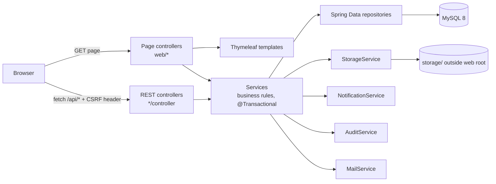
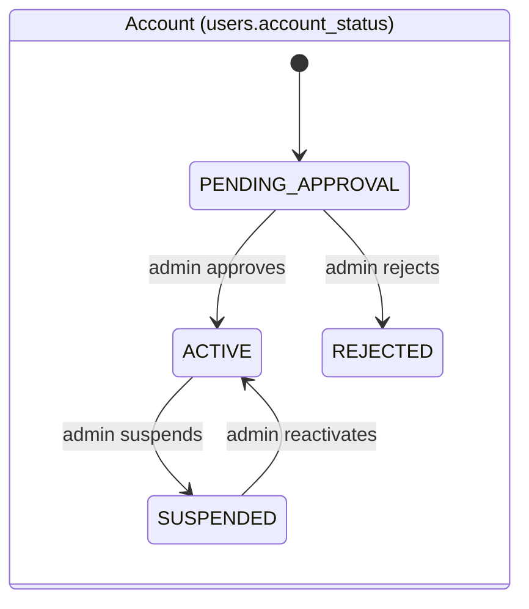
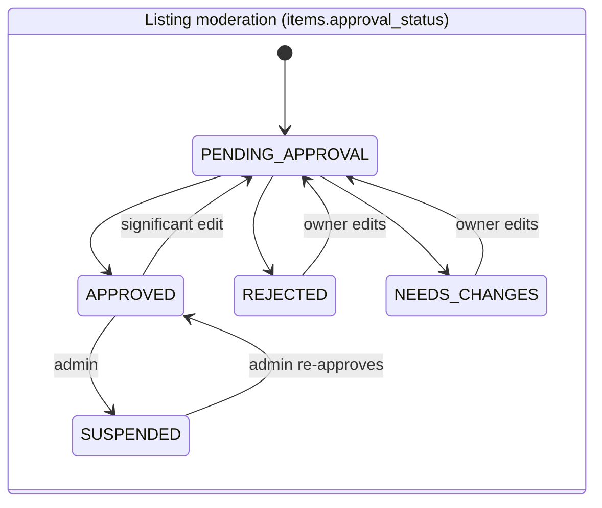
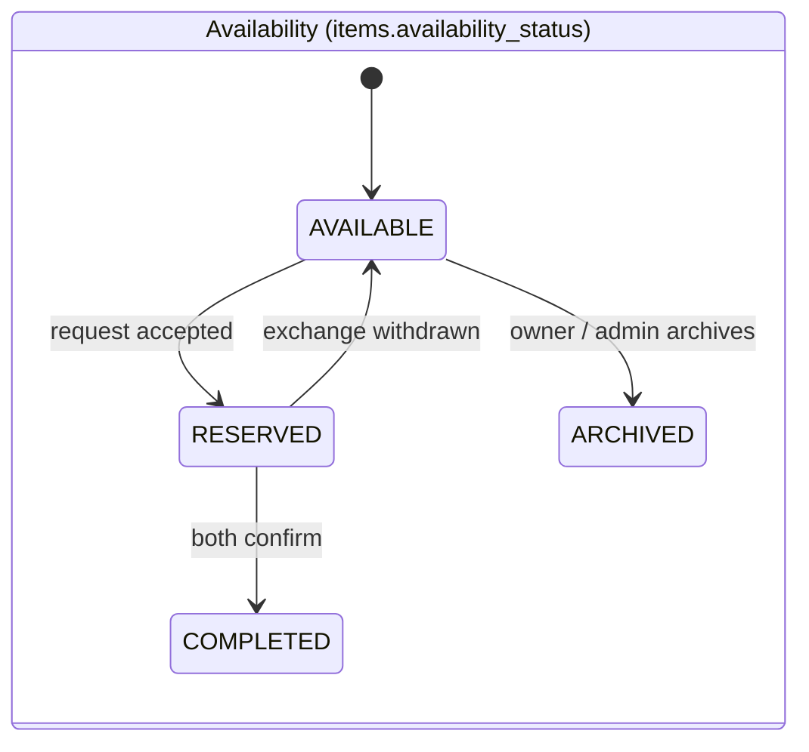

# System Architecture

## 1. Technology

| Layer | Choice |
|---|---|
| Runtime | Java 21, Spring Boot 3.5 |
| Web | Spring MVC: Thymeleaf pages plus JSON REST API under `/api` |
| Frontend | HTML5, CSS3 (one central theme), vanilla JavaScript ES modules, Fetch API |
| Persistence | MySQL 8, Spring Data JPA / Hibernate 6, Flyway migrations |
| Security | Spring Security 6: session login, BCrypt, CSRF, remember-me, method security |
| Files | `StorageService` abstraction (local disk now, S3/R2-ready) |
| E-mail | Spring Mail (SMTP) when configured, otherwise a logging fallback |
| Tests | JUnit 5, Mockito, Spring Boot Test + MockMvc against MySQL 8 |

## 2. Request flow

- **Pages** are rendered server-side with the data they need for first paint (homepage, item details). Interactive lists (explore results, dashboards, queues) are loaded by page modules through `/api`, with skeleton, empty and error states.
- **Controllers** only translate HTTP. **Services** hold every business rule and transaction boundary. **Entities** never leave the service layer; controllers return DTO records.

## 3. Packages (`com.ecoswap`)

| Package | Responsibility |
|---|---|
| `config` | Security filter chain, MVC config, storage config, typed properties |
| `common` | Exceptions plus the global API handler, response records, validation, utilities |
| `auth` | Registration, login, logout, verification, reset, remember-me, status filter, admin bootstrap, rate limiting |
| `user` | User entity, profile service and API |
| `category` | Category entity, service, public lookup |
| `item` | Items, images, search specifications, posting, editing, archiving, public queries |
| `exchange` | Exchange requests and their state machine |
| `favorite` | Saved items |
| `notification` | Notification persistence and API |
| `dashboard` | Student dashboard summary |
| `approval` | Approval history |
| `admin` | Admin APIs and services (dashboard, users, listings, exchanges, categories) |
| `report` | Student reports and admin resolution |
| `support` | Tickets and replies |
| `audit` | Append-only admin audit log |
| `impact` | Platform statistics (homepage, impact page, community) |
| `storage` | `StorageService` interface, local implementation, file validation, media endpoints |
| `web` | Page controllers, global model attributes, error views |

## 4. Status model

Three independent state machines. They are never merged into one field.

Exchange request: `PENDING → ACCEPTED → COMPLETED`; terminal alternatives are `REJECTED` (owner), `CANCELLED` (participant) and `CLOSED` (system, when the item was reserved through another request or suspended).

## 5. Security design

- Session-based authentication. Login is a JSON endpoint that checks the password **before** revealing account status, so status isn't leaked to someone guessing passwords. The session id changes on login, and failed attempts are rate-limited per e-mail.
- `AccountStatusFilter` reloads the account status on every authenticated request. A suspension takes effect immediately, even for remember-me sessions.
- Authorization: URL rules (`/admin/**`, `/api/admin/**` → ADMIN; student areas → USER) **and** `@PreAuthorize` on admin services and controllers. Ownership checks happen in services.
- CSRF: synchronizer token rendered in a `<meta>` tag and sent by `api.js` as `X-CSRF-TOKEN` on every state-changing request.
- Uploads: the type is detected from the file's magic bytes (JPEG, PNG, WebP; PDF for support attachments) with size and count limits and random storage names. Files are stored outside the web root and served only through `/media/**` controllers that check visibility and ownership.
- Headers: CSP, `X-Content-Type-Options`, `Referrer-Policy`, frame denial.
- Secrets come only from environment variables.

## 6. Storage

`StorageService` (`store`, `load`, `delete`) has one implementation, `LocalStorageService`, rooted at `ECOSWAP_STORAGE_DIR` with folders `items/`, `profiles/`, `support/` and `temporary/`. Keys look like `items/2026/11/<uuid>.webp`, and resolved paths are checked against the root to prevent traversal. An S3/R2 implementation would implement the same interface and be selected by configuration. The database only ever stores the key.
