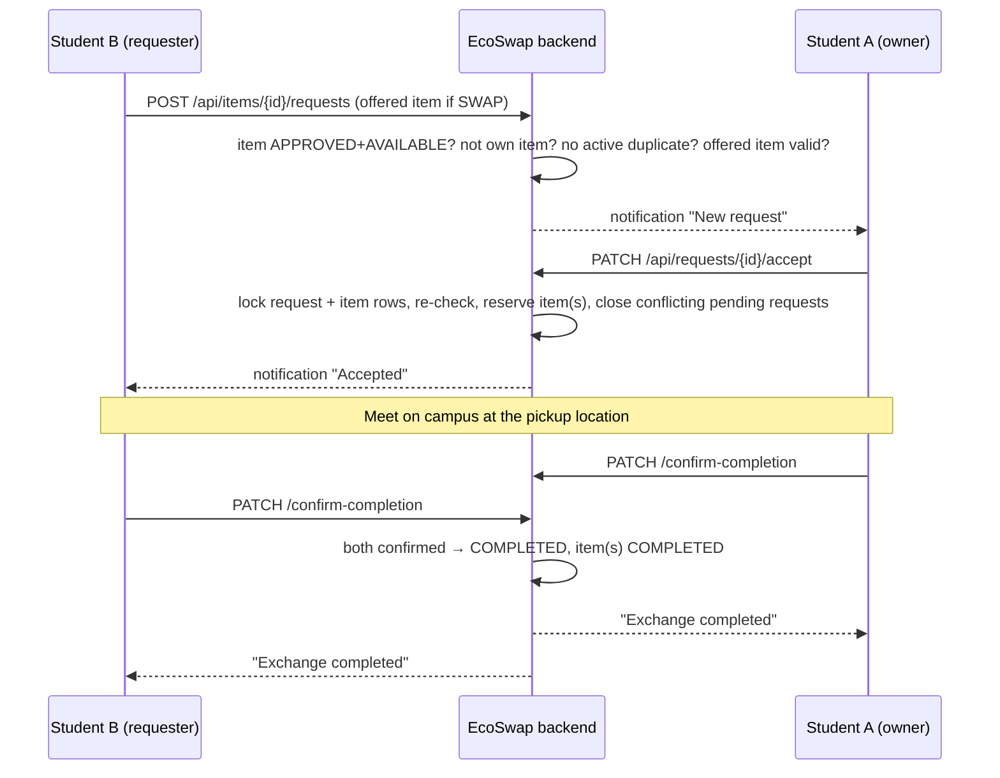

# Student Workflows

## 1. Registration and approval

```mermaid
flowchart TD
    A[Student opens /register] --> B[Full name, university e-mail, password, university, accept terms]
    B --> C{Backend validation}
    C -- invalid / duplicate e-mail --> B
    C -- valid --> D[(users: role USER, status PENDING_APPROVAL, password BCrypt)]
    D --> E[Verification e-mail sent<br/>(or link logged in dev)]
    D --> F[All admins notified]
    D --> G[/register/pending page/]
    E --> H[Student clicks link → email_verified = true]
    F --> I{Admin decision}
    I -- approve --> J[status ACTIVE + notification] --> K[Student logs in → /dashboard]
    I -- reject + reason --> L[status REJECTED + reason + notification] --> M[Login shows rejection message]
```

Login outcomes:

| Account status | Result |
|---|---|
| PENDING_APPROVAL | Redirected to the "awaiting approval" page |
| ACTIVE | Signed in (session, optional remember-me) |
| REJECTED | Blocked; the reason is shown |
| SUSPENDED | Blocked; the reason is shown. An active session is ended on the next request. |

## 2. Posting and editing a listing

```mermaid
flowchart TD
    A[/items/new] --> B[Name, category, description, condition, type, pickup, 1–6 photos, optional weight]
    B --> C{Validation: fields, image type by magic bytes, ≤5 MB, ≤6 photos}
    C -- fail --> B
    C -- ok --> D[(items: PENDING_APPROVAL / AVAILABLE)] --> E[Photos stored in storage/items, metadata in item_images]
    D --> F[Admins notified] --> G{Admin}
    G -- approve --> H[APPROVED + AVAILABLE → visible in Explore, owner notified]
    G -- reject + reason --> I[Hidden, reason shown in My Listings] --> J[Edit & resubmit → PENDING_APPROVAL]
    G -- request changes --> I
    H --> K[Owner edits name, description, category, condition, type or photos] --> D
```

Pickup location and weight changes don't need re-approval. Reserved or completed listings can't be edited. Archiving removes a listing from Explore.

## 3. Exchange



Other transitions: the owner can **reject** a pending request. The requester can **cancel** a pending request. Either participant can **withdraw** an accepted exchange (with a reason), which releases the reserved items.

## 4. Support

Help & Support → FAQ, or submit a ticket (subject, message, optional image or PDF up to 5 MB). The student gets a reference code (e.g. `ES-7K2QX9`) and can follow replies and status. Each admin reply creates a notification.
